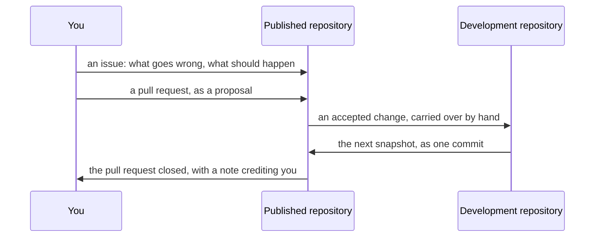

# Contributing to Kanso

**Start here to change Kanso itself**: the compiler, the libraries, the tools or the documents. If you only want to write programs in KSPL, the quick start in the root [`README.md`](../README.md) is enough. Each task below has one document to read.

The first two commands to type, once you have a C compiler and Make ([`HOWTO-build.md`](HOWTO-build.md) says how to get them):

```sh
make help        # every target you can type, one line each
make ci-linux    # every gate on Linux: run it before you propose a change
```

| To | Read |
| :-- | :-- |
| Build the compiler and have it rebuild itself, format, lint and test, on Linux, macOS or Windows without Docker | [`HOWTO-build.md`](HOWTO-build.md) |
| Know what every gate checks, and on which platform | [`SPEC-gates.md`](SPEC-gates.md) |
| Write code and documents this repository's way | [`DESIGN.md`](DESIGN.md) |
| Add or change a document (its name is its kind) | [`SPEC-documents.md`](SPEC-documents.md) |
| Find a package; each carries its own `README.md` | ["Repository layout" in `../README.md`](../README.md#-repository-layout) |
| See what is left, across packages and in each | [`PLAN.md`](PLAN.md) |
| Change the compiler | [`../ksplc/README.md`](../ksplc/README.md), then [`../ksplc/docs/DESIGN.md`](../ksplc/docs/DESIGN.md) |
| Propose a change, as an issue or a pull request | "How a change gets in" below |
| Report a security problem | [`SECURITY.md`](SECURITY.md) |

## The make targets

**`make help` lists the targets.** Every target you can type has a one-line description, because `make test-recipe-bytes` fails on a typable target without one. How to write a description is in the header of `mk/help.mk`.

Caution: **Do not copy the list into this document.** It goes out of date as soon as one target is added (Principle 4 in [`DESIGN.md`](DESIGN.md)).

The list names targets only. A variable (a setting passed as `NAME=value`) is described beside the task it serves: `LLVM=1`, `PREFIX=`, `FMT_JOBS=`, `SRC_KSPL=` in [`HOWTO-build.md`](HOWTO-build.md), and `FILE=` in [`HOWTO-set-up-a-project.md`](HOWTO-set-up-a-project.md).

## Setting your git identity

Set the name and e-mail address git records on your commits once per repository, and make git stop when none is set.

**Do not put a default identity into `~/.gitconfig`**: git would use it even in repositories where you did not mean it. Instead, follow these two steps.

1. Add the one setting that stops git unless an identity is set:

   ```ini
   # ~/.gitconfig
   [user]
   	useConfigOnly = true
   ```

2. Right after cloning, set this repository's identity:

   ```sh
   git config user.name  "<name>"
   git config user.email "<address>"
   ```

**If you forget step 2, the commit stops** with `fatal: no email was given and auto-detection is disabled`. Without `useConfigOnly`, git would build an identity from the computer's user and host names and let the commit through, silently wrong.

`git config --show-origin --show-scope user.email` shows where an identity comes from. **If `$HOME` differs between MSYS2 and Windows, each reads a different `.gitconfig`**, so run it from both shells. To switch identity per folder, use `~/.gitconfig`'s `includeIf "gitdir/i:<folder>/"`, still with no default.

## Reading a document's diff

**Read a document's diff with `--word-diff`** (`git diff --word-diff`). A paragraph is one line ("Wording and formatting rules" in [`SPEC-documents.md`](SPEC-documents.md)), so a plain diff shows a one-word fix as a whole line replaced. It needs no setting, since git splits words at whitespace. The changed word then shows inside the line:

```
| **rule** | A settled [-decision.-]{+verdict.+} Not a suggestion |
```

## How a change gets in

**A pull request in the published repository is read as a proposal, not merged.** The published repository is a snapshot of the one Kanso is developed in, taken whole into one commit each time. An accepted change is carried into the development repository by hand, and comes back with the next snapshot. Merged in the published repository, it would sit on a history that the next snapshot does not contain.

The path of a change, from you to the published repository and back:



* **Open an issue first** for anything beyond a small fix: what goes wrong now, and what should happen instead. It settles whether a change is wanted before anyone works on it.
* **A pull request is welcome as a proposal.** It is read, and an accepted change arrives with the next snapshot. The pull request is then closed with a note saying so. The note credits its author, since a snapshot's one commit names no one else.
* **Run the gates before proposing.** A change must pass the same gates as everything else (`make ci-linux` on Linux; each platform's set is in [`SPEC-gates.md`](SPEC-gates.md)).

## How AI-written work is handled

**Kanso is developed with AI coding agents, and the gates check what they write like any other change.** Work made with AI **carries the same license** ([`LICENSE.md`](../LICENSE.md)'s MIT), and whoever submits it answers for its content, as for any change.

Caution: **Read it yourself before submitting.** Generated code can closely resemble somebody else's, and once it is merged, nobody looks at it.

Review covers more than whether it works: the conventions in [`DESIGN.md`](DESIGN.md) and [`SPEC-documents.md`](SPEC-documents.md) apply to what AI wrote as well. **Borrowed weights and models are separate from the code**: a converted model file keeps the original's license ("How borrowed models are handled" in [`tools/ai_assist/README.md`](../tools/ai_assist/README.md)).

## Further reading

Beyond the table above:

* [`README.md`](README.md) — the documents that belong to no single package, and which reader each is for.
* [`../README.md`](../README.md) — the front door: what Kanso is, how far it works, and where everything is.
