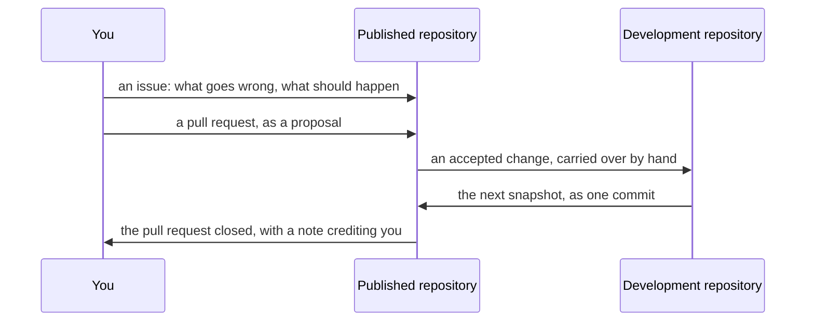

# Contributing to Kanso

**Start here to change Kanso itself**: the compiler, the libraries, the tools or the documents. If you only want to write programs in KSPL, the quick start in the root [`README.md`](../README.md) is enough.

Install a C compiler and Make as described in [`HOWTO-build.md`](HOWTO-build.md). Then run these commands:

```sh
make help        # every target you can type, one line each
make ci          # every gate this machine runs: run it before you propose a change
```

**Use the table in [`README.md`](README.md) to find a document for your task.** It covers building, gates, principles, document rules, plans and security reports. These three starting points are outside that table:

| To | Read |
| :-- | :-- |
| Find a package; each carries its own `README.md` | ["Repository layout" in `../README.md`](../README.md#-repository-layout) |
| Change the compiler | [`../ksplc/README.md`](../ksplc/README.md) |
| Propose a change, as an issue or a pull request | "How a change gets in" below |

## The make targets

**`make help` lists the targets.** Every available target has a one-line description. `make test-recipe-bytes` fails when a target lacks one. How to write a description is in the header of `mk/help.mk`.

Caution: **Do not copy the list into this document.** Adding a target would make the copy outdated (Principle 4 in [`DESIGN-principles.md`](DESIGN-principles.md)).

The list names targets only. A variable is a setting passed as `NAME=value`. Each task describes its variables: `LLVM=1`, `PREFIX=`, `FMT_JOBS=`, `SRC_KSPL=` in [`HOWTO-build.md`](HOWTO-build.md), and `FILE=` in [`HOWTO-set-up-a-project.md`](HOWTO-set-up-a-project.md).

## Setting your git identity

Set your commit name and e-mail address for each repository. Configure git to stop when no identity is set.

**Do not put a default identity into `~/.gitconfig`.** Git would use it even in repositories where you want another identity. Follow these steps:

1. Add the one setting that stops git unless an identity is set:

   ```ini
   # ~/.gitconfig
   [user]
   	useConfigOnly = true
   ```

2. Right after cloning, set this repository's identity:

   ```sh
   git config user.name  "<name>"
   git config user.email "<address>"
   ```

**If you forget step 2, the commit stops** with `fatal: no email was given and auto-detection is disabled`. Without `useConfigOnly`, git constructs an identity from the computer's user and host names. It accepts the commit without checking that identity.

`git config --show-origin --show-scope user.email` shows where an identity comes from. **If `$HOME` differs between MSYS2 and Windows, each reads a different `.gitconfig`.** Run the command from both shells. To switch identity per folder, use `~/.gitconfig`'s `includeIf "gitdir/i:<folder>/"`, still with no default.

## Reading a document's diff

**Read a document's diff with `--word-diff`** (`git diff --word-diff`). A paragraph occupies one line ("Wording and formatting rules" in [`SPEC-documents.md`](SPEC-documents.md)). A plain diff therefore marks the whole line as replaced for a one-word edit. No setting is needed: git splits words at whitespace. The changed word then shows inside the line:

```
| **rule** | A settled [-decision.-]{+verdict.+} Not a suggestion |
```

## How a change gets in

**The maintainers review pull requests in the published repository as proposals.** They do not merge them there. Each publication copies the development repository into one snapshot commit. Maintainers apply accepted changes to the development repository by hand. The next snapshot includes those changes. Merging into the published repository would create history that the next snapshot omits.

The path of a change, from you to the published repository and back:



* **Open an issue first** for anything beyond a small fix. Describe the problem and the expected result. This lets maintainers decide whether they want the change before work starts.
* **Submit a pull request as a proposal.** Maintainers review it and include accepted changes in the next snapshot. They then close the pull request with a note crediting its author. A snapshot commit does not name each contributor.
* **Run the gates before proposing a change.** Every change must pass the applicable gates. Run `make ci`. Outside Linux, also run it in the dev container to cover the Linux-only gates. [`SPEC-gates.md`](SPEC-gates.md) lists each platform's gates.

## How AI-written work is handled

**Kanso uses AI coding agents for development.** The gates check their work like any other change. AI-written work **carries the same MIT license** ([`LICENSE.md`](../LICENSE.md)). Whoever submits it is responsible for its content.

Caution: **Read it yourself before submitting.** Generated code can closely resemble another author's code. Do not rely on someone reviewing it after the merge.

Review also covers the conventions in [`DESIGN-principles.md`](DESIGN-principles.md) and [`SPEC-documents.md`](SPEC-documents.md). These apply to AI-written work too. **Borrowed weights and models are separate from the code**: a converted model file keeps the original's license ("How borrowed models are handled" in [`tools/ai_assist/README.md`](../tools/ai_assist/README.md)).

## Further reading

* [`README.md`](README.md) — the documents that belong to no single package, and which reader each is for.
* [`../README.md`](../README.md) — the entry point: what Kanso is, what works, and where everything is.
