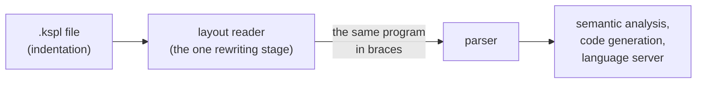
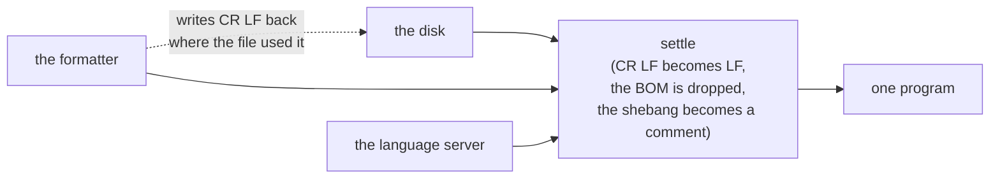
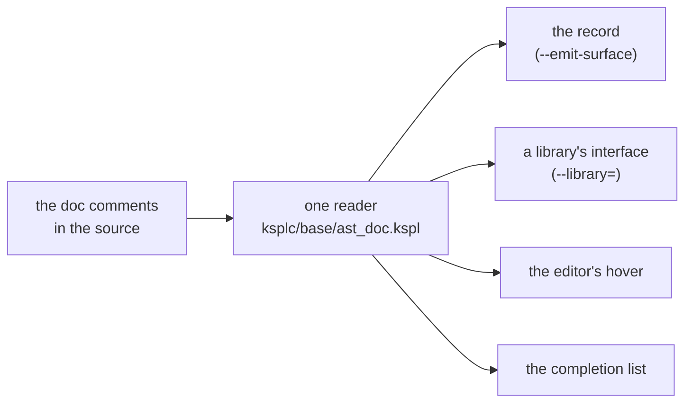

# The rationale behind KSPL's notation

**This document says why KSPL source is written the way it is.** It covers blocks by indentation, names, keywords, line ends, long strings and documentation comments. The rest of the language's rationale is in [`DESIGN-programming-language.md`](DESIGN-programming-language.md). What the language *is* belongs to [`SPEC-programming-language.md`](SPEC-programming-language.md).

## The indentation notation (`.kspl`)

**KSPL source is written by indentation, in `.kspl` files.** Indenting, dedenting and the end of a line say where a block opens and closes and where a statement ends:

```kspl
priv fn sign(n: I32): I32
    if n < 0
        return -1
    return 1
```

The rules are "2.5 Blocks and statement ends" in [`SPEC-programming-language.md`](SPEC-programming-language.md); this chapter holds why. A reader in the compiler ([`../ksplc/parse/layout.kspl`](../ksplc/parse/layout.kspl)) rewrites indentation into braces before parsing ("Only one stage rewrites, and only before the parser"). **The braces are the parser's representation, not a second way to write.** No command takes a `.ksplb` file; that name is kept for brace text in the parser's own tests. The formatter writes only `.kspl`, and an `import` names only `.kspl`.

**One notation, through the decision order of the chapter "One notation per purpose" in [`DESIGN-principles.md`](DESIGN-principles.md):**

1. **The meanings coincide exactly**, so a second notation adds no program that could not be written.
2. **Actual use is all indentation.** Braces are left only in parser test material.
3. **A second public notation costs on every side.** It needs a converter both ways and a gate holding the round trip. It needs an `import` that probes the disk for either file, and an editor that tells two languages apart.

**A test can need to show what the parser alone does**, such as a diagnostic naming a `{`. Such a test hands brace text to the parser directly, through a program of its own in `ksplc/tests/prog/`.

### What disappears, and what does not

**Only the braces around a block and the `;` that ends a statement (blocks and terminators) disappear.** Every other brace or `;` (in a struct literal, for example) stays as written. The table is in "2.5 Blocks and statement ends" of [`SPEC-programming-language.md`](SPEC-programming-language.md).

Note: **The grammar names them too**: `Block_open` / `Block_close` / `Stmt_end`, listed in the header of [`../ksplc/kspl.kspeg`](../ksplc/kspl.kspeg). How that list is kept in step is "Keeping the grammar and the AST node kinds in step" in [`../ksplc/docs/DESIGN-compiler.md`](../ksplc/docs/DESIGN-compiler.md).

**No mark (`:`) is placed on a block's heading.** KSPL's `:` already serves type annotations and labels. A wrapped line and a block are told apart by how they are written. Python's rule "a line wraps only inside brackets" is not enough, because the formatter also wraps outside brackets (a line starting `.s(…)`).

**`catch` is the one word that both continues a line and opens a block, so the column decides.** A line is never broken after `catch`: the handler would read as the block's first statement. `ksplc fmt` refuses that break and runs past the width instead ("The formatting settings (`--style`)" in [`../ksplc/docs/SPEC-tools.md`](../ksplc/docs/SPEC-tools.md)). `ksplc/tests/notation/tutorial.kspl` carries the shape.

### How a column is read

**A line belongs to a block when it is indented deeper than the block's heading.** Only the heading's column is stacked (`Frame` in `ksplc/parse/layout.kspl`), so any indent width works, and widths can mix in one file. All the lines of one block must still start at the same column.

**A depth matching no block would otherwise enter the inner block.** Take a heading at column 2 and a body at column 6:

```text
  if ready        ← the heading, at column 2
      start()     ← the body, at column 6
    stop()        ← column 4: refused
```

By the heading's column alone, the line at 4 would join the block, while a person reads it as outside. **So it is refused.** KSPL compares the line with the block's own members. Wrapping stays free, since a continuation line is folded into its logical line first.

* **The refusal carries no diagnostic code.** A code can be switched off, and what would go quiet is a difference in what runs ("1. Diagnostic codes, and the errors that have none" in [`../ksplc/docs/SPEC-diagnostics.md`](../ksplc/docs/SPEC-diagnostics.md)).
* `ksplc fmt` rebuilds the columns, so no formatted source meets it.
* The compiler prints it once, with every other diagnostic ("Every place a source enters reads it the same way" in [`../ksplc/docs/DESIGN-parse.md`](../ksplc/docs/DESIGN-parse.md)).

**Only a space counts as a column** ("2.5 Blocks and statement ends" in [`SPEC-programming-language.md`](SPEC-programming-language.md)). A tab's width is an editor setting, so a line could line up on screen while the columns differ. The tab gets no diagnostic code, since a syntax error comes first; `ksplc/tests/layout_test.kspl` pins that.

Note: **Japanese input most easily slips in the ideographic space** (U+3000). The line looks correctly indented, so `odd_indent_name` in `ksplc/parse/syntax_msg.kspl` adds a Note naming the character.

**A lone `return`, `throw` or `fallback`, and a `!` at a line's end, end the statement.** A `!` at the start of a line continues one (a wrapped `T!E`).

**A value that splits where no mark continues it goes in parentheses.** In a conditional value (`a if c else b`), an `if` / `else` at a line's head or end reads as a statement's heading. In the value of a `return` / `throw` / `fallback`, the keyword alone is a bare statement. A newline inside brackets never starts a level, so parentheses carry either value.

| Question | Answer |
| :-- | :-- |
| **Why not a word-keyed rule for each?** | Three such rules would be needed, and a writer would have to know which break points are read back. Products that key exceptions on a line's leading word keep adding to the list |
| **Why does the value still come first?** | A condition-first form (`if c then a else b`) would put `if` at a line's head, the misreading this rule removes |
| **Who writes the parentheses?** | `ksplc fmt`, which breaks between the choices, never between an `if` and its condition (`paren_spans` in [`../ksplc/fmt/printer.kspl`](../ksplc/fmt/printer.kspl)) |
| **What if a writer breaks outside the brackets?** | It is refused, and the message names the parentheses (`append_split_value_hint` in [`../ksplc/parse/syntax_msg.kspl`](../ksplc/parse/syntax_msg.kspl); cases `laid_choice_split_*` in `ksplc/tests/negative/laid.kspl`) |

### The forms whose notation is fixed

The rules are "2.5 Blocks and statement ends" in [`SPEC-programming-language.md`](SPEC-programming-language.md); this section holds why.

**A bare block carries a label**, because a block with no heading cannot be told from a continuation of the previous statement. A bare block exists so that something runs on exit, and that becomes the name (`release_on_exit` / `while_locked`). A meaningless name (`scope1`) hides the reason. `stmt` does not use `stmt_block` (`ksplc/kspl.kspeg`), so a bare block does not parse, and the message names the label to add (the case `bare_block_without_label` in `ksplc/tests/parse/syntax.ksplb`). A `break` to `_` is refused (the case `break_to_no_name_label` in `ksplc/tests/negative/control.kspl`).

**Why two forms keep their braces in `.kspl`**:

| Form | Why it keeps its braces |
| :-- | :-- |
| **A closure with a multi-line body inside a call's arguments** | A newline inside brackets does not become a block |
| **An empty block, and a block fitting on one line** | Indentation cannot say "there are no contents". No word such as Python's `pass` is added, since the braces already say it (Principles 1 and 6) |

**Such a block needs no `;` on its last statement.** The heading word tells it apart from a value such as `T::{ … }`. The reader supplies the `;` before a `}` on the same line (`supply_block_end` in [`../ksplc/parse/layout.kspl`](../ksplc/parse/layout.kspl)), so no line break changes what a statement means. `ksplc fmt` leaves the `;` out.

### Statements sharing a line

**A `;` outside every bracket ends a statement, so one line holds any number of statements and declarations, a whole program included** (`import "std/io"; fn main() { … }`). A program sometimes has to fit where no line break can go: a command-line argument, a JSON string, an HTML attribute, a chat message.

* **It is not a second notation.** The `;` is the separator the notation already had, and `ksplc fmt` puts each statement back on a line of its own.
* **One-line blocks nest**, so a loop inside a condition inside a function fits on one line.
* **The heading is the last statement's** (`seg_from` in [`../ksplc/parse/layout.kspl`](../ksplc/parse/layout.kspl)).
* **A C-style loop header keeps its `;`** until the loop's block has closed, even where the header is continued onto a line of its own.

**A `;` right after a one-line block's `}` is refused, with no code.** The `}` already ended the statement, so `};` would be a second spelling (Principle 6). Writers from C or JavaScript, and models, type it by habit, so the message names the cause and the fix. A `catch` block ends no statement, so its `;` stays.

**A program with no file is read as a file named `-` in the current folder** (`ksplc run -` or `--eval=`; "2.5 Running as a script (ksplc run)" in [`../ksplc/docs/SPEC-tools.md`](../ksplc/docs/SPEC-tools.md)). A relative import then resolves from where the command runs.

### No lines are added, and `switch` gets no block

**The rewriting into braces never adds or removes a line, so line numbers agree with the file as written.** **Columns shift only at the end of a line**, so the columns before an end-of-line comment do not change. **The `;` a one-line block leaves out stands in the space before its `}`.** With no space there, the rest of that line reads one column late until `ksplc fmt` adds it.

**Do not make a block under `switch`.** `switch` carries no braces (its `case` and `default` do), so every arm stands at the `switch`'s column. **The first arm goes below the `switch`, not on its line**:

* **The arms line up**, so a search for `^ *case` finds each.
* **A change to one arm touches that arm's lines alone**, so a diff shows only the arms that changed.
* **A long subject and a long first pattern do not share a line.**

**So the `switch`'s line takes no terminator and goes on into a `case` at its own column** (`arms_follow` in [`../ksplc/parse/layout.kspl`](../ksplc/parse/layout.kspl)). A comment written over the first arm stays there.

* **A `case` indented under the `switch` is refused** ("Do not align with Python" below), and the Note says where the arms go (the cases `switch_arms_in_a_block` in `../ksplc/tests/parse/syntax.ksplb` and `laid_switch_case_indented` in `../ksplc/tests/negative/laid.kspl`).
* **A shallower `case` belongs to the level outside** ("How a column is read").
* **Only a `case` continues it**, so a `default` standing first is a compile error.

**The one-line form is still read, and `ksplc fmt` writes the arm below.** **An empty arm (`case .a {}`) keeps a line of its own too**, so the next arm stays findable.

**Do not align with Python.** Python's `match` carries a block of its own, while KSPL's `switch` has no brace there. A level would create a block where no brace exists, and the arms would stand at two columns.

### Only one stage rewrites, and only before the parser

**The compiler turns `.kspl` into braces in one early step, before the parser, and only that step rewrites anything** ([`../ksplc/parse/layout.kspl`](../ksplc/parse/layout.kspl)). The grammar, the syntax tree, code generation and the language server see one notation only.



**The rewriting runs exactly once at each place a source enters**: from the disk and from the editor. The compiler holds that ("Every place a source enters reads it the same way" in [`../ksplc/docs/DESIGN-parse.md`](../ksplc/docs/DESIGN-parse.md)).

**An import names a `.kspl` file, and a logical name drops that extension** ("9.1 import syntax and path resolution" in [`SPEC-programming-language.md`](SPEC-programming-language.md)). Where a logical name is written out again, `.kspl` is added back. Both read one constant, `SOURCE_EXT` in [`../ksplc/base/core.kspl`](../ksplc/base/core.kspl).

Note: `make test-notation` watches that a CRLF file is the same program as with LF, and that squiggles, hovers and jumps point at the lines as written.

### Formatting

**`ksplc fmt` rewrites indentation from scratch, from the syntax tree, so formatting erases raggedness.** Unintended raggedness shows as a diff, lined up the way the compiler understood it. `make test-fmt-tree` formats every tracked source and fails where one byte would change.

Note: So the ragged column's test material (the case `laid_ragged_sibling` in `../ksplc/tests/negative/laid.kspl`) sits where the formatting gate does not reach (`mk/lint.mk`).

**A comment behind a block's last line stays inside the block.** The reader puts a block's `}` behind that line's code, so the comment is passed back to the line it follows (`pull_trailing_comment` in [`../ksplc/fmt/trivia.kspl`](../ksplc/fmt/trivia.kspl)).

## How the source text is written

**Nothing this chapter decides changes what a program does**, and a gate, not habit, holds each rule.

### Prefix a name only when it cannot state its origin

Write `io.out()` when `out` alone would be unclear, and plain `Arena` when the name already says what it is. A prefix is **part of the name, showing at the use site**. Where the name alone says what the thing is, the prefix says it twice; where it does not, fix the name.

**A name can enter the unprefixed space (selective import, `import "…" { Name }`; docs/SPEC-programming-language.md §9) only if all three hold:**

| # | Condition | Passes | Fails |
| :-- | :-- | :-- | :-- |
| 1 | **Its spelling says what the thing is** | `Arena`, `Tensor`, `Option`, `Str_builder` | `Node`, `Value`, `Entry`, `Config`, `run`, `init`, `out` |
| 2 | **Its spelling is unique across the program** | — | A colliding name cannot enter, since a collision is a compile error |
| 3 | **Its origin carries no design information** | A name from `ksplc/base/` or `std/` | A reference crossing `ksplc/`'s layers, which carries the layer in its name (`Sema_ctx`, `Genc_ctx`) |

**A name's spelling is fixed once per name, not per file.** `mod.Name` in one place and `Name` in another is one thing written two ways ("One notation per purpose" in [`DESIGN-principles.md`](DESIGN-principles.md)). The conditions apply to types and functions alike.

**What is given up**: an unprefixed name loses its origin at the use site; the reader finds it on the file's `import` lines. Condition 2 breaks when the spelling appears elsewhere, always as a compile error.

### The spelling of reserved words is taken from C

**Where a keyword does C's job, it uses C's word (`switch`, `for`, `typedef`), even when it behaves a little differently.** `switch` does not fall through, and `for` covers C's `for` / `while` / `do-while` and sequence iteration in one word (`docs/SPEC-programming-language.md`, 7.1 and 7.2).

1. **The names left to a writer do not shrink.** C's reserved words are usable as identifiers in KSPL (`docs/SPEC-programming-language.md`, 2.2), so C's spelling takes no new word. `match` and `loop` are nouns a writer needs.
2. **The reader does not look it up again.** A reader of C reads `switch` and `for` on sight.

**Being one word and being spelled `for` are separate decisions.** The first follows from "every repetition serves the same purpose" (`docs/SPEC-programming-language.md`, 7.2), as Go's single `for` does.

**One word costs the checks nothing.** Whether a loop ends is read from its shape: a `for` with no condition that no `break` leaves never ends (`docs/SPEC-programming-language.md`, 7.2). The missing-return check and the unreachable-code warning read one judgement (`is_endless_loop` in `ksplc/base/ast_ext.kspl`), so they cannot disagree.

* **A constant `true` is a condition.** `for true` gets a warning, whose fix is the bare `for`.
* **The shape spares the writer a dead `return`** after an endless loop.

**Another name for a type is `typedef`, name first** (`typedef Id = I32`; `docs/SPEC-programming-language.md`, 3.5). The job is exactly C's: a KSPL typedef is only another name (["A typedef is only another name"](DESIGN-programming-language.md#a-typedef-is-only-another-name)). C puts the name where a variable's name would stand (`typedef int Id;`). KSPL writes a type whole, so it puts the name first, as Rust, Swift and Go do. `alias` and `type` stay free for a writer.

**What is given up**: `typedef` reads as "define a type" and defines none. A C writer's `typedef I32 Id;` fails with a note writing KSPL's order (`append_typedef_spelling_hint` in `ksplc/parse/syntax_msg.kspl`).

Caution: **Where the spelling is the same but the behavior differs, the specification must say so by name.** Silence lets the reading "presumably the same" through (`docs/SPEC-programming-language.md`, 7.1 names that `switch` does not fall through).

### When an abbreviation is useful

**An abbreviation earns its place through frequent use or an established meaning.** `len`, `str`, `buf` and `fmt` are familiar, and `Rc` and `Arc` name established ownership patterns. Less familiar public names use full words: `Conversion`, `Options`, and JSON's `Value`, `Array` and `Object_builder`.

### Why the size type is named `Sz`

**`Sz` keeps common type annotations short and text searches distinct.** Lengths and indices occur often, so `count: Sz` stays compact beside `I32` and `U64`. `Size` stays free as a domain name, and a search for `Sz` rarely finds unrelated identifiers.

**What is given up**: a new reader must learn the abbreviation. Its width is in "3.1 Primitive types" in [`SPEC-programming-language.md`](SPEC-programming-language.md#31-primitive-types). Why it is signed is "Why the size and index type `Sz` is signed" in [`DESIGN-programming-language.md`](DESIGN-programming-language.md#why-the-size-and-index-type-sz-is-signed).

### Why constants are uppercase and enum variants lowercase

**An uppercase constant name states its role where it is used**, so `MAX_BUFFER_SIZE` reads as a constant without its declaration. Ordinary immutable bindings stay lowercase, since immutability is the default. An enum variant's context already identifies it, so `.not_found` and `.some(value)` need no second mark.

**What is given up**: changing a value between a constant and a binding renames it. The rules are "2.2 Identifiers and naming rules" in [`SPEC-programming-language.md`](SPEC-programming-language.md#22-identifiers-and-naming-rules).

### The line terminator is the file's spelling, not the program's

**A file saved with Windows line ends (`\r\n`) compiles to exactly the same program as one saved with `\n`.** Every `\r\n` becomes `\n` where the source enters (`to_lf` in [`../ksplc/parse/source_fix.kspl`](../ksplc/parse/source_fix.kspl)). The BOM and the shebang (`#!` line) are handled there too. A `"""` text keeps its bytes, so otherwise one source would be two programs, and both checkouts would build and disagree.

**Writing it back is the other half.** `ksplc fmt` writes `\r\n` back where the file used it, as it does the BOM ("The formatting settings" in [`../ksplc/docs/SPEC-tools.md`](../ksplc/docs/SPEC-tools.md)). So a Windows checkout does not show every line as changed.



**Every place a source enters takes this step**, through one function, `settle` in [`../ksplc/parse/source_fix.kspl`](../ksplc/parse/source_fix.kspl). The places are listed in "Every place a source enters reads it the same way" in [`../ksplc/docs/DESIGN-parse.md`](../ksplc/docs/DESIGN-parse.md).

**What a program writes is the output half of the same question** ("Standard output carries the bytes a program writes" in [`DESIGN-programming-language.md`](DESIGN-programming-language.md)).

### Carrying a long string literal across lines

End a line inside a string with `\` to continue the string on the next line. The `\`, the line break and the next line's indent add no bytes ("Escape sequences" in [`SPEC-programming-language.md`](SPEC-programming-language.md)).

**A string literal is the one thing on a line a formatter cannot narrow by itself**, because its bytes are the program. With the `\` seam, indenting moves no byte, and `ksplc fmt` lays a literal out like anything else. What is carried on stands one step in from its opening line.

```kspl
priv const HELP: U8[] = "usage: tool [options] <file>, \
    where options come before the file"
```

**A mark, not two literals side by side.** With adjacent literals joined (`"a" "b"`), a forgotten comma in `::{ "a"` / `"b" }` would compile as a one-element array. In KSPL it is a syntax error. Turning a refusal into a silent merge is what Principle 8 refuses.

**Nor is `+` the spare path.** `"one" + "two"` is refused (*slices have no arithmetic or ordering*). Reopening it for literals would give `+` two meanings (Principle 6).

**The space at the seam cannot be seen**, so only the formatter writes a seam. One edited by hand makes `make test-fmt-tree` show the file as changed.

**KSPL formats around what it cannot narrow rather than going quiet.** What stays over the width has no seam ("The formatting settings" in [`../ksplc/docs/SPEC-tools.md`](../ksplc/docs/SPEC-tools.md)):

* a literal with no space (a URL, a JSON fixture);
* a literal whose only spaces are inside a `\{ … \}`;
* a word longer than the line;
* an overrun that is not a literal.

**The formatter counts bytes and the width check counts display columns**, so a line of CJK text breaks early. That is safe, since a character never takes more columns than bytes. The one measure is what `write_raw` in [`../ksplc/fmt/printer.kspl`](../ksplc/fmt/printer.kspl) counts.

### The documentation a declaration carries

A documentation comment starts with `//<` and stands on the line of what it describes, or just below it. Its first line is a one-line summary, and the detail starts on the next line.

```kspl
priv struct Window //< a rectangle on the screen
    //< Its origin is the top-left corner, and every size is in pixels.
    width: I32 //< how wide it is
    height: I32 //< how tall it is
```

**One marker, `//<`, describes the thing on its own line, and the first line of its run is the summary.** Where each kind of declaration takes it is "2.1 Comments" in [`SPEC-programming-language.md`](SPEC-programming-language.md). `Rule_prof` in `kspeg/engine.kspl` shows a summary with its detail below, and `Mode` in `ksplc/main.kspl` the anchor shape (an empty `//<` on the declaration's line, the description below).

**The description sits behind the thing it describes.** So no name is written twice, and a renamed parameter takes its description along. Prose in front would push the signature down, which is why Python puts its docstring after the `def` line.

**A run stands one step in** from the line it continues. (A *run* is a description's lines of `//<` one after another.) At the declaration's column, it would look like a comment over the *next* declaration. Where the declaration has braces, the run goes inside them. The linter holds this (`[H0807]`).

**The line boundary ends the summary.** A first sentence cut at a `.` is a guess that lands at `e.g.` or inside version numbers. An empty line after the summary is a separator the writer must remember. So the summary is the run's first line. `ksplc fmt` removes an empty `//<` right below a summary; further down, one parts two paragraphs of the detail.

**The summary is one line that says what the thing is.** The hover, the completion list and `ksplc doc` open with it. The compiler warns about a summary that opens with a `Caution:` or `Note:` label (`[W0213]`, in [`../ksplc/docs/SPEC-diagnostics.md`](../ksplc/docs/SPEC-diagnostics.md)).

**Where the head closes on a later line, the run hangs off that line**, or it would read as the last parameter's.

**A description longer than one line stands below a mark with no text.** One that fits stays on the line. Length decides the shape, so it is one rule. `ksplc fmt` moves a description that does not fit into the anchor shape, never the reverse ("The formatting settings" in [`../ksplc/docs/SPEC-tools.md`](../ksplc/docs/SPEC-tools.md)).

**The run is joined onto one line** in the record of the published API ("The published API is recorded in the repository" in [`DESIGN-repository.md`](DESIGN-repository.md)). The record and the hover read the same words whichever shape the source has. A full stop is put in after a summary that does not already close a sentence.

**A continuation that continues nothing, and an anchor with nothing under it, are refused.** The first reaches neither the hover nor the record, and the second publishes an empty entry (Principle 5). Both are compiler warnings (`[W0209]` and `[W0210]` in [`../ksplc/docs/SPEC-diagnostics.md`](../ksplc/docs/SPEC-diagnostics.md)), asked through the reader's own function (Principle 4).

**No third marker is added for a description below the code.** Written the wrong way round, a "the code above me" mark attaches the description to the neighbouring field, and nothing reports it (Principle 8).

**`///` is refused rather than read, and `//<` is not respelled `///` either.** Every product with `///` points it at the thing *after* it, so a writer from Rust, Swift, C# or Zig types it before the declaration. Read as the contents, the sentence would land on the wrong thing. Read as nothing, it would vanish. Given `//<`'s meaning, the same spelling would point the opposite way. So `///` is a compiler warning (`[W0212]`), as is `//!`. Four slashes or more make an ordinary comment.

**Three things hold this up, none of them new grammar.**

* **`//<` is an ordinary line comment**, so editors and `grep` keep working on it.
* **`fmt` keeps the shape.** A signature broken one parameter per line stays broken, the trailing comma deciding it.
* **One reader serves four consumers.** The record (`ksplc doc --emit-surface`'s fourth column), a library's interface (`--library=`), the hover and the completion list all read `ksplc/base/ast_doc.kspl` (Principle 6).



**Every published entry says what it is.** A silent entry still matches its API, so `make test-surface` names each entry with no fourth column.

Caution: **Count against the current shape, not against the record.** A declaration added and published in the same round has no row yet, and would be let through.

**The detail does not travel to a declaration file**; only the summary does. The six-line cap on the detail is the linter's (`[H0806]`). A parameter's description is for the source and the editor, read by `param_docs` and, for the return value, `return_doc`.

**Do not add a third marker for "the file as a whole"** (Principle 6). A file says what it is with the same `//<`, above its imports, with nothing over it but blank lines. The linter reports a banner over the run (`[H0808]`).

**The run takes what a *caller* needs, and the banner below it keeps what an *editor* needs.**

| Who reads | What they need | Where it goes |
| :-- | :-- | :-- |
| A caller | What is in here, what it costs, what it refuses | The `//<` run |
| Someone editing the file | Which import must not be added, which shape must not be folded; any table or worked example | The banner (ordinary comments) below the run |

The run does not restate the file's name, which `ksplc doc` already shows beside it.

### A function of one enum is its method

**A function whose first parameter is an enum declared in the same file is written as that enum's method, taking `Self`.** So you call `state.text()`, not `state_text(state)`. What an enum does is found where the enum is, and the call reads in the order the value flows.

**An enum of another file or package is left out.** Its `impl` would hold another package's reading of it, against the reference direction ("What crosses a package boundary" in [`DESIGN-repository.md`](DESIGN-repository.md)).

**The language allows both shapes; the linter reports the free function** (`[I0503]`, in [`../ksplc/docs/SPEC-diagnostics.md`](../ksplc/docs/SPEC-diagnostics.md)). It reports only an enum taken by value as the first parameter; review judges a pointer or a slice of it (Principle 8).
