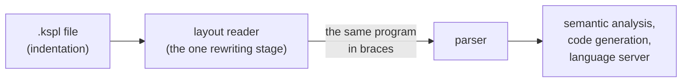
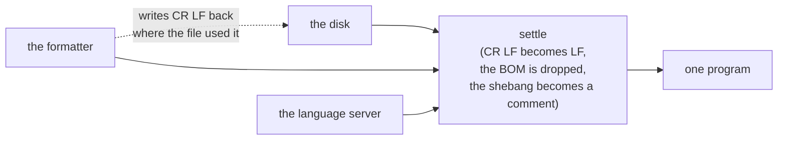
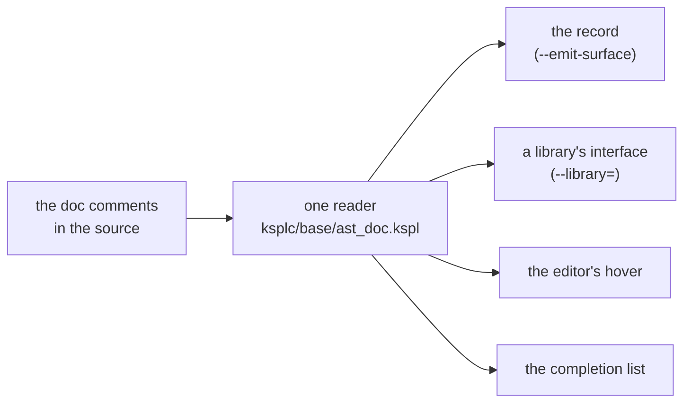

# The rationale behind KSPL's notation

**This document says why KSPL source is written the way it is.** It says why blocks are written by indentation in `.kspl` files. It says how names, keywords, line ends, long strings and documentation comments are written. The rest of the language's rationale is in [`DESIGN-programming-language.md`](DESIGN-programming-language.md): its symbols, types, traits, function values, ownership, concurrency, visibility and the boundary with C. What the language *is* belongs to the specification, [`SPEC-programming-language.md`](SPEC-programming-language.md).

## The indentation notation (`.kspl`)

**KSPL source is written by indentation, in `.kspl` files.** Indenting, dedenting and the end of a line say where a block opens and closes and where a statement ends:

```kspl
priv fn sign(n: I32): I32
    if n < 0
        return -1
    return 1
```

The rules are "2.5 Blocks and statement ends" in [`SPEC-programming-language.md`](SPEC-programming-language.md). This chapter holds why there is one notation and why its rules are what they are. A reader in the compiler ([`../ksplc/parse/layout.kspl`](../ksplc/parse/layout.kspl)) rewrites indentation into braces before parsing ("Only one stage rewrites, and only before the parser"). **The braces are the parser's representation, not a second way to write.** No command takes a `.ksplb` file. (That name is kept for brace text, which only the parser's own tests write.) The formatter writes only `.kspl`, and an `import` names only `.kspl`. The grammar holds, in the names of its rules, which symbols that reader replaces ("What disappears, and what does not").

**One notation, through the decision order of the chapter "One notation per purpose" in [`DESIGN-principles.md`](DESIGN-principles.md):**

1. **The meanings coincide exactly**, so a second notation adds no program that could not be written.
2. **Actual use is all indentation.** The repository is written in it, every package included. Braces were left only in test material: parser cases broken on purpose, and pairs written twice to be compared.
3. **A second public notation costs on every side.** It needs all of these:

   * a converter both ways;
   * a gate holding the round trip to the same bytes;
   * a lint for the comments a conversion moves;
   * an `import` that probes the disk for either file;
   * an editor that tells two languages apart.

   Each exists only because two notations do.

**A test can need to show what the parser alone does.** Examples are a shape the indentation reader would refuse first, or a diagnostic naming a `{`. Such a test hands brace text to the parser directly, through a program of its own in `ksplc/tests/prog/`. That is a test of the parser, not a second notation.

### What disappears, and what does not

**Only the braces around a block and the `;` that ends a statement (blocks and terminators) disappear.** Every other brace or `;` (in a struct literal, for example) stays as it is written. The table of which is which is in "2.5 Blocks and statement ends" of [`SPEC-programming-language.md`](SPEC-programming-language.md).

Note: **The grammar names them too.** A block's opening and closing braces and the terminating `;` are the rules `Block_open` / `Block_close` / `Stmt_end`, listed in the header of [`../ksplc/kspl.kspeg`](../ksplc/kspl.kspeg). How that list is kept in step with the tree is "Keeping the grammar and the AST node kinds in step" in [`../ksplc/docs/DESIGN-compiler.md`](../ksplc/docs/DESIGN-compiler.md).

**No mark (`:`) is placed on a block's heading.** Python opens a block with `:`. KSPL's `:` already serves type annotations and labels, and this would be a third meaning. Instead, a wrapped line and a block are told apart by how they are written. The three cases in which a line continues are in the specification's section above. Python's rule "a line wraps only inside brackets" is not enough, because the formatter also wraps outside brackets (it starts the line after `b.s(…)` with `.s(…)`).

**`catch` is the one word that both continues a line and opens a block. It is the one form the symbols alone do not decide: the column decides.** So a line is never broken after `catch`. A break there would put the two readings at the same column. The handler would be read as the block's first statement, and the value it stood for would be lost. `ksplc fmt` refuses that break and runs past the width instead ("The formatting settings (`--style`)" in [`../ksplc/docs/SPEC-tools.md`](../ksplc/docs/SPEC-tools.md)). `ksplc/tests/notation/tutorial.kspl` carries the shape, so the refusal cannot be dropped unnoticed.

### How a column is read

**A line belongs to a block when it is indented deeper than the block's heading.** Only the heading's column is stacked. How deep a block's body is indented is not remembered (`Frame` in `ksplc/parse/layout.kspl`). So any indent width works. A block indented by 2 and one indented by 4 can mix in the same file. All the lines of one block must still start at the same column.

**The price would be that a depth matching no block enters the inner block.** Take a block whose heading is at column 2 and whose body is at column 6:

```text
  if ready        ← the heading, at column 2
      start()     ← the body, at column 6
    stop()        ← column 4: refused
```

By the heading's column alone, the line at 4 would join the block. A person sees it stand shallower than its siblings, and reads it as outside. Two readings give two programs.

**So it is refused.** Python stacks the body's column too, and cuts the same shape off with `IndentationError`. KSPL compares the line with the block's own members instead. That leaves wrapping free, since a continuation line is folded into its logical line before any column is looked at.

* **The refusal carries no diagnostic code.** A code can be switched off by a project setting, and what would go quiet is a difference in what runs ("1. Diagnostic codes, and the errors that have none" in [`../ksplc/docs/SPEC-diagnostics.md`](../ksplc/docs/SPEC-diagnostics.md) names the others handled so).
* `ksplc fmt` rebuilds the columns, so no formatted source meets it.
* The reader returns what it finds as a value. The compiler prints it once, with every other diagnostic. How is "Every place a source enters reads it the same way" in [`../ksplc/docs/DESIGN-parse.md`](../ksplc/docs/DESIGN-parse.md).

**Only a space counts as a column** (the rule is "2.5 Blocks and statement ends" in [`SPEC-programming-language.md`](SPEC-programming-language.md)). Do not make a tab count. Its width is an editor setting, so counting it would allow a line that lines up on screen while the columns differ. The tab gets no diagnostic code: a line pushed out to column 0 gets a syntax error first, so a code would never fire. The rewriting stage does find it, and `ksplc/tests/layout_test.kspl` pins that.

Note: **Japanese input most easily slips in the ideographic space** (U+3000, a full-width space). The syntax error it causes says nothing about the cause, since on screen the line looks correctly indented. So `odd_indent_name` in `ksplc/parse/syntax_msg.kspl` adds a Note naming the character, as Python names it in `invalid non-printable character U+00A0`. It is a Note rather than a lint because the syntax error comes first, and the program never reaches sema.

**A lone `return`, `throw` or `fallback`, and a `!` at a line's end, end the statement.** A bare `return` returns nothing, and `f()!` passes an error on to the caller, so neither waits for more. A `!` at the start of a line continues one (a wrapped `T!E` type). That is the one place where a line's end and its start are read differently.

**A value that splits where no mark continues it goes in parentheses.** Two kinds of value are written with words that also stand alone:

* In a conditional value (`a if c else b`), an `if` / `else` at a line's head or end reads as a statement's heading.
* In the value of a `return` / `throw` / `fallback`, the keyword alone is a bare statement.

A newline inside brackets never starts a level, so parentheses carry either value across lines, with no rule of their own.

| Question | Answer |
| :-- | :-- |
| **Why not a word-keyed rule for each?** | Three such rules would be needed. `else` / `if` at a line's end would continue it, except behind a `}`. A lone `return` would take a deeper line below as its value. And the third is the reverse of `catch`'s reading of the same shape. A writer would have to know which break points are read back (after `else` yes, before it no). Those not read back say nothing about why. The products that key exceptions on a line's leading word (F#, Scala 3) keep adding to the list |
| **Why does the value still come first?** | A condition-first form (`if c then a else b`) starts the value with `if`. Every value moved to a line of its own would then put `if` at the line's head, which is the misreading this rule removes. `a if c else b` never starts with its `if`, and every reader from Python already knows it |
| **Who writes the parentheses?** | `ksplc fmt` puts them in. A conditional value that must split outside every bracket gets parentheses, and breaks between its choices, never between an `if` and its condition. A `return`'s value stays on the `return`'s line, with a string carried on and a call broken inside its own brackets (`paren_spans` in [`../ksplc/fmt/printer.kspl`](../ksplc/fmt/printer.kspl)) |
| **What if a writer breaks outside the brackets?** | It is refused, and the message names the parentheses (`append_split_value_hint` in [`../ksplc/parse/syntax_msg.kspl`](../ksplc/parse/syntax_msg.kspl)). The cases `laid_choice_split_*` and `laid_value_below_return` in `ksplc/tests/negative/laid.kspl`, and the formatter's case "a value too long for its line" in `make test-fmt` hold it |

### The forms whose notation is fixed

The rules for these shapes are "2.5 Blocks and statement ends" in [`SPEC-programming-language.md`](SPEC-programming-language.md); this section holds why.

**Naming a bare block is better than `_` where it can be named** (below). The refusal of a `break` to `_` is pinned by the case `break_to_no_name_label` in `ksplc/tests/negative/control.kspl`.

**A bare block carries a label**, because a block with no heading cannot be told from a continuation of the previous statement. The label states what the block exists for. A bare block always exists so that something runs on exit, and that something becomes the name (`release_on_exit` / `while_locked` / `until_exit`).

* **Do not generate names mechanically.** A meaningless name (`scope1`) leaves the reason unknown until the inside is read.
* **The compiler holds it**: `stmt` does not use `stmt_block` (`ksplc/kspl.kspeg`), so a bare block does not parse, and the message names the label to put on. The case `bare_block_without_label` in `ksplc/tests/parse/syntax.ksplb`, and the one-line shape beside it, pin the message.

**Why two forms keep their braces in `.kspl`**:

| Form | Why it keeps its braces |
| :-- | :-- |
| **A closure with a multi-line body inside a call's arguments** | A newline inside brackets does not become a block |
| **An empty block, and a block fitting on one line** | Indentation cannot say "there are no contents", and a comment line does not make a block. No word such as Python's `pass` is added: Python needs one because it has no braces, and here the braces already say it (Principle 1 and Principle 6) |

For such a block:

* **The heading word is what lets it go without a terminator.** It tells the block apart from `x: = T::{ … }`. That also ends in `}`, but it is a value and needs a terminator.
* **Requiring a `;` on its last statement would make it the one terminator the notation still shows.** A writer who types the block the way Go or Swift spells it would get `expected ';'`. The reader puts it back before the `}`, by the rule that a line's end follows. A statement ending in `}` takes one unless its heading opens a block (`supply_block_end` in [`../ksplc/parse/layout.kspl`](../ksplc/parse/layout.kspl)). Only a `}` on the same line supplies one. So no line break changes what a statement means, as one does in JavaScript when a `return` ends its line. `ksplc fmt` leaves the `;` out. The grammar is not touched, so the parser keeps one spelling.

### Statements sharing a line

**A `;` outside every bracket ends a statement, so one line holds any number of statements and declarations, a whole program included** (`import "std/io"; fn main() { … }`). A program sometimes has to fit where no line break can go. Examples are a command-line argument, a string in JSON or YAML, an HTML attribute and a message in a chat. Without this, the smallest program takes two lines, an `import` and a `fn`, and every such place needs an escaped newline.

* **It is not a second notation.** The `;` is the separator the notation already had between two statements on one line. It is read the same at the top level as inside a one-line block, and `ksplc fmt` puts each statement back on a line of its own.
* **One-line blocks nest.** A loop inside a condition inside a function fits on one line, so the one-line form is not limited to simple statements. A notation whose one-line form takes only simple statements cannot put a loop after its `;`, and its users fall back on executing a string.
* **The heading is the last statement's.** The line's end and a deeper line can only belong to one statement, and the last is the one they follow (`seg_from` in [`../ksplc/parse/layout.kspl`](../ksplc/parse/layout.kspl)).
* **A C-style loop header keeps its `;`** until the loop's block has closed. That holds also where the header is continued onto a line of its own. Those `;` are the `for`'s, not statement ends. The statement is read across the logical line, not afresh at each physical one, or a wrapped header would end at its next `;`.

**A `;` right after a one-line block's `}` is refused, with no code.** The `}` already ended the statement. Accepted, `}` and `};` would be two spellings of one end (Principle 6). No setting can let either pass. It is the `;` a writer from C, Java or JavaScript types by habit, and a model writing KSPL does the same. So the message names the cause and the fix rather than the token the parser expected. The reader reads that `;` as a space, so the parse goes on and the message is the one report. A block that is part of a value (`catch`'s) ends no statement, so its `;` is the statement's own and stays.

**A program with no file is read as a file named `-` in the current folder.** That is `ksplc run -` from standard input, or `--eval=` from the command line. See "2.5 Running as a script (ksplc run)" in [`../ksplc/docs/SPEC-tools.md`](../ksplc/docs/SPEC-tools.md). A relative import then resolves from where the command runs, as it would for a script saved there.

### No lines are added, and `switch` gets no block

**The rewriting into braces never adds or removes a line, so line numbers agree with the file as written.** A diagnostic's line, a jump-to-definition target, and a hover position all point at the line of the `.kspl` the writer is looking at.

**Columns shift only at the end of a line** (back by what was inserted), so the columns before an end-of-line comment do not change. **The `;` a one-line block leaves out stands in the space before its `}`**, so it moves no column either. With no space there it is inserted, and the rest of that line reads one column late until `ksplc fmt` puts the space in.

**Do not make a block under `switch`.** `switch` carries no braces (its `case` and `default` do). So every `case` and `default` stands at the `switch`'s column. The first stands on the line below the `switch`. Each later one stands on the line after the arm before it, where that arm's block closes, or below an empty arm's `{}`.

**The first arm goes below the `switch`, not on its line.** On the `switch`'s line it would be the one arm with another shape:

* **The arms line up.** Every `case` starts a line at one column, so a reader scans them as a list, and a search for `^ *case` finds each.
* **A change to one arm touches that arm's lines alone.** Adding an arm in front, removing the first, or reordering them leaves the `switch`'s line as it is. So a diff shows only the arms that changed.
* **A long subject and a long first pattern do not share a line**, so neither is broken to fit the width.

**So the `switch`'s line goes on into a `case` at its own column.** That is the continuation a later arm already has after its `}`. So the reader adds no new kind of rule: the `switch`'s line simply takes no terminator (`arms_follow` in [`../ksplc/parse/layout.kspl`](../ksplc/parse/layout.kspl)). The line it goes on into is the next with code, as for every continuation, so a comment written over the first arm stays there.

* **A `case` indented under the `switch` is refused, not read as the first arm** ("Do not align with Python" below). The error's Note says where the arms go. It is for whoever writes the indented shape of Python's `match`, or the braced block of other languages' `switch`. See the case `switch_arms_in_a_block` in `../ksplc/tests/parse/syntax.ksplb` and the case `laid_switch_case_indented` in `../ksplc/tests/negative/laid.kspl`.
* **A shallower `case` is not taken in.** It belongs to the level outside, by the same columns that close any level ("How a column is read").
* **Only a `case` continues it.** The grammar's first arm is always a `case`, so a `default` standing first is a compile error on either line.

**The one-line form is still read, and `ksplc fmt` writes the arm below.** Where the first `case` stands is layout, like a break inside brackets: the program is the same either way, and the formatter gives it one spelling.

**An empty arm (`case .a {}`) keeps a line of its own too**, and so does the arm after it. Joined (`case .a {} default`), the next arm would be the one a search for `^ *case` misses, and an edit to either arm would touch the other's line. The joined form is still read, as the one-line first arm is.

**Do not align with Python.** Python's `match` carries a block of its own, so one level of indent is required. KSPL's `switch` does not, so a level there would create a block where no brace exists. That departs from "only blocks and terminators disappear" ("What disappears, and what does not"). And the arms of one `switch` would stand at two columns: the first below it, and the rest where each `}` closes.

### Only one stage rewrites, and only before the parser

**The compiler turns `.kspl` into braces in one early step, before the parser, and only that step rewrites anything.** `ksplc` reads `.kspl` directly ([`../ksplc/parse/layout.kspl`](../ksplc/parse/layout.kspl)). The grammar, the syntax tree and every later stage see one notation only. What is passed on is ordinary brace notation. So semantic analysis, code generation and the language server do not know the difference. (The language server is the part that serves an editor's hovers and squiggles.)



**The rewriting runs exactly once at each place a source enters**: from the disk and from the editor. The compiler holds that ("Every place a source enters reads it the same way" in [`../ksplc/docs/DESIGN-parse.md`](../ksplc/docs/DESIGN-parse.md)).

**An import names a `.kspl` file, and a logical name drops that extension** (the rule is "9.1 import syntax and path resolution" in [`SPEC-programming-language.md`](SPEC-programming-language.md)). Wherever a logical name is written out again (a diagnostic, a `#line`, the language server's document URI), `.kspl` is added back. Dropping and adding back read one constant, `SOURCE_EXT` in [`../ksplc/base/core.kspl`](../ksplc/base/core.kspl), so no name is written out that points at a missing file.

Note: `make test-notation` watches that a file saved with CRLF is the same program as with LF. It also watches that squiggles, hovers and jump-to-definition point at the lines as written.

### Formatting

**`ksplc fmt` rewrites indentation from scratch, from the syntax tree, so formatting erases raggedness.** Once `make fmt` runs, unintended raggedness shows as a diff, lined up the way the compiler understood it. A gate (`make test-fmt-tree`) formats every tracked source and fails where one byte would change. What it compares is the source itself, not a second formatting. A reading that goes wrong settles to a fixed point as firmly as one that goes right.

Note: So the ragged column's test material (the case `laid_ragged_sibling` in `../ksplc/tests/negative/laid.kspl`) sits where the formatting gate does not reach (`mk/lint.mk`). Formatting it would line the columns up and stop it being material.

**A comment behind a block's last line stays inside the block.** The reader puts a block's `}` behind that line's code, never at a line's head. So the comment after it is passed back to the line it follows (`pull_trailing_comment` in [`../ksplc/fmt/trivia.kspl`](../ksplc/fmt/trivia.kspl)). A `}` written at a line's head is the writer's (a value's, or an empty block's), and the comment after it stays where it stands.

## How the source text is written

**Nothing this chapter decides changes what a program does**, and a gate, not habit, holds each rule. The chapter covers names, keywords, line ends, long strings and documentation comments.

### Prefix a name only when it cannot state its origin

Write `io.out()` when `out` alone would be unclear, and plain `Arena` when the name already says what it is. Each name is written one way across the whole repository.

A prefix (the `io.` of `io.out()`) is **part of the name, showing at the use site**. Where the name alone says what the thing is, the prefix says it twice. Where it does not, fix the name, not the prefix.

**A name can enter the unprefixed space (selective import, `import "…" { Name }`; docs/SPEC-programming-language.md §9) only if all three hold:**

| # | Condition | Passes | Fails |
| :-- | :-- | :-- | :-- |
| 1 | **Its spelling says what the thing is** | `Arena`, `Tensor`, `Option`, `Str_builder` | `Node`, `Value`, `Entry`, `Config`, `run`, `init`, `out` |
| 2 | **Its spelling is unique across the program** | — | A colliding name cannot enter, since a collision is always a compile error |
| 3 | **Its origin carries no design information** | A name from `ksplc/base/` or `std/`: where it comes from tells the reader nothing | A reference crossing layers (`ksplc/`'s `parse` / `sema` / `lower` / `gen`). Such a name enters with the layer in the name (`Sema_ctx`, `Genc_ctx`) |

**A name's spelling is fixed once per name, not per file.** `mod.Name` in one place and `Name` in another is one thing written two ways, which the chapter "One notation per purpose" in [`DESIGN-principles.md`](DESIGN-principles.md) forbids. Inside one file it looks like two things.

**No line can be drawn by kind.** Types and functions alike can be legible (`Arena`, `percent_decode`) or not (`Node`, and `run` or `init`, which many files declare), so the conditions apply to both.

**What is given up**:

* **An unprefixed name loses its origin at the use site.** The reader finds it on the file's `import` lines, where a selective import lists the names it brings.
* **A name legible unprefixed is redundant with a prefix** (`base_ast.Ast_node` says it twice), so each name goes one way.
* **Condition 2 breaks if the same spelling appears elsewhere**, and it breaks as a compile error, never as a silent pointer to something else.

### The spelling of reserved words is taken from C

**Where a keyword does C's job, it uses C's word (`switch`, `for`, `typedef`), even when it behaves a little differently**: it takes C's spelling, not C's behavior. `switch` does not fall through (run on into the next case), and `for` covers C's `for` / `while` / `do-while` and sequence iteration in one word (`docs/SPEC-programming-language.md`, 7.1 and 7.2). There are two reasons.

1. **The names left to a writer do not shrink.** In KSPL, C's reserved words (`int`, `goto` and so on) are usable as identifiers (`docs/SPEC-programming-language.md`, 2.2). A keyword of KSPL's own would take one more word out of the names a writer can use. Taking C's spelling takes only words that are already reserved in C. `match` and `loop` are common nouns, needed exactly where one names a match's result, or a loop.
2. **The reader does not look it up again.** A reader of C reads `switch` and `for` on sight; a new spelling for the same meaning must be looked up once.

**Being one word and being spelled `for` are separate decisions.** The first follows from "every repetition serves the same purpose" (`docs/SPEC-programming-language.md`, 7.2), with Go's single `for` as the precedent. The second is this section's rule.

**One word costs the checks nothing.** Whether a loop ever ends is read from its shape, not from a keyword: a `for` with no condition that no `break` leaves never ends. So a function can end on it, and what follows it is unreachable (`docs/SPEC-programming-language.md`, 7.2). A separate word for the endless loop would give the checks nothing the shape does not. But the writer would have one more word to choose between. Where each `break` goes is settled once, when the compiler resolves the `break`. The missing-return check and the unreachable-code warning read that one judgement (`is_endless_loop` in `ksplc/base/ast_ext.kspl`), so they cannot disagree (Principle 6).

* **A constant `true` is a condition.** Reading `for true` as endless would make the check fold constants, and give one meaning two spellings. `for true` gets a warning instead, whose fix is the bare `for`.
* **The shape spares the writer a dead `return`.** If the loop were read as one that can end, a `return` that never runs would be demanded after it. Nothing would warn that it never runs, and loops would be bent into a flag and a `break` to avoid it.

**Another name for a type is `typedef`, name first** (`typedef Id = I32`; `docs/SPEC-programming-language.md`, 3.5). The job is exactly C's: a KSPL typedef is only another name (["A typedef is only another name"](DESIGN-programming-language.md#a-typedef-is-only-another-name)). C's `typedef` likewise "does not introduce a new type, only a synonym" (C11, 6.7.8). The C backend writes one for each. The order is not C's:

| | Where the new name stands | Example |
| :-- | :-- | :-- |
| C | Where a variable's name would stand in a declaration: last, or in the middle | `typedef int Id;`, `typedef int (*Op)(int);` |
| KSPL | First, as in Rust, Swift, Go and C++'s `using` | `typedef Id = I32` |

KSPL writes a type whole (`fn(x: I32): I32`), so C's order would only put the name behind it. Reason 1 holds as well: `alias` and `type` stay free for a writer, where Rust's `type` keyword costs every field called `type`.

**What is given up**: `typedef` reads as "define a type" and defines none, which C's standard itself must say. A reader from C takes it as meant. One who expects a new type finds the one-field struct in Appendix A of `docs/SPEC-programming-language.md`. A C writer's `typedef I32 Id;`, and the other languages' spellings of an alias, fail with a note writing the line in KSPL's order (`append_typedef_spelling_hint` in `ksplc/parse/syntax_msg.kspl`).

Caution: **Where the spelling is the same but the behavior differs, the specification must say so by name.** The same spelling invites the reading "presumably the same", and silence lets that misreading through (`docs/SPEC-programming-language.md`, 7.1 names that `switch` does not fall through).

### When an abbreviation is useful

**An abbreviation earns its place through frequent use or an established meaning.** `len`, `str`, `buf` and `fmt` are familiar in programming. `Rc` and `Arc` name established ownership patterns. The shorter spelling saves space without making each reader invent an expansion.

Less familiar public names use full words: `Conversion`, `Options`, and JSON's `Value`, `Array`, `Object` and `Object_builder`. A reader can understand these names without learning another vocabulary. The argument parser's module is `std/argparse`; its name joins the familiar words for its task.

### Why the size type is named `Sz`

**`Sz` keeps common type annotations short and text searches distinct.** Lengths and indices occur often, so `count: Sz` stays compact beside types such as `I32` and `U64`.

`Size` is an ordinary domain name: a program can use it for dimensions or size categories. Keeping that name available also makes a search for `Sz` less likely to find unrelated identifiers.

**What is given up**: a new reader must learn the abbreviation. Its meaning and width are defined in "3.1 Primitive types" in [`SPEC-programming-language.md`](SPEC-programming-language.md#31-primitive-types). Why it is signed is explained in "Why the size and index type `Sz` is signed" in [`DESIGN-programming-language.md`](DESIGN-programming-language.md#why-the-size-and-index-type-sz-is-signed).

### Why constants are uppercase and enum variants lowercase

**An uppercase constant name states its role where it is used.** A reader of `MAX_BUFFER_SIZE` can recognize a named constant without finding its declaration.

Ordinary immutable bindings keep lowercase names. Immutability is the default, so using uppercase for it would make most local names uppercase too.

An enum variant's context already identifies its role. Lowercase keeps `.not_found` and constructors such as `.some(value)` readable without adding a second visual mark.

**What is given up**: changing a value between a constant and an ordinary binding also changes its name. The naming rules and the exact meaning of each case style are in "2.2 Identifiers and naming rules" in [`SPEC-programming-language.md`](SPEC-programming-language.md#22-identifiers-and-naming-rules).

### The line terminator is the file's spelling, not the program's

**A file saved with Windows line ends (`\r\n`, CR LF) compiles to exactly the same program as one saved with `\n`.** Every `\r\n` becomes `\n` where the source enters (`to_lf` in [`../ksplc/parse/source_fix.kspl`](../ksplc/parse/source_fix.kspl)). The BOM and the shebang are handled at the same place, since they too are the file's spelling. (The BOM is an invisible marker some editors put at a file's start; the shebang is a `#!` first line.) Why this matters: a `"""` text keeps its bytes, line terminators included. Otherwise one source would be two programs, one per way an editor ends a line. No check would see it: both checkouts build, pass, and disagree. Every language with a multi-line literal fixes it at the same place.

**Writing it back is the other half.** `ksplc fmt` writes `\r\n` back where the file used it, as it does the BOM ("The formatting settings" in [`../ksplc/docs/SPEC-tools.md`](../ksplc/docs/SPEC-tools.md)). So a Windows checkout does not show every line as changed: the whole-file diff that Prettier's move to `endOfLine: "lf"` met.



**Every place a source enters takes this step**: the disk, the formatter and the language server. A place that skips it answers about a different program from the one a compile sees. They share one step, `settle` in [`../ksplc/parse/source_fix.kspl`](../ksplc/parse/source_fix.kspl), so none can be skipped. The places are listed in "Every place a source enters reads it the same way" in [`../ksplc/docs/DESIGN-parse.md`](../ksplc/docs/DESIGN-parse.md).

**What a program writes is the output half of the same question.** On Windows it is decided for every program at its entry point ("Standard output carries the bytes a program writes" in [`DESIGN-programming-language.md`](DESIGN-programming-language.md)).

### Carrying a long string literal across lines

End a line inside a string with `\` to continue the string on the next line. The `\`, the line break and the next line's indent add no bytes.

**A string literal is the one thing on a line a formatter cannot narrow by itself**, because its bytes are the program. Without a way to carry a string on, a formatter breaks everything else on the line and stops at the literal. Narrowing it then means splitting the call by hand into several `.s(…)`, changing code to fix layout. The width check misses it too, since it reads only lines that *begin* with `//`.

**A `\` at a line's end carries the text on, stands for no byte, and takes the next line's indent with it** ("Escape sequences" in [`SPEC-programming-language.md`](SPEC-programming-language.md)). So indenting the block moves no byte, and `ksplc fmt` can lay a literal out like anything else. What is carried on stands one step in from its opening line, as a `//<` run does. At the opener's column it would look like a line beginning something of its own.

```kspl
priv const HELP: U8[] = "usage: tool [options] <file>, \
    where options come before the file"
```

**A mark, not two literals side by side.** C, C++ and Python join adjacent literals (`"a" "b"` is `"ab"`), and clang-format, the one widely used formatter that narrows a literal, relies on that. But think of `U8[][2]::{ "a"` with the comma forgotten and `"b" }` below it. In KSPL that is a syntax error. With adjacent literals joined, it would be a one-element array that compiles. That is a daily exposure in a tree that writes `::{ "a", "b" }` in every test file, and a common complaint that lint rules are written against. Turning a refusal into a silent merge is the shape Principle 8 refuses. Exempting `::{ … }` would be a rule with a hole in it, needed every day.

**Nor is `+` the spare path.** `"one" + "two"` is refused with its own sentence (*slices have no arithmetic or ordering*). Reopening it for literals would give `+` one meaning on a literal and another on a value: the second means to one purpose that Principle 6 refuses.

**The space at the seam cannot be seen** (`"… for it. \` against `"… for it.\`, at the right margin). The answer: only the formatter writes a seam. One edited by hand is broken again elsewhere, and `make test-fmt-tree` shows the file as changed. A check on the seam would not answer it. Nothing tells a dropped space from a deliberate break inside a long word. So it would need an exemption, and an exemption is how a check stops saying anything.

**KSPL formats around what it cannot narrow rather than going quiet**, which is a common complaint against formatters. What stays over the width is what has no seam ("The formatting settings" in [`../ksplc/docs/SPEC-tools.md`](../ksplc/docs/SPEC-tools.md)):

* a literal with no space (a URL, a JSON fixture, one long identifier);
* a literal whose only spaces are inside a `\{ … \}`;
* a word longer than the line (half a word is worse than a long line);
* an overrun that is not a literal.

**The formatter counts bytes and the width check counts display columns**, so a line holding CJK (Chinese, Japanese, Korean) text breaks early. That is safe, not exact: a character never takes more columns than bytes. One measure is kept, not two: the bytes `write_raw` in [`../ksplc/fmt/printer.kspl`](../ksplc/fmt/printer.kspl) counts.

### The documentation a declaration carries

A documentation comment starts with `//<` and stands on the line of what it describes, or just below it. Its first line is a one-line summary, and the detail starts on the next line.

```kspl
priv struct Window //< a rectangle on the screen
    //< Its origin is the top-left corner, and every size is in pixels.
    width: I32 //< how wide it is
    height: I32 //< how tall it is
```

**One marker, `//<`, describes the thing on its own line, and the first line of its run is the summary.** One marker spares the writer a question that does not matter to a reader: whether a sentence is about the line or about its contents. Where each kind of declaration takes it is "2.1 Comments" in [`SPEC-programming-language.md`](SPEC-programming-language.md). `Rule_prof` in `kspeg/engine.kspl` shows a summary with its detail below, and `Mode` in `ksplc/main.kspl` the anchor shape (an empty `//<` on the declaration's line, with the description below).

**The description sits behind the thing it describes.** So no name is written twice, and no pair gets out of step: a renamed parameter takes its description along. Javadoc and Doxygen restate the name in a `@param x`. Behind rather than in front, because prose in front pushes the signature down, and the reader meets the description before the shape. That is why Python puts its docstring after the `def` line.

**A run stands one step in** from the line it continues. (A *run* is a description's lines of `//<` one after another.) At the declaration's column, it would have the shape of a comment block over the *next* declaration. Only the mark would say which way it points. That is also why Python's docstring takes the body's indent. Where the declaration has braces, the run goes inside them, or a marker trait written `pub trait Move_only {}` would be described from outside. The linter holds this (`[H0807]`).

**The line boundary ends the summary.** A tool has to know where the summary stops, and there are two other ways to tell it, each with a cost:

* **A first sentence cut at a `.`** is a guess. Javadoc and Doxygen's `AUTOBRIEF` make it, and the cut lands at `e.g.`, at `Dr.` and inside version numbers. That is why Javadoc also offers `{@summary}` to mark the summary explicitly.
* **An empty line after the summary** (Python's PEP 257, and the first paragraph Rust and Swift take) is a separator the writer must remember. It costs a line in every comment and a check that reports it missing. Where the summary is one line anyway, it tells the reader nothing the line boundary has not.

So the summary is the run's first line, and nothing follows it to mark the end. `ksplc fmt` removes an empty `//<` right below a summary, so the old shape does not come back. Further down, an empty `//<` still parts two paragraphs of the detail.

**The summary is one line that says what the thing is.** It is what the hover, the completion list and `ksplc doc` open with. A second line is detail by position, so the summary cannot grow, and the six-line cap counts every line past it. The compiler warns about a summary that opens with a `Caution:` or `Note:` label (`[W0213]`, in [`../ksplc/docs/SPEC-diagnostics.md`](../ksplc/docs/SPEC-diagnostics.md)), asked of the same reader the hover walks. One line rather than one sentence cut at a `.`, for the reason above; Go's doc comments and PEP 257 open with one line too.

**Where the head closes on a later line, the run hangs off that line.** The opening line belongs to the parameters below it, and a run there would read as the last parameter's.

**A description longer than one line stands below a mark with no text.** Begun behind the declaration, it would start wherever the declaration ends and wrap to the run's column, ragged, and reflow on every rename. One that fits stays on the line, since the anchor spends a line saying nothing. Length decides the shape, not preference, so it is one rule and not two spellings. `ksplc fmt` moves a description that does not fit into the anchor shape, and never the reverse. The anchor is also how a writer groups a run about to grow ("The formatting settings" in [`../ksplc/docs/SPEC-tools.md`](../ksplc/docs/SPEC-tools.md)).

**The run is joined onto one line**, since the record holds one entry per line. The record is the published API file ("The published API is recorded in the repository" in [`DESIGN-repository.md`](DESIGN-repository.md)). The record's fourth column and the hover read the same words whichever shape the source has. Where the summary meets the rest, a full stop is put in, since a `//<` is written as a fragment. None is put in after a summary that already closes a sentence, looking past a closing backtick, bracket, quote or bold mark. Inside a run none is added: its lines are one paragraph wrapped.

**A continuation that continues nothing, and an anchor with nothing under it, are refused.** The first writes a sentence that reaches neither the hover nor the record. The second publishes an entry saying nothing. Whoever wrote either believes it took effect, the state Principle 5 refuses. Both are compiler warnings, not convention checks (`[W0209]` and `[W0210]` in [`../ksplc/docs/SPEC-diagnostics.md`](../ksplc/docs/SPEC-diagnostics.md)), so they reach the editor they were written in and can be set per file. The refusal asks "does this continue something" of the same function the reader uses, so the two cannot drift apart (Principle 4).

**No third marker is added for a description below the code.** Haddock's `-- ^` means "the code above me". Written the wrong way round, it attaches the description to the neighbouring field, and nothing reports it (Principle 8).

**`///` is refused rather than read, and `//<` is not respelled `///` either.** Every product with `///` points it at the thing *after* it. So a writer or a model from Rust, Swift, C# or Zig types it first, before the declaration.

| If `///` were… | What would happen |
| :-- | :-- |
| Read as describing the contents | A field's sentence would become the enclosing type's |
| Read as nothing | A function's sentence would vanish |
| Given the meaning of `//<` | The fault only moves. The same spelling with the opposite direction is the misreading that the caution in "The spelling of reserved words is taken from C" names. And a `///` above a declaration would continue the one before it |

In each case nobody is told (Principle 5). So `///` is a compiler warning (`[W0212]`). So is `//!`, Rust's and Zig's mark for the enclosing thing, which such a writer puts at a file's head. Four slashes or more make an ordinary comment, as in Rust.

**Three things hold this up, none of them new grammar.**

* **`//<` is an ordinary line comment**, so editors, `grep` and every existing tool keep working on it.
* **`fmt` keeps the shape.** A signature broken one parameter per line stays broken, the trailing comma deciding it (black's magic trailing comma). Decided on width alone, the shape is lost on the next run, which is what a marker behind each parameter meets in practice.
* **One reader serves four consumers.** The record (`ksplc doc --emit-surface`'s fourth column), a library's interface (`--library=`), the hover and the completion list all read `ksplc/base/ast_doc.kspl` (Principle 6). The summary crosses the artefact boundary, so a caller holding only a library's header still gets it in its editor.



**Every published entry says what it is.** A record where every entry is silent still matches its API, so the drift check cannot see it. `make test-surface` names each entry with no fourth column.

Caution: **Count against the current shape, not against the record.** The record is what was committed. A declaration added and published in the same round would be judged against a row not there yet. The entry that most needs a sentence would be the one let through.

**The detail does not travel to a declaration file**, which holds headings, not contents. It carries the run's first line, the summary, and stops there. What keeps a detail in its place is the six-line cap on what stands past the summary, which the linter counts (`[H0806]`). Nor does a parameter's description reach the record. A parameter is not an entry, so its description is for the source and the editor to show. The return value's description stands in the same place, read by `return_doc` beside `param_docs`.

**Do not add a third marker for "the file as a whole".** It would be a second means to one end (Principle 6), which Rust's `//!` pays for with two rules the reader must hold apart. So a file says what it is with the same `//<`, opening the file above its imports, with nothing over it but blank lines. A banner over the run pushes what the file is for off the screen, and the linter reports that order (`[H0808]`).

**The run takes what a *caller* needs, and the banner below it keeps what an *editor* needs.**

| Who reads | What they need | Where it goes |
| :-- | :-- | :-- |
| A caller | What is in here, what it costs, what it refuses | The `//<` run |
| Someone editing the file | Which import must not be added, which shape must not be folded into a generic, where the substance is delegated; any table or worked example | The banner (ordinary comments) below the run, since the run is joined into one line |

The run does not restate the file's name. `ksplc doc` titles the file's reference with it, and shows it beside the summary in the package's listing. Prose repeating it says it twice, and goes stale on a rename with nothing to catch it.

### A function of one enum is its method

**Take a function whose first parameter is an enum declared in the same file. It is written as that enum's method, in its `impl` and taking `Self`.** So you call `state.text()` or `a.same_role(b)`, not `state_text(state)`. What an enum does is found where the enum is. The name need not repeat the type (as 11.1 asks of any name). And the call reads in the order the value flows.

**An enum of another file or package is left out.** Its `impl` would hold another package's reading of it, against the reference direction. (ksai's readers of std's `json.Value` stay in ksai.) The direction is the chapter "What crosses a package boundary" in [`DESIGN-repository.md`](DESIGN-repository.md).

**The language allows both shapes; the linter reports the free function** (`[I0503]`, in [`../ksplc/docs/SPEC-diagnostics.md`](../ksplc/docs/SPEC-diagnostics.md)). It reads the declaration as the compiler parsed it, so a signature wrapped over several lines is found too. It reports only an enum taken by value as the first parameter. Review judges a function over a pointer to the enum, or over a slice of it (Principle 8).
