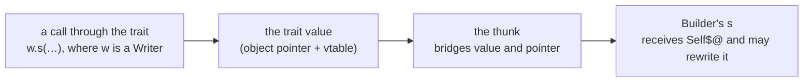
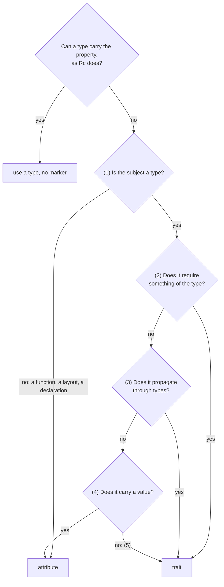
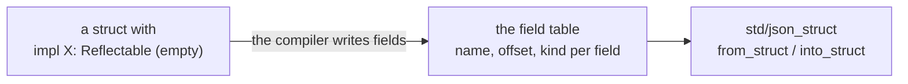
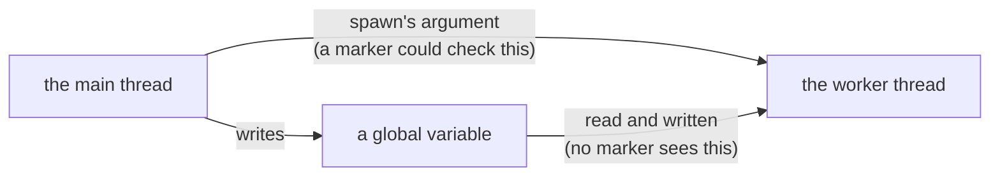
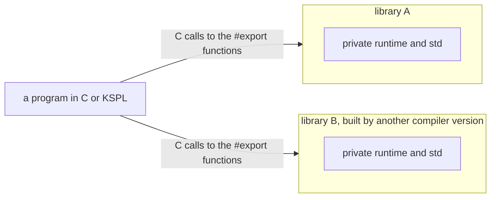

# The rationale behind KSPL's design

**This document says why the language is the way it is**: why KSPL differs from other languages, and why each restriction exists.

What the language *is* belongs to the specification, [`SPEC-programming-language.md`](SPEC-programming-language.md); for the rules alone, that is all you need. Read this document when two readings of the specification disagree, and before you propose a change to it. The principles its reasons rest on are in [`DESIGN-principles.md`](DESIGN-principles.md). Why the source text is written as it is lives in [`DESIGN-notation.md`](DESIGN-notation.md).

## Symbols and syntax

**The symbols were not chosen for looks.** Each is what is left once every candidate that could be misread is struck out.

### Why taking an address and dereferencing are postfix

KSPL writes these two operators *after* the value (docs/SPEC-programming-language.md §6.2). `val@` takes the address of `val`, and `ptr$` reads what `ptr` points at. Read left to right, the code follows the data.

```kspl
val: = 100
ptr: I32@ = val@ // "of val, the address"
x: = ptr$ // "of ptr, what it points at"
z: = p$.x // "of what p points at, the field x" - straight through, left to right
```

C's prefix `&` / `*` has three well-known problems, and postfix keeps none of them:

| C's problem | In C | In KSPL |
| :-- | :-- | :-- |
| **The precedence is counter-intuitive** | `*p++` is `*(p++)`, and `*a.b` is `*(a.b)` | There is no `++` / `--`, and postfix operators apply left to right |
| **It needs an extra operator** | `(*p).x` is cumbersome, so C added `->` | `.` dereferences automatically, so `p.x` works on a value and a pointer alike |
| **Declarations mislead the reader** | The `b` in `int *a, b;` is not a pointer, and `int (*fp)(void)` reads from the inside out | Expressions and types run one way: `val@` has the type `I32@`, both postfix |

**The grammar closes in one rule**: `.` `[]` `()` `@` `$` `!` all fit `expr_postfix = expr_primary ( … )*`. Parentheses are needed only to apply a postfix to a binary operation's result (`(ptr + i)$`).

### Why the symbols are `@` and `$`

A postfix operator appears directly after a complete expression, which is also where a binary operator appears. So the symbol must meet three conditions, and of all the ASCII symbols, only `@` and `$` pass:

| Condition | Why | What it rules out |
| :-- | :-- | :-- |
| 1. **It is not a binary operator** | If dereferencing were `p*`, the `*` in `a * b` could be either reading | `*` `&` `%` `^` `\|` `+` `-` `/` `<` `>` |
| 2. **It has no compound assignment `X=`** | Dereferencing is most often an assignment target. With `^`, `p^ = v` and the XOR assignment `p ^= v` would differ only by a space | `!` too, since there is `!=` |
| 3. **It is not already taken** | `#` is attributes, `'` `"` `\` are characters and strings, `` ` `` sits badly with the surrounding tools, and `~` is prefix bitwise NOT | `#` `'` `"` `\` `` ` `` `~` |

`@`, read as "at", takes the address, and `$`, the inverse, dereferences. **Error propagation's `!` is postfix although condition 2 rules it out for dereferencing**: what it yields is never an assignment target. So a postfix `!` is read only where no `=` follows it, and `a!=b` still compares ("Failure" in [`DESIGN-principles.md`](DESIGN-principles.md)).

The one operator deliberately made **prefix** is the type cast `T::v`. Its left side is a *type*, which no reader mistakes for an expression. What it costs the parser is "Why `::` stays the cast, and what it costs to parse".

#### Why directives are `##` and attributes are `#`

One `#` marks the declaration that follows it; two (`##`) mark the whole file.

| Kind | Examples | Applies to |
| :-- | :-- | :-- |
| Attribute, `#` | `#inline`, `#cfg(flag)` | What comes next |
| Directive, `##` | `##error`, `##lint` | What encloses it: the file |

Both stand before their target, so **the number of `#`, not the position, fixes the scope**.

**Do not separate them with `!`.** `#!lint` reads like the negation in `#cfg(!flag)`. It also overlaps the shebang (`#!/usr/bin/env -S ksplc run`), the first line that lets a Unix shell run the file. A wrong guess there would turn a directive into a line comment with no diagnostic.

`##` **cannot be read as an operator**, and `@` and `$` are spent. Counting `#`, the shebang test is only "does it start with `#!/`", which a directive never matches.

Caution: **Keep the symbol and the name one token** (`Attribute_prefix` / `Directive_prefix`), not a sequence of elements. The grammar's whitespace skipping also skips newlines and comments, so a name on the line after a lone `#` would join it.

**Names are not written into the grammar.** It stops at `Directive_prefix "(" ... ")"`, and `directive_shape` in `ksplc/sema/decl/attrs.kspl` holds which names exist. Otherwise each new name would go in four places, and missing one would leave a declaration that no stage reads.

Caution: **State the price honestly.** `##error` takes a foldable expression, and `##lint` takes `CODE = level`. The grammar accepts both shapes for both names, so `check_directive` must reject the crossings. The case `directive_argument_shape` in `ksplc/tests/negative/target.kspl` pins this.

#### Why type arguments are `<|…|>`

KSPL writes `Vec<|T|>`, not `Vec<T>`. `<|` cannot be "less than", so the parser knows at the second character that type arguments begin.

**Do not go back to angle brackets for familiarity.** `<` is also a comparison, so `a < b` and `Vec<T>` stay ambiguous until the rest is read. Every language that chose angle brackets pays for it in the lexer, the grammar or the notation. KSPL pays one character in the writing and holds no special case.

Note: `type_args` in `ksplc/kspl.kspeg` fails at once unless it sees `"<|"`, so trying it at every identifier costs almost nothing.

**The price is unfamiliarity**, paid once, while the ambiguity would be paid every time.

#### Why `::` stays the cast, and what it costs to parse

`::` means a cast (`I64::x`), and a path to a module's member uses `.` (`io.out`). The cast makes the parser a little slower, and that time is won back elsewhere.

**The parser still pays for the prefix cast.** KSPL's parser is a PEG parser: it tries the grammar's alternatives in order and backs out of one that fails. A type and a value begin alike, so at every operand the parser tries `type_expr "::"` and backs out. It does the same for `T::{ … }`. Taking the forms out of the grammar gives these figures for the parse alone (`ksplc --stats` counts the rule calls):

| Taken out of the grammar | Rule calls | Parse time |
| :-- | :-- | :-- |
| The cast, and the type in front of a literal | about a fifth fewer | about a fifth less |
| The cast alone | under a tenth fewer | within the noise |
| The type in front of a literal alone | a few percent fewer | within the noise |

Guards gain little: a lookahead cuts the calls and the time by a few percent at most.

**Giving `::` to paths would not buy this back.** The cost is the attempt at an operand's head, not the separator. A cast moved elsewhere still needs a mark, and every mark costs somewhere.

**The parse time is saved in the memo table instead**, where the parser remembers each rule's result at each position. One table serves every file of a run, emptied by a generation stamp and sized from one slot per byte ([`../kspeg/memo.kspl`](../kspeg/memo.kspl)). That saves more than taking the cast out would, with no change to the language. Parsing dominates a cold self-compile, and takes milliseconds once the syntax-tree cache is warm.

**What keeping `::` costs the writer, and the answer**: a Rust writer's `Arena::new(1024)` would give three errors, none naming the fix. So where `T` is a module or a type, and `name` is nothing in scope, `T::name` is reported as one error naming the fix. For a type's `new`, that is the type call `Arena(1024)`; otherwise, the `.` spelling. A cast of a value in scope (`I32::count`) is left alone.

**The one weakness of `.` everywhere** is that a local named like an imported module hides it: below `io: = 5`, `io.out()` reads the local. Such a local is a warning at its declaration (`[W0502]` in [`../ksplc/docs/SPEC-diagnostics.md`](../ksplc/docs/SPEC-diagnostics.md)), not an error. Shadowing stays legal ("4.5 Scope and shadowing" in [`SPEC-programming-language.md`](SPEC-programming-language.md)). A second separator for modules would collide with the cast.

### Why immutability is the default

**A variable cannot be changed unless you mark it with `$`** (docs/SPEC-programming-language.md §4.2), for three reasons:

1. **A marker goes on the minority side.** Most local declarations and parameters in this repository are immutable.
2. **Writing shows up in the type.** With mutability the default, nobody notices a write through a pointer.
3. **It matches where other languages are heading.** Rust's `let mut`, Swift's `let` default and Kotlin's `val` all mark the mutable side, and `$` reads as "variable" from Perl and the shells.

**The marker is the same `$` as dereferencing**, because only `@` and `$` pass the conditions above. The two never meet. In an expression, `$` follows a value. As a marker it stands before a declaration's identifier (`$x: = 0`), on a parameter, or before a type's postfix `@`/`[` (`I32$@`). None can hold a dereference.

#### Why the mutability marker on a type argument is prefix

Where a generic declares that its type parameter can be mutable, the `$` goes in front: `struct Slice<|$T|>`, not `Slice<|T$|>` (`docs/SPEC-programming-language.md`, 3.3).

1. **`$`'s position keeps its meaning.** The marker positions above are all prefix, while postfix `$` dereferences.
2. **Postfix requires lookahead.** A type argument can also be an expression (`<|4|>`), where a postfix `$` would overlap `p$`.
3. **Postfix is unreadable when nested.** `Slice<|Slice<|U8$|>$|>` wedges the `$` between closing brackets. Prefix gives `Slice<|$Slice<|$U8|>|>`, with the marker before what it modifies.

**The desugaring moves the marker** from the constructor (`$[]` in `U8$[]`) to the type argument, since the type system carries immutability on the element type. Other languages likewise write modifiers in front (`const T`) and constructors behind (`T*`).

**The declaration states whether it accepts the marker** (`struct Slice<|$T|> { … }`), so a `List<|$U8|>` against a type that does not declare it is a type error.

#### A `const` slice can stand over a run of elements

**A top-level `const` slice can be initialized from a run of elements (`T[]::{ … }`), not only from a string literal** ("4.1.2 `const`" in [`SPEC-programming-language.md`](SPEC-programming-language.md)). The array the run builds is placed in read-only memory beside the slice, so the slice still cannot write into ROM. A refusal would make each table a fixed-length array (`T[_]`), and every call taking it as a slice would need a cast.

## The type system

**One rule runs through this chapter: a type says what it is, and nothing is inferred that a reader would have to guess at.**

### Why type inference is limited to local variables

Top-level declarations (`const`, variables, `extern` variables) must carry a type annotation, and only local variables are inferred (docs/SPEC-programming-language.md §4.1).

1. **It follows an existing line.** Parameters, return values, `struct` fields and enum payloads all state their type, and a top-level declaration is the file's interface.
2. **Inferring it would bring in a new failure mode.** Inference runs in declaration order, so a function body before a global would see a stale type. Fixing that needs dependency ordering and cycle detection: the ground of C++'s static initialization order problem.
3. **It does not balance.** It saves one type name.

**What is given up**: omitting a type name at the top level.

#### A type is redundant only where it is written twice

**The compiler calls a local's type annotation redundant only where its initializer already names that type.** A type that could merely be inferred stays, because the annotation can be the only place a reader sees it. The report is [H0302], a hint on by default (in [`../ksplc/docs/SPEC-diagnostics.md`](../ksplc/docs/SPEC-diagnostics.md)).

| The line | Reported? | Why |
| :-- | :-- | :-- |
| `p: Point = Point::{ … }`, `n: U8 = U8::v`, `k: Kind = Kind.small`, `xs: List<\|I32\|> = List<\|I32\|>(arena)` | Yes | The type is written twice |
| `count: Sz = items.len` | No | The annotation is the one place the type stands in the text |
| `$i: Sz = 0` | No | Deleting it changes the type: the literal would be `I32` |
| `wide: I64 = small` | No | The conversion follows the annotation |
| `return Option<\|I32\|>.some(n)` in a function returning `I32?`, `kinds.push(Kind.small)` | Yes, the variant's type | The signature or the parameter already says it |
| `k: = Kind.small`, `mode == Mode.on` | No | Nothing else says the type |

* **Inferable is not redundant.** A model reads the text and cannot hover ("The reader can be a model" in [`DESIGN-repository.md`](DESIGN-repository.md)). Removing every inferable type would take it from the readers least able to recover it.
* **An annotation doing work is not reported**: a literal or a conversion follows it, and `::{ … }` or `.small` are typed by it. Nor is a cast that [I0301] calls unnecessary, since deleting both would leave the value's own type.
* **The verdict holds for every type argument**, since the check compares what is written. A call inside a generic is left alone, because an impl for one instance can change its type.

**An enum's type at its variant goes where the place already gives it** ("6.6.2 Where the type may be omitted" in [`SPEC-programming-language.md`](SPEC-programming-language.md)). Such places are a declaration's written type and the place `=` assigns to, a call's parameter, and a payload. So are a struct literal's field, an array element, the value a `catch` stands in for, and the function's return and error types. There, [H0302] reports the enum's name, so the tree reads `return .some(n)`, `kinds.push(.small)` and `throw .lost`.

* **The variant's name stays, and it says which value.** The enum's name stands in the signature, the parameter or the declaration, and the compiler checks the value against it.
* **Only where the variant's type is the one the place expects.** An `if … else` in such a place passes the type to both sides, so `return .some(n) if ok else .none` needs no name. Where nothing fixes the type, the name stays. That holds in a comparison, and in an `if … else` in no such place (`v: = .ok if c else .err`). It holds in an argument a generic infers its type from.
* **One fix per line.** Where the initializer repeats the annotation, only the annotation is reported.

**What is given up**: a call's line no longer names an argument's enum; the reader of `kinds.push(.small)` finds `Kind` in the parameter.

### Why implicit conversion stops at what loses nothing

A number converts to another type without a cast only when no value can be lost, such as `I32` to `I64` ([`docs/SPEC-programming-language.md`, 6.4](SPEC-programming-language.md)).

The usual reason to forbid implicit widening is that a mixed-width expression computes narrow and then widens, which hides the overflow. **That reason does not apply to KSPL.** The expected type propagates down through the operator, so a wider receiver widens before computing. For `a: I32 = 100000`, `f: I64 = a * a` gives 10000000000, computed in `I64`.

**Between integers and reals it is forbidden both ways.** An implicit `int` to `float` rounds an integer beyond 24 bits. An integer literal is an integer too: `2.0` is the one spelling of that float (Principle 6).

**Two operands of different types compute in the one holding every value of the other.**

| Operands | Computed in |
| :-- | :-- |
| `I32` with `I64` | `I64`, which holds every `I32` |
| `I32` with `U32`, `I8` with `U8`, `Sz` with `U32` | Rejected: neither holds the other, so the writer casts one side |

C's answer, converting to the unsigned side, makes `-1 < 1u` false. A third, wider type would hold both, but the widest pair (`I64` with `U64`) would still have none. So the rule would end in a refusal anyway, further from the code that caused it.

#### Conversion also applies inside a Result

**When the expected type is `T!E`, a returned value is converted to the success type `T`, then wrapped.**

```kspl
priv fn f(): Shape!Err
    p: = mem.alloc_as<|Sq|>()
    return p // the Sq$@ -> Shape upcast works inside a Result too
```

**Do not wrap only on an exact match.** Then `fn f(): Trait!Err` could only `throw`: its success type writable but unreturnable. Diagnostics speak of the success type too: `return "str";` gives `expected 'I32'`.

### A cast to an enum gives one of its variants

**An enum value is one of the variants its declaration lists.** An exhaustive `switch` and `variant_name` read a value that is none of them as the last one they test. So a number cast to an enum (`E::x`) must be a tag ("6.4 Type conversion (`::`) and implicit casts" in [`SPEC-programming-language.md`](SPEC-programming-language.md)).

* **A constant is caught at translation time**, as a constant divisor of 0 is.
* **The run-time check costs a comparison per variant where a number becomes an enum**, and nothing where an enum is only read.
* **The value is compared before it narrows to the enum's base type.** Narrowed first, `E::300` of an `enum E: U8` would wrap to 44.
* **A float or a `Bool` goes through an integer cast written out**, and an enum whose variants carry data is built, not cast.

**The cast stays.** A program reading an enum from a file or a wire format holds a number first. Without the cast, each such program would copy every tag into a `switch`, which a new variant leaves behind (Principle 4).

**No second conversion returns `E?`.** It would be a second spelling (Principle 6). A number from outside is checked as other input is, before the cast.

**Raw memory can still hold a value that is no tag**, such as a C function filling the enum. That is undefined, as a dangling pointer is ([`docs/SPEC-programming-language.md`, 14.2](SPEC-programming-language.md)).

### A cast from floating point to an integer saturates

**`I32::x` always gives an answer, and the same one on every target and backend.** NaN gives `0`, a value below the type's range its minimum, a value above its maximum. Anything else is truncated toward zero ("6.4 Type conversion (`::`) and implicit casts" in [`SPEC-programming-language.md`](SPEC-programming-language.md)).

* **Not undefined.** C leaves an out-of-range value undefined, and x86-64 and Arm answer differently. A sensor reading out of range would print a different number per target.
* **Saturating, not stopping.** A cast is how a value is brought into a narrower range on purpose, such as a sample clipped to `I16`. Arm's instruction saturates itself, so on a microcontroller the rule costs nothing.
* **NaN gives `0`**, the one integer that claims no magnitude.
* **Each width saturates at its own bounds.** `I8::300.0` is `127`, not `300` narrowed through `I32` to `44`.

**A constant that does not fit is a compile error**, as a constant integer overflow is (6.8 in [`SPEC-programming-language.md`](SPEC-programming-language.md)). The width checked is the one every target holds, so `Sz::3.0e9` is refused on a 64-bit machine too. One fold decides it (`float_cast_of` in `ksplc/sema/decl/fold_float.kspl`), and both backends write its value.

**There is no conversion that gives none instead.** A caller that must know a bound was reached compares the value with the range before the cast (Principle 1). Caution: **The right bounds are open one past the range** (`-128.9` truncates to `-128` and fits `I8`).

### A tag names another variant through its enum

**`b = E.a + 1` is written with the enum's name, and a bare `a` is refused** ("3.4 Enums (`enum`)" in [`SPEC-programming-language.md`](SPEC-programming-language.md)). A bare `a` would open one place where the enum's names stand beside the file's own. A `const a` in the same file would then mean two things. Two variants sharing a tag are refused, so a bare alias cannot arise either.

### An enum lists its variants and reads one back

**An `enum` whose variants carry no payload gets `E.variants()` and `E.from_variant_name(name)`, which the compiler writes as it writes `variant_name()`** ("3.4 Enums (`enum`)" in [`SPEC-programming-language.md`](SPEC-programming-language.md)). A program that saves a variant as its name needs the way back, and a menu needs every variant. Without them, each program copies the variants, and a new variant is missing from the copy (Principle 4).

* **The list is a constant slice**, so nothing is allocated or freed. It is a function of the type, since a KSPL type has functions as its members and no constants.
* **A name not found gives `.none`.** An unknown name from a file is ordinary input, and the caller decides what it means.
* **It is not a second spelling of the cast `E::x`.** The cast reads a tag, a number; this reads a name.
* **An enum with a payload gets neither**, since a name cannot supply the data. Asking for either is a compile error naming the variant carrying data.
* **A name the file already uses wins.** The file's own method or variant of that name is kept, and the compiler makes nothing for it.
* **The lookup compares the names one by one**, since an enum holds few variants.

### A slice is a std struct, under generics' rules

A slice (`U8[]`: a pointer plus a length) is not built into the compiler. It is an ordinary generic struct in the standard library, so what holds for generics holds for slices.

#### `T[]` is sugar for `Slice<|$T|>`

`std/lang` declares `struct Slice<|$T|> { ptr: T$@; len: Sz; }`, and the slice notation is shorthand for it:

| Written | Desugared to | Elements |
| :-- | :-- | :-- |
| `U8[]` | `Slice<\|U8\|>` | Read-only |
| `U8$[]` | `Slice<\|$U8\|>` | Writable |
| `U8$[][]` | `Slice<\|Slice<\|$U8\|>\|>` | Read-only elements, each a slice of writable bytes |
| `U8[4]` | Not folded | A fixed-length array, not a slice |

`ksplc/parse/desugar.kspl` folds **the type expression as written**, from the left. So `U8$[][]` is an immutable-element slice of mutable-element slices; reverse the order and the markers swap. A postfix carrying a size (`[N]`) is a fixed-length array and is not folded. **Diagnostics show the sugar** (`ksplc/sema/type/display.kspl`), not a name the user never wrote.

**The sugar is the only spelling of a slice type.** `Slice<|U8|>` written as a type is a compile error naming `U8[]`, as `Option<|T|>` is for `T?` (Principle 6). Only `std/lang`'s declaration names `Slice`.

**Being a struct spares special cases.** A descriptor literal (`::{ .ptr = …, .len = … }`) is an ordinary struct literal, and the C name and layout follow as for any generic. An out-of-bounds index stops through the one `bounds_panic` in `std/lang`.

#### `impl<|T|> T$[]` is an ordinary generic impl

`T$[]` is sugar for `Slice<|$T|>`, so adding methods to every slice is no different from adding a method to `List<|T|>` (docs/SPEC-programming-language.md §9.3).

#### Immutable and mutable instances: one C struct, two KSPL types

`U8$[]` passes where `U8[]` is declared (docs/SPEC-programming-language.md §3.3), yet **as KSPL types they stay two**. Immutability rides on the field's type, so the `p` of `Box<|$I32|>` is `I32$@` and that of `Box<|I32|>` is `I32@`. In C they are one struct, so the weakening emits no cast. How the C name drops the mark is "Immutability marks in a type" in [`../ksplc/docs/DESIGN-sema.md`](../ksplc/docs/DESIGN-sema.md).

**The body is instantiated per instance**, so a write to the element inside the immutable version is rejected at translation time.

#### Making a single instantiation the target of an impl

`impl U8[] { ... }` adds methods to byte slices alone, with **no new notation**. An impl's target is a template when it holds the impl's own type argument. When it does not, it is that one instance (docs/SPEC-programming-language.md §9.3; `impl_target_rejects` in `ksplc/sema/decl/mono.kspl`).

**Overlap is rejected.** Otherwise the later impl would overwrite the template's methods by name (Principle 5). "The more specialized one wins" is not adopted, since a reader cannot tell which one is in effect.

### A type argument with nothing to bind to is rejected

**A type parameter must be bound by the receiver's instance or by the call's actual arguments.** Three positions have neither. Each is a compile error where it is written (Principle 5).

| Position | Example | Section |
| :-- | :-- | :-- |
| A name on the impl that the receiver leaves open | `impl<\|T, U\|> List<\|T\|>` | "A name on the impl that the receiver leaves open" |
| A mutability marker on the impl's own type argument | `impl<\|$T\|> Box<\|T\|>` | "An impl's mutability marker, and a call's type argument" |
| A type argument at the call of a generic type's method | `q.get<\|U8\|>()` | The same |

#### A name on the impl that the receiver leaves open

`impl<|T, U|> List<|T|>` cannot be written (docs/SPEC-programming-language.md §3.3): **the receiver's type does not determine `U`**.

Caution: **It must not pass silently.** The grammar accepts it, so `collect_impl_decl` in `ksplc/sema/decl/collect.kspl` rejects it at the declaration.

**A method's own type arguments can be written**, since the call site binds them.

```kspl
impl<|T|> Holder<|T|>
    fn to<|U|>(r: Self, u: U): Holder<|U|>
        …
h.to(true)          // U is determined from the actual argument
h.to<|Bool|>(true)  // may also be written
```

**Such a method is instantiated at the call site.** That works because the method table is built when it is looked up ("Where the instantiation queue is drained" in [`../ksplc/docs/DESIGN-sema.md`](../ksplc/docs/DESIGN-sema.md)).

#### An impl's mutability marker, and a call's type argument

**The mutability marker takes effect only on the target side.** `apply_arg_mut_mark` reads it from the declaration that declared the position (`struct Box<|$T|>`), so a `$` on the impl's own list (`impl<|$T|> Box<|T|>`) changes nothing. Writable but ineffective, it is made unwritable (Principle 5).

Caution: **This is not only about the marker.** A method's type arguments belong to the enclosing `impl`, and the receiver's instance has already fixed them. A `q.get<|U8|>()` on a `Plain<|I32|>` value would be discarded silently, so it is refused too.

A method that declares **its own** type arguments (`fn m<|$T|>(…)`) can be written, since it is instantiated from a template.

### A generic's type arguments are inferred from the actual arguments

**You write `f(x)`, and the compiler works `T` back from `x`'s type; do not swing to "always require `<|T|>` explicitly".** Calls that omit the type argument outnumber the rest by an order of magnitude, mostly `arena.create(x)`. Requiring it would mean writing `arena.create<|List<|U8[]|>|>(…)`. Where `T` appears only in the return (`alloc_as<|T|>()`), it must be written.

**The type a call's result is given does not fix a type argument**: `y: U8 = zero(5)` is refused and asks for `zero<|U8|>(5)`. Inference runs one way, from the arguments to the call. Run the other way, `zero(5)` would build a different copy depending on where it stands, and the call would not show it.

**What is inferred is a function's own type arguments, however it is reached**: `f(x)`, `h.to(x)` and `Holder<|I32|>.to(h, x)` alike. **A generic type's are not inferred from a call through it**: `Holder.mk(1)` is an error asking for `Holder<|I32|>.mk(1)`. Many of a type's functions take nothing that would fix it (`List<|I32|>(null)`), so inference would work for only some (Principle 6).

**The price is that instantiation comes after the arguments' inference.** The compiler must then check the arguments again against the substituted parameter types, or broken C comes out silently. The check is ["A generic call's arguments are checked after instantiation"](../ksplc/docs/DESIGN-diagnostics.md#a-generic-calls-arguments-are-checked-after-instantiation) in [`../ksplc/docs/DESIGN-diagnostics.md`](../ksplc/docs/DESIGN-diagnostics.md).

#### A generic function used as a value names its specialization

**To pass or store a generic function as a function pointer, write which copy (specialization) you mean: `f: fn(x: I32): I32 = same<|I32|>`.** A generic function's code exists only as specializations, and a function-pointer value is the address of one. `same<|I32|>` is built where it is named, and its type is checked against the expected one. The bare `same` is a compile error that says to write it.

**The type arguments are not inferred from the expected type.** A function named as a value has no actual arguments, and working back from the expected type would be a second direction of inference. It would also fail where the receiving parameter is itself generic. Writing the specialization works in every position, so it is the one form (Principle 6).

**Passed to a generic parameter, or bound to a declaration with no type, the name gives its function type**: `apply(same<|I32|>, 3)` binds `F` to `fn(x: I32): I32`. That is ordinary inference from an actual argument, and `f: = same<|I32|>` makes `f` one too. A non-generic function's name gives its type the same way. So do a method named through its type ("A method as a value is named through its type") and an anonymous function. **`F` becomes a function-pointer type**, so two functions of one signature share one instance of `apply`.

**Type arguments after a function that declares none would bind nothing** (Principle 5), so "8.1 Definitions" in [`SPEC-programming-language.md`](SPEC-programming-language.md) refuses them.

**What is given up**: leaving the specialization to the expected type. Each use costs the few characters of `<|I32|>`.

#### A method as a value is named through its type

The rules are "8.1 Definitions" in [`SPEC-programming-language.md`](SPEC-programming-language.md); this section holds why.

**Every type argument is written, each where it belongs**: a generic type's on the type, the method's own after the method (`Keeper<|I32|>.pair<|U8|>`). A value names one copy, as in "A generic function used as a value names its specialization".

**A method named through a value (`p.read`, not called) is a compile error.** A function pointer is an address alone, with no room for the receiver. Keeping `p` would make it a closure, which states its captures ("Why capture is made explicit and escape is forbidden").

**A trait's method named through the trait (`Shape.area`) is a compile error.** It is a slot each conforming type fills, with no one function to point at.

**What is given up**: a bound method, `p.read` standing for "read `p` later". The receiver is passed at the call instead.

### Generics also take translation-time constants as type arguments

A type argument can be a constant, as in `Ring<|512|>` ([`docs/SPEC-programming-language.md`, "3.3 Structs (`struct`)"](SPEC-programming-language.md#33-structs-struct)).

**It is the only way to embed fixed-capacity memory in a type where no heap is available.** `struct Buf<|const N: Sz|> { data: U8[N]; }` is sized by its declaration alone. So it works in an interrupt handler, before the scheduler starts, and right after a freestanding boot. `% N` is also a constant in the generated C, so no software division is called.

**Arithmetic cannot be written in the argument position**, because the notation as written is the canonical name. Write it in a `const`'s definition: `Foo<|N|>` with `const N: Sz = 4 * 2;` is the same type as `Foo<|8|>`. An array length (`T[ROWS * COLS]`) creates no name, so arithmetic is accepted there.

**A parameter's kind is checked where the argument is written, a generic's own declaration included.** `fn f<|const N: Sz|>(h: Hold<|N|>@)` passes a value where `Hold` takes a type, and is refused even if nothing calls `f`. Left to a call, the error would blame the caller.

**A capacity on the type fixes the size only where the memory is embedded in the type.** Memory passed separately is passed as a slice, and the receiver checks its length. `std/ring.kspl`'s `Ring<|CAP|>.new` takes a `U8$[]` and stops unless its length is `CAP`. The type argument keeps the arithmetic constant, and the slice carries the bounds.

**A `const` parameter is read off the argument where it stands as an array's length or a generic's value argument.** `sum(s)` with `s: I32[3]` makes `N` of `fn sum<|const N: Sz|>(v: I32[N])` 3. The argument determines the value as uniquely as a type. Where two arguments fix it to different values, the call is refused naming both.

**Nothing else gives a `const` parameter's value.** A slice's length is known only at run time, and `I32[N + 1]` is not solved for `N`. Where nothing gives it, the call writes it (`sum<|3|>(I32[]::s)`).

**What is given up:**

* **A separate body per value.** `Ring<|4|>` and `Ring<|8|>` are different types, emitted once per value used.
* **The declaration-synthesizing features skip it.** `variant_name` is not synthesized for an `enum` carrying a const generic ([`ksplc/docs/DESIGN-parse.md`, "Synthesizing an `enum`'s members"](../ksplc/docs/DESIGN-parse.md#synthesizing-an-enums-members)).

### Whatever returns a view returns an immutable view

**A function that returns a view (a slice pointing into existing data) returns a read-only one. Only a function that takes a writable slice can hand back a writable view.**

```kspl
pub fn sub(r: U8[], start: Sz, len: Sz): U8[]
pub fn sub_from(r: U8[], start: Sz): U8[]
pub fn split(r: U8[], delimiter: U8, ...): List<|U8[]|>
pub fn lines(r: U8[], ...): List<|U8[]|>
```

Caution: **Do not return a mutable view from an immutable input.** `U8$[]::{ .ptr = <immutable pointer> }` lets the caller write into a read-only region. Exactly one function writes into a slice: `sub_mut(r: U8$[], start, len): U8$[]`.

Immutable accepts mutable, so widening a declaration toward the immutable side never breaks a caller.

#### The clamping of a range is held in one place

**A function carving out a view must not assemble the descriptor itself.** `T$[]::{ .ptr = xs.ptr + s, .len = xs.len - s }` gives a negative length when `xs` is empty, and nothing stops it.

One function, `sub_count(count, start, len)` (`std/lang`), decides how many elements a range really holds. Every slice's `sub` / `sub_from` / `sub_mut` (`std/chars`) and `std/ds`'s `List.sub` / `List.sub_from` go through it.

| What is inspected | What happens if it is dropped |
| :-- | :-- |
| The **lower** side of `start` | `Sz` is signed, so a negative `start` points before the beginning |
| **Not** comparing with `start + len` | An enormous `len` wraps the addition itself and slips past the clamp |

**Out of range returns empty; it does not panic.** Indexing (`xs[i]`) panics, since the caller can compute the range from `len`. Slicing asks whether a range exists.

**Two consequences inside the compiler belong to the compiler**: how a descriptor literal's fields are checked, and why an immutable slice's `ptr` is not `const` in C. See "Immutability marks in a type, and the API that asks" in [`../ksplc/docs/DESIGN-sema.md`](../ksplc/docs/DESIGN-sema.md). See also "Genc orders its type definitions after stripping immutability marks" in [`../ksplc/docs/DESIGN-backends.md`](../ksplc/docs/DESIGN-backends.md).

### Where permission lives changes with whether it is owned

**A read-only container protects its elements only if it owns them.** A read-only `List` protects the elements it allocated. A slice only borrows memory, so its element type decides. Whether `a[i] = v` passes through a read-only receiver is decided by the receiver `Index_place` declares (`index_stops_permission_walk` in `ksplc/sema/decl/access.kspl`; docs/SPEC-programming-language.md §6.1.2):

| Container | What it declares | What speaks for permission |
| :-- | :-- | :-- |
| `Slice<\|$T\|>` | `at(r: Self@, …)` | The returned `T$@`: borrowed, holding only `ptr` and `len` |
| `Tensor<\|T\|>` | `at(r: Self@, …)` | The returned `T$@`: passed by value, sharing what `data` points at |
| `List<\|T\|>` | `at(r: Self$@, …)` | The receiver: it owns the region it allocated |

`Tensor` is on the borrowed side because ksai treats it so: `matmul_into` takes its output by value and writes into `out.data`. With `Self$@`, `(out.data + i)$ = v` would pass where `out[i] = v` is rejected.

**So `List` gets no mutability marker.** Receiving `List<|T|>@` already says "do not touch the contents" (Principle 6). A slice, passed by value, has no axis but its type.

**A read-only slot does not mean nothing can be written through it.** The walk up a place's path stops at a pointer type and answers with what it points at. So for `x: H@`, `x.p$ = 22` passes ("Where immutability's two axes are enforced" in [`../ksplc/docs/DESIGN-sema.md`](../ksplc/docs/DESIGN-sema.md)).

#### The receiver of a read-only method is `Self@`

A method that does not change its receiver takes it as `Self@`, so the caller needs no `$`. `std/seq`'s methods and `std/ds`'s `List.get` do. `Self$@` would **force a `$` onto the caller's binding though nothing is written**.

Caution: **Keep `slice` / `at` / `items` as `Self$@`.** Each returns a writable pointer or slice into the receiver, so a read-only receiver would wash away const.

#### The receiver's permission decides whether an index is a 'place'

**On a read-only receiver, `a[i]` reads through `at_ref`, which returns a read-only pointer, never through `at`.**

Caution: **Do not choose `at` when the receiver is read-only.** `at` takes `Self$@`, so through `xs: List<|T|>@` the generated C would discard const, with no diagnostic (Principle 2). `for x in xs` takes the same path. Reads go to `Index_ref.at_ref`, and a type with neither falls back to `Index.get`, which returns a copy. A write through the read-only receiver is refused ("Where immutability's two axes are enforced" in [`../ksplc/docs/DESIGN-sema.md`](../ksplc/docs/DESIGN-sema.md)).

### A typedef is only another name

`typedef User_id = I32;` gives `I32` a second name; it does not make a new type ("3.5 Typedefs (`typedef`)" in [`SPEC-programming-language.md`](SPEC-programming-language.md)). For a type kept apart, declare a struct with one field.

**The reason**: a typedef told apart would be "the same type, but remembered". Every feature would have to say which of two spellings a value carries, such as a variant built through the typedef. A struct with one field already gives a separate type at no run-time cost, and makes a mix an error (Principle 6).

**What is given up**: `User_id` and `Order_id` over `I32` mix silently; where that matters, declare structs.

### Why `Bool` keeps ordering and has no arithmetic

`false < true` works, but arithmetic and shifts (`true + true`) do not, and no number casts to `Bool`: write `x != 0`. The operators are in "6.1 The operator list and precedence" in [`SPEC-programming-language.md`](SPEC-programming-language.md).

**Ordering stays** because `false < true` has one fixed meaning, and sorting on a boolean key is needed.

**No number casts to `Bool`.** C's `_Bool` makes every non-zero value true, while keeping the low bit makes `2` false. `x != 0` says the one meant (Principle 6).

**What is given up**: a flag is counted through a conversion, `I32::flag`.

### Why an unsigned minus and a fixed-answer comparison are refused

Two forms are compile errors: `-u` on an unsigned integer, and a comparison with a constant outside every value the type holds (`x == -1` with `x: U8`). The rules are in ("6.8 Integer arithmetic: folding, overflow, division, shifts" in [`SPEC-programming-language.md`](SPEC-programming-language.md)).

**Both are written but do nothing a writer meant** (Principle 5). `-u` can only wrap: with `u: U32 = 5` it is `4294967291`. A `U8` compared with `-1` is false whatever the value.

**Why errors, not warnings**:

1. **The same comparison against a `U32` is already an error**, as a literal out of range.
2. **The answer is fixed at translation**, so the fix is always a different spelling.
3. **A warning would be noisy only in generic code**, and neither check runs inside a generic instance.

**Where the meaning was wrapping, it is still written**: `0 - u` is the wrapping negation, and a cast reads the bits the other way (`I8::x == -1`).

### Why the size and index type `Sz` is signed

The short spelling is explained in "Why the size type is named `Sz`" in [`DESIGN-notation.md`](DESIGN-notation.md#why-the-size-type-is-named-sz).

`Sz` is signed, the reverse of C's `size_t` and Rust's `usize`. The `size_t` row of "What cannot be written in C's types" rests on this.

1. **A difference fits in the type.** Unsigned, an `a - b` below zero becomes an enormous length or index. Signed, it stays negative, and one bound comparison catches it.
2. **It can count down.** With an unsigned index, "one before 0" is the maximum value, so `Range.desc(n)` could not stop plainly.
3. **The width matches at the C boundary**: a pointer difference is `ptrdiff_t`.

**What is given up**: the maximum halves, and every interface taking a length or index must reject negatives itself. The interfaces that carve out a range share that decision in `sub_count` ("The clamping of a range is held in one place").

Caution: **A proposal to make it unsigned must answer all three points above.** "Check the order before subtracting" replaces point 1, but a forgotten check still yields an enormous length.

### `T?` is sugar for `Option<|T|>`

A value that can be absent is written `T?`. It is `std/lang`'s `Option<|T|>`, folded in the parse as `T[]` is ("`T[]` is sugar for `Slice<|$T|>`").

| Written | Desugared to |
| :-- | :-- |
| `I32?` | `Option<\|I32\|>` |
| `U8[]?` | `Option<\|Slice<\|U8\|>\|>`: an optional slice |
| `U8?[]` | `Slice<\|Option<\|U8\|>\|>`: a slice of optional bytes |
| `I32?!E` | a result whose value can be absent |
| `(I32!E)?` | an optional result |

* **The marks fold from the left**, as `[]` does (`fold_sugar_postfixes` in `ksplc/parse/desugar_slice.kspl`).
* **`?` is the mark Swift, Kotlin and C# give an optional value.** A result is marked with `!` ("Failure" in [`DESIGN-principles.md`](DESIGN-principles.md)), so `?` names absence alone.
* **Diagnostics show the sugar**; an optional result is written `(T!E)?`.
* **`T!E?` is refused.** The `?` would land on the error type, and the note names both readings.
* **The long form is refused as a type, and stands only in an expression** (`Option<|I32|>.none`), where a `?` cannot stand (Principle 6). Source the compiler writes spells the sugar back (`spell_as_written` in `ksplc/parse/desugar_slice.kspl`).
* **A `?` after a value marks nothing.** `v: = x catch { return … }` takes the value or leaves, and `if v: = x` uses it inside a block ("Unwrapping an `Option`" in [`DESIGN-principles.md`](DESIGN-principles.md)).

### `T!E` is sugar for `Result<|T, E|>`

A result is written `T!E`, folded in the parse into `std/lang`'s enum `Result<|T, E|>` ("8.3 Error handling" in [`SPEC-programming-language.md`](SPEC-programming-language.md)).

**Why a library type, not the compiler's own**: one mechanism then serves the optional and the result. And a result is a value like any other.

* **A built-in kind would stand apart from every other value.** It could not be stored, passed through a generic or switched on, so a failure that has to wait would need a second type. Its layout and counting would be written a third time.
* **The enum gives the layout, reference counting and code generation**, so nothing is special past the sugar and the three operators.
* **`!` and `catch` stay**: they make failure cheap to pass on.
* **The long form is refused as a type** (Principle 6).
* **A result crosses no C boundary**, since its layout is the enum's tagged union ("11.1 Types that cannot cross the C boundary" in [`SPEC-programming-language.md`](SPEC-programming-language.md)).

**A result nobody takes apart is refused because the type says the call can fail.** A warning would compile clean on a machine that turns warnings off. A binding whose name opens with `_` counts as dropping it. `f() catch {}` drops a failure on purpose, where the reader sees it.

**What is given up**: `I32?` and `I32!E` differ by one mark, so a signature is read to its last character.

## Traits and markers

**A trait is the only thing in KSPL that rides on the type system.** Only a trait combines with generics and is checked by the type checker. So a property pasted onto a type is either a trait or an attribute (a `#` mark). This chapter says which, and why.

### Why a trait's receiver is fixed to a bare `Self`

A `trait` method's receiver **is written only as a bare `Self`**; `Self@` / `Self$@` are compile errors (docs/SPEC-programming-language.md §5.3). The implementation can receive it in any form.

```kspl
pub trait Writer
    fn s(r: Self, val: U8[]): Self // the receiver is always a bare Self

impl Builder: Writer
    pub fn s(r: Self$@, s: U8[]): Self$@ // the impl may receive Self$@ and rewrite it
        …
```

A *thunk*, a small function the compiler generates, sits between the vtable and the implementation and bridges value and pointer:



**In a trait's receiver position, `$@` would not mean what it means elsewhere.**

* **It would bind nothing on the implementation.** The conformance check ignores the receiver's notation, and a trait value is a fat pointer, so an implementation taking `Self$@` already rewrites the original.
* **It would bind only the caller.** A declared `Self$@` requires a writable place as the receiver (`ksplc/sema/body/call.kspl`), and rejects a temporary, as in `io.out().s("x")`.

**Enforcing agreement is not open.** The declaration must be `Self` for `io.out().s(…)` to be writable, and the implementation `Self$@` to rewrite. So the choice is removed instead, as Go does.

**What is given up**: a trait cannot state "this method requires an lvalue receiver", or that the receiver is not rewritten. No working protection is lost: a rewrite was always the implementation's choice.

Omitting a parameter's type, and `Self` on a parameter **other than the receiver**, are separate rules (docs/SPEC-programming-language.md §5.1, §5.3). The second exists because a thunk would pass the fat pointer where a concrete type is expected (`ksplc/docs/DESIGN-sema.md` "The Sema layer: it knows the types").

#### When a temporary can be the receiver

`f().m()` calls a method on a temporary result (docs/SPEC-programming-language.md §5.2):

| `m` declares | `f().m()` | Why |
| :-- | :-- | :-- |
| `Self@` (reads) | Accepted | The value is copied into a hidden local, and its address is passed |
| `Self$@` (writes) | Rejected | The write would change only that hidden copy |

**Accepting it allocates nothing.** The compiler copies the value into an automatic variable in the call's block (`P t = f(); m(&t);`), as `x: = f(); x.m();` would.

**Rejecting a writing receiver** stops `make_point().set_n(5)` from being a call doing nothing (Principle 5). A write to what a descriptor points at does not need `$`, since only the descriptor is copied. The line can be read off the declaration of `m` alone.

**Operators and casts use the same slot**: `a + b` desugars to `a.add(b)` and `Dest::x` to `x.cast()`. **Do not split the decision across the three notations**, or `P(1) + P(2)` could pass while `P(1).get()` is rejected (Principle 6). It lives in `receiver_needs_hoist` in `ksplc/sema/type/query.kspl`.

### Why a trait's methods stand in the trait's block

**A method a trait requires counts only when it stands in `impl T: Trait`.** Elsewhere it is a compile error at the conformance block, naming the method's line. A file also holds one plain `impl T` block per type, which `ksplc lint` holds at zero (I0801). The rules are in "5.2 Implementations (`impl`) and receivers" in [`SPEC-programming-language.md`](SPEC-programming-language.md).

* **The conformance block answers "how does this type meet the trait?" by itself.** Otherwise `impl Arena: Manual_free {}` would show nothing, and the reader would search every block.
* **Joining a trait is a decision written where the trait is named.** Otherwise a method written for another purpose would meet the trait by its name alone.
* **One place for each kind of method** (Principle 6). A banner comment heads each group inside the one plain block.
* **The first rule is an error, and the second is a lint.** The first decides what a conformance is made of. A plain block split in two runs the same.

**Two kinds of conformance keep an empty `{}`.** One is a trait with no methods (`Move_only`). The other is a trait whose methods the compiler writes into the block (`Reflectable`'s field table, a suite's `run`).

**A call does not change**: `a.free()` finds the method whichever block holds it.

**What is given up**:

* **One type cannot meet two traits that require a method of the same name.** Rename one, or meet one through a small wrapper type.
* **A file that adds methods to another file's type keeps its own plain block** ("9.3 Adding a method to another file's type" in [`SPEC-programming-language.md`](SPEC-programming-language.md)).

### Whether a marker is an attribute or a trait

A marker that changes how the compiler treats a type or a declaration has two means. One is an attribute (`#inline`). The other is a trait the compiler knows (`Ref_counted` / `Move_only` / `Manual_free`, and the operator group in `std/lang`). Often either fits, so the order of decision is fixed.

#### The order of decision

The questions below are asked in order, and the first that answers decides:



**First, see whether a type can carry the property instead**, as `Rc<|T|>` does. That is stronger than a marker and adds no language machinery.

**(1) Is the subject a type, or a declaration or a site?** A trait attaches only to a type. So `#naked` / `#interrupt` / `#noreturn` / `#inline` / `#export` / `#section` (a function), `#align` / `#packed` (a layout) and `#cfg` are attributes.

**(2) If something is required of the type, a trait.** A conformance check enforces the methods' existence, argument count and types; an attribute cannot. A library is no different: `Map<|K, V|>` requires the trait `ds.Hashable<|Key|>` of its key (`std/docs/DESIGN-core.md`, "A container's requirement on a type is a trait").

**(3) Even a pure marker with no requirement is a trait if it propagates through types.** Only a trait can be derived from a type's parts, or written as a generic's constraint (`fn f<|T: some.Marker|>`). `fn f<|T: #arc|>` cannot be written.

**(4) If it carries a value, an attribute.** `#align(16)` / `#section(".isr")` / `#cfg(blas)` take parameters.

**(5) If (1) to (4) do not decide it, a trait:**

* The attribute table's rule keeps no exceptions: removing an attribute leaves the executable's logical structure unchanged (docs/SPEC-programming-language.md chapter 10). That rule gives "an unknown attribute is an error" its meaning.
* A marker that later grows a method requirement gains one prototype, and the user's code does not change.

**The trait's costs are accepted:**

* **The compiler depends on a name in the standard library**: `ksplc/sema/type/arc.kspl` holds the string `"std.Ref_counted"`. "Why compiler-known traits are confined to `std/lang`" contains the damage.
* **A marker-only trait's conformance check is empty**, as with Rust's `Send` / `Sync` / `Copy`.
* **The user writes more**: `impl X: Move_only {}` instead of `#move_only`, with no import line.

#### Why ARC is expressed as a trait

A type gets automatic reference counting by conforming to the trait `Ref_counted`, not through an `#arc` attribute (docs/SPEC-programming-language.md §8.4.2).

1. **An attribute cannot check the requirement.** The compiler looks up `retain` / `release` by name, and inserts nothing if the lookup fails. An attribute on a type lacking them would silently disable ARC; a conformance check stops it ("The order of decision" (2)).
2. **It would break the attribute rule**: removing `#arc` would change the executable's logical structure ("The order of decision" (5)).
3. **A trait already drives code generation.** `Add` desugars `a + b`, and `Index_place` desugars `a[i]`. Inserting retain and release is the same shape.

**The methods are `priv`**, because a call by hand doubles up with the inserted ones and writes into freed memory. `priv` on the conforming impl refuses the direct call. On the trait, it closes the path through an upcast. The synthesized calls are inserted after the visibility check, so they still reach. **The trait itself is `pub`**, so every file shares one declaration.

**Only `std.Ref_counted` itself counts (an exact FQN match).** A suffix match would switch ARC on for a same-named trait, and the inserted calls would write into freed memory. `Move_only` and the operator group are matched by FQN for the same reason.

**The vtable cost**: `--gc-sections` reclaims an unused vtable, except under Windows (PE) linkers, which keep unreferenced sections.

#### Markers not carried

Three markers are deliberately absent: `#arc`, `#deterministic` and `Thread_shareable`.

**There is no `#arc` attribute**: "Why ARC is expressed as a trait".

**There is no `#deterministic`** (making an ARC-managed value a compile error in one function). The existing machinery suffices: raising the lint [W0601] to `error` does it. `ksplc.cfg` is read up the directory tree with the innermost winning, so the `error` can be scoped to the real-time path's directory.

**There is no `Thread_shareable`**; the chapter "Concurrency" gives the reason.

#### Why compiler-known traits are confined to `std/lang`

**The traits the compiler names by FQN (the operator traits, `Ref_counted` / `Move_only` / `Manual_free` / `Callable1` / `Callable2`) stand only in `std/lang`.** A name is the only tie, so placement shows which names bear the load.

Caution: Mixed into a general-purpose file, a name whose renaming silently disables a feature cannot be told from one safe to rename.

**`Option` / `Range` / `panic` stand there too**, because the syntax requires them: `switch`'s exhaustiveness, `for item in collection`, and bounds checks and `assert`.

**Do not add for convenience.** Every program pays for this file (`make test-thin-use` guards its size).

**When it can sit outside `std/lang`**: when the whole file exists for that mechanism, and its name declares it. `std/reflect` holds only `Reflectable` / `Field_info` / `Field_kind`.

**The direction of dependency**: `std/lang.kspl` can import only `std/libc`. Routing `panic`'s output through `std/io` would cycle (`lang → io → mem → lang`).

**The way out for a file that declared the same name**: `std/lang` gives every file the alias `lang`, so `impl My_type: lang.Ref_counted` still conforms. Unqualified, the name means the file's own declaration, and ARC and operator desugaring stop silently. Do not write `lang.` where the unqualified form is not blocked (Principle 6); `make test-conventions` watches for it.

**What moving a file does not resolve**: the compiler also looks up methods and functions by name.

| Name | Purpose | What backs it |
| :-- | :-- | :-- |
| `retain` / `release` | ARC's synthesized calls | `Ref_counted`'s conformance check requires them |
| `fields` | Where `Reflectable`'s synthesized table goes ("Why a container's round trip is a table-returning trait") | `Reflectable`'s conformance check requires it |
| `fmt` | String interpolation (called inside `\{x\}` → `put(w, x)`) | If missing, `Formattable`'s conformance check stops it |
| `put` | What string interpolation desugars to; a free function in `std/lang`, so **its unqualified name is taken in every file** | If missing, "undefined identifier" |
| `len` | `for`-`in`, and slices | As above |
| `get` / `at` / `set` | Indexing | Reached through `Index` / `Index_place` |
| `free` / `dealloc` | Detecting use-after-free | **Nothing. A pure name-match heuristic** |

The last can misfire on an unrelated method named `free`. Moving it onto a trait would mean a conformance on every freeing type, so it stays, stated as a heuristic.

#### Why a container's round trip is a table-returning trait

To write a struct out as JSON and read it back, a type conforms to `Reflectable`. Its one method returns a table describing the type's fields, and a library walks that table. The compiler writes the table when the `impl` is empty.

```kspl
pub trait Reflectable
    fn fields(r: Self): Field_info[]
```

`Field_info` (in `std/reflect`) holds the name, the offset, the kind, a nested table and `Field_extra`. `std/json_struct`'s `from_struct` / `into_struct` walk it in ordinary KSPL.



**A trait rather than an attribute**, by (3) of "The order of decision". Whether a type can round-trip is derived from its fields' types, and it must be writable as a constraint (`fn save<|T: Reflectable|>`).

**A table rather than a body per library.** A `to_json` method would name a `std/json` type, and a synthesized body would make it compiler-known, confined to `std/lang`. A table needs only `U8[]`, `Sz` and an enum, so it lives in `std/reflect`, and any library can walk it.

**The compiler writes the table only for an `impl` with an empty body** ("5.5 Worked example: synthesizing a field table with `Reflectable`" in [`SPEC-programming-language.md`](SPEC-programming-language.md)). A body written by hand is the way out for another key mapping. How it is built is `synthesize_reflect_impls` in `ksplc/sema/decl/reflect.kspl`, pass 2a' of "The internal flow: registration, type inference, then generic instantiation" in [`../ksplc/docs/DESIGN-sema.md`](../ksplc/docs/DESIGN-sema.md). The table's shape is `std`'s ("The field table holds widths as data, nesting by pointer" in [`../std/docs/DESIGN-system.md`](../std/docs/DESIGN-system.md)).

**`offset` is in the table** because sizes cannot be added up to it: padding, `#packed` and `#align(N)` intervene. One place in ksplc interprets them ("A layout is computed when it is first asked for" in [`../ksplc/docs/DESIGN-sema.md`](../ksplc/docs/DESIGN-sema.md)). A walker adding sizes would be a second layout implementation.

**A `T?` field that is `.none` writes no key**, and an explicit `null` is refused. A missing key and a `null` are different values, and `null` is not made a second spelling of "missing" (Principle 6).

**A container of containers, and an option holding a container or an option, are not covered**, rather than writable but not walked (Principle 5). What blocks them is in "Known holes, and what would fill them" in [`../std/docs/DESIGN-core.md`](../std/docs/DESIGN-core.md).

**The table is not a translation-time value (no `fieldsof(T)`).** Constant folding answers an `I64` (`ksplc/sema/decl/eval.kspl`). `offsetof` is one more scalar beside `sizeof`.

**An `offsetof` it cannot answer is rejected** (docs/SPEC-programming-language.md §6.7). Every `struct` has a fixed layout, so nothing forces an undefined case (Principle 5).

**No mechanism renames keys.** The mapping is fixed as "field name = key, type = the value's kind". To change it, write the `impl` body by hand.

**It applies only where the external form is the declaration itself.** It does not apply where the writer decides the key. Examples are flattening, renaming, and omitting a default value. So are an enum expressed by a key's presence, and a value written differently from its type. Nor does it apply where no source struct exists (`kssrv/api.kspl`, `ksplc/lsp/msg.kspl`). **These are not added to the mechanism**, or two hands would decide how a key is written (Principle 6).

#### Why a suite finds a test by its name

**A test written twice drifts.** A test kept also in a hand-kept list of calls never runs once missing from the list, and nothing reports it. So the compiler finds the tests and writes the list.

**A test is found by its name, `test_…`, with no mark.** A `#test` mark would cost a line on every test. It would also be the one attribute whose removal changes what runs ("The order of decision" (5)).

**A misnamed test is reported.** A function in a file of tests that nothing calls and whose name does not start with `test_` is reported ([W0503]). A step that another test calls must not be named `test_…`, or the suite would also run it alone.

**The suite is a trait**, by (2): the compiler requires `run` of it and writes that body. Its file, `std/suite`, holds that trait alone ("When it can sit outside `std/lang`").

**The order is fixed, never random.** Tests share one process, so a random order would make a failure come and go. The suite's own file comes first, then the files it imports in import order, each file's tests in the order declared. A test that must run first is placed by that order alone: its file's name sorts its import first.

**A suite reaches only the files it imports itself**, or it would also run the tests of a library a test file uses.

**A test takes the suite's fields by name**, as parameters. A parameter with no matching field is a compile error at the test. **`before_each` and `after_each` hold what each test would repeat**, such as a fresh arena; their default bodies do nothing.

**A test that no suite runs is reported** ([W0214]). That check and [W0503] work only on a whole program, so a compile with no `main` reports neither.

### No syntax equivalent to concepts is added

KSPL has nothing like C++20's concepts (named requirements on a template's type arguments). The flood of errors from deep inside templates that they fix does not happen in KSPL.

| What concepts gave | Where KSPL stands |
| :-- | :-- |
| (1) Constraints checked before instantiation, ending diagnostics reported from the depths | **Present.** A violation of `<\|T: Trait\|>` is rejected naming the instantiated type, and **the violating instantiation's body is not type-checked**. `EXPECT-NOT` in the case `generic_constraint_via_static_call` in `ksplc/tests/negative/generic.kspl` pins this |
| (2) Choosing an overload by constraint | **Not needed.** KSPL has no overloading, and an impl targeting a bare type argument is rejected, so **there is nothing to choose between** |
| (3) The requirements shown in the signature | Partly: `<\|T: Trait\|>` can be written but is **not required** |

**Measured**: a method the type lacks, called three levels deep in generics, gives exactly one message, naming the concrete type and pointing into the body. A body failing for several types gives one per type.

* **So the syntax is not added.** A mandatory (3) would limit a body to what the constraints guarantee.
* **What is given up is a diagnostic detail.** An unconstrained body that fails does not say which call bound the type argument. See "A diagnostic points at 'the position the user wrote'" in [`../ksplc/docs/DESIGN-diagnostics.md`](../ksplc/docs/DESIGN-diagnostics.md).

## Function values

**A function value is one of two things, and how it is written shows which.** With no capture list it is a function pointer; with one it is a trait value carrying an environment. A *capture* is a variable of the enclosing function that the body uses, and the *environment* is the struct holding the captures.

| Written | It is | Can go to C | Can be named at the top level |
| :-- | :-- | :-- | :-- |
| `fn(x: I32): Bool { … }` | An anonymous function: a function pointer | Yes | Yes |
| `fn(x: I32; n: I32): Bool { … }` | A closure: a `Callable1` trait value pointing at its captures (here `n`, after the `;`) | No | No |

### Why capture is made explicit and escape is forbidden

A closure lists the outer variables it uses after a `;`, with their types. It can be passed down to the functions it calls, but it cannot outlive the function that made it. An anonymous function is lifted to a top-level `priv fn`. A closure gets a synthesized struct pointing at its captures and an impl of `Callable1`/`Callable2` (`desugar_fn_lit` / `desugar_closure` in `ksplc/parse/desugar_closure.kspl`).

**That the `;` changes the type is intended.** A function plus an environment does not fit one C function pointer, so the notation shows what can go to C. Even with zero captures, a `;` makes a `Callable`, so a predicate can reach an API that takes no function pointer.

**Captures are held by place (a pointer).** Copied by value, they would break as a `defer` frozen at registration does ("Why `defer` has no capture list").

**Escape is forbidden in exchange.** A captured place dangles once the environment leaves the function, and with no borrow checker that cannot be tracked. But a closure is a trait value, so the escape rules of "Which pointers into a frame are stopped from leaving it" apply. `check_ffi_safety` already stops it at the C boundary, so closures need no check of their own.

**An enclosing type argument reaches a closure, but not an anonymous function.** A closure's synthesized declarations copy across the ones its signature touches. See "A closure is synthesized as source for the same parser" in ksplc/docs/DESIGN-parse.md. An anonymous function is a function-pointer value, so the error asks for a capture list (the case `anon_fn_generic_param` in `ksplc/tests/negative/closure.kspl`).

**Captures are typed because the environment is a struct, whose fields need types.** Inferring them would invert the phases: a struct's fields are resolved before the body's inference (`sema_body_infer.run`). Whether a type can be omitted differs by position:

| Position omitted | Possible | Reason |
| :-- | :-- | :-- |
| `return` (a tail expression) | Requires no information | Decided by syntax alone |
| A capture's type | A route exists | Made a **type argument** of the synthesized declarations, it binds from the environment-building function's argument |
| A parameter's or return's type | No route | It would need **a route back from the use site's expected type**, and there is none |
| The capture list itself | Against the design | Made implicit, an expression's type would vary with its body, and whether it can go to C would vanish from the text |

**A route existing is not a reason to take it.** Closures with captures are few, and omitting the types would save no lines. This is revisited only "when a caller needing captures appears" ("Whether a callback arrives as a function pointer or a `Callable`").

**Only one- and two-argument `Callable`s exist** (`std/lang.kspl`). With no variadic generics, `Callable` cannot take the argument count as a type argument. `std/seq` needs no more than two, so `Callable3` is not added on "it would be handy".

**What is given up**:

* **It cannot be carried out.** Where the writer decides the environment's lifetime, put the captures in a `struct` and pass that (docs/SPEC-programming-language.md appendix A).
* **The call goes through a vtable**, one level more than a direct call.
* **A closure cannot be captured.** Composition passes an argument instead (docs/SPEC-programming-language.md §8.1.3). The diagnostic says so, rather than naming `_anon_env_N` (`append_closure_capture_note` in `ksplc/sema/session/ctx.kspl`).
* **It cannot be placed at the top level**, even with zero captures, since the environment is a temporary on the caller's frame (`block_depth` in `ksplc/parse/desugar.kspl`). So a reused predicate cannot be named, while a function pointer can.
* **Diagnostics can name synthesized declarations** (`_anon_env_N` / `_anon_env_new_N` / `_anon_env_v_N`), placed where the closure was written.
* **An outer name used in an anonymous function's body gives `undefined path or identifier`.** The diagnostic adds that capture is impossible (`append_anon_fn_capture_note` in `ksplc/sema/session/ctx.kspl`), worded in one place for both reporting points.

**The notation does not collide with the function-pointer type.** They differ only in whether a body block follows, so one token of lookahead decides it.

**The function-pointer type cannot be withdrawn.** It serves an `extern "C"` signature, a hook in a `struct` field or global, and a context with no allocator. None has anywhere to put an environment ("The FFI boundary check looks inside the type").

### Whether a callback arrives as a function pointer or a `Callable`

**A function that takes a callback takes a `Callable` only if callers need to give it captures; otherwise it takes a plain function pointer.** Being a predicate does not make it a `Callable`.

| Does it need them | How it is received | Example |
| :-- | :-- | :-- |
| Yes | `Callable1` / `Callable2` | `std/seq`'s `where` / `select` / `any` / `all`, whose predicate needs what is searched for |
| No | A function pointer | `std/fs`'s `skip_dir` (a fixed set of names), `ksos`'s `on_idle` |
| It crosses the C boundary | A function pointer, **with no choice** | `std/thread.spawn`'s `entry`, which goes to `pthread_create` (`check_ffi_safety` stops a trait value) |

**Moving a callback that needs no captures to `Callable` shrinks what can be written**, since a closure cannot be named and reused. `ksos`'s `on_idle` takes `semihost_console`'s `exit` from each demo's `ksos_main`; as a `Callable` it would need the same closure in every one.

**The judgment changes only "when a caller needing captures appears".** Only then is a zero-capture closure in a top-level `const` worth weighing. The LLVM backend lacks the ground for it: a fat pointer is no shape a static initializer can hold on both backends.

### Where it is fine to move to `std/seq`

A chain such as `xs.where(…).select(…)` from `std/seq` can replace a hand-written loop over a `List` in ordinary code. **A chain adds no allocation** ("Iteration" in [`DESIGN-principles.md`](DESIGN-principles.md)); only `to_list` allocates, and `order_by` / `distinct` stay eager.

Keep hand-written loops in `ksplc`'s inner loops (tens of thousands of runs per compilation), and in `std/`, `ksos/` and `ksai/`. `ksai/`, with `ksai/examples/qwen_infer` and `ksai/examples/llama_engine`, works per layer, token and element throughout.

**Only a loop that filters, maps or counts a `List` is replaced.** A loop over a slice stays, since `std/seq` extends `List<|T|>`. So does one that uses the index itself, since `std/seq` has no variant passing a position.

### Why a closure is not written after the call

**A closure passed to a call goes inside its parentheses, or is bound to a name first and the name passed.** There is no trailing closure (Swift's `xs.sorted { … }`).

* **It would give one call a second spelling** (`f(xs, g)` and `f(xs) g`), which "One notation per purpose" in [`DESIGN-principles.md`](DESIGN-principles.md) turns away.
* **The place it fills is taken.** A trailing closure fills the last parameter, where the standard library passes the arena (`order_by(cmp, arena)`).
* **A condition could not be told from its body.** A closure after `if xs.any()` would open a level that reads as the `if`'s own.
* **A `return` inside would read two ways**: as leaving the function, while it leaves the closure.

When the body runs to several lines, the closure is bound first:

```kspl
over: = fn(x: I32; floor: I32): Bool
    return x > floor
big: = count_over(xs, over)
```

A `fn` right behind a call's `)` is an error whose Note names both forms (`forbidden_spelling_hint` in `ksplc/parse/syntax_msg.kspl`). "Features not carried" in [`SPEC-programming-language.md`](SPEC-programming-language.md) lists it.

**What would reopen it**: calls that read as statements, written many times over, as in view builders. KSPL writes none.

### A compared function's name takes the other side's type

The rules are "8.1 Definitions" in [`SPEC-programming-language.md`](SPEC-programming-language.md); this section holds why.

**A function's name takes its type from where it is written** ("A generic function used as a value names its specialization"). In a comparison, that is the other side, typed first whichever order they are written in. **Two names are refused, not compared**, since neither gives the other a type. Binding one side (`f: = twice`) costs a line and fixes the type.

**A function value takes `==` and `!=` alone.** Where two functions sit is the linker's choice, and an address moved by an offset is no function. To sort function values, cast to an integer first (`U64::f`).

### A type call selects its existing constructor

**`T(...)` calls the static `new` that the type already declares.** Construction stays short with no constructor trait or new kind of declaration. The call uses ordinary member lookup, so visibility, defaults and errors have one implementation.

**The function decides what it returns and where it allocates.** The notation promises neither a value of exactly `T` nor a heap allocation. An arena argument stays explicit, and cleanup still needs `defer`. A function taking an instance as its first parameter is a method, not a constructor for this notation. Type arguments stay explicit, and a local function value named like a type is still that value.

**`T(...)` is the only way to call a static `new`.** `T.new(...)` is a compile error naming the type call, so no build accepts a second spelling. `T.new` without a call is still the function value.

### A function's name has no size

`sizeof(twice)` is a compile error, as is a function's name where a type goes (`x: twice`). The message names `sizeof(fn(x: I32): I32)`, the size of a function pointer.

**"The size of a function" has no one meaning**: a pointer's size, its machine code's, or its result's. Each answer is silently wrong for some reader, so the name gets no type here. A variable holding a function has a type, and `sizeof(f)` measures it.

### A function value is not cast to another signature

`(fn(x: I64): I64)::f` for an `f: fn(x: I32): I32` is a compile error, as is any `::` between differing function types. A cast to the same signature is a copy.

**A call through the result is undefined, and nothing would show it.** The caller lays out the arguments as the new type says, and the function reads them as written. C compiles such a cast without a warning. A right conversion is a function of the wanted signature calling the original.

**An address arriving from C stays reachable.** A function pointer handed over as `Void@` becomes a function type by a cast from `Void@`, which states that the writer vouches for the signature.

**What is given up**: reinterpreting one function type as another directly. Going through `Void@` spells the step out in two casts.

## Ownership and lifetime

**KSPL does not prove at compile time that every pointer stays valid, so what the language protects has to be chosen.** It protects what local data flow alone can follow: what happens to a value inside one function. The rest is the writer's responsibility (Principle 8).

| Area | What the language does | What stays the writer's |
| :-- | :-- | :-- |
| Copies | Stops an accidental copy of an owning handle, such as a lock or a file (`Move_only`) | A duplicate made through a pointer |
| `defer` | Runs a `defer` on the variables as they are when the scope ends | Copying a value to keep it as it was at registration |
| Escapes | Stops a pointer into the frame leaving by `return` / `throw`. Also stops an unseen pointer leaving by a store into a global or behind a pointer | Storing `x@` of a local; an escape through a call or a struct field set afterwards |
| A missed free | Warns where a value the function makes is left unfreed on some path | A field, a value reached through a pointer, and a value in a generic body |
| `switch` bindings | Keeps a counted value a `switch` arm binds alive for the whole arm | A pointer to the binding (`a@`) kept past the arm |

**Raw pointers are set apart rather than banned.** `T@` is a first-class type, and unchecked access has its own form, `(p + i)$` (docs/SPEC-programming-language.md §6.2.1).

**What is given up: how a type's memory is managed has to be read from its name.** Raw pointers and ARC live side by side. The lint [W0601], off by default, finds a project departing from a no-ARC policy ([`../ksplc/docs/SPEC-diagnostics.md`](../ksplc/docs/SPEC-diagnostics.md)).

### Every cleanup stands in the source

**No type frees itself.** A value that owns something is freed where the source says so: `defer` in front of its declaration (`defer $b: = Str_builder()`), a `defer` statement, or a `free()` call.

| Contract | What the compiler supplies | Where it belongs |
| :-- | :-- | :-- |
| `Manual_free` | The call `defer` in front of a declaration makes, checks after an explicit `free()`, and the warning for a value left unfreed | Every owner: a builder, a file, a lock, an arena, a container |
| `Move_only` | Checks after ownership transfers | An owner whose copy would free one resource twice: a file, a lock, a thread primitive, a child process |

**Why `defer` goes in front of the declaration**: the cleanup costs one word, and nothing can come between the acquisition and its cleanup. A value declared so is freed when its block ends, so handing it over is refused. The form's rule is "A declaration takes `defer` in front, and only to free" in [`DESIGN-principles.md`](DESIGN-principles.md).

**Why automatic cleanup is left out**: a type that frees itself frees where the source does not show it. Passing it by value hands it over unseen, and a struct holding one frees that field too. The compiler would also need live flags per owner, and moves through fields and payloads. One word per owner keeps "when something is freed can be read from the source" ("Notations not carried" in [`DESIGN-principles.md`](DESIGN-principles.md)).

**Why `Manual_free` and `Move_only` stay two markers**: ordinary code copies a list or a map as a borrowed view of its arena. Making every owner move-only would turn each such copy into an error. A file, a lock and a thread primitive conform to both. One marker would also catch less than it seems: a copy taken out of a container (`rows.get(i)`) makes a second owner unseen.

**Why ARC stays in the compiler**: with no type that frees itself, a library `Rc` would need a `free()` at each release. That is manual reference counting, a known source of leaks and use-after-free. So the hidden retain and release are kept for the few types that conform to `Ref_counted`.

**A free written on the line after the declaration has the form in front as its canonical spelling** ([H0303] in [`../ksplc/docs/SPEC-diagnostics.md`](../ksplc/docs/SPEC-diagnostics.md)).

**What is given up**: a missed free is possible. [W0109] reads one function's code only. It misses a field, a value behind a pointer, an unused generic body, and an arena variable that is `null` at run time. A lock left held (`File_lock`, `Mutex<|T|>`) blocks every later taker.

**Raw storage keeps its own operations.** `mem.init_at`, `mem.take_at` and `mem.drop_at` tell initialization, transfer and release apart for ARC. Treating initialization as replacement would read garbage and release a count never held. Normal locals use ordinary moves and assignment.

### A generic method body is checked when needed

A container can store a `Move_only` element without being able to copy it. Checking every method body at instantiation would reject even unused copying methods.

**Signatures and trait requirements are checked independently of bodies.** Method bodies are checked when referenced, as generic free functions are. A trait view requires every method in its table, and ARC requires `retain` and `release`. The compiler follows those dependencies until no new body is needed, and emits only checked bodies. An invalid method's first use reports the error with the concrete type arguments.

### Why there is no borrow checker, only a move-only marker

Conformance to `Move_only` forbids implicitly copying an owning handle, such as a file descriptor, where a duplicate means a double free (docs/SPEC-programming-language.md §5.4). Once handed over, the old name cannot be used again.

**Why no borrow checker**: Rust's borrow checker proves that no reference outlives its data, and that no two places change it at once. That tracks an order of magnitude more, and would reject the raw pointers (`T@`) KSPL code uses routinely. Move-only tracks one thing, "this binding can no longer be read", and local data flow suffices.

**Why a move rather than a ban on copying**: a ban makes construction impossible. `Mutex<|T|>::{ .mutex = m, … }` copies `m`, but ownership passes and leaves no duplicate.

**Which reads are moves**: the rule (docs/SPEC-programming-language.md §5.4) lists the reads that do not duplicate: a receiver, and the target of `@` / `$` / `[`. Every other read is a move. Listing the moves instead would miss a position added later.

**Why a field moves on its own, rather than taking its binding with it**: a struct can hold several owning handles. Handing one over is ordinary (a pipe end given to a child), so the field's path is tracked. The moved field, what lies below it, and the whole binding are refused until a new value revives it. A field reached through a pointer is not tracked, which is the pointer limit below.

**Why a loop's body is followed until nothing changes**: a move on one pass meets the next pass's read. So the body is walked again from the state its end leaves, until the state at its start stops changing. The report says the move came from an earlier pass, since the line that moved the value stands below the use.

**What is given up**: duplication through a pointer goes undetected, so the check is not sound (docs/SPEC-programming-language.md §5.4).

### Why an assignment evaluates its value before its place

**An assignment runs its value, then finds its place, then writes** ("Evaluation order" in [`SPEC-programming-language.md`](SPEC-programming-language.md)). Everything else runs left to right.

**Why**: with no borrow checker, nothing stops a call from moving the memory a place points into. In `nodes[i].left = put(...)`, `put` can grow `nodes`, which moves its elements. With the place found first, the write would silently corrupt freed memory. A call inside the place itself still can (`xs[0].items[grow()]`).

**A compound assignment takes the same order**: the value, the place, a read of its old value, then the write. So in `n += f()`, a change `f` makes to `n` counts. A compound assignment takes only numbers, `Bool` and pointers, so one order covers all of them.

**What is given up**: an assignment runs its right side first. A program relying on the place's side effects running first must split the statement.

### Why `defer` has no capture list

A `defer` reads outer variables **on leaving the scope** (docs/SPEC-programming-language.md §8.4.1), not as they were when the `defer` line ran.

**Freezing at registration would be wrong**: for a value struct, freeing the frozen copy does not free the real thing.

```kspl
b: = Str_builder() // at this point ptr = null, cap = 0
defer b                // <- frozen, this captures a copy with cap = 0
    b.free()
b.s("...")             // allocates and grows the internal buffer (the original b is updated)
```

`Builder.free()` frees only when `cap > 0`, so the frozen copy frees nothing and the grown buffer leaks. The standard library is full of this shape.

| | Read on leaving (KSPL) | Frozen at registration |
| :-- | :-- | :-- |
| `b.free()` in the example | Frees the grown buffer | Frees the empty copy; the buffer leaks |
| The variable is swapped to another resource after registration | The old resource leaks | The new resource leaks |

**"Immediate is safer" does not hold.** A `defer` that releases a resource must free what it holds on leaving. Where the variable is swapped, one resource leaks either way, so that code is wrong in itself. Freezing looks safe only where a pointer or handle is deferred, not a **value struct** that owns heap memory.

**Why there is no capture list**: reading on leaving, it would do nothing at run time. Unenforced, it is writable but ineffective (Principle 5). **To keep a value from registration time**, copy it yourself ([`docs/SPEC-programming-language.md`, 8.4](SPEC-programming-language.md)).

Caution: **Should freezing at registration ever be needed, do not spell it `defer a, b { … }`.** It could not be told from the existing `defer`. Give it its own notation.

### Which pointers into a frame are stopped from leaving it

A pointer *dangles* when what it points at is gone, such as a local after its function returns. Two ways out are checked: `return` / `throw`, and a store into a place that outlives the frame. A pointer is refused only where one function's code shows the danger, so the refusal is always right.

| How the pointer leaves | A pointer the compiler makes unseen: a trait value, a slice over a local array | An address written with `@`: `x@`, `a[0]@`, `s.f@` |
| :-- | :-- | :-- |
| `return` / `throw` | Refused | Refused |
| A store into a global or behind a pointer | Refused | The writer's |

**A pointer the compiler makes has no `@` in the source.** Upcasting a value to a trait makes the compiler synthesize `&value`.

```kspl
priv fn make(): Shape
    $s: = Sq::{ .n = 7 }
    return s // <- not one pointer operation is written
```

It lowers to `return (Shape){ .obj = (void*)&s, … };`, with no `@` written. **Responsibility can only be assigned for what the writer can see.** A slice cast over a fixed-length array, or built from a run of elements, is the same. So both are refused wherever they leave.

**At `return` / `throw`, a written `@` is refused too.** `return x@` hands the caller the address of folded storage, so no caller can use it. Left to the C compiler, it would be a warning (Principle 2), then garbage read from a dead frame.

**A store of a written `@` stays the writer's.** Keeping a local's address in a longer-lived place is right when the place is cleared before the function returns. A compiler pass points a shared context at its own local cache. A kernel links a waiting function's queue entry into a shared wait queue. Whether the place is cleared is control flow, which a check following names cannot see. The `@` on the page shows the danger, and the one who wrote it clears the place. An invisible pointer is refused at a store all the same: nobody wrote it there, so nobody knows to clear it.

| Returned or thrown | Stopped? | Why |
| :-- | :-- | :-- |
| `s`, a local value, as a trait (`Shape`) | Yes | The compiler would write `&s` unseen |
| `U8[]::a` or `U8[]::{ … }` over a local array | Yes | The compiler would write the descriptor's pointer unseen |
| `x@`, `a[0]@` or `s.f@` of a local, `v@` of a parameter passed by value | Yes | The address is of storage folded at the return |
| `U8[]::{ .ptr = a[0]@, .len = 4 }`, `.some(x@)`, `a[0]@ + 1`, `U8@::x@` | Yes | The value carries such an address inside it |
| A local set from any of those forms | Yes | The mark follows the name (below) |
| `builder.slice()`, `arena.alloc()` | No | The compiler does not know where a call's result points |
| A global or its address, an upcast pointer, `p$@`, `p.f@` through a pointer `p` | No | None of them points into the frame |

Caution: **Do not reject a call's result, and do not widen the check to "do not return a slice" or "do not return a pointer".** Returning allocated memory, or what a pointer parameter points at, is legitimate.

**The forms are found anywhere inside the value** (`g = .some(c)`, `return .some(x@)`):

* a struct's field, an enum's payload, or a `T!E`'s value;
* either branch of `a if c else b`;
* a pointer stepped by an integer;
* a cast between pointers or slices.

A store's place outlives the frame when it is a global, or when it lies behind a pointer (a field through a `T$@`, `p$`, a slice's element).

**What is not checked** needs real escape analysis, and stays the writer's:

* **A value handed to a call that stores it or returns it** (`list.push(c)`, `return id(x@)`).
* **A local struct whose field is set afterwards**, then returned or stored (`h.s = U8[]::a; return h`).
* **A written `@` stored** (`g = x@`), for the reason above.

**What is given up: a pointer into this very frame counts as outliving it.** `q: = h@; q.c = …` is refused, as is a callback installed through a pointer and removed before the function returns. A closure that has to reach a callee is passed to it as an argument.

**A local variable carries the mark along names.** `t: Shape = s; return t` hides the upcast, and `p: = x@; return p` hides the `@`. So a local set from one of the forms is refused where that form is. The mark follows names, not control flow, and is never cleared. So a marked local later set to heap memory is still refused: the safe side of a check that cannot see which assignment ran last.

### Why a field `#packed` leaves under-aligned has no address

**A field that `#packed` puts at an unaligned position can be read and written through any path, but nothing can take its address.** Through its path, the compiler knows the alignment and accesses it byte-wise. An `I32@` promises four aligned bytes. At an odd address that faults on a Cortex-M0, and C and LLVM leave it undefined everywhere.

| Way weighed | What it costs | Verdict |
| :-- | :-- | :-- |
| A pointer kind that carries the alignment | A second pointer kind through every signature, for a layout used mainly for wire formats | Not taken: two pointer kinds for one purpose (Principles 1 and 6) |
| A warning, as C compilers give | The program builds and still faults | Not taken: accepted but wrong (Principle 5) |
| A hidden copy for a receiver that only reads | A method returning a pointer into its receiver would point into the copy | Not taken |
| A compile error naming the fix | The writer copies the field into a local and assigns it back | **Taken** |

**The implicit forms are refused along with `@`** (Principle 8). They are a method, an operator or a subscript whose receiver is a pointer, and a slice cast of an array field. An ARC-managed field left under-aligned is refused where the struct declares it.

**The line is the alignment, not the attribute.** A one-byte field, a field of a nested `#packed` struct's type, and a field at a multiple of its alignment keep their address.

**What is given up**: calling a method on such a field directly; the copy costs a line or two. For a method that writes its receiver (`Self$@`), assigning the copy back is the writer's to remember.

### Why a value left unfreed warns, and how narrowly

**No type frees itself, so a forgotten free leaks.** A value handed on along some paths, or freed by hand, can miss one. What [W0109] reports and exempts is in `ksplc/docs/SPEC-diagnostics.md`.

* **It asks only about values the function makes.** A parameter is the caller's, an element read from a container stays the container's, and an arena's value is the arena's.
* **A shape read off the code, branch by branch.** Checkers that follow a resource through calls pay in false reports. A way out before a `defer` is one shape; a block end with the value still owned is another. One fault is reported once, at the first place it shows.
* **`Manual_free` says which values are asked about**, as it does for `defer` in front of a declaration and the use-after-free check (docs/SPEC-programming-language.md §8.4.5).

**What is given up**: an owner held in a field, behind a pointer, or made in a generic body is not found.

### Why a `switch` arm's binding holds its own count

A `switch` arm's binding, and `if v: = o`'s, is a copy of the payload. So ARC counts it: one retain where the arm starts, one release wherever it ends (docs/SPEC-programming-language.md §8.4.2).

**The alternative is a borrow**, which costs no count. But an arm can let the subject go while the binding is named (`s = .none`). Proving it never does is a borrow checker's work ("Why there is no borrow checker, only a move-only marker"). Unproven, one assignment frees the value under the binding unseen.

**The same holds for every copy the writer does not spell out**: each branch of `x if c else y` and a `catch`'s substitute.

**What is given up**: one retain and one release per counted binding per arm, atomic for an `Arc`, as `for x in` already pays.

## Concurrency

### Why data races are not prevented by the type system

KSPL's types do not stop two threads from touching the same data at once (a *data race*). `thread.Thread.spawn<|T|>` requires nothing of `T`, and there is no `Send` / `Sync`-like marker (`Thread_shareable`). Instead, a type's name says whether it can be shared (`Arc`, `Mutex`), and a gate runs the tests under ThreadSanitizer.

**The reason: only one of the two channels can be checked.** Threads share data through `spawn`'s arguments or through a global, and a marker binds only the first. A closure cannot leave its function, so it cannot reach `spawn`. A global becomes the natural way to share data, so the bypass is the main path.



**The shape that passes**: a non-conforming type in a global, a small conforming argument to `spawn`, and a worker touching the global. `ksplc lint` reports nothing, and a counter ends low or a `List` loses elements. Worse, a single-thread `Rc<|T|>` in a global crashes from racing counts. **What slips past fails harder than what the marker would catch.**

**The difference from Rust**: Rust's `Send` is sound because `static` requires `Sync` and `static mut` requires `unsafe`. KSPL has no such closure. Requiring it of every mutable global would fail `ksplc` itself, whose shared arena is a raw pointer.

**Structural derivation decides it.** `struct Counter { n: I32 }` would conform, and `c.n += 1` racing from two threads would pass with no diagnostic. The marker would manufacture false assurance (Principle 8). So the type's name carries the choice instead ("The order of decision").

**A gate finds the races the tests reach.** `make test-race` builds the programs that start threads with ThreadSanitizer and fails on any report ("What each platform runs" in [`SPEC-gates.md`](SPEC-gates.md)). Without it, a race shows only as a wrong result some runs later.

* **It watches every channel at once**: a global, an argument or a raw pointer. It names both accesses by their `.kspl` lines.
* **It is a check on what ran, not a guarantee** (Principle 8): "no test hit one", not "the program has no race".
* **Nothing is suppressed.** std, the runtime and the program are compiled from source into one unit, so a report is a finding to fix.
* **The price is paid by the gate, not the language.** A sanitized run takes several times the time and memory, so it runs once, in the Linux job. A program left out of it is named with its reason.

**`Move_only` escapes this criticism**: a global does not bypass the local data flow it follows.

## Visibility

**`priv` answers one question: which files can write this name.** Two sections close holes where the mark could be written and not hold. They are "Why a narrow type cannot stand where visibility is wide" and "Why a typedef cannot be published wider than its target". "Visibility and linkage are separate axes" separates it from linkage. "Why a built-in type's method needs its file imported" is the other gate on reaching a name.

### Why a narrow type cannot stand where visibility is wide

A `pub` function cannot return a `priv` type. Otherwise code outside the file would bind the value (`f: = io.open(path);`), call its methods and read its fields. Whoever wrote `priv` believes the type is closed: **a marker that is writable but ineffective** is an error.

**Only positions where a value leaves are covered**: a function's return, a `struct`'s `pub` fields and an `enum`'s payload. So are a `trait`'s method prototypes and a top-level declaration's type.

**Left out, and why**:

* **A parameter.** The outside cannot make a value of the narrow type, so nothing leaks.
* **A non-`pub` field.** Its access is checked at the use site.
* **`main`'s return.** Only the start-up code receives it, as an exit status, and `main` cannot be `priv`.

**What is compared is effective visibility**: a member reaches no wider than what encloses it (docs/SPEC-programming-language.md §9.4).

**A `priv` type in a `pub struct`'s `pub` field is never what is wanted**: narrow the field or widen the type. An opaque handle is a `pub` type with non-`pub` members.

**A generic's type arguments pass through**: `List<|Secret|>.get()` with a `priv struct Secret` gives no diagnostic. `Secret` is visible where it is instantiated, so nothing leaks.

### Why a typedef cannot be published wider than its target

**A typedef cannot be more visible than any type it names**, walking inside its type expression. A `pub typedef` of a `priv` type is refused ("3.5.1 Visibility" in [`SPEC-programming-language.md`](SPEC-programming-language.md)).

**The reason**: a wider typedef lets code that cannot name the target receive its value, the state the section above forbids. How far a type reaches could then no longer be read from its declaration.

**To keep the implementation closed and publish only the name, mark the type itself** (the same section). KSPL nests no names in a hierarchy, so a `pub use`-style facade has no path to hide.

### Visibility and linkage are separate axes

`priv` decides which KSPL files can name a symbol. It does not decide whether the C symbol is hidden from the linker (C's `static`). A translation unit is one C file that the C compiler compiles on its own.

| Question | Answered by | What decides it |
| :-- | :-- | :-- |
| Which KSPL files can write this name? | `priv` / `pub` (visibility) | The mark the writer puts on the declaration |
| Which C translation units can use this symbol? | C's `static` or not (linkage) | Whether the name is unique within the file and not beyond it |

Caution: **Mixing them makes a correct program fail to build only when the number of splits changes.** ARC's `retain` / `release` are `priv fn` in `std/refcount`, yet the compiler synthesizes their calls in the user's file. Mapped to `static`, they fail under `ksplc run`, which splits by core count, and pass as one unit.

**A symbol is closed to its translation unit only when its name is unique within the file and not beyond it.** A method is unique through its type's FQN, which carries its file's path, and a generic's instance through its type arguments. The compiler rejects two files that add a same-named method to one type. **Decide together what makes a name unique and what closes a symbol** (Principle 6). `priv` loses nothing.

**The check must change the number of splits and actually link and run** (`ksplc/tests/prog/split.kspl` and `ksplc/tests/suite/split_test.kspl`). A check reading the generated C lets this failure through.

### Why a built-in type's method needs its file imported

**A method another file adds to a type is called only where that file is imported** ("An extension method requires the import" in [`SPEC-programming-language.md`, 9.3](SPEC-programming-language.md#93-adding-a-method-to-another-files-type)). **A built-in type is no exception: it counts as `std/lang`'s**, which every file imports. So a method `std/str` adds to `U8[]` needs `std/str`.

**Exempting built-in types would break two things.**

* **The unused-import hint would advise breaking the build.** [I0401] would call the file's own import of the definer unused, and deleting it would break the file elsewhere.
* **Whether a call compiles would depend on files it never names.** `"abc".contains_nul()` would compile only while `std/io` → `std/str` → `std/chars` loads the method.

**A format specifier is included.** `\{n:x\}` desugars to `n.fmt_hex(…)`, so the file imports `std/strfmt`. The error names the specifier written.

**A generic's instantiation is excluded.** `put<|W, T: Formattable|>` in `std/lang` cannot import every file serving its bound. A conformance holds wherever its file is in the program.

**What is given up**: one import line per file, stating a dependency the call already has.

### A name the file cannot see is refused where selected

**Importing a name the file cannot see is a compile error at that `import` line**: `import "p" { Hidden }` with a `priv` `Hidden` gives `cannot access symbol 'Hidden'`. A missing name is refused there too. Asked at each use instead, every road to a name would have to ask again, and some would not. A call, a type, a constant and a struct literal each find a name their own way. Rust and Java refuse it at the import as well.

**What is given up**: a selector the file never uses, naming what it cannot see. No use of it could have compiled.

## The boundary with C

**Everything Kanso passes to C or receives from it crosses one boundary.** This chapter says which types cross it, how C's types are received, and where a binding names its library. It also covers what standard output carries, how a KSPL library ships to C, and how folded sizes are tied to the C compiler's.

### The FFI boundary check looks inside the type

A function marked `#export` (callable from C) cannot use a type whose memory layout is KSPL's own (docs/SPEC-programming-language.md §11.1). An example is a slice, even one buried inside a struct.

Caution: **Do not look at the outermost layer only.** `struct W { items: U8[] }` would slip past. A struct's fields are followed recursively.

**Pointers are not followed.** A pointer is a pointer in C too. Following would fail nearly every `#export`, self-referential structs included. Cycles are cut by a visited set and a depth limit.

**The LLVM backend is stricter still**: it cannot pass even a plain struct by value across the C boundary. It does not implement each target's C ABI classification (Win64, SysV x86-64 and AAPCS differ). The C backend passes it, since the C compiler classifies ([`ksplc/docs/DESIGN-backends.md`](../ksplc/docs/DESIGN-backends.md), "Passing an aggregate is an explicit internal ABI").

### What cannot be written in C's types

Three kinds of C type have no KSPL spelling. In an `extern` declaration, the table says how each is received. LP64 is 64-bit Linux and macOS, where `long` is 64 bits; LLP64 is 64-bit Windows, where it is 32.

| C type | Why it cannot be written | How to receive it |
|---|---|---|
| `char*` / `FILE*` | Kanso's byte is `U8` (`unsigned char`), and C's plain `char` is a third type, distinct from both `signed char` and `unsigned char` | As `Void$@` / `Void@`: the same representation and calling convention, so nothing breaks |
| `size_t` | Kanso's size type `Sz` is signed (`ptrdiff_t`; "Why the size and index type `Sz` is signed") | As `Sz`: the width, and so the ABI, always match, and only the sign differs. Do not pass a negative value |
| `long` / `clock_t` / `time_t` | Its width varies per target (64-bit on LP64 Linux, **32-bit on LLP64 Windows**), and Kanso has only fixed-width types | **Where every value fits in 32 bits, as `Sz` going in and `I32` coming out** (below). Otherwise convert the width inside a small function on the C side |

Caution: **Writing `long` as `I64` breaks silently on Windows.** The 32-bit return value is read as 64 bits, so `-1L` (failure) becomes `4294967295`. It slips past a "negative means failure" check.

**A `long` whose every value fits in 32 bits crosses with no C between.** A parameter is `Sz`, which fills `long`'s register or stack slot on every target. A result is `I32`, the low 32 bits of the register. OpenSSL's `SSL_ctrl` crosses this way (`ksbind/tls.kspl`). A `long` that can pass 32 bits (`ftell`'s offset) stays with the third row's C.

`kspl_file_size` / `kspl_mono_us` (`ksplc/gen/runtime/hosted.c`) and `kspl_path_info` / `kspl_remove_path` (`ksplc/gen/runtime/hosted_fs.c`) take that way out. Adding one needs its LLVM counterpart too (`ksplc/gen/llvm/module.kspl`; `make test-conventions` watches the pair).

**Do not receive a `char*` as `U8@`.** One of stdio.h's declaration and genc's freestanding one always differs in sign (`-Wpointer-sign`, against Principle 2).

**No type for plain `char` is added.** `Void@` already receives a `char*`, and plain `char`'s sign varies per target (Principle 1).

### The library an `extern` block needs is named on the block

**`#link("openblas")` on an `extern` block names the library its declarations are found in.** So a program taking in a binding takes its library with it. No build file carries the name ("11.5 Naming the library an `extern` block needs (`#link`)" in [`SPEC-programming-language.md`](SPEC-programming-language.md)).

| Decision | Why |
| :-- | :-- |
| 1. **A name, never a flag or a place** | A flag in the source forces one machine's link line on every machine, and can run code at build time. Where to look, and static or dynamic, belong to the building machine |
| 2. **On the block, under the block's own `#cfg`** | The library follows the flag that keeps its declarations. On a line of its own, it would link into a build that dropped every declaration needing it |
| 3. **The source is the one place the name is written** | The compile writes the names of the blocks it kept, and `ksplc run` and a hand-made link both take them from there |
| 4. **The order is the one a linker reading once from the left needs** | A library comes before the ones it uses, which is the order of a file's imports. A repeat is dropped at its later place |

`#link` keeps the attribute rule of "The order of decision" (5): deleting it changes only whether the link finds the definitions.

**What is given up**:

* **A library named differently per OS cannot be one `#link`.** OpenSSL is `ssl` and `crypto` on a Unix-like system, but `libssl` and `libcrypto` for MSVC. No `#cfg` names the OS, so `ksbind/tls` does not link there. A name that agrees works on both: clang's driver turns `-lopenblas` into `openblas.lib` on an MSVC target.
* **Nothing is searched for, and static or dynamic is not chosen.** The linker's own message names `-l<name>`.
* **A kept block links its library whether or not a call reaches it**, so an edit elsewhere cannot drop a library the program names.

### Standard output carries the bytes a program writes

**On Windows, a KSPL program writes `\n` as `\n`. The generated `main` puts standard output and standard error into binary mode** before the program's own code (`emit_main_function` in [`../ksplc/gen/c/root.kspl`](../ksplc/gen/c/root.kspl)). In text mode, every `\n` becomes `\r\n` unseen, and `\r\n` becomes `\r\r\n`. The console is unaffected.

**Deciding it per program does not work.** Another program speaking the same `Content-Length` framing would write `\r\r\n`, and its reader would find no header end. The exchange would end as "the peer closed" (Principle 5). The entry point every hosted program shares leaves nothing to forget.

**A library built from KSPL leaves the mode to the program that links it** ("A KSPL library crosses as C, holding its own runtime").

### A KSPL library crosses as C, holding its own runtime

**A library shipped without its source is reached through its C interface alone**: its `#export` functions, and the plain types they name. **It holds its own copy of the runtime and of std**, invisible outside it: built with `--library`, every definition but an `#export` is C's `static`. KSPL code shares KSPL types with other KSPL code as source ("Outside parts are not fetched; only their location is stated" in [`DESIGN-repository.md`](DESIGN-repository.md)). How to build and use one is "Binaries crossing the boundary" in [`../ksplc/docs/SPEC-tools.md`](../ksplc/docs/SPEC-tools.md).



**Why a private copy, not one runtime shared between artifacts**:

* **A shared copy ties every artifact to one compiler and one std.** Folding the duplicates needs weak symbols, which silently pick one definition. Each object format would need its own proof.
* **A private copy needs none of that.** Libraries from different vendors and compiler versions sit in one program.
* **`static` hides a symbol on every toolchain, a static archive included**, because the compiler writes a library as one translation unit.
* **C's interface is the one every caller already links.** The C header and the KSPL `extern "C"` block are both written by the compilation that writes the library (`--library=`).

**What is given up**:

* **A closed library cannot offer KSPL's own types**: a slice, a `Result`, a trait value, a generic, a method. A library offering them ships as source, as std does.
* **Each library carries its own runtime and std**; the parts it reaches are paid once per library.
* **What a KSPL program's start-up sets for the process is the program's** ("Standard output carries the bytes a program writes"). Each step is listed in "Building a library" in [`../ksplc/docs/SPEC-tools.md`](../ksplc/docs/SPEC-tools.md).

### The target sets sizes; the C compiler checks folded ones

**ksplc lays every value out for the machine named with `--machine`.** **Each size it writes into the C as a number carries a compile-time check against the C compiler's own layout.** A pointer, `Sz` and a function pointer are 8 bytes on a 64-bit machine, and 4 on a Cortex-M chip or in wasm32. Where ksplc folds a size (an array length, a constant, a static `if`, `##error`, reflection's offsets), the number must be that machine's.

| Decision | Why |
| :-- | :-- |
| 1. **One description of each machine** (`MACHINES` in [`../ksplc/base/target.kspl`](../ksplc/base/target.kspl)) | With every reader taking it from one row, a fold cannot use one width while the layout uses another. A new machine is one row |
| 2. **The C compiler checks every number ksplc folds**, at the source line that asked for it | ksplc's layout is a copy of the C compiler's, and a copy is tied to its original by a check (Principle 4). A `typedef` of negative size stops the build, naming the machine |
| 3. **Only a folded number makes the C target-specific** | A `sizeof` left in a function body stays the C compiler's own. A program that folds nothing carries no check |
| 4. **The machine is named to both, rather than read by ksplc from the C compiler** | ksplc translates without a C compiler at hand: the editor, `ksplc lint`, a build compiled elsewhere. A chip's build hands one triple to both (`CM_MACHINE` in [`../ksos/Makefile`](../ksos/Makefile)) |
| 5. **A machine ksplc does not know is refused, never approximated** | A guessed machine folds a size the C compiler then refuses, far from the cause. The message lists the known machines |

**What is given up**:

* **The C of a program that folds a size builds only for machines that lay that type out alike.** One C for a 32-bit and a 64-bit machine leaves the size in a function body.
* **The editor analyses for the machine it runs on**, since the language server takes no `--machine`. On a machine the table lacks, it refuses to start, naming that machine.
* **The LLVM backend lays out only 8-byte pointers** and refuses `--to=llvm` for any other machine.
* **A constant expression is still checked at the bound every machine guarantees** (`Sz` at 32 bits, SPEC-programming-language.md §6.8). So a source is not refused on one machine for its arithmetic alone.
