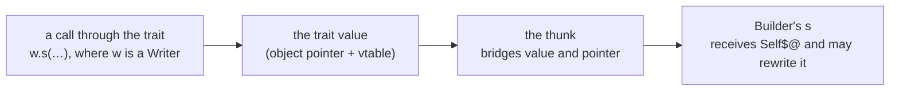
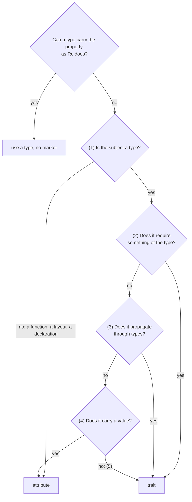
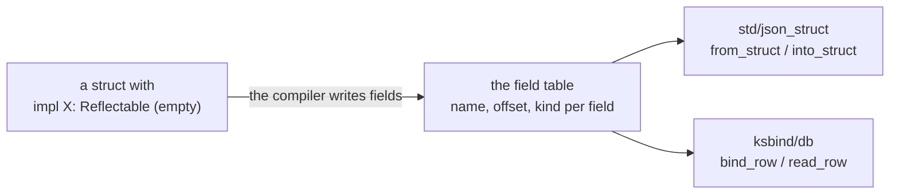
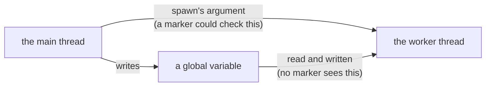
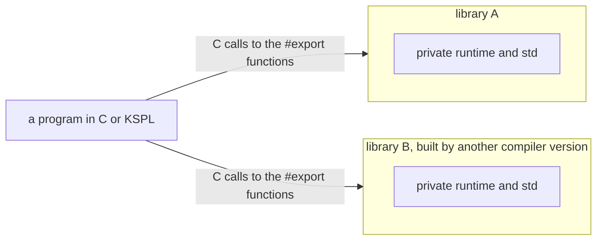

# The rationale behind KSPL's design

**This document says why the language is the way it is.** It answers two kinds of question: "why does KSPL do this differently from other languages?" and "why does this restriction exist?".

What the language *is* belongs to the specification, [`SPEC-programming-language.md`](SPEC-programming-language.md). For the rules alone, that is all you need. Read this document when two readings of the specification disagree, and before you propose a change to it. The principles its reasons rest on are in [`DESIGN-principles.md`](DESIGN-principles.md). Why the source text is written as it is (the indentation notation, names, keywords, line ends, long strings and documentation comments) is in [`DESIGN-notation.md`](DESIGN-notation.md).

## Symbols and syntax

**The symbols were not chosen for looks.** Each is what is left once every candidate that could be misread is struck out.

### Why taking an address and dereferencing are postfix

KSPL writes these two operators *after* the value. `val@` takes the address of `val`, and `ptr$` reads what `ptr` points at. Read left to right, the code then follows the data.

Both are **postfix** (docs/SPEC-programming-language.md §6.2):

```kspl
val: = 100
ptr: I32@ = val@ // "of val, the address"
x: = ptr$ // "of ptr, what it points at"
z: = p$.x // "of what p points at, the field x" - straight through, left to right
```

C's prefix `&` / `*` has three well-known problems, and postfix keeps none of them:

| C's problem | In C | In KSPL |
| :-- | :-- | :-- |
| **The precedence is counter-intuitive** | `*p++` is `*(p++)`, and `*a.b` is `*(a.b)` | There is no `++` / `--` (only `+= 1`), and postfix operators apply left to right |
| **It needs an extra operator** | `(*p).x` is cumbersome, so C added `->` | `.` dereferences automatically, so `p.x` works on a value and a pointer alike |
| **Declarations mislead the reader** | The `b` in `int *a, b;` is not a pointer, and `int (*fp)(void)` reads from the inside out. Declaring and taking an address are prefix, member access infix | Expressions and types run one way: `val@` has the type `I32@`, both postfix |

**The grammar closes in one rule**: `.` `[]` `()` `@` `$` `!` all fit `expr_postfix = expr_primary ( … )*`, "a primary expression followed by any number of postfixes". Parentheses are needed only to apply a postfix to the result of a binary operation (`(ptr + i)$`), where the meaning needs them anyway.

### Why the symbols are `@` and `$`

A postfix symbol must not be readable as anything else. Of all the ASCII symbols, only `@` and `$` pass the three tests below.

A postfix operator appears directly after a complete expression. That is also where a binary operator (one between two operands, as in `a * b`) appears. So the symbol must meet three conditions:

| Condition | Why | What it rules out |
| :-- | :-- | :-- |
| 1. **It is not a binary operator** | If dereferencing were `p*`, the `*` in `a * b` could be "`a` dereferenced" or multiplication, and neither the parser nor the reader could tell | `*` `&` `%` `^` `\|` `+` `-` `/` `<` `>` |
| 2. **It has no compound assignment `X=`** | Dereferencing is most often an assignment target, `p$ = v`. With `^`, `p^ = v` (assigning through a dereference) and `p ^= v` (XOR assignment) would differ only by a space | `!` too, since there is `!=` |
| 3. **It is not already taken** | `#` is attributes, `'` `"` `\` are characters and strings, `` ` `` sits badly with the surrounding tools, and `~` is prefix bitwise NOT | `#` `'` `"` `\` `` ` `` `~` |

Exactly two ASCII symbols pass. `@`, read as "at" (an address), takes the address, and `$`, the inverse, dereferences. **Error propagation's `!` is postfix although condition 2 rules it out for dereferencing**: what it yields is a value, never an assignment target, so `f()! = v` means nothing. A postfix `!` is therefore read only where no `=` follows it, and `a!=b` still compares ("Failure" in [`DESIGN-principles.md`](DESIGN-principles.md)).

The one operator deliberately made **prefix** is the type cast `T::v`. Its left side is a *type*, which no reader mistakes for an expression. What it still costs the parser is a section below. So is why `::` does not go to paths instead: "Why `::` stays the cast, and what it costs to parse".

#### Why directives are `##` and attributes are `#`

One `#` marks the declaration that follows it; two (`##`) mark the whole file. Counting the `#`s, not where they stand, tells the scope.

| Kind | Examples | Applies to |
| :-- | :-- | :-- |
| Attribute, `#` | `#inline`, `#cfg(flag)` | What comes next |
| Directive, `##` | `##error`, `##warning`, `##lint` | What encloses it: the file |

Both stand before their target, so **the number of `#`, not the position, fixes the scope**.

**Do not separate them with `!`.** Pairing `#!` against `#` costs twice:

* It reads like the negation in `#cfg(!flag)`, so `#!lint` is misread as "`#` with a negation attached".
* It overlaps the shebang, the first line (`#!/usr/bin/env -S ksplc run`) that lets a Unix shell run the file as a script. The lexer, which cuts the text into tokens, would have to tell the two apart by looking ahead. A wrong guess gives no diagnostic at all: the first line's directive becomes a line comment, and the writer has no clue.

`##` **cannot be read as an operator**: no prefix, infix or postfix `##` exists. `@` and `$`, all that "Why the symbols are `@` and `$`"'s conditions leave, are spent. Counting `#`, the shebang test is only "does it start with `#!`, and is the next character `/`", which a directive never matches. So a silent failure cannot be written.

Caution: **Keep the symbol and the name one token** (`Attribute_prefix` / `Directive_prefix`), not a sequence of elements. The grammar's whitespace skipping also skips newlines and line comments. So a name on the line after a lone `#` would join it, while the reader reads that line as an expression. As one token under the capital-initial rule, the separated form does not exist in the syntax.

**Names are not written into the grammar.** It stops at `Directive_prefix "(" ... ")"`, and `directive_shape` in `ksplc/sema/decl/attrs.kspl` holds which names exist, as attributes manage with the single rule `( "#" attribute )+`. Otherwise each new name would go in four places: the grammar rule, the `decl_top` alternatives, the AST kind and its name, and the normalization list. Missing one leaves a declaration writable but read by no stage.

Caution: **State the price honestly.** The arguments' shape differs per name: `##error` takes a foldable expression (one the compiler computes at translation time), and `##lint` takes `CODE = level`. `=` is not an expression, so the grammar accepts both shapes for both names, and `check_directive` must reject the crossings. Without it, `##error(CODE = level)` loses its assertion, and `##lint(<expression>)` is accepted with no level setting in effect. That is a step back from "not writable is stronger", pinned down by the case `directive_argument_shape` in `ksplc/tests/negative/target.kspl`.

#### Why type arguments are `<|…|>`

KSPL writes `Vec<|T|>`, not `Vec<T>`. `<|` cannot be "less than", so the parser knows at the second character that type arguments begin.

**Do not go back to angle brackets for familiarity.** `<` is also a comparison, so `a < b` and `Vec<T>` share their first character, and stay ambiguous until the rest is read. `<|` splits them at the second character. `a < b` is a comparison because `|` does not follow `<`, and `Vec<|T|>` is type arguments once `<|` is seen, with no backtracking or context.

**Angle brackets make someone else pay**: a special case in the lexer or the grammar. Every language that chose them pays, in the notation, the grammar or the implementation. KSPL pays one character in the writing and holds no special case.

Note: `type_args` in `ksplc/kspl.kspeg` fails at once unless it sees `"<|"`, so trying it at every identifier costs almost nothing. With angle brackets it would read a whole type-argument list there and discard it.

**The price is unfamiliarity.** Anyone arriving from another language writes it wrong once, while the ambiguity would be paid every time it is written.

#### Why `::` stays the cast, and what it costs to parse

`::` means a cast (`I64::x`), and a path to a module's member uses `.` (`Arena.new`). The cast makes the parser a little slower, and that time is won back elsewhere. A Rust-style `Arena::new` gets one error that names the fix.

**The parser still pays for the prefix cast.** KSPL's parser is a PEG parser: at each point it tries the grammar's alternatives in order and backs out of one that fails. A type and a value begin alike (`Arena` can be either). So at every operand the parser tries `type_expr "::"` and backs out, and does the same for the type in front of a literal (`T::{ … }`). Few of those operands are casts. Taking the forms out of the grammar gives the figures below, on files that hold neither form. They count the PEG parse alone, built at `-O2`; `ksplc --stats` counts the rule calls (how often a grammar rule is tried).

| Taken out of the grammar | Rule calls | Parse time |
| :-- | :-- | :-- |
| The cast, and the type in front of a literal | about a fifth fewer | about a fifth less |
| The cast alone | under a tenth fewer | within the noise |
| The type in front of a literal alone | a few percent fewer | within the noise |

Guards gain little. A lookahead before both tries cuts the calls, and the time, by a few percent at most. First-token guards cut more calls and no time: the calls they save are cheap.

**Giving `::` to paths would not buy this back.** The cost is the attempt at an operand's head, not the separator, and no product has measured a separator costing parse time. Nor would a second mark buy more than Rust's split of the namespaces (paths take `::`, fields and methods `.`). Type arguments that open with `<|` need no turbofish (Rust's `f::<T>()` form). A cast moved elsewhere still needs a mark, and every mark costs somewhere.

**The parse time is saved in the memo table instead.** The memo table is where the parser remembers each rule's result at each position, so no text is parsed twice. One table serves every file of a run: a generation stamp empties it, and it is sized from one slot per byte ([`../kspeg/memo.kspl`](../kspeg/memo.kspl)). It takes clearly fewer instructions and less time than a table zeroed per file. That saves more than taking the cast out would, with no change to the language. Parsing dominates a cold self-compile, and takes milliseconds once the syntax-tree cache is warm.

**What keeping `::` costs the writer, and the answer**: a Rust or C++ writer's `Arena::new(1024)`, read as a cast, gives three errors, none naming the fix. So where `T` is a module, or a type holding `name`, and `name` is nothing in scope, `T::name` is read as the path meant. It is reported as one error naming `Arena.new`. A cast of a value in scope (`I32::count`) is left alone.

**The one weakness of `.` everywhere** is that a local named like an imported module hides the module: below `io: = 5`, `io.out()` reads the local. Such a local or parameter is a warning at its declaration (`[W0502]` in [`../ksplc/docs/SPEC-diagnostics.md`](../ksplc/docs/SPEC-diagnostics.md)), not an error, since shadowing stays legal ("4.5 Scope and shadowing" in [`SPEC-programming-language.md`](SPEC-programming-language.md)). A second separator for modules (Swift 6.3's `Module::name`) would collide with the cast. `json::Value` and `Sz::n` have one shape, and only name resolution could tell them apart.

### Why immutability is the default

**A variable cannot be changed unless you mark it with `$`: immutability is the default** (docs/SPEC-programming-language.md §4.2), for three reasons:

1. **A marker goes on the minority side.** In this repository most local declarations and parameters are immutable (to recount, grep a tree that `ksplc lint` passes). Marking them would waste much.
2. **Writing shows up in the type.** With mutability the default, the source does not say what can be written. Nobody notices a write through a pointer that slips past the checks.
3. **It matches what readers expect and where other languages are heading.** `$` reads as "variable" from Perl and the shells. Rust's `&mut` / `let mut`, Swift's `let` default and Kotlin's recommended `val` all mark the mutable side.

**The marker is the same `$` as dereferencing**, because only `@` and `$` pass "Why the symbols are `@` and `$`"'s conditions; another symbol would only move the overloading. The two never meet. In an expression `$` appears only in `expr_postfix`, after a value. As a marker it stands in one of three positions: directly before a declaration's identifier (`$x: = 0`), on a parameter, and directly before a type's postfix `@`/`[` (`I32$@`). None can hold a dereference, so the grammar decides each uniquely, and neither the implementation nor the reader hesitates.

#### Why the mutability marker on a type argument is prefix

Where a generic declares that its type parameter can be mutable, the `$` goes in front: `struct Slice<|$T|>`, not `Slice<|T$|>`.

The rule is `docs/SPEC-programming-language.md`, 3.3. Three reasons put the marker in front:

1. **`$`'s position keeps its meaning.** The three marker positions of "Why immutability is the default" are all prefix and all mean "mutable", while postfix `$` is dereferencing in expressions.
2. **Postfix requires lookahead.** A `$` inside a type starts `$[` or `$@` (`Box<|I32$|>` is rejected with `expected '[' or '@'`). Admitting `T$` makes what follows `$` one of three things: `[`, `@`, or the end of the type. A type argument can also be an expression (`type_arg = type_expr | expr`; `<|4|>` and `<|bound|>` are in actual use), where a postfix `$` would overlap `p$`.
3. **Postfix is unreadable when nested.** `U8$[]$[]` would become `Slice<|Slice<|U8$|>$|>`, with the `$` wedged between closing brackets and no telling which level it belongs to. Prefix gives `Slice<|$Slice<|$U8|>|>`, with the marker directly before what it modifies.

**The desugaring moves the marker** from the constructor (`$[]` in `U8$[]`) to the type argument, because the type system carries immutability on the element type (`U8[]` is `make_slice(make_const(U8))`). The move is unavoidable, so the only question is how to write a modifier on a type. Other languages likewise write modifiers in front (`const T` / `&mut T`) and constructors behind (`T*` / `T&`).

**The declaration states whether it accepts the marker** (`struct Slice<|$T|> { … }`). So a `List<|$U8|>` against a type that does not declare it is a type error, not a lint found after the fact.

## The type system

**One rule runs through this chapter: a type says what it is, and nothing is inferred that a reader would have to guess at.**

### Why type inference is limited to local variables

Inside a function, `x: = 5` lets the compiler work out the type. A declaration outside every function must write its type.

Top-level declarations (`const`, variables, `extern` variables: everything declared outside a function) must carry a type annotation, and only local variables are inferred (docs/SPEC-programming-language.md §4.1), because:

1. **It follows an existing line.** Parameters, return values, `struct` fields and enum payloads all state their type. A top-level declaration is the file's interface, not a local variable. So requiring the annotation joins existing policy and adds no restriction.
2. **Inferring it would bring in a new failure mode.** Inference runs in declaration order, so a function body before a global would see a stale type. Avoiding that needs a pass typing every global before any function body. Globals depend on one another (`pub const B = a * 2;`), so it also needs resolution in dependency order and cycle detection. That is the ground of C++'s static initialization order problem. There, one global can be read before another file's global that it depends on is set.
3. **It does not balance.** It saves one type name, and gains only brevity.

**What is given up**: omitting a type name at the top level.

#### A type is redundant only where it is written twice

**The compiler calls a local's type annotation redundant only where its initializer already names that type.** That is the same type written at the initializer's head, or `Bool` over `true` / `false`. A type that could merely be inferred stays, because the annotation can be the only place a reader sees it. The report is [H0302], a hint on by default, so the tree holds none (its section is in [`../ksplc/docs/SPEC-diagnostics.md`](../ksplc/docs/SPEC-diagnostics.md)).

| The line | Reported? | Why |
| :-- | :-- | :-- |
| `p: Point = Point::{ … }`, `n: U8 = U8::v`, `k: Kind = Kind.small`, `xs: List<\|I32\|> = List<\|I32\|>.new(arena)` | Yes | The type is written twice |
| `count: Sz = items.len` | No | The annotation is the one place the type stands in the text |
| `$i: Sz = 0` | No | Deleting it changes the type: the literal would be `I32` |
| `wide: I64 = small` | No | The conversion follows the annotation |
| `return Option<\|I32\|>.some(n)` in a function returning `I32?`, `kinds.push(Kind.small)` | Yes, the variant's type | The signature or the parameter already says it |
| `k: = Kind.small`, `mode == Mode.on` | No | Nothing else says the type |

* **Inferable is not redundant.** In `count: Sz = items.len` the annotation is the one place the type stands in the text. A model reads the text and cannot hover ("The reader can be a model" in [`DESIGN-repository.md`](DESIGN-repository.md)). A person in KSPL's editor sees it only by hovering. So removing every inferable type would take it from the readers least able to recover it.
* **Deleting it keeps the type.** An annotation doing work is not reported: a literal takes its type from it, a conversion follows it, and `::{ … }` or `.small` are typed by it. Nor is a cast that [I0301] calls unnecessary, since deleting both would leave the value's own type.
* **The verdict holds for every type argument.** The check compares what is written, so a generic's line reads the same in each instantiation. A call is the exception: its type is its callee's, which an impl for one instance can change. So a call inside a generic is left alone.

**An enum's type at its variant goes where the place already gives it.** The language lets the name go in these places ("6.6.2 Where the type may be omitted" in [`SPEC-programming-language.md`](SPEC-programming-language.md)):

* a declaration's written type, and the place `=` assigns to;
* a call's parameter, and a variant's payload;
* a struct literal's field, or an array literal's element;
* the value a `catch` stands in for;
* the function's return and error types.

There, `return Option<|I32|>.some(n)` writes the type twice, once in the signature and once at the value. [H0302] reports the second, so the tree reads `return .some(n)`, `kinds.push(.small)`, `held = .none` and `throw .lost`.

* **The variant's name stays, and it says which value.** What goes is the enum's name, which the signature or the declaration still writes and the compiler checks the value against. At a `return` or a `throw`, that is the function's own signature. At a call, it is the parameter, which a reader looks up to learn what the argument means anyway. At `=`, it is the variable's declaration. In a payload, a field or an element, it is the variant's, the struct's or the array's. After `catch`, it is the call it stands in for.
* **Only where the variant's type is the one the place expects.** Then `.small` is looked up in the same enum, and the program does not change. An `if … else` in such a place passes the type to both sides. The whole expression takes the place's type, and each side takes the whole's. So `return .some(n) if ok else .none` needs no name either. Where nothing fixes the type, the name stays. That holds for a comparison, and for an `if … else` in no such place (`v: = .ok if c else .err`). It holds for an argument that a generic infers its type from, which the value decides.
* **One fix per line.** In a declaration whose annotation the initializer repeats, the annotation is reported and the variant keeps its type. `k: = Kind.small` and `k: Kind = .small` say the same. Two hints on one line would pull against each other.

**What is given up**: leaving out every type that could be left out. `count: Sz = items.len` stays, and so does an annotation written from habit. And a call's line no longer names an argument's enum: the reader of `kinds.push(.small)` finds `Kind` in the parameter.

### Why implicit conversion stops at what loses nothing

A number converts to another type without a cast only when no value can be lost, such as `I32` to `I64`. Integers and reals never convert silently, and two operands of different types meet only where one type holds every value of the other.

The permitted range is in [`docs/SPEC-programming-language.md`, 6.4](SPEC-programming-language.md).

Rust and Swift allow no implicit numeric conversion, though both keep reference coercions implicit (`&mut T` → `&T`, Deref coercion). Rust has not accepted proposals to make widening implicit. Chiefly, a mixed-width expression (`Foo(x * (y + z))`) **computes at the narrow width and then widens**, which hides the overflow.

**That reason does not apply to KSPL.** The expected type propagates down through the operator, so a wider receiver widens before computing. For `a: I32 = 100000`, `f: I64 = a * a` gives 10000000000, and the generated C is `(I64)((U64)((I64)a) * (U64)((I64)a))`. Received as `I32`, the same expression computes narrow and overflows. So KSPL can leave lossless widening implicit.

**Between integers and reals it is forbidden both ways.** Java's implicit `int` → `float` rounds an integer beyond 24 bits, and a line at "only what loses nothing" cannot accept that. An integer literal is an integer too: `2` takes no float type, and `2.0` is the one spelling of that value (Principle 6).

**Two operands of different types compute in one of the two.** That is the one holding every value of the other, by the same relation as an implicit conversion.

| Operands | Computed in |
| :-- | :-- |
| `I32` with `I64` | `I64`, which holds every `I32` |
| `I32` with `U32`, `I8` with `U8`, `Sz` with `U32` | Rejected: neither holds the other, so the writer casts one side |

C's answer, converting to the unsigned side, makes `-1 < 1u` false; that is the silent change this line exists to stop. A third, wider type (`I32` with `U32` computed as `I64`) would hold both. But the result would then be a type neither operand has, and the widest pair (`I64` with `U64`) would still have none. So the rule would end in a refusal anyway, only further away from the code that caused it.

#### Conversion also applies inside a Result

A function returning `T!E` (a `T`, or an error `E`) can `return` any value that converts to `T`.

When the expected type is `T!E`, the value is converted to the success type `T`, then wrapped.

```kspl
priv fn f(): Shape!Err
    p: = mem.alloc_as<|Sq|>()
    return p // the Sq$@ -> Shape upcast works inside a Result too
```

**Do not wrap only on an exact match.** Then no value needing conversion could pass under a Result, and `fn f(): Trait!Err` could only `throw`: its type writable, its success unreturnable (writable but ineffective). Diagnostics speak of the success type too: `return "str";` gives `expected 'I32'`, not `expected 'I32!E'`.

### A cast to an enum gives one of its variants

**An enum value is one of the variants its declaration lists.** An exhaustive `switch` names every variant and no `default`, and `variant_name` names each one. Both read a value that is none of them as the last one they test. So a number cast to an enum (`E::x`) must be a tag. The rules are "6.4 Type conversion (`::`) and implicit casts" in [`SPEC-programming-language.md`](SPEC-programming-language.md).

* **A constant is caught at translation time**, as a constant divisor of 0 is: what is fixed then is not left to run time.
* **The run-time check costs a comparison per variant where a number becomes an enum**, and nothing where an enum is only read.
* **The value is compared before it narrows to the enum's base type.** Narrowed first, `E::300` of an `enum E: U8` would wrap to 44, and pass as a tag nobody wrote.
* **A float or a `Bool` goes through an integer cast written out**, so the truncation shows where it happens. No number holds a payload, so an enum whose variants carry data is built, not cast.

**The cast stays, rather than being taken away.** A program reading an enum from a file or a wire format holds a number first. Without the cast, each such program writes a `switch` from numbers to variants by hand. That is a second copy of every tag. A variant added later leaves it behind, with nothing to show it (Principle 4).

**No second conversion returns `E?`.** It would be a second spelling of what `E::x` writes (Principle 6). And every caller would handle an absence, even where the number came from `I32::e` a line before. A number from outside is checked as other input is, before the cast. The cast's own check then guards against a mistake, as the bounds check guards an index.

**Raw memory can still hold a value that is no tag**: a write through a pointer cast, or a C function filling the enum. That is undefined, as a dangling pointer is ([`docs/SPEC-programming-language.md`, 14.2](SPEC-programming-language.md)). The cast is the one ordinary way a number becomes an enum, so the rule holds there (Principle 8).

### A cast from floating point to an integer saturates

**`I32::x` always gives an answer, and the same one on every target and backend.** NaN gives `0`, a value below the type's range its minimum, a value above it its maximum, and anything else is truncated toward zero. The rules are "6.4 Type conversion (`::`) and implicit casts" in [`SPEC-programming-language.md`](SPEC-programming-language.md).

* **Not undefined.** C leaves a value the type cannot hold undefined, and each target's instruction answers its own way. x86-64 gives the minimum for every such value, NaN included, while Arm saturates. An optimizer folding a constant can answer anything. A cast left undefined would print a different number per target, per backend and per optimization level. A sensor reading out of range would carry no sign of it.
* **Saturating, not stopping.** A cast is how a value is brought into a narrower range on purpose (a sample clipped to `I16`, a coordinate to a pixel). There the nearest bound is the answer wanted. Stopping the program would make every such cast need a range check first. That check is written by hand, with bounds that are easy to get wrong by one. Arm's conversion instruction saturates and gives NaN `0` itself, so on a microcontroller the rule costs nothing; x86-64 pays two comparisons.
* **NaN gives `0`**, the one integer that claims no magnitude, as Arm's instruction answers.
* **Each width saturates at its own bounds.** `I8::300.0` is `127`, not `300` narrowed through `I32` to `44`: going through a wider type first would bring back the wrap the rule exists to avoid.

**A constant that does not fit is a compile error**, as a constant integer overflow is (6.8 in [`SPEC-programming-language.md`](SPEC-programming-language.md)). What is fixed at translation time is not left to the rule for run time. `I32::1.0e20` written in the source is a mistake, never a deliberate clip. The width checked is the one every target holds, so `Sz::3.0e9` is refused on a 64-bit machine too. One fold decides it (`float_cast_of` in `ksplc/sema/decl/fold_float.kspl`). Both backends write a constant cast as that fold's value. So the C compiler and LLVM never fold it a second time.

**`to_i32` and its kin say none instead** (`x.to_i32(): I32?`, on `F64` and `F32`, in `std/math`, not in `std/lang`, which every program carries whether it calls them or not). Saturation hides that a bound was reached; a caller who must know, such as one reading a number from a file, needs the absence. The two do not spell one thing twice (Principle 6): the cast answers for every input, the method answers whether the input had an answer. Without the method, that caller writes the bounds by hand. The right ones are open one past the range (`-128.9` fits `I8`), which a hand-written check easily gets wrong. The name follows `std/strnum`'s `to_i64` for a string.

### A tag names another variant through its enum

**`b = E.a + 1` is written with the enum's name, and a bare `a` is refused** ("3.4 Enums (`enum`)" in [`SPEC-programming-language.md`](SPEC-programming-language.md)). A variant is named `E.a` or, where an enum is expected, `.a`. Say a tag expression could read `a` alone. That would open one place where the enum's names stand bare beside the file's own. A `const a` in the same file would then mean two things, depending on where it is written. The refusal names `E.a`, the spelling that folds. A bare `a` meant as an alias cannot arise either: two variants sharing a tag are refused.

### A slice is a std struct, under generics' rules

A slice (`U8[]`: a pointer plus a length) is not built into the compiler. It is an ordinary generic struct in the standard library, so what holds for generics holds for slices.

#### `T[]` is sugar for `Slice<|$T|>`

There is no built-in slice. `std/lang` declares `struct Slice<|$T|> { ptr: T$@; len: Sz; }`, and the slice notation is shorthand for it:

| Written | Desugared to | Elements |
| :-- | :-- | :-- |
| `U8[]` | `Slice<\|U8\|>` | Read-only |
| `U8$[]` | `Slice<\|$U8\|>` | Writable |
| `U8$[][]` | `Slice<\|Slice<\|$U8\|>\|>` | Read-only elements, each a slice of writable bytes |
| `U8[4]` | Not folded | A fixed-length array, not a slice |

`ksplc/parse/desugar.kspl` desugars **the type expression as written**, folding the postfixes from the left. So `U8$[][]` is an immutable-element slice of mutable-element slices; reverse the order and the markers swap. A postfix carrying a size (`[N]`) is a fixed-length array and is not folded.

**Diagnostics show the sugar** (`ksplc/sema/type/display.kspl`), not a type name the user never wrote, such as `std_lang_Slice_U8_Const`.

**The sugar is the only spelling of a slice type.** `Slice<|U8|>` written as a type is a compile error naming `U8[]`, as `Option<|T|>` is for `T?` ("`T?` is sugar for `Option<|T|>`" below). Two spellings of one type would leave a reader wondering whether they differ (Principle 6). Only `std/lang`'s declaration of `Slice` names it.

**Being a struct spares three special cases.** A descriptor literal (`::{ .ptr = …, .len = … }`) is an ordinary struct literal, the C type name is mangled like any other generic's, and the layout follows from the fields. An out-of-bounds index, too, stops through the one `bounds_panic` in `std/lang`.

#### `impl<|T|> T$[]` is an ordinary generic impl

`T$[]` is sugar for `Slice<|$T|>`, so adding methods to every slice is no different from adding a method to `List<|T|>` (docs/SPEC-programming-language.md §9.3).

#### Immutable and mutable instances: one C struct, two KSPL types

A read-only slice and a writable slice are two KSPL types, so the compiler keeps them apart. The generated C uses one struct for both, so passing a writable slice where a read-only one is expected costs no cast.

`U8$[]` passes where `U8[]` is declared (docs/SPEC-programming-language.md §3.3), yet **as KSPL types they stay two**. Immutability rides on the field's type, so the `p` of `Box<|$I32|>` is `I32$@` and that of `Box<|I32|>` is `I32@`. In C they are one struct, so the one step of weakening emits no cast. With a struct each, the generated C would refuse to pass one where the other is declared. How the C name drops the mark belongs to the compiler ("Immutability marks in a type" in [`../ksplc/docs/DESIGN-sema.md`](../ksplc/docs/DESIGN-sema.md)).

**The body is instantiated per instance**, so a write to the element inside the immutable version is rejected at translation time, not at run time.

#### Making a single instantiation the target of an impl

`impl U8[] { ... }` adds methods to byte slices alone, and it cannot overlap a general impl.

`impl U8[] { ... }` needs **no new notation**. An impl's target is a type expression: a template when it holds the impl's own type argument, and that one instance when it does not. The matching rules are docs/SPEC-programming-language.md §9.3 (the check is `impl_target_rejects` in `ksplc/sema/decl/mono.kspl`).

**Overlap is rejected.** Otherwise the template's table would overwrite by name, keeping whichever impl was collected later (Principle 5). Swift's "the more specialized one wins" is not adopted: a reader cannot tell which one is in effect.

**The designs people complain about make you write the same thing a different way.** KSPL already has `impl<|T|> Box<|$T|>`, and a concrete target follows from the same rule.

### A type argument with nothing to bind to is rejected

**A type parameter must be bound by something: the receiver's instance (the type the method is called on), or the actual arguments of the call.** Three positions have neither. Each is a compile error where it is written, not passed on to a later stage as a name bound to nothing (Principle 5).

| Position | Example | Section |
| :-- | :-- | :-- |
| A name on the impl that the receiver leaves open | `impl<\|T, U\|> List<\|T\|>` | 2.4.1 |
| A mutability marker on the impl's own type argument | `impl<\|$T\|> Box<\|T\|>` | 2.4.2 |
| A type argument at the call of a generic type's method | `q.get<\|U8\|>()` | 2.4.2 |

#### A name on the impl that the receiver leaves open

`impl<|T, U|> List<|T|>` cannot be written (docs/SPEC-programming-language.md §3.3): **the receiver's type does not determine `U`**, since `List<|I32|>` says nothing about it.

Caution: **It must not pass silently.** The grammar accepts it, so `collect_impl_decl` in `ksplc/sema/decl/collect.kspl` rejects it at the declaration.

**A method's own type arguments can be written** (`impl<|T|> List<|T|> { fn select<|U|>(…) }`). The call site binds `U`, and it has actual arguments.

```kspl
impl<|T|> Holder<|T|>
    fn to<|U|>(r: Self, u: U): Holder<|U|>
        …
h.to(true)          // U is determined from the actual argument
h.to<|Bool|>(true)  // may also be written
```

**Such a method is instantiated at the call site**, since the receiver's type arguments alone cannot instantiate it. It can be written because the method table is built when it is looked up. A table built along with the type would have nothing to fix `U` with. How the compiler finds and instantiates it is "Where the instantiation queue is drained" in [`../ksplc/docs/DESIGN-sema.md`](../ksplc/docs/DESIGN-sema.md).

#### An impl's mutability marker, and a call's type argument

**The mutability marker takes effect only on the target side.** A `$` on the impl's own type argument (`impl<|$T|> Box<|T|>`) changes nothing. `apply_arg_mut_mark` reads the marker from the declaration that declared that position (the variance of `struct Box<|$T|>`). An impl's list only names what to bind, and the target type expression alone decides which instance the impl attaches to. Writable but ineffective, it is made unwritable (Principle 5). So, for the same reason, is a type argument written at the call site on a generic type's method.

Caution: **This is not only about the marker.** A method's type arguments belong to the enclosing `impl`, and the receiver's instance has already fixed them. A `q.get<|U8|>()` on a `Plain<|I32|>` value has nothing to bind to, and accepting it would discard it silently.

A method that declares **its own** type arguments (`fn m<|$T|>(…)`) can be written. It is instantiated from a template, so both the count and the markers can be matched.

**Rust and Swift reject it too.** The complaints there are about the notation, not the rule, so KSPL takes the same rule. It adds only the diagnostic's content: where the type argument came from, and where it belongs.

### A generic's type arguments are inferred from the actual arguments

**You write `f(x)`, and the compiler works `T` back from `x`'s type; keep it so, and do not swing to "always require `<|T|>` explicitly".** Calls that omit the type argument outnumber those that write it by an order of magnitude, and most of them are `arena.create(x)`. Requiring it would mean writing nested generics such as `arena.create<|List<|U8[]|>|>(…)`. That costs clearly more than reading the type in the text gains.

The design already infers what is determined and asks for the rest. Where `T` is the parameter's type itself (`Arena.create<|T|>(init_val: T)`), working back is unique; where `T` appears only in the return (`alloc_as<|T|>()`), it must be written. No cheap part is left to cut.

**The type a call's result is given does not fix a type argument**: `y: U8 = zero(5)` is refused, as `x: = zero(5)` is, and asks for `zero<|U8|>(5)`. Inference runs one way, from the arguments to the call. It runs so for a function named as a value too ("A generic function used as a value names its specialization"). Run the other way too, the same `zero(5)` would build a different copy depending on where it stands. The call itself does not show that. And it would still need the type arguments written wherever nothing fixes a type. Examples are a declaration with no type, and an argument of another generic. Written once at the call, they read the same everywhere.

**What is inferred is a function's own type arguments, however the function is reached**: `f(x)`, `h.to(x)` and `Holder<|I32|>.to(h, x)` alike. **A generic type's are not inferred from a call through it**: `Holder.mk(1)` is a compile error that says to write `Holder<|I32|>.mk(1)`. The type written before the `.` is what chooses the instance. It is so for a variable's type or a field's too ("An impl's mutability marker, and a call's type argument"). Many of a type's functions take nothing that would fix it (`List<|I32|>.new(null)`). So inferring it would add a second form that works for only some of them (Principle 6).

**The price is that instantiation comes after the arguments' inference.** Right after instantiating, the compiler must check the actual arguments again against the substituted parameter types. Skip that, and broken C comes out with zero diagnostics. The check is in [`../ksplc/docs/DESIGN-diagnostics.md`](../ksplc/docs/DESIGN-diagnostics.md), under this heading:

* ["A generic call's arguments are checked after instantiation"](../ksplc/docs/DESIGN-diagnostics.md#a-generic-calls-arguments-are-checked-after-instantiation)

#### A generic function used as a value names its specialization

**To pass or store a generic function as a function pointer, you write which copy (specialization) you mean: `f: fn(x: I32): I32 = same<|I32|>`.** A generic function's code exists only as specializations, one per set of type arguments, and a function-pointer value is the address of one of them. Written `same<|I32|>`, it is built where it is named, as a call would build it, and its type is checked against the expected one. The bare `same` there is a compile error that says to write it.

**The type arguments are not inferred from the expected type.** The inference of "A generic's type arguments are inferred from the actual arguments" works back from actual arguments. A function named as a value has none. Working back from the expected type would be a second direction of inference, which no other position has. An anonymous function's types are not taken from where it is passed either ("Why capture is made explicit and escape is forbidden"). It would also reach only some positions. Where the receiving parameter is itself generic (`apply(same, 3)` with `fn apply<|F|>(f: F, x: I32)`), nothing is expected at all, and a bare name already has to be written out there. Writing the specialization works in every position, so it is the one form (Principle 6). The reader sees which copy is taken without opening the receiving function.

**Passed to a generic parameter, or bound to a declaration with no type, the name gives its function type**: `apply(same<|I32|>, 3)` binds `F` to `fn(x: I32): I32`, and `f: = same<|I32|>` makes `f` one. This is the inference of "A generic's type arguments are inferred from the actual arguments". It runs from an actual argument to the parameter, and is not a second direction. The written specialization names one function, and its signature is in the text. These each name one function too, and give their types the same way:

* a non-generic function's name;
* a method named through its type ("A method as a value is named through its type");
* an anonymous function.

Refusing them while taking the specialization would make a plain function harder to pass than a generic one. A declaration with no type is the same question: the type a local takes from its initializer ("Why type inference is limited to local variables"). The answer is in the text where the name is written. Writing the function type out instead would repeat what the declaration already says. The bare `same` names no one function, so it stays a compile error there as everywhere. **`F` becomes a function-pointer type**, the same for every function of that signature. So two functions of one signature pass through one instance of `apply`, and a variable of that type holds either.

**Type arguments after a function that declares none would bind nothing and change nothing** (Principle 5), so "8.1 Definitions" in [`SPEC-programming-language.md`](SPEC-programming-language.md) refuses them.

**What is given up**: `f: fn(x: I32): I32 = same`, leaving the specialization to the expected type. Each use costs the few characters of `<|I32|>`.

#### A method as a value is named through its type

The rules are "8.1 Definitions" in [`SPEC-programming-language.md`](SPEC-programming-language.md); this section holds why.

**Every type argument is written, each where it belongs**: a generic type's on the type, the method's own after the method (`Keeper<|I32|>.pair<|U8|>`). Each instance of `Keeper` has its own copy of each method. A generic method has one copy per specialization. So a value names one, as in "A generic function used as a value names its specialization". The bare `Keeper.keep` and `Meter.same` are compile errors that say what to write.

**A method named through a value (`p.read`, not called) is a compile error.** A function pointer is an address alone, with no room for the receiver. So `p.read` would have to keep `p` somewhere. That is a closure, which states what it captures and is written as one ("Why capture is made explicit and escape is forbidden"). Naming the method through its type and passing the receiver at the call keeps the value an address.

**A trait's method named through the trait (`Shape.area`) is a compile error.** It is a slot that each conforming type fills with its own function. There is no one function to point at. A conforming type's method is named through that type.

**What is given up**: a bound method, `p.read` standing for "read `p` later". Where one is wanted, the receiver is passed at the call.

### Generics also take translation-time constants as type arguments

A type argument can be a constant, as in `Ring<|512|>`. That is how a buffer of fixed size lives inside a type where no heap (memory allocated at run time) is available.

What can be written is in [`docs/SPEC-programming-language.md`, "3.3 Structs (`struct`)"](SPEC-programming-language.md#33-structs-struct).

**It is the only way to embed fixed-capacity memory in a type where no heap is available.** The declaration alone fixes the size of `struct Buf<|const N: Sz|> { data: U8[N]; }`. So it works where `alloc` cannot be called. That is in an interrupt handler, before the scheduler starts, and right after a freestanding boot. (A freestanding boot is a program starting with no operating system under it.) With the value on the type, `% N` is also a constant in the generated C. So no software division is called, even on a target without hardware divide.

**Arithmetic cannot be written in the argument position**, because the notation as written is the canonical name. Naming by the folded value would turn `true` into `1` and land a `Bool` type argument on a different type. Write the arithmetic in the `const`'s definition: a `Foo<|N|>` given `const N: Sz = 4 * 2;` is the same type as `Foo<|8|>`. The array-length position (`T[ROWS * COLS]`) creates no canonical name, so arithmetic is accepted there: the only place two positions treat the same value differently.

**A parameter's kind is checked where the argument is written, a generic's own declaration included.** `fn f<|const N: Sz|>(h: Hold<|N|>@)` passes a value where `Hold` takes a type, and is refused at the declaration, whether or not anything calls `f`. Left to a call, the mistake would show as the call's argument failing to match. That blames the caller for the declaration's error. And a generic nobody calls yet would keep it hidden.

**A capacity on the type fixes the memory's size at translation time only where the memory is embedded in the type.** Where the memory is passed separately, it is passed as a slice. The receiver compares the slice's length with the type argument when it is handed over. `std/ring.kspl`'s `Ring<|CAP|>.new` takes a `U8$[]` and stops the program unless its length is `CAP`. So the two guarantee different things. The type argument keeps the arithmetic constant (the wrap `% CAP` needs no division at run time). The slice carries the bounds, which every access then checks. A bare address would carry no length, and a capacity differing from the buffer would write out of bounds unseen.

**A `const` parameter is read off the argument where it stands as an array's length or as a generic's value argument.** `sum(s)` with `s: I32[3]` makes `N` of `fn sum<|const N: Sz|>(v: I32[N])` 3. `cap(b@)` with `b: Buf<|8|>` makes `N` of `fn cap<|const N: Sz|>(b: Buf<|N|>@)` 8. Each is part of the argument's type. So the argument determines the value as uniquely as it determines a type parameter standing bare. See "A generic's type arguments are inferred from the actual arguments". Writing `sum<|3|>(s)` or `cap<|8|>(b@)` would repeat what the declaration of `s` or `b` already says. The two are one value to the rule: `fn fit<|const N: Sz|>(b: Buf<|N|>@, v: I32[N])` takes `N` from either argument. Where two arguments fix it to different values, the call is refused naming both. Say it took the first, as a type parameter does. The instance would then refuse the second argument alone, though either can be the wrong one.

**Nothing else gives a `const` parameter's value.** A slice's length is known only at run time, so it fixes nothing at translation time. A length written as arithmetic on the parameter (`I32[N + 1]`) is not solved for `N`. Where nothing gives the value, the call writes it (`sum<|3|>(I32[]::s)`), and a value written there decides as any written type argument does.

**What is given up:**

* **A separate body per value.** `Ring<|4|>` and `Ring<|8|>` are different types, so a type and its functions are emitted into the generated C once per value used.
* **The declaration-synthesizing features skip it.** `variant_name` is not synthesized for an `enum` carrying a const generic, because the type arguments' notation is not reconstructed ([`ksplc/docs/DESIGN-parse.md`, "Synthesizing an `enum`'s `variant_name`"](../ksplc/docs/DESIGN-parse.md#synthesizing-an-enums-variant_name)). Every new declaration-synthesizing feature needs the same exception.

### Whatever returns a view returns an immutable view

**A function that returns a view (a slice pointing into existing data) returns a read-only one. Only a function that takes a writable slice can hand back a writable view.** Every slicing function in `std/chars` and `std/str` returns an immutable view.

```kspl
pub fn sub(r: U8[], start: Sz, len: Sz): U8[]
pub fn sub_from(r: U8[], start: Sz): U8[]
pub fn split(r: U8[], delimiter: U8, ...): List<|U8[]|>
pub fn lines(r: U8[], ...): List<|U8[]|>
```

Caution: **Do not return a mutable view from an immutable input.** `U8$[]::{ .ptr = <immutable pointer> }` is a hole in immutability, through which the caller writes into a read-only region. Exactly one function writes into a slice: `sub_mut(r: U8$[], start, len): U8$[]`, which takes a mutable receiver. So no path leads from an immutable receiver to a mutable view.

Immutable accepts mutable, so widening a declaration toward the immutable side never breaks a caller.

#### The clamping of a range is held in one place

One function, `sub_count`, decides how many elements a requested range really has. Every slicing function goes through it, so none can build a slice with a negative or overflowing length.

**A function carving out a view must not assemble the descriptor itself.** `T$[]::{ .ptr = xs.ptr + s, .len = xs.len - s }` gives a negative length when `xs` is empty, and whoever trusts `len` advances without limit. Neither the type system nor the checks stop it.

One place decides how many elements a range really holds: `sub_count(count, start, len)` (`std/lang`). Every slice's `sub` / `sub_from` / `sub_mut` (`std/chars`) and `std/ds`'s `List.sub` / `List.sub_from` go through it. It makes two decisions:

| What is inspected | What happens if it is dropped |
| :-- | :-- |
| The **lower** side of `start` | `Sz` is signed, so a negative `start` points before the beginning |
| **Not** comparing with `start + len` | An enormous `len` wraps the addition itself and slips past the clamp |

**Out of range returns empty; it does not panic.** Indexing (`xs[i]`) panics because the caller can compute the range from `len`. Slicing asks whether a range exists, and if it does not, empty is the answer.

**A slice is a struct whose immutability rides on its element type. That has two consequences inside the compiler.** One is how a descriptor literal's fields are checked. The other is why an immutable slice's `ptr` is not `const` in the generated C. Both belong to the compiler:

* "Immutability marks in a type, and the API that asks" in [`../ksplc/docs/DESIGN-sema.md`](../ksplc/docs/DESIGN-sema.md);
* "Genc orders its type definitions after stripping immutability marks" in [`../ksplc/docs/DESIGN-backends.md`](../ksplc/docs/DESIGN-backends.md).

### Where permission lives changes with whether it is owned

**A read-only container (the receiver) protects its elements only if it owns them.** A `List` allocated its elements and owns them, so a read-only `List` protects them. A slice only borrows memory someone else owns, so there the container's permission and its elements' are separate axes, and the slice's element type decides. So whether `a[i] = v` passes through a read-only receiver is decided by the receiver that the `Index_place` implementation declares (`index_stops_permission_walk` in `ksplc/sema/decl/access.kspl`; the rule is docs/SPEC-programming-language.md §6.1.2):

| Container | What it declares | What speaks for permission |
| :-- | :-- | :-- |
| `Slice<\|$T\|>` | `at(r: Self@, …)` | The returned `T$@`: borrowed, holding only `ptr` and `len` |
| `Tensor<\|T\|>` | `at(r: Self@, …)` | The returned `T$@`: passed by value, sharing what `data` points at |
| `List<\|T\|>` | `at(r: Self$@, …)` | The receiver: it owns the region it allocated |

`Tensor` is on the borrowed side because ksai treats it so. `matmul_into` takes its output by value as `out: Tensor<|T|>` and writes into what `out.data` points at. `view_rows` and `safetensors.get_tensor` return views pointing at another tensor's `data`. If `at` declared `Self$@`, `(out.data + i)$ = v` would pass in the same function where `out[i] = v` is rejected.

**So `List` gets no mutability marker.** Receiving `List<|T|>@` already says "do not touch the contents", and `List<|$T|>` would be a second means to the same purpose (the chapter "One notation per purpose" in [`DESIGN-principles.md`](DESIGN-principles.md)). A slice, passed around by value, needs the marker because it has no axis but its type.

**A read-only slot does not mean nothing can be written through it.** The walk up the path to the root stops at a pointer type and answers with the immutability of what it points at. So for `x: H@`, `x.p$ = 22` (a field of a bare pointer) passes. Indexing follows the same rule, with the return type of `at` stopping the walk. Where the compiler walks the path is "Where immutability's two axes are enforced" in [`../ksplc/docs/DESIGN-sema.md`](../ksplc/docs/DESIGN-sema.md).

#### The receiver of a read-only method is `Self@`

A method that does not change its receiver takes it as `Self@`, a read-only pointer, so the caller needs no `$`.

None of `std/seq`'s methods rewrite the receiver: they return a new `List` or count a value. So their receiver is `Self@`, as is that of `std/ds`'s `List.get`. `Self$@` would **force a `$` onto the caller's binding though nothing is written**, leaving the lie "this gets rewritten" in the text.

Caution: **Keep `slice` / `at` / `items` as `Self$@`.** Each returns a writable pointer or slice into the receiver, so calling it on a read-only receiver would wash away const. Only `get`, which returns a value, can safely be relaxed.

#### The receiver's permission decides whether an index is a 'place'

On a read-only receiver, `a[i]` reads through `get`, which returns a copy, never through `at`, which returns a writable pointer.

`a[i]` resolves first to `Index_place`'s `at`, a mutable pointer to the element.

Caution: **Do not choose it when the receiver is read-only.** `at` takes `Self$@`, so through a read-only place such as `xs: List<|T|>@` the generated C discards const, with zero diagnostics from ksplc (against Principle 2). `for x in xs` expands to indexing and takes the same path. Reads go to `Index.get` instead (safe, as it returns a value), and writes to `Index_mut.set`. How the compiler keeps this choice in one place is "Where immutability's two axes are enforced" in [`../ksplc/docs/DESIGN-sema.md`](../ksplc/docs/DESIGN-sema.md).

### A typedef is only another name

`typedef User_id = I32;` gives `I32` a second name; it does not make a new type. For a type the compiler keeps apart, declare a struct with one field.

The rule is "3.5 Typedefs (`typedef`)" in [`SPEC-programming-language.md`](SPEC-programming-language.md).

**The reason**: a typedef told apart from its type would be "the same type, but remembered". Every value would carry one of two spellings, and every feature would have to say which. Examples are a variant built through the typedef, and a function called through it. Another is a value returned where the typedef is declared.

Rust's `type`, Swift's `typealias`, C's `typedef` and Go's `type A = B` all name the same type. A language needing a separate type declares one (Rust's and Haskell's newtype, Go's defined type). KSPL already has that means, a struct with one field. It costs nothing at run time and makes the mix an error, not a warning (Principle 6).

**What is given up**: a typedef carries intent the compiler does not check. `User_id` and `Order_id` over `I32` mix silently; where that matters, declare structs.

### Why `Bool` keeps ordering and has no arithmetic

`false < true` works, but arithmetic and shifts (`true + true`) do not, and no number converts to `Bool` by a cast: write `x != 0`.

The operators `Bool` takes, and the answers arithmetic would silently change, are in "6.1 The operator list and precedence" in [`SPEC-programming-language.md`](SPEC-programming-language.md).

**The reason ordering stays**: `false < true` has one fixed meaning, and sorting on a boolean key is genuinely needed.

**What is given up**: a flag is counted only through a conversion, `I32::flag`.

**No number casts to `Bool`.** C's `_Bool` makes every non-zero value true. A conversion that keeps the low bit (LLVM's `trunc`) makes `2` false. A cast would have to pick one of two readings a writer could hold. `x != 0` already says the one meant, so a second spelling of it is not carried (Principle 6). The comparison reads the same to everyone.

### Why an unsigned minus and a fixed-answer comparison are refused

`-u` on an unsigned integer, and an integer compared with a constant outside every value its type holds (`x == -1` with `x: U8`), are compile errors. The rules are in "6.8 Integer arithmetic: folding, overflow, division, shifts" in [`SPEC-programming-language.md`](SPEC-programming-language.md).

**Both are written but do nothing a writer meant** (Principle 5). An unsigned type holds no negative, so `-u` can only wrap: with `u: U32 = 5` it is `4294967291`. A `U8` compared with `-1` computes at `I32`, where the `U8` is widened to `0` … `255`, so the answer is false whatever the value.

**Why errors, not warnings**:

1. **The same comparison against a `U32` is already an error**: there `-1` is a literal out of the type the comparison computes in. Whether a narrower type is refused would otherwise hang on a promotion detail.
2. **The answer is fixed at translation**, so no program needs the comparison as written; the fix is always a different spelling.
3. **A warning would be noisy only in generic code**, where a type argument makes a comparison fixed in one instance and not another. KSPL reports neither check inside a generic instance, so that cost does not arise.

**Where the meaning was wrapping, it is still written**: `0 - u` is the wrapping negation, and a cast reads the bits the other way first (`I8::x == -1`). A literal under the minus (`u: U32 = -1`) stays the literal's range error, which names the cast that keeps the bits.

**What is given up**: C's `-u` idiom for "the two's complement of an unsigned" needs `0 - u`, three characters more.

### Why the size and index type `Sz` is signed

The short spelling is explained in "Why the size type is named `Sz`" in [`DESIGN-notation.md`](DESIGN-notation.md#why-the-size-type-is-named-sz).

`Sz`, the type of sizes and indices, can be negative, unlike C's `size_t`. A subtraction that goes below zero then stays visibly negative instead of turning into a huge number.

`Sz` is signed, the reverse of C's `size_t` and Rust's `usize`. The `size_t` row of "What cannot be written in C's types" rests on this decision.

1. **A difference fits in the type.** Indices and lengths get subtracted (`remaining = len - start`, reverse loops, the distance between two positions). Unsigned, an `a - b` below zero becomes an enormous positive value passing as a length or an index. Signed, it stays negative, and one bound comparison catches it.
2. **It can count down.** `Range.desc(n)` stops just past 0. With an unsigned index, "one before 0" is the maximum value, and a downward loop cannot be written plainly.
3. **The width matches at the C boundary**: a pointer difference is `ptrdiff_t` in C too.

**What is given up**: the representable maximum halves, and every interface taking a length or an index has to reject negative values itself. A check of the upper bound alone (`start < count`) lets a negative `start` through. The interfaces that carve out a range share that decision, `sub_count` ("The clamping of a range is held in one place").

Caution: **A proposal to make it unsigned must answer all three points above.** Point 1 can be replaced by "check the order before taking the difference", but forgetting that check still silently yields an enormous length.

### `T?` is sugar for `Option<|T|>`

A value that can be absent is written `T?`. It is `std/lang`'s `Option<|T|>`, folded in the parse as `T[]` is folded into `Slice<|T|>` ("`T[]` is sugar for `Slice<|$T|>`").

| Written | Desugared to |
| :-- | :-- |
| `I32?` | `Option<\|I32\|>` |
| `U8[]?` | `Option<\|Slice<\|U8\|>\|>`: an optional slice |
| `U8?[]` | `Slice<\|Option<\|U8\|>\|>`: a slice of optional bytes |
| `I32?!E` | a result whose value can be absent |
| `(I32!E)?` | an optional result |

* **The marks fold from the left**, as `[]` does (`fold_sugar_postfixes` in `ksplc/parse/desugar_slice.kspl`), so the order written is the order read.
* **`?` is the mark Swift, Kotlin and C# give an optional value**, so their readers read it on sight. A result is marked with `!` ("Failure" in [`DESIGN-principles.md`](DESIGN-principles.md)), so `?` names absence alone.
* **Diagnostics show the sugar**, as they do for a slice; an optional result is written in brackets, `(T!E)?`.
* **`T!E?` is refused.** The `!` takes the whole type after it, so the `?` would land on the error type. An absent error is a failure with nothing to say. The note names both readings the writer can have meant.
* **The long form is refused as a type, and stands only in an expression.** A type written `Option<|I32|>` is a compile error naming `I32?`, an `impl`'s target included (`impl<|T|> T?`). So an optional is spelled one way (Principle 6). A hint would leave the second spelling accepted. An expression that names the type has no other spelling (`Option<|I32|>.none`, where a `?` cannot stand), so it keeps the long form. Source the compiler writes from a folded type spells the sugar back (`spell_as_written` in `ksplc/parse/desugar_slice.kspl`).
* **A `?` after a value marks nothing.** There is no early return of an absent value (Rust's `?` on an `Option`). `if v: = x` takes the value out ("Unwrapping an `Option`" in [`DESIGN-principles.md`](DESIGN-principles.md)). Keeping it the one way keeps what a `?` means to one thing.

### `T!E` is sugar for `Result<|T, E|>`

A result is written `T!E`, folded in the parse into `std/lang`'s enum `Result<|T, E|>` as `T?` is folded into `Option<|T|>`. The rules, the desugaring included, are "8.3 Error handling" in [`SPEC-programming-language.md`](SPEC-programming-language.md); this section holds why.

**Why a library type, not the compiler's own**: one mechanism then serves the optional and the result. And a result is a value like any other.

* **A built-in kind would stand apart from every other value.** It could not be stored, passed through a generic or switched on. So a failure that has to wait would need a second type. Examples are a task's outcome kept in a queue, and a batch of answers checked at the end. And `(A!B)!E` and `A!B!E` would come to one type. Its layout, its reference counting and its unpacking would be written a third time beside the enum's and the optional's.
* **What the enum gives.** Layout, reference counting and code generation are the enum's, so nothing about a result is special past the sugar and the three operators.
* **`!` and `catch` stay**: they are what makes failure cheap to pass on, and a `switch` alone would make every call site three lines.
* **The long form is refused as a type** so that a result is spelled one way (Principle 6). An expression keeps it only because no `!` can stand there.
* **A result crosses no C boundary because its layout is the enum's tagged union** ("11.1 Types that cannot cross the C boundary" in [`SPEC-programming-language.md`](SPEC-programming-language.md)). A C caller gets a status and an out-parameter, written as such.

**A result nobody takes apart is refused because the type says the call can fail.** A failure dropped in silence breaks that promise where nothing shows it. A warning would leave the second reading accepted, and the same code would compile clean on a machine that turns warnings off.

* **A binding whose name opens with `_` counts as dropping it**, since `_` is the mark that silences the unread-variable warning.
* **`f() catch {}` drops a failure on purpose**, and the reader sees it where it happens.

**What is given up**: "can be absent" (`I32?`) and "can fail" (`I32!E`) differ by one mark, so a signature is read to its last character.

## Traits and markers

**A trait is the only thing in KSPL that rides on the type system.** Only a trait combines with generics and is checked by the type checker. So a property pasted onto a type is either a trait or an attribute (a `#` mark such as `#inline`). This chapter says which, and why.

### Why a trait's receiver is fixed to a bare `Self`

In a trait's declaration, a method's receiver is always written plain `Self`. Each implementation chooses for itself whether it takes the receiver by value or through a pointer it can write through.

A `trait` method's receiver **is written only as a bare `Self`**; `Self@` / `Self$@` are compile errors (docs/SPEC-programming-language.md §5.3). The implementation can receive it in any form.

```kspl
pub trait Writer
    fn s(r: Self, val: U8[]): Self // the receiver is always a bare Self

impl Builder: Writer
    pub fn s(r: Self$@, s: U8[]): Self$@ // the impl may receive Self$@ and rewrite it
        …
```

A call through the trait reaches the implementation in two steps. A *thunk*, a small function the compiler generates, sits between the vtable and the implementation and bridges value and pointer:



**In a trait's receiver position, `$@` would not mean what it means elsewhere in a type.** Elsewhere it says value or pointer, and whether what it points at is rewritten:

* **It would bind nothing on the implementation.** The conformance check ignores the receiver's notation, and the thunk bridges value and pointer. So an implementation can take `Self$@` and rewrite the receiver. A trait value is a fat pointer to `v` (object pointer + vtable), not a copy, so the rewrite reaches the original.
* **It would bind only the caller.** A declared `Self$@` engages the lvalue check in `ksplc/sema/body/call.kspl`: the receiver must be a place that can be written, such as a variable. That check rejects a temporary as the receiver, as in `io.out().s("x")`.

**Enforcing agreement, as Rust does, is not open.** The declaration must be `Self` for `io.out().s(…)` to be writable, and the implementation must be `Self$@` to rewrite. The two must differ, which is why the thunk exists, so the choice is removed instead.

**Elsewhere a receiver on the trait is either absent or enforced.** Go, Swift, Java and C# write none there (Swift's `mutating` is a method modifier, and enforced). Rust enforces exact agreement (E0053), and C++ enforces the `const` of `virtual void f() const;`. With one form, KSPL sits with Go. The asymmetry with the impl is sound: what means different things is written differently.

**What is given up**: a trait cannot state "this method requires an lvalue receiver". No working protection is lost: whether a rewrite reaches the caller was always the implementation's choice, by taking `Self$@` or not.

**A guarantee that "the receiver is not rewritten"** would need a marker per method (for example `fn draw(r: Self) # readonly;`). The receiver's type cannot carry that contract: the thunk makes the receiver rewritable, and the fat pointer makes no copy.

Omitting a parameter's type, and `Self` on a parameter **other than the receiver**, are separate rules (docs/SPEC-programming-language.md §5.1, §5.3). The second exists because a thunk would pass the fat pointer where a concrete type is expected. That fails at the C stage with no KSPL diagnostic (`ksplc/docs/DESIGN-sema.md` "The Sema layer: it knows the types").

#### When a temporary can be the receiver

`f().m()` calls a method on a temporary result. It is allowed when `m` only reads its receiver, and refused when `m` writes, because the write would land in a hidden copy.

The rule is docs/SPEC-programming-language.md §5.2:

| `m` declares | `f().m()` | Why |
| :-- | :-- | :-- |
| `Self@` (reads) | Accepted | The value is copied into a hidden local, and its address is passed |
| `Self$@` (writes) | Rejected | The write would change only that hidden copy |

**Accepting it allocates nothing.** Receiver position takes an address implicitly, so the compiler copies the value into an automatic variable in the call's block and passes its address (`P t = f(); m(&t);`). The lifetime and the size are those of `x: = f(); x.m();`, so the rule of no implicit heap allocation still holds.

**Rejecting a writing receiver**: the slot is a copy. A write through `Self$@` would vanish where the caller cannot see it, and `make_point().set_n(5)` would be a call doing nothing (Principle 5).

**So a receiver takes `$` only when the method rewrites the receiver's own memory.** A write to what a descriptor points at does not need it, since only the descriptor is copied. The `fill` example is in docs/SPEC-programming-language.md §5.2. The line is "was it declared as writing", so it can be read off the declaration of `m` alone, and the protection needs no borrow checker.

**Operators and casts use the same slot**: `a + b` desugars to `a.add(b)` and `Dest::x` to `x.cast()`, whose receivers can be temporaries too.

**Do not split the decision across the three notations**, or `P.new(1) + P.new(2)` could pass while `P.new(1).get()` is rejected (Principle 6). It lives in one place, `receiver_needs_hoist` in `ksplc/base/ast_place.kspl`.

Rust extends the temporary's lifetime to the end of the statement and accepts the call; its borrow checker does not stop the write being discarded. C++ binds a temporary to `const&` but not to a non-`const` lvalue reference, which is in effect KSPL's line. Swift, Java and Python have reference semantics, so the question does not arise.

### Whether a marker is an attribute or a trait

A marker that changes how the compiler treats a type or a declaration has two means. One is an attribute (`#inline`). The other is a trait the compiler knows (`Ref_counted` / `Move_only` / `Owned`, and the operator group in `std/lang`). Often either fits, so the order of decision is fixed ("The order of decision").

#### The order of decision

The questions below are asked in order, and the first that answers decides:



**First, see whether a type can carry the property instead**, as `Rc<|T|>` and `Ci32` do. That is stronger than a marker and adds no language machinery. A marker is needed only to add a property to an existing type afterwards, or to let users add it to their own types.

**(1) Is the subject a type, or a declaration or a site?** A trait attaches only to a type. So it is not an option for `#naked` / `#interrupt` / `#noreturn` / `#inline` / `#export` / `#section` (a function), `#align` / `#packed` (a struct's layout) or `#cfg` (any declaration). A choice arises only for "this type is such-and-such".

**(2) If something is required of the type, a trait.** A conformance check enforces the methods' existence, argument count and types; an attribute cannot ("Why ARC is expressed as a trait"). A library is no different: what `Map<|K, V|>` requires of its key is the trait `ds.Hashable<|Key|>` (`std/docs/DESIGN-core.md`, "A container's requirement on a type is a trait").

**(3) Even a pure marker with no requirement is a trait if it propagates through types.** Only a trait rides on the type system. So only a trait can be derived structurally from a type's parts (fields, an `enum`'s payload, an array's elements). Only a trait can be written as a generic's constraint (`fn f<|T: some.Marker|>`) and checked at instantiation. An attribute is a flag per declaration with no rule for composing, and `fn f<|T: #arc|>` cannot be written.

**(4) If it carries a value, an attribute.** `#align(16)` / `#section(".isr")` / `#cfg(blas)` take parameters; a marker trait cannot carry a value.

**(5) If (1) to (4) do not decide it, a trait:**

* The attribute table's rule keeps no exceptions: removing an attribute leaves the executable's logical structure unchanged (docs/SPEC-programming-language.md chapter 10). That rule is what gives the gate "an unknown attribute is an error" its meaning.
* A marker that later grows a method requirement gains one prototype, and the user's code does not change. The cost is one FQN constant and a conformance call, not a check written by hand.

**The trait's costs are accepted:**

* **The compiler depends on a name in the standard library**: `ksplc/sema/type/arc.kspl` holds the string `"std.Ref_counted"`, against the layer direction (3.2.4 contains the damage).
* **A marker-only trait's conformance check is empty.** It sees only that the marker is attached, and guarantees nothing about the type's shape (as with Rust's `Send` / `Sync` / `Copy`).
* **The user writes more**: `impl X: Move_only {}` instead of `#move_only`, though with no import line, since `Move_only` comes in with `std/lang`.

#### Why ARC is expressed as a trait

A type gets automatic reference counting by conforming to the trait `Ref_counted`, not through an `#arc` attribute. Only the trait lets the compiler check that the type really has `retain` and `release`.

The rule is docs/SPEC-programming-language.md §8.4.2. An attribute such as `#arc` fails on three counts.

**1. An attribute cannot check the requirement.** ARC means "provide retain/release". To synthesize the calls, the compiler looks up `<type name>.retain` / `<type name>.release` by name, and inserts nothing if the lookup fails. An attribute on a type lacking them would disable ARC with no diagnostic, where a trait's conformance check stops it (3.2.1 (2)).

**2. It would break the attribute rule**: removing `#arc` would change the executable's logical structure (3.2.1 (5)).

**3. A trait already drives code generation.** `Add` desugars `a + b` to `a.add(b)`, and `Index_place` desugars `a[i]` to `a.at(i)$`. Inserting "retain on copy, release on leaving scope" is the same shape, not a new mechanism.

**The methods are `priv`**, because a call by hand doubles up with the inserted ones: an automatic `release` after an explicit one writes into freed memory. `priv` on the conforming impl refuses the direct call. On the trait, it closes the path through an upcast (converting the value to the trait type). The synthesized calls are inserted after the visibility check, so they still reach.

**The trait itself is `pub`.** A `priv trait`'s name could not be written, and every file defining an ARC-managed type would redeclare a trait of the same name. With only the methods `priv`, every file shares one declaration and the calls stay closed.

**Only `std.Ref_counted` itself counts (an exact FQN match).** Matching the suffix `.Ref_counted` would switch ARC on for any same-named trait made for another purpose. Retain/release inserted into a type counted by hand write into freed memory with no diagnostic. `Move_only` and the operator group in `std/lang` are matched by FQN for the same reason.

**The vtable cost**: a trait with methods gives the conforming type a vtable. `--gc-sections` reclaims it when nothing uses it dynamically, so the linked size does not grow. The exception is Windows (PE) linkers, which keep unreferenced sections.

#### Markers not carried

Three markers are deliberately absent: `#arc`, `#deterministic` and `Thread_shareable`.

**There is no `#arc` attribute.** ARC is conformance to `Ref_counted`; why an attribute is the wrong shape is 3.2.2.

**There is no `#deterministic`** (an attribute making an ARC-managed parameter, return value or local variable a compile error in one function). By "The order of decision" (1) an attribute would be the right shape, since the subject is a function, but the existing machinery suffices. It is needed only where one binary mixes paths with and without ARC, and a hard error must hold the paths without it. Raising the lint [W0601] to `error` does that. `ksplc.cfg` is read up the directory tree with the innermost winning, so the `error` can be scoped to the real-time path's directory.

**There is no `Thread_shareable`**; the chapter "Concurrency" gives the reason.

#### Why compiler-known traits are confined to `std/lang`

The traits the compiler looks up by name all live in one file, `std/lang`. Whoever renames something there can see that the name is special.

The traits the compiler names by FQN (the operator traits, and `Ref_counted` / `Move_only` / `Owned` / `Callable1` / `Callable2`) stand only in `std/lang`, with one exception, under "When it can sit outside `std/lang`" below.

**The motive**: "The order of decision" names a cost: "the compiler depends on a name in the standard library". That cost cannot be removed, since a name is the only tie. What is left is to show by placement which names bear the load.

Caution: Mixed into a general-purpose file, a name whose renaming silently disables a feature cannot be told from one safe to rename.

**`Option` / `Range` / `panic` stand there too**, because the language's syntax requires them directly: `Option` for `switch`'s exhaustiveness, `Range` for `for item in collection`, and `panic` for bounds checks and `assert`.

**Do not add for convenience.** Every program pays for this file (`make test-thin-use` guards its size).

**When it can sit outside `std/lang`**: when the whole file exists for that mechanism. `std/reflect` holds only `Reflectable` / `Field_info` / `Field_kind`, and its name declares the mechanism, which meets the motive. Mixed into `std/lang`, it would be harder to tell apart. `std/lang` holds only what the syntax requires, and `impl X: reflect.Reflectable` is written out, so reflection does not belong there.

**The direction of dependency**: `std/lang.kspl` can import only `std/libc`. Routing `panic`'s output through `std/io` would cycle (`lang → io → mem → lang`) and make every program pay for strings and IO. The other way round, `std/refcount` (the `Rc`/`Arc` conformances) and `std/thread` (`Raw_mutex`/`Mutex`) depend on it.

**The way out for a file that declared the same name**: `std/lang` also gives every file the import alias `lang`. So a file declaring its own `Ref_counted` still conforms to the lang one with `impl My_type: lang.Ref_counted`. Unqualified, the name means the file's own declaration: the conformance target changes, type checking passes, and ARC and operator desugaring stop working with no diagnostic.

Conversely, do not write `lang.` where the unqualified form is not blocked. That is two ways of writing one thing (the chapter "One notation per purpose" in [`DESIGN-principles.md`](DESIGN-principles.md)), and `make test-conventions` watches for it.

**What moving a file does not resolve**: it removes only the coupling by type name. The compiler also looks up methods and functions by name, and placement does not fix those.

| Name | Purpose | What backs it |
| :-- | :-- | :-- |
| `retain` / `release` | ARC's synthesized calls | `Ref_counted`'s conformance check requires them |
| `fields` | Where `Reflectable`'s synthesized table goes ("Why a container's round trip is a table-returning trait") | `Reflectable`'s conformance check requires it |
| `fmt` | String interpolation (called inside `\{x\}` → `put(w, x)`) | If missing, `Formattable`'s conformance check stops it |
| `put` | What string interpolation desugars to; a free function in `std/lang`, so **its unqualified name is taken in every file** | If missing, "undefined identifier" |
| `len` | `for`-`in`, and slices | As above |
| `get` / `at` / `set` | Indexing | Reached through `Index` / `Index_place`, so it follows the type-name coupling |
| `free` / `dealloc` | Detecting use-after-free | **Nothing. A pure name-match heuristic** |

The last is the weakest coupling: it can misfire on an unrelated method named `free`. Moving it onto a trait such as `Deallocating` would mean a conformance on every type with a freeing method. The cost does not balance, so it stays, stated as a heuristic.

#### Why a container's round trip is a table-returning trait

To write a struct out as JSON or a database row and read it back, a type conforms to `Reflectable`. Its one method returns a table describing the type's fields, and the libraries walk that table. The compiler writes the table for you when the `impl` is empty.

With a bare interface, `json` and `db` would each write a field's key twice, once to write and once to read (`std/docs/DESIGN-core.md`). KSPL folds that into **one trait that returns a table of fields**.

```kspl
pub trait Reflectable
    fn fields(r: Self): Field_info[]
```

`Field_info` (in `std/reflect`) holds the name, the offset, the kind, a nested table and `Field_extra` (a number's width, and the like). `std/json_struct`'s `from_struct` / `into_struct` and `ksbind/db`'s `bind_row` / `read_row` walk it in ordinary KSPL.



**A trait rather than an attribute**, by (3) of "The order of decision". Whether a type can round-trip is derived structurally from its fields' types (`Outer` only when `Inner` can), and it must be writable as a generic's constraint (`fn save<|T: Reflectable|>`). Nor is it an empty marker: `fields()` is called directly under that constraint. So no second mechanism looks up a name (the chapter "One notation per purpose" in [`DESIGN-principles.md`](DESIGN-principles.md)).

**A table rather than a body per library.** `Json_codable { fn to_json(…) }` names a `std/json` type in its signature. Once ksplc synthesized its body, it would be a compiler-known trait. "Why compiler-known traits are confined to `std/lang`" puts those in `std/lang`, which can import only `std/libc`. A table's signature needs only `U8[]`, `Sz` and an enum, so it can live anywhere: in `std/reflect`, not `std/lang` ("Why compiler-known traits are confined to `std/lang`"). And one mechanism serves both `json` and `db`.

**The compiler writes the table only for an `impl` with an empty body**, as a person would write it. It leaves an `impl` with a body alone (the rule is "5.5 Worked example: synthesizing a field table with `Reflectable`" in [`SPEC-programming-language.md`](SPEC-programming-language.md)). A body written by hand is the way out for another key mapping, or for a type the table cannot express. The trait is matched by FQN, as every compiler-known trait is ("Why compiler-known traits are confined to `std/lang`"). How the compiler builds the table is ksplc's: `synthesize_reflect_impls` in `ksplc/sema/decl/reflect.kspl`. It is also pass 2a' in [`../ksplc/docs/DESIGN-sema.md`](../ksplc/docs/DESIGN-sema.md), under this heading:

* "The internal flow: registration, type inference, then generic instantiation"

The table's own shape (nesting, widths, containers) is `std`'s ("The field table holds widths as data, nesting by pointer" in [`../std/docs/DESIGN-system.md`](../std/docs/DESIGN-system.md)).

**`offset` is in the table** because adding up sizes from `kind` cannot give it. Padding intervenes (the `b` of `struct { a: U8; b: I64; }` is at 8, not 1), `#packed` stops the padding, and `#align(N)` overrides a struct's alignment. One place in ksplc interprets those and the alignment rules ("A layout is computed when it is first asked for" in [`../ksplc/docs/DESIGN-sema.md`](../ksplc/docs/DESIGN-sema.md)). A walker that added up sizes would be a second implementation of the layout rules, and a divergence would produce no diagnostic. Given `offset`, the walker needs only "where" and "how to convert", never "how many bytes".

**A `T?` field that is `.none` writes no key**, and an explicit `null` is refused as a difference in kind. serde, Swift's `Codable` and Jackson read a missing key and a `null` as one state, and a user who needs the difference reaches for a double wrapper. Here the two are already different values, and `null` is not made a second spelling of "missing" (the chapter "One notation per purpose" in [`DESIGN-principles.md`](DESIGN-principles.md)).

**A container of containers, and an option holding a container or an option, are not covered.** A form that can be written but not walked would be "writable but ineffective" (Principle 5). What blocks them is in "Known holes, and what would fill them" in [`../std/docs/DESIGN-core.md`](../std/docs/DESIGN-core.md).

**The table is not a translation-time value (no `fieldsof(T)`).** Constant folding answers an `I64` (`ksplc/sema/decl/eval.kspl`), and an aggregate would be a new kind of translation-time value. `offsetof` is one more scalar beside `sizeof`, one notation (the chapter "One notation per purpose" in [`DESIGN-principles.md`](DESIGN-principles.md)).

**An `offsetof` it cannot answer is rejected**, neither left undefined nor answered with a stand-in (the cases are docs/SPEC-programming-language.md §6.7). With neither inheritance nor virtual function tables, every `struct` has a fixed layout. So nothing forces an undefined case, and a request with no answer becomes an error (Principle 5).

**No mechanism renames keys.** The mapping is fixed as "field name = key, type = the value's kind". To change it, write the `impl` body by hand so no synthesis applies.

**It applies only where the external form is the declaration itself.** A key written in two places is not enough. It does not apply where the writer decides the key by any of these:

* **Flattening** (a nested struct adding its keys to the parent object).
* **Renaming** (`Paper.height` → `page_height`).
* **Omitting a default value** (on a non-`Option` field).
* **An enum expressed by a key's presence or by a name's spelling**.
* **A value written differently from its type** (a color written as an `#rrggbb` string).
* **No source struct to copy from** (the value is assembled from several sources; `kssrv/api.kspl`, `ksplc/lsp/msg.kspl`).

**These are not added to the mechanism.** Two hands would then decide how a key is written, and "no mechanism renames keys" would collapse (the chapter "One notation per purpose" in [`DESIGN-principles.md`](DESIGN-principles.md)). Each is a deliberate decision by the writer, and bending it to fit the mechanism has the order backwards.

### No syntax equivalent to concepts is added

KSPL has nothing like C++20's concepts (named requirements on a template's type arguments). What concepts fix in C++, a flood of errors from deep inside templates, does not happen in KSPL.

C++'s concepts check a template's constraints **before instantiation**. Without them, diagnostics are reported from deep inside instantiations. KSPL checks a generic's body per instantiation, so it could pay the same price; the measurement below decides.

| What concepts gave | Where KSPL stands |
| :-- | :-- |
| (1) Constraints checked before instantiation, ending diagnostics reported from the depths | **Present.** A violation of `<\|T: Trait\|>` is rejected naming the instantiated type. **The body of an instantiation known to violate is not type-checked**, so no errors derive from it. `EXPECT-NOT` in the case `generic_constraint_via_static_call` in `ksplc/tests/negative/generic.kspl` pins this |
| (2) Choosing an overload by constraint (replacing SFINAE, C++'s rule of skipping a template whose substitution fails; subsumption) | **Not needed.** KSPL has no function overloading, and an impl targeting a type argument itself is rejected, so **there is nothing to choose between** |
| (3) The requirements shown in the signature | Partly: `<\|T: Trait\|>` can be written but is **not required** |

**Measured**: take a method the type lacks, called three levels deep in generics calling generics. It gives exactly one message, naming the concrete type and pointing into the body. A body failing for several types gives one per type. The cascade C++ shows without concepts does not occur.

* **So the syntax is not added.** (1) is present and (2) has nothing to act on. A mandatory (3) would check generics once against the constraints, limiting a body to what they guarantee.
* **What is given up is a diagnostic detail**: an unconstrained body that fails does not say which call bound the type argument. The position that caused the instantiation is recorded for the constraint check, not for the body's later analysis. See "A diagnostic points at 'the position the user wrote'" in [`../ksplc/docs/DESIGN-diagnostics.md`](../ksplc/docs/DESIGN-diagnostics.md). So the gap is a missing note on the diagnostic, not a gap in the type system.

## Function values

**A function value is one of two things, and how it is written shows which.** With no capture list it is a function pointer; with one it is a trait value carrying an environment. A *capture* is a variable of the enclosing function that the body uses, and the *environment* is the struct holding the captures.

| Written | It is | Can go to C | Can be named at the top level |
| :-- | :-- | :-- | :-- |
| `fn(x: I32): Bool { … }` | An anonymous function: a function pointer | Yes | Yes |
| `fn(x: I32; n: I32): Bool { … }` | A closure: a `Callable1` trait value pointing at its captures (here `n`, after the `;`) | No | No |

### Why capture is made explicit and escape is forbidden

A closure lists the outer variables it uses after a `;`, with their types. It can be passed down to the functions it calls, but it cannot outlive the function that made it.

An anonymous function (`fn(x: I32): Bool { … }`) is lifted to a top-level `priv fn`. A closure (`fn(x: I32; n: I32): Bool { … }`) gets a synthesized struct pointing at its captures and an impl of `Callable1`/`Callable2` (`desugar_fn_lit` / `desugar_closure` in `ksplc/parse/desugar_closure.kspl`).

**That the `;` changes the type is intended.** A function plus an environment does not fit one C function pointer. With the kind visible in the notation, a reader can tell what can go to C without following the types. Even with zero captures, a `;` makes a `Callable`. So a predicate needing no captures can reach an API that takes no function pointer: KSPL has no overloading, so the callee cannot take both.

**Captures are held by place (a pointer).** Copied by value, they would break as a `defer` frozen at registration does ("Why `defer` has no capture list"). Through a pointer, a call reads the body as it is then.

**Escape is forbidden in exchange.** A captured place dangles once the environment leaves the function. With no borrow checker ("Why there is no borrow checker, only a move-only marker") that cannot be tracked. But a closure is a trait value. So the escape prohibition of "Which pointers into a frame are stopped from leaving it" applies. It applies at `return` / `throw`, and at a store into a global or behind a pointer. And `check_ffi_safety` already stops it at the C boundary. Closures need no check of their own: the trait value's constraints are exactly the two needed.

**An enclosing type argument reaches a closure, but not an anonymous function.** A closure's synthesized declarations copy across the ones its signature touches. See "A closure is synthesized as source for the same parser" in ksplc/docs/DESIGN-parse.md. An anonymous function is a function-pointer value, and nothing fixes the instantiation where a value is passed. This follows from the `;` rule, which the text does not show, so the error asks for a capture list (the case `anon_fn_generic_param` in `ksplc/tests/negative/closure.kspl`).

**Captures are typed because the environment is a struct, whose fields need types.** Inferring them would invert the phases. Types come from the body's inference (`sema_body_infer.run`), while a struct's fields are resolved before it (Pass 3 of `sema_decl_collect.run`). A written type lets desugaring decide it alone, on the line "Why type inference is limited to local variables" already holds.

**Whether a type can be omitted differs by position**, since the phase inversion blocks only "omit it and infer it".

| Position omitted | Possible | Reason |
| :-- | :-- | :-- |
| `return` (a tail expression) | Requires no information | Decided by syntax alone |
| A capture's type | A route exists | Made a **type argument** of the synthesized declarations and taken in the environment-building function's parameter, it binds from that actual argument (no phase is crossed) |
| A parameter's or return's type | No route | The type argument does not appear in the environment-building function's parameters. So it would need **a route back from the use site's expected type to the value's type argument**, and there is none |
| The capture list itself | Against the design | The `;` separates a function pointer from a trait value. Made implicit, an expression's type would silently vary with its body, and whether it can go to C would vanish from the text |

**A route existing is not a reason to take it.** Closures with captures are few in the tree, and omitting all four would save no lines and a negligible share of characters.

Note: This is revisited only under the condition in "Whether a callback arrives as a function pointer or a `Callable`". The condition is "when a caller needing captures appears". The mechanism is in [`../ksplc/docs/DESIGN-parse.md`](../ksplc/docs/DESIGN-parse.md), with why no route leads back from an expected type. Its heading is "A closure is synthesized as source for the same parser".

**Only one- and two-argument `Callable`s exist** (`std/lang.kspl`). With no variadic generics (generics taking any number of type arguments), `Callable` cannot take the argument count as a type argument. `std/seq` needs no more than two, so `Callable3` and beyond are not added ahead on "it would be handy".

**What is given up**:

* **It cannot be carried out.** Where the writer must decide the environment's lifetime, put the captures in a `struct` and pass that as an argument (docs/SPEC-programming-language.md appendix A).
* **The call goes through a vtable**, one level more than an anonymous function's direct call.
* **A closure cannot be captured.** A capture points at the body a name refers to. So it would take in the environment struct, not a `Callable`. Composition passes an argument instead (docs/SPEC-programming-language.md §8.1.3). Say so in the diagnostic, or the user reads `_anon_env_N`, a type name they never wrote (`append_closure_capture_note` in `ksplc/sema/session/ctx.kspl`).
* **It cannot be placed at the top level**, even with zero captures. The environment is a temporary on the caller's frame. `block_depth` in `ksplc/parse/desugar.kspl` decides it, and a diagnostic says so. So a reused predicate cannot be given a name. A function pointer can be named once and passed from several functions. An API taking a `Callable` needs a closure in each function using it.
* **Diagnostics can name synthesized declarations absent from the source** (`_anon_env_N` / `_anon_env_new_N` / `_anon_env_v_N`), placed where the closure was written.
* **An outer name used in an anonymous function's body gives `undefined path or identifier`.** That suggests a typo, so the diagnostic adds that capture is impossible (`append_anon_fn_capture_note` in `ksplc/sema/session/ctx.kspl`).
  * A failed name has two reporting points (an undefined identifier, an undefined callee), so the wording is held in one place.

**The notation does not collide with the function-pointer type.** The type `fn(args): return` and an anonymous function differ only in whether a body block follows. The missing name after `fn` sets both apart from a definition (`decl_fn`), so one token of lookahead decides it.

**The function-pointer type cannot be withdrawn.** It serves an `extern "C"` signature, a hook stored in a `struct` field or a top-level variable, and a context with no allocator. None of these has anywhere to put an environment. The reason is the one for which a trait value cannot cross the C boundary ("The FFI boundary check looks inside the type").

### Whether a callback arrives as a function pointer or a `Callable`

**A function that takes a callback takes a `Callable` only if callers need to give it captures; otherwise it takes a plain function pointer.** Being a predicate does not make it a `Callable`. Keeping both kinds is selective extensibility, not duplication.

| Does it need them | How it is received | Example |
| :-- | :-- | :-- |
| Yes | `Callable1` / `Callable2` | `std/seq`'s `where` / `select` / `any` / `all` (without captures the predicate cannot be given what is searched for, leaving a bare `for`) |
| No | A function pointer | `std/fs`'s `skip_dir` (its natural predicate is a fixed set of names such as `.git` / `out`), `ksos`'s `on_idle` |
| It crosses the C boundary | A function pointer, **with no choice** | `std/thread.spawn`'s `entry`, which goes to `pthread_create` (`check_ffi_safety` stops a trait value) |

**Moving a callback that needs no captures to `Callable` shrinks what can be written.** A closure cannot be named and reused ("Why capture is made explicit and escape is forbidden"). `ksos`'s `on_idle` takes `semihost_console`'s `exit` from each demo's `ksos_main`; as a `Callable` it would need the same closure in every one.

**The judgment changes only "when a caller needing captures appears".** Only then is a zero-capture closure in a top-level `const` (a closure that can be named) worth weighing. Do not add it first. The LLVM backend lacks the ground for it. A fat pointer cannot be folded into a static initializer, and the build stops with `this global initializer is not a compile-time constant`. So it would cost about as much as making a function pointer placeable at global scope.

### Where it is fine to move to `std/seq`

A chain such as `xs.where(…).select(…)` from `std/seq` can replace a hand-written loop over a `List` in ordinary code. Keep hand-written loops in the compiler's inner loops and in `std/`, `ksos/` and `ksai/`.

**A chain of `where` / `select` adds no allocation** ("Iteration" in [`DESIGN-principles.md`](DESIGN-principles.md)), so it does the work of a hand-written `for`. Only `to_list` allocates. A place using the chain twice needs it, since a second pass runs the predicate again per element. `order_by` / `distinct` stay eager and allocate a `List`.

Do not bring these into `ksplc`'s inner loops (tens of thousands of runs per compilation), nor into `std/` or `ksos/`. `ksai/`, with its examples `ksai/examples/qwen_infer` and `ksai/examples/llama_engine`, is out of scope too: it does inference and training per layer, token and element throughout.

**Only a loop that filters, maps or counts a `List` is replaced.** `std/seq` extends `List<|T|>`, so a loop over a slice (a `json.Value$[]`, a `U8[]`) stays. So does one that uses the index itself (`rejoin_replaced(lines, i, …)`), since `std/seq` has no variant passing a position.

### Why a closure is not written after the call

**A closure passed to a call goes inside its parentheses, or is bound to a name first and the name passed.** There is no trailing closure (Swift's `xs.sorted { … }`, Kotlin's `xs.filter { … }`).

* **It would give one call a second spelling** (`f(xs, g)` and `f(xs) g`), which "One notation per purpose" in [`DESIGN-principles.md`](DESIGN-principles.md) turns away, to save a pair of parentheses.
* **The place it fills is taken.** A trailing closure fills the last parameter, where the standard library passes the arena (`order_by(cmp, arena)`). Either every such signature turns around, or the language takes on rules for which parameter it fills.
* **A condition could not be told from its body.** The indentation notation writes a condition without parentheses, so a closure after `if xs.any()` would open a level that reads as the `if`'s own.
* **A `return` inside would read two ways.** In what looks like a statement's body it reads as leaving the function, yet it leaves the closure.

When the body runs to several lines, the closure is bound first, its body indented under it:

```kspl
over: = fn(x: I32; floor: I32): Bool
    return x > floor
big: = count_over(xs, over)
```

A `fn` right behind a call's `)` is an error whose Note names both forms (`forbidden_spelling_hint` in `ksplc/parse/syntax_msg.kspl`). "Features not carried" in [`SPEC-programming-language.md`](SPEC-programming-language.md) lists it.

**What would reopen it**: calls that read as statements of their own, written many times over (SwiftUI's view builders, Kotlin's type-safe builders). There, naming each closure first would become the bulk of the text. KSPL writes none.

### A compared function's name takes the other side's type

The rules are "8.1 Definitions" in [`SPEC-programming-language.md`](SPEC-programming-language.md); this section holds why.

**A function's name takes its type from where it is written** ("A generic function used as a value names its specialization"). In a comparison, the position is the other side. `==` asks the same question in either order, so the order the sides are written in cannot decide whether the name has a type. The other side is typed first, whichever it is.

**Two names are refused, not compared**, even when their signatures agree. Neither side gives the other a type. Only a generic parameter or a declaration takes a type from the function that a name names, and a comparison is neither. See "A generic function used as a value names its specialization". The answer is in the text as well: which functions two names stand for is known where they are written. Binding one side (`f: = twice`) costs a line and fixes the type both are compared at.

**An address has no order and no arithmetic that means anything**, which is why a function value takes `==` and `!=` alone. Where two functions sit is the linker's choice, C leaves ordering them undefined, and an address moved by an offset is no function.

**What is given up**: sorting function values by address, as a table's keys. Where an order is wanted, cast to an integer first (`U64::f`).

### A function's name has no size

`sizeof(twice)` is a compile error, as is a function's name where a type goes (`x: twice`). The message names what answers the question its writer most likely had: `sizeof(fn(x: I32): I32)`. That is the size of a pointer to a function, which is the same for every function type.

**`sizeof` gives a function's name no type** ("A compared function's name takes the other side's type"), so it has nothing to measure. A variable holding a function does have a type, the function type it was declared with, and `sizeof(f)` measures it.

**"The size of a function" has no one meaning.** It could be the size of a pointer to it, or the size of its machine code. Reading the name the way a call is read, it could be the size of what it returns. Each answer is right for some reader and silently wrong for the others. The refusal costs one rewrite and leaves no reader with a wrong number.

**What is given up**: nothing that cannot be written. The size of a pointer to a function is `sizeof` of a function type; the size of its result is `sizeof` of the result type.

### A function value is not cast to another signature

`(fn(x: I64): I64)::f` for an `f: fn(x: I32): I32` is a compile error, as is any `::` between function types whose parameters or result differ. A cast to the same signature, the parameters' names or an alias aside, is a copy.

**A call through the result is undefined, and nothing would show it.** The caller lays out the arguments and reads the result as the new type says. The function takes and gives them as it was written. So an `I64` is read where an `I32` was passed, or a result is read from a function that returns none. C compiles such a cast without a warning, and the program goes wrong only when the call runs, often far from the cast. A conversion that is right is a function of the wanted signature calling the original, which states what happens to each argument.

**An address arriving from C stays reachable.** A function pointer can be handed over as `Void@` (a symbol looked up at run time, a slot in a C table). It becomes a function type by a cast from `Void@`, since nothing on the KSPL side knows its signature to compare. That cast states that the writer vouches for the signature. A cast from another function type would state the opposite of what the compiler can see.

**What is given up**: reinterpreting one function type as another directly. Where C code demands it (a callback slot typed for another signature), going through `Void@` spells the step out in two casts.

## Ownership and lifetime

**KSPL does not prove at compile time that every pointer stays valid, as Rust's borrow checker does. So what the language protects has to be chosen.** It protects what local data flow alone can follow: what happens to a value inside one function, read from that function's code alone. The rest is stated as the writer's responsibility (Principle 8).

| Section | What the language does | What stays the writer's |
| :-- | :-- | :-- |
| 4.1 | Stops an accidental copy of an owning handle, such as a lock or a file (`Move_only`) | A duplicate made through a pointer |
| 4.2 | Runs a `defer` on the variables as they are when the scope ends | Copying a value to keep it as it was at registration |
| 4.3 | Stops a pointer into the frame leaving by `return` / `throw`. Also stops a pointer the compiler would make unseen from leaving by a store into a global or behind a pointer | Storing `x@` of a local; an escape through a call or a struct field set afterwards |
| 4.4 | Warns where a block can be left before the `defer` that frees a value | A value with no `defer` at all |
| 4.5 | Keeps a counted value a `switch` arm binds alive for the whole arm | A pointer to the binding (`a@`) kept past the arm |

**Raw pointers are set apart rather than banned.** `T@` is a first-class type, and unchecked access has its own form, `(p + i)$` (docs/SPEC-programming-language.md §6.2.1), so C-level control need not move into a library.

**What is given up: how a type's memory is managed has to be read from its name.** Raw pointers and ARC live side by side, so the reader checks which one manages a type. Consistency is chosen per project, not by the language. The lints [W0601] and [I0602], off by default, find code departing from the chosen policy ([`../ksplc/docs/SPEC-diagnostics.md`](../ksplc/docs/SPEC-diagnostics.md)).

### Why there is no borrow checker, only a move-only marker

KSPL checks one simple thing instead of every pointer's lifetime: once a `Move_only` value is handed over, the old name cannot be used again.

Conformance to `Move_only` forbids implicitly copying an owning handle, such as an OS lock or a file descriptor. There a duplicate means a double free (docs/SPEC-programming-language.md §5.4). Rust's borrow checker is not adopted.

**Why no borrow checker**: Rust's borrow checker proves that no reference outlives the data it points at. It also proves that no two places change the same data at once. That proof tracks an order of magnitude more. It infers the region of code each reference is valid in. It excludes aliases (two live references to one place where one writes). It would also reject the raw pointers (`T@`) KSPL code uses routinely. Move-only tracks one thing, "this binding can no longer be read", and local data flow suffices for that.

**Why a move rather than a ban on copying**: a ban makes construction impossible. `Mutex<|T|>::{ .mutex = m, … }` copies `m`, and so does binding the result of `Raw_mutex.new()`. Ownership passes there and leaves no duplicate, so what fits is a move invalidating the original.

**Which reads are moves**: the rule (docs/SPEC-programming-language.md §5.4) lists the reads that do not duplicate. They are a method's or field's receiver, and the target of `@` / `$` / `[`. Every other read as a value is a move. Listing the moves instead (assignment, arguments, struct literals, `return`) would be longer, and a position added later would be easy to miss.

**Why a field moves on its own, rather than taking its binding with it**: a struct can hold more than one owning handle. Handing one over while keeping the others is ordinary work (a pair of pipe ends, one given to a child process). Three answers were possible. Refusing to move a field at all forces the whole struct to be taken apart by a function written for it. Moving the whole binding on a field's move refuses the other fields for no reason. Tracking the field's path costs one path per read of a `Move_only` field, which is rare, and frees both. So the path is tracked. The moved field, what lies below it, and the binding read as a whole are refused. A new value in the field revives it, as one in the binding does. Only a path inside the binding's own value is tracked. A field reached through a pointer lies in memory the binding does not own, which is the pointer limit below.

**Why a loop's body is followed until nothing changes**: the body's end leads back to its start. So a move on one pass meets the next pass's read. Following the body once, from the state before the loop, can never see that. The analysis walks the body again from the state its end leaves, until the state at its start stops changing. Moves and releases only accumulate, so this ends, mostly after one walk. The report on a move found that way says it came from an earlier pass. The line that moved the value stands below the use, where a reader would not look.

**What is given up**: duplication through a pointer goes undetected. So the check is not sound, meaning it does not catch every case. The limit is stated in docs/SPEC-programming-language.md §5.4.

### Why `defer` has no capture list

A `defer` block runs when its scope ends, and it reads the variables as they are then, not as they were when the `defer` line was reached.

A `defer` carries only its body, which reads outer variables **on leaving the scope** (docs/SPEC-programming-language.md §8.4.1). Nothing freezes them at registration (the moment the `defer` line runs).

**Freezing at registration would be wrong**: for a value struct, freeing the frozen copy does not free the real thing.

```kspl
b: = Str_builder.new() // at this point ptr = null, cap = 0
defer b                // <- frozen, this captures a copy with cap = 0
    b.free()
b.s("...")             // allocates and grows the internal buffer (the original b is updated)
```

`Builder.free()` frees only when `cap > 0`, so the frozen copy frees nothing and the whole grown buffer leaks. The standard library is full of this shape. With freezing, ksplc itself would leak megabytes in a single compilation.

| | Read on leaving (KSPL) | Frozen at registration |
| :-- | :-- | :-- |
| `b.free()` in the example | Frees the grown buffer | Frees the empty copy; the buffer leaks |
| The variable is swapped to another resource after registration | The old resource leaks | The new resource leaks |

**The uses agree.** A `defer` that releases a resource almost always calls `.free()` / `dealloc()` / `fclose()`, and each must free what it holds on leaving. Not one needs freezing.

**"Immediate is safer" does not hold.** It looks better when the variable is swapped to another resource after registration. But then immediate leaks the new resource and deferred leaks the old. Either way one leaks, so that code is wrong in itself.

Go's `defer` is immediate only in evaluating its arguments. Its block form, which `defer { … }` corresponds to, is deferred. Immediate looks safe there because Go defers a pointer or a handle. What breaks here is a **value struct** that owns heap memory, such as `Str_builder`.

**Why there is no capture list**: reading on leaving, a capture list would do nothing at run time. It would still tell the reader which variables the block touches, but unenforced it is a comment: writable but ineffective (Principle 5).

**To keep a value from registration time**, copy it yourself (the idiom is in [`docs/SPEC-programming-language.md`, 8.4](SPEC-programming-language.md)).

Caution: **Should freezing at registration ever be needed, do not spell it `defer a, b { … }`.** It could not be told from the existing `defer`, which reads on leaving, and would break silently. Give it its own notation.

### Which pointers into a frame are stopped from leaving it

A pointer *dangles* when what it points at is gone. Here, that is a local variable after its function has returned and its frame (the function's local storage) is folded. Two ways out are checked: `return` / `throw`, and a store into a place that outlives the frame. At each, a pointer is refused only where one function's code shows the danger. There the refusal is always right.

| How the pointer leaves | A pointer the compiler makes unseen: a trait value, a slice over a local array | An address written with `@`: `x@`, `a[0]@`, `s.f@` |
| :-- | :-- | :-- |
| `return` / `throw` | Refused | Refused |
| A store into a global or behind a pointer | Refused | The writer's |

**A pointer the compiler makes has no `@` in the source.** A trait value is an `{obj, vtable}` pair, so upcasting a value makes the compiler synthesize `&value`.

```kspl
priv fn make(): Shape
    $s: = Sq::{ .n = 7 }
    return s // <- not one pointer operation is written
```

It lowers to `return (Shape){ .obj = (void*)&s, … };`, yet `Shape` looks like a value type and no `@` or `$@` is written. **Responsibility can only be assigned for what the writer can see.** A slice is the same. Casting a fixed-length array to a slice makes the compiler synthesize the descriptor's pointer. So does building a slice from a run of elements. So both are refused wherever they leave.

**At `return` / `throw`, a written `@` is refused too.** `return x@` hands the caller the address of storage that is folded as the function returns. No caller can use it, so the program is wrong whatever it does next, and the refusal turns away nothing that works. Left to the C compiler, the mistake would come out as its warning that a stack address is returned. The build must not print that (Principle 2). Then it would come out as garbage read from a dead frame.

**A store of a written `@` stays the writer's.** Keeping a local's address in a place that outlives the frame is right when the place is cleared before the function returns. A compiler pass points a shared context at a cache that is its own local. It takes the pointer back at the end of the pass. A kernel links a waiting function's own queue entry, a local, into a shared wait queue. It unlinks the entry before the wait returns. Whether the place is cleared is a fact of control flow, which a check following names cannot see. So refusing the store would forbid both. The `@` on the page shows the danger, and the one who wrote it is the one to clear the place. An invisible pointer is refused at a store all the same: nobody wrote it there, so nobody knows to clear it.

| Returned or thrown | Stopped? | Why |
| :-- | :-- | :-- |
| `s`, a local value, as a trait (`Shape`) | Yes | The compiler would write `&s` unseen |
| `U8[]::a` or `U8[]::{ … }` over a local array | Yes | The compiler would write the descriptor's pointer unseen |
| `x@`, `a[0]@` or `s.f@` of a local, `v@` of a parameter passed by value | Yes | The address is of storage folded at the return |
| `U8[]::{ .ptr = a[0]@, .len = 4 }`, `.some(x@)`, `a[0]@ + 1`, `U8@::x@` | Yes | The value carries such an address inside it |
| A local set from any of those forms | Yes | The mark follows the name (below) |
| `builder.slice()`, `arena.alloc()` | No | The compiler does not know where a call's result points |
| A global or its address, an upcast pointer, `p$@`, `p.f@` through a pointer `p` | No | None of them points into the frame |

Caution: **Do not reject a call's result, and do not widen the check to "do not return a slice" or "do not return a pointer".** The compiler does not know where `builder.slice()` or `arena.alloc()` points, and returning allocated memory or what a pointer parameter points at is legitimate.

**The forms are found anywhere inside the value** (`g = .some(c)`, `p.v = View::{ .s = U8[]::a }`, `return .some(x@)`):

* a struct's field, an enum's payload, or a `T!E`'s value;
* either branch of `a if c else b`;
* a pointer stepped by an integer;
* a cast between pointers or slices.

A store's place outlives the frame when it is a global. It does so too when it lies behind a pointer (a field reached through a `T$@`, `p$`, a slice's element). A global outlives every frame. Where a pointer leads is not known, so the place is taken as outliving the frame.

**What is not checked** needs real escape analysis, and stays the writer's. The line is the one in "Why there is no borrow checker, only a move-only marker": follow only what is cheap and certainly correct.

* **A value handed to a call that stores it or returns it** (`list.push(c)`, `return id(x@)`). The callee sees a parameter, which can point anywhere, and the caller sees an ordinary argument.
* **A local struct whose field is set afterwards**, then returned or stored (`h.s = U8[]::a; return h`, `h.p = x@; return h`). Assigning a field does not mark the struct.
* **A written `@` stored** (`g = x@`), for the reason above.

**What is given up: a pointer into this very frame counts as outliving it.** `q: = h@; q.c = …` is refused, as is a callback installed in a context reached through a pointer and removed before the function returns. Telling these apart would mean following where each pointer points. A closure that has to reach a callee is passed to it as an argument.

**A local variable carries the mark along names.** `t: Shape = s; return t` hides the upcast one line up, and is as invisible as `return s`; `p: = x@; return p` hides the `@` as well. So take a local set from one of the forms, by its declaration or by `x = …` (from another marked local too). It is refused where that form is: at `return` / `throw`. Set from an invisible pointer, it is refused at a store that outlives the frame as well. The mark follows names, not control flow, and is never cleared. A marked local later set to heap memory is still refused. That is the safe side of a check that does not see which assignment ran last. A struct field assigned afterwards (`h.s = U8[]::a`), a call (`return id(s)`) and a pointer are not followed.

### Why a field `#packed` leaves under-aligned has no address

**A field that `#packed` puts at an unaligned position can be read and written through any path, but nothing can take its address.** Where the program reads or writes the field through its path, the compiler knows the field's alignment and makes the access byte-wise. A pointer carries no such knowledge: an `I32@` promises four bytes, so every access through it is a word access. At an odd address that faults on a Cortex-M0, and C and LLVM leave it undefined everywhere (x86 merely tolerates it).

| Way weighed | What it costs | Verdict |
| :-- | :-- | :-- |
| A pointer kind that carries the alignment | A second pointer kind through every signature, conversion and generic, for a layout used mainly for wire formats | Not taken: two pointer kinds for one purpose (Principles 1 and 6) |
| A warning, as C compilers give | The program builds and still faults | Not taken: accepted but wrong (Principle 5) |
| A hidden copy for a receiver that only reads | A method returning a pointer into its receiver (`Index_ref.at_ref`) would point into the copy, and nothing on the page says so | Not taken |
| A compile error naming the fix | The writer copies the field into a local and assigns it back | **Taken** |

**The implicit forms are refused along with `@`.** They are a method, an operator or a subscript whose receiver is a pointer, and a slice cast of an array field. Each makes the pointer with no `@` on the page, as the upcast in the section above does. So refusing `@` alone would leave the same fault a call away (Principle 8). ARC counts a field through its address on every copy and release. So an ARC-managed field left under-aligned is refused once, where the struct declares it.

**The line is the alignment, not the attribute.** These fields keep their type's alignment, so their address is as good as any other and passes:

* a one-byte field;
* a field of a nested `#packed` struct's type;
* a field at a multiple of its alignment in a struct both `#packed` and `#align(N)`.

**What is given up**: calling a method on such a field directly. The copy costs a line or two where it happens. For a method that writes its receiver (`Self$@`), assigning the copy back is the writer's to remember.

### Why an early exit before a `defer` warns, and how narrowly

**A `defer` is its own statement. So the language cannot stop a way out from standing between an acquisition and its cleanup** ("A `defer` is not joined onto a declaration" in [`DESIGN-principles.md`](DESIGN-principles.md)). A warning asks about it instead. What it reports, and what it exempts, are [W0109] in `ksplc/docs/SPEC-diagnostics.md`.

* **It asks only where a later `defer` in the same block frees the value.** A value freed by hand, passed on or kept has another shape. Calling it a leak would be a false report.
* **A shape rather than every path.** Checkers that follow a resource along every path pay in false reports. A rule read off the code as written, like Error Prone's `MustBeClosed`, does not. The gap before a `defer` is such a rule.
* **`Owned` says which values are asked about.** `Owned` is the trait whose `free()` the compiler reads as freeing the value. It is the same contract the use-after-free check reads (docs/SPEC-programming-language.md §8.4.5), so a type taking part in one takes part in the other.

**What is given up**: a value with no later `defer` in the block, never freed at all, is not this warning's to find.

### Why a `switch` arm's binding holds its own count

A `switch` arm's binding, and `if v: = o`'s, is a copy of the payload. So ARC counts it as any other copy: one retain where the arm starts, one release wherever it ends (docs/SPEC-programming-language.md §8.4.2).

**The alternative is a borrow**: the binding reads the payload in place and owns nothing. That costs no count, but the payload then lives only as long as the subject holds it. An arm can let the subject go while the binding is still named. Examples are `s = .none`, and a call that empties the container the subject came from. Proving that an arm never does so is a borrow checker's work. KSPL does not do it ("Why there is no borrow checker, only a move-only marker"). Unproven, one assignment in the arm frees the value under the binding, with nothing on the page to show it.

**The same holds for every copy the writer does not spell out.** Each branch of `x if c else y` and a `catch`'s substitute hands over a count of its own. So the value is counted the same whichever way it was reached.

**What is given up**: one retain and one release per counted binding per arm, atomic for an `Arc`. `for x in` already pays the same for each element it binds.

## Concurrency

### Why data races are not prevented by the type system

KSPL's types do not stop two threads from touching the same data at once (a *data race*). A marker could check only one of the two ways data reaches another thread. Instead, a type's name says whether it can be shared (`Arc`, `Mutex`), and a gate runs the tests under ThreadSanitizer to catch the races they reach.

KSPL's type system **places no constraint on values crossing a thread boundary**. `thread.Thread.spawn<|T|>` requires nothing of `T`, and there is no marker like Rust's `Send` / `Sync` or Swift's `Sendable` (`Thread_shareable`).

**The reason: only one of the two channels can be checked.** Threads share data through `spawn`'s arguments or through a top-level variable (a global), and a marker binds only the first. A closure cannot leave its function ("Why capture is made explicit and escape is forbidden"), so it cannot be passed to `spawn`. A global becomes the natural way to show two threads the same data. The bypass is not a loophole but the main path.



**The shape that passes**: put a non-conforming type in a global, give `spawn` a small conforming argument, and have the worker touch only the global. `ksplc lint` reports nothing, and the program breaks. A global counter ends below the expected count. So does a struct with a raw pointer in a field, which fails to conform even under structural derivation. `push` onto a `List<|I32|>` loses the pushed elements.

Worse, the single-thread `Rc<|T|>` also passes in a global, and running it SIGSEGVs (a use-after-free from racing counts). Its non-atomic count is the case the marker most ought to protect. **What slips past fails harder than what the marker would catch** (numbers going wrong).

**The difference from Rust**: Rust's `Send` is incomplete but sound because every path across threads goes through it. `static` requires `Sync`, and `static mut` requires `unsafe`. KSPL has no such closure, so the same marker would only filter part of one channel.

**Closing the hole is not taken on either.** Soundness would require every mutable global in a spawning program to conform (Rust's `static` rule). `ksplc` itself, whose shared arena is a raw pointer, would fail that, and the cost extends to changing the compiler's architecture.

**Structural derivation decides it.** Derivation counts a type nobody reviewed as conforming. `struct Counter { n: I32 }` conforms, and `c.n += 1` racing from two threads passes with no diagnostic and still ends below the count. Where it does not protect, the marker would manufacture false assurance (Principle 8).

**What is given up, and what stands in its place**: the type system cannot stop the one point `spawn(worker, rc@)`. So the type's name carries the choice instead (Principle 8, "The order of decision").

**A gate finds the races the tests reach.** `make test-race` builds the programs that start threads with ThreadSanitizer and fails on any report (what it runs is "What each platform runs" in [`SPEC-gates.md`](SPEC-gates.md)). ThreadSanitizer is a compiler option that records, while the program runs, which thread touched which memory. Without the gate, a race shows only as a wrong result some runs later: a counter ending low, or an `Rc` crashing. Nothing names the two accesses.

* **It watches every channel at once.** A marker would see `spawn`'s argument alone. The sanitizer sees an access through a global, an argument or a raw pointer alike, the bypass above included. It names both accesses by their `.kspl` lines and the threads they came from.
* **It is a check on what ran, not a guarantee** (Principle 8). A race no test reaches stays unseen, so the gate is not read as "the program has no race", only as "no test hit one".
* **Nothing is suppressed.** std, the runtime and the program are compiled from source into one unit, so nothing the sanitizer watches is uninstrumented. The false reports that a prebuilt library gives in C++, and an uninstrumented standard library in Rust, do not arise. A report is a finding to fix.
* **The price is paid by the gate, not the language.** A sanitized run takes several times the time and memory. So the gate runs once, in the Linux job, whose image holds the sanitizer. A program left out of it is named with its reason, so what the gate does not run stays visible.

**`Move_only` escapes this criticism**: a global does not bypass the local data flow it follows ("Why there is no borrow checker, only a move-only marker").

## Visibility

**`priv` answers one question: which files can write this name.** Two sections close holes where the mark could be written and not hold:

* "Why a narrow type cannot stand where visibility is wide";
* "Why a typedef cannot be published wider than its target".

"Visibility and linkage are separate axes" separates it from the question it is most often confused with. "Why a built-in type's method needs its file imported" is the other gate on reaching a name. A method another file adds is reached only where that file is imported.

### Why a narrow type cannot stand where visibility is wide

A `pub` function cannot return a `priv` type. Otherwise code outside the file would hold a value of a type it is not even allowed to name.

A `priv` type in a `pub` function's return (`pub fn open(): File_stream$@`) passes the value to code that cannot name the type. That code binds it (`f: = io.open(path);`), calls its methods and reads its fields. Meanwhile whoever wrote `priv` believes the type is closed to the file. **A marker that is writable but ineffective** is an error.

**Only positions where a value leaves are covered**:

* a function's return;
* a `struct`'s `pub` fields;
* an `enum`'s payload;
* a `trait`'s method prototypes;
* a top-level declaration's type annotation.

**Left out, and why**:

* **A parameter.** The outside cannot make a value of the narrow type, so it cannot call the function. That is inconvenient, but not a lie, and nothing leaks.
* **A non-`pub` field.** Its access is checked at the use site, so the value does not leave, whatever its type. Only a `pub struct`'s `pub` field leaks.
* **`main`'s return.** Only the start-up code receives it, and that code names no type: it turns the value into an exit status and a message. So `fn main(): Void!Er` with a `priv enum Er` leaks nothing, while the advice to narrow the function could not be followed, since `main` cannot be `priv`.

**What is compared is effective visibility**: a member reaches no wider than what encloses it (docs/SPEC-programming-language.md §9.4). Without that, every `pub` member of a type closed to its file would be a false report.

**A `priv` type in a `pub struct`'s `pub` field is never what is wanted**; one of the two marks is wrong. Narrow the field if the outside does not read it, and widen the type if it does. An opaque handle is a `pub` type with non-`pub` members, and its name can then appear in a diagnostic.

**A generic's type arguments pass through**: `List<|Secret|>.get()` with `priv struct Secret` in the calling file gives no diagnostic. The monomorphized method (the copy made for `Secret`) is analyzed in the template's file, where the caller's `priv` symbol does not resolve. That is right: `Secret` is visible where it is instantiated, so nothing leaks.

### Why a typedef cannot be published wider than its target

**A typedef cannot be more visible than any type it names**, walking inside the type expression on its right. A `pub typedef` of a `priv` type is refused. The rule and its examples are "3.5.1 Visibility" in [`SPEC-programming-language.md`](SPEC-programming-language.md).

**The reason**: a typedef puts a type's name outward. A wider one lets code that cannot name the target receive its value through the typedef. That is the state that "Why a narrow type cannot stand where visibility is wide" forbids. Here it has the shape of a `priv` on one declaration overridden by another. With visibility decided away from the declaration, how far a type reaches could no longer be read from its declaration alone.

**To keep the implementation closed and publish only the name, mark the type itself** (the same section), so no typedef is needed for it.

**Rust (E0364 / E0365), Swift and Kotlin refuse an alias wider than its target too.** Rust's `pub use` facade works because the declaration itself is public and only the path to it is hidden. KSPL nests no names in a hierarchy, so there is no path to hide and the idiom does not carry over.

### Visibility and linkage are separate axes

`priv` decides which KSPL files can name a symbol. It does not decide whether the C symbol is hidden from the linker (C's `static`). Tying the two together breaks some correct programs, and only when the build splits the C into a different number of files.

"**Which translation units can use this symbol**" is a different question from the one `priv` answers. A translation unit is one C file that the C compiler compiles on its own; the linker then joins the units.

| Question | Answered by | What decides it |
| :-- | :-- | :-- |
| Which KSPL files can write this name? | `priv` / `pub` (visibility) | The mark the writer puts on the declaration |
| Which C translation units can use this symbol? | C's `static` or not (linkage) | Whether the name is unique within the file and not beyond it |

Caution: **Mixing them makes a correct program fail to build only when the number of splits changes.** ARC's `retain` / `release` are `priv fn` in `std/refcount` ("Why ARC is expressed as a trait"), yet the compiler synthesizes their calls in the user's file. Mapping `priv` straight to C's `static` makes such a call reach outside its translation unit. So it fails under `ksplc run`, which splits by core count, and passes under `ksplc a.kspl a.c`, a single unit.

**A symbol is closed to its translation unit only when its name is unique within the file and not beyond it.** A method is already unique program-wide through its type's FQN, and a generic's instantiation through its type arguments. A type's FQN carries its file's logical path as a prefix, and the compiler rejects two files that add a same-named method to one type.

**Decide together what makes a name unique and what closes a symbol** (Principle 6). Adding only one gives an unprefixed name made `static`.

**`priv` loses nothing**: the rule decides only what the linker sees.

**Rust and Swift keep the two apart too**, each for its own constraint. KSPL reads the whole program at once, so no function gets two bodies. Whether a name is globally unique can be read off the declaration.

**In C++, which mixes them, the link fails silently, by configuration.** So the check must change the number of splits and actually link and run (`ksplc/tests/prog/split.kspl` and `ksplc/tests/suite/split_test.kspl`). A check reading the generated C lets this failure through.

### Why a built-in type's method needs its file imported

A file can add methods to a built-in type such as `U8[]`. You can call such a method only in a file that imports the file adding it, just as for any other type.

A method another file adds to a type is called only where that file is imported ("An extension method requires the import" in [`SPEC-programming-language.md`, 9.3](SPEC-programming-language.md#93-adding-a-method-to-another-files-type)). **A built-in type is no exception: it counts as `std/lang`'s**, the file every file imports. So the methods written there need nothing, and one that `std/str` adds needs `std/str`.

**Exempting built-in types would break two things.** A method on one would then resolve in every file once any file of the program loaded its definer:

* **The unused-import hint would advise breaking the build.** To the lint, the file's own import of the definer holds nothing up, so [I0401] calls it unused. Deleting it breaks the file wherever nothing else loads the definer. A `_` alias on each such import would silence the hint and hide the dead ones.
* **Whether a call compiles would depend on files it never names.** `"abc".contains_nul()` would compile because `std/io` → `std/str` → `std/chars` loads the method, and stop when that chain changes.

Swift closes the same hole with `MemberImportVisibility`, and Rust, C# and Kotlin tie the call to an import in the calling file.

**A format specifier is included.** `\{n:x\}` desugars to `n.fmt_hex(…)`, which `std/strfmt` adds, so the file imports `std/strfmt`. The error names the specifier written, not a `fmt_hex` the source never holds. An exemption would be a second path to the same methods, shown by no import line (Principle 6).

**A generic's instantiation is excluded.** Its receiver can be the type argument's, and `put<|W, T: Formattable|>` in `std/lang` cannot import every file serving its bound, so the requirement would vary with the argument. A conformance (`impl I32: Formattable`) holds wherever its file is in the program, and a call through it is the generic's.

**What is given up**: one import line per file that uses a method another file adds to a built-in type. The line states a dependency the call already has.

### A name the file cannot see is refused where selected

**Importing a name the file cannot see is a compile error at that `import` line**: `import "p" { Hidden }`, with `Hidden` `priv` in `p` or unmarked in another package, gives `cannot access symbol 'Hidden'`. A name that does not exist is refused there too. Selecting a name changes no visibility, and the line that selects it is the one place to say so. Asked at each use instead, every road to a name had to ask again. A call, a value, a type, a constant and a struct literal each find the name their own way. Some did not ask. So a `priv` struct or constant selected from another file was used with no diagnostic. And a function's use was reported as an undefined name.

**Rust and Java refuse it at the import as well** (`use p::Hidden` is "struct `Hidden` is private"; `import p.Hidden` is "not public in p"). A use of the name then needs no check of its own.

**What is given up**: a selector the file never uses, naming what it cannot see. No use of it could have compiled.

## The boundary with C

**Everything Kanso passes to C or receives from it crosses one boundary.** This chapter says these things:

* which types can cross it;
* how C's types are received;
* where a binding names its C library;
* what standard output carries;
* how a library built from KSPL is shipped to C;
* how the sizes ksplc folds are tied to the C compiler's.

### The FFI boundary check looks inside the type

A function marked `#export` (callable from C) cannot use a type whose memory layout is KSPL's own. An example is a slice, even one buried inside a struct.

The list of such types is docs/SPEC-programming-language.md §11.1.

Caution: **Do not look at the outermost layer only.** Merely wrapping (`struct W { items: U8[] }`) would slip past. When the reason is its layout, refusing a bare slice but passing one inside a struct makes no sense. A struct's fields are followed recursively.

**Pointers are not followed.** A pointer is a pointer in C too, and what it points at matters only if the C code touches it. Following would fail nearly every `#export`, self-referential structs included. Cycles are cut twice over, by a visited set and a depth limit.

**The LLVM backend is stricter still**: it cannot pass even a plain struct by value across the C boundary. genllvm does not implement the per-target C ABI classification: the rules for which registers or memory carry a struct. Win64 uses a hidden pointer beyond 8 bytes. SysV x86-64 works in eightbytes around a 16-byte boundary. AAPCS has the HFA case, and so on. The C backend passes it, since the C compiler does the classification ([`ksplc/docs/DESIGN-backends.md`](../ksplc/docs/DESIGN-backends.md), "Passing an aggregate is an explicit internal ABI").

### What cannot be written in C's types

Three kinds of C type have no KSPL spelling: `char`, `size_t` and the types whose width varies, such as `long`. The table says how an `extern` declaration receives each.

In an `extern` declaration, which one applies decides how it is received. Below, LP64 is the model of 64-bit Linux and macOS, where `long` is 64 bits, and LLP64 that of 64-bit Windows, where `long` is 32 bits.

| C type | Why it cannot be written | How to receive it |
|---|---|---|
| `char*` / `FILE*` | Kanso's byte is `U8` (`unsigned char`), and C's plain `char` is a third type, distinct from both `signed char` and `unsigned char` | As `Void$@` / `Void@`: the same representation and calling convention, so nothing breaks |
| `size_t` | Kanso's size type `Sz` is signed (`ptrdiff_t`; "Why the size and index type `Sz` is signed") | As `Sz`: the width, and so the ABI, always match, and only the sign differs. Do not pass a negative value |
| `long` / `clock_t` / `time_t` | Its width varies per target (64-bit on LP64 Linux, **32-bit on LLP64 Windows**), and Kanso has only fixed-width types | **Where every value fits in 32 bits, as `Sz` going in and `I32` coming out** (below). Otherwise do not write it in an `extern`: convert the width inside a small function on the C side |

Caution: **Writing `long` as `I64` breaks silently on Windows.** The 32-bit return value is read as 64 bits. x86-64 zero-fills the upper 32 bits on a write to EAX, so `-1L` (failure) becomes `4294967295`. It slips past a "negative means failure" check, with no crash to notice.

**A `long` whose every value fits in 32 bits crosses with no C between.** A parameter is `Sz`: it has `long`'s width on LP64 and on 32-bit targets. On LLP64 Windows, both take one 8-byte register or stack slot, of which the callee reads the low half. A result is `I32`: it comes back in a register, whose low 32 bits are the value whatever `long`'s width. OpenSSL's `SSL_ctrl` crosses this way (`ksbind/tls.kspl`), and so a binding needs no C file of its own. A `long` that can pass 32 bits (`ftell`'s offset, a `time_t`) cannot, and stays with the third row's C.

`kspl_file_size` / `kspl_mono_us` (`ksplc/gen/runtime/hosted.c`) and `kspl_path_info` / `kspl_remove_path` (`ksplc/gen/runtime/hosted_fs.c`) take the third row's way out: only fixed-width types cross. Adding one needs its LLVM backend counterpart too (`ksplc/gen/llvm/module.kspl`; `make test-conventions` watches the pair).

**Do not receive a `char*` as `U8@`.** The declaration is stdio.h's when hosted and the one genc prints when freestanding. One of the two always differs in sign (`-Wpointer-sign`, against Principle 2).

**No type for plain `char` is added.** `Void@` already receives a `char*`, and plain `char`'s sign is implementation-defined. Matching it would mean carrying a type whose sign varies per target, only for the look of an `extern` (Principle 1).

### The library an `extern` block needs is named on the block

**`#link("openblas")` on an `extern` block names the library its declarations are found in.** So a program taking in a binding takes its library with it, and no build file carries the name. The rules are "11.5 Naming the library an `extern` block needs (`#link`)" in [`SPEC-programming-language.md`](SPEC-programming-language.md); this section holds why.

| Decision | Why |
| :-- | :-- |
| 1. **A name, never a flag or a place** | A flag in the source is one machine's link line forced on every machine that builds it. Go narrows its `#cgo` flags with an allowlist, because a flag can run code at build time. A name carries no search path, plugin or option. Where to look and whether to link statically belong to the building machine, so they stay with the environment |
| 2. **On the block, under the block's own `#cfg`** | `#cfg` keeps or drops the block whole, so the library follows the flag that keeps its declarations, written once. Apart from the block (on a line of its own at the file's head), it would link the library into a build. That build could have dropped every declaration needing it |
| 3. **The source is the one place the name is written** | The compile writes the names of the blocks it kept, and `ksplc run` and a build linking by hand both take them from there. A copy in a Makefile would be tied to it by a comment alone, and changing one would leave the other linking the old library |
| 4. **The order is the one a linker reading once from the left needs** | A library comes before the ones it uses, which is the order of a file's imports. Rust also passes a crate's libraries before its dependencies', and CMake also drops a repeat at its later place |

`#link` keeps the attribute rule of "The order of decision" (5). Deleting it changes nothing the program does, only whether the link finds the definitions, as with `#export`.

**What is given up**:

* **A library named differently per OS cannot be one `#link`.** OpenSSL is `ssl` and `crypto` on a Unix-like system and under MSYS2, but `libssl` and `libcrypto` for the MSVC toolchain. No `#cfg` names the OS (the flags come from the build), so `ksbind/tls`, which names `ssl` and `crypto`, does not link there. A name that agrees works on both: clang's driver turns `-lopenblas` into `openblas.lib` on an MSVC target.
* **Nothing is searched for, and static or dynamic is not chosen.** A library not where the linker looks fails the link, and the linker's own message names `-l<name>`.
* **A kept block links its library whether or not a call reaches it.** Tied to use, the link line would move with the pruning of unused functions. An edit elsewhere could drop a library the program still names.

### Standard output carries the bytes a program writes

**On Windows, a KSPL program writes `\n` as `\n`. The generated `main` puts the standard streams into binary mode.** It does so for standard error with standard output, after `argc`/`argv` and before the program's own code (`emit_main_function` in [`../ksplc/gen/c/root.kspl`](../ksplc/gen/c/root.kspl)). The C runtime's streams are in text mode there. Every `\n` becomes `\r\n` behind the program's back, and a line that already ends `\r\n` becomes `\r\r\n`, shown as a blank line between lines. What a program writes has to be what lands, for every KSPL program and not for the tool alone. The console is unaffected, since it makes a lone `\n` a new line itself.

**Deciding it per program does not work.** An opt-in call in one program's `main` covers that program alone. Another KSPL program speaking the same `Content-Length` framing writes `\r\r\n`, and its reader finds no `\r\n\r\n` to cut the header at. The exchange ends as "the peer closed", with nothing naming the cause. That is correct to read and wrong on one platform, the shape Principle 5 refuses. The entry point every hosted program shares leaves nothing to remember and nothing to forget.

**A library built from KSPL leaves the mode to the program that links it** ("A KSPL library crosses as C, holding its own runtime"). The mode is the process's, and that program has chosen it for its own output.

### A KSPL library crosses as C, holding its own runtime

**A library shipped without its source is reached through its C interface alone**: its `#export` functions, and the plain types they name, written as C. **It holds its own copy of the runtime and of std**, which nothing outside it can see: built with `--library`, every definition but an `#export` is C's `static`. KSPL code shares KSPL types with other KSPL code as source ("Outside parts are not fetched; only their location is stated" in [`DESIGN-repository.md`](DESIGN-repository.md)). How to build, ship and use one, and what can be relied on, is "Binaries crossing the boundary" in [`../ksplc/docs/SPEC-tools.md`](../ksplc/docs/SPEC-tools.md); this section holds why.

The picture below shows one program linking two such libraries. Each reaches the program only through its C interface, and the two private copies never meet:



**Why a private copy, not one runtime shared between artifacts**:

* **A shared copy ties every artifact to one compiler and one std.** Each must leave its runtime out, and one artifact must supply it. A library built by another version must be stopped at the link, by a version in every symbol name. Folding the duplicates needs weak symbols, which pick one definition without a word wherever the names agree. Every guard is a mark that a toolchain can honour or not, so each object format needs its own proof.
* **A private copy needs none of that.** Nothing two libraries hold can meet, so libraries from different vendors and different compiler versions sit in one program. The person linking them names no runtime and learns no rule.
* **`static` hides a symbol on every toolchain, a static archive included.** That holds because the compiler writes a library as one translation unit. A visibility attribute leaves a static archive's symbols colliding, and an export list belongs to a linker the compiler does not run. A compiler that writes a library as many objects can hide symbols only in a shared library (a version script, a definition file). Two of its static archives collide on their copies of the standard library.
* **C's interface is the one every caller already links.** A C program includes a header; a KSPL program imports an `extern "C"` block. Both are written by the compilation that writes the library (`--library=`), so neither drifts from it.

**What is given up**:

* **A closed library cannot offer KSPL's own types**: a slice, a `Result`, a trait value, a generic, a method. Its interface is C's. A library offering them ships as source, as std does.
* **Each library carries its own runtime and std.** The parts it does not reach are dropped by the C compiler and the linker; the parts it does are paid once per library.
* **What a KSPL program's start-up sets for the whole process is the program's** ("Standard output carries the bytes a program writes"). A library sets none of it, and writes as the program that links it writes. Each step is listed in "Building a library" in [`../ksplc/docs/SPEC-tools.md`](../ksplc/docs/SPEC-tools.md).

### The target sets sizes; the C compiler checks folded ones

**ksplc lays every value out for the machine the program will run on, named to it with `--machine`.** **Each size it writes into the C as a number carries a compile-time check against the C compiler's own layout.** A pointer, `Sz` and a function pointer are 8 bytes on a 64-bit machine and 4 on a Cortex-M chip or in wasm32. Take a place where ksplc folds a size: an array's length, a constant built from another, a static `if`, `##error`, or reflection's offsets. The folded number is what the program runs with, so it must be that machine's.

| Decision | Why |
| :-- | :-- |
| 1. **One description of each machine** (`MACHINES` in [`../ksplc/base/target.kspl`](../ksplc/base/target.kspl)) | A width written where it is used answers for one machine only. With every reader taking it from one row, a fold cannot use one width while the layout uses another. A new machine is one row |
| 2. **The C compiler checks every number ksplc folds**, at the source line that asked for it | ksplc's layout is a copy of the C compiler's, and a copy is tied to its original by a check (Principle 4). The C compiler is the one party that knows the machine it builds for. Where the two disagree, a `typedef` of negative size stops the build, and its name says which machine ksplc laid the number out for |
| 3. **Only a folded number makes the C target-specific** | A `sizeof` left in a function body stays the C compiler's own and is right on any machine. A program that folds nothing carries no check, and its C builds for any machine as it did |
| 4. **The machine is named to both, rather than read by ksplc from the C compiler** | ksplc translates without a C compiler at hand: the editor's analysis, `ksplc lint`, a build whose C is compiled elsewhere. The default is the machine ksplc runs on, which every hosted build targets. A build for a chip writes the triple once and hands it to both (`CM_MACHINE` in [`../ksos/Makefile`](../ksos/Makefile)) |
| 5. **A machine ksplc does not know is refused, never approximated** | A machine guessed close folds a size the C compiler then refuses, far from the cause. Refused at once, the message lists the machines it knows |

**What is given up**:

* **The C of a program that folds a size builds only for machines that lay that type out alike.** One C for a 32-bit and a 64-bit machine needs the size left in a function body, where the C compiler answers it.
* **The editor analyses for the machine it runs on.** The language server takes no `--machine`, so a static `if` on a size is shown as that machine takes it. On a machine the table lacks, it refuses to start, naming that machine.
* **The LLVM backend lays out only 8-byte pointers** and refuses `--to=llvm` for any other machine, rather than writing IR with wrong offsets.
* **A constant expression is still checked at the bound every machine guarantees** (`Sz` at 32 bits, SPEC-programming-language.md §6.8), whatever machine is named. So a source that compiles for one machine is not refused for another for its arithmetic.
