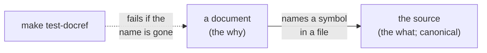
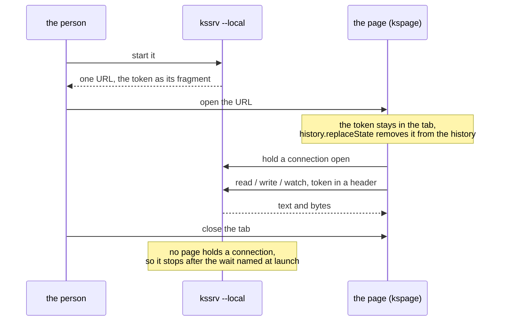
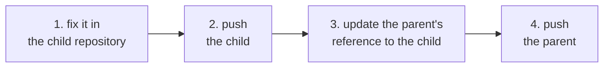
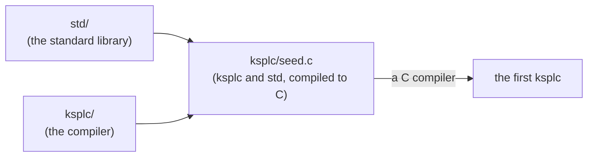
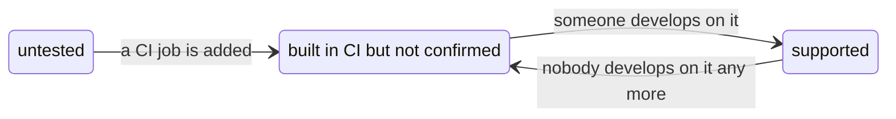

# How the repository is organized, and why

**This document says why Kanso's documents, packages, repository and gates have the shape they have.** The principles they follow are in [`DESIGN-principles.md`](DESIGN-principles.md); the rules themselves are in [`SPEC-documents.md`](SPEC-documents.md) and [`SPEC-gates.md`](SPEC-gates.md).

## Documents

**What a document is for, and whom it is for, are decided before it is opened**: by its name, and, for a document belonging to no package, by its row in `docs/README.md`. What it may hold *of the source* is a separate question, since there the code is the canonical source (the single place a fact lives) and the document only points at it.

### A document's name says what it is for

The six kinds, what each holds, and how a document is named are "Document naming" in [`SPEC-documents.md`](SPEC-documents.md). This section holds why.

**A reader opens a document in one of a few modes**: arriving, learning, carrying out a task, looking a rule up, understanding why, or seeing what is left. The reader needs to know which before opening it. Readers do not complain where the mode is in the name, and do where it cannot be told. So the kinds are a closed set of six, and the kind is the file's name. A folder's listing is then its reading order, with nothing to learn first.

**One of the kinds is Kanso's own, and it keeps something out of `DESIGN-principles.md`.** A `PLAN.md` holds what is left to do. A plan changes with every step taken, and a rationale only when a decision changes. Inside the slower document, a plan reads as done: a common complaint about "future work" sections.

**There is one plan for the repository, with a section per package**, so what is left reads on one page, and a package's few stages do not take a file of their own. What is given up is a package copied out alone carrying its plan along: what is left is the repository's work, not the copy's.

**What is done is deleted from the plan, not marked**, so the plan is never read against the code. What is given up is one list of what was achieved; that list is `git log`'s.

**"One file, one kind" is a judgment, gated only where a count decides it** ("Document naming" in [`SPEC-documents.md`](SPEC-documents.md)). Whether a paragraph of why belongs in a how-to is a person's call. Policing it page by page is a common complaint, and Principle 8 names the rest as the gap it is.

**The grounds are edited in place, not appended**, so the reader reads the current state rather than replaying records. A log of decisions (a common alternative) carries each one's state in a status field. Here the kind carries it: what is not done stands in a `PLAN.md`, and what stands is the `DESIGN-principles.md`'s. What is given up is the path to that state inside the document; it is git's.

**A package's entry point is its own `README.md`, and the root one is the front door.** One README holding every package would cost every reader a page nobody reads through, a common complaint about front pages. A seam between packages gets its own document ([`SPEC-local-server.md`](SPEC-local-server.md) is one, and "A page asks the local machine through one protocol" below holds why). So the root `README.md` holds what Kanso is, how far it works, one way to start, and where everything is. What is given up is the one-file search: a reader who does not know which package holds a thing reads the layout table first.

**A README's headings come from one skeleton** ("What every README contains" in [`SPEC-documents.md`](SPEC-documents.md)). So a reader who knows one package's README finds the same part under the same heading in the next. The skeleton is offered rather than required. Otherwise a folder with no common change or no trap would grow an empty section, which sends the reader looking for something that is not there.

**The kind carries the reader, so no second axis is added.** Inside a package the folder is the subject, so the kind answers who reads: a `SPEC-` is for whoever relies on the subject from outside, a `DESIGN-principles.md` for whoever changes it. The documents that belong to no package share no subject, so their entry point's table names the reader ("Who reads a document is said by a column, not a folder" below).

* **The reader is not marked per file.** A document honestly serving two readers would need one label, and the argument moves to which one: the standing complaint against documentation cut by persona (an imagined type of reader).
* **The kind makes one misplacement visible**: facts about something outside Kanso in a document for whoever changes Kanso. A board's pin table belongs in [`../ksos/docs/SPEC-board.md`](../ksos/docs/SPEC-board.md), not in ksos's rationale.

**What the reader must already have is said where the kind cannot say it**: in a `HOWTO-`'s first sentence, and in a column of a README's table only where the documents differ ("Document naming" in [`SPEC-documents.md`](SPEC-documents.md)). The reader needs a checklist (a terminal, a toolchain, a car on the desk), not a persona. A column answering the same all the way down is noise the reader learns to skip. The check reaches the name, not the row: which documents earn a row is the "one file, one kind" judgment.

**A document gets no line cap.** A specification is as long as its subject, and is looked up rather than read through. The two kinds read through are bounded by what they are: a `README.md` routes and explains nothing, and a `TOUR.md` is one program. A cap would be a number with no grounds behind it and no gate under it (Principle 8).

### Who reads a document is said by a column, not a folder

**The documents that belong to no package all sit flat in `docs/`, with no folder inside it, the shape of every package's `docs/`** ("Where documents sit" in [`SPEC-documents.md`](SPEC-documents.md)). There are no folders per kind of reader: whom each is for is the last column of the table in `docs/README.md`, the one place that question is answered.

**The column says what a folder cannot.**

* **It names two readers where a document honestly serves two.** The project how-to is for whoever writes KSPL, and its last section for whoever wants a document to open from the file manager.
* **It names what the reader must already have** (a C compiler for the build how-to).

A folder picks one reader and says no more. Folders cut by reader beside the column would answer one question twice, kept in step by hand (Principle 6).

**The column names the reader, not the subject.** A subject splits again once one document covers two, and then nothing decides where it belongs; a reader does not split. Other products put the reader in a title or a hostname, and both must be learnt.

**No folder needs an exception.** GitHub finds `CONTRIBUTING.md` and `SECURITY.md` in `docs/` ("Documents whose name is fixed from outside" in [`SPEC-documents.md`](SPEC-documents.md)). So they stand where every other document does, and the language specification and this document cite each other by bare name.

**What it gives up is the reader's name in the path.** A link to `docs/DESIGN-principles.md` says what the document is, not whom it is for, and a reader who does not know the kinds finds that in `docs/README.md`. The products praised for keeping readers apart pay with two places to keep in step. Where both share one folder, a common complaint is documents with no status and a catch-all group. Here every name carries its kind from a closed set, and every document says only how things stand now. So the two are told apart before either is opened, and nothing is left over.

**The rules for the documents are a document of their own.** A document that routes cannot also be canonical for a rule. So `docs/README.md` routes, and the rules are [`SPEC-documents.md`](SPEC-documents.md), held up by `make test-docref` and `make test-conventions`.

### Linking a design document to the source (no round trip)

**A document names the code it talks about (a file, a function), and a check fails when that name disappears: the source is the one canonical source, and a document points only toward it** (the rules are "Linking documents to source" in [`SPEC-documents.md`](SPEC-documents.md)). A design document never copies code, and the code never points back at the document. A deleted or renamed name is visible only through a check.

**How far a machine can guard decides what each part holds.**

| What | Who can guard it | So it holds |
| :-- | :-- | :-- |
| Names (symbols, files, headings) | A machine | Links from the document to the source |
| Examples | A run (compiling and running them) | Running examples, by pointing at tests |
| Prose | Only a person | The why; the what is a pointer to the source |

**The word "round trip" is kept out of this design.** Under a tool that synchronizes both ways, the model and the code drift apart. The diagram goes stale once writing begins, and then stops being trusted. That is what UML's CASE tools and model-driven development (tools that generate code from diagrams and back) lost, and it follows from Principle 6. Do not mix the document and the source into one file either. The mixed forms (literate programming, notebooks) lose every other tool: line numbers shift, diffs become unreadable, debuggers and `grep` stop working. The name links the two, not the container.

**There are only two ways of linking.**

| Way of linking | What it holds | Who is canonical |
| :-- | :-- | :-- |
| **A link** | Which symbol in which file, by name | The source |
| **Generation from a table** | The table holds the values, and the notation is generated | The table |

**A document does not show the source's text.** Copied in, it goes stale where nobody can see it. Read afresh at every display, it needs the document's editor to read and cut source, which is the work of a code editor, not of a document (the editor and the language server already show it). Generation is kept to where a table is canonical, such as the list of diagnostic codes. It is never general-purpose code generation (what model-driven development lost). Always place a check on the generated artifact's freshness beside it, or a hand edit to the artifact silently vanishes at the next generation.

#### No marker is added per symbol

**No attribute or directive tying a symbol to a design document is attached to the symbol.**

* **It is derivable.** The document names the symbol, so a check can assemble the reverse index, and one fact written in two places is what Principle 6 forbids.
* **There would be many**, and a marker per symbol becomes decoration the source's reader skips every time.
* **It breaks weakly.** A forgotten marker is lost quietly, while a link in the document fails a check the moment its target disappears.

**Visibility already says which symbols a design document shows**: `pub` marks them, so no marker says it again.

#### A running example is obtained by pointing at a test

**A document shows a running example by pointing at a function in a test**, because an example copied into a document goes stale. Rust's doctest and Python's `doctest` are strong because when the code changes the document breaks, and when the document breaks the build fails. A test function pointed at by name has that property without a test notation in the language, and is the very thing CI runs every time.

**An explanatory fragment, its surrounding context left out, is written in the document**, and `make test-docsnippet` compiles it. Do not mix the two: whether a piece runs on its own decides which side it is on.

**Every block is compiled, and a line meant to be refused says so on that line.** A whole program must compile and pass the lint gate. A line ending in `// error` must draw an error, alone and with the others, and nothing else may (the marks are "A code block compiles, or says why not" in [`SPEC-documents.md`](SPEC-documents.md)).

| | Rust's doctest | KSPL's documents |
| :-- | :-- | :-- |
| Where the "expected to fail" mark sits | On the whole block (`compile_fail`, naming the error's code at most), so an error on another line than the one meant still passes | On the line it is about, as a comment |
| A block left unchecked | `ignore` lets a block rot unread | A block that excuses itself (an elision, a file needed beside it) says so where the reader sees it, and one that compiles anyway fails |
| Visible on the rendered page? | No: the mark sits in the fence's info string, which a page rendered from Markdown does not show | Yes: a reader of the raw text or the page learns which line is refused, and the check learns which line must be |

**What compiling every block gives up**: a fragment that leans on the prose is not compiled to any verdict, since only the prose holds what it leans on. So a fragment that carries a mark carries its context too, a few lines longer than an illustration needs.

**What linking this way gives up**:

* **Code cannot be fixed from the design document**; the source is rewritten instead.
* **Renaming a symbol fails the document**, and each rename needs a hand edit in the document. That is also the point: a pointer made not to fail loses its target with nobody noticing.

#### A comment that points is checked as a document is

**A comment naming a symbol in another file is read by the same check as a document's link, with no mark of its own.** A stale pointer where the code's reader stands costs what a stale link costs. Other tools check a pointer only when it is a marked link, and leave a plain name in backquotes unread. A mark would be a second way to write one pointer (Principle 6), and the unmarked one is what goes stale. So the spelling a pointer takes anyway, `` `name` in `file` ``, is the one read. The member is read as well as the owner. A method moved to another file leaves its type named in the old one, and a check reading the owner alone stays green on a pointer that leads nowhere.

**A pointer that names no file is read through the commenting file's own scope.** In the packages' `//<` lines, `` `Owner.member` `` is the more common spelling, and only the compiler holds the scope it relies on. So the compiler reads it as the code beside the comment would, and a missing member is a warning in the editor as it is typed (`[W0211]` in [`../ksplc/docs/SPEC-tools.md`](../ksplc/docs/SPEC-tools.md)). The same reader turns the name into a link in the hover and the completion list, so a name is never linked in one place and called stale in another. The API pages link it to the entry carrying it.

**Each spelling has one reader.**

| Spelling | Who reads it |
| :-- | :-- |
| A name tied to its file (`` `name` in `file` ``) | The document check. It is the way to point at a method added by a file outside the compilation |
| A name naming no file, in a comment | The compiler |
| A name naming no file, in a document | The document check, which has no scope, so it reads the name against every declaration of the tree |
| A name introduced as another product's ("Python's `` `json.dumps` ``") | Nobody |

KSPL has no mark to tell a pointer from a plain name in backquotes (above), so the wording tells them apart.

**What is given up**: the check reads literal text, so a pointer worded another way escapes it. That form is still a violation (Principle 8), as "Linking documents to source" in [`SPEC-documents.md`](SPEC-documents.md) says. And the scope is the compilation's, so the editor's single document can call stale a method that only a file it does not import adds. The pointer naming its file answers that.

### The reader may be a model

**An agent works on this repository, and a model writes KSPL for whoever asked it to; both read what is written here.** What a model lacks decides what they need.

| What a model lacks | What that requires |
| :-- | :-- |
| **It cannot ask.** | What it needs is written down, or can be had from a command, never held in someone's head |
| **KSPL is in no model's training.** | A model falls back on the habits of Rust, Swift and C. So what KSPL leaves out, and what to write instead, has to stand where a model reads it |
| **Its context is short, and costs.** | One precise piece on request beats a document read whole: `ksplc explain <code>` prints one diagnostic's section ("An explanation is printed from the specification, and only a code has one" in [`../ksplc/docs/DESIGN-diagnostics.md`](../ksplc/docs/DESIGN-compiler.md)). An instruction file carries only what cannot be read from the code, as the one measurement of such files found |
| **It believes what it reads.** | A stale pointer or a copied fact misleads it with confidence. So what it reads is generated from the canonical source and held by a check: Principle 4's rule, with less forgiveness |

**A document that restates a canonical source loses value**, since a model restates on demand and the copy goes stale. One that holds what no source holds gains value: a decision and its grounds, a rule, a comparison with its complaints. A model can neither infer that nor make it up correctly. So no second, hand-written copy of a document is made "for AI"; where a model needs another shape, it is generated from the same source.

#### No file for models

**No file for models is kept** (`llms.txt`, `llms-full.txt`: a convention for one file a model reads first). What one would hold already has a canonical source a model can read:

* what KSPL leaves out (Appendix A of [`SPEC-language.md`](SPEC-language.md));
* the tour ([`TOUR.md`](TOUR.md));
* the grammar, the API pages, and each diagnostic's section (`ksplc explain <code>`).

So the file would only repeat them, in two files if both the convention and GitHub's rendering are to find it. An agent working on this repository reads those sources whole.

**What is given up**: one file to give a model that cannot read the repository. Such a model is given the specification and the tour instead.

### The tour is a program, one declaration per step

**The tour is one program, and each step is one of its declarations with its `//<` comment, in an order chosen for teaching.** How the page is written and checked is the head of [`TOUR.md`](TOUR.md); this section holds why.

**The motive is a tour that cannot drift.** A tour is the one document a newcomer reads before they can tell that it is wrong, and a tour kept by hand drifts as far as its team is small. Checking only the code examples leaves the prose between them to go stale. Generated from a program the gates compile and run in both notations, the code and the words that explain it sit in one file and are checked together.

**A generated page still needs an order chosen for the learner.** A page generated from source tends to follow the features' own order and to read as a reference. So the program's declarations stand in teaching order, smallest first, each one idea small enough to hold in your head, with the code of the step beside its prose.

**The page ends by naming where to go next.** A common complaint about tutorials is their end, where a reader who has finished does not know what to read.

**What it gives up**:

* **A step can teach only what one declaration of a running program shows.** What needs a program of its own, such as splitting a program over files, belongs to the project how-to ([`HOWTO-set-up-a-project.md`](HOWTO-set-up-a-project.md)).
* **A step's prose is a comment, held to a comment's limit** (Principle 7). A step that needs more is split into two declarations, or points at the specification.

## What crosses a package boundary

**A package's promise to whoever is outside it is exactly its `pub` names.** (A *package* is one top-level folder such as `std/` or `ksdb/`, and `pub` marks a name visible to everyone.) This chapter covers where tests go, how the published API is recorded, how outside code is brought in, and how a package is found.

### A test inspecting the inside of a unit goes inside that unit

**A test that looks at a package's private parts (the inside of a unit) lives in a `tests/` folder under that package.** (A *unit* here is a package: the extent a name with no visibility mark is visible in.) There it is the same unit, so it reaches what it inspects with unspecified visibility, without making one name `pub`. It also stays out of the shipped artifact, since a file nobody imports is not compiled. The language needs no change: `package_of` in `ksplc/base/locate.kspl` takes a file's unit from the first separator of its logical path, so `kspage/tests/flow_test.kspl` is in unit `kspage`. From the root's `tests/`, a package of its own, the same test would need its target `pub`, and nothing would tell that `pub` from an unnecessary one. [I0402] (the lint for an unneeded `pub`) sees only the references in one compilation, and the entry point that builds the product uses nothing in `tests/`.

| The test | Where it goes | Why |
| :-- | :-- | :-- |
| Inspects the inside of one package | `<package>/tests/` | Same unit, so no `pub` is needed |
| Looks at two packages | The `tests/` of the one that imports the other | The other way would add an import direction that is not allowed |
| Inspects the compiler's answers | `ksplc/tests/`, importing nothing from `ksplc/` | It drives the built compiler as a child process |
| Stands on what walks the repository or builds a child process | The root `tests/` | It uses things from outside every unit |

**A test looking at two packages goes to the one that imports the other.** A randomness test of both `std/prng` and `ksai/sampler` in `std/tests/` would make std depend on ksai, a direction `make test-docref` does not allow. So the part choosing the next word sits in `ksai/tests/token_test.kspl`.

**`ksplc/tests/` imports nothing from `ksplc/`.** It inspects the answers the compiler produced, from inside a program the compiler built, through a suite under `ksplc/tests/suite/`. That suite runs the compiler this folder builds as a child process, and another `ksplc` runs the suite. A test of an internal function would go there, but then the whole compiler enters that executable. Measure `make debug`'s translation time before adding one.

**What is used from outside a unit stays in `tests/`: such tests, the gates, and their materials.** That is Rust's line between unit and integration tests, and Go's between `package foo` and `package foo_test`. What stays is the tests that stand on what walks the repository root and git (`tests/support/harness.kspl`), and on what starts a child process to build (`harness_build.kspl`). Those tools must not be moved into `std/` ("What tests share stands in std" below). Other large trees divide on the same line, LLVM's top-level `cross-project-tests/` among them.

**Do not bring in what the destination does not depend on.** A test that does leaks into the distributed unit, which is why Rust keeps `core`'s tests outside `core`. Here that would be a moved test using what its package does not depend on, which `make test-docref`'s direction check watches.

#### Where the entry points are

**Every package has its own `tests/`, and `tests/debug/main.kspl`, the one place that calls more than one, only calls each entry point in turn.**

* **One package or all.** `make debug-<name>` runs one package where `make debug` runs all. That gives a shorter wait for the first answer, not less to confirm: what to run before pushing is `make ci-linux`.
* **Each package has a second door**, its `<package>/tests/main.kspl`, run by its own `Makefile` (`tools/`, which has none, by the root's `debug-tools`; the `$(error)` in `mk/test.mk` stops make at start for a second folder like it). It passes its own compiler where a run takes one (`run_std(ksplc, arena)`). The parameter types hold both doors to one shape, and both are compiled on every round (`make debug` and `make test-extract`).
* **`ksbind` has the second door alone**: its tests link libraries from outside the toolchain, which `make debug` must not need.

**Each package's entry point is `<package>/tests/all.kspl`, and its opening comment says what the package's tests inspect.**

**The remaining boundary is closed by opening exactly one entry point as `pub`**: one function that runs everything, like `run_kspage` in `kspage/tests/all.kspl`.

* **Do not add inspection interfaces here.** Each is one more contract put outside the unit.

#### Where an unneeded `pub` is reported

**[I0402] can be enabled for `kspage/`, `ksos/` and `tools/` as well as `ksplc/` and `kssrv/`, but not for the units distributed and used elsewhere (`std/`, `ksdb/`, `ksai/`, `ksbind/`).** Their `pub` is a contract with outside users that references inside the repository cannot judge. So keeping to one entry point there is a matter of form, and adding more brings no diagnostic. Read the header of `all.kspl` before adding.

**The diagnostic is turned off in two files, each with its reason beside the switch.** In `tools/ai_assist/ksplc_oracle.kspl`, `compiles` is a `pub` that the tools' tests use (`tools/ai_assist/tests/ai_assist_test.kspl`), invisible from the entry point building the tool. In `ksplc/tests/prog/equiv.kspl`, `main`'s error type is seen from outside as the entry point's, so it cannot be narrowed. Closed to one file each, the switch leaves the unit's other `pub` count at zero.

**Inside `tests/` itself it is the reverse.** No package imports that leaf (the bottom layer, which only points upward), so a `pub` there has no user outside the unit, and its tests reach each other with unspecified visibility, being one unit. So the diagnostic can be enabled there too (`tests/ksplc.cfg`). A `pub` inside the materials is not reported: the forms in `negative/` and `lint/`, and those held in `"""…"""` inside a test. They are written to make a visibility diagnostic fire.

**In `ksos/demo/`, only part of a unit is an entry point, and a `pub` there has no user outside the unit either.** But the diagnostic cannot apply to the demo alone. The configuration is found from the entry point's file. So turning it on for the demo also reports the `pub` names of the kernel and the drivers in the same build, and those stay ("The guidance for adding an API or an implementation" in [`../ksos/docs/DESIGN-rtos.md`](../ksos/docs/DESIGN-rtos.md)). `make test-conventions` checks the demo's text instead.

### The published API is recorded in the repository

**Each package's published API is listed in one text file committed to the repository (`SURFACE.txt`), and a gate fails when the code and the list disagree, so a change to the API always shows up in a diff** (`ksplc --emit-surface`, regenerated by `make surface`, with `make test-surface` rejecting drift; "Writing out the published API" in [`../ksplc/docs/SPEC-tools.md`](../ksplc/docs/SPEC-tools.md)). Without it, deleting a `pub` whose user lives in another repository keeps this build green, with no record of what changed. Being comparable by a tool and being recorded under version control are different things. Without the record, the only thing to compare against is whoever still has the previous version.

**How other tools do it**:

| Tool | Its shape | What KSPL takes |
| :-- | :-- | :-- |
| Rust's `cargo-public-api` | Keeps the record in the repository for review; its diff carries auto-derives and blanket impls | The record in the repository. Derived items stay out from the start: what counts as API is the declarations actually written, with no instantiated body |
| Swift | The toolchain itself emits the record, since a separate analyzer would drift with nobody noticing; it needs the whole SDK | The toolchain emits it, and one entry-point file suffices |

**Do not merge the record with a library's interface** (`--library=`). It looks like Principle 6, but the purposes differ:

| | The interface (`--library=`) | The record (`--emit-surface`) |
| :-- | :-- | :-- |
| What it holds | Only the `#export` functions, spelled in C | Every `pub` declaration as written |
| Which build | One build | Every `#cfg` branch included |

Made from the interface, the record would lose the API a KSPL caller reads from the source, and another build's branches.

### Outside parts are not fetched; only their location is stated

**KSPL has no package manager: to use someone else's code, you copy it onto your machine and state where it is** (`--pkg-src-dir=` and the environment variable `KSPLC_PKG_SRC_DIR`). The resolution order, and the rule that a local copy wins, are "The source of a package other than `std`" in [`../ksplc/docs/SPEC-tools.md`](../ksplc/docs/SPEC-tools.md). Nothing is fetched, no versions are solved, and nothing runs at import time.

**The motive**: a part requested by name becomes, the moment it is requested, someone else's code that nobody has read. Fetching brings four questions, and none of them is visible to whoever requested it:

1. Where did it come from?
2. Which version is it?
3. What comes along with it?
4. What runs at import time?

Kanso holds no hidden work at build time, any more than at run time.

**Common complaints are about code running at import time and dependencies that bring in dependencies.** Where a manifest (the file listing dependencies) is language code, solving dependencies means building and running it. Other common complaints are that one part brings hundreds along, and that a registry has no namespaces. Elsewhere the tooling does not agree on one shape. Nor is this C/C++'s shape, where no standard is set and many tools each answer the question. The interface is narrowed to the single `--pkg-src-dir=`, and only fetching is absent.

**What it gives up**:

* **Someone else's part is brought over by hand**, and which version was brought is yours to note. An update goes unnoticed unless you look for it.
* **A dependency's own dependencies are followed by hand.**
* **Fewer parts are available than anywhere else.** That is the price of taking on neither dependency resolution nor the risks outside parts bring in.

**What was brought over can still be read.** A part shipping a `SURFACE.txt` shows what disappeared when matched against the previous version ("The published API is recorded in the repository" above). This is revisited when KSPL packages that people want by name appear outside this repository, not because nobody has built a fetcher. Until then a fetcher would have nowhere to fetch from.

### A package names itself, and names what it uses

**A package states its own name, and the packages it imports, in its `ksplc.cfg` file; its place is the environment's, so it builds from any folder, under any folder name.** It names itself in its top folder's `ksplc.cfg` (`[package]`, `name = ksdb`). It lists under `uses` what it imports besides itself and `std`. Its files and its `embed`s (files baked into the program) are read from that folder, wherever it stands and whatever it is called. A used package's place is told as any place is ("Outside parts are not fetched; only their location is stated" above; the rule is "9.1 import syntax and path resolution" in [`SPEC-language.md`](SPEC-language.md)).

**The motive**: a package found as a folder of its name, under the folder the compiler runs in, compiles only from the repository's root. From its own folder, its import of itself is looked for one level too deep, and a copy under another name cannot build. So whether a package can be lifted out is answered only by trying. Common complaints are about cases where the place decides: imports that resolve by how the program was started, a fixed workspace folder, module paths that name a location. A name with no place in it causes none of them: nothing in `ksdb/log` says where ksdb stands.

**Naming what it uses lets a reach be refused where it is made.** An import past the list is a compile error at the `import`. It is caught here, where every package happens to be present, rather than in a copy where it is not.

**What it gives up**:

* A package that names itself says so in one more file, and a new dependency is written twice, in the `import` and in `uses`.
* **A used package is still found as a folder of its name**, locally or under `--pkg-src-dir`. Only the package being worked on is freed from its folder's name.

### The standard library reaches only itself

**A file in `std/` may import only other `std/` files, and never with a `..` path.** Either reach out of it is refused at the line that writes it ("9.1 import syntax and path resolution" in [`SPEC-language.md`](SPEC-language.md)).

**The motive**: `std` is found by its place, not by a name, so no `uses` list ("A package names itself, and names what it uses" above) holds it. Without the rule, a `std` file importing another package would compile clean. It would show up only as a "not found" pointing at `std`, from inside another package's copy. `std/../x` would let a file from outside be read as `std`'s, into its unit of visibility and its linkage.

**Why a rule and not a name**: naming `std` would state a second time what its place already states, and the two could disagree. The list it would carry is always empty. A list in a settings file can be widened by editing it, where a rule of the language cannot. Go and Rust name `std` in a manifest because their build tools build it as one more module. KSPL's compiler never builds `std` through the package path.

**Nor does `std` bind a C library from outside the toolchain.** It is plain KSPL over the runtime every program carries, so it builds anywhere with nothing installed. A binding to an outside library, such as OpenSSL or SQLite, stands in its own package, `ksbind` (why is [`../ksbind/docs/DESIGN-bindings.md`](../ksbind/docs/DESIGN-bindings.md)).

**What it gives up**: a `std` passed with `--std-dir` cannot import the user's packages. One that did would have to travel with every compiler, making it part of the standard library in all but name.

### What tests share stands in std

**The general test helpers, which know no repository (run checks, compare a child program's output, make a scratch folder), are part of `std`; only the helpers that know this repository stay in the root `tests/`.**

| Part | Where | What it does |
| :-- | :-- | :-- |
| `std/verdict` | `std` | Runs checks on past a failure, with their lines and a closing `RESULT:` line. Reads a child process's run as a check: its exit code and outputs as one text, for one child or several side by side |
| `std/fs` | `std` | Gives a scratch folder, and writes and copies a tree |
| `std/fuzz` | `std` | Scatters broken input at a program |
| `tests/support/harness.kspl` | The root `tests/` | Walks the repository's root and git, and knows where its compiler lives (built on the three above, and on ksplc's own suites' harness, which it starts on those paths) |

**The motive**: a package's tests reach only what the package reaches: itself, what it names under `uses`, and `std` ("A package names itself, and names what it uses" and "The standard library reaches only itself" above). With the whole harness in the root's `tests/`, a test standing on it could run from the repository's root alone, never from a copy of the package. Such tests are the checks on the compiler a package built, and the packages' fuzz suites. A package lifting its tests out would write its own tally, a second copy.

**Why `std` and not a package of test helpers**: such a package would need a test-only `uses`, and `std`'s own tests could not use it, since `std` reaches only itself. Other tools' complaints sit on that path: a test-only dependency leaking into the product, or resolved for every user. A harness in or beside the standard library (Go's `testing`, Rust's `libtest`) avoids them, and gives every package's tests the one shape the gates read. The complaint at the other end is a standard harness too thin to use. It is kept off because this repository's own suites run on it, so what they need is added where every package's tests have it.

**What it gives up**:

* `std`'s published API grows by names a program testing nothing never calls. They cost nothing to build (a file nobody imports is not compiled), but they are a contract like any other `pub` of `std`'s.
* The shape of a verdict line becomes `std`'s to keep. Changing it is a change to `std`'s API, and every package's tests move with it.

### A path's `..` is resolved by its spelling

**`a/../b` always means `b`: a path's `..` is folded by its spelling, not by asking the filesystem, in the walk up to the folder a file stands in and in the file's name alike** ("9.1 import syntax and path resolution" in [`SPEC-language.md`](SPEC-language.md)).

| Path as written | The file stands in | Its name |
| :-- | :-- | :-- |
| `pkg/../other/x.kspl` | `other`'s folder, never `pkg`'s | `other/x` |
| `sub/../lib/n` | `lib`'s folder | `lib/n` |

**The motive**: a walk cutting off one name at a time steps from `pkg/..` back into `pkg`, a folder below the one the path names. Three things would go wrong:

* **A file would pass for another package's.** Run from inside a package, a file in the folder beside it, named through `..`, would pass for one of the package's own, named `pkg/../other/main`, and be held to the package's lint levels.
* **`#line` would show a wrong folder.** A package's file spelt through `..` would give its folder as `pkg/probe/..` in every `#line`.
* **One file would be two.** The name folds too, since a name kept as written is two names for one file. Reached as `lib/n` and as `sub/../lib/n`, a file would compile twice, as two modules with a counter each. The second name puts it in `sub`, whose files would reach its unmarked symbols.

**By spelling, not by asking the filesystem.** Every language keeps both ways. The filesystem's way needs the file to exist and brings surprises of its own. The fold by spelling has one documented caveat, a symbolic link followed by `..`. That is the price taken here, as Python's `normpath` and Go's `filepath.Abs` take it.

**A `..` that climbs out of a package read from a place of its own stays.** Such places are `std`'s, a package that names itself, and one under `--pkg-src-dir`. That folder need not stand at its name: `ksdb/../x` folded to `x` would name a file beside the project, not beside the package.

**What it gives up**: a package, or a file, reached through a symbolic link followed by `..` is read at the spelling's place, not at the folder above where the link points.

### A package's examples and benchmarks stand inside it

**An example program or a benchmark that uses only one package lives inside that package** (`ksai/examples/`, `ksai/benches/`), and the package's own `make test` builds the examples and holds them to what they print. A program that needs more than one package and `std`, such as one that uses the whole repository as material or the compiler as a child process, stays a tool (`tools/ai_assist/`).

**The motive**: kept in a leaf of their own, `ksai`'s examples would be a second package that travels apart from the engine.

* A copy of `ksai` would carry none of them.
* `ksos`, which embeds the weights one of them trains, would need an arrow from implementation to leaf, which the direction table does not allow. Here the weights' arrow is `ksos→ksai`, one the table already has.
* A common complaint is about examples kept out of the library's build, found broken only by whoever runs them. Cargo builds a crate's examples on every `cargo test`.

**What it gives up**:

* **The examples take the package's lint settings.** A leaf of their own could turn I0402 on, as nothing imports a leaf. Inside `ksai`, whose `pub` is a contract with outside users ("Where an unneeded `pub` is reported" above), it stays off. A common complaint about this shape is that an example cannot have settings of its own.
* **The package's `make test` needs a C compiler**, to build the examples it runs.

### What a recipient is owed is one table, held by a gate

**Every license notice owed, and the origin of every binary file, is listed in one table, `THIRD-PARTY-NOTICES.md`, and `make test-conventions` fails if a file is missing from it.** The rules the check holds are listed at the head of that file.

**The motive**: a caution in that file alone ("once a file that declares an origin is added, add it here too") would be a rule nothing checks (Principle 8). A missing notice is found by a recipient, after the release. A common complaint is about a license header in every file. One table read against the files keeps the record in one place, and still catches the file that slipped past it. The binaries are in because a model's weights carry a license: converted Qwen weights committed by mistake would go out under Apache-2.0 with no attribution.

**What it gives up**:

* **Code rewritten from another's without its words is not caught.** The gate sees a license's words, not an origin told in prose. That half stays the author's, as the table's caution says.
* **The release's contents are named twice**, in `.github/workflows/release.yml` and in the gate's list of what it carries. Adding a bundled folder means adding it to both.

### A page asks the local machine through one protocol

**A page open in your browser (`kspage`) reads and writes files on your computer by asking a small local server (`kssrv --local`) through one protocol, written in a document of its own** ([`SPEC-local-server.md`](SPEC-local-server.md)), and a secret token keeps other pages and programs out. The page asks and the server answers, so the protocol belongs to neither package: a seam between packages gets its own document ("A document's name says what it is for" above). The server is meant to be replaceable, so the document holds only the rules, and their grounds stand here.

The picture below shows one session from start to end.

**The server does not know the document.** Knowing it would put the document model in two places, with nothing to tell which is canonical. So the server moves only text and bytes, and the page decides where they go.

**The transport is built on what `std` already has.**

* **No program is started.** Building, debugging, completion and plugins would each start one. They serve a code editor, which the page is not, and they would make what a page can ask for into running code, so that every guard must hold. The convenience does not balance that (Principle 1).
* **`HEAD` is not carried.** Watching already returns the size and whether the file exists, and two entry points that differ only in name leave the page unsure which to use (Principle 6).
* **The type is not guessed, and the encoding is UTF-8 only.** The receiver believes a guess and reads the bytes by it, and a wrong guess shows only where it misses.

**Watching is the page asking, not the OS telling.** The OS's notification (inotify, ReadDirectoryChangesW) needs one implementation per OS, and porting cost would gather there. Asking loses how many times a file changed, but returns how it is now, so the page always catches up to the final state. What is given up is cheap watching of a whole large folder, where asking is heavy.

**The token goes across once, in the fragment, and stays in the tab.** (The *fragment* is the part of a URL after `#`.) Whoever holds the token can read and write every file under the root, so each other place it could go is ruled out:

| The token is not… | Why |
| :-- | :-- |
| **In a query** (after `?`) | A fragment is never sent to the server, so another process on the same machine cannot get the token by sending `GET /` |
| **In the response that serves the page**, on request, or in a response header | Anyone who knows the address could read it there. Only a malicious page inside a browser, which cannot read the response, would be kept out |
| **In a cookie** | The browser attaches a cookie on its own, to a malicious page's requests too. That is why the token rides in a header |
| **On the command line** | `ps` shows it to anyone on the machine |
| **Compared byte by byte with an early exit** | It is compared in full: a page in a browser can send requests to the loopback address, and a difference in return time would let it guess the token a byte at a time |

**What it gives up**: a person opens one URL once per start-up. Jupyter's local server asks the same, and leaves the token in the browser's history as well; here `history.replaceState` removes it.

**The page named at launch may sit outside the root** (`kssrv --page=<file>`), because the page and the document are separate. The document is in the person's folder, and the page is with the server. Requiring the page under the root would mean copying it into that folder, or the document could not be opened.

**The server stops when no page holds a connection open.** Something has to end it, and the console cannot: a server opened by a double-click has no console to press anything in. The held connection carries nothing, so there is nothing in it to parse or get wrong, and closing the tab closes it. The other signals are ruled out:

| Signal not used | Why |
| :-- | :-- |
| **A timer** | It only tells that somebody was there some seconds ago, and every choice of the wait is wrong somewhere. Too short, the server stops while someone reads; too long, it lingers |
| **The last request** | A page where someone is writing asks for nothing between saves |
| **A goodbye message** | A killed tab, a stopped browser or a sleeping machine sends none |

**The wait named at launch only bridges two gaps**: before the first page arrives, while a browser starts cold, and after the last page leaves. The second gap is worth keeping, since a person who closes one document and opens the next within the wait reuses the same server.

**Whoever holds the token can also stop the server at once, by asking it** (`POST /api/stop`). A server left running for the next document needs a way to end it that does not wait out the idle time, and asking is chosen over killing its process.

* **Not by process number**: a number outlives its process and is handed to the next one, so a stale record would end an unrelated program.
* **Not by a signal**: Windows has none to send, so killing would be a second way per platform.
* **Through the same guard as every request**: the token decides who may, so a page from another site still cannot end it.
* **The answer goes out first**, so the asker knows the stop took effect, rather than guessing from a connection that closed.
* **What it gives up**: a server that has stopped answering cannot be stopped this way; that is left to the operating system's own tools.

**Whether the server is there is asked, not guessed.** The server says whether it is local-facing, since the same implementation facing outward answers too. Probing entry points to guess from the refusal numbers would gain one more way of guessing with every entry point added.

**What it gives up**: the protocol serves one machine only. Use from another machine needs a protocol of its own, and this one refuses it.

### The reference is rendered when asked, not committed

**To read a package's API documentation, run `ksplc doc <file>`, which renders it from the source each time; no generated HTML or Markdown reference is committed** (the command is 7.5 in [`../ksplc/docs/SPEC-tools.md`](../ksplc/docs/SPEC-tools.md)). The record (`SURFACE.txt`, "The published API is recorded in the repository") stays committed: two versions are matched by it, and a reference is not.

**The grounds**:

* **A committed rendering is a second copy of every description.** A gate can hold it to the source, but a reader then meets the same sentence in two places. And every change to how it is rendered rewrites thousands of lines that publish nothing new.
* **One page per file is one small file per source file**, and one page per package instead runs to many thousands of lines, read only by searching it.
* **An entry point returning one piece serves a person and a model alike** (the chapter "Models write it, and AI runs in it" in [`DESIGN-principles.md`](DESIGN-principles.md)). `ksplc doc std/mem.Arena.alloc` returns that entry and nothing else, where a page has to be read down. It runs wherever `ksplc` runs, the release's zip included. It answers at once, as it parses the one file asked about and analyses nothing.
* **On a repository host the source is the reference.** A description stands on the line of what it describes, so the file holding a declaration also holds what is said of it.

**What it gives up**: a rendered, linked reference to browse without a toolchain. `make surface` writes one under `out/docs/` for whoever has the toolchain, and it is `ksplc doc`'s answers and nothing else. A link from one file's reference to another file's entry is given up too: that name stays text, and `ksplc doc` on the other file shows it.

## Why one repository

Kanso holds nine packages (`ksai` / `ksbind` / `ksdb` / `kspage` / `ksos` / `kspeg` / `ksplc` / `kssrv` / `std`) in one repository. **This is not "not split yet" but the decision not to split.** In short: most changes touch more than one package, and the compiler cannot be built without the standard library, so separate repositories would make ordinary work slower and easier to break.

### What happens if it is split

**Whether to split is decided by the share of changes that cross packages**, not by "they are independent, so separate repositories". The import direction says whether packages are independent. What decides the cost is how many packages one change reaches: how many packages' files the most recent commits touched, merges excluded (`git log --name-only`). It can be measured again, so no number is copied here (Principle 7).

**Once split, a change crossing two or more packages becomes work across repositories in a fixed order.** Forget any one of the four steps and neither repository builds on its own:

### `std` cannot be separated from `ksplc`

**The file that bootstraps the compiler holds the standard library inside it, so every change to `std` is also a change to `ksplc`.** The bootstrap seed ([`../ksplc/seed.c`](../ksplc/seed.c)) is `ksplc` and `std` compiled together into one C file, holding thousands of `std`'s function bodies. The compiler is written in KSPL, so the seed is how it is first built on a machine with only a C compiler. So fixing `std` means rebuilding the seed, and the seed belongs to `ksplc`. In separate repositories every change to `std` would straddle two.

Caution: **Get the order wrong and the seed is left holding a stale `std`.** `make self-host` then fails, not for whoever made the change but for the next person who pulls.

**There is no cycle in the import direction** (the table in [`SPEC-documents.md`](SPEC-documents.md)). What keeps the packages together is not the shape of their dependencies but the seed, and the volume of crossing changes.

### No split is designed

**No way of splitting is designed, and no tool for it exists**: it is designed on the day one is decided, against the repository as it then stands. What a split would need is kept anyway, because each is worth having in one repository too. A package's tests sit inside it ("Where the entry points are" above), its published API is recorded (`make surface`), and `make test-extract` builds and tests a package from a copy of its folder alone ("A package names itself, and names what it uses" above).

## The build and the gates

**The build is two builds, with opposite options** ("A shipped executable is built optimized, and the development cycle is not"). What each gate (a check CI runs that can fail the build) checks is in [`SPEC-gates.md`](SPEC-gates.md), and how to run them is in [`HOWTO-build.md`](HOWTO-build.md).

**One invocation keeps one build dependency graph.** The logging wrapper forwards the build goals together to one child make, so parallel goals share their prerequisite builds and their combined log. Build directories and that log use the same `OUT_DIR` paths. `clean` is forwarded separately without a log, because it removes that directory.

### A shipped executable is built optimized, and the development cycle is not

**While you work on the compiler, it is built without optimization (`-O0`) so each rebuild is quick. Do not raise `CFLAGS`.** That development cycle is the stage1 / stage2 that `make` builds (stage1 is the compiler built by the seed; stage2 is the compiler built by stage1). The copy that is installed or released is built once more with optimization, from the same C. Megabytes of generated C are rebuilt for every line fixed in the compiler. `clang`'s time grows by an order of magnitude with optimization, and a round building both stages pays it twice.

| | The development cycle | What ships |
| :-- | :-- | :-- |
| Built | On every change | Once per install or release |
| C compiler options | `-O0` | `SHIP_CFLAGS` (`-O2`), as `out/ksplc_ship.exe` |
| Who uses it | Whoever changes the compiler, waiting for each rebuild | Whoever runs `make install`, and the release (`.github/workflows/release.yml`) |
| Compared with the development build | — | It translates ksplc itself (from the same stage2 C) in roughly half the time, and is roughly half the size |

**Shipping is the reverse**: built once, it is fast every time for whoever uses it. The generated C does not change by one byte: `make self-host-ship` translates ksplc with the shipped build, and compares the result with stage2's C. That is a gate on Linux and a step of every platform's release build. So nothing moves: not the self-hosting fixed point (the compiler reproducing itself exactly), not the tests' results, not the stage1 numbers the performance guard inspects.

**Only the C a person reads is tidied.** Clang-Format runs on the generated C of `make debug-file` and `make commit-seed`. The C that the bootstrap and `make debug` leave is not tidied, since nobody reads it and tidying it costs more than compiling it.

**So Clang-Format is optional everywhere but one step.** Where it is not installed, `make debug-file` leaves its C as generated and says so in one line: untidied C builds and debugs the same, so stopping F5 for it would cost the person more than it gives. `make commit-seed` stops instead, and says why: `ksplc/seed.c` is tidied in git, and a seed written untidied would change every one of its lines, burying the real change in the history.

Caution: **Do not drop `-g`.** When a shipped executable dies, that is the only place a position comes from.

### Where CI's time goes, and what shrinks it

**One local command, `make ci`, covers the Windows workflow on Windows and all three sections on Linux/macOS.** Windows runs the two native shared sections without a container dependency. The shared sections exercise the host's process, file and compiler behavior. Linux-only checks need Linux's APIs and tooling; macOS includes them through the devcontainer, and Windows can request them through the explicit Linux targets. Its writable checkout and build outputs are isolated from the host; only logs return, carrying their execution platform so that a skip allowed on one OS cannot be accepted on another. Docker's layer cache keeps unchanged tool installation out of later rounds. A periodic progress line names the active gate while its own output is quiet.

**The shared jobs divide the compiler's extraction suites too.** Whole-package checks leave the compiler's long suite list concentrated in one job. Each shared job instead rebuilds an isolated compiler and takes a share of its longest-first list, dealing successive pairs in opposite directions so the leading heavy suites do not collect in one job. This repeats the isolated bootstrap and package-boundary checks, but keeps every regression suite in exactly one job. The other packages overlap the core share; lint also runs there to offset the rest share's LLVM checks. No job is added.

CI's machines effectively have one core, so the only way to make the gates faster is to do less work in total.

**Do not write the seconds here** (Principle 7). Each run lists its own seconds per gate at its tail ("How a run is read" in [`SPEC-gates.md`](SPEC-gates.md)), and `make ci-summary` prints the last run's list again. A one-core run (below) comes closer to a runner's figures than a local `-j` run. **The regression suites cost the most by far** (`test-suites`, dealt out as `suites_a`, `suites_b` and `suites_text`). Next come the gates that redo work under another build: `test-race`, `test-sanitize` and `self-host-ship` in the Linux job, and self-host ×2 in the shared ones. `lint` and `perf-log` follow, and those stages are the bulk of it.

**`-j` barely takes effect on GitHub's runners.** (`-j` tells make how many jobs to run in parallel.) Only the gates given a `-j` (`test-suites` / `lint` / `lint-cfg` / `link_abi`) take several times as long as locally, and one core locally reproduces that. So a runner is effectively one core, and the only route to faster gates is less total work. The reproduction is `taskset -c 0 make -j1 test-suites`: `sys.cpu_count` follows the affinity, so the suites' own side-by-side runs drop to one as well.

| Stage | Can it be shrunk |
|---|---|
| self-host ×2 (C and LLVM) | **Do not attach `-B`.** It redoes even the seed's compilation, making the seed newer than the later stages, and `perf-log` rebuilds C's stage1 wholesale. `self-host`'s own recipe emits the verification marker on an incremental build too. Emitted from `$(DIFF_TXT)`'s recipe instead, a round that needs no rebuild would emit no marker, and the runner (`Gate.verdict` in `tools/ci_gates.kspl`) would return "passed without verifying" |
| perf-log | **Measure both times**: on an empty cache (cold), then on the same cache (warm). Time differs severalfold and peak memory clearly, so one alone leaves the other half unchecked. The cache sits in a dedicated location, so the shared cache is not erased (which would make every following gate cold) |
| test-suites | With the runner's cores full, **the total amount of work** fixes it, and a higher `-j` does not shrink it. What does is a smaller total, or dealing the suites out between the jobs that already stand. **No job is added for them**: every job pays its own start-up and its own billing, so another job raises the cost while the total work stays the same ("How CI runs" in [`SPEC-gates.md`](SPEC-gates.md)). The launch order sets the speed, so `SUITES` is kept longest first (the grounds are at `SUITES` in `mk/test.mk`) |
| test-race / test-sanitize / self-host-ship | **They run in the Linux job alone** (`Shard.linux` in `tools/ci_gates.kspl`), so they lengthen that job and not the two shared ones. Each builds again what the shared jobs build once: race and sanitize rebuild tests under a sanitizer (sanitize through both backends) and run them, and self-host-ship builds the compiler once more at `-O2` and has it compile itself. In sanitize the run is the longer part, since std's tests start children and wait on sockets |
| test-ksos-qemu | The demos that grab a fixed resource are serial ("How the gates are arranged" in [`SPEC-gates.md`](SPEC-gates.md)) |

**Do not merge fine-grained suites "because there are many of them".** Merging runs not one byte less, so the wall clock does not shrink (the total fixes it), while a fine-grained name points straight at the cause when it fails. Only the same property inspected in two places may be merged.

**When reducing the total, look at the heavy individuals, not the count.** The time is skewed per suite and per case. `ksplc/tests/negative/` is mostly a handful of cases that poke the depth safety valve. Their input must exceed the 1000 levels the compiler's walks over a type allow (`max_type_unwrap_depth` in `ksplc/sema/type/query.kspl` and its kind) and costs quadratically in the level count, so a large count does not mean a large amount of time.

### A failed round says why in its last lines

**A round prints thousands of lines, and each gate's cause sits in the middle of them**: a `FAIL` among hundreds of `pass` lines, a `panic:` inside a child's quoted output, a `SKIP` no row expects among thirty that are expected. A reader who opens the end of the log finds only make's last word, which names a target and not a reason. So a round ends by naming each fallen gate's causes, one line each, with the path of the gate's whole log; what each line shows is "How a run is read" in [`SPEC-gates.md`](SPEC-gates.md).

* **The causes are the gate's own lines.** A gate's marks (`FAIL`, `panic:`, `RESULT:`) are spelt the same on every machine. make's message is in the language the person's machine speaks (`Error 1` reads `エラー 1` in Japanese), and says only which target stopped, so make's line is read by its `*** [` alone and shown after the gate's own.
* **An expected SKIP is counted, not copied.** Thirty expected lines copied to the end bury the one that fails the gate, which looks like them. The one no row holds is listed among the causes and marked `UNEXPECTED`.
* **Where no line names the cause, the log's last lines stand in** (a C compiler's error, a crash): a target's name alone sends the reader back into the log.
* **A green round stays short**: one line per gate, and no cause.

**The rows are held against the tree before a round meets them.** A reason one platform alone prints is otherwise first seen by that platform's round, after the whole round's wait. `make test-conventions` reads every reason the tree can print and refuses one no row of `tools/ci_gates.kspl` holds:

* **A reason built at run time must carry, in one literal, the piece a row names.** An interpolation can put anything in, so a row matched across one proves nothing. A constant of the same file is read as its text, and a reason bound to a name in the same function, or returned by a function of the file, is read where it is written.
* **A call written inside a string is not read.** It is a program a test runs as its child and reads itself, and no round prints its lines.
* **A reason no platform should let through stays out of every row**, and the check lists it with its reason (`held_by_none` in `tests/support/conventions_skip.kspl`): a module only the Linux image is promised to hold, say.

### 'Supported' means someone uses it

An environment is called "supported" only when the gates run there and someone also develops there every day. A green CI job alone is not enough.

**Each environment Kanso runs in is placed at one of three levels by what stands behind it: supported, built in CI but not confirmed, or untested.** The table and what each level promises are "Where it is supported" in the root [`README.md`](../README.md), the one place they are written. This section holds why they are set so.

**A green CI job is not enough for "supported".** CI runs weekly and on request, not on every commit ("How CI runs" in [`SPEC-gates.md`](SPEC-gates.md)), so it shows what ran that day. And a gate sees only what it was written to look at. Typing into a terminal, a file name the real filesystem holds, an input method and a debugger are met by someone who uses the environment day to day, and by no gate. So the top level needs both: the gates running there, and development done there.

The levels move like this:

**The C compiler is part of the environment.** ksplc emits C, and what becomes of it is the C compiler's: the warnings, the libraries a link needs, the object format, what C leaves unspecified. So a row names an operating system, an architecture and a C compiler together, and "Linux" alone is no row. GCC compiles the generated C in one gate alone, `make test-c-warnings`, which keeps Principle 2's warning zero on it as on clang. No gate builds the compiler or runs a program with GCC, so GCC stands among the untested (Principle 8: a check seeing part is not read as the whole).

**A level is named by what stands behind it, not numbered.** A number, or "it builds", tells a reader nothing about whether their program runs, and a reader not told rounds it up to "supported".

**What no row names is written down as untested.** Because KSPL translates to C99, a new environment needs only a C compiler, not a port of the toolchain. A reader takes that for "it runs everywhere", and meets the gap as a bug.

Caution: **Do not raise a level because a CI job went green.** A new job places its environment at "built in CI". It moves up only once someone develops on it, and down once nobody does.

**What is given up**: an environment that would work is still listed as untested until someone runs it, so macOS reads as lower than its green job suggests. Nothing checks the table against who develops where. That is a fact about people, so the table is kept by hand, and a change of who works where changes it in the same commit.

### The Windows executable is built on UCRT64

**The released Windows `ksplc.exe` is built with MSYS2's UCRT64 clang**, the same toolchain Windows developers here use, not by LLVM's own clang targeting MSVC. (MSYS2 is a set of Unix-style tools and packages for Windows. UCRT64 is its environment whose programs use the Universal C Runtime that ships with Windows 10.)

**The grounds**:

* **What ships is what is used.** "Supported" rests on someone developing there ("'Supported' means someone uses it"). Built on another toolchain, the file users download would be the one Windows build nobody runs day to day. What no gate looks at (a console, a file name, a real keyboard) would break there unseen.
* **It needs nothing installed beside Windows.** UCRT is Windows 10's own C runtime, and the runtime uses Windows threads, not MSYS2's `winpthreads`. So the executable imports only DLLs Windows carries (the `api-ms-win-crt-*` set, `KERNEL32`, `SHELL32`, `WS2_32`). The release refuses an import found under MSYS2's tree (`.github/workflows/release.yml`, "Refuse a DLL that only MSYS2 carries"). A DLL such as `libwinpthread-1.dll` is present on the machine that built it, and on no user's.
* **Building it needs no Visual Studio.** MSYS2 installs from its own packages. The MSVC target links against Microsoft's libraries, which a Build Tools install brings.
* **Nothing it links calls for MSVC.** That target's usual reason is linking with software Visual Studio built, which is why rustup recommends it. ksplc links no C++, so the reason does not arise.

**MSYS2 holds two kinds of tool, and the build uses both.**

| | POSIX tools | Native tools |
| :-- | :-- | :-- |
| Where | No prefix, in `/usr/bin` (`bash`, `make`, `git`, `find`, `grep`, `sed`, `python`) | Named `mingw-w64-ucrt-x86_64-…`, in `/ucrt64/bin` (`clang`, `ld.lld`, `llvm-objcopy`, `lldb`) |
| What they are | Linked against `msys-2.0.dll`, a POSIX layer derived from Cygwin | Plain Windows programs, sharing one C runtime (UCRT) with what ships |
| Their job | Drive the build: POSIX paths (`/c/Work/...`), fork, signals, wait statuses, and argv and the environment byte for byte. They never touch the bytes of what ships | Build what ships |

Built by the POSIX tools instead, `ksplc.exe` would depend on `msys-2.0.dll`. `MSYSTEM=UCRT64` chooses only which native tools come first on the PATH, and the shell always comes from the POSIX tools (`/ucrt64/bin/bash` does not exist).

**The packages both kinds come from are one list, `tools/msys2-packages.txt`, which CI and a person install alike**, as `.devcontainer/Dockerfile` is for Linux. CI's Windows jobs install it through one action of the repository's own, and the setup guide installs it with a `pacman` command that reads the same file.

* **A list written twice drifts, and the drift shows only on a fresh machine.** Nothing runs a guide's own copy: CI installs its list, and a developer's machine already holds what it needs. So a package missing from the guide fails nobody until a person sets up a fresh MSYS2, and meets the missing command midway through `make ci` (without `diff`, the self-host cannot compare its stages).
* **The source is a plain file, not the workflow.** A person cannot run a workflow's YAML, and a file that `pacman` reads runs the same in both places. `make test-conventions` refuses a workflow that sets MSYS2 up by itself.
* **It holds what `make ci` needs and nothing more.** A tool only some work uses (`clang-format`, `lldb`, the ARM and wasm toolchains) is named in the guide beside that work, so a CI job does not pay to install what no gate uses. The gates that skip without such a tool are named per platform in `tools/ci_gates.kspl`, and a skip not named there fails its gate.
* **`git` comes before the list.** The list sits in the repository, so the guide installs `git` by a command of its own to clone it.

**What is given up**: the MSVC target is not what ships, and no CI job builds it, so it stands among the untested. Kanso's own build refuses it (`-dumpmachine` in the root `Makefile`), rather than keep a branch nothing runs. A user whose clang is LLVM's own Windows build still compiles their program's C for it, since ksplc answers its link words per target. Debug information from this toolchain is DWARF, not a PDB. So it is read with LLDB (as the release's bundled `.vscode/` does), not with Visual Studio's debugger.

**A tool taken from the wrong kind breaks later, far from its cause, after everything seemed to work.** So the Makefile refuses to run outside the UCRT64 shell, and refuses `mingw-w64-ucrt-x86_64-make`. Outside that shell the build breaks in ways that are hard to read:

* Windows's own `find.exe` shadows GNU `find` (`File not found - *.kspl`).
* The console's code page (CP932 in most Japanese environments) garbles `make`'s UTF-8 output.
