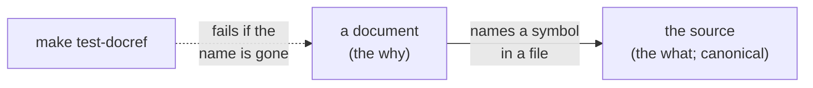
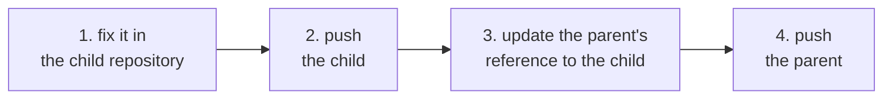
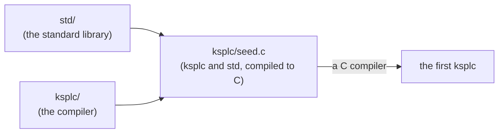
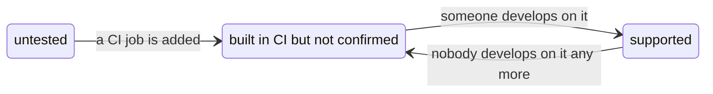

# How the repository is organized, and why

**This document says why Kanso's documents, packages, repository and gates have the shape they have.** The principles they follow are in [`DESIGN-principles.md`](DESIGN-principles.md); the rules themselves are in [`SPEC-documents.md`](SPEC-documents.md) and [`SPEC-gates.md`](SPEC-gates.md).

## Documents

**What a document is for, and whom it is for, are decided before it is opened.** Its name decides them, and so does its row in `docs/README.md` for a document of no package. Of the source, a document holds only pointers; the code is the canonical source.

### A document's name says what it is for

The six kinds, what each holds, and how a document is named are "Document naming" in [`SPEC-documents.md`](SPEC-documents.md). This section holds why.

**A reader opens a document in one of a few modes.** The modes are arriving, learning, carrying out a task, looking a rule up, understanding why, and seeing what is left. The reader needs to know which before opening it. So the kinds are a closed set of six, and the kind is the file's name. A folder's listing is then its reading order.

**Every tutorial is a `TUTORIAL-<topic>.md`, and takes a newcomer from nothing to a first result.** A HOWTO does one task for a reader who knows the subject. A newcomer needs one path, read once from start to end. One name form for every tutorial lets the name check refuse any other. **The language's tutorial is generated, and a package's is written by hand.** The language's is a program the gates run. A package's steps install tools and download files on the reader's own machine, which no gate can run. A gate still checks what it can reach in it, such as each `make` target named (`make test-docref`).

**One of the kinds is Kanso's own: a `PLAN.md` holds what is left to do.** A plan changes with every step, and a rationale only when a decision changes. Inside the slower document, a plan reads as done.

**There is one plan for the repository, with a section per package**, so what is left reads on one page. A package copied out alone does not carry its plan; what is left is the repository's work.

**What is done is deleted from the plan, not marked**, so the plan is never read against the code. The list of what was achieved is `git log`'s.

**"One file, one kind" is a judgment, gated only where a count decides it** ("Document naming" in [`SPEC-documents.md`](SPEC-documents.md)). Whether a paragraph of why belongs in a how-to is a person's call, and Principle 8 names the rest as a gap.

**The grounds are edited in place, not appended**, so the reader reads the current state rather than replaying records. The kind carries a decision's state: what is not done stands in a `PLAN.md`, and what stands is the `DESIGN-<subject>.md`'s. The path to that state is git's.

**A package's entry point is its own `README.md`, and the root one is the front door.** One README holding every package would cost every reader a page nobody reads through. A seam between packages gets its own document, such as [`SPEC-local-server.md`](SPEC-local-server.md). So the root `README.md` holds what Kanso is, how far it works, one way to start, and where everything is.

**A README's headings come from one skeleton** ("What every README contains" in [`SPEC-documents.md`](SPEC-documents.md)), so the same part stands under the same heading in each. The skeleton is offered rather than required, so no folder grows an empty section.

**The kind carries the reader, so no second axis is added.** Inside a package, a `SPEC-` is for whoever relies on the subject from outside, and a `DESIGN-<subject>.md` for whoever changes it. The documents that belong to no package share no subject. So their entry point's table names the reader ("A column, not a folder, says who reads a document" below).

**A specification's reader needs a complete agreement without reading maintainer explanations.** So references go from design to specification ("What a SPEC can point at" in [`SPEC-documents.md`](SPEC-documents.md)), and the README connects the two reading paths. This gives up a direct link from each rule to its rationale.

* **The reader is not marked per file.** A document serving two readers would need one label, and the argument would move to which one.
* **The kind makes one misplacement visible**: facts about something outside Kanso in a document for whoever changes Kanso. A board's pin table belongs in [`../ksos/docs/SPEC-board.md`](../ksos/docs/SPEC-board.md), not in ksos's rationale.

**What the reader must already have is said where the kind cannot say it.** It stands in the first sentence of a `HOWTO-` or a `TUTORIAL-<topic>.md`, or in a README table's column where the documents differ ("Document naming" in [`SPEC-documents.md`](SPEC-documents.md)). The reader needs a checklist (a terminal, a toolchain, a board on the desk), not a persona.

**A document gets no line cap.** A specification is as long as its subject and is looked up, not read through. A `README.md` routes and explains nothing, and the language's tutorial is one program. A cap would be a number with no grounds behind it (Principle 8).

### A column, not a folder, says who reads a document

**The documents that belong to no package all sit flat in `docs/`, with no folder inside it** ("Where documents sit" in [`SPEC-documents.md`](SPEC-documents.md)). Whom each is for is the last column of the table in `docs/README.md`, the one place that question is answered.

**The column says what a folder cannot.** It names two readers where a document serves two, and what the reader must already have (a C compiler for the build how-to). Folders cut by reader beside the column would answer one question twice (Principle 6).

**The column names the reader, not the subject.** A subject splits again once one document covers two; a reader does not split.

**No folder needs an exception.** GitHub finds `CONTRIBUTING.md` and `SECURITY.md` in `docs/` ("Documents whose name is fixed from outside" in [`SPEC-documents.md`](SPEC-documents.md)).

**What it gives up is the reader's name in the path.** A reader who does not know the kinds finds them in `docs/README.md`. Every name carries its kind from a closed set, so documents are told apart before either is opened.

**The rules for the documents are a document of their own.** A document that routes cannot also be canonical for a rule. So `docs/README.md` routes, and the rules are [`SPEC-documents.md`](SPEC-documents.md), held up by `make test-docref` and `make test-conventions`.

### Linking a design document to the source (no round trip)

**A document names the code it talks about (a file, a function), and a check fails when that name disappears.** The source is the canonical source, and a document points only toward it ("Linking documents to source" in [`SPEC-documents.md`](SPEC-documents.md)). A design document never copies code, and the code never points back.



**How far a machine can guard decides what each part holds.**

| What | Who can guard it | So it holds |
| :-- | :-- | :-- |
| Names (symbols, files, headings) | A machine | Links from the document to the source |
| Examples | A run (compiling and running them) | Running examples, by pointing at tests |
| Prose | Only a person | The why; the what is a pointer to the source |

**The word "round trip" is kept out of this design.** Under a tool that synchronizes both ways, the model and the code drift apart, and the diagram stops being trusted (Principle 6). Do not mix the document and the source into one file either: line numbers shift, diffs become unreadable, and debuggers and `grep` stop working.

**There are only two ways of linking.**

| Way of linking | What it holds | Who is canonical |
| :-- | :-- | :-- |
| **A link** | Which symbol in which file, by name | The source |
| **Generation from a table** | The table holds the values, and the notation is generated | The table |

**A document does not show the source's text.** Copied in, it goes stale unseen; the editor and the language server already show the source. Generation is kept to where a table is canonical, such as the list of diagnostic codes. Always place a check on the generated artifact's freshness beside it, or a hand edit silently vanishes at the next generation.

#### No marker is added per symbol

**No attribute or directive tying a symbol to a design document is attached to the symbol.**

* **It is derivable.** The document names the symbol, so a check can build the reverse index (Principle 6).
* **There would be many**, and the source's reader would skip them.
* **It breaks weakly.** A forgotten marker is lost quietly, while a link fails a check the moment its target disappears.

**Visibility already says which symbols a design document shows**: `pub` marks them.

#### A running example is obtained by pointing at a test

**A document shows a running example by pointing at a function in a test**, because an example copied into a document goes stale. A test pointed at by name breaks the build when the code changes, as a doctest does, with no test notation in the language.

**An explanatory fragment, its surrounding context left out, is written in the document**, and `make test-docsnippet` compiles it. Whether a piece runs on its own decides which side it is on.

**Every block is compiled, and a line meant to be refused says so on that line.** A whole program must compile and pass the lint gate. A line ending in `// error` must draw an error, and nothing else can draw one. The marks are "A code block compiles, or says why not" in [`SPEC-documents.md`](SPEC-documents.md). A mark on the whole block would let an error on another line pass. A mark hidden in the fence's info string would not show on the rendered page.

**What compiling every block gives up**: a fragment that leans on the prose is not compiled to any verdict. So a fragment that carries a mark carries its context too.

**What linking this way gives up**: code cannot be fixed from the design document. Renaming a symbol fails the document until it is edited by hand, and that failure is the point.

#### A comment that points is checked as a document is

**A comment naming a symbol in another file is read by the same check as a document's link, with no mark of its own.** A mark would be a second way to write one pointer (Principle 6), and the unmarked one is what goes stale. So the spelling a pointer takes anyway, `` `name` in `file` ``, is the one read. The member is read as well as the owner, since a method moved to another file leaves its type named in the old one.

**A pointer that names no file is read through the commenting file's own scope.** Only the compiler holds that scope, so it reads `` `Owner.member` `` as the code beside the comment would. A missing member is a warning in the editor (`[W0211]` in [`../ksplc/docs/SPEC-diagnostics.md`](../ksplc/docs/SPEC-diagnostics.md)), and the same reader links the name in the hover.

**Each spelling has one reader.**

| Spelling | Who reads it |
| :-- | :-- |
| A name tied to its file (`` `name` in `file` ``) | The document check. It is the way to point at a method added by a file outside the compilation |
| A name naming no file, in a comment | The compiler |
| A name naming no file, in a document | The document check, against every declaration of the tree |
| A name introduced as another product's ("Python's `` `json.dumps` ``") | Nobody |

**What is given up**: the check reads literal text, so a pointer worded another way escapes it, and is still a violation (Principle 8). The editor's single document can also call stale a method added by a file it does not import. The pointer naming its file answers that.

### The reader can be a model

**An agent works on this repository, and a model writes KSPL for whoever asked it to; both read what is written here.** What a model lacks decides what they need.

| What a model lacks | What that requires |
| :-- | :-- |
| **It cannot ask.** | What it needs is written down, or can be had from a command, never held in someone's head |
| **KSPL is in no model's training.** | A model falls back on the habits of Rust, Swift and C. So what KSPL leaves out, and what to write instead, has to stand where a model reads it |
| **Its context is short, and costs.** | One precise piece on request beats a document read whole. `ksplc explain <code>` prints one diagnostic's section ("Explanations come from the specification, and only codes have one" in [`../ksplc/docs/DESIGN-diagnostics.md`](../ksplc/docs/DESIGN-diagnostics.md)). `make explain T=<target>` prints what one make target is made of. An instruction file carries only what cannot be read from the code |
| **It believes what it reads.** | A stale pointer or a copied fact misleads it with confidence. So what it reads is generated from the canonical source and held by a check (Principle 4) |

**A document that restates a canonical source loses value**, since a model restates on demand and the copy goes stale. One that holds a decision and its grounds, a rule, or a comparison gains value. So no second, hand-written copy of a document is made "for AI"; where a model needs another shape, it is generated from the same source.

#### No file for models

**No file for models is kept** (`llms.txt`, a convention for one file a model reads first). What one would hold already has a canonical source a model can read:

* what KSPL leaves out (Appendix A of [`SPEC-programming-language.md`](SPEC-programming-language.md));
* the tour ([`TUTORIAL-programming-language.md`](TUTORIAL-programming-language.md));
* the grammar, the API pages, and each diagnostic's section (`ksplc explain <code>`).

**What is given up**: one file to give a model that cannot read the repository. Such a model is given the specification and the tour instead.

### The tour is a program, one declaration per step

**The tour is one program, and each step is one of its declarations with its `//<` comment, in an order chosen for teaching.** How the page is written and checked is the head of [`TUTORIAL-programming-language.md`](TUTORIAL-programming-language.md).

**The motive is a tour that cannot drift.** A newcomer reads it before they can tell that it is wrong. Generated from a program the gates compile and run, the code and its explanation sit in one file and are checked together.

**A generated page still needs an order chosen for the learner**, or it reads as a reference. So the declarations stand in teaching order, smallest first, one idea each. **The page ends by naming where to go next.**

**What it gives up**:

* **A step can teach only what one declaration of a running program shows.** Splitting a program over files belongs to [`HOWTO-set-up-a-project.md`](HOWTO-set-up-a-project.md).
* **A step's prose is a comment, held to a comment's limit** (Principle 7). A longer step is split, or points at the specification.

## What crosses a package boundary

**A package's promise to whoever is outside it is exactly its `pub` names.** (A *package* is one top-level folder such as `std/` or `ksdb/`.) This chapter covers where tests go, how the published API is recorded, how outside code is brought in, and how a package is found.

### A test of a unit's inside goes inside that unit

**A test that looks at a package's private parts lives in a `tests/` folder under that package.** (A *unit* here is a package: the extent a name with no visibility mark is visible in.) There it reaches what it inspects without making one name `pub`, and it stays out of the shipped artifact. `package_of` in `ksplc/base/locate.kspl` takes a file's unit from the first separator of its logical path, so `ksmd/tests/tables.kspl` is in unit `ksmd`. From the root's `tests/`, the same test would need its target `pub`, and [I0402] (the lint for an unneeded `pub`) could not tell that `pub` from an unnecessary one.

| The test | Where it goes | Why |
| :-- | :-- | :-- |
| Inspects the inside of one package | `<package>/tests/` | Same unit, so no `pub` is needed |
| Looks at two packages | The `tests/` of the one that imports the other | The other way would add an import direction that is not allowed |
| Inspects the compiler's answers | `ksplc/tests/`, importing nothing from `ksplc/` | It drives the built compiler as a child process |
| Stands on what walks the repository or builds a child process | The root `tests/` | It uses things from outside every unit |

**A test looking at two packages goes to the one that imports the other.** A test of both `std/prng` and `ksai/sampler` in `std/tests/` would make std depend on ksai. So it sits in `ksai/tests/token_test.kspl`.

**`ksplc/tests/` imports nothing from `ksplc/`.** Its suites run the compiler this folder builds as a child process. A test of an internal function would bring the whole compiler into that executable, so measure `make debug`'s translation time before adding one.

**What is used from outside a unit stays in `tests/`.** That is the tests that stand on what walks the repository root and git (`tests/support/harness.kspl`), and on what starts a child process to build (`harness_build.kspl`). Those tools must not move into `std/` ("What tests share stands in std" below).

**Do not bring in what the destination does not depend on.** A test that does leaks into the distributed unit; `make test-docref`'s direction check watches for it.

#### Where the entry points are

**Every package has its own `tests/`, and `tests/debug/main.kspl`, the one place that calls more than one, only calls each entry point in turn.**

* **One package or all.** `make debug-<name>` runs one package where `make debug` runs all. That shortens the wait for a first answer; what to run before pushing is `make ci`.
* **Each package has a second door**, its `<package>/tests/main.kspl`, run by its own `Makefile`. `tools/` has none, so the root's `debug-tools` runs it; the `$(error)` in `mk/test.mk` stops make for a second folder like it. Each door passes its own compiler where a run takes one (`run_std(ksplc, arena)`), and both are compiled on every round.
* **`ksbind` has the second door alone**: its tests link libraries from outside the toolchain, which `make debug` must not need.

**Each package's entry point is `<package>/tests/all.kspl`, and its opening comment says what the package's tests inspect.** Its suite runs every function named `test_…` in the files it imports ("8.5 Tests: functions named `test_`, run by a suite" in [`SPEC-programming-language.md`](SPEC-programming-language.md)). Adding a test touches no list; adding a file of tests adds one import line.

**The remaining boundary is closed by opening exactly one entry point as `pub`**: one function that runs everything, like `run_ksos` in `ksos/tests/all.kspl`. Do not add inspection interfaces here; each is one more contract outside the unit.

#### Where an unneeded `pub` is reported

**[I0402] can be enabled for `ksmd/`, `ksos/`, `ksagent/` and `tools/` as well as `ksplc/` and `kssrv/`, but not for the units distributed and used elsewhere (`std/`, `ksdb/`, `ksai/`, `ksbind/`).** Their `pub` is a contract with outside users that references inside the repository cannot judge. Read the header of `all.kspl` before adding.

**The diagnostic is turned off in two files, each with its reason beside the switch.** In `tools/ai_assist/ksplc_oracle.kspl`, `compiles` is a `pub` that the tools' tests use (`tools/ai_assist/tests/ai_assist_test.kspl`). In `ksplc/tests/prog/equiv.kspl`, `main`'s error type is seen from outside as the entry point's.

**Inside `tests/` itself it is the reverse.** No package imports that leaf, so a `pub` there has no user outside the unit, and the diagnostic is enabled (`tests/ksplc.cfg`). A `pub` inside the materials (`negative/`, `lint/`, and forms held in `"""…"""`) is not reported, since they are written to make a visibility diagnostic fire.

**In `ksos/demo/`, a `pub` has no user outside the unit either, but the diagnostic cannot apply to the demo alone.** The configuration is found from the entry point's file. So it would also report the kernel's and drivers' `pub` names, which stay ("The guidance for adding an API or an implementation" in [`../ksos/docs/DESIGN-rtos.md`](../ksos/docs/DESIGN-rtos.md)). `make test-conventions` checks the demo's text instead.

### The published API is recorded in the repository

**Each package's published API is listed in one text file committed to the repository (`SURFACE.txt`).** A gate fails when the code and the list disagree, so a change to the API always shows in a diff. `ksplc doc --emit-surface` writes the list, `make surface` regenerates it, and `make test-surface` rejects drift ("Writing out the published API" in [`../ksplc/docs/SPEC-tools.md`](../ksplc/docs/SPEC-tools.md)). Without it, deleting a `pub` whose user lives in another repository keeps this build green, with no record of what changed.

**The toolchain emits the record from one entry-point file**, so it cannot drift as a separate analyzer would. What counts as API is the declarations actually written, with no derived items or instantiated bodies.

**Do not merge the record with a library's interface** (`--library=`). It looks like Principle 6, but the purposes differ:

| | The interface (`--library=`) | The record (`--emit-surface`) |
| :-- | :-- | :-- |
| What it holds | Only the `#export` functions, spelled in C | Every `pub` declaration as written |
| Which build | One build | Every `#cfg` branch included |

### Outside parts are not fetched; only their location is stated

**KSPL has no package manager: to use someone else's code, you copy it onto your machine and state where it is** (`--pkg-src-dir=` and the environment variable `KSPLC_PKG_SRC_DIR`). The resolution order, and the rule that a local copy wins, are "The source of a package other than `std`" in [`../ksplc/docs/SPEC-tools.md`](../ksplc/docs/SPEC-tools.md). Nothing is fetched, no versions are solved, and nothing runs at import time.

**The motive**: a part requested by name becomes someone else's code that nobody has read. Fetching brings four questions that whoever requested it cannot see. Where did it come from, which version is it, what comes with it, and what runs at import time? Kanso holds no hidden work at build time, any more than at run time. Where a manifest is language code, solving dependencies means running it.

**What it gives up**:

* **Someone else's part is brought over by hand**, and which version was brought is yours to note.
* **A dependency's own dependencies are followed by hand.**
* **Fewer parts are available than anywhere else.**

**What was brought over can still be read.** A part shipping a `SURFACE.txt` shows what disappeared against the previous version ("The published API is recorded in the repository" above). This is revisited when KSPL packages people want by name appear outside this repository; until then a fetcher would have nowhere to fetch from.

### A package names itself, and names what it uses

**A package states its own name, and the packages it imports, in its `ksplc.cfg` file. Its place is the environment's, so it builds from any folder, under any folder name.** It names itself in its top folder's `ksplc.cfg` (`[package]`, `name = ksdb`), and lists under `uses` what it imports besides itself and `std`. Its files and `embed`s are read from that folder, wherever it stands. A used package's place is told as any place is ("Outside parts are not fetched; only their location is stated" above). The rule is "9.1 import syntax and path resolution" in [`SPEC-programming-language.md`](SPEC-programming-language.md).

**The motive**: a package found as a folder of its name, under the folder the compiler runs in, compiles only from the repository's root. From its own folder, its import of itself is looked for one level too deep. A name with no place in it avoids that: nothing in `ksdb/log` says where ksdb stands.

**Naming what it uses lets a reach be refused where it is made.** An import past the list is a compile error at the `import`, caught here rather than in a copy where the package is missing.

**What it gives up**:

* A new dependency is written twice, in the `import` and in `uses`.
* **A used package is still found as a folder of its name**, locally or under `--pkg-src-dir`.

### The standard library reaches only itself

**A file in `std/` can import only other `std/` files, and never with a `..` path.** Either reach out of it is refused at the line that writes it ("9.1 import syntax and path resolution" in [`SPEC-programming-language.md`](SPEC-programming-language.md)).

**The motive**: `std` is found by its place, so no `uses` list holds it ("A package names itself, and names what it uses" above). Without the rule, a `std` file importing another package would compile clean here and fail inside another package's copy. `std/../x` would let an outside file be read as `std`'s.

**Why a rule and not a name**: naming `std` would state a second time what its place states, and its list would always be empty. A settings file can be widened by editing it, where a rule of the language cannot.

**Nor does `std` bind a C library from outside the toolchain.** It is plain KSPL over the runtime every program carries, so it builds anywhere. A binding to an outside library, such as OpenSSL, stands in `ksbind` (why is [`../ksbind/docs/DESIGN-bindings.md`](../ksbind/docs/DESIGN-bindings.md)).

**What it gives up**: a `std` passed with `--std-dir` cannot import the user's packages.

### What tests share stands in std

**The general test helpers, which know no repository, are part of `std`.** They run checks, compare a child program's output, and make a scratch folder. **Only the helpers that know this repository stay in the root `tests/`.**

| Part | Where | What it does |
| :-- | :-- | :-- |
| `std/verdict` | `std` | Runs checks on past a failure, with their lines and a closing `RESULT:` line. Reads a child process's exit code and outputs as one check |
| `std/fs` | `std` | Gives a scratch folder, and writes and copies a tree |
| `std/fuzz` | `std` | Scatters broken input at a program |
| `tests/support/harness.kspl` | The root `tests/` | Walks the repository's root and git, and knows where its compiler lives. It is built on the three above, and on ksplc's own suites' harness |

**The motive**: a package's tests reach only itself, its `uses` and `std` ("The standard library reaches only itself" above). With the whole harness in the root's `tests/`, a package's tests could run only from the repository's root, never from a copy of the package.

**Why `std` and not a package of test helpers**: such a package would need a test-only `uses`, and `std`'s own tests could not use it. A harness in the standard library gives every package's tests the one shape the gates read. This repository's own suites run on it, so it does not stay too thin to use.

**What it gives up**: `std`'s published API grows by names a program testing nothing never calls. And the shape of a verdict line becomes `std`'s API to keep.

### A path's `..` is resolved by its spelling

**`a/../b` always means `b`.** A path's `..` is folded by its spelling, not by asking the filesystem. That holds for the folder a file stands in and for its name ("9.1 import syntax and path resolution" in [`SPEC-programming-language.md`](SPEC-programming-language.md)).

| Path as written | The file stands in | Its name |
| :-- | :-- | :-- |
| `pkg/../other/x.kspl` | `other`'s folder, never `pkg`'s | `other/x` |
| `sub/../lib/n` | `lib`'s folder | `lib/n` |

**The motive**: a walk cutting off one name at a time steps from `pkg/..` back into `pkg`. Three things would go wrong:

* **A file would pass for another package's**, and be held to that package's lint levels.
* **`#line` would show a wrong folder**, such as `pkg/probe/..`.
* **One file would be two.** Reached as `lib/n` and as `sub/../lib/n`, a file would compile twice, as two modules with a counter each.

**By spelling, not by asking the filesystem.** The filesystem's way needs the file to exist. The fold by spelling has one documented caveat, a symbolic link followed by `..`, the price Python's `normpath` and Go's `filepath.Abs` also take.

**A `..` that climbs out of a package read from a place of its own stays**: `std`'s, a package that names itself, and one under `--pkg-src-dir`. That folder need not stand at its name, so `ksdb/../x` folded to `x` would name the wrong file.

**What it gives up**: a file reached through a symbolic link followed by `..` is read at the spelling's place, not where the link points.

### A package's examples and benchmarks stand inside it

**An example program or a benchmark that uses only one package lives inside that package** (`ksai/examples/`, `ksai/benches/`). The package's own `make test` builds the examples and holds them to what they print. A program that needs more than one package and `std` stays a tool (`tools/ai_assist/`).

**The motive**: kept in a leaf of their own, `ksai`'s examples would travel apart from the engine. A copy of `ksai` would carry none of them. And `ksos`, which embeds the weights one of them trains, would need an arrow from implementation to leaf; here it uses `ksos→ksai`, one the direction table has. Examples outside the library's build are found broken only by whoever runs them.

**What it gives up**:

* **The examples take the package's lint settings**, so I0402 stays off for them, as for `ksai` ("Where an unneeded `pub` is reported" above).
* **The package's `make test` needs a C compiler**, to build the examples it runs.

### What recipients are owed: one table, held by a gate

**Every license notice owed, and the origin of every binary file, is listed in one table, `THIRD-PARTY-NOTICES.md`, and `make test-conventions` fails if a file is missing from it.** The rules the check holds are listed at the head of that file.

**The motive**: a caution alone would be a rule nothing checks (Principle 8), and a missing notice would be found by a recipient after the release. One table read against the files keeps the record in one place, with no license header in every file. The binaries are in because a model's weights carry a license.

**What it gives up**:

* **Code rewritten from another's without its words is not caught.** The gate sees a license's words, not an origin told in prose.
* **The release's contents are named twice**, in `.github/workflows/release.yml` and in the gate's list. Adding a bundled folder means adding it to both.

### A page asks the local machine through one protocol

**A page open in your browser (`ksmd`) reads and writes files on your computer by asking a small local server (`kssrv --local`).** It asks through one protocol, written in [`SPEC-local-server.md`](SPEC-local-server.md), and a secret token keeps other pages and programs out. The protocol belongs to neither package, so it is a seam with its own document ("A document's name says what it is for" above). The server is meant to be replaceable, so the document holds only the rules, and their grounds stand here.

The picture below shows one session from start to end.


**The server does not know the document** ("Who asks whom" in [`SPEC-local-server.md`](SPEC-local-server.md)), or the document model would stand in two places.

**The transport is built on what `std` already has.**

* **No program is started.** Building, debugging and plugins serve a code editor, which the page is not. A started program reads beyond the root and reaches the network, with the token as the whole defence (Principle 1).
* **`HEAD` is not carried.** Watching already returns the size and whether the file exists (Principle 6).
* **The type is not guessed, and the encoding is UTF-8 only.** A wrong guess shows only where it misses.

**Watching is the page asking, not the OS telling.** OS notification needs one implementation per OS. Asking loses how many times a file changed, but always returns the final state. Watching a whole large folder cheaply is given up.

**The token goes across once, in the fragment, and stays in the tab.** (The *fragment* is the part of a URL after `#`.) Whoever holds it can read and write every file under the root.

| The token is not… | Why |
| :-- | :-- |
| **In a query** (after `?`) | A fragment is never sent to the server, so another process cannot get the token by sending `GET /` |
| **In the response that serves the page**, or in a response header | Anyone who knows the address could read it there |
| **In a cookie** | The browser attaches a cookie on its own, to a malicious page's requests too. So the token rides in a header |
| **On the command line** | `ps` shows it to anyone on the machine |
| **Compared byte by byte with an early exit** | A page can send requests to the loopback address. A difference in return time would let it guess the token a byte at a time |

**What it gives up**: a person opens one URL once per start-up. `history.replaceState` keeps the token out of the browser's history.

**The page named at launch can sit outside the root** (`kssrv --page=<file>`). The document is in the person's folder, and the page is with the server.

**The server stops when no page holds a connection open.** A server opened by a double-click has no console to stop it from. Closing the tab closes the held connection, which carries nothing to parse.

| Signal not used | Why |
| :-- | :-- |
| **A timer** | Every choice of the wait is wrong somewhere: too short, it stops while someone reads |
| **The last request** | A page where someone is writing asks for nothing between saves |
| **A goodbye message** | A killed tab, a stopped browser or a sleeping machine sends none |

**The wait named at launch only bridges two gaps**: before the first page arrives, and after the last one leaves. A person who opens the next document within the wait reuses the same server.

**Whoever holds the token can also stop the server at once, by asking it** (`POST /api/stop`).

* **Not by process number**: a number outlives its process, so a stale record would end an unrelated program.
* **Not by a signal**: Windows has none to send.
* **Through the same guard as every request**, so a page from another site cannot end it.
* **The answer goes out first**, so the asker knows the stop took effect.
* **What it gives up**: a server that has stopped answering is left to the operating system's own tools.

**Whether the server is there is asked, not guessed.** The server says whether it is local-facing, rather than leaving a page to guess from refusal codes.

**What it gives up**: the protocol serves one machine only, and refuses use from another.

### The reference is rendered when asked, not committed

**To read a package's API documentation, run `ksplc doc <file>`.** It renders the documentation from the source each time. **No generated HTML or Markdown reference is committed.** The command is 7.5 in [`../ksplc/docs/SPEC-tools.md`](../ksplc/docs/SPEC-tools.md). The record (`SURFACE.txt`) stays committed, since two versions are matched by it.

* **A committed rendering is a second copy of every description**, and every change to the rendering rewrites thousands of lines that publish nothing new.
* **An entry point returning one piece serves a person and a model alike** (the chapter "Models write it, and AI runs in it" in [`DESIGN-principles.md`](DESIGN-principles.md)). `ksplc doc std/mem.Arena.alloc` returns that entry and nothing else, at once, wherever `ksplc` runs.
* **On a repository host the source is the reference**, since a description stands on the line of what it describes.

**What it gives up**: a rendered, linked reference to browse without a toolchain. `make surface` writes one under `out/docs/` for whoever has the toolchain. A link from one file's reference to another file's entry stays text.

## Why one repository

Kanso holds ten packages (`ksagent` / `ksai` / `ksbind` / `ksdb` / `ksmd` / `ksos` / `kspeg` / `ksplc` / `kssrv` / `std`) in one repository. **This is the decision not to split.** Most changes touch more than one package, and the compiler cannot be built without the standard library.

### What happens if it is split

**Whether to split is decided by the share of changes that cross packages**, not by whether the packages are independent. It is measured by how many packages' files recent commits touched, merges excluded (`git log --name-only`), so no number is copied here (Principle 7).

**Once split, a change crossing two or more packages becomes work across repositories in a fixed order.** Forget any one of the four steps and neither repository builds on its own:



### `std` cannot be separated from `ksplc`

**The file that bootstraps the compiler holds the standard library inside it, so every change to `std` is also a change to `ksplc`.** The seed ([`../ksplc/seed.c`](../ksplc/seed.c)) is `ksplc` and `std` compiled together into one C file. It is how the compiler is first built on a machine with only a C compiler. In separate repositories every change to `std` would straddle two.



Caution: **Get the order wrong and the seed is left holding a stale `std`.** `make self-host` then fails for the next person who pulls.

**There is no cycle in the import direction** (the table in [`SPEC-documents.md`](SPEC-documents.md)). The seed and the volume of crossing changes keep the packages together.

### No split is designed

**No way of splitting is designed, and no tool for it exists.** A way would be designed on the day a split is decided. What a split would need is kept anyway, because each is worth having in one repository too:

* A package's tests sit inside it ("Where the entry points are" above).
* Its published API is recorded (`make surface`).
* `make test-extract` builds and tests a package from a copy of its folder alone ("A package names itself, and names what it uses" above).

## The build and the gates

**The build is two builds, with opposite options** ("A shipped executable is optimized; the development cycle is not"). What each gate checks is in [`SPEC-gates.md`](SPEC-gates.md), and how to run them is in [`HOWTO-build.md`](HOWTO-build.md).

**One invocation keeps one build dependency graph.** The logging wrapper forwards the build goals together to one child make, so parallel goals share their prerequisites and one log under `OUT_DIR`. `clean` is forwarded separately without a log, because it removes that directory.

**What a target is made of is asked of make, not written down.** `make explain T=<target>` reads make's own database and `make -n`. It prints the rule's place, the prerequisites, the filled-in commands, each variable with the line that sets it, and the settings. A hand-written map of the make files would drift from them ("Explaining a make target" in [`../tools/docs/DESIGN-tools.md`](../tools/docs/DESIGN-tools.md)).

### What goes where in `out/`

**The top of `out/` holds only the programs a person runs, and folders.** A person finds a program there by the name a document gives. Every other output goes into the folder for its kind:

| Place | What it holds |
| :-- | :-- |
| `out/` itself | The programs a person runs or a document names, such as `ksplc_stage1.exe`, `kssrv.exe` and `ksmd.exe` |
| `out/gen/` | What a build writes for a later step: generated C and LLVM IR, `.libs` and `.deps` files, and the `.desktop` entry |
| `out/test/` | A program built only for a gate, such as `test_debug.exe`, `debug_tools.exe` and `kssrv_llvm.exe` |
| `out/log/` | Logs and reports: `make.log`, each gate's log under `ci/`, the comparisons `stage_diff_c.txt` and `ship_diff.txt`, and the repository's size `repo_stat.txt` |
| `out/tmp/` | Scratch that a gate or a tool writes during its run |
| A folder named for a package or a tool | That package's build as its own `Makefile` lays it out (`ksmd/`, `ksos_posix/`), or one tool's output (`surface/`, `docs/`, `ai_assist/` for the models and tokenizers `tools/ai_assist` makes, `benches/` for ksai's benchmarks) |

**A new output goes into one of these folders.** It goes at the top only when a person runs it, since its path then becomes part of what the documents promise. `make debug-file` (VS Code's F5) is such a case: its program stands at the top, where the debugger looks. A benchmark goes into `out/benches/`, although a person runs it: `ksplc build` leaves a program's C and libraries beside it, and they would fill the top. `make clean` removes `out/` whole, so a folder needs no cleaning rule of its own.

**What it gives up**: a gate's program is one folder deeper to type, as `./out/test/test_debug.exe`.

### A shipped executable is optimized; the development cycle is not

**While you work on the compiler, it is built without optimization (`-O0`) so each rebuild is quick. Do not raise `CFLAGS`.** That development cycle is the stage1 / stage2 that `make` builds (stage1 is built by the seed; stage2 by stage1). Megabytes of generated C are rebuilt for every line fixed, and optimization multiplies `clang`'s time by an order of magnitude.

| | The development cycle | What ships |
| :-- | :-- | :-- |
| Built | On every change | Once per install or release |
| C compiler options | `-O0` | `SHIP_CFLAGS` (`-O2`), as `out/ksplc_ship.exe` |
| Who uses it | Whoever changes the compiler | Whoever runs `make install`, and the release (`.github/workflows/release.yml`) |
| Compared with the development build | — | It translates ksplc itself in roughly half the time, and is roughly half the size |

**The generated C does not change by one byte.** `make self-host-ship` translates ksplc with the shipped build and compares the result with stage2's C, on Linux and in every platform's release build.

**Only the C a person reads is tidied.** Clang-Format runs on the C of `make debug-file` and `make commit-seed`. The C the bootstrap and `make debug` leave is not tidied, since nobody reads it.

**So Clang-Format is optional everywhere but one step.** Without it, `make debug-file` leaves its C as generated and says so. `make commit-seed` stops instead: `ksplc/seed.c` is tidied in git, and an untidied seed would change every line and bury the real change.

Caution: **Do not drop `-g`.** When a shipped executable dies, that is the only place a position comes from.

### A language rule is a lint, not a text check

**A rule about how KSPL source is written is checked by `ksplc lint`, never by a check under `tests/` that reads the text.** The lints read the parsed tree, its comment runs and its resolved names. A check under `tests/` reads text only for a rule of this repository, such as the words a document uses.

* **Each reader of its own reads strings and comments a little differently**, while the compiler reads them once, for every check.
* **A line-by-line reader misses what spans lines**, such as a wrapped signature or a type behind a `typedef`.
* **The lint answers where the code is written**: in the editor, and through `ksplc explain` ("Static analysis and the linter" in [`../ksplc/docs/SPEC-tools.md`](../ksplc/docs/SPEC-tools.md)).
* **What it gives up**: the lint sees only the files the lint gate's entry points read, so a fixture compiled alone (`ksplc/tests/negative/`, `ksplc/tests/lint/`) is not measured. **The lint of one entry point checks every file it reads**, so an unused `priv` in an imported file is reported too ([W0206]).

### A run target writes every option out

**A run target builds its programs, then runs one program with every option written out.** A run target is one a person types to use a program, such as `make chat`. An empty value means a setting not given. The program makes every choice: whether a setting was given, its default, and what to start. Its `--help` names each default and what an empty value means.

The worked example is `make chat` in `mk/ksagent.mk`:

```make
chat: $(KSAGENT_EXE) $(KSSRV_EXE) $(KSAGENT_PAGE) $(KSAGENT_CHAT_EXE)
	./$(KSAGENT_CHAT_EXE) --dir=$(call shq,$(DIR)) --model-file=$(call shq,$(MODEL)) --port=$(call shq,$(PORT))
```

| Decision | Why |
| :-- | :-- |
| **The recipe is a command a person could type** | The line make prints is the whole command. The reader needs no helper variable to see what runs |
| **Each choice stands in the program alone** | A choice split between make and the program can disagree. Make's half also reaches no one who runs the program alone |
| **Each value is handed on in single quotes, through `$(call shq,...)` in the root `Makefile`** | A value is what a person typed, and can hold a quote, a `$` or a backtick. In double quotes, one of them ends the word or has the shell run text. In single quotes nothing is special, and `shq` writes a `'` in the value as `'\''` |
| **An empty value means "not given"** | Make can leave an option out only through a conditional, which is a choice in make again |
| **The program's `--help` says what an empty value means** | The recipe names no default, so the usage is the one place to find it |
| **The rule applies to a run target when the target changes**, not to the whole build at once | A rewrite of every recipe costs much, and fixes nothing that a person meets today |

**What it gives up**: a program does not start a build. Where `make chat` finds neither `llama-server` nor `chat_server`, its launcher stops and names `make chat-server NATIVE=1` ("Starting the model server" in [`tools/docs/DESIGN-tools.md`](../tools/docs/DESIGN-tools.md)).

### Where CI's time goes, and what shrinks it

**One local command, `make ci`, runs a round on any platform**; which sections it runs on each is "How the gates are arranged" in [`SPEC-gates.md`](SPEC-gates.md). **It runs only what the host runs natively, and starts no container**, so one command means one machine. Off Linux, the Linux-only section is run by opening the repository in its dev container. Each gate's log carries the platform it ran on, so a skip allowed on one OS cannot be accepted on another. A progress line names the active gate while its output is quiet.

**The shared jobs divide the compiler's extraction suites too**, so the heavy suites do not collect in one job ("How the gates are arranged" in [`SPEC-gates.md`](SPEC-gates.md)). Each share repeats the bootstrap, since each job needs a compiler of its own. Every regression suite runs in exactly one job, and no job is added.

**Do not write the seconds here** (Principle 7). Each run lists its seconds per gate at its tail ("How a run is read" in [`SPEC-gates.md`](SPEC-gates.md)), and `make ci-summary` prints the last list again. **The regression suites cost the most by far** (`test-suites`, dealt out as `suites_a`, `suites_b` and `suites_text`). Next come the gates that redo work under another build: `test-race`, `test-sanitize` and `test-ksmd-browser` in the Linux job. On a round that starts with nothing built, `self-host-ship` and self-host ×2 join them.

**`-j` barely takes effect on GitHub's runners**, so a runner is effectively one core, and the only route to faster gates is less total work. The reproduction is `taskset -c 0 make -j1 test-suites`: `sys.cpu_count` follows the affinity, so the suites' own side-by-side runs drop to one as well.

| Stage | Can it be shrunk |
|---|---|
| self-host ×2 (C and LLVM) | **Do not attach `-B`.** It redoes even the seed's compilation, and `perf-log` then rebuilds C's stage1 wholesale. `self-host`'s own recipe emits the verification marker on an incremental build too; otherwise the runner (`Gate.verdict` in `tools/ci_gates.kspl`) would return "passed without verifying" |
| perf-log | **Measure both times**: on an empty cache (cold), then on the same cache (warm). One alone leaves half unchecked. The cache sits in a dedicated location, so the shared cache is not erased |
| test-suites | With the cores full, **the total amount of work** fixes it. **No job is added for them**: each job pays its own start-up and billing ("How CI runs" in [`SPEC-gates.md`](SPEC-gates.md)). `SUITES` is kept longest first (the grounds are at `SUITES` in `mk/test.mk`) |
| test-race / test-sanitize / self-host-ship | **They run in the Linux job alone** (`Shard.linux` in `tools/ci_gates.kspl`). Each builds again what the shared jobs build once, under a sanitizer or at `-O2` |
| test-ksos-qemu | The demos that grab a fixed resource are serial ("How the gates are arranged" in [`SPEC-gates.md`](SPEC-gates.md)) |
| test-ksmd-browser / test-ksmd-open | **The server and the page are files that list their sources.** So the second gate to want one builds nothing (`kspl_dep_rules` in the root `Makefile`; the page's in `ksmd/Makefile`). The browser's checks run alone ("Two gates side by side" in [`SPEC-gates.md`](SPEC-gates.md)) |

**Do not merge fine-grained suites "because there are many of them".** Merging runs not one byte less, and a fine-grained name points straight at the cause. Only the same property inspected in two places can be merged.

**When reducing the total, look at the heavy individuals, not the count.** `ksplc/tests/negative/` is mostly a handful of cases that exceed the 1000 levels the compiler's type walks allow (`MAX_TYPE_UNWRAP_DEPTH` in `ksplc/sema/type/query.kspl`). They cost quadratically in the level count.

### A failed round says why in its last lines

**A round prints thousands of lines, and each gate's cause sits among them.** It is a `FAIL` among `pass` lines, a `panic:` in a child's output, or an unexpected `SKIP`. The end of the log holds only make's last word, which names a target, not a reason. So a round ends by naming each fallen gate's causes, one line each. Each carries the path of the gate's whole log ("How a run is read" in [`SPEC-gates.md`](SPEC-gates.md)).

* **The causes are the gate's own lines.** A gate's marks (`FAIL`, `panic:`, `RESULT:`) are spelt the same on every machine, while make's message is in the machine's language (`Error 1` reads `エラー 1` in Japanese). So make's line is read by its `*** [` alone, and shown after the gate's own.
* **An expected SKIP is counted, not copied**, so it does not bury the one that fails. A SKIP no row holds is listed and marked `UNEXPECTED`.
* **Where no line names the cause, the log's last lines stand in** (a C compiler's error, a crash).
* **A green round stays short**: one line per gate.

**The rows are held against the tree before a round meets them.** Otherwise a reason one platform alone prints is first seen after that platform's whole round. `make test-conventions` refuses a reason no row of `tools/ci_gates.kspl` holds:

* **A reason built at run time must carry, in one literal, the piece a row names.** A constant of the same file is read as its text. A reason bound to a name in the same function is read where it is written.
* **A call written inside a string is not read**; it is a test's child program.
* **A reason that no platform must let through stays out of every row**, listed with its reason (`HELD_BY_NONE` in `tests/support/conventions_skip.kspl`).

### 'Supported' means someone uses it

**An environment is called "supported" only when the gates run there and someone also develops there every day.** The levels are supported, built in CI but not confirmed, and untested. The table and what each level promises are "Where it is supported" in the root [`README.md`](../README.md); this section holds why.

**A green CI job is not enough for "supported".** CI runs weekly and on request ("How CI runs" in [`SPEC-gates.md`](SPEC-gates.md)), and a gate sees only what it was written to look at. Someone who uses the environment daily meets a terminal, a real filesystem, an input method and a debugger, which no gate meets.



**The C compiler is part of the environment.** What becomes of the emitted C is the C compiler's: warnings, libraries, object format, and what C leaves unspecified. So a row names an operating system, an architecture and a C compiler together. GCC compiles the generated C in `make test-c-warnings` alone, and no gate builds the compiler with GCC. So GCC stands among the untested (Principle 8).

**A level is named by what stands behind it, not numbered**, since a reader not told rounds it up to "supported".

**What no row names is written down as untested.** KSPL translates to C99, so a reader takes "needs only a C compiler" for "runs everywhere".

Caution: **Do not raise a level because a CI job went green.** A new job places its environment at "built in CI". It moves up only once someone develops on it, and down once nobody does.

**What is given up**: an environment that would work is listed as untested until someone runs it. So macOS reads lower than its green job suggests. Who develops where is a fact about people, so the table is kept by hand.

### The Windows executable is built on UCRT64

**The released Windows `ksplc.exe` is built with MSYS2's UCRT64 clang**, the toolchain Windows developers here use, not LLVM's clang targeting MSVC. (MSYS2 is a set of Unix-style tools for Windows. UCRT64 is its environment whose programs use the Universal C Runtime that ships with Windows 10.)

* **What ships is what is used** ("'Supported' means someone uses it"). Otherwise the downloaded file would be the one Windows build nobody runs day to day.
* **It needs nothing installed beside Windows.** The executable imports only DLLs Windows carries (the `api-ms-win-crt-*` set, `KERNEL32`, `SHELL32`, `WS2_32`), and uses Windows threads, not `winpthreads`. The release refuses an import found under MSYS2's tree (`.github/workflows/release.yml`, "Refuse a DLL that only MSYS2 carries").
* **Building it needs no Visual Studio.** MSYS2 installs from its own packages.
* **Nothing it links calls for MSVC.** That target's usual reason is linking with software Visual Studio built, and ksplc links no C++.

**MSYS2 holds two kinds of tool, and the build uses both.**

| | POSIX tools | Native tools |
| :-- | :-- | :-- |
| Where | No prefix, in `/usr/bin` (`bash`, `make`, `git`, `find`, `grep`, `sed`, `python`) | Named `mingw-w64-ucrt-x86_64-…`, in `/ucrt64/bin` (`clang`, `ld.lld`, `llvm-objcopy`, `lldb`) |
| What they are | Linked against `msys-2.0.dll`, a POSIX layer derived from Cygwin | Plain Windows programs, sharing one C runtime (UCRT) with what ships |
| Their job | Drive the build: POSIX paths (`/c/Work/...`), fork, signals, and argv byte for byte. They never touch the bytes of what ships | Build what ships |

Built by the POSIX tools instead, `ksplc.exe` would depend on `msys-2.0.dll`. `MSYSTEM=UCRT64` chooses only which native tools come first on the PATH; the shell always comes from the POSIX tools.

**The packages both kinds come from are one list, `tools/msys2-packages.txt`, which CI and a person install alike**, as `.devcontainer/Dockerfile` is for Linux. CI installs it through one action of the repository's own, and the setup guide through a `pacman` command reading the same file.

* **A list written twice drifts, and the drift shows only on a fresh machine**, midway through `make ci` (without `diff`, the self-host cannot compare its stages).
* **The source is a plain file, not the workflow**, since a person cannot run a workflow's YAML. `make test-conventions` refuses a workflow that sets MSYS2 up by itself.
* **It holds what `make ci` needs and nothing more.** A tool only some work uses (`clang-format`, `lldb`, the ARM and wasm toolchains) is named in the guide beside that work. The gates that skip without one are named per platform in `tools/ci_gates.kspl`.
* **`git` comes before the list**, by a command of its own, to clone the repository holding it.

**What is given up**: the MSVC target is not what ships, and no CI job builds it, so it is untested. Kanso's own build refuses it (`-dumpmachine` in the root `Makefile`). A user's program can still be compiled for it, since ksplc answers its link words per target. Debug information is DWARF, read with LLDB (as the release's bundled `.vscode/` does), not with Visual Studio's debugger.

**A tool taken from the wrong kind breaks later, far from its cause.** So the Makefile refuses to run outside the UCRT64 shell, and refuses `mingw-w64-ucrt-x86_64-make`. Outside that shell:

* Windows's own `find.exe` shadows GNU `find` (`File not found - *.kspl`).
* The console's code page (CP932 in most Japanese environments) garbles `make`'s UTF-8 output.
