# The rationale behind Kanso's design

**This document says why Kanso is the way it is.** It answers two kinds of question: "why does KSPL do this differently from other languages?" and "why does this restriction exist?".

What the language *is* belongs to the specification, [`SPEC-language.md`](SPEC-language.md). For the rules alone, that is all you need. Read this document when two readings of the specification disagree, and before you propose a change to it.

What belongs to one folder, not to Kanso as a whole, stands in that folder. The compiler's internal design is [`ksplc/docs/DESIGN.md`](../ksplc/docs/DESIGN.md), and each standard-library file's is [`std/docs/DESIGN.md`](../std/docs/DESIGN.md).

## How to read this document

Start with the eight Development Principles. Each chapter after them applies the principles to one subject, one decision per section. The chapters from "Symbols and syntax" to "Function values" decide what a program means, those from "One notation per purpose" to "How the source text is written" how it is written down, those from "Documents" to "The build and the gates" how the documents, the packages and the build are arranged, and "Models write it, and AI runs in it" what the whole is for.

* **Each section opens with the decision in plain words**, then gives the details, the reasons, and what the decision gives up. Reasons carry values.
* **This document holds only KSPL's decisions and their grounds**, not a survey of how other languages handle the same problems.
* **History is not written here** (Principle 7).
* **The headings carry no numbers**, and a section is cited by its heading's words: a number shifts whenever a section is inserted above it, and every citation of it goes stale at once.
* **New to KSPL?** The two tables below give the notation and the words the chapters assume. The language itself is taught step by step in [`TOUR.md`](TOUR.md).

### The notation the examples use

KSPL reads like C written left to right. These are the forms the chapters use most; the full rules are in [`SPEC-language.md`](SPEC-language.md). The examples use the indentation notation (`.kspls`), where a block is its indented lines, as in Python (the chapter "The indentation notation (`.kspls`)").

| You see | It means | Nearest C |
| :-- | :-- | :-- |
| `x: = 5` | Declare `x`, with its type inferred (here `I32`) | `const int x = 5;` |
| `$x: I64 = 0` | The `$` before the name lets `x` be assigned again | `int64_t x = 0;` |
| `x@` / `p$` | The address of `x` / what the pointer `p` points at | `&x` / `*p` |
| `I32@` / `I32$@` | A raw pointer to a read-only / writable `I32` | `const int*` / `int*` |
| `U8[]` / `U8$[]` | A slice: a pointer plus a length, its elements read-only / writable | a `{ptr, len}` struct |
| `U8[4]` | A fixed-length array of four bytes | `uint8_t a[4]` |
| `List<\|I32\|>` | A generic type given the type argument `I32` | C++'s `List<int>` |
| `I64::x` | Convert `x` to `I64` (a cast) | `(int64_t)x` |
| `T!E` | A result: a `T` on success, an error `E` on failure | — |
| `Sz` | The signed size and index type | `ptrdiff_t` |
| `fn m(r: Self@)` | A method; `r` is its *receiver*, the `a` in `a.m()` | `void m(const T *r)` |
| `pub` / `priv` | Visible from every file / from this file only; with neither, from this package | — |

### Words used throughout

These words recur in every chapter and in every package's documents. **This table is their one definition**: a package's own glossary holds only the words of that package, and points here for the rest. Compiler-internal words are in the compiler's glossary ([`ksplc/docs/DESIGN.md`, "The glossary"](../ksplc/docs/DESIGN.md#the-glossary)). A few words, such as *gate* (one check that CI runs), *reject* (the compiler refuses the program) and *canonical source* (the one place a fact lives), carry one fixed meaning in every document ("Terms of art" in [`SPEC-documents.md`](SPEC-documents.md)).

| Word | What it means here |
| :-- | :-- |
| **translation time** | When `ksplc` compiles the program, as opposed to run time. "Rejected at translation time" means a compile error |
| **the generated C** | `ksplc` translates KSPL into C (or LLVM IR), and a C compiler (or LLVM) finishes the job |
| **diagnostic**, `[W0109]` | A message from the compiler: an error, a warning, an information or a hint. Every one but an error carries a code, whose letter is its weight: `W` warning, `I` information, `H` hint. `ksplc explain W0109` prints what the code means |
| **lint** | `ksplc lint`: the compiler's analysis alone. It prints every diagnostic, hints included, and builds nothing |
| **desugar** | Rewrite a convenient notation into a plainer one: `a + b` becomes the call `a.add(b)` |
| **generic**, **type argument**, **instantiate** | A generic is code with type parameters (`List<\|T\|>`); the concrete type put in for `T` is a *type argument*. Instantiating the generic makes one concrete copy per set of type arguments used (`List<\|I32\|>`), as C++ templates do. That copy is an *instantiation*, or *specialization*, and each one costs translation time |
| **trait**, **conform** | A trait is a named set of methods, like a Java interface. `impl X: Trait` declares that `X` has them: `X` conforms to the trait |
| **trait value**, **fat pointer**, **vtable**, **thunk** | A value whose type is a trait. It is a *fat pointer*: a pointer carried with a second word, here a pointer to the object plus a pointer to its vtable. The vtable is the table of that type's methods; each entry points at a *thunk*, a small adapter function that calls the type's own method |
| **receiver** | The value a method is called on: `b` in `b.free()` |
| **ARC** | Automatic reference counting. For a type that conforms to `Ref_counted`, each value counts the places holding it; the compiler inserts `retain` (count up) and `release` (count down, free at zero). The type `Arc` is another thing ("The names of the reference-counting types" in [`std/docs/DESIGN.md`](../std/docs/DESIGN.md#the-names-of-the-reference-counting-types)) |
| **arena** | A block of memory that hands out pieces and gives all of them back at once, when the arena itself is freed. Nothing inside is freed one by one. `std/mem`'s `Arena` is one ("8.4 The memory management model" in [`SPEC-language.md`](SPEC-language.md#84-the-memory-management-model-defer--arc--arenas)) |
| **FQN** | Fully qualified name: a name with its file's path in front (`std.Ref_counted`), unique in the program |
| **FFI**, **ABI** | FFI is calling between KSPL and C. The ABI is the binary agreement such a call rests on: how a type is laid out, and how arguments are passed. Both of `ksplc`'s backends keep it identical, so C output and LLVM output can call each other |
| **hosted**, **freestanding**, **bare metal** | *Hosted* code runs under an operating system and may call libc. *Freestanding* code (`--freestanding`) may not; it is for *bare metal*, a chip with no operating system, such as a microcontroller |
| **libc** | The C standard library (`printf`, `strtod`, `fopen` …). glibc is the usual one on Linux, and the CRT (UCRT) is Windows'. A freestanding build has none |
| **the C runtime** | The C code in `ksplc/gen/runtime/` that every hosted program needs besides its own: files, threads, the clock, the checks. Its functions are named `kspl_*`, and they are the only place `std` touches an operating system's API directly |
| **the seed**, **bootstrap** | The compiler is written in KSPL, so building it needs a compiler: the *bootstrap*. The *seed* (`ksplc/seed.c`) is the compiler, `std` included, frozen as C; any C compiler builds it into the first `ksplc`. A change the compiler needs at build time takes effect only once it reaches the seed |
| **borrow checker** | Rust's compile-time proof that no reference outlives its data and that no two places change the same data at once. KSPL has none (the chapter "Ownership and lifetime") |
| **Principle N** | One of the eight [Development Principles](#development-principles). The table at their head states each in one line |

---

## Development Principles

Eight rules come first in every folder: in the language, the libraries, the tools and the documents alike. The table states each rule in one line. The numbered list after it gives, for each rule, why it holds and how to apply it, the most important point first. Other documents cite the list's numbers ("Principle 5").

| # | Principle | In plain words | For example | How it is checked |
| :-- | :-- | :-- | :-- | :-- |
| 1 | The Zen of Subtraction | Take a feature on only if its benefit outweighs all it costs, and remove one that stops paying its way | `Callable3` is not added: `std/seq` needs no more than two arguments, and "it would be handy" shows no price ("Why capture is made explicit and escape is forbidden") | By review |
| 2 | Warning Zero | The build prints no warning, from `ksplc` or from the C compiler | A C `char*` is received as `Void@`, since `U8@` makes the C compiler warn ("What cannot be written in C's types") | `make lint`, which passes only at zero, and `make test-c-warnings` |
| 3 | Keeping file size down and even | Keep files and functions short: split a file where its parts are read for different reasons, and merge a small file into its only user | A file holds at most 1000 lines, a function 300 | `make test-conventions` for a file, `make lint` (H0803) for a function |
| 4 | Following DRY — one canonical source, copies tied together by a check | Keep each fact in one place. Where a copy must exist, a check compares it with the original | A runtime helper written in C and its LLVM counterpart are compared by `make test-conventions` ("What cannot be written in C's types") | The check added with each copy, most of them in `make test-conventions` |
| 5 | Do not leave anything "writable but ineffective" | Whatever the compiler or a tool accepts must have an effect; otherwise it is an error | `defer` has no capture list, since one would change nothing ("Why `defer` has no capture list") | By review; each check's own samples show that the check can fire |
| 6 | One means to one purpose | Offer one way to write each thing | No number casts to `Bool`, since `x != 0` already says it ("Why `Bool` keeps ordering and has no arithmetic") | By review |
| 7 | Documents and comments state only "how it is now" | Write the present state and its reasons, never the history | This document says "X is", never "X used to be" | `make test-conventions` for a comment's length and for phrases that tell a history; `tools/repo_stat.kspls` measures the share of comments; the rest by review |
| 8 | A check that can only be half kept is not made a guarantee | If ordinary code can slip past a check, do not let the check pose as a guarantee | There is no thread-safety marker, since a global variable bypasses it ("Why data races are not prevented by the type system") | By review |

Each chapter below applies the principles to one subject, and [`ksplc/docs/DESIGN.md`](../ksplc/docs/DESIGN.md) applies them to the compiler's implementation.

1. **The Zen of Subtraction**

   **A feature costs more than the code it takes**: it has to be implemented, checked, documented and kept compatible, and every reader meets it. What is left after cutting is explicit and predictable. This holds for the language, a library's API and a tool's options alike.

   * **Name the price before adding.** The price is the implementation, its checks, its documentation and future compatibility. "It would be handy" names no price, so it is no reason to add.
   * **Take the feature on only if its benefit is larger.** Ask whether the cost is paid once or on every change, and whether whoever pays is whoever benefits.
   * **Do not pay for input that does not occur in practice.** Making absurd nesting depths or item counts fast is no benefit. A wrong answer is another matter: it is fixed whatever the input (Principle 5).
   * **Remove a feature that has stopped paying its way**, even one already built: being there is no reason to stay. Weigh it again once its use and upkeep can be seen. When removing it, show its replacement, or make the old notation an error. Leaving it accepted but doing nothing breaks Principle 5.

2. **Warning Zero**

   **A warning that stays hides the next one**: among warnings everyone has learned to skip, a new one goes unread. So `ksplc` prints none, and neither do `clang` and `gcc` when they build the generated C.

   * **Fix a warning before moving on to the next piece of work.**

3. **Keeping file size down and even**

   **A reader holds one file in mind at a time.** Mistakes hide in a file or a function too long to hold, and a file too short to stand alone sends the reader to another file to understand it. The limits are 1000 lines per file, 300 lines per function and 8 levels of block nesting.

   * **Split where the parts are read for different reasons**, not at a line count. Cut by count, neither file can be read without the other. How to place the cut is "Choosing where to split a file" below.
   * **Plan the split before the limit is reached.** Split on the day the limit is hit, and the split lands inside an unrelated change. As a file nears the limit, write down where it will split ("Where a file's splitting plan is written" in [`SPEC-documents.md`](SPEC-documents.md)) before touching it again.
   * **Merge a small file into its only user**, unless it has a reason to stand alone ("When a small file stands alone" below).
   * What `make test-conventions` counts, and its exceptions, are "What the convention checks count" in [`SPEC-gates.md`](SPEC-gates.md).

4. **Following DRY — one canonical source, copies tied together by a check**

   **Two copies of one fact drift apart**: a fix reaches one copy, whoever made it cannot see the other, and someone else finds the difference another day. So each fact, whether data, a computation or a field, lives in one place: its canonical source. DRY stands for "don't repeat yourself".

   * **Before adding, look for what already holds the fact.** Add a field or a function only when no existing one can serve.
   * **Where a copy cannot be avoided, add the check that compares it with the original, in the same commit.**
   * **Make the check's failure name the file to fix**, as each "X matches" and "X agrees" check in `make test-conventions` does.
   * Principle 6 is the same idea applied to the ways a thing is written.

5. **Do not leave anything "writable but ineffective"**

   **What is accepted but does nothing hides a bug**: its writer believes it took effect, so nobody looks there. This covers the language's grammar, attributes and modifiers; a tool's options and configuration keys; a library's arguments.

   * **Give it an effect, or refuse it with an error.** Never accept it and ignore it.
   * **A check is something written too.** A check that runs but can never fail stays green while the rule is broken, so each check shows that it can fire. How is "Showing that a check can fire" in [`tests/docs/HOWTO-write-a-suite.md`](../tests/docs/HOWTO-write-a-suite.md), and for the compiler's diagnostics "A gate checks that a diagnostic fires separately from the pass/fail verdict" in [`ksplc/docs/DESIGN.md`](../ksplc/docs/DESIGN.md).

6. **One means to one purpose**

   **With two ways to write one thing, nobody can tell which is canonical**, and a fix made to one leaves the two different. This covers an alias for an option, two API names for one operation, and two notations with one meaning.

   * **Before adding a means, confirm that no existing one serves.**
   * Principle 4 keeps a fact in one place; this one keeps each purpose to one way of writing it.

7. **Documents and comments state only "how it is now"**

   **A reader acts on what the text says**: where it tells a history, they have to work out which part still holds. This covers source comments, READMEs, DESIGN and SPEC documents alike. History belongs in git commit messages.

   * **Write** the decided facts and their reasons, what breaks if the thing is changed, the traps the next person is likely to hit ("A trap is written as why it is dangerous" in [`SPEC-documents.md`](SPEC-documents.md)), and the contract seen from outside: what the arguments mean, lifetimes, the order of calls.
   * **Do not write how it came to be**: a work log, the investigation, rejected proposals, bugs already fixed, experience told in the past tense, dates, or which attempt this was.
   * **An absence is a present fact.** Where leaving something out is the decision, write what is absent and why, so that the same proposal does not come back ("Markers not carried" and "Notations not carried" below). Never write when or by whom it was decided.
   * **Do not write a figure that changes while nobody touches the repository**, such as a measured time. It is stale once written, and nobody can see that it is. Write the relation and the order of magnitude, and point at where the measurement and the way to retake it are.
   * **Keep each comment short**: 6 lines at most, and 10 for a file's opening header. Every comment line up to the next line of code counts toward one comment, so a blank line does not start a new one. A section divider (a line opening with `---` or `===`) does, since it visibly starts a new subject. Longer background goes to a DESIGN.md, under the same rules.
   * **Keep comments to 30% of the source or less.** The share is measured over all the hand-written source (`cmt%` on the `total (hand-written)` line that [`tools/repo_stat.kspls`](../tools/repo_stat.kspls) prints), so a file with hard logic may run above it and a plain one below. Room under the cap is no reason to write more: keep what the code cannot say, said once and briefly.

8. **A check that can only be half kept is not made a guarantee**

   **A check that ordinary code slips past is trusted more than it deserves**: a program passes it and still breaks, and its writer trusts it the more for having passed. Half-protecting is worse than not protecting at all.

   * **Before forbidding something, confirm that no ordinary way of writing slips past the check.** Where one does, the type system does not state the rule.
     * Failure (`T!E`), the absence of a value (`Option`) and being uninitialized cannot be slipped past, so the type system states them.
     * Lifetime (who frees what, and when) and sharing (which threads may touch a value) can be, through raw pointers and top-level variables, so the type system leaves them out (the chapters "Ownership and lifetime" and "Concurrency").
   * **What the type system does not state, the type's name does.** `Rc` (one thread), `Arc` (shareable), `Mutex<|T|>`, `Atomic_sz` and `Move_only` put the choice in front of whoever calls: misuse is made visible instead of stopped.
   * **A check that sees only some forms says so.** The convention checks read literal text and miss some forms, so their rules state that a form escaping the check is still a violation. Otherwise green is read as "the rule is kept".

### Choosing where to split a file

**Put the cut where the fewest names have to cross it.** Principle 3 splits a file where its parts are read for different reasons; among the cuts that do that, this one leaves each file readable on its own. A package's own limits, and the plan for each of its files near the cap, are in its README ("Where a file's splitting plan is written" in [`SPEC-documents.md`](SPEC-documents.md)). Below, `priv` marks a name visible only inside its own file.

**First count what would cross**: the names each side needs from the other, by call sites, not by mentions. A part that touches none of the other part's state, or only a value fixed before the work starts, moves out with its imports running one way. `ksplc/fmt/space.kspls` touches no part of `Formatter`, and `ksplc/fmt/style.kspls` takes only `Config`.

**Then place what the two parts share**:

| What | Where it goes | Why |
| :-- | :-- | :-- |
| The types the moved state holds | With the state | Left behind, they make the two files import each other. So `ksplc/sema/session/state.kspls` holds `Generic_arg`, `Alias_info` and `Import_symbol_info` beside the state structs |
| What both parts read | The lower file, opened from `priv` | Moved up, it makes the lower file import the file that imports it |
| A name only the moved part calls | The moved part, still `priv` | A name opened from `priv` is open to the whole package |
| Some of an `impl`'s methods | A second `impl` of the same type, in the new file | An `impl` may add methods to a type declared in another file ("9.3 Adding a method to another file's type" in [`SPEC-language.md`](SPEC-language.md)), as `ksplc/base/ast_place.kspls` does for `Ast_node`. Callers import the new file, and `make lint` names a missing import |

**Three cases need care**:

* **Two parts that call each other** may import each other inside one folder, as `ksplc/gen/c/expr.kspls` and `ksplc/gen/c/expr_postfix.kspls` do. The price is that neither file can be read alone.
  * Caution: **Where a package keeps its imports running one way, an `impl` the original calls back cannot move alone.** Move the state it touches with it.
* **A reader of text is not split by word order.** A form that puts the name before the document and a form that puts it after are one reading. Kept in two files, a fix to one leaves the other behind.
* **Part of a test suite goes to a support file, not to a suite of its own.** The Makefile registers each suite as one unit, so a new suite starts its own copy of whatever it drives, such as a language server. A support file takes what the suite drives as a parameter, so it starts once. Keep the part together by its fixture (the source it exercises), not by its entry point: one source that exercises several readers, split by entry point, is written twice.

**After a cut, fix the documents that name what moved.** `make test-docref` checks that each named symbol is in the named file, so it fails even when only a call moved.

**What this gives up**: a cut placed by what crosses can leave one file well under the cap and the other near it. The line count is not the goal.

### When a small file stands alone

**A short file that only one other file uses joins that file, unless it has a reason to stand alone.** To understand either, a reader opens both, so the two are one part kept in two places. This is the other half of Principle 3: split where the reasons to read differ, and merge where they are the same. The small files complained about in other languages exist because a rule demanded them, not a reader: a class per file, a module's boilerplate file, an empty package marker, a function made a package of its own.

**A file stands alone for one of four reasons**:

| Reason | What it covers |
| :-- | :-- |
| **A tool needs it whole** | It has a `main` of its own (a script, a suite, a package's entry point), it is a fixture that must be a complete program, or it is an asset |
| **Another reader imports it** | Something needs it without the rest, such as a lower layer, or a driver offered as a part to any program |
| **It is a boundary** | `priv` stops at the file, so the file is what keeps its insides out of reach |
| **It changes for another reason** | A platform, a piece of hardware, a bring-up stage, or a cut made because the file it came from neared the cap |

**"Short" is 60 lines or fewer**, about one screen, so a merge costs no scrolling. Two kinds of import are not a use. A link-only import (an `_` alias) brings in entry points to be linked, never called, and a package's test entry point (`all.kspls`) gathers files that each stand for a subject of their own.

**What it gives up**: a file that has one user today and several tomorrow is merged and later split out again. A merge is cheap to undo, so that cost is accepted over a file that stays split for a reason nobody can name.

---

## Symbols and syntax

**The symbols were not chosen for looks.** Each is what is left once every candidate that could be misread is struck out.

### Why taking an address and dereferencing are postfix

KSPL writes these two operators *after* the value. `val@` takes the address of `val`, and `ptr$` reads what `ptr` points at. Read left to right, the code then follows the data.

Both are **postfix** (docs/SPEC-language.md §6.2):

```kspls
val: = 100
ptr: I32@ = val@ // "of val, the address"
x: = ptr$ // "of ptr, what it points at"
z: = p$.x // "of what p points at, the field x" - straight through, left to right
```

C's prefix `&` / `*` has three well-known problems, and postfix keeps none of them:

| C's problem | In C | In KSPL |
| :-- | :-- | :-- |
| **The precedence is counter-intuitive** | `*p++` is `*(p++)`, and `*a.b` is `*(a.b)` | There is no `++` / `--` (only `+= 1`), and postfix operators apply left to right |
| **It needs an extra operator** | `(*p).x` is cumbersome, so C added `->` | `.` dereferences automatically, so `p.x` works on a value and a pointer alike |
| **Declarations mislead the reader** | The `b` in `int *a, b;` is not a pointer, and `int (*fp)(void)` reads from the inside out. Declaring and taking an address are prefix, member access infix | Expressions and types run one way: `val@` has the type `I32@`, both postfix |

**The grammar closes in one rule**: `.` `[]` `()` `@` `$` `!` all fit `expr_postfix = expr_primary ( … )*`, "a primary expression followed by any number of postfixes". Parentheses are needed only to apply a postfix to the result of a binary operation (`(ptr + i)$`), where the meaning needs them anyway.

### Why the symbols are `@` and `$`

A postfix symbol must not be readable as anything else. Of all the ASCII symbols, only `@` and `$` pass the three tests below.

A postfix operator appears directly after a complete expression. That is also where a binary operator (one between two operands, as in `a * b`) appears. So the symbol must meet three conditions:

| Condition | Why | What it rules out |
| :-- | :-- | :-- |
| 1. **It is not a binary operator** | If dereferencing were `p*`, the `*` in `a * b` could be "`a` dereferenced" or multiplication, and neither the parser nor the reader could tell | `*` `&` `%` `^` `\|` `+` `-` `/` `<` `>` |
| 2. **It has no compound assignment `X=`** | Dereferencing is most often an assignment target, `p$ = v`. With `^`, `p^ = v` (assigning through a dereference) and `p ^= v` (XOR assignment) would differ only by a space | `!` too, since there is `!=` |
| 3. **It is not already taken** | `#` is attributes, `'` `"` `\` are characters and strings, `` ` `` sits badly with the surrounding tools, and `~` is prefix bitwise NOT | `#` `'` `"` `\` `` ` `` `~` |

Exactly two ASCII symbols pass. `@`, read as "at" (an address), takes the address, and `$`, the inverse, dereferences. **Error propagation's `!` is postfix although condition 2 rules it out for dereferencing**: what it yields is a value, never an assignment target, so `f()! = v` means nothing. A postfix `!` is therefore read only where no `=` follows it, and `a!=b` still compares ("Failure" below).

The one operator deliberately made **prefix** is the type cast `T::v`. Its left side is a *type*, which no reader mistakes for an expression. What it still costs the parser, and why `::` does not go to paths instead, is "Why `::` stays the cast, and what the cast costs to parse" below.

#### Why directives are `##` and attributes are `#`

One `#` marks the declaration that follows it; two (`##`) mark the whole file. Counting the `#`s, not where they stand, tells the scope.

| Kind | Examples | Applies to |
| :-- | :-- | :-- |
| Attribute, `#` | `#inline`, `#cfg(flag)` | What comes next |
| Directive, `##` | `##error`, `##warning`, `##lint` | What encloses it: the file |

Both stand before their target, so **the number of `#`, not the position, fixes the scope**.

**Do not separate them with `!`.** Pairing `#!` against `#` costs twice:

* It reads like the negation in `#cfg(!flag)`, so `#!lint` is misread as "`#` with a negation attached".
* It overlaps the shebang, the first line (`#!/usr/bin/env -S ksplc run`) that lets a Unix shell run the file as a script. The lexer, which cuts the text into tokens, would have to tell the two apart by looking ahead. A wrong guess gives no diagnostic at all: the first line's directive becomes a line comment, and the writer has no clue.

`##` **cannot be read as an operator**: no prefix, infix or postfix `##` exists. `@` and `$`, all that "Why the symbols are `@` and `$`"'s conditions leave, are spent. Counting `#`, the shebang test is only "does it start with `#!`, and is the next character `/`", which a directive never matches. So a silent failure cannot be written.

Caution: **Keep the symbol and the name one token** (`Attribute_prefix` / `Directive_prefix`), not a sequence of elements. The grammar's whitespace skipping also skips newlines and line comments. So a name on the line after a lone `#` would join it, while the reader reads that line as an expression. As one token under the capital-initial rule, the separated form does not exist in the syntax.

**Names are not written into the grammar.** It stops at `Directive_prefix "(" ... ")"`, and `directive_shape` in `ksplc/sema/decl/attrs.kspls` holds which names exist, as attributes manage with the single rule `( "#" attribute )+`. Otherwise each new name would go in four places: the grammar rule, the `decl_top` alternatives, the AST kind and its name, and the normalization list. Missing one leaves a declaration writable but read by no stage.

Caution: **State the price honestly.** The arguments' shape differs per name: `##error` takes a foldable expression (one the compiler computes at translation time), and `##lint` takes `CODE = level`. `=` is not an expression, so the grammar accepts both shapes for both names, and `check_directive` must reject the crossings. Without it, `##error(CODE = level)` loses its assertion, and `##lint(<expression>)` is accepted with no level setting in effect. That is a step back from "not writable is stronger", pinned down by `ksplc/tests/negative/directive_argument_shape.kspls`.

#### Why type arguments are `<|…|>`

KSPL writes `Vec<|T|>`, not `Vec<T>`. `<|` cannot be "less than", so the parser knows at the second character that type arguments begin.

**Do not go back to angle brackets for familiarity.** `<` is also a comparison, so `a < b` and `Vec<T>` share their first character, and stay ambiguous until the rest is read. `<|` splits them at the second character. `a < b` is a comparison because `|` does not follow `<`, and `Vec<|T|>` is type arguments once `<|` is seen, with no backtracking or context.

**Angle brackets make someone else pay**: a special case in the lexer or the grammar. Every language that chose them pays, in the notation, the grammar or the implementation. KSPL pays one character in the writing and holds no special case.

Note: `type_args` in `ksplc/kspl.kspeg` fails at once unless it sees `"<|"`, so trying it at every identifier costs almost nothing. With angle brackets it would read a whole type-argument list there and discard it.

**The price is unfamiliarity.** Anyone arriving from another language writes it wrong once, while the ambiguity would be paid every time it is written.

#### Why `::` stays the cast, and what the cast costs to parse

`::` means a cast (`I64::x`), and a path to a module's member uses `.` (`Arena.new`). The cast makes the parser a little slower, and that time is won back elsewhere. A Rust-style `Arena::new` gets one error that names the fix.

**The parser still pays for the prefix cast.** KSPL's parser is a PEG parser: at each point it tries the grammar's alternatives in order and backs out of one that fails. A type and a value begin alike (`Arena` can be either). So at every operand the parser tries `type_expr "::"` and backs out, and does the same for the type in front of a literal (`T::{ … }`). Few of those operands are casts. Taking the forms out of the grammar gives the figures below, on files that hold neither form. They count the PEG parse alone, built at `-O2`; `ksplc --stats` counts the rule calls (how often a grammar rule is tried).

| Taken out of the grammar | Rule calls | Parse time |
| :-- | :-- | :-- |
| The cast, and the type in front of a literal | about a fifth fewer | about a fifth less |
| The cast alone | under a tenth fewer | within the noise |
| The type in front of a literal alone | a few percent fewer | within the noise |

Guards gain little. A lookahead before both tries cuts the calls, and the time, by a few percent at most. First-token guards cut more calls and no time: the calls they save are cheap.

**Giving `::` to paths would not buy this back.** The cost is the attempt at an operand's head, not the separator, and no product has measured a separator costing parse time. Nor would a second mark buy more than Rust's split of the namespaces (paths take `::`, fields and methods `.`), since type arguments that open with `<|` need no turbofish (Rust's `f::<T>()` form). A cast moved elsewhere still needs a mark, and every mark costs somewhere.

**The parse time is saved in the memo table instead.** The memo table is where the parser remembers each rule's result at each position, so no text is parsed twice. One table serves every file of a run: a generation stamp empties it, and it is sized from one slot per byte ([`../kspeg/memo.kspls`](../kspeg/memo.kspls)). It takes clearly fewer instructions and less time than a table zeroed per file. That saves more than taking the cast out would, with no change to the language. Parsing dominates a cold self-compile, and takes milliseconds once the syntax-tree cache is warm.

**What keeping `::` costs the writer, and the answer**: a Rust or C++ writer's `Arena::new(1024)`, read as a cast, gives three errors, none naming the fix. So where `T` is a module, or a type holding `name`, and `name` is nothing in scope, `T::name` is read as the path meant. It is reported as one error naming `Arena.new`. A cast of a value in scope (`I32::count`) is left alone.

**The one weakness of `.` everywhere** is that a local named like an imported module hides the module: below `io: = 5`, `io.out()` reads the local. Such a local or parameter is a warning at its declaration (`[W0502]` in [`../ksplc/docs/SPEC-tools.md`](../ksplc/docs/SPEC-tools.md)), not an error, since shadowing stays legal ("4.5 Scope and shadowing" in [`SPEC-language.md`](SPEC-language.md)). A second separator for modules (Swift 6.3's `Module::name`) would collide with the cast. `json::Val` and `Sz::n` have one shape, and only name resolution could tell them apart.

### Why immutability is the default

A variable cannot be changed unless you mark it with `$`. Most variables are never changed, so the mark goes on the few that are.

**Immutability is the default**, and `$` goes only where rewriting is allowed (docs/SPEC-language.md §4.2), for three reasons:

1. **A marker goes on the minority side.** In this repository most local declarations and parameters are immutable (to recount, grep a tree that `ksplc lint` passes). Marking them would waste much.
2. **Writing shows up in the type.** With mutability the default, the source does not say what can be written, and nobody notices a write through a pointer that slips past the checks.
3. **It matches what readers expect and where other languages are heading.** `$` reads as "variable" from Perl and the shells. Rust's `&mut` / `let mut`, Swift's `let` default and Kotlin's recommended `val` all mark the mutable side.

**The marker is the same `$` as dereferencing**, because only `@` and `$` pass "Why the symbols are `@` and `$`"'s conditions; another symbol would only move the overloading. The two never meet. In an expression `$` appears only in `expr_postfix`, after a value. As a marker it stands in one of three positions: directly before a declaration's identifier (`$x: = 0`), on a parameter, and directly before a type's postfix `@`/`[` (`I32$@`). None can hold a dereference, so the grammar decides each uniquely, and neither the implementation nor the reader hesitates.

#### Why the mutability marker on a type argument is prefix

Where a generic declares that its type parameter may be mutable, the `$` goes in front: `struct Slice<|$T|>`, not `Slice<|T$|>`.

The rule is `docs/SPEC-language.md`, 3.3. Three reasons put the marker in front:

1. **`$`'s position keeps its meaning.** The three marker positions of "Why immutability is the default" are all prefix and all mean "mutable", while postfix `$` is dereferencing in expressions.
2. **Postfix requires lookahead.** A `$` inside a type starts `$[` or `$@` (`Box<|I32$|>` is rejected with `expected '[' or '@'`). Admitting `T$` makes what follows `$` one of three things: `[`, `@`, or the end of the type. A type argument can also be an expression (`type_arg = type_expr | expr`; `<|4|>` and `<|bound|>` are in actual use), where a postfix `$` would overlap `p$`.
3. **Postfix is unreadable when nested.** `U8$[]$[]` would become `Slice<|Slice<|U8$|>$|>`, with the `$` wedged between closing brackets and no telling which level it belongs to. Prefix gives `Slice<|$Slice<|$U8|>|>`, with the marker directly before what it modifies.

**The desugaring moves the marker** from the constructor (`$[]` in `U8$[]`) to the type argument, because the type system carries immutability on the element type (`U8[]` is `make_slice(make_const(U8))`). The move is unavoidable, so the only question is how to write a modifier on a type. Other languages likewise write modifiers in front (`const T` / `&mut T`) and constructors behind (`T*` / `T&`).

**The declaration states whether it accepts the marker** (`struct Slice<|$T|> { … }`). So a `List<|$U8|>` against a type that does not declare it is a type error, not a lint found after the fact.

---

## The type system

**One rule runs through this chapter: a type says what it is, and nothing is inferred that a reader would have to guess at.**

### Why type inference is limited to local variables

Inside a function, `x: = 5` lets the compiler work out the type. A declaration outside every function must write its type.

Top-level declarations (`const`, variables, `extern` variables: everything declared outside a function) must carry a type annotation, and only local variables are inferred (docs/SPEC-language.md §4.1), because:

1. **It follows an existing line.** Parameters, return values, `struct` fields and enum payloads all state their type. A top-level declaration is the file's interface, not a local variable. So requiring the annotation joins existing policy and adds no restriction.
2. **Inferring it would bring in a new failure mode.** Inference runs in declaration order, so a function body before a global would see a stale type. Avoiding that needs a pass typing every global before any function body. Globals depend on one another (`pub const b = a * 2;`), so it also needs resolution in dependency order and cycle detection. That is the ground of C++'s static initialization order problem, where one global can be read before another file's global it depends on is set.
3. **It does not balance.** It saves one type name, and gains only brevity.

**What is given up**: omitting a type name at the top level.

#### A type is redundant only where it is written twice

The compiler calls a local's type annotation redundant only when the same line already names that type. A type that could merely be inferred stays, because the annotation may be the only place a reader sees it.

**A local's annotation is reported as redundant only where its initializer already says the type.** That is the same type written at the initializer's head, or `Bool` over `true` / `false`. It is [H0302], a hint on by default, so the tree holds none (its section is in [`../ksplc/docs/SPEC-tools.md`](../ksplc/docs/SPEC-tools.md)).

| The line | Reported? | Why |
| :-- | :-- | :-- |
| `p: Point = Point::{ … }`, `n: U8 = U8::v`, `k: Kind = Kind.small`, `xs: List<\|I32\|> = List<\|I32\|>.new(arena)` | Yes | The type is written twice |
| `count: Sz = items.len` | No | The annotation is the one place the type stands in the text |
| `$i: Sz = 0` | No | Deleting it changes the type: the literal would be `I32` |
| `wide: I64 = small` | No | The conversion follows the annotation |
| `return Option<\|I32\|>.some(n)` in a function returning `I32?`, `kinds.push(Kind.small)` | Yes, the variant's type | The signature or the parameter already says it |
| `k: = Kind.small`, `mode == Mode.on` | No | Nothing else says the type |

* **Inferable is not redundant.** In `count: Sz = items.len` the annotation is the one place the type stands in the text. A model reads the text and cannot hover ("The reader may be a model" below). A person in KSPL's editor sees it only by hovering. So removing every inferable type would take it from the readers least able to recover it.
* **Deleting it keeps the type.** An annotation doing work is not reported: a literal takes its type from it, a conversion follows it, and `::{ … }` or `.small` are typed by it. Nor is a cast that [I0301] calls unnecessary, since deleting both would leave the value's own type.
* **The verdict holds for every type argument.** The check compares what is written, so a generic's line reads the same in each instantiation. A call is the exception: its type is its callee's, which an impl for one instance can change, so a call inside a generic is left alone.

**An enum's type at its variant goes where the place already gives it.** In the places where the language lets the name go (a declaration's written type, the place `=` assigns to, a call's parameter, a variant's payload, a struct literal's field or an array literal's element, the value a `catch` stands in for, the function's return and error types: "6.6.2 Where the type may be omitted" in [`SPEC-language.md`](SPEC-language.md)), `return Option<|I32|>.some(n)` writes the type twice, once in the signature and once at the value. [H0302] reports the second, so the tree reads `return .some(n)`, `kinds.push(.small)`, `held = .none` and `throw .lost`.

* **The variant's name stays, and it says which value.** What goes is the enum's name, which the signature or the declaration still writes and the compiler checks the value against. At a `return` or a `throw` that is the function's own signature; at a call it is the parameter, which a reader looks up to learn what the argument means anyway; at `=` it is the variable's declaration, in a payload, a field or an element the variant's, the struct's or the array's, and after `catch` the call it stands in for.
* **Only where the variant's type is the one the place expects.** Then `.small` is looked up in the same enum, and the program does not change. An `if … else` in such a place passes the type to both sides: the whole expression takes the place's type, and each side takes the whole's, so `return .some(n) if ok else .none` needs no name either. Where nothing fixes the type the name stays: a comparison, an `if … else` in no such place (`v: = .ok if c else .err`), and an argument a generic infers its type from, which the value decides.
* **One fix per line.** In a declaration whose annotation the initializer repeats, the annotation is reported and the variant keeps its type: `k: = Kind.small` and `k: Kind = .small` say the same, and two hints on one line would pull against each other.

**What is given up**: leaving out every type that could be left out. `count: Sz = items.len` stays, and so does an annotation written from habit. And a call's line no longer names an argument's enum: the reader of `kinds.push(.small)` finds `Kind` in the parameter.

### Why implicit conversion stops at what loses nothing

A number converts to another type without a cast only when no value can be lost, such as `I32` to `I64`. Integers and reals never convert silently, and two operands of different types meet only where one type holds every value of the other.

The permitted range is in [`docs/SPEC-language.md`, 6.4](SPEC-language.md).

Rust and Swift allow no implicit numeric conversion, though both keep reference coercions implicit (`&mut T` → `&T`, Deref coercion). Rust has not accepted proposals to make widening implicit. Chiefly, a mixed-width expression (`Foo(x * (y + z))`) **computes at the narrow width and then widens**, which hides the overflow.

**That reason does not apply to KSPL.** The expected type propagates down through the operator, so a wider receiver widens before computing. For `a: I32 = 100000`, `f: I64 = a * a` gives 10000000000, and the generated C is `(I64)((U64)((I64)a) * (U64)((I64)a))`. Received as `I32`, the same expression computes narrow and overflows. So KSPL may leave lossless widening implicit.

**Between integers and reals it is forbidden both ways.** Java's implicit `int` → `float` rounds an integer beyond 24 bits, and a line at "only what loses nothing" cannot accept that. An integer literal is an integer too: `2` takes no float type, and `2.0` is the one spelling of that value (Principle 6).

**Two operands of different types compute in one of the two: the one holding every value of the other**, by the same relation as an implicit conversion.

| Operands | Computed in |
| :-- | :-- |
| `I32` with `I64` | `I64`, which holds every `I32` |
| `I32` with `U32`, `I8` with `U8`, `Sz` with `U32` | Rejected: neither holds the other, so the writer casts one side |

C's answer, converting to the unsigned side, makes `-1 < 1u` false; that is the silent change this line exists to stop. A third, wider type (`I32` with `U32` computed as `I64`) would hold both. But the result would then be a type neither operand has, and the widest pair (`I64` with `U64`) would still have none. So the rule would end in a refusal anyway, only further away from the code that caused it.

#### Conversion also applies inside a Result

A function returning `T!E` (a `T`, or an error `E`) may `return` any value that converts to `T`.

When the expected type is `T!E`, the value is converted to the success type `T`, then wrapped.

```kspls
priv fn f(): Shape!Err
    p: = mem.alloc_as<|Sq|>()
    return p // the Sq$@ -> Shape upcast works inside a Result too
```

**Do not wrap only on an exact match.** Then no value needing conversion could pass under a Result, and `fn f(): Trait!Err` could only `throw`: its type writable, its success unreturnable (writable but ineffective). Diagnostics speak of the success type too: `return "str";` gives `expected 'I32'`, not `expected 'I32!E'`.

### A slice is a std struct, and the rules for generics apply to it unchanged

A slice (`U8[]`: a pointer plus a length) is not built into the compiler. It is an ordinary generic struct in the standard library, so what holds for generics holds for slices.

#### `T[]` is sugar for `Slice<|$T|>`

There is no built-in slice. `std/lang` declares `struct Slice<|$T|> { ptr: T$@; len: Sz; }`, and the slice notation is shorthand for it:

| Written | Desugared to | Elements |
| :-- | :-- | :-- |
| `U8[]` | `Slice<\|U8\|>` | Read-only |
| `U8$[]` | `Slice<\|$U8\|>` | Writable |
| `U8$[][]` | `Slice<\|Slice<\|$U8\|>\|>` | Read-only elements, each a slice of writable bytes |
| `U8[4]` | Not folded | A fixed-length array, not a slice |

`ksplc/parse/desugar.kspls` desugars **the type expression as written**, folding the postfixes from the left. So `U8$[][]` is an immutable-element slice of mutable-element slices; reverse the order and the markers swap. A postfix carrying a size (`[N]`) is a fixed-length array and is not folded.

**Diagnostics show the sugar** (`ksplc/sema/type/display.kspls`), not a type name the user never wrote, such as `std_lang_Slice_U8_Const`.

**Being a struct spares three special cases.** A descriptor literal (`::{ .ptr = …, .len = … }`) is an ordinary struct literal, the C type name is mangled like any other generic's, and the layout follows from the fields. An out-of-bounds index, too, stops through the one `bounds_panic` in `std/lang`.

#### `impl<|T|> T$[]` is an ordinary generic impl

`T$[]` is sugar for `Slice<|$T|>`, so adding methods to every slice is no different from adding a method to `List<|T|>` (docs/SPEC-language.md §9.3).

#### Immutable and mutable instances share one C struct, but stay two KSPL types

A read-only slice and a writable slice are two KSPL types, so the compiler keeps them apart. The generated C uses one struct for both, so passing a writable slice where a read-only one is expected costs no cast.

`Slice<|$U8|>` passes where `Slice<|U8|>` is declared (docs/SPEC-language.md §3.3), yet **as KSPL types they stay two**. Immutability rides on the field's type, so the `p` of `Box<|$I32|>` is `I32$@` and that of `Box<|I32|>` is `I32@`. In C they are one struct, so the one step of weakening emits no cast. With a struct each, the generated C would refuse to pass one where the other is declared. How the C name drops the mark belongs to the compiler ("How immutability marks are expressed in a type" in [`../ksplc/docs/DESIGN.md`](../ksplc/docs/DESIGN.md)).

**The body is instantiated per instance**, so a write to the element inside the immutable version is rejected at translation time, not at run time.

#### Making a single instantiation the target of an impl

`impl Slice<|U8|> { ... }` adds methods to byte slices alone, and it may not overlap a general impl.

`impl Slice<|U8|> { ... }` needs **no new notation**. An impl's target is a type expression: a template when it holds the impl's own type argument, and that one instance when it does not. The matching rules are docs/SPEC-language.md §9.3 (the check is `impl_target_rejects` in `ksplc/sema/decl/mono.kspls`).

**Overlap is rejected.** Otherwise the template's table would overwrite by name, keeping whichever impl was collected later (Principle 5). Swift's "the more specialized one wins" is not adopted: a reader cannot tell which one is in effect.

**The designs people complain about make you write the same thing a different way.** KSPL already has `impl<|T|> Box<|$T|>`, and a concrete target follows from the same rule.

### A type argument with nothing to bind to is rejected

A type parameter must be filled in by something: the type the method is called on, or the arguments of the call. One that nothing fills is a compile error where it is written.

**A type argument is written where something binds it**: the receiver's instance, or the actual arguments at the call. Three positions have neither. Each is rejected where it stands, not passed on to a later stage as a name bound to nothing (Principle 5).

| Position | Example | Section |
| :-- | :-- | :-- |
| A name on the impl that the receiver does not fix | `impl<\|T, U\|> List<\|T\|>` | 2.4.1 |
| A mutability marker on the impl's own type argument | `impl<\|$T\|> Box<\|T\|>` | 2.4.2 |
| A type argument at the call of a generic type's method | `q.get<\|U8\|>()` | 2.4.2 |

#### A name on the impl that the receiver does not fix

`impl<|T, U|> List<|T|>` cannot be written (docs/SPEC-language.md §3.3): **the receiver's type does not determine `U`**, since `List<|I32|>` says nothing about it.

Caution: **It must not pass silently.** The grammar accepts it, so `collect_impl_decl` in `ksplc/sema/decl/collect.kspls` rejects it at the declaration.

**A method's own type arguments can be written** (`impl<|T|> List<|T|> { fn select<|U|>(…) }`). The call site binds `U`, and it has actual arguments.

```kspls
impl<|T|> Holder<|T|>
    fn to<|U|>(r: Self, u: U): Holder<|U|>
        …
h.to(true)          // U is determined from the actual argument
h.to<|Bool|>(true)  // may also be written
```

**Such a method is instantiated at the call site**, since the receiver's type arguments alone cannot instantiate it. It can be written because the method table is built when it is looked up. A table built along with the type would have nothing to fix `U` with. How the compiler finds and instantiates it is "Where the instantiation queue is drained" in [`../ksplc/docs/DESIGN.md`](../ksplc/docs/DESIGN.md).

#### A mutability marker on the impl, and a type argument at the call site

**The mutability marker takes effect only on the target side.** A `$` on the impl's own type argument (`impl<|$T|> Box<|T|>`) changes nothing. `apply_arg_mut_mark` reads the marker from the declaration that declared that position (the variance of `struct Box<|$T|>`). An impl's list only names what to bind, and the target type expression alone decides which instance the impl attaches to. Writable but ineffective, it is made unwritable (Principle 5). So, for the same reason, is a type argument written at the call site on a generic type's method.

Caution: **This is not only about the marker.** A method's type arguments belong to the enclosing `impl`, and the receiver's instance has already fixed them. A `q.get<|U8|>()` on a `Plain<|I32|>` value has nothing to bind to, and accepting it would discard it silently.

A method that declares **its own** type arguments (`fn m<|$T|>(…)`) can be written. It is instantiated from a template, so both the count and the markers can be matched.

**Rust and Swift reject it too.** The complaints there are about the notation, not the rule, so KSPL takes the same rule. It adds only the diagnostic's content: where the type argument came from, and where it should be written.

### Inferring a generic's type arguments from the actual arguments is kept

You write `f(x)`, and the compiler works out `T` from `x`'s type. You write `<|T|>` only where nothing else fixes it.

**Keep writing `f(x)` and working `T` back from the actual argument's type; do not swing to "always require it explicitly".** Calls that omit the type argument outnumber those that write it by an order of magnitude, and most of them are `arena.create(x)`. Requiring it would mean writing nested generics such as `arena.create<|List<|U8[]|>|>(…)`. That costs clearly more than reading the type in the text gains.

The design already infers what is determined and asks for the rest. Where `T` is the parameter's type itself (`Arena.create<|T|>(init_val: T)`), working back is unique; where `T` appears only in the return (`alloc_as<|T|>()`), it must be written. No cheap part is left to cut.

**What is inferred is a function's own type arguments, however the function is reached**: `f(x)`, `h.to(x)` and `Holder<|I32|>.to(h, x)` alike. **A generic type's are not inferred from a call through it**: `Holder.mk(1)` is a compile error that says to write `Holder<|I32|>.mk(1)`. The type written before the `.` is what chooses the instance, as it is for a variable's type or a field's ("A mutability marker on the impl, and a type argument at the call site"). Many of a type's functions take nothing that would fix it (`List<|I32|>.new(null)`), so inferring it would add a second form that works for only some of them (Principle 6).

**The price is that instantiation comes after the arguments' inference.** Right after instantiating, the actual arguments must be checked again against the substituted parameter types (["A generic call's arguments are checked against the parameter types after instantiation" in ksplc/docs/DESIGN.md](../ksplc/docs/DESIGN.md#a-generic-calls-arguments-are-checked-against-the-parameter-types-after-instantiation)). Skip that, and broken C comes out with zero diagnostics.

#### A generic function used as a value names its specialization

To pass or store a generic function as a function pointer, you write which copy you mean: `f: fn(x: I32): I32 = same<|I32|>`. The bare `same` there is a compile error that says to write it.

**A generic function's code exists only as specializations**, one per set of type arguments, and a function-pointer value is the address of one of them. So a value must name one. Written `same<|I32|>`, it is built where it is named, as a call would build it, and its type is checked against the expected one.

**The type arguments are not inferred from the expected type.** The inference of "Inferring a generic's type arguments from the actual arguments is kept" works back from actual arguments, and a function named as a value has none. Working back from the expected type would be a second direction of inference, which no other position has: an anonymous function's types are not taken from where it is passed either ("Why capture is made explicit and escape is forbidden"). It would also reach only some positions. Where the receiving parameter is itself generic (`apply(same, 3)` with `fn apply<|F|>(f: F, x: I32)`), nothing is expected at all, and a bare name already has to be written out there. Writing the specialization works in every position, so it is the one form (Principle 6), and the reader sees which copy is taken without opening the receiving function.

**Passed to a generic parameter, or bound to a declaration with no type, the name gives its function type**: `apply(same<|I32|>, 3)` binds `F` to `fn(x: I32): I32`, and `f: = same<|I32|>` makes `f` one. This is the inference of "Inferring a generic's type arguments from the actual arguments is kept", from an actual argument to the parameter, not a second direction: the written specialization names one function, and its signature is in the text. A non-generic function's name, a method named through its type ("A method used as a value is named through its type") and an anonymous function each name one function too, and give their types the same way. Refusing them while taking the specialization would make a plain function harder to pass than a generic one. A declaration with no type is the same question, the type a local takes from its initializer ("Why type inference is limited to local variables"), and the answer is in the text where the name is written; writing the function type out instead would repeat what the declaration already says. The bare `same` names no one function, so it stays a compile error there as everywhere. **`F` becomes a function-pointer type**, the same for every function of that signature, so two functions of one signature pass through one instance of `apply`, and a variable of that type holds either.

**Type arguments after a function that declares none are a compile error**, called or named as a value (`twice<|I32|>`): they would bind nothing and change nothing (Principle 5).

**What is given up**: `f: fn(x: I32): I32 = same`, leaving the specialization to the expected type. Each use costs the few characters of `<|I32|>`.

#### A method used as a value is named through its type

A method is passed or stored as a function pointer by naming it through its type: `f: fn(r: Meter@): I32 = Meter.read`. It is then a function whose first parameter is the receiver, in the shape the method declares (a copy or a pointer).

**Every type argument is written, each where it belongs**: a generic type's on the type, the method's own after the method (`Keeper<|I32|>.pair<|U8|>`). Each instance of `Keeper` has its own copy of each method, and a generic method has one copy per specialization, so a value names one, as in "A generic function used as a value names its specialization". The bare `Keeper.keep` and `Meter.same` are compile errors that say what to write.

**A method named through a value (`p.read`, not called) is a compile error.** A function pointer is an address alone, with no room for the receiver, so `p.read` would have to keep `p` somewhere: that is a closure, which states what it captures ("Why capture is made explicit and escape is forbidden") and is written as one. Naming the method through its type and passing the receiver at the call keeps the value an address.

**A trait's method named through the trait (`Shape.area`) is a compile error**: it is a slot that each conforming type fills with its own function, and there is no one function to point at. A conforming type's method is named through that type.

**What is given up**: a bound method, `p.read` standing for "read `p` later". Where one is wanted, the receiver is passed at the call.

### Generics also take translation-time constants as type arguments

A type argument can be a constant, as in `Ring<|512|>`. That is how a buffer of fixed size lives inside a type where no heap (memory allocated at run time) is available.

What may be written is in [`docs/SPEC-language.md`, "3.3 Structs (`struct`)"](SPEC-language.md#33-structs-struct).

**It is the only way to embed fixed-capacity memory in a type where no heap is available.** The declaration alone fixes the size of `struct Buf<|const n: Sz|> { data: U8[n]; }`. So it works where `alloc` cannot be called: in an interrupt handler, before the scheduler starts, right after a freestanding boot (a program starting with no operating system under it). With the value on the type, `% n` is also a constant in the generated C, so no software division is called, even on a target without hardware divide.

**Arithmetic cannot be written in the argument position**, because the notation as written is the canonical name. Naming by the folded value would turn `true` into `1` and land a `Bool` type argument on a different type. Write the arithmetic in the `const`'s definition: a `Foo<|n|>` given `const n: Sz = 4 * 2;` is the same type as `Foo<|8|>`. The array-length position (`T[rows * cols]`) creates no canonical name, so arithmetic is accepted there: the only place two positions treat the same value differently.

**A capacity on the type guarantees the memory's size only where the memory is embedded in the type.** Where it is passed separately (`std/ring.kspls`'s `Ring` receives the head address of a `U8[cap]`), a capacity that differs from the actual buffer goes unseen at translation time and writes out of bounds. A type argument protects only the index's wrapping; the memory's bounds are the caller's.

**What is given up:**

* **A separate body per value.** `Ring<|4|>` and `Ring<|8|>` are different types, so a type and its functions are emitted into the generated C once per value used.
* **The declaration-synthesizing features skip it.** `variant_name` is not synthesized for an `enum` carrying a const generic, because the type arguments' notation is not reconstructed ([`ksplc/docs/DESIGN.md`, "Synthesizing an `enum`'s `variant_name`"](../ksplc/docs/DESIGN.md#synthesizing-an-enums-variant_name)). Every new declaration-synthesizing feature needs the same exception.
* **No inference from the actual arguments ("Inferring a generic's type arguments from the actual arguments is kept").** An actual argument's type cannot determine a value type variable. So the call site writes the type arguments of a declaration containing a const generic.

### Whatever returns a view returns an immutable view

A function that returns a view (a slice pointing into existing data) returns a read-only one. Only a function that takes a writable slice can hand back a writable view.

**If the input is immutable, so is the output.** Every slicing function in `std/chars` and `std/str` returns an immutable view.

```kspls
pub fn sub(r: U8[], start: Sz, len: Sz): U8[]
pub fn sub_from(r: U8[], start: Sz): U8[]
pub fn split(r: U8[], delimiter: U8, ...): List<|U8[]|>
pub fn lines(r: U8[], ...): List<|U8[]|>
```

Caution: **Do not return a mutable view from an immutable input.** `U8$[]::{ .ptr = <immutable pointer> }` is a hole in immutability, through which the caller writes into a read-only region. Exactly one function writes into a slice: `sub_mut(r: U8$[], start, len): U8$[]`, which takes a mutable receiver. So no path leads from an immutable receiver to a mutable view.

Immutable accepts mutable, so widening a declaration toward the immutable side never breaks a caller.

#### The clamping of a range is held in one place

One function, `sub_count`, decides how many elements a requested range really has. Every slicing function goes through it, so none can build a slice with a negative or overflowing length.

**A function carving out a view must not assemble the descriptor itself.** `T$[]::{ .ptr = xs.ptr + s, .len = xs.len - s }` gives a negative length when `xs` is empty, and whoever trusts `len` advances without limit. Neither the type system nor the checks stop it.

One place decides how many elements a range really holds: `sub_count(count, start, len)` (`std/lang`). Every slice's `sub` / `sub_from` / `sub_mut` (`std/chars`) and `std/ds`'s `List.sub` / `List.sub_from` go through it. It makes two decisions:

| What is inspected | What happens if it is dropped |
| :-- | :-- |
| The **lower** side of `start` | `Sz` is signed, so a negative `start` points before the beginning |
| **Not** comparing with `start + len` | An enormous `len` wraps the addition itself and slips past the clamp |

**Out of range returns empty; it does not panic.** Indexing (`xs[i]`) panics because the caller can compute the range from `len`. Slicing asks whether a range exists, and if it does not, empty is the answer.

**A slice being a struct whose immutability rides on its element type has two consequences inside the compiler**: how a descriptor literal's fields are checked, and why an immutable slice's `ptr` is not `const` in the generated C. Both belong to the compiler ("How immutability marks are expressed in a type" and "The output order of genc's type definitions is decided after the immutability marks are stripped" in [`../ksplc/docs/DESIGN.md`](../ksplc/docs/DESIGN.md)).

### Where permission lives changes with whether it is owned

Whether `a[i] = v` is allowed through a read-only container depends on whether the container owns its elements. A `List` allocated its elements and owns them, so a read-only `List` protects them. A slice only borrows memory someone else owns, so the slice's element type decides.

**A receiver's immutability speaks for its elements only in a container that owns the region.** A borrowed view does not own what it points at, so there the two are separate axes. So whether `a[i] = v` passes through a read-only receiver is decided by the receiver that the `Index_place` implementation declares (`index_stops_permission_walk` in `ksplc/sema/decl/access.kspls`; the rule is docs/SPEC-language.md §6.1.2):

| Container | What it declares | What speaks for permission |
| :-- | :-- | :-- |
| `Slice<\|$T\|>` | `at(r: Self@, …)` | The returned `T$@`: borrowed, holding only `ptr` and `len` |
| `Tensor<\|T\|>` | `at(r: Self@, …)` | The returned `T$@`: passed by value, sharing what `data` points at |
| `List<\|T\|>` | `at(r: Self$@, …)` | The receiver: it owns the region it allocated |

`Tensor` is on the borrowed side because ksai treats it so. `matmul_into` takes its output by value as `out: Tensor<|T|>` and writes into what `out.data` points at. `view_rows` and `safetensors.get_tensor` return views pointing at another tensor's `data`. If `at` declared `Self$@`, `(out.data + i)$ = v` would pass in the same function where `out[i] = v` is rejected.

**So `List` gets no mutability marker.** Receiving `List<|T|>@` already says "do not touch the contents", and `List<|$T|>` would be a second means to the same purpose (the chapter "One notation per purpose"). A slice, passed around by value, needs the marker because it has no axis but its type.

**A read-only slot does not mean nothing can be written through it.** The walk up the path to the root stops at a pointer type and answers with the immutability of what it points at. So for `x: H@`, `x.p$ = 22` (a field of a bare pointer) passes. Indexing follows the same rule, with the return type of `at` stopping the walk. Where the compiler walks the path is "Where immutability's two axes are enforced" in [`../ksplc/docs/DESIGN.md`](../ksplc/docs/DESIGN.md).

#### The receiver of a read-only method is `Self@`

A method that does not change its receiver takes it as `Self@`, a read-only pointer, so the caller needs no `$`.

None of `std/seq`'s methods rewrite the receiver: they return a new `List` or count a value. So their receiver is `Self@`, as is that of `std/ds`'s `List.get`. `Self$@` would **force a `$` onto the caller's binding though nothing is written**, leaving the lie "this gets rewritten" in the text.

Caution: **Keep `slice` / `at` / `items` as `Self$@`.** Each returns a writable pointer or slice into the receiver, so calling it on a read-only receiver would wash away const. Only `get`, which returns a value, can safely be relaxed.

#### Whether an index may resolve to a 'place' is decided by the receiver's permission

On a read-only receiver, `a[i]` reads through `get`, which returns a copy, never through `at`, which returns a writable pointer.

`a[i]` resolves first to `Index_place`'s `at`, a mutable pointer to the element.

Caution: **Do not choose it when the receiver is read-only.** `at` takes `Self$@`, so through a read-only place such as `xs: List<|T|>@` the generated C discards const, with zero diagnostics from ksplc (against Principle 2). `for x in xs` expands to indexing and takes the same path. Reads go to `Index.get` instead (safe, as it returns a value), and writes to `Index_mut.set`. How the compiler keeps this choice in one place is "Where immutability's two axes are enforced" in [`../ksplc/docs/DESIGN.md`](../ksplc/docs/DESIGN.md).

### A typedef is only another name

`typedef User_id = I32;` gives `I32` a second name; it does not make a new type. For a type the compiler keeps apart, declare a struct with one field.

The rule is "3.5 Typedefs (`typedef`)" in [`SPEC-language.md`](SPEC-language.md).

**The reason**: a typedef told apart from its type would be "the same type, but remembered". Every value would carry one of two spellings, and every feature would have to say which: a variant built through the typedef, a function called through it, a value returned where the typedef is declared.

Rust's `type`, Swift's `typealias`, C's `typedef` and Go's `type A = B` all name the same type. A language needing a separate type declares one (Rust's and Haskell's newtype, Go's defined type). KSPL already has that means, a struct with one field. It costs nothing at run time and makes the mix an error, not a warning (Principle 6).

**What is given up**: a typedef carries intent the compiler does not check. `User_id` and `Order_id` over `I32` mix silently; where that matters, declare structs.

### Why `Bool` keeps ordering and has no arithmetic

`false < true` works, but arithmetic and shifts (`true + true`) do not, and no number converts to `Bool` by a cast: write `x != 0`.

The operators `Bool` takes, and the answers arithmetic would silently change, are in "6.1 The operator list and precedence" in [`SPEC-language.md`](SPEC-language.md).

**The reason ordering stays**: `false < true` has one fixed meaning, and sorting on a boolean key is genuinely needed.

**What is given up**: a flag is counted only through a conversion, `I32::flag`.

**No number casts to `Bool`.** C's `_Bool` makes every non-zero value true, while a conversion that keeps the low bit (LLVM's `trunc`) makes `2` false; a cast would have to pick one of two readings a writer could hold. `x != 0` already says the one meant, so a second spelling of it is not carried (Principle 6), and the comparison reads the same to everyone.

### Why the size and index type `Sz` is signed

`Sz`, the type of sizes and indices, can be negative, unlike C's `size_t`. A subtraction that goes below zero then stays visibly negative instead of turning into a huge number.

`Sz` is signed, the reverse of C's `size_t` and Rust's `usize`. The `size_t` row of "What cannot be written in C's types" rests on this decision.

1. **A difference fits in the type.** Indices and lengths get subtracted (`remaining = len - start`, reverse loops, the distance between two positions). Unsigned, an `a - b` below zero becomes an enormous positive value passing as a length or an index. Signed, it stays negative, and one bound comparison catches it.
2. **It can count down.** `Range.desc(n)` stops just past 0. With an unsigned index, "one before 0" is the maximum value, and a downward loop cannot be written plainly.
3. **The width matches at the C boundary**: a pointer difference is `ptrdiff_t` in C too.

**What is given up**: the representable maximum halves, and every interface taking a length or an index has to reject negative values itself. A check of the upper bound alone (`start < count`) lets a negative `start` through. The interfaces that carve out a range share that decision, `sub_count` ("The clamping of a range is held in one place").

Caution: **A proposal to make it unsigned must answer all three points above.** Point 1 can be replaced by "check the order before taking the difference", but forgetting that check still silently yields an enormous length.

### `T?` is sugar for `Option<|T|>`

A value that may be absent is written `T?`. It is `std/lang`'s `Option<|T|>`, folded in the parse as `T[]` is folded into `Slice<|T|>` ("`T[]` is sugar for `Slice<|$T|>`").

| Written | Desugared to |
| :-- | :-- |
| `I32?` | `Option<\|I32\|>` |
| `U8[]?` | `Option<\|Slice<\|U8\|>\|>`: an optional slice |
| `U8?[]` | `Slice<\|Option<\|U8\|>\|>`: a slice of optional bytes |
| `I32?!E` | a result whose value may be absent |
| `(I32!E)?` | an optional result |

* **The marks fold from the left**, as `[]` does (`fold_sugar_postfixes` in `ksplc/parse/desugar_slice.kspls`), so the order written is the order read.
* **`?` is the mark Swift, Kotlin and C# give an optional value**, so their readers read it on sight. A result is marked with `!` ("Failure" below), so `?` names absence alone.
* **Diagnostics show the sugar**, as they do for a slice; an optional result is written in brackets, `(T!E)?`.
* **`T!E?` is refused.** The `!` takes the whole type after it, so the `?` would land on the error type, and an absent error is a failure with nothing to say. The note names both readings the writer may have meant.
* **The long form stays writable, and lint [H0303] asks a type for the short one.** An expression that names the type has no other spelling (`Option<|I32|>.none`, where a `?` cannot stand), so refusing the long form would leave it with none; a type written `Option<|I32|>` is pointed at `I32?`, so the tree spells an optional one way (Principle 6).
* **A `?` after a value marks nothing.** There is no early return of an absent value (Rust's `?` on an `Option`): `if v: = x` takes the value out ("Unwrapping an `Option`" below), and keeping it the one way keeps what a `?` means to one thing.

**What is given up**: "may be absent" (`I32?`) and "may fail" (`I32!E`) differ by one mark, so a signature is read to its last character.

---

## Traits and markers

**A trait is the only thing in KSPL that rides on the type system**: only a trait combines with generics and is checked by the type checker. So a property pasted onto a type is either a trait or an attribute (a `#` mark such as `#inline`), and this chapter says which, and why.

### Why a trait's receiver is fixed to a bare `Self`

In a trait's declaration, a method's receiver is always written plain `Self`. Each implementation chooses for itself whether it takes the receiver by value or through a pointer it may write through.

A `trait` method's receiver **is written only as a bare `Self`**; `Self@` / `Self$@` are compile errors (docs/SPEC-language.md §5.3). The implementation may receive it in any form.

```kspls
pub trait Writer
    fn s(r: Self, val: U8[]): Self // the receiver is always a bare Self

impl Builder: Writer
    pub fn s(r: Self$@, s: U8[]): Self$@ // the impl may receive Self$@ and rewrite it
        …
```

A call through the trait reaches the implementation in two steps. A *thunk*, a small function the compiler generates, sits between the vtable and the implementation and bridges value and pointer:

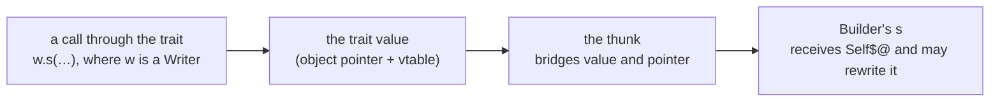

**In a trait's receiver position, `$@` would not mean what it means elsewhere in a type** (value or pointer, and whether what it points at is rewritten):

* **It would bind nothing on the implementation.** The conformance check ignores the receiver's notation, and the thunk bridges value and pointer. So an implementation may take `Self$@` and rewrite the receiver. A trait value is a fat pointer to `v` (object pointer + vtable), not a copy, so the rewrite reaches the original.
* **It would bind only the caller.** A declared `Self$@` engages the lvalue check in `ksplc/sema/body/call.kspls`: the receiver must be a place that can be written, such as a variable. That check rejects a temporary as the receiver, as in `io.out().s("x")`.

**Enforcing agreement, as Rust does, is not open.** The declaration must be `Self` for `io.out().s(…)` to be writable, and the implementation must be `Self$@` to rewrite. The two must differ, which is why the thunk exists, so the choice is removed instead.

**Elsewhere a receiver on the trait is either absent or enforced.** Go, Swift, Java and C# write none there (Swift's `mutating` is a method modifier, and enforced). Rust enforces exact agreement (E0053), and C++ enforces the `const` of `virtual void f() const;`. With one form, KSPL sits with Go. The asymmetry with the impl is sound: what means different things is written differently.

**What is given up**: a trait cannot state "this method requires an lvalue receiver". No working protection is lost: whether a rewrite reaches the caller was always the implementation's choice, by taking `Self$@` or not.

**A guarantee that "the receiver is not rewritten"** would need a marker per method (for example `fn draw(r: Self) # readonly;`). The receiver's type cannot carry that contract: the thunk makes the receiver rewritable, and the fat pointer makes no copy.

Omitting a parameter's type, and `Self` on a parameter **other than the receiver**, are separate rules (docs/SPEC-language.md §5.1, §5.3). The second exists because a thunk would pass the fat pointer where a concrete type is expected. That fails at the C stage with no KSPL diagnostic (`ksplc/docs/DESIGN.md` "The Sema layer: it knows the types").

#### When a temporary can be the receiver

`f().m()` calls a method on a temporary result. It is allowed when `m` only reads its receiver, and refused when `m` writes, because the write would land in a hidden copy.

The rule is docs/SPEC-language.md §5.2:

| `m` declares | `f().m()` | Why |
| :-- | :-- | :-- |
| `Self@` (reads) | Accepted | The value is copied into a hidden local, and its address is passed |
| `Self$@` (writes) | Rejected | The write would change only that hidden copy |

**Accepting it allocates nothing.** Receiver position takes an address implicitly, so the compiler copies the value into an automatic variable in the call's block and passes its address (`P t = f(); m(&t);`). The lifetime and the size are those of `x: = f(); x.m();`, so the rule of no implicit heap allocation still holds.

**Rejecting a writing receiver**: the slot is a copy. A write through `Self$@` would vanish where the caller cannot see it, and `make_point().set_n(5)` would be a call doing nothing (Principle 5).

**So a receiver takes `$` only when the method rewrites the receiver's own memory.** A write to what a descriptor points at does not need it, since only the descriptor is copied (the `fill` example is in docs/SPEC-language.md §5.2). The line is "was it declared as writing", so it can be read off the declaration of `m` alone, and the protection needs no borrow checker.

**Operators and casts use the same slot**: `a + b` desugars to `a.add(b)` and `Dest::x` to `x.cast()`, whose receivers can be temporaries too.

**Do not split the decision across the three notations**, or `P.new(1) + P.new(2)` could pass while `P.new(1).get()` is rejected (Principle 6). It lives in one place, `receiver_needs_hoist` in `ksplc/base/ast_place.kspls`.

Rust extends the temporary's lifetime to the end of the statement and accepts the call; its borrow checker does not stop the write being discarded. C++ binds a temporary to `const&` but not to a non-`const` lvalue reference, which is in effect KSPL's line. Swift, Java and Python have reference semantics, so the question does not arise.

### Whether a marker is expressed as an attribute or as a trait

A marker that changes how the compiler treats a type or a declaration has two means: an attribute (`#inline`) or a trait the compiler knows (`Ref_counted` / `Move_only` / `Owned`, and the operator group in `std/lang`). Often either fits, so the order of decision is fixed ("The order of decision").

#### The order of decision

The questions below are asked in order, and the first that answers decides:

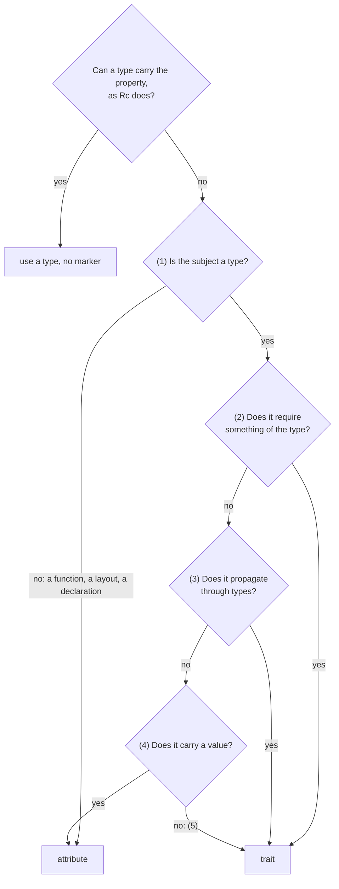

**First, see whether a type can carry the property instead**, as `Rc<|T|>` and `Ci32` do. That is stronger than a marker and adds no language machinery. A marker is needed only to add a property to an existing type afterwards, or to let users add it to their own types.

**(1) Is the subject a type, or a declaration or a site?** A trait attaches only to a type. So it is not an option for `#naked` / `#interrupt` / `#noreturn` / `#inline` / `#export` / `#section` (a function), `#align` / `#packed` (a struct's layout) or `#cfg` (any declaration). A choice arises only for "this type is such-and-such".

**(2) If something is required of the type, a trait.** A conformance check enforces the methods' existence, argument count and types; an attribute cannot ("Why ARC is expressed as a trait"). A library is no different: what `Map<|K, V|>` requires of its key is the trait `ds.Hashable<|Key|>` (`std/docs/DESIGN.md`, "What a container requires of a type is written as a trait").

**(3) Even a pure marker with no requirement is a trait if it propagates through types.** Only a trait rides on the type system. So only a trait can be derived structurally from a type's parts (fields, an `enum`'s payload, an array's elements), written as a generic's constraint (`fn f<|T: some.Marker|>`), and checked at instantiation. An attribute is a flag per declaration with no rule for composing, and `fn f<|T: #arc|>` cannot be written.

**(4) If it carries a value, an attribute.** `#align(16)` / `#section(".isr")` / `#cfg(blas)` take parameters; a marker trait cannot carry a value.

**(5) If (1) to (4) do not decide it, a trait:**

* The attribute table's rule keeps no exceptions: removing an attribute leaves the executable's logical structure unchanged (docs/SPEC-language.md chapter 10). That rule is what gives the gate "an unknown attribute is an error" its meaning.
* A marker that later grows a method requirement gains one prototype, and the user's code does not change. The cost is one FQN constant and a conformance call, not a check written by hand.

**The trait's costs are accepted:**

* **The compiler depends on a name in the standard library**: `ksplc/sema/type/arc.kspls` holds the string `"std.Ref_counted"`, against the layer direction (3.2.4 contains the damage).
* **A marker-only trait's conformance check is empty.** It sees only that the marker is attached, and guarantees nothing about the type's shape (as with Rust's `Send` / `Sync` / `Copy`).
* **The user writes more**: `impl X: Move_only {}` instead of `#move_only`, though with no import line, since `Move_only` comes in with `std/lang`.

#### Why ARC is expressed as a trait

A type gets automatic reference counting by conforming to the trait `Ref_counted`, not through an `#arc` attribute. Only the trait lets the compiler check that the type really has `retain` and `release`.

The rule is docs/SPEC-language.md §8.4.2. An attribute such as `#arc` fails on three counts.

**1. An attribute cannot check the requirement.** ARC means "provide retain/release". To synthesize the calls, the compiler looks up `<type name>.retain` / `<type name>.release` by name, and inserts nothing if the lookup fails. An attribute on a type lacking them would disable ARC with no diagnostic, where a trait's conformance check stops it (3.2.1 (2)).

**2. It would break the attribute rule**: removing `#arc` would change the executable's logical structure (3.2.1 (5)).

**3. A trait already drives code generation.** `Add` desugars `a + b` to `a.add(b)`, and `Index_place` desugars `a[i]` to `a.at(i)$`. Inserting "retain on copy, release on leaving scope" is the same shape, not a new mechanism.

**The methods are `priv`**, because a call by hand doubles up with the inserted ones: an automatic `release` after an explicit one writes into freed memory. `priv` on the conforming impl refuses the direct call, and on the trait it closes the path through an upcast (converting the value to the trait type). The synthesized calls are inserted after the visibility check, so they still reach.

**The trait itself is `pub`.** A `priv trait`'s name could not be written, and every file defining an ARC-managed type would redeclare a trait of the same name. With only the methods `priv`, every file shares one declaration and the calls stay closed.

**Only `std.Ref_counted` itself counts (an exact FQN match).** Matching the suffix `.Ref_counted` would switch ARC on for any same-named trait made for another purpose. Retain/release inserted into a type counted by hand write into freed memory with no diagnostic. `Move_only` and the operator group in `std/lang` are matched by FQN for the same reason.

**The vtable cost**: a trait with methods gives the conforming type a vtable. `--gc-sections` reclaims it when nothing uses it dynamically, so the linked size does not grow. The exception is Windows (PE) linkers, which keep unreferenced sections.

#### Markers not carried

Three markers are deliberately absent: `#arc`, `#deterministic` and `Thread_shareable`.

**There is no `#arc` attribute.** ARC is conformance to `Ref_counted`; why an attribute is the wrong shape is 3.2.2.

**There is no `#deterministic`** (an attribute making an ARC-managed parameter, return value or local variable a compile error in one function). By "The order of decision" (1) an attribute would be the right shape, since the subject is a function, but the existing machinery suffices. It is needed only where one binary mixes paths with and without ARC, and a hard error must hold the paths without it. Raising the lint [W0601] to `error` does that. `ksplc.cfg` is read up the directory tree with the innermost winning, so the `error` can be scoped to the real-time path's directory.

**There is no `Thread_shareable`**; the chapter "Concurrency" gives the reason.

#### Why compiler-known traits are confined to `std/lang`

The traits the compiler looks up by name all live in one file, `std/lang`. Whoever renames something there can see that the name is special.

The traits the compiler names by FQN (the operator traits, and `Ref_counted` / `Move_only` / `Owned` / `Callable1` / `Callable2`) stand only in `std/lang`, with one exception, under "When it may sit outside `std/lang`" below.

**The motive**: "The order of decision"'s cost "the compiler depends on a name in the standard library" cannot be removed, since a name is the only tie. What is left is to show by placement which names bear the load.

Caution: Mixed into a general-purpose file, a name whose renaming silently disables a feature cannot be told from one safe to rename.

**`Option` / `Range` / `panic` stand there too**, because the language's syntax requires them directly: `Option` for `switch`'s exhaustiveness, `Range` for `for item in collection`, and `panic` for bounds checks and `assert`.

**Do not add for convenience.** Every program pays for this file (`make test-thin-use` guards its size).

**When it may sit outside `std/lang`**: when the whole file exists for that mechanism. `std/reflect` holds only `Reflectable` / `Field_info` / `Field_kind`, and its name declares the mechanism, which meets the motive. Mixed into `std/lang`, it would be harder to tell apart. `std/lang` holds only what the syntax requires, and `impl X: reflect.Reflectable` is written out, so reflection does not belong there.

**The direction of dependency**: `std/lang.kspls` may import only `std/libc`. Routing `panic`'s output through `std/io` would cycle (`lang → io → mem → lang`) and make every program pay for strings and IO. The other way round, `std/refcount` (the `Rc`/`Arc` conformances) and `std/thread` (`Raw_mutex`/`Mutex`) depend on it.

**The way out for a file that declared the same name**: `std/lang` also gives every file the import alias `lang`. So a file declaring its own `Ref_counted` still conforms to the lang one with `impl My_type: lang.Ref_counted`. Unqualified, the name means the file's own declaration: the conformance target changes, type checking passes, and ARC and operator desugaring stop working with no diagnostic.

Conversely, do not write `lang.` where the unqualified form is not blocked. That is two ways of writing one thing (the chapter "One notation per purpose"), and `make test-conventions` watches for it.

**What moving a file does not resolve**: it removes only the coupling by type name. The compiler also looks up methods and functions by name, and placement does not fix those.

| Name | Purpose | What backs it |
| :-- | :-- | :-- |
| `retain` / `release` | ARC's synthesized calls | `Ref_counted`'s conformance check requires them |
| `fields` | Where `Reflectable`'s synthesized table goes ("Why the round trip between a container and an external form is a trait returning a table") | `Reflectable`'s conformance check requires it |
| `fmt` | String interpolation (called inside `\{x\}` → `put(w, x)`) | If missing, `Formattable`'s conformance check stops it |
| `put` | What string interpolation desugars to; a free function in `std/lang`, so **its unqualified name is taken in every file** | If missing, "undefined identifier" |
| `len` | `for`-`in`, and slices | As above |
| `get` / `at` / `set` | Indexing | Reached through `Index` / `Index_place`, so it follows the type-name coupling |
| `free` / `dealloc` | Detecting use-after-free | **Nothing. A pure name-match heuristic** |

The last is the weakest coupling: it can misfire on an unrelated method named `free`. Moving it onto a trait such as `Deallocating` would mean a conformance on every type with a freeing method. The cost does not balance, so it stays, stated as a heuristic.

#### Why the round trip between a container and an external form is a trait returning a table

To write a struct out as JSON or a database row and read it back, a type conforms to `Reflectable`. Its one method returns a table describing the type's fields, and the libraries walk that table. The compiler writes the table for you when the `impl` is empty.

With a bare interface, `json` and `db` would each write a field's key twice, once to write and once to read (`std/docs/DESIGN.md`). KSPL folds that into **one trait that returns a table of fields**.

```kspls
pub trait Reflectable
    fn fields(r: Self): Field_info[]
```

`Field_info` (in `std/reflect`) holds the name, the offset, the kind, a nested table and `Field_extra` (a number's width, and the like). `std/json_struct`'s `from_struct` / `into_struct` and `ksbind/db`'s `bind_row` / `read_row` walk it in ordinary KSPL.

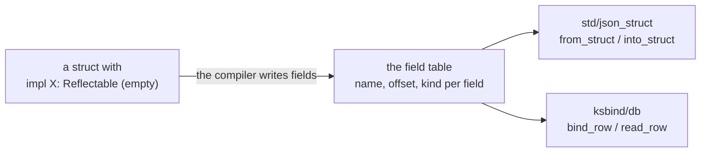

**A trait rather than an attribute**, by (3) of "The order of decision". Whether a type can round-trip is derived structurally from its fields' types (`Outer` only when `Inner` can), and it must be writable as a generic's constraint (`fn save<|T: Reflectable|>`). Nor is it an empty marker: `fields()` is called directly under that constraint, so no second mechanism looks up a name (the chapter "One notation per purpose").

**A table rather than a body per library.** `Json_codable { fn to_json(…) }` names a `std/json` type in its signature. Once ksplc synthesized its body, it would be a compiler-known trait. "Why compiler-known traits are confined to `std/lang`" puts those in `std/lang`, which may import only `std/libc`. A table's signature needs only `U8[]`, `Sz` and an enum, so it can live anywhere: in `std/reflect`, not `std/lang` ("Why compiler-known traits are confined to `std/lang`"). And one mechanism serves both `json` and `db`.

**The compiler writes the table only for an `impl` with an empty body**, as a person would write it, and leaves an `impl` with a body alone (the rule is "5.5 Worked example: synthesizing a field table with `Reflectable`" in [`SPEC-language.md`](SPEC-language.md)). A body written by hand is the way out for another key mapping, or for a type the table cannot express. The trait is matched by FQN, as every compiler-known trait is ("Why compiler-known traits are confined to `std/lang`"). How the compiler builds the table is ksplc's (`synthesize_reflect_impls` in `ksplc/sema/decl/reflect.kspls`, and pass 2a' under "The internal flow: registering every file up front → the main type-inference walk → draining the work list of generic instantiations" in [`../ksplc/docs/DESIGN.md`](../ksplc/docs/DESIGN.md)). The table's own shape (nesting, widths, containers) is `std`'s ("The field table holds a number's width as data, and nests by pointing" in [`../std/docs/DESIGN.md`](../std/docs/DESIGN.md)).

**`offset` is in the table** because adding up sizes from `kind` cannot give it. Padding intervenes (the `b` of `struct { a: U8; b: I64; }` is at 8, not 1), `#packed` stops the padding, and `#align(N)` overrides a struct's alignment. One place in ksplc interprets those and the alignment rules ("A layout is computed when it is first asked for" in [`../ksplc/docs/DESIGN.md`](../ksplc/docs/DESIGN.md)). A walker that added up sizes would be a second implementation of the layout rules, and a divergence would produce no diagnostic. Given `offset`, the walker needs only "where" and "how to convert", never "how many bytes".

**A `T?` field that is `.none` writes no key**, and an explicit `null` is refused as a difference in kind. serde, Swift's `Codable` and Jackson read a missing key and a `null` as one state, and a user who needs the difference reaches for a double wrapper. Here the two are already different values, and `null` is not made a second spelling of "missing" (the chapter "One notation per purpose").

**A container of containers, and an option holding a container or an option, are not covered.** A form that can be written but not walked would be "writable but ineffective" (Principle 5). What blocks them is in "Known holes, and what would fill them" in [`../std/docs/DESIGN.md`](../std/docs/DESIGN.md).

**The table is not a translation-time value (no `fieldsof(T)`).** Constant folding answers an `I64` (`ksplc/sema/decl/eval.kspls`), and an aggregate would be a new kind of translation-time value. `offsetof` is one more scalar beside `sizeof`, one notation (the chapter "One notation per purpose").

**An `offsetof` it cannot answer is rejected**, neither left undefined nor answered with a stand-in (the cases are docs/SPEC-language.md §6.7). With neither inheritance nor virtual function tables, every `struct` has a fixed layout. So nothing forces an undefined case, and a request with no answer becomes an error (Principle 5).

**No mechanism renames keys.** The mapping is fixed as "field name = key, type = the value's kind". To change it, write the `impl` body by hand so no synthesis applies.

**It applies only where the external form is the declaration itself.** A key written in two places is not enough. It does not apply where the writer decides the key by any of these:

* **Flattening** (a nested struct adding its keys to the parent object).
* **Renaming** (`Paper.height` → `page_height`).
* **Omitting a default value** (on a non-`Option` field).
* **An enum expressed by a key's presence or by a name's spelling**.
* **A value written differently from its type** (a color written as an `#rrggbb` string).
* **No source struct to copy from** (the value is assembled from several sources; `kssrv/api.kspls`, `ksplc/lsp/msg.kspls`).

**These are not added to the mechanism.** Two hands would then decide how a key is written, and "no mechanism renames keys" would collapse (the chapter "One notation per purpose"). Each is a deliberate decision by the writer, and bending it to fit the mechanism has the order backwards.

### No syntax equivalent to concepts is added

KSPL has nothing like C++20's concepts (named requirements on a template's type arguments). What concepts fix in C++, a flood of errors from deep inside templates, does not happen in KSPL.

C++'s concepts check a template's constraints **before instantiation**. Without them, diagnostics are reported from deep inside instantiations. KSPL checks a generic's body per instantiation, so it could pay the same price; the measurement below decides.

| What concepts gave | Where KSPL stands |
| :-- | :-- |
| (1) Constraints checked before instantiation, ending diagnostics reported from the depths | **Present.** A violation of `<\|T: Trait\|>` is rejected naming the instantiated type, and **the body of an instantiation known to violate is not type-checked**, so no errors derive from it (pinned by `EXPECT-NOT` in `ksplc/tests/negative/generic_constraint_via_static_call.kspls`) |
| (2) Choosing an overload by constraint (replacing SFINAE, C++'s rule of skipping a template whose substitution fails; subsumption) | **Not needed.** KSPL has no function overloading, and an impl targeting a type argument itself is rejected, so **there is nothing to choose between** |
| (3) The requirements shown in the signature | Partly: `<\|T: Trait\|>` can be written but is **not required** |

**Measured**: a method the type lacks, called three levels deep in generics calling generics, gives exactly one message, naming the concrete type and pointing into the body. A body failing for several types gives one per type. The cascade C++ shows without concepts does not occur.

* **So the syntax is not added.** (1) is present and (2) has nothing to act on. A mandatory (3) would check generics once against the constraints, limiting a body to what they guarantee.
* **What is given up is a diagnostic detail**: an unconstrained body that fails does not say which call bound the type argument. The position that caused the instantiation is recorded for the constraint check, not for the body's later analysis ("A diagnostic points at 'the position the user wrote'" in [`../ksplc/docs/DESIGN.md`](../ksplc/docs/DESIGN.md)). So the gap is a missing note on the diagnostic, not a gap in the type system.

---

## Ownership and lifetime

KSPL does not prove at compile time that every pointer stays valid, as Rust's borrow checker does. It protects the few things that a simple check inside one function can get right, and states the rest as the writer's responsibility (Principle 8).

**With no borrow checker, what the language protects has to be chosen.** It protects what local data flow alone can follow: what happens to a value inside one function, read from that function's code alone. The rest is the writer's.

| Section | What the language does | What stays the writer's |
| :-- | :-- | :-- |
| 4.1 | Stops an accidental copy of an owning handle, such as a lock or a file (`Move_only`) | A duplicate made through a pointer |
| 4.2 | Runs a `defer` on the variables as they are when the scope ends | Copying a value to keep it as it was at registration |
| 4.3 | Stops a `return` of a pointer the compiler would make unseen | Returning `x@` of a local; an escape through a struct field |
| 4.4 | Warns where a block can be left before the `defer` that frees a value | A value with no `defer` at all |

**Raw pointers are set apart rather than banned.** `T@` is a first-class type, and unchecked access has its own form, `(p + i)$` (docs/SPEC-language.md §6.2.1), so C-level control need not move into a library.

**What is given up: how a type's memory is managed has to be read from its name.** Raw pointers and ARC live side by side, so the reader checks which one manages a type. Consistency is chosen per project, not by the language. The lints [W0601] and [I0602], off by default, find code departing from the chosen policy ([`../ksplc/docs/SPEC-tools.md`](../ksplc/docs/SPEC-tools.md)).

### Why there is no borrow checker, only a move-only marker

KSPL checks one simple thing instead of every pointer's lifetime: once a `Move_only` value is handed over, the old name cannot be used again.

Conformance to `Move_only` forbids implicitly copying an owning handle, such as an OS lock or a file descriptor, where a duplicate means a double free (docs/SPEC-language.md §5.4). Rust's borrow checker is not adopted.

**Why no borrow checker**: Rust's borrow checker proves that no reference outlives the data it points at, and that no two places change the same data at once. That proof tracks an order of magnitude more: it infers the region of code each reference is valid in, and it excludes aliases (two live references to one place where one writes). It would also reject the raw pointers (`T@`) KSPL code uses routinely. Move-only tracks one thing, "this binding can no longer be read", and local data flow suffices for that.

**Why a move rather than a ban on copying**: a ban makes construction impossible. `Mutex<|T|>::{ .mutex = m, … }` copies `m`, and so does binding the result of `Raw_mutex.new()`. Ownership passes there and leaves no duplicate, so what fits is a move invalidating the original.

**Which reads are moves**: the rule lists the reads that do not duplicate: a method's or field's receiver and the target of `@` / `$` / `[` (docs/SPEC-language.md §5.4). Every other read as a value is a move. Listing the moves instead (assignment, arguments, struct literals, `return`) would be longer, and a position added later would be easy to miss.

**What is given up**: duplication through a pointer goes undetected, so the check is not sound, meaning it does not catch every case (the limit is stated in docs/SPEC-language.md §5.4).

### Why `defer` has no capture list

A `defer` block runs when its scope ends, and it reads the variables as they are then, not as they were when the `defer` line was reached.

A `defer` carries only its body, which reads outer variables **on leaving the scope** (docs/SPEC-language.md §8.4.1). Nothing freezes them at registration (the moment the `defer` line runs).

**Freezing at registration would be wrong**: for a value struct, freeing the frozen copy does not free the real thing.

```kspls
b: = Str_builder.new() // at this point ptr = null, cap = 0
defer b                // <- frozen, this captures a copy with cap = 0
    b.free()
b.s("...")             // allocates and grows the internal buffer (the original b is updated)
```

`Builder.free()` frees only when `cap > 0`, so the frozen copy frees nothing and the whole grown buffer leaks. The standard library is full of this shape. With freezing, ksplc itself would leak megabytes in a single compilation.

| | Read on leaving (KSPL) | Frozen at registration |
| :-- | :-- | :-- |
| `b.free()` in the example | Frees the grown buffer | Frees the empty copy; the buffer leaks |
| The variable is swapped to another resource after registration | The old resource leaks | The new resource leaks |

**The uses agree.** A `defer` that releases a resource almost always calls `.free()` / `dealloc()` / `fclose()`, and each must free what it holds on leaving. Not one needs freezing.

**"Immediate is safer" does not hold.** It looks better when the variable is swapped to another resource after registration. But then immediate leaks the new resource and deferred leaks the old. Either way one leaks, so that code is wrong in itself.

Go's `defer` is immediate only in evaluating its arguments. Its block form, which `defer { … }` corresponds to, is deferred. Immediate looks safe there because Go defers a pointer or a handle. What breaks here is a **value struct** that owns heap memory, such as `Str_builder`.

**Why there is no capture list**: reading on leaving, a capture list would do nothing at run time. It would still tell the reader which variables the block touches, but unenforced it is a comment: writable but ineffective (Principle 5).

**To keep a value from registration time**, copy it yourself (the idiom is in [`docs/SPEC-language.md`, 8.4](SPEC-language.md)).

Caution: **Should freezing at registration ever be needed, do not spell it `defer a, b { … }`.** It could not be told from the existing `defer`, which reads on leaving, and would break silently. Give it its own notation.

### Why dangling is stopped only on the paths that create an invisible pointer

Returning the address of a local variable (`return x@`) is not checked, because the danger is written on the page. Only two returns are stopped, where the compiler itself would make a hidden pointer to the function's local storage.

A pointer *dangles* when what it points at is gone: here, a local variable after its function has returned and its frame (the function's local storage) is folded. Returning a local's address to dangle, as in `return x@;`, is the writer's responsibility, with no diagnostic. Only two cases are stopped at `return` / `throw`: a trait value, and a slice descriptor built over a frame's array (`return U8[]::a;`, `return U8[]::{ … };`).

**The reason: no `@` appears in the source.** A trait value is an `{obj, vtable}` pair, so upcasting a value makes the compiler synthesize `&value`.

```kspls
priv fn make(): Shape
    $s: = Sq::{ .n = 7 }
    return s // <- not one pointer operation is written
```

It lowers to `return (Shape){ .obj = (void*)&s, … };`, yet `Shape` looks like a value type and no `@` or `$@` is written. `return x@;` shows its danger on the page; here the language makes a pointer nobody sees. **Responsibility can only be assigned for what the writer can see.** A slice is the same: casting a fixed-length array to a slice, or building one from a run of elements, makes the compiler synthesize the descriptor's pointer.

| Returned | Stopped? | Why |
| :-- | :-- | :-- |
| `s`, a local value, as a trait (`Shape`) | Yes | The compiler would write `&s` unseen |
| `U8[]::a` or `U8[]::{ … }` over a local array | Yes | The compiler would write the descriptor's pointer unseen |
| A local set from either of those forms | Yes | The mark follows the name (below) |
| `x@`, `a[0]@`, `U8[]::{ .ptr = a[0]@, .len = 4 }` | No | The `@` shows the danger on the page |
| `builder.slice()`, `arena.alloc()` | No | The compiler does not know where a call's result points |
| A global, an upcast pointer, `p$` | No | None of them points into the frame |

**Put the line at this point only.** `return a[0]@;` and `return U8[]::{ .ptr = a[0]@, .len = 4 };` show their danger on the page, so they are the writer's responsibility and pass.

Caution: **Do not reject a call's result either, and do not widen the check to "do not return a slice".** The compiler does not know where `builder.slice()` or `arena.alloc()` points, and returning allocated memory is legitimate.

**Only `return` and `throw` are checked.** Both fold the frame, and at both the danger is easy to detect and always wrong. An indirect escape, such as storing into a struct field and returning that, needs real escape analysis and is out of scope ("Why there is no borrow checker, only a move-only marker"'s line: follow only what is cheap and certainly correct).

**A local variable carries the mark along names.** `t: Shape = s; return t` hides the upcast one line up, and is as invisible as `return s`. So a local set from one of the two forms, by its declaration or by `x = …` (from another marked local too), is refused at `return` / `throw` as well. The mark follows names, not control flow, and is never cleared: a marked local later set to heap memory is still refused, the safe side of a check that does not see which assignment ran last. A struct field assigned afterwards (`h.s = U8[]::a`), a call (`return id(s)`) and a pointer are not followed.

**Three forms pass**: a global (static storage), an upcast of a pointer (no `&` is synthesized), and what a pointer points at (`p$`, whose address lies in the heap or elsewhere).

### Why an early exit before a `defer` is warned about, and how narrowly

If a block can be left (by `!`, `return`, `throw`, `break` or `continue`) after a value is acquired but before the `defer` that frees it, the compiler warns: on that path the value leaks.

**A `!`, `return`, `throw`, `break` or `continue` between an `Owned` value's binding and the `defer` that frees it in the same block is [W0109].** That path leaves before the `defer` is registered, so what was acquired leaks. The language does not stop it, since a `defer` is its own statement ("Notations not carried").

* **It asks only where a later `defer` in the same block frees the value.** A value freed by hand, passed on or kept has another shape, and calling it a leak would be a false report (the exemptions are under [W0109] in `ksplc/docs/SPEC-tools.md`).
* **A shape rather than every path.** Checkers that follow a resource along every path pay in false reports. A rule read off the code as written, like Error Prone's `MustBeClosed`, does not. The gap before a `defer` is such a rule.
* **`Owned` says which values are asked about.** `Owned` is the trait whose `free()` the compiler reads as freeing the value. It is the same contract the use-after-free check reads (docs/SPEC-language.md §8.4.5), so a type taking part in one takes part in the other.

**What is given up**: a value with no later `defer` in the block, never freed at all, is not this warning's to find.

---

## Concurrency

### Why data races are not prevented by the type system

KSPL's types do not stop two threads from touching the same data at once (a *data race*). A marker could check only one of the two ways data reaches another thread. Instead, a type's name says whether it may be shared (`Arc`, `Mutex`), and a gate runs the tests under ThreadSanitizer to catch the races they reach.

KSPL's type system **places no constraint on values crossing a thread boundary**. `thread.Thread.spawn<|T|>` requires nothing of `T`, and there is no marker like Rust's `Send` / `Sync` or Swift's `Sendable` (`Thread_shareable`).

**The reason: only one of the two channels can be checked.** Threads share data through `spawn`'s arguments or through a top-level variable (a global), and a marker binds only the first. A closure cannot leave its function ("Why capture is made explicit and escape is forbidden"), so it cannot be passed to `spawn`. A global becomes the natural way to show two threads the same data. The bypass is not a loophole but the main path.

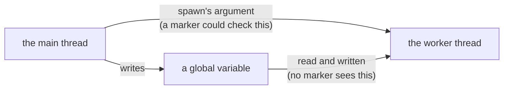

**The shape that passes**: put a non-conforming type in a global, give `spawn` a small conforming argument, and have the worker touch only the global. `ksplc lint` reports nothing, and the program breaks. A global counter ends below the expected count. So does a struct with a raw pointer in a field, which fails to conform even under structural derivation. `push` onto a `List<|I32|>` loses the pushed elements.

Worse, the single-thread `Rc<|T|>` also passes in a global, and running it SIGSEGVs (a use-after-free from racing counts). Its non-atomic count is the case the marker most ought to protect. **What slips past fails harder than what the marker would catch** (numbers going wrong).

**The difference from Rust**: Rust's `Send` is incomplete but sound because every path across threads goes through it. `static` requires `Sync`, and `static mut` requires `unsafe`. KSPL has no such closure, so the same marker would only filter part of one channel.

**Closing the hole is not taken on either.** Soundness would require every mutable global in a spawning program to conform (Rust's `static` rule). `ksplc` itself, whose shared arena is a raw pointer, would fail that, and the cost extends to changing the compiler's architecture.

**Structural derivation decides it.** Derivation counts a type nobody reviewed as conforming. `struct Counter { n: I32 }` conforms, and `c.n += 1` racing from two threads passes with no diagnostic and still ends below the count. Where it does not protect, the marker would manufacture false assurance (Principle 8).

**What is given up, and what stands in its place**: the type system cannot stop the one point `spawn(worker, rc@)`, so the type's name carries the choice instead (Principle 8, "The order of decision").

**A gate finds the races the tests reach.** `make test-race` builds the programs that start threads with ThreadSanitizer and fails on any report (what it runs is "What each platform runs" in [`SPEC-gates.md`](SPEC-gates.md)). ThreadSanitizer is a compiler option that records, while the program runs, which thread touched which memory. Without the gate, a race shows only as a wrong result some runs later, a counter ending low or an `Rc` crashing, with nothing naming the two accesses.

* **It watches every channel at once.** A marker would see `spawn`'s argument alone; the sanitizer sees an access through a global, an argument or a raw pointer alike, the bypass above included, and names both accesses by their `.kspls` lines and the threads they came from.
* **It is a check on what ran, not a guarantee** (Principle 8). A race no test reaches stays unseen, so the gate is not read as "the program has no race", only as "no test hit one".
* **Nothing is suppressed.** std, the runtime and the program are compiled from source into one unit, so nothing the sanitizer watches is uninstrumented. The false reports that a prebuilt library gives in C++, and an uninstrumented standard library in Rust, do not arise, and a report is a finding to fix.
* **The price is paid by the gate, not the language**: a sanitized run takes several times the time and memory, so the gate runs once, in the Linux job, whose image holds the sanitizer. A program left out of it is named with its reason, so what the gate does not run stays visible.

**`Move_only` escapes this criticism**: a global does not bypass the local data flow it follows ("Why there is no borrow checker, only a move-only marker").

---

## Visibility

**`priv` answers one question: which files may write this name.** "Why a narrow type may not sit in a position with wide visibility" and "Why a typedef cannot be published wider than its target" close holes where the mark could be written and not hold. "Visibility and linkage are separate axes" separates it from the question it is most often confused with. "Why a method on a built-in type needs its file imported" is the other gate on reaching a name: a method another file adds is reached only where that file is imported.

### Why a narrow type may not sit in a position with wide visibility

A `pub` function may not return a `priv` type. Otherwise code outside the file would hold a value of a type it is not even allowed to name.

A `priv` type in a `pub` function's return (`pub fn open(): File_stream$@`) passes the value to code that cannot name the type. That code binds it (`f: = io.open(path);`), calls its methods and reads its fields. Meanwhile whoever wrote `priv` believes the type is closed to the file. **A marker that is writable but ineffective** is an error.

**Only positions where a value leaves are covered**: a function's return, a `struct`'s `pub` fields, an `enum`'s payload, a `trait`'s method prototypes, and a top-level declaration's type annotation.

**Left out, and why**:

* **A parameter.** The outside cannot make a value of the narrow type, so it cannot call the function. That is inconvenient, but not a lie, and nothing leaks.
* **A non-`pub` field.** Its access is checked at the use site, so the value does not leave, whatever its type. Only a `pub struct`'s `pub` field leaks.

**What is compared is effective visibility**: a member reaches no wider than what encloses it (docs/SPEC-language.md §9.4). Without that, every `pub` member of a type closed to its file would be a false report.

**A `priv` type in a `pub struct`'s `pub` field is never what is wanted**; one of the two marks is wrong. Narrow the field if the outside does not read it, and widen the type if it does. An opaque handle is a `pub` type with non-`pub` members, and its name can then appear in a diagnostic.

**A generic's type arguments pass through**: `List<|Secret|>.get()` with `priv struct Secret` in the calling file gives no diagnostic. The monomorphized method (the copy made for `Secret`) is analyzed in the template's file, where the caller's `priv` symbol does not resolve. That is right: `Secret` is visible where it is instantiated, so nothing leaks.

### Why a typedef cannot be published wider than its target

A typedef may not be more visible than any type it names. A `pub typedef` of a `priv` type would leak the type, just as "Why a narrow type may not sit in a position with wide visibility" forbids.

**A typedef is no wider than any name on its right**, walking inside the type expression (the rule and its examples are "3.5.1 Visibility" in [`SPEC-language.md`](SPEC-language.md)).

**The reason**: a typedef puts a type's name outward. A wider one lets code that cannot name the target receive its value through the typedef. That is the state "Why a narrow type may not sit in a position with wide visibility" forbids, in the shape of a `priv` on one declaration overridden by another. With visibility decided away from the declaration, how far a type reaches could no longer be read from its declaration alone.

**To keep the implementation closed and publish only the name, mark the type itself** (the same section), so no typedef is needed for it.

**Rust (E0364 / E0365), Swift and Kotlin refuse an alias wider than its target too.** Rust's `pub use` facade works because the declaration itself is public and only the path to it is hidden. KSPL nests no names in a hierarchy, so there is no path to hide and the idiom does not carry over.

### Visibility and linkage are separate axes

`priv` decides which KSPL files may name a symbol. It does not decide whether the C symbol is hidden from the linker (C's `static`). Tying the two together breaks some correct programs, and only when the build splits the C into a different number of files.

"**Which translation units may use this symbol**" is a different question from the one `priv` answers. A translation unit is one C file that the C compiler compiles on its own; the linker then joins the units.

| Question | Answered by | What decides it |
| :-- | :-- | :-- |
| Which KSPL files may write this name? | `priv` / `pub` (visibility) | The mark the writer puts on the declaration |
| Which C translation units may use this symbol? | C's `static` or not (linkage) | Whether the name is unique within the file and not beyond it |

Caution: **Mixing them makes a correct program fail to build only when the number of splits changes.** ARC's `retain` / `release` are `priv fn` in `std/refcount` ("Why ARC is expressed as a trait"), yet the compiler synthesizes their calls in the user's file. Mapping `priv` straight to C's `static` makes such a call reach outside its translation unit. So it fails under `ksplc run`, which splits by core count, and passes under `ksplc a.kspls a.c`, a single unit.

**A symbol is closed to its translation unit only when its name is unique within the file and not beyond it.** A method is already unique program-wide through its type's FQN, and a generic's instantiation through its type arguments. A type's FQN carries its file's logical path as a prefix, and the compiler rejects two files that add a same-named method to one type.

**Decide together what makes a name unique and what closes a symbol** (Principle 6). Adding only one gives an unprefixed name made `static`.

**`priv` loses nothing**: the rule decides only what the linker sees.

**Rust and Swift keep the two apart too**, each for its own constraint. KSPL reads the whole program at once, so no function gets two bodies, and whether a name is globally unique can be read off the declaration.

**In C++, which mixes them, the link fails silently, by configuration.** So the check must change the number of splits and actually link and run (`ksplc/tests/prog/split.kspls` and `ksplc/tests/suite/split_test.kspls`). A check reading the generated C lets this failure through.

### Why a method on a built-in type needs its file imported

A file can add methods to a built-in type such as `U8[]`. You can call such a method only in a file that imports the file adding it, just as for any other type.

A method another file adds to a type is called only where that file is imported ("An extension method requires the import" in [`SPEC-language.md`, 9.3](SPEC-language.md#93-adding-a-method-to-another-files-type)). **A built-in type is no exception: it counts as `std/lang`'s**, the file every file imports. So the methods written there need nothing, and one that `std/str` adds needs `std/str`.

**Exempting built-in types would break two things.** A method on one would then resolve in every file once any file of the program loaded its definer:

* **The unused-import hint would advise breaking the build.** To the lint, the file's own import of the definer holds nothing up, so [I0401] calls it unused. Deleting it breaks the file wherever nothing else loads the definer. A `_` alias on each such import would silence the hint and hide the dead ones.
* **Whether a call compiles would depend on files it never names.** `"abc".contains_nul()` would compile because `std/io` → `std/str` → `std/chars` loads the method, and stop when that chain changes.

Swift closes the same hole with `MemberImportVisibility`, and Rust, C# and Kotlin tie the call to an import in the calling file.

**A format specifier is included.** `\{n:x\}` desugars to `n.fmt_hex(…)`, which `std/strfmt` adds, so the file imports `std/strfmt`. The error names the specifier written, not a `fmt_hex` the source never holds. An exemption would be a second path to the same methods, shown by no import line (Principle 6).

**A generic's instantiation is excluded.** Its receiver can be the type argument's, and `put<|W, T: Formattable|>` in `std/lang` cannot import every file serving its bound, so the requirement would vary with the argument. A conformance (`impl I32: Formattable`) holds wherever its file is in the program, and a call through it is the generic's.

**What is given up**: one import line per file using a method another file adds to a built-in type, stating a dependency the call already has.

### A name the file cannot see is refused where it is selected

`import "p" { Hidden }`, with `Hidden` `priv` in `p` or unmarked in another package, is a compile error at that `import` line: `cannot access symbol 'Hidden'`. A name that does not exist is refused there too.

**Selecting a name changes no visibility, and the line that selects it is the one place to say so.** Asked at each use instead, every road to a name had to ask again: a call, a value, a type, a constant and a struct literal each find the name their own way. Some did not ask, so a `priv` struct or constant selected from another file was used with no diagnostic, and a function's use was reported as an undefined name.

**Rust and Java refuse it at the import as well** (`use p::Hidden` is "struct `Hidden` is private"; `import p.Hidden` is "not public in p"). A use of the name then needs no check of its own.

**What is given up**: a selector the file never uses, naming what it cannot see. No use of it could have compiled.

---

## The boundary with C

**Everything Kanso passes to C or receives from it crosses one boundary.** This chapter says which types may cross it, how C's types are received, where a binding names its C library, what standard output carries, how a library built from KSPL is shipped to C, and how the sizes ksplc folds are tied to the C compiler's.

### The FFI boundary check looks inside the type

A function marked `#export` (callable from C) may not use a type whose memory layout is KSPL's own, such as a slice, even one buried inside a struct.

The list of such types is docs/SPEC-language.md §11.1.

Caution: **Do not look at the outermost layer only.** Merely wrapping (`struct W { items: U8[] }`) would slip past. When the reason is its layout, refusing a bare slice but passing one inside a struct makes no sense. A struct's fields are followed recursively.

**Pointers are not followed.** A pointer is a pointer in C too, and what it points at matters only if the C code touches it. Following would fail nearly every `#export`, self-referential structs included. Cycles are cut twice over, by a visited set and a depth limit.

**The LLVM backend is stricter still**: it cannot pass even a plain struct by value across the C boundary. genllvm does not implement the per-target C ABI classification, the rules for which registers or memory carry a struct (Win64 uses a hidden pointer beyond 8 bytes, SysV x86-64 works in eightbytes around a 16-byte boundary, AAPCS has the HFA case, and so on). The C backend passes it, since the C compiler does the classification ([`ksplc/docs/DESIGN.md`](../ksplc/docs/DESIGN.md), "Passing an aggregate is an explicit internal ABI").

### What cannot be written in C's types

Three kinds of C type have no KSPL spelling: `char`, `size_t` and the types whose width varies, such as `long`. The table says how an `extern` declaration receives each.

In an `extern` declaration, which one applies decides how it is received. Below, LP64 is the model of 64-bit Linux and macOS, where `long` is 64 bits, and LLP64 that of 64-bit Windows, where `long` is 32 bits.

| C type | Why it cannot be written | How to receive it |
|---|---|---|
| `char*` / `FILE*` | Kanso's byte is `U8` (`unsigned char`), and C's plain `char` is a third type, distinct from both `signed char` and `unsigned char` | As `Void$@` / `Void@`: the same representation and calling convention, so nothing breaks |
| `size_t` | Kanso's size type `Sz` is signed (`ptrdiff_t`; "Why the size and index type `Sz` is signed") | As `Sz`: the width, and so the ABI, always match, and only the sign differs. Do not pass a negative value |
| `long` / `clock_t` / `time_t` | Its width varies per target (64-bit on LP64 Linux, **32-bit on LLP64 Windows**), and Kanso has only fixed-width types | **Where every value fits in 32 bits, as `Sz` going in and `I32` coming out** (below). Otherwise do not write it in an `extern`: convert the width inside a small function on the C side |

Caution: **Writing `long` as `I64` breaks silently on Windows.** The 32-bit return value is read as 64 bits. x86-64 zero-fills the upper 32 bits on a write to EAX, so `-1L` (failure) becomes `4294967295`. It slips past a "negative means failure" check, with no crash to notice.

**A `long` whose every value fits in 32 bits crosses with no C between.** A parameter is `Sz`: it has `long`'s width on LP64 and on 32-bit targets, and on LLP64 Windows both take one 8-byte register or stack slot, of which the callee reads the low half. A result is `I32`: it comes back in a register, whose low 32 bits are the value whatever `long`'s width. OpenSSL's `SSL_ctrl` crosses this way (`ksbind/tls.kspls`), and so a binding needs no C file of its own. A `long` that can pass 32 bits (`ftell`'s offset, a `time_t`) cannot, and stays with the third row's C.

`kspl_file_size` / `kspl_mono_us` (`ksplc/gen/runtime/hosted.c`) and `kspl_stat` / `kspl_remove_path` (`ksplc/gen/runtime/hosted_fs.c`) take the third row's way out: only fixed-width types cross. Adding one needs its LLVM backend counterpart too (`ksplc/gen/llvm/module.kspls`; `make test-conventions` watches the pair).

**Do not receive a `char*` as `U8@`.** The declaration is stdio.h's when hosted and the one genc prints when freestanding. One of the two always differs in sign (`-Wpointer-sign`, against Principle 2).

**No type for plain `char` is added.** `Void@` already receives a `char*`, and plain `char`'s sign is implementation-defined. Matching it would mean carrying a type whose sign varies per target, only for the look of an `extern` (Principle 1).

### The library an `extern` block needs is named on the block

**`#link("openblas")` on an `extern` block names the library its declarations are found in.** So a program taking in a binding takes its library with it, and no build file carries the name. The rules are "11.5 Naming the library an `extern` block needs (`#link`)" in [`SPEC-language.md`](SPEC-language.md); this section holds why.

| Decision | Why |
| :-- | :-- |
| 1. **A name, never a flag or a place** | A flag in the source is one machine's link line forced on every machine that builds it. Go narrows its `#cgo` flags with an allowlist, because a flag can run code at build time. A name carries no search path, plugin or option. Where to look and whether to link statically belong to the building machine, so they stay with the environment |
| 2. **On the block, under the block's own `#cfg`** | `#cfg` keeps or drops the block whole, so the library follows the flag that keeps its declarations, written once. Apart from the block (on a line of its own at the file's head), it would link the library into a build that dropped every declaration needing it |
| 3. **The source is the one place the name is written** | The compile writes the names of the blocks it kept, and `ksplc run` and a build linking by hand both take them from there. A copy in a Makefile would be tied to it by a comment alone, and changing one would leave the other linking the old library |
| 4. **The order is the one a linker reading once from the left needs** | A library comes before the ones it uses, which is the order of a file's imports. Rust also passes a crate's libraries before its dependencies', and CMake also drops a repeat at its later place |

`#link` keeps the attribute rule of "The order of decision" (5). Deleting it changes nothing the program does, only whether the link finds the definitions, as with `#export`.

**What is given up**:

* **A library named differently per OS cannot be one `#link`.** OpenSSL is `ssl` and `crypto` on a Unix-like system and under MSYS2, but `libssl` and `libcrypto` for the MSVC toolchain. No `#cfg` names the OS (the flags come from the build), so `ksbind/tls`, which names `ssl` and `crypto`, does not link there. A name that agrees works on both: clang's driver turns `-lopenblas` into `openblas.lib` on an MSVC target.
* **Nothing is searched for, and static or dynamic is not chosen.** A library not where the linker looks fails the link, and the linker's own message names `-l<name>`.
* **A kept block links its library whether or not a call reaches it.** Tied to use, the link line would move with the pruning of unused functions, and an edit elsewhere could drop a library the program still names.

### Standard output carries the bytes a program writes

On Windows, a KSPL program writes `\n` as `\n`. The C runtime there would turn it into `\r\n`, so every generated `main` switches the standard streams to binary mode first.

**On Windows, the generated `main` puts the standard streams into binary mode**, standard error with standard output, after `argc`/`argv` and before the program's own code (`emit_main_function` in [`../ksplc/gen/c/root.kspls`](../ksplc/gen/c/root.kspls)). The C runtime's streams are in text mode there. Every `\n` becomes `\r\n` behind the program's back, and a line that already ends `\r\n` becomes `\r\r\n`, shown as a blank line between lines. What a program writes has to be what lands, for every KSPL program and not for the tool alone. The console is unaffected, since it makes a lone `\n` a new line itself.

**Deciding it per program does not work.** An opt-in call in one program's `main` covers that program alone. Another KSPL program speaking the same `Content-Length` framing writes `\r\r\n`, and its reader finds no `\r\n\r\n` to cut the header at. The exchange ends as "the peer closed", with nothing naming the cause. That is correct to read and wrong on one platform, the shape Principle 5 refuses. The entry point every hosted program shares leaves nothing to remember and nothing to forget.

**A library built from KSPL leaves the mode to the program that links it** ("A library built from KSPL crosses as C, holding its own runtime"): the mode is the process's, and that program has chosen it for its own output.

### A library built from KSPL crosses as C, holding its own runtime

**A library shipped without its source is reached through its C interface alone**: its `#export` functions, and the plain types they name, written as C. **It holds its own copy of the runtime and of std**, which nothing outside it can see: built with `--library`, every definition but an `#export` is C's `static`. KSPL code shares KSPL types with other KSPL code as source ("Outside parts are not fetched; only their location is stated"). How to build, ship and use one, and what can be relied on, is "Binaries crossing the boundary" in [`../ksplc/docs/SPEC-tools.md`](../ksplc/docs/SPEC-tools.md); this section holds why.

The picture below shows one program linking two such libraries. Each reaches the program only through its C interface, and the two private copies never meet:

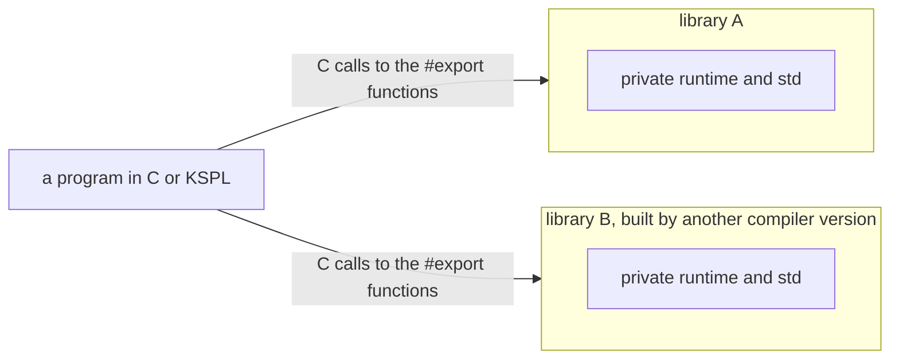

**Why a private copy, not one runtime shared between artifacts**:

* **A shared copy ties every artifact to one compiler and one std.** Each must leave its runtime out, one artifact must supply it, and a library built by another version must be stopped at the link, by a version in every symbol name. Folding the duplicates needs weak symbols, which pick one definition without a word wherever the names agree. Every guard is a mark that a toolchain may honour or not, so each object format needs its own proof.
* **A private copy needs none of that.** Nothing two libraries hold can meet, so libraries from different vendors and different compiler versions sit in one program. The person linking them names no runtime and learns no rule.
* **`static` hides a symbol on every toolchain, a static archive included.** That holds because the compiler writes a library as one translation unit. A visibility attribute leaves a static archive's symbols colliding, and an export list belongs to a linker the compiler does not run. A compiler that writes a library as many objects can hide symbols only in a shared library (a version script, a definition file), and two of its static archives collide on their copies of the standard library.
* **C's interface is the one every caller already links.** A C program includes a header; a KSPL program imports an `extern "C"` block. Both are written by the compilation that writes the library (`--library=`), so neither drifts from it.

**What is given up**:

* **A closed library cannot offer KSPL's own types**: a slice, a `Result`, a trait value, a generic, a method. Its interface is C's. A library offering them ships as source, as std does.
* **Each library carries its own runtime and std.** The parts it does not reach are dropped by the C compiler and the linker; the parts it does are paid once per library.
* **What a KSPL program's start-up sets for the whole process is the program's** ("Standard output carries the bytes a program writes"). A library sets none of it, and writes as the program that links it writes. Each step is listed in "Building a library" in [`../ksplc/docs/SPEC-tools.md`](../ksplc/docs/SPEC-tools.md).
* **Every `#export` is the library's interface**, a callback passed to C (a thread's entry) included, so each is named as an API name is.

### A size is the target machine's, and the C compiler checks each one ksplc folds

**ksplc lays every value out for the machine the program will run on, named to it with `--machine`, and each size it writes into the C as a number carries a compile-time check against the C compiler's own layout.** A pointer, `Sz` and a function pointer are 8 bytes on a 64-bit machine and 4 on a Cortex-M chip or in wasm32. Where ksplc folds a size (an array's length, a constant built from another, a static `if`, `##error`, reflection's offsets), the folded number is what the program runs with, so it must be that machine's.

| Decision | Why |
| :-- | :-- |
| 1. **One description of each machine** (`machines` in [`../ksplc/base/target.kspls`](../ksplc/base/target.kspls)) | A width written where it is used answers for one machine only. With every reader taking it from one row, a fold cannot use one width while the layout uses another, and a new machine is one row |
| 2. **The C compiler checks every number ksplc folds**, at the source line that asked for it | ksplc's layout is a copy of the C compiler's, and a copy is tied to its original by a check (Principle 4). The C compiler is the one party that knows the machine it builds for. Where the two disagree, a `typedef` of negative size stops the build, and its name says which machine ksplc laid the number out for |
| 3. **Only a folded number makes the C target-specific** | A `sizeof` left in a function body stays the C compiler's own and is right on any machine. A program that folds nothing carries no check, and its C builds for any machine as it did |
| 4. **The machine is named to both, rather than read by ksplc from the C compiler** | ksplc translates without a C compiler at hand: the editor's analysis, `ksplc lint`, a build whose C is compiled elsewhere. The default is the machine ksplc runs on, which every hosted build targets. A build for a chip writes the triple once and hands it to both (`CM_MACHINE` in [`../ksos/Makefile`](../ksos/Makefile)) |
| 5. **A machine ksplc does not know is refused, never approximated** | A machine guessed close folds a size the C compiler then refuses, far from the cause. Refused at once, the message lists the machines it knows |

**What is given up**:

* **The C of a program that folds a size builds only for machines that lay that type out alike.** One C for a 32-bit and a 64-bit machine needs the size left in a function body, where the C compiler answers it.
* **The editor analyses for the machine it runs on.** The language server takes no `--machine`, so a static `if` on a size is shown as that machine takes it, and on a machine the table lacks it refuses to start, naming that machine.
* **The LLVM backend lays out only 8-byte pointers** and refuses `--to=llvm` for any other machine, rather than writing IR with wrong offsets.
* **A constant expression is still checked at the bound every machine guarantees** (`Sz` at 32 bits, SPEC-language.md §6.8), whatever machine is named. So a source that compiles for one machine is not refused for another for its arithmetic.

---

## Function values

**A function value is one of two things, and how it is written shows which.** With no capture list it is a function pointer; with one it is a trait value carrying an environment. A *capture* is a variable of the enclosing function that the body uses, and the *environment* is the struct holding the captures.

| Written | It is | Can go to C | Can be named at the top level |
| :-- | :-- | :-- | :-- |
| `fn(x: I32): Bool { … }` | An anonymous function: a function pointer | Yes | Yes |
| `fn(x: I32; n: I32): Bool { … }` | A closure: a `Callable1` trait value pointing at its captures (here `n`, after the `;`) | No | No |

### Why capture is made explicit and escape is forbidden

A closure lists the outer variables it uses after a `;`, with their types. It can be passed down to the functions it calls, but it cannot outlive the function that made it.

An anonymous function (`fn(x: I32): Bool { … }`) is lifted to a top-level `priv fn`. A closure (`fn(x: I32; n: I32): Bool { … }`) gets a synthesized struct pointing at its captures and an impl of `Callable1`/`Callable2` (`desugar_fn_lit` / `desugar_closure` in `ksplc/parse/desugar_closure.kspls`).

**That the `;` changes the type is intended.** A function plus an environment does not fit one C function pointer. With the kind visible in the notation, a reader can tell what may go to C without following the types. Even with zero captures, a `;` makes a `Callable`. So a predicate needing no captures can reach an API that takes no function pointer: KSPL has no overloading, so the callee cannot take both.

**Captures are held by place (a pointer).** Copied by value, they would break as a `defer` frozen at registration does ("Why `defer` has no capture list"). Through a pointer, a call reads the body as it is then.

**Escape is forbidden in exchange.** A captured place dangles once the environment leaves the function. With no borrow checker ("Why there is no borrow checker, only a move-only marker") that cannot be tracked. But a closure is a trait value, so "Why dangling is stopped only on the paths that create an invisible pointer"'s escape prohibition applies, and `check_ffi_safety` already stops it at the C boundary. Closures need no check of their own: the trait value's constraints are exactly the two needed.

**An enclosing type argument reaches a closure, but not an anonymous function.** A closure's synthesized declarations copy across the ones its signature touches (ksplc/docs/DESIGN.md "Synthesizing a closure makes a KSPL source string and puts it through the same parser"). An anonymous function is a function-pointer value, and nothing fixes the instantiation where a value is passed. This follows from the `;` rule, which the text does not show, so the error asks for a capture list (`ksplc/tests/negative/anon_fn_generic_param.kspls`).

**Captures are typed because the environment is a struct, whose fields need types.** Inferring them would invert the phases. Types come from the body's inference (`sema_body_infer.run`), while a struct's fields are resolved before it (Pass 3 of `sema_decl_collect.run`). A written type lets desugaring decide it alone, on the line "Why type inference is limited to local variables" already holds.

**Whether a type can be omitted differs by position**, since the phase inversion blocks only "omit it and infer it".

| Position omitted | Possible | Reason |
| :-- | :-- | :-- |
| `return` (a tail expression) | Requires no information | Decided by syntax alone |
| A capture's type | A route exists | Made a **type argument** of the synthesized declarations and taken in the environment-building function's parameter, it binds from that actual argument (no phase is crossed) |
| A parameter's or return's type | No route | The type argument does not appear in the environment-building function's parameters. So it would need **a route back from the use site's expected type to the value's type argument**, and there is none |
| The capture list itself | Against the design | The `;` separates a function pointer from a trait value. Made implicit, an expression's type would silently vary with its body, and whether it can go to C would vanish from the text |

**A route existing is not a reason to take it.** Closures with captures are few in the tree, and omitting all four would save no lines and a negligible share of characters.

Note: This is revisited only under "Whether a callback is received as a function pointer or as a `Callable`"'s condition, "when a caller needing captures appears". The mechanism, and why no route leads back from an expected type, are "Synthesizing a closure makes a KSPL source string and puts it through the same parser" in [`../ksplc/docs/DESIGN.md`](../ksplc/docs/DESIGN.md).

**Only one- and two-argument `Callable`s exist** (`std/lang.kspls`). With no variadic generics (generics taking any number of type arguments), `Callable` cannot take the argument count as a type argument. `std/seq` needs no more than two, so `Callable3` and beyond are not added ahead on "it would be handy".

**What is given up**:

* **It cannot be carried out.** Where the writer must decide the environment's lifetime, put the captures in a `struct` and pass that as an argument (docs/SPEC-language.md appendix A).
* **The call goes through a vtable**, one level more than an anonymous function's direct call.
* **A closure cannot be captured.** A capture points at the body a name refers to, so it would take in the environment struct, not a `Callable` (composition passes an argument instead; docs/SPEC-language.md §8.1.3). Say so in the diagnostic, or the user reads `_anon_env_N`, a type name they never wrote (`append_closure_capture_note` in `ksplc/sema/session/ctx.kspls`).
* **It cannot be placed at the top level**, even with zero captures: the environment is a temporary on the caller's frame (`block_depth` in `ksplc/parse/desugar.kspls` decides it, and a diagnostic says so). So a reused predicate cannot be given a name. A function pointer can be named once and passed from several functions, while an API taking a `Callable` needs a closure in each function using it.
* **Diagnostics can name synthesized declarations absent from the source** (`_anon_env_N` / `_anon_env_new_N` / `_anon_env_v_N`), placed where the closure was written.
* **An outer name used in an anonymous function's body gives `undefined path or identifier`.** That suggests a typo, so the diagnostic adds that capture is impossible (`append_anon_fn_capture_note` in `ksplc/sema/session/ctx.kspls`).
  * A failed name has two reporting points (an undefined identifier, an undefined callee), so the wording is held in one place.

**The notation does not collide with the function-pointer type.** The type `fn(args): return` and an anonymous function differ only in whether a body block follows. The missing name after `fn` sets both apart from a definition (`decl_fn`), so one token of lookahead decides it.

**The function-pointer type cannot be withdrawn.** It serves an `extern "C"` signature, a hook stored in a `struct` field or a top-level variable, and a context with no allocator. None of these has anywhere to put an environment, for the reason a trait value cannot cross the C boundary ("The FFI boundary check looks inside the type").

### Whether a callback is received as a function pointer or as a `Callable`

A function that takes a callback takes a `Callable` only if callers need to give it captures. Otherwise it takes a plain function pointer.

**One question decides it: does the callback need captures?** Being a predicate does not make it a `Callable`. Keeping both kinds is selective extensibility, not duplication.

| Does it need them | How it is received | Example |
| :-- | :-- | :-- |
| Yes | `Callable1` / `Callable2` | `std/seq`'s `where` / `select` / `any` / `all` / `first_where` (without captures the predicate cannot be given what is searched for, leaving a bare `for`) |
| No | A function pointer | `std/fs`'s `skip_dir` (its natural predicate is a fixed set of names such as `.git` / `out`), `ksos`'s `on_idle` |
| It crosses the C boundary | A function pointer, **with no choice** | `std/thread.spawn`'s `entry`, which goes to `pthread_create` (`check_ffi_safety` stops a trait value) |

**Moving a callback that needs no captures to `Callable` shrinks what can be written**, since a closure cannot be named and reused ("Why capture is made explicit and escape is forbidden"). `ksos`'s `on_idle` takes `semihost_console`'s `exit` from each demo's `ksos_main`; as a `Callable` it would need the same closure in every one.

**The judgment changes only "when a caller needing captures appears".** Only then is a zero-capture closure in a top-level `const` (a closure that can be named) worth weighing. Do not add it first. The LLVM backend lacks the ground for it (a fat pointer cannot be folded into a static initializer, stopping with `this global initializer is not a compile-time constant`), so it would cost about as much as making a function pointer placeable at global scope.

### Where it is fine to move to `std/seq`

A chain such as `xs.where(…).select(…)` from `std/seq` may replace a hand-written loop over a `List` in ordinary code. Keep hand-written loops in the compiler's inner loops and in `std/`, `ksos/` and `ksai/`.

**A chain of `where` / `select` adds no allocation** ("Iteration"), so it does the work of a hand-written `for`. Only `to_list` allocates. A place using the chain twice needs it, since a second pass runs the predicate again per element. `order_by` / `reversed` / `distinct` stay eager and allocate a `List`.

Do not bring these into `ksplc`'s inner loops (tens of thousands of runs per compilation), nor into `std/` or `ksos/`. `ksai/`, with its examples `ksai/examples/qwen_infer` and `ksai/examples/llama_engine`, is out of scope too: it does inference and training per layer, token and element throughout.

**Only a loop that filters, maps or counts a `List` is replaced.** `std/seq` extends `List<|T|>`, so a loop over a slice (a `json.Val$[]`, a `U8[]`) stays. So does one that uses the index itself (`rejoin_replaced(lines, i, …)`), since `std/seq` has no variant passing a position.

### Why a closure is not written after the call

**A closure passed to a call goes inside its parentheses, or is bound to a name first and the name passed.** There is no trailing closure (Swift's `xs.sorted { … }`, Kotlin's `xs.filter { … }`).

* **It would give one call a second spelling** (`f(xs, g)` and `f(xs) g`), which "One notation per purpose" turns away, to save a pair of parentheses.
* **The place it fills is taken.** A trailing closure fills the last parameter, where the standard library passes the arena (`order_by(cmp, arena)`). Either every such signature turns around, or the language takes on rules for which parameter it fills.
* **A condition could not be told from its body.** The indentation notation writes a condition without parentheses, so a closure after `if xs.any()` would open a level that reads as the `if`'s own.
* **A `return` inside would read two ways.** In what looks like a statement's body it reads as leaving the function, yet it leaves the closure.

When the body runs to several lines, the closure is bound first, its body indented under it:

```kspls
over: = fn(x: I32; floor: I32): Bool
    return x > floor
big: = count_over(xs, over)
```

A `fn` right behind a call's `)` is an error whose Note names both forms (`forbidden_spelling_hint` in `ksplc/parse/syntax_msg.kspls`). "Features not carried" in [`SPEC-language.md`](SPEC-language.md) lists it.

**What would reopen it**: calls that read as statements of their own, written many times over (SwiftUI's view builders, Kotlin's type-safe builders), where naming each closure first would become the bulk of the text. KSPL writes none.

### A function's name in a comparison takes the other side's type

`twice == f` and `f == twice` are the same comparison: the name of a function, written on either side, takes the function type of the other side and is checked against it. Two names (`twice == thrice`) are a compile error that says to bind one side to a variable of a function type first. A function value takes `==` and `!=` and no other operator.

**A function's name takes its type from where it is written**: an expected function type, or, passed to a generic parameter or bound to a declaration with no type, the function type of the function it names ("A generic function used as a value names its specialization"). In a comparison the position is the other side, and `==` asks the same question in either order, so the order the sides are written in cannot decide whether the name has a type. The other side is typed first, whichever it is.

**Two names are refused, not compared**, even when their signatures agree. Neither side gives the other a type, and a comparison is neither a generic parameter nor a declaration, the positions that take a type from the function a name names ("A generic function used as a value names its specialization"). The answer is in the text as well: which functions two names stand for is known where they are written. Binding one side (`f: = twice`) costs a line and fixes the type both are compared at.

**An address has no order and no arithmetic that means anything.** Where two functions sit is the linker's choice, C leaves ordering them undefined, and an address moved by an offset is no function. So `<`, `+`, a unary `-` or `!`, and a compound assignment (`f += g`) are compile errors on a function value; a null check is `f == null`.

**What is given up**: sorting function values by address, as a table's keys. Where an order is wanted, cast to an integer first (`U64::f`).

### A function's name has no size

`sizeof(twice)` is a compile error, as is a function's name where a type goes (`x: twice`). The message names what answers the question its writer most likely had: `sizeof(fn(x: I32): I32)`, the size of a pointer to a function, which is the same for every function type.

**`sizeof` gives a function's name no type** ("A function's name in a comparison takes the other side's type"), so it has nothing to measure. A variable holding a function does have a type, the function type it was declared with, and `sizeof(f)` measures it.

**"The size of a function" has no one meaning.** It could be the size of a pointer to it, the size of its machine code, or, reading the name the way a call is read, the size of what it returns. Each answer is right for some reader and silently wrong for the others; the refusal costs one rewrite and leaves no reader with a wrong number.

**What is given up**: nothing that cannot be written. The size of a pointer to a function is `sizeof` of a function type; the size of its result is `sizeof` of the result type.

---

## One notation per purpose

**If the same thing can be written two ways, one of them is withdrawn.** A *notation* is a way of spelling something in the source. With one notation per purpose, everyone writes the same source for the same job, and a writer's taste cannot make it drift apart. Python states the same aim: "There should be one obvious way to do it".

A notation is judged by three questions, in this order. *Sugar* means a short spelling that the compiler expands into a longer form you could also write by hand.

1. **Do the meanings coincide exactly?** If either can always be written with the other, one is unnecessary.
2. **Is it sugar?** If the expanded form can always be written, the sugar must give more than brevity. Used in hundreds of places, it meets a real demand for readability. Used in a handful, it is withdrawn.
3. **Count actual use.** A notation the grammar accepts and nobody uses is a liability. All it does is show the reader an option.

**Sometimes both stay**: where each form has hundreds of real uses, and removing one would cost expressiveness or readability. Three pairs stay for this reason: compound assignment (`x += y` beside `x = x + y`), the block form and the expression form of `catch`, and the named and positional forms of a struct literal.

**Symmetry outranks the use count.** Declaring several variables in one statement (`a: I32 = 1, b: I32 = 2;`) has no real use as a statement, yet it stays. The reason is the C-style loop. Its init part uses the same grammar rule (`decl_var`), and `for $i: = 0, $j: = 100; …` depends on it. The loop's step part can list several updates with `,` as well. Narrowing only the init to one declaration would make the two halves of one loop differ. A writer would then remember two rules ("the step can be listed, the init cannot") instead of one ("they can be listed with `,`"). That costs more understanding than removing one option gains.

**What is given up: the code does not get shorter.** With little sugar, the same work takes more lines than in a language with shorter forms. In return, only what is written happens. The extra lines have three sources.

| # | Where the extra lines come from | What it is |
| :-- | :-- | :-- |
| 1 | **Lines that hold only a closing brace** | The price of braces that cannot be left out. They are a sizeable share of the brace notation's lines (convert any file with `ksplc fmt --to=kspl` and count them). The indentation notation (the chapter "The indentation notation (`.kspls`)") removes exactly those, losing no content, and its character count barely moves |
| 2 | **Code that says who owns what** | The price of not hiding ownership (which code frees which memory). It stays |
| 3 | **Functions `std/` lacks that would do a whole errand in one call** | Not a price but a gap ("Known holes, and what would fill them" in [`../std/docs/DESIGN.md`](../std/docs/DESIGN.md)) |

Note: **Even filling gap 3 barely reduces the line count.** With a round-trip function (one call that turns a struct into JSON and back), `tests/tools/perf_guard.kspls` has as many code lines as without one (the `json` / `db` row of "Known problems KSPL handles" in [`../std/docs/DESIGN.md`](../std/docs/DESIGN.md)). Such a function removes key names spelled twice and placeholder values filled in as defaults, not lines.

### Notations not carried

These spellings are not part of KSPL. The right column says what to write instead. The list is kept so that the same proposal does not come round again.

| Notation not carried | The form that writes the same thing |
| :-- | :-- |
| `Fstring` (a separate prefixed string form for formatting, like Python's `f"…"`; an `expr_primary` alternative) | `Literal` (an ordinary string literal, which formats values in place with `\{x\}`) |
| Block comments `/* */` | Line comments `//` |
| The abbreviated error type `T!` | `T!I32` |
| `?` for a result (`T?E`, `f()?`) | `!` (`T!E`, `f()!`); "Failure" below gives the grounds |
| Escapes outside the ten (`\b` `\x41` `\101`) | The character itself, with no backslash (`\\` for a backslash, `\uXXXX` for a code point) |
| A built-in `Char` type | `U8`, printed as a character with the format specifier `\{b:c\}` |
| Multi-byte character literals (`'あ'` / `'ab'`) | A string (`U8[]`); a character literal holds exactly one byte |
| A `defer` joined onto a declaration (`buf: = Str_builder.new() defer .free()`) | A `defer` of its own on the next line, naming what it cleans up (`defer buf.free()`) |
| An octal literal (`0755`, `0o755`), and a decimal integer that starts with `0` | Hexadecimal (`0x1ed`); a decimal integer starts with a non-zero digit |

**Withdrawing a notation removes it from every place the source is read**: from the grammar, and from the compiler's own code that skips whitespace and comments. Removed from only one, a form the grammar refuses would pass silently through the other. Where the compiler reads comments apart from the grammar is "Every place a source enters reads it the same way" in [`../ksplc/docs/DESIGN.md`](../ksplc/docs/DESIGN.md).

#### Escapes are closed at ten

Only ten escapes may follow a `\` in a literal. Any other, such as C's `\b`, is an error, not a plain `b`.

**The escapes after `\` are closed at ten** ("2.3.2 Escape sequences" in [`SPEC-language.md`](SPEC-language.md)). Reading an unknown one as "the character itself" would make `\b` and `b` two spellings of one byte, which Principle 6 (one means to one purpose) forbids. Worse, a `'\b'` copied from C (where it is the backspace, byte 8) would silently become `'b'`, which is what Principle 5 (nothing "writable but ineffective") forbids. The compiler holds the rejection in one place (`is_known_escape` in `ksplc/base/literal.kspls`), and `make test-negative` holds it.

**`\{` and `\}` are among the ten because interpolation is written `\{` … `\}`.** *Interpolation* puts a value inside a string: `"n=\{n\}"`. So a bare `{` stands in the text as it is. There is no doubling (`{{`), which Python's f-strings and C# require. `'\{'` is the matching form in a character literal.

**`\uXXXX` takes exactly four hex digits** ("2.3.3 Writing a code point with `\uXXXX`" in [`SPEC-language.md`](SPEC-language.md)). A *code point* is a character's number in Unicode. The table compares the shapes other languages use.

| Shape | Where | What goes wrong | KSPL |
| :-- | :-- | :-- | :-- |
| Greedy hex escape (`\x` takes every hex digit that follows) | C/C++ and Python's `\x` | The meaning changes when another hex digit follows the escape | No hex escape at all, so a fixed count of four closes the hole by itself |
| Braced code point (`\u{0041}`) | Rust, Swift | Confusable with interpolation's `\{` … `\}` | Not taken |

**Nothing above U+FFFF and no surrogate is written with `\u`.** A *surrogate pair* is how UTF-16, Java's string encoding, stores a character above U+FFFF in two halves. KSPL's strings are UTF-8, where such a half is only an invalid byte sequence. A character above U+FFFF is written directly into the UTF-8 source.

**`\u` is expanded only where a literal's bytes are decided, never before lexing** (*lexing* is the first step of compiling, which cuts the text into words). So comments and raw strings pass through untouched. Java expands `\u` before lexing, so a `\u000A` (a newline) inside a comment breaks the file.

#### There is no `Char` type

A character literal such as `'a'` is one byte (`U8`). There is no separate character type; to print a byte as a character, write `\{b:c\}`.

**A character literal holds exactly one byte.** If accepted, `'あ'` (three bytes in UTF-8) would silently give only its first byte. The same character written with `\u` is rejected, so the two ways of writing one thing would give different answers. One rule judges the escaped and unescaped forms alike (`literal_fault` in `ksplc/base/literal.kspls`).

**There is no `Char` type because it would carry exactly one job.** It would have `U8`'s representation and values, and differ only in printing as a character in interpolation (`\{x\}`). One byte has two readings, "as a number" and "as a character", and the line between them belongs to how it is written, not to its type. Split by type, the line breaks easily: pass a `Char` once through a function that takes `U8`, and `A` prints as `65`. So the type would guarantee nothing. `\{b:c\}` puts the line where the value is printed, and says the same without a type (Principle 1, the Zen of Subtraction, and Principle 6). It adds one notation and removes one type, so it is not an addition.

**Only `U8` carries `fmt_char`** (`std/strfmt.kspls`), for the same reason hex has its own `fmt_hex`. So `:c` on another type is refused (docs/SPEC-language.md §3.6.2). Do not let `c` take a width, zero padding or thousands separators. One character has nothing for them to apply to, so they would be written and do nothing (`char_alone` in `ksplc/parse/format_spec.kspls`).

**A character type may return, but not as eight bits.** It would be a text type that guarantees valid UTF-8, kept apart from `U8[]`, and it would give a code point (32 bits) per step when iterated. Its name is undecided, and `Char` is not the leading candidate. The word names five different things across languages and suggests one byte (Go uses `rune` rather than reuse it).

**No word is reserved for it.** The grounds:

* A reservation works only once the name is decided, and deciding the name is the design of the type.
* Holding `Char` would protect a candidate that is not in the lead.
* Holding a list of candidates grows the vocabulary for a type nobody has decided to build (Principle 1).
* A word reserved later breaks the code that used it, as Rust's `try` and `gen` do even with editions and `r#`. Here that breakage is the cheapest kind: a compile error at the declaration, fixed by one rename.

**If a word is reserved anyway, reserve it in sema's name check, not in the grammar.** (*Sema*, semantic analysis, is the compiler stage that resolves names and types.) A word blocked by the grammar's `_Keyword` gets the same "expected 'character class'" error as `struct I32`, which does not say why it cannot be written.

#### A `defer` is not joined onto a declaration

Write cleanup as its own line, `defer buf.free()`, right after the line that acquires `buf`. The joined form `buf: = … defer .free()` is not KSPL.

`defer` runs a statement when the enclosing block exits; it is how a file is closed or memory freed on every way out.

```kspls
import "std/str" { Str_builder }

priv fn greet()
    $buf: = Str_builder.new()
    defer buf.free()
    buf.s("hello")
```

**Frequent use does not keep the joined `defer`.** Step 2 of the decision order keeps a sugar used in hundreds of places. This one saves only a name and a line, and it costs three things.

| Cost | What happens |
| :-- | :-- |
| **It would be the one statement that carries on behind a closed level** | Under `x: = f() catch`, with a deeper `fallback` line, a `defer .free()` back at `x`'s column would join `x`'s statement. The indentation reader would need an exception for a line opening with `defer .`. That is the kind of word-keyed rule the conditional value gives up in favour of brackets ("How a column is read") |
| **It fills in a receiver nothing else fills in** | Everywhere else a leading `.` names an enum value (`.ok`). So a `defer .free()` moved to a line of its own would meet "cannot infer enum type" |
| **It is written nowhere else** | A `defer` of its own on the next line is what Go, Zig and C's draft `defer` write, and what a model writes unprompted. No form bound to a declaration fills a receiver into an arbitrary call |

**The joined form guaranteed that nothing comes between an acquisition and its cleanup; that is the writer's to keep.** [W0109] asks about a way out of the block in between ("Why an early exit before a `defer` is warned about, and how narrowly"), and Go and Zig carry the same exposure. The specification says to write the `defer` on the next line (8.4.1 in [`SPEC-language.md`](SPEC-language.md)).

`defer` takes one statement, so the separate line costs only the name. If `defer` took only a block, the form would be `defer { buf.free(); }`, the one `;` the indentation notation would still show. **What holds it**: a `defer` behind a statement is refused with the line to write instead (`append_trailing_defer_hint` in [`../ksplc/parse/syntax_msg.kspls`](../ksplc/parse/syntax_msg.kspls)). A `defer .free()` standing alone is refused by name (`reject_receiverless_cleanup` in [`../ksplc/sema/body/stmt.kspls`](../ksplc/sema/body/stmt.kspls)). `make test-negative` holds both.

#### A decimal integer does not start with 0

`0755` is a syntax error. Write `0x1ed` for a bit pattern, or `755` for the decimal number.

**A leading `0` on a decimal integer is a syntax error**, not a decimal digit and not an octal mark ("2.3 Literals" in [`SPEC-language.md`](SPEC-language.md)). Languages split on this spelling:

| Reading of `0755` | Languages |
| :-- | :-- |
| Octal (base 8), so 493 | C, C++, Java |
| Decimal, so 755 | Rust, Swift |
| Refused | Python 3, KSPL |

Whichever reading KSPL took, a writer from the other half would get a different number with no diagnostic. A file mode written `0755` is the usual case, and a model trained on C writes it that way too. Refusing it is the one answer that leaves no one with a silent wrong value; Python 3 refuses it for the same reason. Octal itself is not carried, because hexadecimal already writes bit patterns (Principle 6). The grammar refuses the spelling (`Integer` in `ksplc/kspl.kspeg`), so an array length or a constant refuses it just as an expression does. The syntax error's note names both readings.

### One mechanism per purpose

Not only spellings but whole mechanisms are kept to one per purpose. For example, there is one loop form over a collection and one way to report failure.

**Two mechanisms that serve one purpose are also gathered into one**, for the same reason as two spellings. With two, the reader must work out from a type or a signature which convention a place follows. Record the form not carried as well as where it was gathered, or the same proposal comes round again.

**Each gathering is recorded with how a departure from it is noticed.** Iteration, failure, unwrapping an `Option` and translation-time conditions need more than a row, so they follow the table. (A *lint* is a check that `ksplc lint` runs for style and likely mistakes; codes like [I0310] name one.)

| Purpose | Where it was gathered | How a departure is noticed |
| :-- | :-- | :-- |
| Importing a file | `as` only to rename; unmarked when the name stays | lint [I0310] |
| Iterating n times | `for x in Range.asc(n)`; a C-style three-part loop only when the body changes the index or the bound | — (the count would be evaluated differently, so it cannot be gathered mechanically) |
| Heap allocation | `alloc_as<\|T\|>()` / `arena.alloc_as<\|T\|>()` / `heap_alloc_as<\|T\|>()`; `alloc(<byte count>)` for raw bytes only | `alloc_as` in `std/mem.kspls` |
| Boolean conjunction and disjunction | `&&` / `\|\|`; `&` / `\|` when both sides must be evaluated. `*` / `+` would work identically over `_Bool`, so they are rejected at translation time | `make test-negative` (what is rejected) and `ksplc/tests/bool_ops_test.kspls` (what is kept) |

#### Iteration

Every loop over a sequence is written `for x in xs`. The type of `xs` decides how it is walked; the writer never drives an iterator by hand.

**There is one way to write iteration, `for x in`.** The compiler expands it either by index or through `std/lang`'s `Iter<|T|>` (a trait with one method, `next`). The writer chooses neither; the type decides (docs/SPEC-language.md, 7.2). The point is not to add notations, so no form drives an iterator by hand (`for it.has_next() { … }`). For the same reason `Iter` has only `next`. A separate "is there more" method would make it possible to call only one of the two.

**`Iter` wins on a type that satisfies both** (the rule is docs/SPEC-language.md, 7.2). A type can be walked by index just by having the right shape, while `Iter` is declared on purpose. A structural match alone must not silently disable what was declared explicitly (Principle 5).

**Which `std` APIs are eager and which lazy**, what each costs, and why a chain can be driven any number of times are `std`'s own design ("Iteration has one notation" in [`../std/docs/DESIGN.md`](../std/docs/DESIGN.md)). (*Eager* builds the whole result at once; *lazy* produces one element each time the loop asks.) Do not add terminals, the methods that consume a chain and return one value. Counting, folding and searching are all written with `for x in`, so each terminal added is a second way of doing the same thing.

**Nothing is eager because closures cannot be held.** A struct holding a predicate (a function that answers yes or no) can be written, since the closure's captured variables live in the caller's frame ("Why capture is made explicit and escape is forbidden"). The struct lives while the chain is built and consumed there. What cannot be written is a function that creates a closure and returns it ("Why dangling is stopped only on the paths that create an invisible pointer").

**The lazy chain rests on four properties of the language.** The first is the `Iter` above, which puts even a sequence with no `.len` onto `for x in`. The other three let the chain be written as method calls:

* **A method can return its own type one level deeper** (`Seq<|S|>.where(): Seq<|Wh<|S|>|>`), and a level advances only as far as the user wrote.
* **A method can introduce a new type argument** (`fn select<|U|>`), bound at the call site (["A type argument with nothing to bind to is rejected"](#a-type-argument-with-nothing-to-bind-to-is-rejected)).
* **A closure literal passed directly still fixes the type argument.** Its type is a synthesized environment (`_anon_env_N`) that declares no generics of its own. So the argument is taken from the instantiation of the `Callable1` it declares (`implemented_trait_instance` in `ksplc/sema/type/env.kspls`).

**The stage types nest** (`Conv<|Keep<|List_seq<|T|>, T|>, T, U|>`), and every stage repeats `where` / `select` / `to_list`. So each new kind of stage multiplies the code in `std/seq`. Rust's `Iterator`, Java's `Stream` and Swift's `Sequence` remove this repetition with default method bodies. Which of the three a trait's default body could take in KSPL, and why each stays per stage, are std's own design (["Why the chain's stages cannot be folded"](../std/docs/DESIGN.md#why-the-chains-stages-cannot-be-folded) in [`../std/docs/DESIGN.md`](../std/docs/DESIGN.md)).

#### Failure

**There is one way to convey failure, `T!E`** (a result that is either a `T` or an error `E`). `std/io.kspls` uses `!Io_error` and `std/fs.kspls` uses `!Fs_error`, with no `Option` or `Bool` mixed into the same file for failure. `exists` / `is_dir` stay `Bool`: they answer a question, and "does not exist" is a normal answer, not a failure.

**A result is marked with `!`, in its type (`T!E`) and where its failure is passed on (`f()!`), and `?` marks nothing.** `!` reads as what it is, a place where the function may stop and hand a failure back, and `?` means absence, as Swift, Kotlin and C# spell an optional value (`T?`, "`T?` is sugar for `Option<|T|>`" above).

* **Two rules make it parse without ambiguity.** A postfix `!` is read only where no `=` follows it, so `a!=b` compares and `f()! == x` needs its space. A `!` at a line's end ends the statement, and one at a line's start continues the line before (a wrapped `T!E`); a statement never begins with a prefix `!`, whose value would be thrown away.
* **The old spelling is refused, naming the new one**: a syntax error on a `?` carries a note writing `T!E` and `f()!`.
* **What is given up**: a reader of Swift, Kotlin, C# or TypeScript reads `x!` as "assume it is present", a crash or an unchecked promise, where KSPL's `f()!` quietly passes a failure up. And Rust's `?`, which means exactly what KSPL's `!` does, is no longer shared.

#### Unwrapping an `Option`

To use the value inside an `Option`, write `if name: = expression`. Inside the block, `name` holds the value.

**There is one `if` for unwrapping an `Option`, `if name: = expression`.** The form that declares a name inside the condition with `;` (`if v: = X; v == .some`) is not carried. The two serve different purposes: `;` says where a name lives (scoping), and `if name: =` says how the contents come out (unwrapping). The `;` form binds the `Option` itself, so most real uses would need one more line to unwrap it. Nor does the `v == .some` checked in the condition carry into the block, so a check would be writable and ineffective (Principle 5). Making it effective would need type narrowing (the compiler learning a variable's narrower type from a condition). Scoping alone does not justify the form either:

* shadowing (a new name hiding an outer one of the same spelling) is rejected (lint [I0501]);
* a bare `{ … }` already scopes;
* chaining while keeping the contents bound is the `,` form's job.

#### Translation-time conditions

`#cfg(flag)` leaves a declaration out of the build; `##error` / `##warning` stop or warn the build. They stay two separate tools, and `#cfg` stays the weaker one on purpose.

**Translation-time conditions keep removing and reporting apart, and unequal.** (*Translation time* is while the compiler runs, before the program does.)

| | `#cfg(flag)` | `##error` / `##warning` |
| :-- | :-- | :-- |
| What it does | Drops a declaration | Emits a diagnostic |
| What it takes | One flag name, with no comparison and no `&&` (docs/SPEC-language.md §10.1) | A foldable expression (`sizeof(Sz) == 8`): one the compiler can compute |
| If the condition is misread | The declaration vanishes, with no message | A diagnostic appears |
| When it runs | Before declarations are gathered (`ksplc/parse/normalize.kspls`), when no names or types are resolved yet | After types are attached (`ksplc/sema/body/infer.kspls`) |

Two grounds follow from the table.

* **A mistake shows in opposite ways.** A rich condition on the silent one alone would erase the clue to the mistake.
* **They run at different stages.** When `#cfg` runs, the material for a comparison is absent. A comparison there would need arithmetic apart from the language, at a stage with no types: the C preprocessor's shape.

**An attribute is either interpreted by both backends or explicitly rejected by one.** (A *backend* turns the checked program into output: ksplc has one that writes C and one that writes LLVM IR.) None is silently ignored under `--to=llvm` ("An attribute is either interpreted in both backends, or refused outright in one" in [`../ksplc/docs/DESIGN.md`](../ksplc/docs/DESIGN.md)).

#### Things that look like duplication and are not

Some pairs look like two ways of doing one thing, but each covers cases the other cannot. Those pairs stay.

**Two things suited to different situations both stay.** `std/thread.kspls` and `std/reactor.kspls` can both "handle many connections", and which to use is in `std/docs/DESIGN.md`. The three indexing traits are each needed (docs/SPEC-language.md §6.1):

| Trait | The case only it serves | Example |
| :-- | :-- | :-- |
| `Index` | Elements with no address | `Range` / `sys.Args` |
| `Index_mut` | A write whose destination does not exist yet | A new key into a `Map` |
| `Index_place` | A body that becomes an lvalue (something that can be assigned to) | `List` |

**Two forms whose writable positions exclude each other are not two ways of writing one thing either.** Gathering them would leave a position where nothing can be written.

| Purpose | The two forms | The position where only one can be written |
| :-- | :-- | :-- |
| Typing an integer | The suffix `5I64` / the prefix cast `I64::5` | The suffix **checks the range** (`300U8` is an error); the cast is an instruction to **truncate** and does not check (`U8::300` passes). The requirements are opposite, so neither can be written with the other |
| An enum variant | Implicit `.some(x)` / type-qualified `T.some(x)` | The implicit form needs an expected type to descend (`y: = .some(1)` is refused with `cannot infer enum type for implicit variant`); there, only the type-qualified form can be written |

**Nor is a `const` inside a function.** It looks like an unmarked immutable binding (`n: Sz = 4;`). But only a `const`, fixed at compile time and holding no memory, can size an array (`I32$[n]`; the unmarked one is refused with `array size must be a positive constant expression`).

**A raw pointer's `null` remains in three places only.** Elsewhere, `T?` says whether a value is present, and lint [H0701] finds a raw pointer's `null` being returned. `T!E` is not the answer here: it says "it failed, and this is why", not "there is no value" (the "one way to convey failure" above).

| Where it remains | Reason |
| :-- | :-- |
| Under `std/` | Foundational primitives: moving to `Option` would require rewriting every caller |
| Functions carrying `#export` | The FFI boundary with C (where C code calls KSPL): `T?` is not ABI-compatible with C's null convention, that is, its memory layout differs from what C expects |
| Tree walking in `ksplc/base` (`find_child` / `unwrap_top_level` / generating notation) | The same reason, suppressed with its grounds in the file-opening `##lint(H0701 = off)` |

**No unmigrated case can exist outside these three**: the repository requires zero diagnostics even at Hint level (`make lint`).

### A default argument is allowed only for a foldable constant

The last parameters of a function may have a default, such as `offset: Sz = 0`, and a caller may leave them out. The default must be one literal value, and some parameters (an arena) must never have one.

**A parameter at the end of the list may carry `= literal`, and the caller may then omit it** (docs/SPEC-language.md §8.1.1). A *foldable constant* is a value the compiler knows without running anything.

There are two grounds for allowing it.

* **Real demand**, meeting the "hundreds of places" of step 2. Most calls of `starts_with` in `std/chars` look at the start of the text, and they omit `offset` rather than write `0`. To recount, set the count of `grep -o "starts_with([^,()]*)"` against that of `grep -o "starts_with("` over the tracked sources.
* **Symmetry.** A struct literal may omit a field and get the type's zero. A parameter that could not be omitted would grow the rules a writer remembers from one ("a named slot may be omitted") to two ("a field may, a parameter may not").

**It is not the same rule as omitting a field.** An omitted field gets the zero the type decides, while a default argument is the writer's choice. The difference is held to "one constant appears", so only a single literal is allowed. An expression would let allocation or side effects happen without appearing in how the call is written.

**"Is it a foldable constant" is the condition for entry, not the reason to enter.** The second test is whether the shorter call lies to the reader. `null` is a constant. But an arena parameter with `= null` would hide, behind the shorter call, "omit it and it allocates on the global heap, and the caller owns the free". (An *arena* is a block of memory that many allocations share and that is freed all at once.)

**So an arena parameter carries no default, and a caller wanting the global heap writes `null`.** Compare `List<|I32|>.new(null)` with `List<|I32|>.new(arena)`; `mem.alloc_in(null, n)`, `base64.encode(data, null)` and `fs.read_dir(path, null)` read the same way. Where the elements go, and whether a `free()` is owed, is then on the call's line. The other shapes are not taken:

| Shape not taken | Why not |
| :-- | :-- |
| **A second constructor for the heap** (`new_on_heap()` beside `new(arena)`) | `new(null)` stays writable, so the heap would have two spellings. A suffix on the arena's form instead (`new_in(arena)`) is the mark std's naming refuses ("A constructor's name says where the returned thing goes" in [`../std/docs/DESIGN.md`](../std/docs/DESIGN.md)), and every constructor would come in pairs |
| **The arena on each growing call, the container holding none** (`xs.push(arena, x)`) | It would rule out handing the wrong arena to one call. But every `push` and `set` would carry it, and `free()` would need it back. A `List` keeps the one it was made with |
| **A default arena held per thread or per scope** | The call would again not show where it allocates, which is what this rule removes |

**`make test-conventions` holds it**: it refuses a parameter whose type names `Arena` and carries `=`. It reads the text, so a spelling it does not see (an arena behind a typedef) is still a violation.

**Where a default cannot be placed**, and why, is the table in docs/SPEC-language.md §8.1.1. Each such place is rejected with a diagnostic (`ksplc/tests/negative/param_default_*.kspls`). A trait's declaration may carry one (the same section; `Index_place.at` in `std/lang` takes this form).

**Where defaults stand is not listed here.** A default is part of its declaration's spelling, so each package's `SURFACE.txt` holds the published ones, and `ksplc --emit-surface=<file> --surface-scope=all` writes every one a file reaches ("Writing out the published API" in [`../ksplc/docs/SPEC-tools.md`](../ksplc/docs/SPEC-tools.md)). What the second test turned away is recorded, so the same discussion is not had twice: an arena (above), an environment's timing (`delay_us`), a grab tolerance (`drag_edge`'s `10.0`), a character to search for (`seek`'s `']'`), and a person's name. Each is a foldable constant, but the value left out is itself a judgment the caller should make.

**What is given up**: a call's text does not show how many arguments it passes, so the reader looks at the declaration.

### Why `import` and `#export` are not made a matched pair of words

`import` and `#export` sound like opposites, but they control different things. `import` is about which names your code can see; `#export` is about what name a function gets in the compiled output.

**They look like a pair, but act on different axes.**

| Axis | One end | The other end |
| :-- | :-- | :-- |
| Naming: which names a file can see | Bringing a name in (`import`) | Hiding one (not writing `pub`) |
| Linking: which symbols the compiled output shares with other code | Emitting a symbol (`#export`) | Using an outside one (`extern "C"`) |

Two axes are not expressed with one pair of words; the list of axes is in [`SPEC-language.md`](SPEC-language.md), "9. Files and import".

**The only languages that pair the words are C++20 (`export module` / `import`) and Java's `module-info` (`exports` / `requires`), and in each the pair reaches past naming.** Java makes visibility the product of two declarations, and C++'s modules give up the premise that a translation unit (one source file and what it includes) is compiled independently.

**The words do not change.** A keyword like Zig's `export fn` would make `#export` look as if it decided linkage too. Visibility decides that, and `#export` touches only the symbol's name. Nor is it renamed `#c_name`: on wasm32 the attribute also means "make it an export", so `c` would be a lie ([`SPEC-language.md`](SPEC-language.md), "11.3 Exposing a KSPL function to C (`#export`)").

**A combination that becomes ineffective across the axes is rejected** (docs/SPEC-language.md §11.3). There are two:

* `#export` on a `priv` function, whose generated C is `static` (invisible outside its file);
* `#export` on a method. Here the reason is that the name must be unique, not visibility. Symbols share one namespace across every link target, so only a name unique on its own can go out bare. A method's name is not unique without its type (`bump` can exist once per type).

**This is a language rule, not a lint.** A lint runs only when someone runs it, and only over the files it is given, so the same notation in another file would be accepted. Like the other spellings that bring nothing about, it carries no diagnostic code ("The list of diagnostic codes" in [`../ksplc/docs/SPEC-tools.md`](../ksplc/docs/SPEC-tools.md)).

### Every item in a declaration block ends with `;`

Inside `{ … }`, every field and every enum value ends with `;`, the last one too. A `,` there is an error.

```kspl
enum Color {
    red;
    green;
}

struct Point {
    x: I32;
    y: I32;
}
```

**Declarations lined up inside `{ … }`, a `struct`'s fields and an `enum`'s values alike, end with `;`, the last one too.** So a block has exactly one mark that says "end". The rule is "2.5 Blocks and statement ends (brace and indentation notations)" in [`SPEC-language.md`](SPEC-language.md).

**`,` keeps its own job.** `;` ends a declaration, and `,` separates the items of a list within one notation. So the rule allowing a trailing `,` ("2.4 Trailing commas" in [`SPEC-language.md`](SPEC-language.md)) applies only to lists.

**The C family's shape is not taken.** There, `,` separates names inside an `enum` that is one whole declaration closed by `;`. KSPL's `enum` sits at the same level as `struct`, with no closing `;`, so that footing is absent. A list mark inside a block would make the mark that says "end" vary from block to block.

**The formatter never keeps two on one line** (`enum E { a; b; }` is always split), so a value's `,` has no job of separating within a line either.

**The rejection of a `,` there carries a Note stating the rule.** The expected set alone (`expected …, or ';'`) does not read as "it is `;`, not `,`" (`forbidden_spelling_hint` in [`../ksplc/parse/syntax_msg.kspls`](../ksplc/parse/syntax_msg.kspls)).

---

## The indentation notation (`.kspls`)

**The same program can be written in `.kspl` (braces) or in `.kspls` (indentation).** In `.kspls`, indenting, dedenting and the end of a line say what `{`, `}` and `;` say in `.kspl`. These two are the same function:

```kspls
priv fn sign(n: I32): I32
    if n < 0
        return -1
    return 1
```

```kspl
priv fn sign(n: I32): I32 {
    if n < 0 {
        return -1;
    }
    return 1;
}
```

The rules for both are "2.5 Blocks and statement ends (brace and indentation notations)" in [`SPEC-language.md`](SPEC-language.md). This chapter holds why the second notation is kept and why its rules are what they are. A reader in the compiler ([`../ksplc/parse/layout.kspls`](../ksplc/parse/layout.kspls)) rewrites indentation into braces before parsing ("Only one stage rewrites, and only before the parser"). The grammar holds, in the names of its rules, which symbols that reader replaces ("What disappears, and what does not").

**Both notations are kept**, through the decision order of the chapter "One notation per purpose":

1. **The meanings coincide exactly.** Each can be produced mechanically from the other (`ksplc fmt --to=kspl` / `--to=kspls`).
2. **It is sugar.** The expanded form (braces) can always be written.
3. **Actual use meets the bar for indentation, not for braces.** The repository is written in indentation, every package included. What is written in braces is test material, not code that runs: the sources in `ksplc/tests/negative/` broken on purpose, a lint case in `ksplc/tests/lint/`, and the twin pairs in `ksplc/tests/kspls/`. Some of the broken sources break before parsing, so no tool can convert them. Some expect a diagnostic that names a `{`, `}` or `;` outright.

**So the default is the indentation notation**: a logical name with no extension means `.kspls` ("Only one stage rewrites, and only before the parser"). (A *logical name* is how an `import` names a file, such as `std/str`.)

**The brace notation is kept as the exception**, on a ground the count does not give: the test material is written in it. The shapes the indentation notation refuses (a block with no body, a ragged column, a forgotten `;`) can be shown only there. It is also how a reader from C, Rust or Swift reads KSPL.

**The condition for revisiting**: once use outside this repository becomes countable, count which notation it is written in. Neither notation is folded into the other while the test material still needs braces to say what it says.

**There is one canonical source and two appearances**, held by a check, not by prose (`make test-kspls-trip`, "Formatting, and the round trip that holds the two notations to one program").

**No rule says which notation to write in**, not even "one or the other per folder". Aligning them would not change that two ways exist, so the one-notation principle gains nothing from it. Aligning within a folder for readability is the writer's freedom.

### What disappears, and what does not

Only the braces around a block and the `;` that ends a statement disappear. Every other brace or `;` (in a struct literal, for example) stays as written.

**Only blocks and terminators disappear**, and every other brace or `;` stays as it is written. The table of which is which is in "2.5 Blocks and statement ends (brace and indentation notations)" of [`SPEC-language.md`](SPEC-language.md).

Note: **The grammar names them too.** A block's opening and closing braces and the terminating `;` are the rules `Block_open` / `Block_close` / `Stmt_end`, listed in the header of [`../ksplc/kspl.kspeg`](../ksplc/kspl.kspeg). How that list is kept in step with the tree is "Keeping the grammar and the AST node kinds in step" in [`../ksplc/docs/DESIGN.md`](../ksplc/docs/DESIGN.md).

**No mark (`:`) is placed on a block's heading.** Python opens a block with `:`. KSPL's `:` already serves type annotations and labels, and this would be a third meaning. Instead, a wrapped line and a block are told apart by how they are written; the three cases in which a line continues are in the specification's section above. Python's rule "a line wraps only inside brackets" is not enough, because the formatter also wraps outside brackets (it starts the line after `b.s(…)` with `.s(…)`).

**`catch` is the one word that both continues a line and opens a block, and the one form the symbols alone do not decide: the column decides.** So a line is never broken after `catch`. A break there would put the two readings at the same column. The handler would be read as the block's first statement, and the value it stood for would be lost. `ksplc fmt` refuses that break and runs past the width instead ("The formatting settings (`--style`)" in [`../ksplc/docs/SPEC-tools.md`](../ksplc/docs/SPEC-tools.md)). `ksplc/tests/kspls/tour.kspls` and its twin carry the shape, so the refusal cannot be dropped unnoticed.

### How a column is read

A line belongs to a block when it is indented deeper than the block's heading. Any indent width works, but all the lines of one block must start at the same column.

**Only the heading's column is stacked**; how deep a block's body is indented is not remembered (`Frame` in `ksplc/parse/layout.kspls`). So no width has to be fixed: a block indented by 2 and one indented by 4 can mix in the same file.

**The price would be that a depth matching no block enters the inner block.** Take a block whose heading is at column 2 and whose body is at column 6:

```text
  if ready        ← the heading, at column 2
      start()     ← the body, at column 6
    stop()        ← column 4: refused
```

By the heading's column alone, the line at 4 would join the block. A person sees it stand shallower than its siblings, and reads it as outside. Two readings give two programs.

**So it is refused.** Python stacks the body's column too, and cuts the same shape off with `IndentationError`. KSPL compares the line with the block's own members instead. That leaves wrapping free, since a continuation line is folded into its logical line before any column is looked at.

* **The refusal carries no diagnostic code.** A code can be switched off by a project setting, and what would go quiet is a difference in what runs ("5.4 The list of diagnostic codes" in [`../ksplc/docs/SPEC-tools.md`](../ksplc/docs/SPEC-tools.md) names the others handled so).
* `ksplc fmt` rebuilds the columns, so no formatted source meets it.
* The reader returns what it finds as a value, and the compiler prints it once, with every other diagnostic (how: "Every place a source enters reads it the same way" in [`../ksplc/docs/DESIGN.md`](../ksplc/docs/DESIGN.md)).

**Indentation is written with spaces.** Several characters look like a space and are not, and none of them counts as a column, so such a line leaves the block enclosing it. Do not make a tab count. Its width is an editor setting, so counting it would allow a line that lines up on screen while the columns differ. The tab gets no diagnostic code: a line pushed out to column 0 gets a syntax error first, so a code would never fire. The rewriting stage does find it, and `ksplc/tests/layout_indent_test.kspls` pins that.

Note: **Japanese input most easily slips in the ideographic space** (U+3000, a full-width space). The syntax error it causes says nothing about the cause, since on screen the line looks correctly indented. So `odd_indent_name` in `ksplc/parse/syntax_msg.kspls` adds a Note naming the character, as Python names it in `invalid non-printable character U+00A0`. It is a Note rather than a lint because the syntax error comes first, and the program never reaches sema.

**A lone `return`, `throw` or `fallback`, and a `!` at a line's end, end the statement.** A bare `return` returns nothing, and `f()!` passes an error on to the caller, so neither waits for more. A `!` at the start of a line continues one (a wrapped `T!E` type). That is the one place where a line's end and its start are read differently.

**A value that splits where no mark continues it goes in parentheses.** Two kinds of value are written with words that also stand alone:

* In a conditional value (`a if c else b`), an `if` / `else` at a line's head or end reads as a statement's heading.
* In the value of a `return` / `throw` / `fallback`, the keyword alone is a bare statement.

A newline inside brackets never starts a level, so parentheses carry either value across lines, with no rule of their own.

| Question | Answer |
| :-- | :-- |
| **Why not a word-keyed rule for each?** | Such rules would be `else` / `if` at a line's end continuing it except behind a `}`, a lone `return` taking a deeper line below as its value, and the reverse of `catch`'s reading of the same shape. A writer would have to know which break points are read back (after `else` yes, before it no), and those not read back say nothing about why. The products that key exceptions on a line's leading word (F#, Scala 3) keep adding to the list |
| **Why does the value still come first?** | A condition-first form (`if c then a else b`) starts the value with `if`. Every value moved to a line of its own would then put `if` at the line's head, which is the misreading this rule removes. `a if c else b` never starts with its `if`, and every reader from Python already knows it |
| **Who writes the parentheses?** | `ksplc fmt` puts them in. A conditional value that must split outside every bracket gets parentheses, and breaks between its choices, never between an `if` and its condition. A `return`'s value stays on the `return`'s line, with a string carried on and a call broken inside its own brackets (`paren_spans` in [`../ksplc/fmt/printer.kspls`](../ksplc/fmt/printer.kspls)) |
| **What if a writer breaks outside the brackets?** | It is refused, and the message names the parentheses (`append_split_value_hint` in [`../ksplc/parse/syntax_msg.kspls`](../ksplc/parse/syntax_msg.kspls)). `ksplc/tests/negative/laid_choice_split_*.kspls`, `ksplc/tests/negative/laid_value_below_return.kspls`, and the formatter's case "a value too long for its line" in `make test-fmt` hold it |

### The forms whose notation is fixed

A few shapes have exactly one spelling: a block with no heading always carries a label, and an empty or one-line block keeps its braces.

**A block with no name declares itself with `_`**, though naming it is better where it can be named (below). `break` / `continue` to a `_` label are not possible. `_` can be written any number of times in the same scope, so what it would point at is not fixed (`ksplc/tests/negative/break_to_no_name_label.kspls` pins the refusal).

**A bare block carries a label**, because a block with no heading cannot be told from a continuation of the previous statement. The label states what the block exists for. A bare block always exists so that something runs on exit, and that something becomes the name (`release_on_exit` / `while_locked` / `until_exit`).

* **Do not generate names mechanically.** A meaningless name (`scope1`) changes the text across a round trip, and leaves the reason unknown until the inside is read.
* **The rule applies to the brace notation too**, since a rule split between the notations would leave only one of them to go stale.
* **The compiler holds it**: `stmt` does not use `stmt_block` (`ksplc/kspl.kspeg`), so a bare block parses in neither notation, and the message names the label to put on. `ksplc/tests/negative/bare_block_without_label.kspl`, and the one-line shape beside it, pin the message.

**Two forms keep their braces in `.kspls`.**

| Form | Why it keeps its braces |
| :-- | :-- |
| **A closure with a multi-line body inside a call's arguments** | A newline inside brackets does not become a block |
| **An empty block, and a block fitting on one line** | Indentation cannot say "there are no contents", and a comment line does not make a block. No word such as Python's `pass` is added: Python needs one because it has no brace notation, and here it would split the grammar per notation (Principle 1 and Principle 6) |

For such a block:

* **No terminator follows it** (`fn f() {};` is not in the grammar). The heading word tells it apart from `x: = T::{ … }`, which also ends in `}` but is a value and needs a terminator.
* **Its last statement takes no `;`**. Otherwise that `;` would be the one terminator the notation still shows, and a writer who types the block the way Go or Swift spells it would get `expected ';'`. The reader puts it back before the `}`, by the rule a line's end follows: a statement ending in `}` takes one unless its heading opens a block (`supply_block_end` in [`../ksplc/parse/layout.kspls`](../ksplc/parse/layout.kspls)). Only a `}` on the same line supplies one, so no line break changes what a statement means, as one does in JavaScript when a `return` ends its line. `ksplc fmt` leaves the `;` out in `.kspls` and writes it in `.kspl`. The grammar is not touched, so the brace notation keeps its one spelling.

### No lines are added, and `switch` gets no block

Converting between the notations never adds or removes a line, so line numbers in error messages match the file you are looking at.

**No lines are added, so line numbers agree in both notations.** A diagnostic's line, a jump-to-definition target, and a hover position all point at the line of the `.kspls` the writer is looking at.

**Columns shift only at the end of a line** (back by what was inserted), so the columns before an end-of-line comment do not change. **The `;` a one-line block leaves out stands in the space before its `}`**, so it moves no column either. With no space there it is inserted, and the rest of that line reads one column late until `ksplc fmt` puts the space in.

**Do not make a block under `switch`.** `switch` carries no braces (its `case` and `default` do). So every `case` and `default` stands at the `switch`'s column: the first on the line below the `switch`, and each later one on the line after the arm before it, where the brace notation's `} case … {` puts it or below an empty arm's `{}`.

**The first arm goes below the `switch`, not on its line.** On the `switch`'s line it would be the one arm with another shape:

* **The arms line up.** Every `case` starts a line at one column, so a reader scans them as a list, and a search for `^ *case` finds each.
* **A change to one arm touches that arm's lines alone.** Adding an arm in front, removing the first, or reordering them leaves the `switch`'s line as it is, so a diff shows only the arms that changed.
* **A long subject and a long first pattern do not share a line**, so neither is broken to fit the width.

**So the `switch`'s line goes on into a `case` at its own column.** That is the continuation a later arm already has after its `}`, so the reader adds no new kind of rule: the `switch`'s line simply takes no terminator (`arms_follow` in [`../ksplc/parse/layout.kspls`](../ksplc/parse/layout.kspls)). The line it goes on into is the next with code, as for every continuation, so a comment written over the first arm stays there.

* **A `case` indented under the `switch` is refused, not read as the first arm** ("Do not align with Python" below). The error's Note says where the arms go, for whoever writes the indented shape of Python's `match` or the braced block of other languages' `switch` (`../ksplc/tests/negative/switch_arms_in_a_block.kspl` and `../ksplc/tests/negative/laid_switch_case_indented.kspls`).
* **A shallower `case` is not taken in.** It belongs to the level outside, by the same columns that close any level ("How a column is read").
* **Only a `case` continues it.** The grammar's first arm is always a `case`, so a `default` standing first is a compile error on either line.

**The one-line form is still read, and `ksplc fmt` writes the arm below.** Where the first `case` stands is layout, like a break inside brackets: the program is the same either way, and the formatter gives it one spelling.

**An empty arm (`case .a {}`) keeps a line of its own too**, and so does the arm after it. Joined (`case .a {} default`), the next arm would be the one a search for `^ *case` misses, and an edit to either arm would touch the other's line. The joined form is still read, as the one-line first arm is.

**Do not align with Python.** Python's `match` carries a block of its own, so one level of indent is required. KSPL's `switch` does not, so a level there would create a block where no brace exists. That departs from "only blocks and terminators disappear" ("What disappears, and what does not"), and the arms of one `switch` would stand at two columns, the first below it and the rest where each `}` closes.

### Only one stage rewrites, and only before the parser

The compiler turns `.kspls` into braces in one early step. Everything after that step sees one notation only.

**Only one stage, before the parser, rewrites anything.** `ksplc` reads `.kspls` directly ([`../ksplc/parse/layout.kspls`](../ksplc/parse/layout.kspls)). The grammar, the syntax tree and every later stage stay one. What is passed on is ordinary brace notation, so semantic analysis, code generation and the language server (the part that serves an editor's hovers and squiggles) do not know the difference.

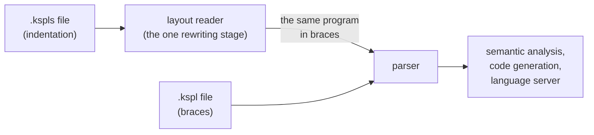

**The rewriting runs exactly once at each place a source enters**: from the disk and from the editor. The compiler holds that ("Every place a source enters reads it the same way" in [`../ksplc/docs/DESIGN.md`](../ksplc/docs/DESIGN.md)).

**Only the default extension is dropped from a logical name** (the rule is "9.1 import syntax and path resolution" in [`SPEC-language.md`](SPEC-language.md)). A logical name is a file's identity, so `a.kspl` and `a.kspls` in the same folder must not look like the same name. The default name carries nothing: a `.kspls` drops its extension, and a `.kspl` keeps it.

Caution: **Do not place two files that differ only in notation under the same name in the same folder.** An `import` without an extension looks for the indentation notation first, so one would silently be read as the other. Only the twins in [`../ksplc/tests/kspls/`](../ksplc/tests/kspls/) share a name, and they are pairs checked to be the same program.

**So an import that writes no extension asks for the default first and the other next, then names the file as found** (`name_as_found` in [`../ksplc/base/locate.kspls`](../ksplc/base/locate.kspls)). A file read under one name and spelled out again under another would cause a diagnostic pointing at a missing file. Its symbols would not be the ones it makes when built as an entry point. Writing the extension skips the asking, which costs one `stat` (a file-exists check) per import name.

**Which extension is dropped and which is added back are one decision, not two.** Wherever a logical name is written out again (a diagnostic, a `#line`, the language server's document URI), the default is added back. So dropping the other one would make each of them name a missing file. Both read `default_ext` in [`../ksplc/base/core.kspls`](../ksplc/base/core.kspls).

Note: `make test-kspls` watches that the twins are the same program, and that squiggles, hovers and jump-to-definition point at the indentation notation's lines.

### Formatting, and the round trip that holds the two notations to one program

`ksplc fmt` rewrites indentation from scratch, and a gate converts every file to the other notation and back, failing if one byte changes.

**Formatting erases raggedness.** `ksplc fmt` rebuilds indentation from the syntax tree. So once `make fmt` runs, unintended raggedness shows as a diff, lined up the way the compiler understood it.

Note: So the ragged column's test material (`../ksplc/tests/negative/laid_ragged_sibling.kspls`) sits where the formatting gate does not reach (`mk/lint.mk`). Formatting it would line the columns up and stop it being material.

**Formatting emits the same notation as its input**, so both notations sit inside the same formatting gate (`make fmt` / `make test-fmt-tree`; a *gate* is a check CI runs that can fail the build). How `--to` changes the notation, and why `--in-place` cannot write a changed one back, are in ksplc/docs/SPEC-tools.md §3.1. **Do not put only one of them in the gate**: the one left out becomes "a notation nobody formats", and each writer's habits stay in it.

**A round trip returns the bytes it was given.** `make test-kspls-trip` does this for every tracked source:

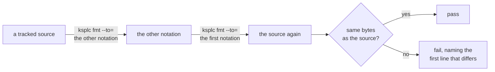

* **All sources go through**, since samples give no answer to "may this be widened" (Principle 8: a check that sees part is not a guarantee).
* **What is compared is the source itself**, not a second round trip. A reading that goes wrong settles to a fixed point as firmly as one that goes right.

**One thing the brace notation can write has no line in the indentation notation, and it is reported, not refused or moved.** It is a comment behind a `}` that the indentation notation leaves out. In `.kspls` that comment lands on another line, and it does not come back.

* **It is a lint** (`[I0801]`, in [`../ksplc/docs/SPEC-tools.md`](../ksplc/docs/SPEC-tools.md)) rather than an error, because where a comment stands changes nothing that runs.
* **The formatter does not move it.** In the brace notation that placing is the writer's own (`if c { n += 1; } // only when c`), and a new one would say something else.
* **The indentation notation gets no closing mark** for such a comment to stand behind, because that would give a block's end a second spelling (Principle 6).
* **The lint asks the formatter which comments it moves** (`note_displaced` in [`../ksplc/fmt/trivia.kspls`](../ksplc/fmt/trivia.kspls)), so the report and the conversion cannot disagree. The question costs a parse and a printing per file written in braces. It costs nothing for a file written by indentation, which never wrote a closing line.

**A comment behind a `}` that the indentation notation keeps stays where it stands**, since that `}` is typed in both notations. Only a `}` the reader put in passes its comment to the line before, because the reader puts one behind a line's code, never at a line's head (`pull_trailing_comment` in [`../ksplc/fmt/trivia.kspls`](../ksplc/fmt/trivia.kspls)).

Note: Static analysis (`make lint`) takes either notation, so `tools/` sits in this gate too.

**The editor extension holds no copy.** The colouring rules, brackets, auto-closing and comment notation are the same in both notations, so they point at the same file (the `.kspls` grammar merely imports `source.kspls`). Only the snippets differ in content, since braces and `;` disappearing is what this notation is. `make test-vscode` watches that their roster (`prefix`) agrees in both. The language ids are separate, and both are sent. The extension sends the language server only documents whose id it knows, so placing `.kspls` with no id would bring neither squiggles nor hovers.

---

## How the source text is written

**Nothing this chapter decides changes what a program does**, and a gate, not habit, holds each rule. The chapter covers names, keywords, line ends, long strings and documentation comments.

### A name's prefix is added only when the name cannot state its own origin

Write `io.out()` when `out` alone would be unclear, and plain `Arena` when the name already says what it is. Each name is written one way across the whole repository.

A prefix (the `io.` of `io.out()`) is **part of the name, showing at the use site**. Where the name alone says what the thing is, the prefix says it twice. Where it does not, fix the name, not the prefix.

**A name may enter the unprefixed space (selective import, `import "…" { Name }`; docs/SPEC-language.md §9) only if all three hold:**

| # | Condition | Passes | Fails |
| :-- | :-- | :-- | :-- |
| 1 | **Its spelling says what the thing is** | `Arena`, `Tensor`, `Option`, `Str_builder` | `Node`, `Val`, `Entry`, `Config`, `run`, `init`, `out` |
| 2 | **Its spelling is unique across the program** | — | A colliding name cannot enter, since a collision is always a compile error |
| 3 | **Its origin carries no design information** | A name from `ksplc/base/` or `std/`: where it comes from tells the reader nothing | A reference crossing layers (`ksplc/`'s `parse` / `sema` / `lower` / `gen`). Such a name enters with the layer in the name (`Sema_ctx`, `Genc_ctx`) |

**A name's spelling is fixed once per name, not per file.** `mod.Name` in one place and `Name` in another is one thing written two ways, which the chapter "One notation per purpose" forbids. Inside one file it looks like two things.

**No line can be drawn by kind.** Types and functions alike can be legible (`Arena`, `percent_decode`) or not (`Node`, and `run` or `init`, which many files declare), so the conditions apply to both.

**What is given up**:

* **An unprefixed name loses its origin at the use site.** The reader finds it on the file's `import` lines, where a selective import lists the names it brings.
* **A name legible unprefixed is redundant with a prefix** (`base_ast.Ast_node` says it twice), so each name goes one way.
* **Condition 2 breaks if the same spelling appears elsewhere**, and it breaks as a compile error, never as a silent pointer to something else.

### The spelling of reserved words is taken from C

Where a keyword does C's job, it uses C's word (`switch`, `for`, `typedef`), even when it behaves a little differently.

**Syntax doing C's job takes C's spelling** (`switch` branches, `for` repeats), not C's behavior. `switch` does not fall through (run on into the next case), and `for` covers C's `for` / `while` / `do-while` and sequence iteration in one word (`docs/SPEC-language.md`, 7.1 and 7.2). There are two reasons.

1. **The names left to a writer do not shrink.** In KSPL, C's reserved words (`int`, `goto` and so on) are usable as identifiers (`docs/SPEC-language.md`, 2.2). A keyword of KSPL's own would take one more word out of the names a writer may use. Taking C's spelling takes only words that are already reserved in C. `match` and `loop` are common nouns, needed exactly where one names a match's result, or a loop.
2. **The reader does not look it up again.** A reader of C reads `switch` and `for` on sight; a new spelling for the same meaning must be looked up once.

**Being one word and being spelled `for` are separate decisions.** The first follows from "every repetition serves the same purpose" (`docs/SPEC-language.md`, 7.2), with Go's single `for` as the precedent. The second is this section's rule.

**One word costs the checks nothing.** Whether a loop ever ends is read from its shape, not from a keyword: a `for` with no condition that no `break` leaves never ends. So a function may end on it, and what follows it is unreachable (`docs/SPEC-language.md`, 7.2). A separate word for the endless loop would give the checks nothing the shape does not, while the writer would have one more word to choose between. Where each `break` goes is settled once, when the compiler resolves the `break`. The missing-return check and the unreachable-code warning read that one judgement (`is_endless_loop` in `ksplc/base/ast_ext.kspls`), so they cannot disagree (Principle 6).

* **A constant `true` is a condition.** Reading `for true` as endless would make the check fold constants, and give one meaning two spellings. `for true` gets a warning instead, whose fix is the bare `for`.
* **The shape spares the writer a dead `return`.** If the loop were read as one that can end, a `return` that never runs would be demanded after it. Nothing would warn that it never runs, and loops would be bent into a flag and a `break` to avoid it.

**Another name for a type is `typedef`, name first** (`typedef Id = I32`; `docs/SPEC-language.md`, 3.5). The job is exactly C's: a KSPL typedef is only another name ([2.9](#a-typedef-is-only-another-name)), as C's `typedef` "does not introduce a new type, only a synonym" (C11, 6.7.8), and the C backend writes one for each. The order is not C's:

| | Where the new name stands | Example |
| :-- | :-- | :-- |
| C | Where a variable's name would stand in a declaration: last, or in the middle | `typedef int Id;`, `typedef int (*Op)(int);` |
| KSPL | First, as in Rust, Swift, Go and C++'s `using` | `typedef Id = I32` |

KSPL writes a type whole (`fn(x: I32): I32`), so C's order would only put the name behind it. Reason 1 holds as well: `alias` and `type` stay free for a writer, where Rust's `type` keyword costs every field called `type`.

**What is given up**: `typedef` reads as "define a type" and defines none, which C's standard itself must say. A reader from C takes it as meant. One who expects a new type finds the one-field struct in Appendix A of `docs/SPEC-language.md`. A C writer's `typedef I32 Id;`, and the other languages' spellings of an alias, fail with a note writing the line in KSPL's order (`append_typedef_spelling_hint` in `ksplc/parse/syntax_msg.kspls`).

Caution: **Where the spelling is the same but the behavior differs, the specification must say so by name.** The same spelling invites the reading "presumably the same", and silence lets that misreading through (`docs/SPEC-language.md`, 7.1 names that `switch` does not fall through).

### The line terminator is the file's spelling, not the program's

A file saved with Windows line ends (`\r\n`, CR LF) compiles to exactly the same program as one saved with `\n`, and the formatter keeps whichever the file used.

**Every `\r\n` becomes `\n` where the source enters** (`to_lf` in [`../ksplc/parse/source_fix.kspls`](../ksplc/parse/source_fix.kspls)). The BOM (an invisible marker some editors put at a file's start) and the shebang (a `#!` first line) are handled at the same place, since they too are the file's spelling. Why this matters: a `"""` text keeps its bytes, line terminators included. Otherwise one source would be two programs, one per way an editor ends a line, and no check would see it: both checkouts build, pass, and disagree. Every language with a multi-line literal fixes it at the same place.

**Writing it back is the other half.** `ksplc fmt` writes `\r\n` back where the file used it, as it does the BOM ("The formatting settings" in [`../ksplc/docs/SPEC-tools.md`](../ksplc/docs/SPEC-tools.md)). So a Windows checkout does not show every line as changed: the whole-file diff that Prettier's move to `endOfLine: "lf"` met.

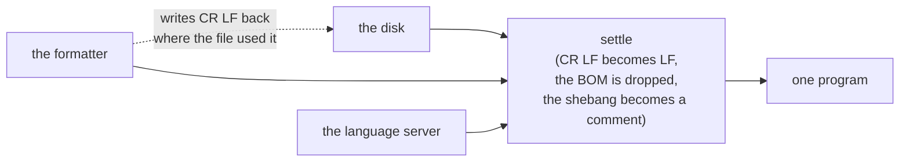

**Every place a source enters takes this step**: the disk, the formatter and the language server. A place that skips it answers about a different program from the one a compile sees. They share one step, `settle` in [`../ksplc/parse/source_fix.kspls`](../ksplc/parse/source_fix.kspls), so none can be skipped (the places are listed in "Every place a source enters reads it the same way" in [`../ksplc/docs/DESIGN.md`](../ksplc/docs/DESIGN.md)).

**What a program writes is the output half of the same question**, and on Windows it is decided for every program at its entry point ("Standard output carries the bytes a program writes").

### Carrying a long string literal across lines

End a line inside a string with `\` to continue the string on the next line. The `\`, the line break and the next line's indent add no bytes.

**A string literal is the one thing on a line a formatter cannot narrow by itself**, because its bytes are the program. Without a way to carry a string on, a formatter breaks everything else on the line and stops at the literal. Narrowing it then means splitting the call by hand into several `.s(…)`, changing code to fix layout. The width check misses it too, since it reads only lines that *begin* with `//`.

**A `\` at a line's end carries the text on, stands for no byte, and takes the next line's indent with it** ("Escape sequences" in [`SPEC-language.md`](SPEC-language.md)). So indenting the block moves no byte, and `ksplc fmt` can lay a literal out like anything else. What is carried on stands one step in from its opening line, as a `//<` run does. At the opener's column it would look like a line beginning something of its own.

```kspls
priv const help: U8[] = "usage: tool [options] <file>, \
    where options come before the file"
```

**A mark, not two literals side by side.** C, C++ and Python join adjacent literals (`"a" "b"` is `"ab"`), and clang-format, the one widely used formatter that narrows a literal, relies on that. But think of `U8[][2]::{ "a"` with the comma forgotten and `"b" }` below it. In KSPL that is a syntax error. With adjacent literals joined, it would be a one-element array that compiles. That is a daily exposure in a tree that writes `::{ "a", "b" }` in every test file, and a common complaint that lint rules are written against. Turning a refusal into a silent merge is the shape Principle 8 refuses. Exempting `::{ … }` would be a rule with a hole in it, needed every day.

**Nor is `+` the spare path.** `"one" + "two"` is refused with its own sentence (*slices have no arithmetic or ordering*). Reopening it for literals would give `+` one meaning on a literal and another on a value: the second means to one purpose that Principle 6 refuses.

**The space at the seam cannot be seen** (`"… for it. \` against `"… for it.\`, at the right margin). The answer: only the formatter writes a seam. One edited by hand is broken again elsewhere, and `make test-fmt-tree` shows the file as changed. A check on the seam would not answer it. Nothing tells a dropped space from a deliberate break inside a long word, so it would need an exemption, and an exemption is how a check stops saying anything.

**KSPL formats around what it cannot narrow rather than going quiet**, which is a common complaint against formatters. What stays over the width is what has no seam: a literal with no space (a URL, a JSON fixture, one long identifier), one whose only spaces are inside a `\{ … \}`, a word longer than the line (half a word is worse than a long line), and an overrun that is not a literal ("The formatting settings" in [`../ksplc/docs/SPEC-tools.md`](../ksplc/docs/SPEC-tools.md)).

**The formatter counts bytes and the width check counts display columns**, so a line holding CJK (Chinese, Japanese, Korean) text breaks early. That is safe, not exact: a character never takes more columns than bytes. One measure is kept, not two: the bytes `write_raw` in [`../ksplc/fmt/printer.kspls`](../ksplc/fmt/printer.kspls) counts.

### The documentation a declaration carries

A documentation comment starts with `//<` and stands on the line of what it describes, or just below it. An empty `//<` line separates a one-line summary from the details.

```kspls
priv struct Window //< a rectangle on the screen
    //<
    //< Its origin is the top-left corner, and every size is in pixels.
    width: I32 //< how wide it is
    height: I32 //< how tall it is
```

**One marker, `//<`, describes the thing on its own line, and a `//<` with no text separates the summary from the detail.** One marker spares the writer a question that does not matter to a reader: whether a sentence is about the line or about its contents. Where each kind of declaration takes it is "2.1 Comments" in [`SPEC-language.md`](SPEC-language.md). `Rule_prof` in `kspeg/engine.kspls` shows a summary with its detail below, and `Mode` in `ksplc/main.kspls` the anchor shape (an empty `//<` on the declaration's line, with the description below).

**The description sits behind the thing it describes**, so no name is written twice and no pair gets out of step: a renamed parameter takes its description along. Javadoc and Doxygen restate the name in a `@param x`. Behind rather than in front, because prose in front pushes the signature down, and the reader meets the description before the shape. That is why Python puts its docstring after the `def` line.

**A run stands one step in** from the line it continues. (A *run* is a description's lines of `//<` one after another.) At the declaration's column it would have the shape of a comment block over the *next* declaration, and only the mark would say which way it points. That is also why Python's docstring takes the body's indent. Where the declaration has braces, the run goes inside them, or a marker trait written `pub trait Move_only {}` would be described from outside. `make test-conventions` holds this.

**A `//<` with no text separates the summary from what follows.** That is Python's rule (PEP 257: a summary line, a blank line, the elaboration), and Rust and Swift take the first paragraph the same way. A first sentence cut at a `.` is not taken. Javadoc and Doxygen's `AUTOBRIEF` do that, and the cut lands at `e.g.`, at `Dr.` and inside version numbers. That is why Javadoc also offers `{@summary}` to mark the summary explicitly.

**The summary is one line that says what the thing is.** It is what the hover, the completion list and `ksplc doc` open with, and a run with no separator carries all of itself there. Such a run would also slip past the six-line cap, which counts only what stands past the separator. The compiler warns about a longer summary (`[W0213]`, in [`../ksplc/docs/SPEC-tools.md`](../ksplc/docs/SPEC-tools.md)), asked of the same reader the hover walks. One line rather than one sentence cut at a `.`, for the reason above; Go's doc comments and PEP 257 open with one line too.

**Where the head closes on a later line, the run hangs off that line.** The opening line belongs to the parameters below it, and a run there would read as the last parameter's.

**A description longer than one line stands below a mark with no text.** Begun behind the declaration, it would start wherever the declaration ends and wrap to the run's column, ragged, and reflow on every rename. One that fits stays on the line, since the anchor spends a line saying nothing. Length decides the shape, not preference, so it is one rule and not two spellings. `ksplc fmt` moves a description that does not fit into the anchor shape, and never the reverse, since the anchor is also how a writer groups a run about to grow ("The formatting settings" in [`../ksplc/docs/SPEC-tools.md`](../ksplc/docs/SPEC-tools.md)).

**The width asked is the brace notation's in both notations**, so a round trip cannot give one program two shapes ("The formatting settings" in [`../ksplc/docs/SPEC-tools.md`](../ksplc/docs/SPEC-tools.md)). One program has one shape, at the cost of a few lines that carry their description below where their own width would have kept it.

**The run is joined onto one line**, since the record (the published API file, "The published API is recorded in the repository") holds one entry per line. The record's fourth column and the hover read the same words whichever shape the source has. Where the summary meets the rest, a full stop is put in, since a `//<` is written as a fragment. None is put in after a summary that already closes a sentence, looking past a closing backtick, bracket, quote or bold mark. Inside a run none is added: its lines are one paragraph wrapped.

**A continuation that continues nothing, and an anchor with nothing under it, are refused.** The first writes a sentence that reaches neither the hover nor the record. The second publishes an entry saying nothing. Whoever wrote either believes it took effect, the state Principle 5 refuses. Both are compiler warnings, not convention checks (`[W0209]` and `[W0210]` in [`../ksplc/docs/SPEC-tools.md`](../ksplc/docs/SPEC-tools.md)), so they reach the editor they were written in and can be set per file. The refusal asks "does this continue something" of the same function the reader uses, so the two cannot drift apart (Principle 4).

**No third marker is added for a description below the code.** Haddock's `-- ^` means "the code above me". Written the wrong way round, it attaches the description to the neighbouring field, and nothing reports it (Principle 8).

**`///` is refused rather than read, and `//<` is not respelled `///` either.** Every product with `///` points it at the thing *after* it. So a writer or a model from Rust, Swift, C# or Zig types it first, before the declaration.

| If `///` were… | What would happen |
| :-- | :-- |
| Read as describing the contents | A field's sentence would become the enclosing type's |
| Read as nothing | A function's sentence would vanish |
| Given the meaning of `//<` | The fault only moves: the same spelling with the opposite direction is the misreading the caution in "The spelling of reserved words is taken from C" names, and a `///` above a declaration would continue the one before it |

In each case nobody is told (Principle 5). So `///` is a compiler warning (`[W0212]`). So is `//!`, Rust's and Zig's mark for the enclosing thing, which such a writer puts at a file's head. Four slashes or more make an ordinary comment, as in Rust.

**Three things hold this up, none of them new grammar.**

* **`//<` is an ordinary line comment**, so editors, `grep` and every existing tool keep working on it.
* **`fmt` keeps the shape.** A signature broken one parameter per line stays broken, the trailing comma deciding it (black's magic trailing comma). Decided on width alone, the shape is lost on the next run, which is what a marker behind each parameter meets in practice.
* **One reader serves four consumers.** The record (`ksplc --emit-surface`'s fourth column), a library's interface (`--library=`), the hover and the completion list all read `ksplc/base/ast_doc.kspls` (Principle 6). The summary crosses the artefact boundary, so a caller holding only a library's header still gets it in its editor.

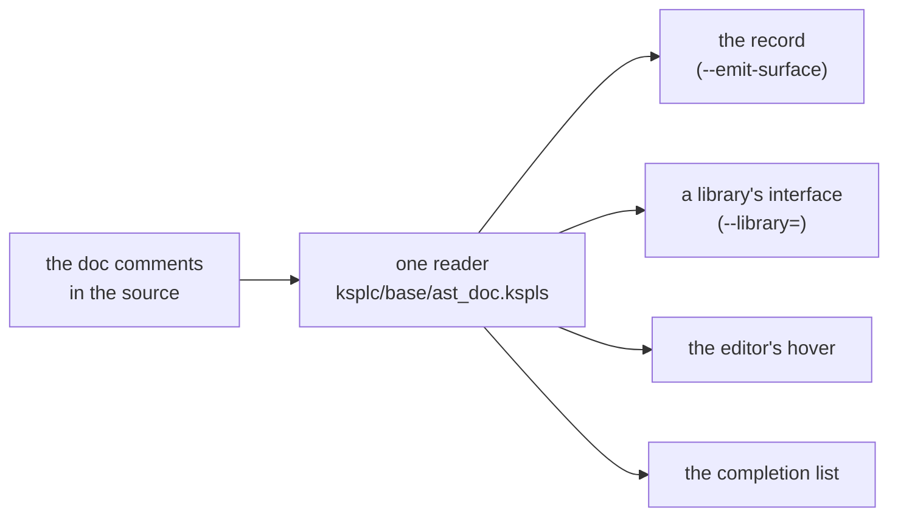

**Every published entry says what it is.** A record where every entry is silent still matches its API, so the drift check cannot see it. `make test-surface` names each entry with no fourth column.

Caution: **Count against the current shape, not against the record.** The record is what was committed. A declaration added and published in the same round would be judged against a row not there yet, and the entry that most needs a sentence is the one let through.

**The detail does not travel to a declaration file**, which holds headings, not contents. It carries the run's first paragraph and stops at the separator. A run with no separator publishes the lot, and what keeps a detail in its place is the six-line cap on what stands past the separator, which `make test-conventions` counts. Nor does a parameter's description reach the record: a parameter is not an entry, so its description is for the source and the editor to show. The return value's description stands in the same place, read by `return_doc` beside `param_docs`.

**Do not add a third marker for "the file as a whole".** It would be a second means to one end (Principle 6), which Rust's `//!` pays for with two rules the reader must hold apart. So a file says what it is with the same `//<`, opening the file above its imports, with nothing over it but blank lines. A banner over the run pushes what the file is for off the screen, and `make test-conventions` refuses that order.

**The run takes what a *caller* needs, and the banner below it keeps what an *editor* needs.**

| Who reads | What they need | Where it goes |
| :-- | :-- | :-- |
| A caller | What is in here, what it costs, what it refuses | The `//<` run |
| Someone editing the file | Which import must not be added, which shape must not be folded into a generic, where the substance is delegated; any table or worked example | The banner (ordinary comments) below the run, since the run is joined into one line |

The run does not restate the file's name. `ksplc doc` titles the file's reference with it, and shows it beside the summary in the package's listing. Prose repeating it says it twice, and goes stale on a rename with nothing to catch it.

### A function of one enum is its method

A function that takes an enum of the same file as its first parameter is written as that enum's method, so you call `state.text()`, not `state_text(state)`.

**A function whose first parameter is an enum declared in the same file stands in that enum's `impl`, taking `Self`.** It is called from the value (`state.text()`, `a.same_role(b)`). What an enum does is found where the enum is, the name need not repeat the type (as 11.1 asks of any name), and the call reads in the order the value flows.

**An enum of another file or package is left out.** Its `impl` would hold another package's reading of it (kspage's readers of std's `json.Val` stay in kspage), against the reference direction ("What crosses a package boundary", the chapter "What crosses a package boundary" of this document).

**The language allows both shapes; this is the repository's rule for its own sources.** `make test-conventions` checks it (`check_enum_functions` in [`../tests/support/conventions_spell.kspls`](../tests/support/conventions_spell.kspls)), leaving out fixtures whose text a test compiles. It reads one line at a time, so a signature it does not recognize still breaks the rule (Principle 8).

---

## Documents

**What a document is for, and whom it is for, are decided before it is opened**: by its name, and, for a document belonging to no package, by its row in `docs/README.md`. What it may hold *of the source* is a separate question, since there the code is the canonical source (the single place a fact lives) and the document only points at it.

### A document's name says what it is for

The six kinds, what each holds, and how a document is named are "Document naming" in [`SPEC-documents.md`](SPEC-documents.md). This section holds why.

**A reader opens a document in one of a few modes**: arriving, learning, carrying out a task, looking a rule up, understanding why, or seeing what is left. The reader needs to know which before opening it. Readers do not complain where the mode is in the name, and do where it cannot be told. So the kinds are a closed set of six, and the kind is the file's name. A folder's listing is then its reading order, with nothing to learn first.

**One of the kinds is Kanso's own, and it keeps something out of `DESIGN.md`.** A `PLAN.md` holds what is left to do. A plan changes with every step taken, and a rationale only when a decision changes. Inside the slower document, a plan reads as done: a common complaint about "future work" sections.

**There is one plan per package**, so a package copied out on its own takes what is left of it along. What is given up is every package's stages on one page; the table in [`PLAN.md`](PLAN.md) routes to each.

**What is done is deleted from the plan, not marked**, so the plan is never read against the code. What is given up is one list of what was achieved; that list is `git log`'s.

**"One file, one kind" is a judgment, gated only where a count decides it** ("Document naming" in [`SPEC-documents.md`](SPEC-documents.md)). Whether a paragraph of why belongs in a how-to is a person's call. Policing it page by page is a common complaint, and Principle 8 names the rest as the gap it is.

**The grounds are edited in place, not appended**, so the reader reads the current state rather than replaying records. A log of decisions (a common alternative) carries each one's state in a status field. Here the kind carries it: what is not done stands in a `PLAN.md`, and what stands is the `DESIGN.md`'s. What is given up is the path to that state inside the document; it is git's.

**A package's entry point is its own `README.md`, and the root one is the front door.** One README holding every package would cost every reader a page nobody reads through, a common complaint about front pages. A seam between packages gets its own document ([`SPEC-local-server.md`](SPEC-local-server.md) is one, and "A page asks the local machine through one protocol" below holds why). So the root `README.md` holds what Kanso is, how far it works, one way to start, and where everything is. What is given up is the one-file search: a reader who does not know which package holds a thing reads the layout table first.

**A README's headings come from one skeleton** ("What every README contains" in [`SPEC-documents.md`](SPEC-documents.md)). So a reader who knows one package's README finds the same part under the same heading in the next. The skeleton is offered rather than required. Otherwise a folder with no common change or no trap would grow an empty section, which sends the reader looking for something that is not there.

**The kind carries the reader, so no second axis is added.** Inside a package the folder is the subject, so the kind answers who reads: a `SPEC-` is for whoever relies on the subject from outside, a `DESIGN.md` for whoever changes it. The documents that belong to no package share no subject, so their entry point's table names the reader ("Who reads a document is said by a column, not a folder" below).

* **The reader is not marked per file.** A document honestly serving two readers would need one label, and the argument moves to which one: the standing complaint against documentation cut by persona (an imagined type of reader).
* **The kind makes one misplacement visible**: facts about something outside Kanso in a document for whoever changes Kanso. A board's pin table belongs in [`../ksos/docs/SPEC-board.md`](../ksos/docs/SPEC-board.md), not in ksos's rationale.

**What the reader must already have is said where the kind cannot say it**: in a `HOWTO-`'s first sentence, and in a column of a README's table only where the documents differ ("Document naming" in [`SPEC-documents.md`](SPEC-documents.md)). The reader needs a checklist (a terminal, a toolchain, a car on the desk), not a persona. A column answering the same all the way down is noise the reader learns to skip. The check reaches the name, not the row: which documents earn a row is the "one file, one kind" judgment.

**A document gets no line cap.** A specification is as long as its subject, and is looked up rather than read through. The two kinds read through are bounded by what they are: a `README.md` routes and explains nothing, and a `TOUR.md` is one program. A cap would be a number with no grounds behind it and no gate under it (Principle 8).

### Who reads a document is said by a column, not a folder

The shared documents all sit flat in `docs/`. The table in `docs/README.md` has a column saying who each one is for; there are no folders per kind of reader.

**The documents that belong to no package sit directly in `docs/`, with no folder inside it, the shape of every package's `docs/`** ("Where documents sit" in [`SPEC-documents.md`](SPEC-documents.md)). Whom each is for is the last column of the table in `docs/README.md`, the one place that question is answered.

**The column says what a folder cannot.**

* **It names two readers where a document honestly serves two.** The project how-to is for whoever writes KSPL, and its last section for whoever wants a document to open from the file manager.
* **It names what the reader must already have** (a C compiler for the build how-to).

A folder picks one reader and says no more. Folders cut by reader beside the column would answer one question twice, kept in step by hand (Principle 6).

**The column names the reader, not the subject.** A subject splits again once one document covers two, and then nothing decides where it belongs; a reader does not split. Other products put the reader in a title or a hostname, and both must be learnt.

**No folder needs an exception.** GitHub finds `CONTRIBUTING.md` and `SECURITY.md` in `docs/` ("Documents whose name is fixed from outside" in [`SPEC-documents.md`](SPEC-documents.md)). So they stand where every other document does, and the language specification and this document cite each other by bare name.

**What it gives up is the reader's name in the path.** A link to `docs/DESIGN.md` says what the document is, not whom it is for, and a reader who does not know the kinds finds that in `docs/README.md`. The products praised for keeping readers apart pay with two places to keep in step. Where both share one folder, a common complaint is documents with no status and a catch-all group. Here every name carries its kind from a closed set, and every document says only how things stand now. So the two are told apart before either is opened, and nothing is left over.

**The rules for the documents are a document of their own.** A document that routes cannot also be canonical for a rule. So `docs/README.md` routes, and the rules are [`SPEC-documents.md`](SPEC-documents.md), held up by `make test-docref` and `make test-conventions`.

### Linking a design document to the source (no round trip)

A document names the code it talks about (a file, a function), and a check fails when that name disappears. The document never copies code, and the code never points back at the document.

**The source is the one canonical source, a document points only toward it, and a check fails a divergence** (the rules are "Linking documents to source" in [`SPEC-documents.md`](SPEC-documents.md)). A design document only points; it never copies code. A deleted or renamed name is visible only through a check.

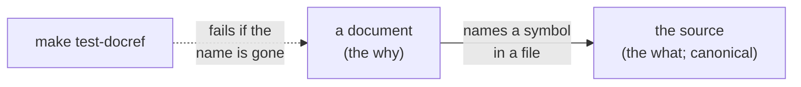

**How far a machine can guard decides what each part holds.**

| What | Who can guard it | So it holds |
| :-- | :-- | :-- |
| Names (symbols, files, headings) | A machine | Links from the document to the source |
| Examples | A run (compiling and running them) | Running examples, by pointing at tests |
| Prose | Only a person | The why; the what is a pointer to the source |

**The word "round trip" is kept out of this design.** Under a tool that synchronizes both ways, the model and the code drift apart. The diagram goes stale once writing begins, and then stops being trusted. That is what UML's CASE tools and model-driven development (tools that generate code from diagrams and back) lost, and it follows from Principle 6. Do not mix the document and the source into one file either. The mixed forms (literate programming, notebooks) lose every other tool: line numbers shift, diffs become unreadable, debuggers and `grep` stop working. The name links the two, not the container.

**There are only two ways of linking.**

| Way of linking | What it holds | Who is canonical |
| :-- | :-- | :-- |
| **A link** | Which symbol in which file, by name | The source |
| **Generation from a table** | The table holds the values, and the notation is generated | The table |

**A document does not show the source's text.** Copied in, it goes stale where nobody can see it. Read afresh at every display, it needs the document's editor to read and cut source, which is the work of a code editor, not of a document (the editor and the language server already show it). Generation is kept to where a table is canonical, such as the list of diagnostic codes. It is never general-purpose code generation (what model-driven development lost). Always place a check on the generated artifact's freshness beside it, or a hand edit to the artifact silently vanishes at the next generation.

#### No marker is added per symbol

**No attribute or directive tying a symbol to a design document is attached to the symbol.**

* **It is derivable.** The document names the symbol, so a check can assemble the reverse index, and one fact written in two places is what Principle 6 forbids.
* **There would be many**, and a marker per symbol becomes decoration the source's reader skips every time.
* **It breaks weakly.** A forgotten marker is lost quietly, while a link in the document fails a check the moment its target disappears.

**Visibility already says which symbols a design document shows**: `pub` marks them, so no marker says it again.

#### A running example is obtained by pointing at a test

**A document shows a running example by pointing at a function in a test**, because an example copied into a document goes stale. Rust's doctest and Python's `doctest` are strong because when the code changes the document breaks, and when the document breaks the build fails. A test function pointed at by name has that property without a test notation in the language, and is the very thing CI runs every time.

**An explanatory fragment, its surrounding context left out, is written in the document**, and `make test-docsnippet` compiles it. Do not mix the two: whether a piece runs on its own decides which side it is on.

**Every block is compiled, and a line meant to be refused says so on that line.** A whole program must compile and pass the lint gate. A line ending in `// error` must draw an error, alone and with the others, and nothing else may (the marks are "A code block compiles, or says why not" in [`SPEC-documents.md`](SPEC-documents.md)).

| | Rust's doctest | KSPL's documents |
| :-- | :-- | :-- |
| Where the "expected to fail" mark sits | On the whole block (`compile_fail`, naming the error's code at most), so an error on another line than the one meant still passes | On the line it is about, as a comment |
| A block left unchecked | `ignore` lets a block rot unread | A block that excuses itself (an elision, a file needed beside it) says so where the reader sees it, and one that compiles anyway fails |
| Visible on the rendered page? | No: the mark sits in the fence's info string, which a page rendered from Markdown does not show | Yes: a reader of the raw text or the page learns which line is refused, and the check learns which line must be |

**What compiling every block gives up**: a fragment that leans on the prose is not compiled to any verdict, since only the prose holds what it leans on. So a fragment that carries a mark carries its context too, a few lines longer than an illustration needs.

**What linking this way gives up**:

* **Code cannot be fixed from the design document**; the source is rewritten instead.
* **Renaming a symbol fails the document**, and each rename needs a hand edit in the document. That is also the point: a pointer made not to fail loses its target with nobody noticing.

#### A comment that points is checked as a document is

**A comment naming a symbol in another file is read by the same check as a document's link, with no mark of its own.** A stale pointer where the code's reader stands costs what a stale link costs. Other tools check a pointer only when it is a marked link, and leave a plain name in backquotes unread. A mark would be a second way to write one pointer (Principle 6), and the unmarked one is what goes stale. So the spelling a pointer takes anyway, `` `name` in `file` ``, is the one read. The member is read as well as the owner. A method moved to another file leaves its type named in the old one, and a check reading the owner alone stays green on a pointer that leads nowhere.

**A pointer that names no file is read through the commenting file's own scope.** In the packages' `//<` lines, `` `Owner.member` `` is the more common spelling, and only the compiler holds the scope it relies on. So the compiler reads it as the code beside the comment would, and a missing member is a warning in the editor as it is typed (`[W0211]` in [`../ksplc/docs/SPEC-tools.md`](../ksplc/docs/SPEC-tools.md)). The same reader turns the name into a link in the hover and the completion list, so a name is never linked in one place and called stale in another. The API pages link it to the entry carrying it.

**Each spelling has one reader.**

| Spelling | Who reads it |
| :-- | :-- |
| A name tied to its file (`` `name` in `file` ``) | The document check. It is the way to point at a method added by a file outside the compilation |
| A name naming no file, in a comment | The compiler |
| A name naming no file, in a document | The document check, which has no scope, so it reads the name against every declaration of the tree |
| A name introduced as another product's ("Python's `` `json.dumps` ``") | Nobody |

KSPL has no mark to tell a pointer from a plain name in backquotes (above), so the wording tells them apart.

**What is given up**: the check reads literal text, so a pointer worded another way escapes it. That form is still a violation (Principle 8), as "Linking documents to source" in [`SPEC-documents.md`](SPEC-documents.md) says. And the scope is the compilation's, so the editor's single document can call stale a method that only a file it does not import adds. The pointer naming its file answers that.

### The reader may be a model

**An agent works on this repository, and a model writes KSPL for whoever asked it to; both read what is written here.** What a model lacks decides what they need.

| What a model lacks | What that requires |
| :-- | :-- |
| **It cannot ask.** | What it needs is written down, or can be had from a command, never held in someone's head |
| **KSPL is in no model's training.** | A model falls back on the habits of Rust, Swift and C. So what KSPL leaves out, and what to write instead, has to stand where a model reads it |
| **Its context is short, and costs.** | One precise piece on request beats a document read whole: `ksplc explain <code>` prints one diagnostic's section ("An explanation is printed from the specification, and only a code has one" in [`../ksplc/docs/DESIGN.md`](../ksplc/docs/DESIGN.md)). An instruction file carries only what cannot be read from the code, as the one measurement of such files found |
| **It believes what it reads.** | A stale pointer or a copied fact misleads it with confidence. So what it reads is generated from the canonical source and held by a check: Principle 4's rule, with less forgiveness |

**A document that restates a canonical source loses value**, since a model restates on demand and the copy goes stale. One that holds what no source holds gains value: a decision and its grounds, a rule, a comparison with its complaints. A model can neither infer that nor make it up correctly. So no second, hand-written copy of a document is made "for AI"; where a model needs another shape, it is generated from the same source.

#### No file for models

**No file for models is kept** (`llms.txt`, `llms-full.txt`: a convention for one file a model reads first). What one would hold already has a canonical source a model can read:

* what KSPL leaves out (Appendix A of [`SPEC-language.md`](SPEC-language.md));
* the tour ([`TOUR.md`](TOUR.md));
* the grammar, the API pages, and each diagnostic's section (`ksplc explain <code>`).

So the file would only repeat them, in two files if both the convention and GitHub's rendering are to find it. An agent working on this repository reads those sources whole.

**What is given up**: one file to give a model that cannot read the repository. Such a model is given the specification and the tour instead.

### The tour is a program, one declaration per step

**The tour is one program, and each step is one of its declarations with its `//<` comment, in an order chosen for teaching.** How the page is written and checked is the head of [`TOUR.md`](TOUR.md); this section holds why.

**The motive is a tour that cannot drift.** A tour is the one document a newcomer reads before they can tell that it is wrong, and a tour kept by hand drifts as far as its team is small. Checking only the code examples leaves the prose between them to go stale. Generated from a program the gates compile and run in both notations, the code and the words that explain it sit in one file and are checked together.

**A generated page still needs an order chosen for the learner.** A page generated from source tends to follow the features' own order and to read as a reference. So the program's declarations stand in teaching order, smallest first, each one idea small enough to hold in your head, with the code of the step beside its prose.

**The page ends by naming where to go next.** A common complaint about tutorials is their end, where a reader who has finished does not know what to read. The brace notation is shown on one step, not the whole program twice. The two notations are one language, so one step in the other spelling shows the difference, and the whole program in braces is one link away.

**What it gives up**:

* **A step can teach only what one declaration of a running program shows.** What needs a program of its own, such as splitting a program over files, belongs to the project how-to ([`HOWTO-set-up-a-project.md`](HOWTO-set-up-a-project.md)).
* **A step's prose is a comment, held to a comment's limit** (Principle 7). A step that needs more is split into two declarations, or points at the specification.

---

## What crosses a package boundary

**A package's promise to whoever is outside it is exactly its `pub` names.** (A *package* is one top-level folder such as `std/` or `ksdb/`, and `pub` marks a name visible to everyone.) This chapter covers where tests go, how the published API is recorded, how outside code is brought in, and how a package is found.

### A test inspecting the inside of a unit goes inside that unit

A test that looks at a package's private parts lives in that package's own `tests/` folder. Then it can see those parts without making them `pub`.

**A test inspecting the inside of a unit goes into a `tests/` under that unit.** (A *unit* here is a package: the extent a name with no visibility mark is visible in.) There it is the same unit, so it reaches what it inspects with unspecified visibility, without one `pub`. It also stays out of the shipped artifact, since a file nobody imports is not compiled. The language needs no change: `package_of` in `ksplc/base/locate.kspls` takes a file's unit from the first separator of its logical path, so `kspage/tests/flow_test.kspls` is in unit `kspage`. From the root's `tests/`, a package of its own, the same test would need its target `pub`, and nothing would tell that `pub` from an unnecessary one. [I0402] (the lint for an unneeded `pub`) sees only the references in one compilation, and the entry point that builds the product uses nothing in `tests/`.

| The test | Where it goes | Why |
| :-- | :-- | :-- |
| Inspects the inside of one package | `<package>/tests/` | Same unit, so no `pub` is needed |
| Looks at two packages | The `tests/` of the one that imports the other | The other way would add an import direction that is not allowed |
| Inspects the compiler's answers | `ksplc/tests/`, importing nothing from `ksplc/` | It drives the built compiler as a child process |
| Stands on what walks the repository or builds a child process | The root `tests/` | It uses things from outside every unit |

**A test looking at two packages goes to the one that imports the other.** A randomness test of both `std/prng` and `ksai/sampler` in `std/tests/` would make std depend on ksai, a direction `make test-docref` does not allow. So the part choosing the next word sits in `ksai/tests/sampler_test.kspls`.

**`ksplc/tests/` imports nothing from `ksplc/`.** It inspects the answers the compiler produced, from inside a program the compiler built, through a suite under `ksplc/tests/suite/`. That suite runs the compiler this folder builds as a child process, and another `ksplc` runs the suite. A test of an internal function would go there, but then the whole compiler enters that executable. Measure `make debug`'s translation time before adding one.

**What is used from outside a unit stays in `tests/`: such tests, the gates, and their materials.** That is Rust's line between unit and integration tests, and Go's between `package foo` and `package foo_test`. What stays is the tests that stand on what walks the repository root and git (`tests/support/harness.kspls`), and on what starts a child process to build (`harness_build.kspls`). Those tools must not be moved into `std/` ("What tests share stands in std" below). Other large trees divide on the same line, LLVM's top-level `cross-project-tests/` among them.

**Do not bring in what the destination does not depend on.** A test that does leaks into the distributed unit, which is why Rust keeps `core`'s tests outside `core`. Here that would be a moved test using what its package does not depend on, which `make test-docref`'s direction check watches.

#### Where the entry points are

**Every package has its own `tests/`, and `tests/debug/parts.kspls`, the one place that knows how to call them, only calls each entry point in turn.** So no copied call keeps an old argument shape.

* **make checks the two agree.** The `$(error)` in `mk/test.mk` stops make at start when a package's `tests/all` and the forms in `tests/debug/pkg/` diverge.
* **One package or all.** `make debug-<name>` runs one package where `make debug` runs all. That gives a shorter wait for the first answer, not less to confirm: what to run before pushing is `make ci-linux`.
* **A package with its own `Makefile` has a second door**, its `<package>/tests/main.kspls`. It passes its own compiler where a run takes one (`run_std(ksplc, arena)`). The parameter types hold both doors to one shape, and both are compiled on every round (`make debug` and `make test-extract`).
* **`ksbind` has the second door alone**: its tests link libraries from outside the toolchain, which `make debug` must not need.

**Each package's entry point is `<package>/tests/all.kspls`, and its opening comment says what the package's tests inspect.**

**The remaining boundary is closed by opening exactly one entry point as `pub`**: one function that runs everything, like `run_kspage` in `kspage/tests/all.kspls`.

* **Do not add inspection interfaces here.** Each is one more contract put outside the unit.

#### Where an unneeded `pub` is reported

**[I0402] can be enabled for `kspage/`, `ksos/` and `tools/` as well as `ksplc/` and `kssrv/`, but not for the units distributed and used elsewhere (`std/`, `ksdb/`, `ksai/`, `ksbind/`).** Their `pub` is a contract with outside users that references inside the repository cannot judge. So keeping to one entry point there is a matter of form, and adding more brings no diagnostic. Read the header of `all.kspls` before adding.

**The diagnostic is turned off in exactly one place**, `##lint(I0402 = off)` in `tools/ai_assist/ksplc_oracle.kspls`. Its `compiles` is a `pub` that `tests/debug/parts.kspls` uses in form 2 of "Where the entry points are" above, invisible from the entry point building the tool. Closed to one file, it leaves the unit's other `pub` count at zero.

**Inside `tests/` itself it is the reverse.** No package imports that leaf (the bottom layer, which only points upward), so a `pub` there has no user outside the unit, and its tests reach each other with unspecified visibility, being one unit. So the diagnostic can be enabled there too (`tests/ksplc.cfg`). A `pub` inside the materials is not reported: the forms in `negative/` and `lint/`, and those held in `"""…"""` inside a test. They are written to make a visibility diagnostic fire.

**In `ksos/demo/`, only part of a unit is an entry point, and a `pub` there has no user outside the unit either.** But the diagnostic cannot apply to the demo alone. The configuration is found from the entry point's file. So turning it on for the demo also reports the `pub` names of the kernel and the drivers in the same build, and those stay ("The guidance for adding an API or an implementation" in [`../ksos/docs/DESIGN.md`](../ksos/docs/DESIGN.md)). `make test-conventions` checks the demo's text instead.

### The published API is recorded in the repository

Each package's public API is listed in a text file in the repository (`SURFACE.txt`). A gate fails when the code and the list disagree, so a change to the API always shows up in a diff.

**A package's published API is one text file, committed to the repository, and a gate cuts off its drift** (`ksplc --emit-surface`, regenerated by `make surface`, with `make test-surface` rejecting drift; "Writing out the published API" in [`../ksplc/docs/SPEC-tools.md`](../ksplc/docs/SPEC-tools.md)). Without it, deleting a `pub` whose user lives in another repository keeps this build green, with no record of what changed. Being comparable by a tool and being recorded under version control are different things. Without the record, the only thing to compare against is whoever still has the previous version.

**How other tools do it**:

| Tool | Its shape | What KSPL takes |
| :-- | :-- | :-- |
| Rust's `cargo-public-api` | Keeps the record in the repository for review; its diff carries auto-derives and blanket impls | The record in the repository. Derived items stay out from the start: what counts as API is the declarations actually written, with no instantiated body |
| Swift | The toolchain itself emits the record, since a separate analyzer would drift with nobody noticing; it needs the whole SDK | The toolchain emits it, and one entry-point file suffices |

**Do not merge the record with a library's interface** (`--library=`). It looks like Principle 6, but the purposes differ:

| | The interface (`--library=`) | The record (`--emit-surface`) |
| :-- | :-- | :-- |
| What it holds | Only the `#export` functions, spelled in C | Every `pub` declaration as written |
| Which build | One build | Every `#cfg` branch included |

Made from the interface, the record would lose the API a KSPL caller reads from the source, and another build's branches.

### Outside parts are not fetched; only their location is stated

KSPL has no package manager. To use someone else's code, you copy it onto your machine and tell the compiler where it is.

**There is no package manager, only a way to state where a part is** (`--pkg-src-dir=` and the environment variable `KSPLC_PKG_SRC_DIR`). The resolution order, and the rule that a local copy wins, are "The source of a package other than `std`" in [`../ksplc/docs/SPEC-tools.md`](../ksplc/docs/SPEC-tools.md). Nothing is fetched, no versions are solved, and nothing runs at import time.

**The motive**: a part requested by name becomes, the moment it is requested, someone else's code that nobody has read. Fetching brings four questions, and none of them is visible to whoever requested it:

1. Where did it come from?
2. Which version is it?
3. What comes along with it?
4. What runs at import time?

Kanso holds no hidden work at build time, any more than at run time.

**Common complaints are about code running at import time and dependencies that bring in dependencies.** Where a manifest (the file listing dependencies) is language code, solving dependencies means building and running it. Other common complaints are that one part brings hundreds along, and that a registry has no namespaces. Elsewhere the tooling does not agree on one shape. Nor is this C/C++'s shape, where no standard is set and many tools each answer the question. The interface is narrowed to the single `--pkg-src-dir=`, and only fetching is absent.

**What it gives up**:

* **Someone else's part is brought over by hand**, and which version was brought is yours to note. An update goes unnoticed unless you look for it.
* **A dependency's own dependencies are followed by hand.**
* **Fewer parts are available than anywhere else.** That is the price of taking on neither dependency resolution nor the risks outside parts bring in.

**What was brought over can still be read.** A part shipping a `SURFACE.txt` shows what disappeared when matched against the previous version ("The published API is recorded in the repository" above). This is revisited when KSPL packages that people want by name appear outside this repository, not because nobody has built a fetcher. Until then a fetcher would have nowhere to fetch from.

### A package names itself, and names what it uses

A package says its own name, and the packages it imports, in its `ksplc.cfg` file. So it builds from any folder, under any folder name.

**A package's name is the package's to state, and its place is the environment's.** It names itself in its top folder's `ksplc.cfg` (`[package]`, `name = ksdb`). It lists under `uses` what it imports besides itself and `std`. Its files and its `embed`s (files baked into the program) are read from that folder, wherever it stands and whatever it is called. A used package's place is told as any place is ("Outside parts are not fetched; only their location is stated" above; the rule is "9.1 import syntax and path resolution" in [`SPEC-language.md`](SPEC-language.md)).

**The motive**: a package found as a folder of its name, under the folder the compiler runs in, compiles only from the repository's root. From its own folder, its import of itself is looked for one level too deep, and a copy under another name cannot build. So whether a package can be lifted out is answered only by trying. Common complaints are about cases where the place decides: imports that resolve by how the program was started, a fixed workspace folder, module paths that name a location. A name with no place in it causes none of them: nothing in `ksdb/log` says where ksdb stands.

**Naming what it uses lets a reach be refused where it is made.** An import past the list is a compile error at the `import`. It is caught here, where every package happens to be present, rather than in a copy where it is not.

**What it gives up**:

* A package that names itself says so in one more file, and a new dependency is written twice, in the `import` and in `uses`.
* **A used package is still found as a folder of its name**, locally or under `--pkg-src-dir`. Only the package being worked on is freed from its folder's name.

### The standard library reaches only itself

A file in `std/` may import only other `std/` files, and never with a `..` path.

**A file of `std` names only `std`'s files, and a name under `std/` holds no `..`.** Either reach out of it is refused at the line that writes it ("9.1 import syntax and path resolution" in [`SPEC-language.md`](SPEC-language.md)).

**The motive**: `std` is found by its place, not by a name, so no `uses` list ("A package names itself, and names what it uses" above) holds it. Without the rule, a `std` file importing another package would compile clean. It would show up only as a "not found" pointing at `std`, from inside another package's copy. `std/../x` would let a file from outside be read as `std`'s, into its unit of visibility and its linkage.

**Why a rule and not a name**: naming `std` would state a second time what its place already states, and the two could disagree. The list it would carry is always empty. A list in a settings file can be widened by editing it, where a rule of the language cannot. Go and Rust name `std` in a manifest because their build tools build it as one more module. KSPL's compiler never builds `std` through the package path.

**Nor does `std` bind a C library from outside the toolchain.** It is plain KSPL over the runtime every program carries, so it builds anywhere with nothing installed. A binding to an outside library, such as OpenSSL or SQLite, stands in its own package, `ksbind` (why is [`../ksbind/docs/DESIGN.md`](../ksbind/docs/DESIGN.md)).

**What it gives up**: a `std` passed with `--std-dir` cannot import the user's packages. One that did would have to travel with every compiler, making it part of the standard library in all but name.

### What tests share stands in std

The general test helpers (run checks, compare a child program's output, make a scratch folder) are part of `std`. Only the helpers that know this repository stay in the root `tests/`.

**The part of a test harness that knows no repository stands in `std`, and the part that knows one stays in that repository's `tests/`.**

| Part | Where | What it does |
| :-- | :-- | :-- |
| `std/verdict` | `std` | Runs checks on past a failure, with their lines and a closing `RESULT:` line. Reads a child process's run as a check: its exit code and outputs as one text, for one child or several side by side |
| `std/fs` | `std` | Gives a scratch folder, and writes and copies a tree |
| `std/fuzz` | `std` | Scatters broken input at a program |
| `tests/support/harness.kspls` | The root `tests/` | Walks the repository's root and git, and knows where its compiler lives (built on the three above, and on ksplc's own suites' harness, which it starts on those paths) |

**The motive**: a package's tests reach only what the package reaches: itself, what it names under `uses`, and `std` ("A package names itself, and names what it uses" and "The standard library reaches only itself" above). With the whole harness in the root's `tests/`, a test standing on it could run from the repository's root alone, never from a copy of the package. Such tests are the checks on the compiler a package built, and the packages' fuzz suites. A package lifting its tests out would write its own tally, a second copy.

**Why `std` and not a package of test helpers**: such a package would need a test-only `uses`, and `std`'s own tests could not use it, since `std` reaches only itself. Other tools' complaints sit on that path: a test-only dependency leaking into the product, or resolved for every user. A harness in or beside the standard library (Go's `testing`, Rust's `libtest`) avoids them, and gives every package's tests the one shape the gates read. The complaint at the other end is a standard harness too thin to use. It is kept off because this repository's own suites run on it, so what they need is added where every package's tests have it.

**What it gives up**:

* `std`'s published API grows by names a program testing nothing never calls. They cost nothing to build (a file nobody imports is not compiled), but they are a contract like any other `pub` of `std`'s.
* The shape of a verdict line becomes `std`'s to keep. Changing it is a change to `std`'s API, and every package's tests move with it.

### A path's `..` is resolved by its spelling

`a/../b` always means `b`, worked out from the text of the path, not by asking the filesystem.

**A path's `..` is folded by spelling, in the walk up to the folder a file stands in and in the file's name alike** ("9.1 import syntax and path resolution" in [`SPEC-language.md`](SPEC-language.md)).

| Path as written | The file stands in | Its name |
| :-- | :-- | :-- |
| `pkg/../other/x.kspls` | `other`'s folder, never `pkg`'s | `other/x` |
| `sub/../lib/n` | `lib`'s folder | `lib/n` |

**The motive**: a walk cutting off one name at a time steps from `pkg/..` back into `pkg`, a folder below the one the path names. Three things would go wrong:

* **A file would pass for another package's.** Run from inside a package, a file in the folder beside it, named through `..`, would pass for one of the package's own, named `pkg/../other/main`, and be held to the package's lint levels.
* **`#line` would show a wrong folder.** A package's file spelt through `..` would give its folder as `pkg/probe/..` in every `#line`.
* **One file would be two.** The name folds too, since a name kept as written is two names for one file. Reached as `lib/n` and as `sub/../lib/n`, a file would compile twice, as two modules with a counter each. The second name puts it in `sub`, whose files would reach its unmarked symbols.

**By spelling, not by asking the filesystem.** Every language keeps both ways. The filesystem's way needs the file to exist and brings surprises of its own. The fold by spelling has one documented caveat, a symbolic link followed by `..`. That is the price taken here, as Python's `normpath` and Go's `filepath.Abs` take it.

**A `..` that climbs out of a package read from a place of its own stays.** Such places are `std`'s, a package that names itself, and one under `--pkg-src-dir`. That folder need not stand at its name: `ksdb/../x` folded to `x` would name a file beside the project, not beside the package.

**What it gives up**: a package, or a file, reached through a symbolic link followed by `..` is read at the spelling's place, not at the folder above where the link points.

### A package's examples and benchmarks stand inside it

An example program that uses only one package lives inside that package (`ksai/examples/`), and the package's own tests build it.

**A program written against one package's parts alone, an example or a benchmark, stands inside that package** (`ksai/examples/`, `ksai/benches/`). The package's own `make test` builds the examples and holds them to what they print. A program that needs more than one package and `std`, such as one that uses the whole repository as material or the compiler as a child process, stays a tool (`tools/ai_assist/`).

**The motive**: kept in a leaf of their own, `ksai`'s examples would be a second package that travels apart from the engine.

* A copy of `ksai` would carry none of them.
* `ksos`, which embeds the weights one of them trains, would need an arrow from implementation to leaf, which the direction table does not allow. Here the weights' arrow is `ksos→ksai`, one the table already has.
* A common complaint is about examples kept out of the library's build, found broken only by whoever runs them. Cargo builds a crate's examples on every `cargo test`.

**What it gives up**:

* **The examples take the package's lint settings.** A leaf of their own could turn I0402 on, as nothing imports a leaf. Inside `ksai`, whose `pub` is a contract with outside users ("Where an unneeded `pub` is reported" above), it stays off. A common complaint about this shape is that an example cannot have settings of its own.
* **The package's `make test` needs a C compiler**, to build the examples it runs.

### What a recipient is owed is one table, held by a gate

Every license notice owed, and the origin of every binary file, is listed in `THIRD-PARTY-NOTICES.md`, and a gate fails if a file is missing from it.

**Every notice owed, and where every binary file comes from, stands in one table, `THIRD-PARTY-NOTICES.md`, and `make test-conventions` holds the tree against it.** The rules the check holds are listed at the head of that file.

**The motive**: a caution in that file alone ("once a file that declares an origin is added, add it here too") would be a rule nothing checks (Principle 8). A missing notice is found by a recipient, after the release. A common complaint is about a license header in every file. One table read against the files keeps the record in one place, and still catches the file that slipped past it. The binaries are in because a model's weights carry a license: converted Qwen weights committed by mistake would go out under Apache-2.0 with no attribution.

**What it gives up**:

* **Code rewritten from another's without its words is not caught.** The gate sees a license's words, not an origin told in prose. That half stays the author's, as the table's caution says.
* **The release's contents are named twice**, in `.github/workflows/release.yml` and in the gate's list of what it carries. Adding a bundled folder means adding it to both.

### A page asks the local machine through one protocol

A page open in your browser (`kspage`) reads and writes files on your computer by talking to a small local server (`kssrv --local`). The rules they share are one document, and a secret token keeps other pages and programs out.

**A page in a browser asks a program on the same machine for files through one protocol, written in a document of its own** ([`SPEC-local-server.md`](SPEC-local-server.md)). The page (`kspage`) asks and the server (`kssrv --local`) answers, so the protocol belongs to neither package: a seam between packages gets its own document ("A document's name says what it is for" above). The server is meant to be replaceable, so the document holds only the rules, and their grounds stand here.

The picture below shows one session from start to end.

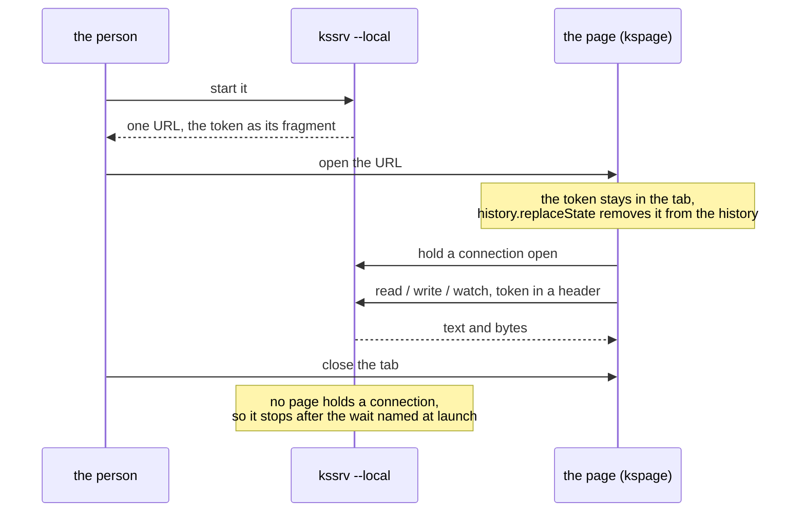

**The server does not know the document.** Knowing it would put the document model in two places, with nothing to tell which is canonical. So the server moves only text and bytes, and the page decides where they go.

**The transport is built on what `std` already has.**

* **No program is started.** Building, debugging, completion and plugins would each start one. They serve a code editor, which the page is not, and they would make what a page can ask for into running code, so that every guard must hold. The convenience does not balance that (Principle 1).
* **`HEAD` is not carried.** Watching already returns the size and whether the file exists, and two entry points that differ only in name leave the page unsure which to use (Principle 6).
* **The type is not guessed, and the encoding is UTF-8 only.** The receiver believes a guess and reads the bytes by it, and a wrong guess shows only where it misses.

**Watching is the page asking, not the OS telling.** The OS's notification (inotify, ReadDirectoryChangesW) needs one implementation per OS, and porting cost would gather there. Asking loses how many times a file changed, but returns how it is now, so the page always catches up to the final state. What is given up is cheap watching of a whole large folder, where asking is heavy.

**The token goes across once, in the fragment, and stays in the tab.** (The *fragment* is the part of a URL after `#`.) Whoever holds the token can read and write every file under the root, so each other place it could go is ruled out:

| The token is not… | Why |
| :-- | :-- |
| **In a query** (after `?`) | A fragment is never sent to the server, so another process on the same machine cannot get the token by sending `GET /` |
| **In the response that serves the page**, on request, or in a response header | Anyone who knows the address could read it there. Only a malicious page inside a browser, which cannot read the response, would be kept out |
| **In a cookie** | The browser attaches a cookie on its own, to a malicious page's requests too. That is why the token rides in a header |
| **On the command line** | `ps` shows it to anyone on the machine |
| **Compared byte by byte with an early exit** | It is compared in full: a page in a browser can send requests to the loopback address, and a difference in return time would let it guess the token a byte at a time |

**What it gives up**: a person opens one URL once per start-up. Jupyter's local server asks the same, and leaves the token in the browser's history as well; here `history.replaceState` removes it.

**The page named at launch may sit outside the root** (`kssrv --page=<file>`), because the page and the document are separate. The document is in the person's folder, and the page is with the server. Requiring the page under the root would mean copying it into that folder, or the document could not be opened.

**The server stops when no page holds a connection open.** Something has to end it, and the console cannot: a server opened by a double-click has no console to press anything in. The held connection carries nothing, so there is nothing in it to parse or get wrong, and closing the tab closes it. The other signals are ruled out:

| Signal not used | Why |
| :-- | :-- |
| **A timer** | It only tells that somebody was there some seconds ago, and every choice of the wait is wrong somewhere. Too short, the server stops while someone reads; too long, it lingers |
| **The last request** | A page where someone is writing asks for nothing between saves |
| **A goodbye message** | A killed tab, a stopped browser or a sleeping machine sends none |

**The wait named at launch only bridges two gaps**: before the first page arrives, while a browser starts cold, and after the last page leaves. The second gap is worth keeping, since a person who closes one document and opens the next within the wait reuses the same server.

**Whoever holds the token can also stop the server at once, by asking it** (`POST /api/stop`). A server left running for the next document needs a way to end it that does not wait out the idle time, and asking is chosen over killing its process.

* **Not by process number**: a number outlives its process and is handed to the next one, so a stale record would end an unrelated program.
* **Not by a signal**: Windows has none to send, so killing would be a second way per platform.
* **Through the same guard as every request**: the token decides who may, so a page from another site still cannot end it.
* **The answer goes out first**, so the asker knows the stop took effect, rather than guessing from a connection that closed.
* **What it gives up**: a server that has stopped answering cannot be stopped this way; that is left to the operating system's own tools.

**Whether the server is there is asked, not guessed.** The server says whether it is local-facing, since the same implementation facing outward answers too. Probing entry points to guess from the refusal numbers would gain one more way of guessing with every entry point added.

**What it gives up**: the protocol serves one machine only. Use from another machine needs a protocol of its own, and this one refuses it.

### The reference is rendered when asked, not committed

To read a package's API documentation, run `ksplc doc <file>`. No generated HTML or Markdown reference is kept in the repository.

**What a package publishes is read with `ksplc doc`, which renders it from the source each time, and no rendering of it is committed** (the command is 7.5 in [`../ksplc/docs/SPEC-tools.md`](../ksplc/docs/SPEC-tools.md)). The record (`SURFACE.txt`, "The published API is recorded in the repository") stays committed: two versions are matched by it, and a reference is not.

**The grounds**:

* **A committed rendering is a second copy of every description.** A gate can hold it to the source, but a reader then meets the same sentence in two places. And every change to how it is rendered rewrites thousands of lines that publish nothing new.
* **One page per file is one small file per source file**, and one page per package instead runs to many thousands of lines, read only by searching it.
* **An entry point returning one piece serves a person and a model alike** (the chapter "Models write it, and AI runs in it"). `ksplc doc std/mem.Arena.alloc` returns that entry and nothing else, where a page has to be read down. It runs wherever `ksplc` runs, the release's zip included. It answers at once, as it parses the one file asked about and analyses nothing.
* **On a repository host the source is the reference.** A description stands on the line of what it describes, so the file holding a declaration also holds what is said of it.

**What it gives up**: a rendered, linked reference to browse without a toolchain. `make surface` writes one under `out/docs/` for whoever has the toolchain, and it is `ksplc doc`'s answers and nothing else. A link from one file's reference to another file's entry is given up too: that name stays text, and `ksplc doc` on the other file shows it.

---

## Why one repository

Kanso holds nine packages (`ksai` / `ksbind` / `ksdb` / `kspage` / `ksos` / `kspeg` / `ksplc` / `kssrv` / `std`) in one repository. **This is not "not split yet" but the decision not to split.** In short: most changes touch more than one package, and the compiler cannot be built without the standard library, so separate repositories would make ordinary work slower and easier to break.

### What happens if it is split

**Whether to split is decided by the share of changes that cross packages**, not by "they are independent, so separate repositories". The import direction says whether packages are independent. What decides the cost is how many packages one change reaches: how many packages' files the most recent commits touched, merges excluded (`git log --name-only`). It can be measured again, so no number is copied here (Principle 7).

**Once split, a change crossing two or more packages becomes work across repositories in a fixed order.** Forget any one of the four steps and neither repository builds on its own:

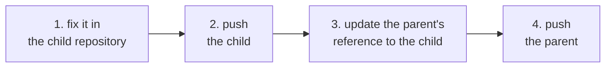

### `std` cannot be separated from `ksplc`

The file that bootstraps the compiler holds the standard library inside it, so every change to `std` is also a change to `ksplc`.

**This is decisive.** The bootstrap seed ([`../ksplc/seed.c`](../ksplc/seed.c)) is `ksplc` and `std` compiled together into one C file, holding thousands of `std`'s function bodies. The compiler is written in KSPL, so the seed is how it is first built on a machine with only a C compiler. So fixing `std` means rebuilding the seed, and the seed belongs to `ksplc`. In separate repositories every change to `std` would straddle two.

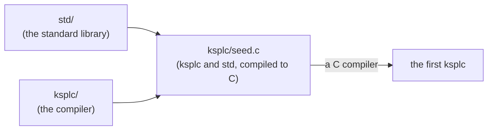

Caution: **Get the order wrong and the seed is left holding a stale `std`.** `make self-host` then fails, not for whoever made the change but for the next person who pulls.

**There is no cycle in the import direction** (the table in [`SPEC-documents.md`](SPEC-documents.md)). What keeps the packages together is not the shape of their dependencies but the seed, and the volume of crossing changes.

### No split is designed

**No way of splitting is designed, and no tool for it exists**: it is designed on the day one is decided, against the repository as it then stands. What a split would need is kept anyway, because each is worth having in one repository too. A package's tests sit inside it ("Where the entry points are" above), its published API is recorded (`make surface`), and `make test-extract` builds and tests a package from a copy of its folder alone ("A package names itself, and names what it uses" above).

---

## The build and the gates

**The build is two builds, with opposite options** ("A shipped executable is built optimized, and the development cycle is not"). What each gate (a check CI runs that can fail the build) checks is in [`SPEC-gates.md`](SPEC-gates.md), and how to run them is in [`HOWTO-build.md`](HOWTO-build.md).

### A shipped executable is built optimized, and the development cycle is not

While you work on the compiler, it is built without optimization so each rebuild is quick. The copy that is installed or released is built once more with optimization, from the same C.

**The development cycle (the stage1 / stage2 that `make` builds) is `-O0`. Do not raise `CFLAGS`.** (Stage1 is the compiler built by the seed; stage2 is the compiler built by stage1.) Megabytes of generated C are rebuilt for every line fixed in the compiler. `clang`'s time grows by an order of magnitude with optimization, and a round building both stages pays it twice.

| | The development cycle | What ships |
| :-- | :-- | :-- |
| Built | On every change | Once per install or release |
| C compiler options | `-O0` | `SHIP_CFLAGS` (`-O2`), as `out/ksplc_ship.exe` |
| Who uses it | Whoever changes the compiler, waiting for each rebuild | Whoever runs `make install`, and the release (`.github/workflows/release.yml`) |
| Compared with the development build | — | It translates ksplc itself (from the same stage2 C) in roughly half the time, and is roughly half the size |

**Shipping is the reverse**: built once, it is fast every time for whoever uses it. The generated C does not change by one byte: `make self-host-ship` translates ksplc with the shipped build, and compares the result with stage2's C. That is a gate on Linux and a step of every platform's release build. So nothing moves: not the self-hosting fixed point (the compiler reproducing itself exactly), not the tests' results, not the stage1 numbers the performance guard inspects.

**Only the C a person reads is tidied.** Clang-Format runs on the generated C of `make debug-file` and `make commit-seed`. The C that the bootstrap and `make debug` leave is not tidied, since nobody reads it and tidying it costs more than compiling it.

Caution: **Do not drop `-g`.** When a shipped executable dies, that is the only place a position comes from.

### Where CI's time goes, and what shrinks it

CI's machines effectively have one core, so the only way to make the gates faster is to do less work in total.

**Do not write the seconds here** (Principle 7). Each run lists its own seconds per stage at its tail ("How a run is read" in [`SPEC-gates.md`](SPEC-gates.md)). The order of cost is test-suites > self-host ×2 > lint > perf-log, and those four stages are the bulk of it.

**`-j` barely takes effect on GitHub's runners.** (`-j` tells make how many jobs to run in parallel.) Only the gates given a `-j` (`test-suites` / `lint` / `lint-cfg` / `link_abi`) take several times as long as locally, and one core locally reproduces that. So a runner is effectively one core, and the only route to faster gates is less total work. The reproduction is `taskset -c 0 make -j1 test-suites`: `sys.cpu_count` follows the affinity, so the suites' own side-by-side runs drop to one as well.

| Stage | Can it be shrunk |
|---|---|
| self-host ×2 (C and LLVM) | **Do not attach `-B`.** It redoes even the seed's compilation, making the seed newer than the later stages, and `perf-log` rebuilds C's stage1 wholesale. `self-host`'s own recipe emits the verification marker on an incremental build too. Emitted from `$(DIFF_TXT)`'s recipe instead, a round that needs no rebuild would emit no marker, and the runner (`Gate.verdict` in `tools/ci_gates.kspls`) would return "passed without verifying" |
| perf-log | **Measure both times**: on an empty cache (cold), then on the same cache (warm). Time differs severalfold and peak memory clearly, so one alone leaves the other half unchecked. The cache sits in a dedicated location, so the shared cache is not erased (which would make every following gate cold) |
| test-suites | With the runner's cores full, **the total amount of work** fixes it, and a higher `-j` does not shrink it. What does is a smaller total, or dealing the suites out between the jobs that already stand. **No job is added for them**: every job pays its own start-up and its own billing, so another job raises the cost while the total work stays the same ("How CI runs" in [`SPEC-gates.md`](SPEC-gates.md)). The launch order sets the speed, so `SUITES` is kept longest first (the grounds are at `SUITES` in `mk/test.mk`) |
| test-ksos-qemu | The demos that grab a fixed resource are serial ("How the gates are arranged" in [`SPEC-gates.md`](SPEC-gates.md)) |

**Do not merge fine-grained suites "because there are many of them".** Merging runs not one byte less, so the wall clock does not shrink (the total fixes it), while a fine-grained name points straight at the cause when it fails. Only the same property inspected in two places may be merged.

**When reducing the total, look at the heavy individuals, not the count.** The time is skewed per suite and per case. `ksplc/tests/negative/` is mostly a handful of cases that poke the depth safety valve. Their input must exceed the 1000 levels the compiler's walks over a type allow (`max_type_unwrap_depth` in `ksplc/sema/type/query.kspls` and its kind) and costs quadratically in the level count, so a large count does not mean a large amount of time.

### 'Supported' means someone uses it

An environment is called "supported" only when the gates run there and someone also develops there every day. A green CI job alone is not enough.

**Each environment Kanso runs in is placed at one of three levels by what stands behind it: supported, built in CI but not confirmed, or untested.** The table and what each level promises are "Where it is supported" in the root [`README.md`](../README.md), the one place they are written. This section holds why they are set so.

**A green CI job is not enough for "supported".** CI runs weekly and on request, not on every commit ("How CI runs" in [`SPEC-gates.md`](SPEC-gates.md)), so it shows what ran that day. And a gate sees only what it was written to look at. Typing into a terminal, a file name the real filesystem holds, an input method and a debugger are met by someone who uses the environment day to day, and by no gate. So the top level needs both: the gates running there, and development done there.

The levels move like this:

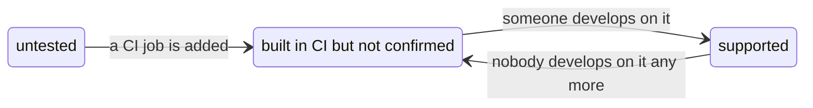

**The C compiler is part of the environment.** ksplc emits C, and what becomes of it is the C compiler's: the warnings, the libraries a link needs, the object format, what C leaves unspecified. So a row names an operating system, an architecture and a C compiler together, and "Linux" alone is no row. GCC compiles the generated C in one gate alone, `make test-c-warnings`, which keeps Principle 2's warning zero on it as on clang. No gate builds the compiler or runs a program with GCC, so GCC stands among the untested (Principle 8: a check seeing part is not read as the whole).

**A level is named by what stands behind it, not numbered.** A number, or "it builds", tells a reader nothing about whether their program runs, and a reader not told rounds it up to "supported".

**What no row names is written down as untested.** Because KSPL translates to C99, a new environment needs only a C compiler, not a port of the toolchain. A reader takes that for "it runs everywhere", and meets the gap as a bug.

Caution: **Do not raise a level because a CI job went green.** A new job places its environment at "built in CI". It moves up only once someone develops on it, and down once nobody does.

**What is given up**: an environment that would work is still listed as untested until someone runs it, so macOS reads as lower than its green job suggests. Nothing checks the table against who develops where. That is a fact about people, so the table is kept by hand, and a change of who works where changes it in the same commit.

### The Windows executable is built on UCRT64

The released Windows `ksplc.exe` is built with MSYS2's UCRT64 clang, the same toolchain Windows developers here use. The result needs nothing installed beyond Windows itself.

**The Windows `ksplc.exe` that ships is built by MSYS2 UCRT64's clang**, the toolchain Windows development runs on, not by LLVM's own clang targeting MSVC. (MSYS2 is a set of Unix-style tools and packages for Windows. UCRT64 is its environment whose programs use the Universal C Runtime that ships with Windows 10.)

**The grounds**:

* **What ships is what is used.** "Supported" rests on someone developing there ("'Supported' means someone uses it"). Built on another toolchain, the file users download would be the one Windows build nobody runs day to day. What no gate looks at (a console, a file name, a real keyboard) would break there unseen.
* **It needs nothing installed beside Windows.** UCRT is Windows 10's own C runtime, and the runtime uses Windows threads, not MSYS2's `winpthreads`. So the executable imports only DLLs Windows carries (the `api-ms-win-crt-*` set, `KERNEL32`, `SHELL32`, `WS2_32`). The release refuses an import found under MSYS2's tree (`.github/workflows/release.yml`, "Refuse a DLL that only MSYS2 carries"). A DLL such as `libwinpthread-1.dll` is present on the machine that built it, and on no user's.
* **Building it needs no Visual Studio.** MSYS2 installs from its own packages. The MSVC target links against Microsoft's libraries, which a Build Tools install brings.
* **Nothing it links calls for MSVC.** That target's usual reason is linking with software Visual Studio built, which is why rustup recommends it. ksplc links no C++, so the reason does not arise.

**MSYS2 holds two kinds of tool, and the build uses both.**

| | POSIX tools | Native tools |
| :-- | :-- | :-- |
| Where | No prefix, in `/usr/bin` (`bash`, `make`, `git`, `find`, `grep`, `sed`, `python`) | Named `mingw-w64-ucrt-x86_64-…`, in `/ucrt64/bin` (`clang`, `ld.lld`, `llvm-objcopy`, `lldb`) |
| What they are | Linked against `msys-2.0.dll`, a POSIX layer derived from Cygwin | Plain Windows programs, sharing one C runtime (UCRT) with what ships |
| Their job | Drive the build: POSIX paths (`/c/Work/...`), fork, signals, wait statuses, and argv and the environment byte for byte. They never touch the bytes of what ships | Build what ships |

Built by the POSIX tools instead, `ksplc.exe` would depend on `msys-2.0.dll`. `MSYSTEM=UCRT64` chooses only which native tools come first on the PATH, and the shell always comes from the POSIX tools (`/ucrt64/bin/bash` does not exist).

**What is given up**: the MSVC target is not what ships, and no CI job builds it, so it stands among the untested. Kanso's own build refuses it (`-dumpmachine` in the root `Makefile`), rather than keep a branch nothing runs. A user whose clang is LLVM's own Windows build still compiles their program's C for it, since ksplc answers its link words per target. Debug information from this toolchain is DWARF, not a PDB. So it is read with LLDB (as the release's bundled `.vscode/` does), not with Visual Studio's debugger.

**A tool taken from the wrong kind breaks later, far from its cause, after everything seemed to work.** So the Makefile refuses to run outside the UCRT64 shell, and refuses `mingw-w64-ucrt-x86_64-make`. Outside that shell the build breaks in ways that are hard to read:

* Windows's own `find.exe` shadows GNU `find` (`File not found - *.kspls`).
* The console's code page (CP932 in most Japanese environments) garbles `make`'s UTF-8 output.

---

## Models write it, and AI runs in it

**This chapter decides two things**: a model writes, reads and checks KSPL ("A model writes it, and the compiler judges it"), and AI runs in KSPL ("AI runs in it"). The grounds are the same for both: only what is written happens, so neither a model nor a microcontroller has to guess.

### A model writes it, and the compiler judges it

| Property | What it gives a model |
| :-- | :-- |
| **A function can be judged from its text.** Nothing is allocated implicitly, and no failure is missing from a type (`T!E`, `T?`) | A model reviewing or generating code needs no knowledge of hidden run-time behaviour |
| **Generated code converges on one spelling.** One means per purpose (Principle 6) and one formatter (`ksplc fmt`) | No equivalent spellings to drift between |
| **The verdict is mechanical.** Not one warning is let stand (Principle 2). A warning, an information or a hint carries a code that `ksplc explain <code>` expands on request, and an error says in its own message what to write instead | A generated completion is judged by whether `ksplc` accepts it, not by opinion |
| **An agent reads the verdict as fields.** `--diagnostic-format=json` writes each diagnostic as one JSON object per line, with its code, place and message apart ("2.11 Diagnostics a program reads" in [`../ksplc/docs/SPEC-tools.md`](../ksplc/docs/SPEC-tools.md)) | No reworded message breaks the reader |
| **What a model reads stays true.** The API pages and records are generated from the source and held to it by checks | The rules for a reader that is a model are in "The reader may be a model" above |

### AI runs in it

* **The engine is KSPL alone** ([`ksai/`](../ksai/README.md)): tensors, inference, training, LoRA (a cheap way to fine-tune a model), the tokenizer and safetensors (a file format for weights), with no second language beneath the model.
* **The same code runs from a microcontroller to a server.** On bare metal (with no operating system) it takes its weights through `embed` and needs no heap; on a server one flag sends the matrix product to OpenBLAS.
* **The model, its tooling and the checking are one language.** So a kernel, the program calling it, and the compiler judging a generated program share one debugger and one set of rules.

### What it costs

* **KSPL is in no model's training**, so every session pays context to read what KSPL leaves out ("The reader may be a model").
* **The engine runs on the CPU alone**, and each layer's backward pass (the step of training that computes how to change the weights) is written by hand ([`ksai/docs/DESIGN.md`](../ksai/docs/DESIGN.md)).
