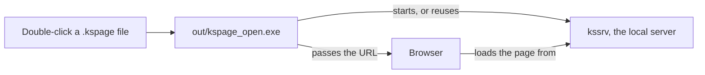

# Setting up a project

**This guide takes you from a first program to a real project**: running a program with arguments, working in any folder, building an executable to hand out, splitting a program into files, and editing in VS Code. It continues from the quick start in the root [`README.md`](../README.md).

**What you need first:**

* `ksplc` with its `std/` folder beside it, unpacked from a release or built from source.
* `clang` on the PATH.
* For the last section only, more: it says so at its top.

The commands are written for the unpacked folder (`./ksplc`). With `ksplc` on the PATH, drop the `./`.

## Running a program

**`ksplc run` turns a `.kspls` file into a program and runs it, in one command.**

```sh
./ksplc run hello.kspls            # on Windows, .\ksplc.exe run hello.kspls
```

`run` translates the program to C, compiles, links and runs it. It caches the build, so an unchanged source starts at once (the cache is in [`ksplc/docs/SPEC-tools.md`](../ksplc/docs/SPEC-tools.md)).

**It compiles the intermediate C with `clang`** (or the compiler named by the environment variable `CC`), so one has to be on the PATH. Building an executable yourself uses the same C compiler ("Building a standalone executable" below).

**On Windows, use MSYS2's UCRT64 clang** (`pacman -S mingw-w64-ucrt-x86_64-clang` in the "MSYS2 UCRT64" shell, then put `C:\msys64\ucrt64\bin` on the PATH). Kanso is developed and built with it. LLVM's own Windows clang targets MSVC instead: ksplc names that toolchain's link flags, but nothing builds or runs a program with it ("Where it is supported" in the root [`README.md`](../README.md)).

Arguments after the script name go to the program:

```sh
./ksplc run hello.kspls --name=Kanso    # --name=Kanso is received by hello.kspls
```

**A first line `#!/usr/bin/env -S ksplc run` makes the script executable** once `ksplc` is on the PATH: you can then start it as `./hello.kspls`. That first line (a *shebang*) does nothing in Windows's native shell, so write `ksplc run <script.kspls>` there.

## Working in another folder

**To work in any folder, put the folder holding `ksplc` on the PATH, and keep `std/` beside `ksplc`.** `import "std/io"` reads the `std/` beside `ksplc`, from whatever folder `ksplc` runs in. Set the PATH in the shell's configuration file (`~/.bashrc` or similar):

```sh
export PATH="/path/to/unpacked:$PATH"       # on Windows, add the folder to Path in the settings
ksplc info std-dir                          # names the std/ beside ksplc
```

The second line checks the result: it prints the `std/` folder `ksplc` uses.

## Building a standalone executable

**To get the executable itself rather than `run` it, `build` it:**

```sh
./ksplc build hello.kspls hello     # hello.c and hello.libs are left beside it
./hello
```

`build` writes the C, then has `clang` (or the compiler `CC` names) compile and link it. It links the libraries this platform needs and those the program names (`#link("openblas")`, "11.5 Naming the library an `extern` block needs" in the [KSPL language specification](SPEC-language.md)).

| You want | Do this |
| :-- | :-- |
| To run it in PowerShell | The same line, with `.\ksplc.exe` and `hello.exe` |
| A normal build | Nothing: it builds optimised, with `-g` (debug information) |
| To pass flags to the C compiler | `--cflags=…`; they come after ksplc's own |
| To step through it in a debugger | `--cflags=-O0` (no optimization) |

The steps it takes, and how to take them apart (to ship objects without the source, say), are in [`ksplc/docs/SPEC-tools.md`](../ksplc/docs/SPEC-tools.md).

## Splitting a program into files

**Where an `import` searches from depends on how it is written, above all on whether it contains `/`** ("The three strict rules of path resolution" in the [KSPL language specification](SPEC-language.md)). The table shows what to write for the usual cases.

| Where the file is | Write |
| :-- | :-- |
| In the standard library | `import "std/io"` |
| Beside the importing file (`hw.kspls` beside `main.kspls`) | `import "hw"` (`as` only to rename) |
| At the top of a project that names itself | `import "myapp/hw"` (below) |

**When an import is not found, the error lists every folder searched**, which shows the starting point.

**A project that names itself is found from any folder.** Put a `ksplc.cfg` holding `[package]` and `name = myapp` at its top, and `import "myapp/hw"` finds `hw.kspls` in that top folder. `ksplc info package` names the package of the current folder. The details are in "A package that names itself (`[package]`)" in [`ksplc/docs/SPEC-tools.md`](../ksplc/docs/SPEC-tools.md).

Note: **A library can also be handed over without its KSPL source**, built with `--library` and used through the C interface the compiler writes for it ("Shipping a library and using it" in [`ksplc/docs/SPEC-tools.md`](../ksplc/docs/SPEC-tools.md)).

## VS Code (syntax highlighting, the Language Server, debugging)

**VS Code builds and debugs in the unpacked folder without setup; the Kanso extension adds colouring and code help.** The unpacked folder holds `.vscode/` (build tasks, LLDB settings) and, at its top, `kspl_lldb.py`: the LLDB pretty printer that makes slices, `Result` types and structs readable in the debugger. The Kanso extension adds `.kspls` syntax highlighting and the Language Server (jump to definition, hover, diagnostics).

1. **Install the extension**

  Install `kspl-*.vsix` from the Releases page. It bundles the LSP server for all three OSes and activates when a `.kspls` is opened.

  ```sh
  code --install-extension kspl-x.y.z.vsix
  ```

  Editing the grammar file (`ksplc/kspl.kspeg`) also needs `kspeg-*.vsix`, installed the same way.

2. **Open the unpacked folder and build**

  Open the folder where `ksplc` and `std/` sit side by side. The bundled `.vscode/tasks.json` takes effect, and `Ctrl+Shift+B` compiles and links the open `.kspls`.
  * Caution: **For a project elsewhere, set `KSPLC_STD_DIR` before starting VS Code.** The Language Server analyzes in a child process, and the CLI's `--std-dir=` does not reach it.

3. **Debug with LLDB (optional)**

  With [CodeLLDB](https://marketplace.visualstudio.com/items?itemName=vadimcn.vscode-lldb) installed (third-party, not in the release artifacts), `F5` on an open `.kspls` runs everything from the build to the debugger's launch.

## Opening a `.kspage` document on a double-click

**This section makes a `.kspage` document open in your browser when you double-click it in the file manager.** It needs a clone of this repository that builds from source ([`HOWTO-build.md`](HOWTO-build.md)), not only the unpacked folder. `make kspage` builds the three programs it uses: the opener, the server and the page ("Where the double-click opener lives" in [`tools/docs/DESIGN.md`](../tools/docs/DESIGN.md)).

The diagram shows what happens on a double-click.



A `.kspage` file double-clicked in a file manager opens in a browser through `out/kspage_open.exe`, built from [`tools/kspage_open.kspls`](../tools/kspage_open.kspls) (what `make kspage-open FILE=…` runs). It starts the local server, or reuses the one serving the same folder, and passes the URL to a browser.

**The server stays up for the next document**, and stops by itself once no kspage tab has held it for a while.

| Command | What it does |
| :-- | :-- |
| `out/kspage_open.exe --list` | Shows the servers running, with the folder each serves |
| `out/kspage_open.exe --stop=<folder>` | Stops one |
| `out/kspage_open.exe --stop-all` | Stops every one |

### Linux (a desktop environment)

1. **Build everything:**

  ```sh
  make kspage
  ```

  It builds the page, the server, the opener and `out/sample.kspage` to double-click. It writes `out/kspage.desktop` (checked by `desktop-file-validate` where installed) and prints the four lines below.

2. **Run the four lines yourself.** `make` does not write under your home directory.

  ```sh
  xdg-mime install --novendor out/kspage-mime.xml
  cp out/kspage.desktop ~/.local/share/applications/
  update-desktop-database ~/.local/share/applications
  xdg-mime default kspage.desktop application/x-kspage
  ```

3. **Double-click `out/sample.kspage`**, the one way to confirm the association works. It holds [`tools/kspage_doc.kspls`](../tools/kspage_doc.kspls)'s content, **not the document shown at start-up**.

**Do not skip the first of the four lines.** Linux ties an application to a MIME type (a name for a kind of file), not to an extension. Undeclared, `.kspage` reads as `application/octet-stream`, which the last line cannot tie.

**Do not edit `Path=` or `%f` in the `.desktop` file.** A double-click starts in the home directory, hence `Path=`, and opens one file, hence `%f`, not `%F`.

To tie `.md` or `.txt` to kspage instead, swap the last line's type for `text/markdown` / `text/plain`; that sends **every** `.md` or `.txt` on the machine to kspage.

### Windows and macOS

**`make kspage` builds the same four** and prints this environment's association steps. The server and the page also have targets of their own:

    make kssrv             # the server it starts  -> out/kssrv.exe
    make kspage-web        # the page it serves    -> out/kspage_web/kspage.html

**All three programs are needed**: the opener looks for `kssrv.exe` and `kspage_web/kspage.html` beside itself, and stops with "kssrv not found" if either is missing.

Caution: **A double-click shows that refusal nowhere.** Run the opener once by hand first (`make kspage-open FILE=out/sample.kspage`) to see the page open.

Each association below runs `out/kspage_open.exe` with one file's path. **No gate runs either of them**, so only your environment can say whether it works.

* **Windows** — right-click a `.kspage` file, choose "Open with ▸ Choose another app ▸ Look for another app on this PC", pick `out\kspage_open.exe`, and tick "Always use this app".
  * **Do not tie `.json` to it.** Every settings and data file on the machine would open in kspage ("The extension is kspage's own, and does not name the format inside" in [`kspage/docs/DESIGN.md`](../kspage/docs/DESIGN.md)).
* **macOS** — Finder's "Get Info ▸ Open with" needs an application bundle (`.app`). Make one in Automator's "Application" running `out/kspage_open.exe "$1"`, and tie that.

### When a double-click shows nothing

**The server can start while the hand-over to the browser fails**, leaving nothing on the screen.

| Look at | What it tells you |
| :-- | :-- |
| **`out/tmp/kspage_open.browser.log` first** | What the browser printed (the opener's last line names this file) |
| **The URL printed on the terminal** | Paste the whole of it, with the token after `#`, into a browser. If the page opens, the server works and only the hand-over failed |
