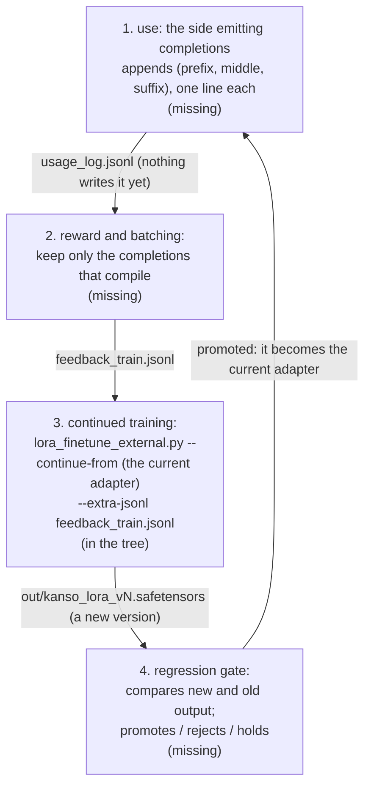

# What is left

**This page holds every plan for the work not done yet**: a section per package with work left, and what spans packages. **Only what is not done stands here.** A done stage is deleted, and its result goes into the document of its kind. A package with nothing left to do has no section ("Document naming" in [`SPEC-documents.md`](SPEC-documents.md)). Each section counts its stages from 1.

## ksos

Three pieces of work are left in ksos:

* saving battery while idle;
* using the RP2040's second CPU core;
* running on a second kind of chip.

What runs, and where it was confirmed, is in [ksos](../ksos/README.md). The decisions and their grounds are in [`ksos/docs/DESIGN-rtos.md`](../ksos/docs/DESIGN-rtos.md).

| | What is left | What it gives the user | Where it stands | What marks it as done |
| :-- | :-- | :-- | :-- | :-- |
| stage 1 | **Power-saving tickless idle.** *Tickless idle* means that with no task ready, the kernel skips the timer's beats until the next task is due. The tickless idle that exists only moves the logical time forward. Sleeping until the next expiry and reading the real elapsed time on waking (FreeRTOS's `configUSE_TICKLESS_IDLE`) is not started | A battery-powered device that sleeps while idle. It is needed once battery-powered devices are a target | Not started | A board probe that sleeps through a `delay` and reads the real elapsed time from a hardware timer |
| stage 2 | **The second core.** The RP2040 has two CPU cores, and core1 is not started. The atomics hold between cores (`ksos/port/rp2040/ksos_atomic_sio.c`), so the runtime needs no fix. One queue used from both cores at once is unconfirmed. `PRIMASK` (the switch that turns interrupts off) stops interrupts only on its own core. So the window that stops interrupts does not stop the other core. That window is the Flash erase and write in `ksos/drivers/rp2040/flash.kspl` | Tasks running on both cores at once | core1 not started | A probe on the real board with both cores using one queue, and the Flash window closed against the second core |
| stage 3 | **A port for a real Cortex-M33 chip** (an RA6M4 or an RP2350). A port is the small chip-specific layer under the kernel. Hardware checks cover only the RP2040: QEMU models no equivalent, and no Cortex-M33 board is available | ksos checked on a real chip beyond the RP2040, a Cortex-M33 | No port, and no board to check it on | The port under `ksos/port/`, `make test-ksos-link` covering it, and a board probe on the chip |

## kssrv

This section holds the work on the kssrv server that is not done yet. It says what each piece would let you do, and how we will know it is finished. What the server does is in [kssrv](../kssrv/README.md), and its decisions are in [`kssrv/docs/DESIGN-server.md`](../kssrv/docs/DESIGN-server.md).

| | What is left | What it gives the user | What marks it as done |
| :-- | :-- | :-- | :-- |
| stage 1 | **HTTPS termination** (the server itself speaking HTTP encrypted with TLS). The server does not answer over TLS, so a page served to other machines goes over plain HTTP. The OpenSSL binding has only a client half, so a server half comes first | A page served to other machines travels encrypted | `kssrv/tests/main.kspl` fetching a page over TLS from the server |
| stage 2 | **The token is checked from the head** (the request line and headers, which arrive before the body). The server checks the token only after the whole request has arrived. So a client without a token can make the server hold the connection cap × the body cap. `std/http` has to pass on a head whose body has not arrived | A client without the token is turned away before it can make the server hold any of its body | `kssrv/tests/local.kspl` sending a head without a token that names a large body, and getting the refusal before sending any of the body |
| stage 3 | **Watching a whole large folder cheaply.** The page asks `GET /api/stat` about each file, which is heavy for a large folder. Adding the OS's notification (inotify / ReadDirectoryChangesW) is decided once that cost shows. Added first, it would be a per-OS implementation that is perhaps not needed | A page over a large folder still notices changes without asking about every file | A page over a large folder is measured as too slow to ask. The decision is written into "A page asks the local machine through one protocol" in [`DESIGN-repository.md`](DESIGN-repository.md) |
| stage 4 | **Telling apart why a write failed.** A failed write or replace answers 500, whether memory or write permission is missing. Telling them apart needs the parent of a name inspected, which belongs in `std/fs`, not in the server. Written into the server first, the code that splits a path would live in two places | A page whose save failed can say why: no memory, or no permission to write | `std/fs` reporting the reason, and "How it refuses" in `docs/SPEC-local-server.md` giving each reason its own status |

## tools

All of it belongs to the coding assistant (`tools/ai_assist/`). The assistant is a small AI model that fills in a gap in KSPL code from the code around it. That task is called *fill-in-the-middle* (FIM). What is in place is in [`tools/ai_assist/README.md`](../tools/ai_assist/README.md), and why it is built that way is in "The coding assistant" in [`tools/docs/DESIGN-tools.md`](../tools/docs/DESIGN-tools.md).

### The stages

Two stages are left: first an assistant that actually knows KSPL, then a loop that lets it keep learning from use.

| | What is left | What it gives the user | What marks it as done |
| :-- | :-- | :-- | :-- |
| stage 2 | **A LoRA that speaks KSPL.** A *LoRA* (or *adapter*) is a small set of added weights trained on top of an existing coding model, instead of retraining the whole model. No adapter is trained on the FIM corpus yet: the adapter that shows the pipeline runs is close to untrained. Training one needs only the FIM corpus `make_fim.kspl` writes and `lora_finetune_external.py` as it is | Completions that know KSPL, from an existing model | `eval_fim.kspl`'s compile pass rate on `corpus/fim_val.jsonl` (how often a file still compiles once the completion is inserted) beats the base model's |
| stage 3 | **The self-evolution loop**: the assistant keeps training on its own completions that compiled. Of the loop below, only continued training exists (`lora_finetune_external.py --continue-from`). Three parts are missing. ① The part that emits completions and writes the usage log. ② The part that scores with `ksplc_oracle` (the compiler used as the judge) and keeps only what passed. ③ The regression gate that compares new and old output, and promotes, rejects or holds. ② and ③ need only the compiler reward, so they can be built as soon as ① exists | An assistant that gets better at the code you actually write | The loop turns once end to end: a usage log written, scored, trained on, and the new adapter promoted or rejected by the gate |

The diagram shows stage 3's loop. Each box is a step, each label on an arrow the file passed on, and the note in a box says whether the step exists.

**Continued training starts from the existing adapter at a low learning rate** (1e-4 by default). This avoids *catastrophic forgetting*, where a model trained on new examples loses what it learned before.

### What is decided about the loop

Three choices are fixed already; each keeps the loop safe to run.

| Decision | Why |
| :-- | :-- |
| **The usage log is off by default.** The part that emits completions writes it only when given a path | Privacy comes first |
| **Continued training is started by hand** (no make target starts it) | Background work and automatic retraining go against keeping the compiler light and stable |
| **The regression gate promotes a new version only when it is at least as good as the old one.** While there are few samples, the gate withholds its verdict | So noise neither promotes nor rejects a version |

### Where the native model stands

**The KSPL-native model (`ksai/examples/fim_coder`, built by `make fim-model`) scores above the empty completion and far below the oracle** on `make fim-eval`. The *native* model is the one trained and run entirely in KSPL. The *oracle* is the original line, which scores 100% by construction. The empty completion scores 0%. The model writes KSPL's surface (the `//<` comments, `fn main(): I32`, `priv const`) and little of its meaning.

### Not yet decided: the editor's signal

**Stage 3 runs on the compiler reward alone.** `ksplc_oracle` gives that reward: objective, deterministic, and callable without limit. The other signal is whether the person in the editor accepted a completion. It needs an editor plugin, and none exists. The assistant runs outside the language server ("Why the assistant runs outside the language server" in [`tools/docs/DESIGN-tools.md`](../tools/docs/DESIGN-tools.md)).

**Do not fill that signal with made-up or guessed data**: the model would learn from answers no editor gave.

How the editor reports is decided once an editor plugin exists. One candidate is a two-step exchange: `complete` returns a `request_id`, and `feedback <id> accepted|rejected` reports on it later.
