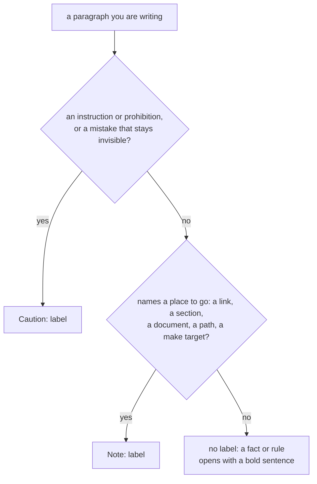
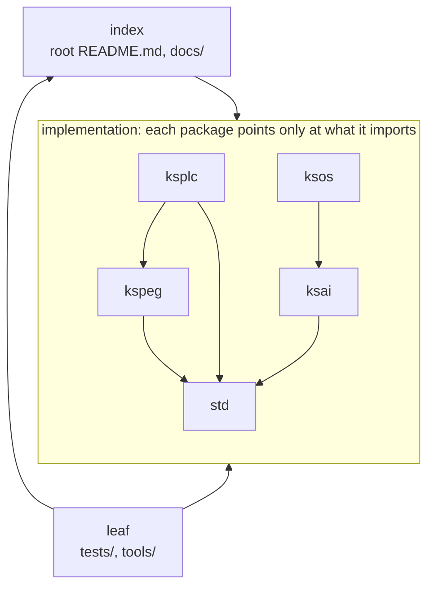

# The specification for the documents

This file sets the rules that every document in this repository follows. They cover its words, its name, its wording and layout, and what it can point at. Read it before you add or change a document.

It states the rules; the reasons are in [`DESIGN-repository.md`](DESIGN-repository.md). `make test-docref` checks references, and `make test-conventions` checks names and layout.

## Terms of art

The words in this table have exactly one meaning, in every document and every source comment. Use them with that meaning.

Caution: **Do not reach for a synonym.** If one thing has two names, the reader has to stop and work out whether they are the same thing.

| Term | What it means |
| :-- | :-- |
| **canonical source** | The single place a fact lives. Every other place points at it and never copies it |
| **rule** | A settled decision. It is not a suggestion, and not a description of how things happen to be |
| **gate** | One check that CI runs and that can fail the build |
| **fire** | What a check does when it catches a violation. A check that cannot fire guarantees nothing |
| **guard** | What a check does for a rule: it watches for the rule being broken |
| **pass silently** | What a gate does when it runs but checks nothing, or skips itself. **It looks exactly like a real pass (green)**, which is why it gets its own word |
| **reject** | What the compiler does to a program it refuses to translate. This is different from a program that fails while it runs |
| **literal text** | The characters as written, as opposed to what they mean. A check that reads literal text misses every form it does not spell out |
| **declare** | What a file or a type does when it states what it is, so the reader need not guess |
| **block** | A region marked off by indentation or by braces. **Not a stage and not a table column** (see the next row) |
| **stage** | One step of a plan in `PLAN.md`, numbered inside its section. Every section counts from 1 again, and a stage that branches gets a letter (`stage 6a`) |
| **phase** | One step of the project's status in the root [`../README.md`](../README.md) (`Phase N`), and nothing else. A `PLAN.md`'s stage 2 and the README's Phase 2 are different things |
| **entry point** | Where control enters: a `main`, a folder's `README.md`, the first file a tool reads |
| **interface** | The way one part is reached from another. Narrowing access to one interface is a design decision, so it gets a name |
| **leaf** | The layer that only points upward (`tests/` / `tools/`). See the layer table below |

**Another language's vocabulary stays in that language's words** (Java's package, Go's module), so a reader can look it up in that language's documentation.

## Words used throughout

These definitions apply to technical terms used across Kanso. Each package's glossary defines only its own terms.

| Word | What it means here |
| :-- | :-- |
| **translation time** | When `ksplc` compiles the program, as opposed to run time. "Rejected at translation time" means a compile error |
| **the generated C** | `ksplc` translates KSPL into C (or LLVM IR), and a C compiler (or LLVM) finishes the job |
| **diagnostic**, `[W0109]` | A message from the compiler: an error, a warning, an information or a hint. Every one but an error carries a code, whose letter is its weight: `W` warning, `I` information, `H` hint. `ksplc explain W0109` prints what the code means |
| **lint** | `ksplc lint`: the compiler's analysis alone. It prints every diagnostic, hints included, and builds nothing |
| **desugar** | Rewrite a convenient notation into a plainer one: `a + b` becomes the call `a.add(b)` |
| **generic**, **type argument**, **instantiate** | A generic is code with type parameters (`List<\|T\|>`); the concrete type put in for `T` is a *type argument*. Instantiating the generic makes one concrete copy per set of type arguments used (`List<\|I32\|>`), as C++ templates do. That copy is an *instantiation*, or *specialization*, and each one costs translation time |
| **trait**, **conform** | A trait is a named set of methods, like a Java interface. `impl X: Trait` declares that `X` has them: `X` conforms to the trait |
| **trait value**, **fat pointer**, **vtable**, **thunk** | A value whose type is a trait. It is a *fat pointer*: a pointer carried with a second word, here a pointer to the object plus a pointer to its vtable. The vtable is the table of that type's methods; each entry points at a *thunk*, a small adapter function that calls the type's own method |
| **receiver** | The value a method is called on: `b` in `b.free()` |
| **ARC** | Automatic reference counting. For a type that conforms to `Ref_counted`, each value counts the places holding it; the compiler inserts `retain` (count up) and `release` (count down, free at zero). This differs from `Arc`, a reference-counted library container |
| **arena** | A block of memory that hands out pieces and gives all of them back at once, when the arena itself is freed. Nothing inside is freed one by one. `std/mem`'s `Arena` is one ("8.4 Memory management" in [`SPEC-programming-language.md`](SPEC-programming-language.md#84-memory-management)) |
| **FQN** | Fully qualified name: a name with its file's path in front (`std.Ref_counted`), unique in the program |
| **FFI**, **ABI** | FFI is calling between KSPL and C. The ABI is the binary agreement such a call rests on: how a type is laid out, and how arguments are passed. Both of `ksplc`'s backends keep it identical, so C output and LLVM output can call each other |
| **hosted**, **freestanding**, **bare metal** | *Hosted* code runs under an operating system and can call libc. *Freestanding* code (`--freestanding`) cannot; it is for *bare metal*, a chip with no operating system, such as a microcontroller |
| **libc** | The C standard library (`printf`, `strtod`, `fopen` …). glibc is the usual one on Linux, and the CRT (UCRT) is Windows'. A freestanding build has none |
| **the C runtime** | The C code in `ksplc/gen/runtime/` that every hosted program needs besides its own: files, threads, the clock, the checks. Its functions are named `kspl_*`, and they are the only place `std` touches an operating system's API directly |
| **the seed**, **bootstrap** | The compiler is written in KSPL, so building it needs a compiler: the *bootstrap*. The *seed* (`ksplc/seed.c`) is the compiler, `std` included, frozen as C; any C compiler builds it into the first `ksplc`. A change the compiler needs at build time takes effect only once it reaches the seed |
| **borrow checker** | Rust's compile-time proof that no reference outlives its data and that no two places change the same data at once. KSPL has none ([8.4 in `SPEC-programming-language.md`](SPEC-programming-language.md#84-memory-management)) |

## Names for units

Four words name the units that code is organized in. Every document and source comment uses them with these meanings.

| Word | What it names |
| :-- | :-- |
| file | One `.kspl` source file. It is what `import` names, and `priv` keeps a name visible inside it only |
| folder | One directory. Inside one folder, files can import each other in a circle |
| package | Each of `ksplc/` `std/` … listed under "implementation" in the layer table below. It is the unit that is distributed, and a name with no visibility keyword is visible inside its package. **Packages do not nest**: only a top-level folder is one, and `ksmd/port/` is a folder (Java's and Python's packages nest; that is the one difference) |
| all | Everywhere: what `pub` opens a name to |

**When you name another product's unit, name its owner too** (`MSYS2's package`, `an ES module`). A bare `package` is always KSPL's.

### A folder's name is plural where it names its contents

**A folder that holds many things of one kind takes a plural name. A folder that names one part of the package around it takes a singular name.** `make test-conventions` guards the rule.

| The folder's name says | Number | Examples |
| :-- | :-- | :-- |
| What it holds, many of a kind | Plural | `tests/` `tools/` `docs/` `examples/` `benches/` `boards/` `drivers/` |
| One step or one aspect of the package it sits in | Singular | `parse/` `sema/` `lower/` `gen/` `fmt/` `lsp/` `model/` `lay/` `write/` `port/` `kernel/` |

**Do not give a folder and a file beside it the same name** (a `verdict/` beside `verdict.kspl`): nothing refuses it, but `ls` shows two `verdict` entries.

**A folder inside a package can share a name with one at the root** (`std/tests/` beside `tests/`). So code that reads a path takes its first folder from where the path begins, not from the first name it recognises.

## Document naming

**Every document is one of six kinds, and its file name says which kind.** No document holds what belongs to another kind.

| Name | The kind — what the reader does with it | Who reads it | What it holds | What it does not hold |
| :-- | :-- | :-- | :-- | :-- |
| `README.md` | **Route.** Arrive, and find the way | Everyone arriving | What is here, the smallest usage example, further reading | An explanation, a manual, a rule of its own |
| `TUTORIAL-<topic>.md` | **Learn.** Read the whole once, from start to end | A newcomer: to KSPL, or to one package. A package's tutorial says in its first sentence what you must already have | A walk from nothing to a first result. KSPL's (`docs/TUTORIAL-programming-language.md`) is generated from a program the gates compile and run. A package's, in its `docs/`, is written by hand: the steps in order, each with its command line and what it prints | One task for a reader who already knows the subject, which is a HOWTO's. In KSPL's, anything written by hand |
| `HOWTO-<task>.md` | **Do.** Carry out one task | Varies with the task, so its first sentence says what you must already have | The steps in order, each with its command line and what it prints | Why a step is what it is, past the one sentence that stops the reader skipping it |
| `SPEC-<subject>.md` | **Look up.** Rely on an agreement | Whoever relies on the subject and cannot change it, such as a tool's options | The rules others can rely on, which change only with care | The reason a rule was chosen; anything that does not exist yet |
| `DESIGN-<subject>.md` | **Understand.** Change it without breaking what it protects | Whoever changes Kanso | Decisions, their grounds, and what each gives up, in the present tense | A rule's statement, a roadmap, a history |
| `PLAN.md` | **See what is left.** Know what is not done, and in what order | Whoever changes Kanso | The stages ahead, what marks each as done, and what is undecided. **One for the repository** ([`PLAN.md`](PLAN.md)), a section per package with work left | Anything done: a done stage is deleted, and its result goes into the document of its kind |

**A `TUTORIAL-<topic>.md` and a `HOWTO-<task>.md` differ by their reader.** A HOWTO does one task for someone who already knows the package. A `TUTORIAL-<topic>.md` takes a newcomer to the package from nothing to a first result.

**The name is written in capitals. A subject follows every kind that can stand more than once in a folder** (`SPEC-programming-language.md`), even where the folder holds one. The subject is as many words as the reader needs ([`SPEC-local-server.md`](SPEC-local-server.md)). **A folder's design is split by theme**: each theme stands in one `DESIGN-<subject>.md`, with as few themes per file as stay readable. There is no entry document among them; the folder's `README.md` lists each one.

**One file, one kind.** A passage written for another kind moves to that kind's document once it is longer than a sentence. Every tracked `.md` carries one of the six names or one fixed from outside (`make test-conventions`). A `SPEC-<subject>.md` cites no `PLAN.md` (`make test-docref`).

**Do not move a kind into a differently named document**, such as a `RATIONALE.md` or an `OVERVIEW.md`: nothing would decide which of the two is canonical. The six names are a closed list.

**A package with nothing left to do has no section in [`PLAN.md`](PLAN.md).**

### Where documents sit

**Every folder that holds a document also holds a `README.md`, and a package's `README.md` is its entry point.** The root README routes to every package's README, and a package's README routes to its deeper folders that have one.

**A package's `docs/` is the one exception: the package's own `README.md` lists its documents**, so `docs/` holds no `README.md` of its own.

**A package's other documents sit under `<package>/docs/`; only its `README.md` stands beside the sources.**

### Documents whose name is fixed from outside

A few documents have names chosen by a tool or a convention outside this repository, which looks for them by that name. Do not rename one. Each is listed in the entry point's table, since its name does not say which of the six kinds it is.

| Name | Who fixes it | What it is among the six |
| :-- | :-- | :-- |
| [`CONTRIBUTING.md`](CONTRIBUTING.md) | GitHub picks it up only under this name, from the entry point, `docs/`, and `.github/` | The `README.md` for the reader changing Kanso: it routes to the requirements, the gates and the rules |
| [`../LICENSE.md`](../LICENSE.md), [`../THIRD-PARTY-NOTICES.md`](../THIRD-PARTY-NOTICES.md) | The license's own terms, and the tooling that reads them | None — the text is the license's, not Kanso's to write |
| [`SECURITY.md`](SECURITY.md) | GitHub's `Security` tab shows a policy only under this name, from the entry point, `docs/`, and `.github/` | The `SPEC-` for whoever reports a vulnerability: where to report it, and what counts |

### What every README contains

**Every `README.md` carries these four elements.** Sections on particular subjects can sit between them.

| Element | Contents |
| :-- | :-- |
| **What is here** | A map: a file table, a reading order, or an index by purpose. |
| **The smallest usage example** | A code block that can be copied and run, or one line of `make`. |
| **Further reading** | A guide at the end, under that heading: the folder's other documents and the entry points of related folders. |
| **Who reads it** | A column on that guide **wherever the answer differs between the folder's documents**. It says who each one is for, and what they must already have (a toolchain, a browser, the board itself). Where every document has the same answer, the guide says it once. `make test-conventions` refuses a document the folder's README never names (for a package's `docs/`, the package's README). |

**The root `docs/README.md`, which only routes to its folder's documents, carries no usage example.** **A folder in which nothing works says so at the top, instead of carrying a usage example.**

**There is one skeleton for a README's headings.** A README need not have every section, but the sections it has take these headings, in this order. A section on a particular subject can sit between them.

| Heading | What it holds |
| :-- | :-- |
| `Run it` | The smallest usage example |
| `The idea` | The whole picture in a few paragraphs |
| `What is here` | The map |
| `Reading order` | Which document or file to read first, and what next |
| `Common changes` | Which files a typical change touches |
| `Pitfalls` | The traps the next person is likely to hit |
| `Files near the limit and how they split` | Where the folder needs it (below) |
| `Further reading` | The guide, always last |

**A README's heading carries no number and no time estimate** ("(30 seconds)").

### Where a file's splitting plan is written

**When a file comes near the line cap, the `README.md` of its top-level folder says how the file will be split.** It says so under the heading "Files near the limit and how they split". What counts as near is "Principle 3 - what is counted, and how" in [`SPEC-gates.md`](SPEC-gates.md). The check is `make test-conventions`.

**Do not write a file's line count there**, only what is split out and where it goes.

Caution: **Read the plan before touching a file it names.** A file named there is touched only once "what is split out" and "where it goes" are written for it.

**Write where it goes as a name plus its folder**, not as a path, which `make test-docref` would report: "a new `locate.kspl` under `ksplc/base/`".

## Wording and formatting rules

### A fact goes where its neighbours already are

**Where a table already covers a subject, a new fact about it becomes a row or a column of that table.** It does not become a paragraph beside it.

**A paragraph beside a table says only what the table cannot hold.** That is why a column exists, a caution about filling one in, or a consequence too big for a cell.

**A passage that repeats another document is replaced by a pointer to it, not reworded.**

**No count decides this**; a person reads for it.

### Caution markers go only on things that break if ignored

Two plain-ASCII labels can open a paragraph: `Caution:` and `Note:`. Everything else carries no label. **This rule applies to documents and source comments.**

| Label | What it goes on |
| :-- | :-- |
| `Caution:` | **An instruction or a prohibition** ("do X", "do not do X", "X must never happen"). Or a warning that it breaks silently: if it is not obeyed, the mistake stays invisible ("silently", "no one notices", "it passes anyway") |
| `Note:` | **A supplement that names somewhere the reader can go** — a link, a section, a document, a path, or a `make` target. It never carries an obligation |

The choice for one paragraph goes like this; the table above is the rule, and the chart only shows the order of the questions.



**A name in backquotes on its own is not a place**: `Note:` needs a link, a `§`, a document's name, a path holding a `/`, or a `make` target. **A supplement that names nowhere is still written, with no label.**

**A fact or a rule of the specification gets no label** ("X is Y", "there is no X"); a bold opening sentence does that job. No other lead word is a label either. A paragraph opening with "The rule:", "The decision:" or "Settlement:" drops that word and keeps its bold sentence.

**Do not rewrite the sentence when removing a label.** Only the label goes.

Caution: **Do not put a label on every assertion.** Then the reader cannot pick out what to obey, and in the end skips the labels altogether.

#### Where a label goes

**The label comes first, and a line holds only one.** In a source comment it follows the comment opener directly; in a document it opens its own paragraph.

**A label stands alone.** Two labels within four lines are read as one. Where two are needed in one place, the second keeps its words and drops its label; a bold `**Do not X.**` still reads as a prohibition.

**Do not put a label inside a table cell or a heading.**

#### The two exceptions

**One alert box stands in the whole tree: the root `README.md`'s status notice**, written as GitHub's alert (`> [!CAUTION]`) directly under the title. Every other caution keeps the plain label.

**The two labels are not the compiler's words** (`error` / `warning` / `information` / `hint`), so `Warning:` is not a label. A diagnostic's own `Note:` inside its message is the compiler, not a label.

#### No gate counts the labels

**Whoever writes and whoever reviews keeps this rule.** A green run says nothing about it.

### A trap is written as why it is dangerous

**A trap (a mistake that is easy to make) is written in the present tense, as the reason it is dangerous.** It is never the story of how someone found it.

| | Example |
| :-- | :-- |
| ✓ | "Walk inside the struct too. The outermost layer alone misses a slice buried inside" |
| ✗ | The same content told as a past-tense experience |

### Another product is named for its behavior, not judged

**Name a product, a language or a company only where what it does grounds a decision here, and describe what it does.** Write "Excel and Word put redo and repeat on one key", not "Excel is complained about for this". Where only the complaint grounds the decision, the complaint stays and the name goes ("a common complaint is …").

**Do not write a verdict on another product, nor that this one does better** ("a classic accident", "ahead of"), in documents and comments alike. Only a fact anyone can check grounds a decision.

### Sentences follow the plain-language specification

**How a sentence is written (its words, length, voice and structure) is set by [`SPEC-plain-language.md`](SPEC-plain-language.md)**, in documents and comments alike. The rules in this section set the form around the sentences.

### Do not hard-wrap paragraphs

**One paragraph, or one bullet item, is written on one line.** Wrap points that move make a diff look like a change in content.

### A document carries no list of its own headings

**A document holds no hand-written table of contents.** The editor's and GitHub's outlines list the headings.

### Escape vertical bars only inside tables

**A notation containing `|`, such as the generic `<|T|>`, takes a backslash before each bar only inside a table row.** In prose it is written bare.

```
prose       `Option<|T|>`
table cell  `Option<\|T\|>`
```

* **A bare `|` inside a table splits the cell**, even inside backticks, and the text after it disappears from the rendered page.
* **A backslash before it in prose shows up as a backslash**: inside a code span it is not an escape.
* The check is `make test-conventions`, which also checks that a table row's number of columns agrees with the header.

### A heading holds no double quote

**Write a quote inside a heading as `'`**, outside a code span. A citation puts a heading's text in double quotes, so a `"` inside the heading would end it early. `make test-docref` refuses such a heading. A code span can hold the notation it names (`` `~"..."` ``).

### A code block compiles, or says why not

**A ` ```kspl ` or ` ```ksplb ` block is KSPL, and `make test-docsnippet` compiles it** inside a copy of the package whose documents hold it.

| The block | What it must do |
| :-- | :-- |
| **A whole program** (it holds `main`) | Compile as it stands, and draw nothing from `ksplc lint` (the linter), not even a hint, as `make lint` asks of the tree |
| **A block carrying a mark** (below) | Compile once its marked lines are taken out, so it carries what it needs: its imports, the declarations it calls |
| **A fragment** (neither) | Read as KSPL. It is compiled as it stands and with its statements wrapped in a function; where neither compiles, it leans on the prose around it |

**A line the compiler refuses ends in `// error:` and the reason** (`x: U8[] = "n=\{n\}" // error: it cannot build a value`). The mark covers its own line, and also the lines that belong to it:

| The marked line | What the mark covers |
| :-- | :-- |
| Opens nothing: `x: = f(1) // error: …` | That line alone |
| Opens a block: `fn first(xs: U8[]): U8 // error: …` | That line, and every line after it that is indented deeper (the function's body) |
| Leaves a bracket open: `n: = pick(1, // error: …` | That line, and the lines after it up to the one that closes the bracket |

`make test-docsnippet` first compiles the block with every covered line taken out. Then, for each mark, it puts back only that mark's lines: the compile must fail, with every error inside that mark's cover. Where a block has two marks or more, it also puts all back at once. Every error must still fall inside some mark's cover.

**A mark ends the line it marks, spelt `// error`** (not `// Error`).

**Two marks excuse a whole program, or a block carrying `// error`, that does not compile:**

* **An elision**: `...` or `…` outside a comment, where the writer left part out.
* **A first line naming the file it needs beside it**: `// app.kspl (the KSPL customer; greet_api.kspl is beside it)`. A block with this line that compiles alone fails.

**A tour's blocks are steps of one program.** `make test-docs` joins them in order, compiles and runs the result, which must print what the program prints.

There is a gap. A fragment that does not compile is taken as leaning on the prose, so a refusal in it goes unseen without a mark. A form that escapes the check is still a violation.

## Reference direction between documents

**A reference between layers or packages points one way only.** It points down from the index, from a package to a package it imports, and up from tests and tools. **`make test-docref` checks every reference**, and the rules below fix which way each can point.

### The layers

The repository has three layers. From the top:

| Layer | Contents | Role |
| :-- | :-- | :-- |
| index | The root `README.md`, `docs/` | Shows where everything is. **May point downward** |
| implementation | `ksplc/` / `std/` / `ksai/` / `kspeg/` / `ksos/` / `kssrv/` / `ksdb/` / `ksbind/` / `ksmd/` / `ksagent/` | References among them go **only in the direction of import** (`ksplc→std`, `ksai→std`, `kspeg→std`, `ksos→std`, `kssrv→std`, `ksdb→std`, `ksbind→std`, `ksmd→std`, `ksagent→std`, `ksplc→kspeg`, `ksos→ksai`, `kssrv→ksai`, `kssrv→ksbind`, `ksos→ksdb`) |
| leaf | `tests/` / `tools/` | Point upward only |

The chart shows the shape with a few of the packages; the table above is the full list of directions.



`ksos→ksdb` exists because `ksos` keeps an append-only record inside a device. **Do not create the reverse.**

Caution: **Do not create sideways references between packages.** A pointer from `std/` to `ksplc/` or `ksos/` has no dependency behind it, so moving either end goes unnoticed.

**No edge goes from implementation to leaf, data included.** A package's examples and benchmarks stand inside it. The `ksos` Cortex-M demo embeds the weights in `ksai/examples/` through `ksos→ksai`. Do not copy the weights into `ksos/`: only the retrained set would be current.

**Do not build a documentation signpost from implementation toward leaf.** "Which tool is built on these parts" and "which suite runs them" belong to the leaf and to the index.

**When adding an edge of this shape, fix both the table and the check.** `make test-conventions` checks that they agree; the check's list is `LAYER_TO` in `tests/suite/docref_test.kspl`.

Note: **The code is read against the same table.** `embed` (baking a file's contents into the program) is a reference between packages just as `import` is. The check "import's and embed's directions are as the convention says too" in `make test-docref` reads both in `.kspl`. A path string opened at run time and names in build files escape it. A form that escapes is still a violation (Principle 8).

### Naming is not depending

**Keep "naming" and "depending" apart.** The two kinds of name below are dependencies in themselves, so the source names them even in a direction the table does not list.

| May be named | Example | What happens if it is not written |
| :-- | :-- | :-- |
| **One half of an implementation** | The bodies behind `std`'s `extern` are in `ksplc/gen/runtime/`, and the region holding the panic record is defined by `ksos/port/*/link.ld` | If a name drifts, it breaks silently. Whoever fixes one half cannot fix the other |
| **A premise behind a rule** | `Map`'s hashing is not randomized because `kssrv/` and `ksdb/` do not use `Map` | When the premise changes, the rule stays with nothing to show why |

**Anything whose name one package alone cannot fix is also "one half of an implementation".** `ksplc/` matches names written in `std` (trait and operator names). It turns syntax into calls on `std` (string interpolation, `for..in`, `retain`/`release`), and rejects certain forms on sight (use-after-free).

**Do not add these to the arrow table**, and **do not name anything that is not one of those two.** "Who uses this" belongs with the user. "Which test guards this" is stated by the make target's name (`make debug`, `make test-conventions`).

**Do not name a test's file.** When the test moves, the annotation in the lower layer is left stale.

**Links between documents are not made even for the two above.** Between `.md` files the check refuses on direction alone. An implementation half or a premise is named in the source, in an annotation.

Note: `make test-docref` checks that what is named exists, so a deleted name cannot rot silently.

### What a SPEC can point at

**A specification states every rule its reader needs**, with the conditions, limits, errors and exceptions. Design documents hold the reasons and tradeoffs.

**A specification does not reference a DESIGN document**, including in the same folder or a higher layer. A DESIGN document may reference a specification.

| Reference from a SPEC | Allowed? |
| :-- | :-- |
| An index (`README.md`), a tutorial or a how-to | Yes, within the layer directions above |
| Another specification in the same folder | Yes |
| A specification in root `docs/` | Yes, within the layer directions above |
| A specification in a folder below or beside it | No |
| A `DESIGN-<subject>.md`, in any folder | No |
| A `PLAN.md`, in any folder | No |

**Do not copy a rule into a design document.** State the rule in its specification and reference it from the design document.

`make test-docref` checks reference directions. Reviewers check that a specification states all the rules its reader needs.

### Writing a reference

**If you write a section number, name its document in the same sentence.** Where the number can be avoided, pointing by the heading's name is sturdier.

| Form | Check |
| :-- | :-- |
| `SPEC-programming-language.md §6.1`, or a link to the heading | Checks that it exists in that document |
| `§6.1` in this document | Checks that it exists here |
| `§6.1` with no document named nearby | **Fails** (nothing to match against) |

**There are gaps**: in a paragraph that names document A, a section number from document B escapes the check. A form that escapes still breaks the rule.

**A link's destination is relative to the file it is written in.** The bare form (`ksmd/README.md`) can also count from the repository root. `make test-docref` checks that it exists.

**A link whose text is a file's name points at that file.** In `` [`X`](Y) ``, the file name that ends X is the one that ends Y; the folders can differ. `make test-docref` refuses a link naming one file and pointing at another, in documents and comments alike.

Caution: **Do not write `[I0301](description)`.** A `(` directly after `]` makes a link to a file that does not exist. Separate a description: `[I0301] the description`.

**If you point at a heading by name, prefer a link.** A link's `](…#anchor)` must match a heading exactly, so it is the tightest check.

**A name in quotes beside the document is checked too**: `` `X.md`'s "Name" ``, `"Name" in X.md` and `` (`X.md`, "Name") `` alike. `make test-docref` accepts the name only where that document names things:

| Where the name stands in document X | Accepted? |
| :-- | :-- |
| Inside a heading | Yes |
| Inside a bold span | Yes |
| At the head of a table cell or a list item | Yes |
| Anywhere else | No |

A quoted name is still looser than a link: a wrong name survives as long as its words stay inside some heading.

**The anchor of a heading that starts with an emoji carries a leading hyphen**: the id of `## 🏗 Architecture` is `#-architecture`.

**A `Phase N` is named with `README.md` nearby**, so the reader can trace the numbering to the root README; `make test-docref` checks this too.

**A stage in another document is named with its document** ("the board material's stage 8"), since every plan counts its stages from 1.

## Linking documents to source

**A document points at the source by file and symbol name, and no marker in the source points back at a document.**

* **The canonical source is the source, and there is one.** A document points at it and never copies it.
* **The direction is document → source only.** No marker on a symbol names a document.
* **Point by name** (file and symbol names), never by line number.
* **If what is pointed at is absent, it fails**: `make test-docref` refuses a deleted or renamed name.
* **A comment that points is read the same way** as a document's link.
* **Do not copy an example; point at the test.**

**Do not add markers in the source.** Markers are for things only a machine can tell (the origin of a generated file, and a few others like it).

**What the check reads of a name** is a name in backticks tied to a file in backticks: `` `name` in `file` `` (or `of` / `inside`), `` `a` / `b` in `file` ``, and `` `name`(`file`) ``. The file must exist and hold the name as a word; for `` `Owner.member` `` it must hold both. A name joined by "and", or a file without backticks, escapes the check but not the rule.

**In a comment, the compiler reads a dotted name tied to no file** (`List.push`, `io.out()`) as the code beside the comment would. The editor's hover reads it the same way. An owner found without the member gets a warning (`[W0211]`); `ksplc explain W0211` gives what is read. Write a name another product owns with its owner in front ("Python's `` `json.dumps` ``").

**A dotted name in a document tied to no file is read against the declarations of the whole tree**, as `ksplc doc --surface-scope=all` lists them. `make test-docref` judges the name by its first part:

| The first part | Example | Refused when |
| :-- | :-- | :-- |
| A type the tree declares (its name starts with a capital) | `List.push` | The type has no such member, counting every file that adds members to it |
| The name of a standard library file directly under `std/` | `io.out` | That file declares no such name |
| Anything else | `root.children` | Never: a lower-case word is as often a variable the prose speaks of |

A member that the document's own KSPL blocks declare counts too. A name tied to its file is checked against that file instead. The check leaves alone another product's name, a file's name (`edit.kspl`) and a code fragment (`io.out().s("x")`).

**A `make` command in a document names a target make has**, in a code span or a fence; `make test-docref` asks make itself. A document inside a package with its own `Makefile` can name its targets, as can a sentence naming the package (``ksbind's own `make test` ``).

**A description written in a source is read where it is written.** `ksplc doc` prints it as it stands, so a relative link in it resolves from the source's folder.
