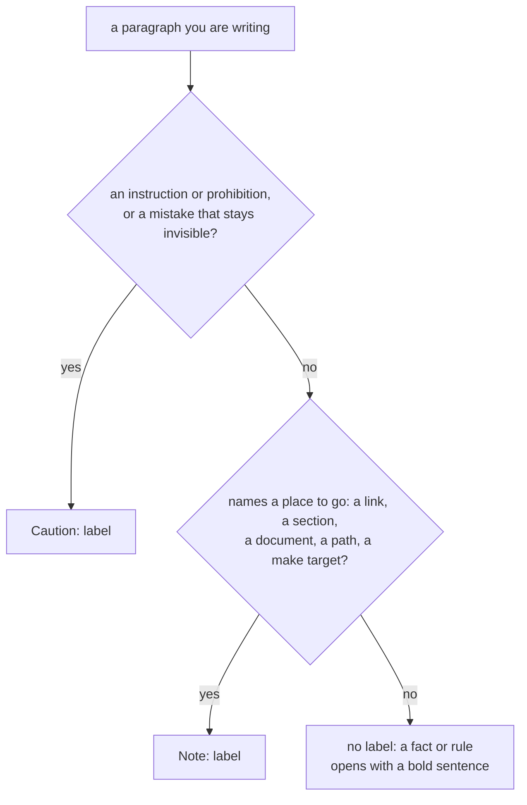
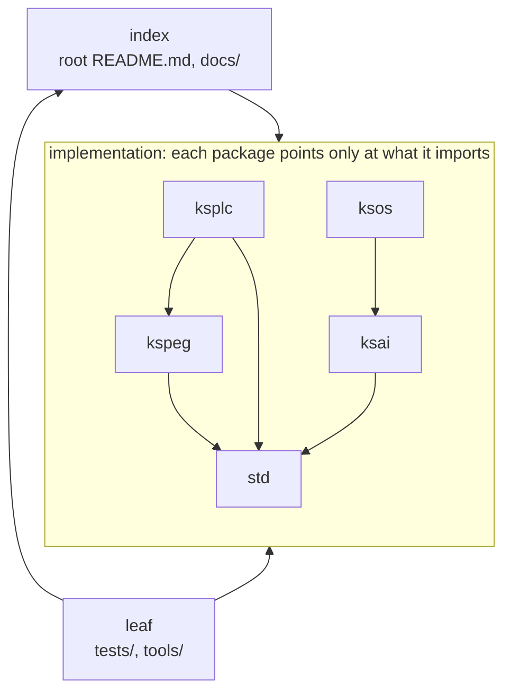

# The specification for the documents

This file sets the rules every document in this repository follows: which words it uses, what the file is called, how the text is worded and laid out, and which other documents it may point at. Read it before you add or change a document.

It is a specification: it states the rules, and does not argue for them. Two gates (checks that CI runs and that can fail the build) check the parts a machine can see: `make test-docref` checks references, and `make test-conventions` checks names and layout. Why each rule was chosen is in [`DESIGN-principles.md`](DESIGN-principles.md); which document to read for what is in [`README.md`](README.md).

## Terms of art

The words in this table have exactly one meaning, in every document and every source comment. Use them with that meaning.

Caution: **Do not reach for a synonym.** If one thing has two names, the reader has to stop and work out whether they are the same thing.

| Term | What it means |
| :-- | :-- |
| **canonical source** | The single place a fact lives. Every other place points at it and never copies it |
| **rule** | A settled decision. It is not a suggestion, and not a description of how things happen to be |
| **gate** | One check that CI runs and that can fail the build |
| **fire** | What a check does when it catches a violation. A check that cannot fire guarantees nothing (Principle 8 in [`DESIGN-principles.md`](DESIGN-principles.md)) |
| **guard** | What a check does for a rule: it watches for the rule being broken |
| **pass silently** | What a gate does when it runs but checks nothing, or skips itself. **It looks exactly like a real pass (green)**, which is why it gets its own word |
| **reject** | What the compiler does to a program it refuses to translate. This is different from a program that fails while it runs |
| **literal text** | The characters as written, as opposed to what they mean. A check that reads literal text misses every form it does not spell out |
| **declare** | What a file or a type does when it states what it is, so the reader need not guess |
| **block** | A region marked off by indentation or by braces. **Not a stage and not a table column** (see the next row) |
| **stage** | One step of a plan in `PLAN.md`, numbered inside its section. Every section counts from 1 again, and a stage that branches gets a letter (`stage 6a`) |
| **phase** | One step of the project's status in the root [`../README.md`](../README.md) (`Phase N`), and nothing else. A `PLAN.md`'s stage 2 and the README's Phase 2 are different things |
| **entry point** | Where control enters: a `main`, a folder's `README.md`, the first file a tool reads |
| **interface** | The way one part is reached from another. Narrowing access to one interface is a design decision, so it gets a name |
| **leaf** | The layer that only points upward (`tests/` / `tools/`). See the layer table below |

**Another language's vocabulary stays in that language's words.** Java's package, Go's module and apt's package are not translated into other words. A reader could not look a paraphrase up in that language's own documentation.

## Names for units

Four words name the units that code is organized in. Every document and source comment uses them with these meanings.

| Word | What it names |
| :-- | :-- |
| file | One `.kspl` source file. It is what `import` names, and `priv` keeps a name visible inside it only |
| folder | One directory. Inside one folder, files may import each other in a circle |
| package | Each of `ksplc/` `std/` … listed under "implementation" in the layer table below. It is the unit that is distributed, and a name with no visibility keyword is visible inside its package. **Packages do not nest**: only a top-level folder is one, and `kspage/lay/` is a folder (Java's and Python's packages nest; that is the one difference) |
| all | Everywhere: what `pub` opens a name to |

**When you name another product's unit, name its owner too** (`MSYS2's package` / `Java's package` / `an ES module`). A bare `package` is always KSPL's.

The rules for visibility and `import` are in [`SPEC-language.md`](SPEC-language.md). This section only sets which word to use.

### A folder's name is plural where it names its contents

**A folder that holds many things of one kind takes a plural name; a folder that names one part of the package around it takes a singular name.**

| The folder's name says | Number | Examples |
| :-- | :-- | :-- |
| What it holds, many of a kind | Plural | `tests/` `tools/` `docs/` `examples/` `benches/` `boards/` `drivers/` |
| One step or one aspect of the package it sits in | Singular | `parse/` `sema/` `lower/` `gen/` `fmt/` `lsp/` `model/` `lay/` `write/` `port/` `kernel/` |

**Which spelling is picked matters less than that a check guards it.** Where no build tool fixes a folder's name, every project spells it its own way, and a reader has to look before they can guess. So `make test-conventions` guards the rule, not anyone's memory.

**Do not give a folder and a file beside it the same name** (a `verdict/` beside `verdict.kspl`). An import finds a file by adding the extension to the name, so both resolve and nothing refuses them. But `ls` shows two `verdict` entries, and the reader cannot tell which is which.

**A folder inside a package may share a name with one at the root** (`std/tests/` beside `tests/`, `std/docs/` beside `docs/`), and that is intended: one word means one thing wherever it is written. So code that reads a path takes its first folder from where the path begins, not from the first folder name it recognises.

## Document naming

**Every document is one of six kinds, and its file name says which kind.** A folder's listing then tells the reader what each document is for before they open any of them, and no document holds what belongs to another kind.

| Name | The kind — what the reader does with it | Who reads it | What it holds | What it does not hold |
| :-- | :-- | :-- | :-- | :-- |
| `README.md` | **Route.** Arrive, and find the way | Everyone arriving; the one kind that greets all of them at once | What is here, the smallest usage example, further reading | An explanation, a manual, a rule of its own — it routes to the document that holds them |
| `TOUR.md` | **Learn.** Read the whole once | Whoever is learning to write KSPL | A walk through the language, generated from a program the gates compile and run | Anything written by hand |
| `HOWTO-<task>.md` | **Do.** Carry out one task | Varies with the task, so its first sentence says what you must already have | The steps in order, each with its command line and what it prints | Why a step is what it is, past the one sentence that stops the reader skipping it |
| `SPEC-<subject>.md` | **Look up.** Rely on an agreement | Whoever relies on the subject and cannot change it — the language, a tool's options, a board's wiring | The rules others can rely on, which change only with care | The reason a rule was chosen; anything that does not exist yet |
| `DESIGN-<subject>.md` | **Understand.** Change it without breaking what it protects | Whoever changes Kanso | Decisions, their grounds, and what each gives up, in the present tense | A rule's statement, a roadmap, a history |
| `PLAN.md` | **See what is left.** Know what is not done, and in what order | Whoever changes Kanso | The stages ahead, what marks each as done, and what is still undecided. **One for the repository**, [`PLAN.md`](PLAN.md) here: a section per package with work left, and one for what spans packages | Anything done — a done stage is deleted, and its result goes into the document of its kind |

**The name is written in capitals. A subject follows every kind that can stand more than once in a folder** (`SPEC-language.md`, `HOWTO-bring-up.md`, `DESIGN-compiler.md`), even where the folder holds one: a name that says only the kind does not say what the document is about. **A folder's design is split by theme**: each `DESIGN-<subject>.md` holds the decisions on one theme a reader comes to understand, a theme stands in one file, and a file holds as few themes as stay readable through. There is no entry document among them; the folder's `README.md` lists each one with what it holds. The subject may be any number of words. Choose the form the reader will understand ([`SPEC-local-server.md`](SPEC-local-server.md)): a name that does not say what the document is fails as an entry point, however short it is.

**One file, one kind.** A passage written for another kind moves to that kind's document once it is longer than a sentence. A `README.md` keeps the smallest usage example, but not a manual. A `HOWTO-` keeps a sentence of why, but not a chapter. The gates guard two things: every tracked `.md` carries one of the six names or one fixed from outside (`make test-conventions`), and a `SPEC-<subject>.md` cites no `PLAN.md` (`make test-docref`).

**Do not move a kind into a differently named document.** Putting the grounds in a `RATIONALE.md`, or the entry point in an `OVERVIEW.md`, makes two documents of one kind, and nothing decides which one is canonical. The six names are a closed list.

**A package with nothing left to do has no section in [`PLAN.md`](PLAN.md).** An empty section is one more heading for the reader to skip.

### Where documents sit

**Every folder that holds a document also holds a `README.md`, and a package's `README.md` is its entry point.** GitHub shows a folder's README without being asked, so it always speaks to the reader who has just arrived. The root README routes to every package's README, and a package's README routes to its deeper folders that have one.

**A package's `docs/` is the one exception: the package's own `README.md` lists its documents.** A `README.md` inside `docs/` could only repeat that list, a second copy to keep in step, and a reader reaches `docs/` from the package's README anyway.

**A package's other documents sit under `<package>/docs/`; only its `README.md` stands beside the sources.** People open a package's folder to find a source file, and each document beside the sources is one more name to read past. The `README.md` stays there because an arriving reader must meet it without being told where to look, and GitHub shows it on the way in.

### Documents whose name is fixed from outside

A few documents have names chosen by a tool or a convention outside this repository, which looks for them by that name. Renaming one hides it from the way people arrive at it. Each is listed in the entry point's table, since its name does not say which of the six kinds it is.

| Name | Who fixes it | What it is among the six |
| :-- | :-- | :-- |
| [`CONTRIBUTING.md`](CONTRIBUTING.md) | GitHub picks it up only under this name, from the entry point, `docs/`, and `.github/` | The `README.md` for the reader changing Kanso: it routes to the requirements, the gates and the rules |
| [`../LICENSE.md`](../LICENSE.md), [`../THIRD-PARTY-NOTICES.md`](../THIRD-PARTY-NOTICES.md) | The license's own terms, and the tooling that reads them | None — the text is the license's, not Kanso's to write |
| [`SECURITY.md`](SECURITY.md) | GitHub's `Security` tab shows a policy only under this name, from the entry point, `docs/`, and `.github/` | The `SPEC-` for whoever reports a vulnerability: where to report it, and what counts |

### What every README contains

**Every `README.md` carries these four elements.** Sections on particular subjects may sit between them.

| Element | Contents |
| :-- | :-- |
| **What is here** | A map of what the folder contains (a file table, a reading order, or an index organized by purpose). |
| **The smallest usage example** | A code block that can be copied and run, or one line of `make`. |
| **Further reading** | A guide at the end, under that heading, listing the same folder's other documents and the entry points of closely related folders. |
| **Who reads it** | A column on that guide **wherever the answer differs between the folder's documents**: who each one is for, and what they must already have (a toolchain, a browser, the board itself). Where every document has the same answer, the guide says it once instead of in a column. `make test-conventions` refuses a document the folder's README never names (for a package's `docs/`, the package's README). |

**The root `docs/README.md`, which only routes to its folder's documents, carries no usage example.** The documents it routes to hold the examples, and a copy in the index would be a second copy to keep in step.

**A folder in which nothing works says so at the top, instead of carrying a usage example.** An example that does not run, or an empty section, sends the reader looking for something that is not there.

**There is one skeleton for a README's headings.** A README need not have every section, but the sections it has take these headings, in this order. A section on a particular subject may sit between them.

| Heading | What it holds |
| :-- | :-- |
| `Run it` | The smallest usage example |
| `The idea` | The whole picture in a few paragraphs |
| `What is here` | The map |
| `Reading order` | Which document or file to read first, and what next |
| `Common changes` | Which files a typical change touches |
| `Pitfalls` | The traps the next person is likely to hit |
| `Files near the limit and how they split` | Where the folder needs it (below) |
| `Further reading` | The guide, always last |

**A README's heading carries no number and no time estimate** ("(30 seconds)"). Nobody can check a time estimate, and a number has to change whenever a section is added.

### Where a file's splitting plan is written

**When a file comes near the line cap (the most lines a source file may have), the `README.md` of its top-level folder says how the file will be split**, under the heading "Files near the limit and how they split". The reason for the cap is Principle 3 in [`DESIGN-principles.md`](DESIGN-principles.md). How to choose the cut is "Choosing where to split a file" in [`DESIGN-principles.md`](DESIGN-principles.md), and what counts as near is "Principle 3 - what is counted, and how" in [`SPEC-gates.md`](SPEC-gates.md). The check is `make test-conventions`.

**A top-level folder's README with no file near the cap may say so in one line**, in the form "No file in `<folder>` exceeds 900 lines". `make test-conventions` checks that line against the tree. It fails if a file under the named folder is over 900 lines, or if the number in the line differs from the check's number.

**Do not write a file's line count there.** It changes with every edit, so only what is split out and where it goes are written.

Caution: **Read the plan before touching a file it names.** A file named there is touched only once "what is split out" and "where it goes" are written for it.

**Write where it goes as a name plus the folder it will sit in**, not as a path: "a new `locate.kspl` under `ksplc/base/`". A path reads as pointing at a file that exists, and `make test-docref` reports one that does not. The destination is a file nobody has made yet, so there is nothing to point at.

## Wording and formatting rules

These rules keep every document written the same way. **Adding to the documents without reading them makes them inconsistent**: what the markers mean, and how lines are wrapped, start to differ from one section to the next.

### A fact goes where its neighbours already are

**Where a table already covers a subject, a new fact about it becomes a row or a column of that table**, not a paragraph beside it. Written as a paragraph, the subject is stated in two places, and when one is edited nothing shows that the other is out of date. The reader pays first: they read the table, believe they have the whole subject, and skip the paragraph.

**A paragraph beside a table says only what the table cannot hold**: why a column exists, a caution about filling one in, or the one consequence that does not fit in a cell.

**A passage that repeats what another document states is deleted, not reworded.** A pointer to that document replaces it, so there is one place to edit.

**No count decides this.** A person reads for it, as with "one file, one kind": a machine can see that a table and a paragraph sit side by side, but not that they say the same thing. Other projects' style guides set the shape a list takes and stop there.

### Caution markers go only on things that break if ignored

Two labels can open a paragraph: `Caution:` for something that breaks if the reader ignores it, and `Note:` for a pointer to somewhere the reader can go. Everything else carries no label. **This rule applies to source comments too**, with the same scope as Principle 7 in [`DESIGN-principles.md`](DESIGN-principles.md) (comments, README, DESIGN, SPEC: all of them).

Both labels are plain ASCII.

| Label | What it goes on |
| :-- | :-- |
| `Caution:` | **An instruction or a prohibition** ("do X", "do not do X", "X must never happen"), or a warning that it breaks silently: if it is not obeyed, the mistake stays invisible ("silently", "no one notices", "it passes anyway") |
| `Note:` | **A supplement that names somewhere the reader can go** — a link, a section, a document, a path, or a `make` target. It never carries an obligation |

The choice for one paragraph goes like this; the table above is the rule, and the chart only shows the order of the questions.



**A name in backquotes on its own does not count as a place.** To a person, `check_line_wrap` reads as a pointer; to a machine, it is just another word in backquotes. What earns the `Note:` label is a destination that can be opened: a link, a `§`, a document's name, a path holding a `/`, or a `make` target in backquotes.

**A supplement that names nowhere is still written; only the label goes.** A measured figure is still stated, and a reason is still given.

**A fact or a rule of the specification gets no label** ("X is Y", "there is no X", "X becomes Y"): a bold opening sentence already does that job. No other lead word is a label either. A paragraph opening with "The rule:", "The decision:" or "Settlement:" drops that word and keeps its bold sentence.

**Do not rewrite the sentence when removing a label.** Only the label goes; the sentence keeps its position and its words.

Caution: **Do not put a label on every assertion.** Then the reader cannot pick out what to obey, and in the end skips the labels altogether.

#### Where a label goes

**The label comes first, and a line holds only one.** In a source comment it follows the comment opener directly, whether the comment has the line to itself or follows code. In a document, where a paragraph is one line, it opens its own paragraph. Two labels on one line are two thoughts sharing a line, so the second takes a line of its own.

**A label stands alone.** Two labels within four lines are read as one, and readers learn to skip them. Where two are needed in one place, the second keeps its words and drops its label: a bold `**Do not X.**` still reads as a prohibition with nothing before it.

**Do not put a label inside a table cell or a heading.** A cell is short, and a label in one cell throws it out of balance with the cell beside it. A heading is already the loudest line on the screen. In a comparison table every cell is a contrast, so a label there would carry no more weight than its neighbours.

#### The two exceptions

**One alert box stands in the whole tree: the root `README.md`'s status notice**, written as GitHub's alert (`> [!CAUTION]`) directly under the title. It is the one caution every arriving reader must see before anything else, and a coloured box is what reaches them. Repeated elsewhere, the box would stop standing out, so every other caution keeps the plain label.

**The two labels are not the compiler's words.** A diagnostic (a message from the compiler) carries `error` / `warning` / `information` / `hint`, and neither label is one of them. So `warning` in a line of text is always the compiler speaking, and a label is always a person speaking to the reader. That is why `Warning:`, which Google's style guide offers, is not used here. A few diagnostics use the bare word `Note:` inside their own message text; that is the compiler, not a label.

#### No gate counts the labels

**Whoever writes and whoever reviews keeps this rule.** A green run says nothing about it (Principle 8 in [`DESIGN-principles.md`](DESIGN-principles.md)).

### A trap is written as why it is dangerous

**A trap (a mistake that is easy to make) is written in the present tense, as the reason it is dangerous**, never as the story of how someone found it.

| | Example |
| :-- | :-- |
| ✓ | "Walk inside the struct too. The outermost layer alone misses a slice buried inside" |
| ✗ | The same content told as a past-tense experience |

### Another product is named for its behavior, not judged

**Name a product, a language or a company only where what it does grounds a decision here, and describe what it does.** "Excel and Word put redo and repeat on one key, so which a press does cannot be told beforehand" grounds a choice; "Excel is complained about for this" does not. Where only the complaint grounds the decision, the complaint stays and the name goes ("a common complaint is …").

**Do not write a verdict on another product, nor that this one does better**: "a classic accident", "not well regarded", "ahead of". A verdict reads as a claim against that product's users. A behavior is a fact anyone can check, and only a fact grounds a decision. This holds in documents and comments alike.

### A word-for-word idiom gives way to the plain word

**Write the plain English word, not a phrase built word by word that English does not use.** The reader has to translate such a phrase back before the sentence says anything, and a model reading it has nothing to translate it from.

| ✗ Built word by word | ✓ Plain English |
| :-- | :-- |
| the calling side | the caller |
| a mouth, an entrance | an entry point |

This holds in documents and comments alike. A span in backquotes is code, which keeps its own names.

### Do not hard-wrap paragraphs

**One paragraph, or one bullet item, is written on one line.** Wrapping is left to the width of the reader's window.

**Do not pick a column and wrap by hand.** Markdown shows a newline inside a paragraph as a space, so a stray space appears mid-sentence. The wrap points also move every time the text is edited, so the diff looks like a change in content.

### A document carries no list of its own headings

**A document holds no hand-written table of contents.** The editor's outline and GitHub's outline button list the headings from the headings themselves. A list written by hand has to be edited with every heading it names, and a heading added later is missing from it with nothing to show it.

### Escape vertical bars only inside tables

**A notation containing `|`, such as the generic `<|T|>`, takes a backslash before each bar only inside a table row.** In prose it is written bare.

```
prose       `Option<|T|>`
table cell  `Option<\|T\|>`
```

* **A bare `|` inside a table splits the cell**, even inside backticks: GitHub's Markdown cuts a row into cells before it reads what is inside them. Cells beyond the header's count are thrown away, so the prose after `<|` disappears from the rendered page, and reading the source does not reveal it.
* **A backslash before it in prose shows up as a backslash**: inside a code span (backticks) it is not an escape.
* To show the escaping itself, put it in a code block, where it comes out as written.
* The check is `make test-conventions`, which also checks that a table row's number of columns agrees with the header.

### A heading holds no double quote

**Write a quote inside a heading as `'`**, outside a code span. A comment or a document cites a heading by its text in double quotes, so a `"` inside the heading would end the citation early, and nothing would check that the citation still matches. `make test-docref` refuses such a heading. A code span may hold the notation it names (`` `~"..."` ``).

### A code block compiles, or says why not

**A ` ```kspl ` or ` ```kspl ` block is KSPL, and `make test-docsnippet` compiles it.** It compiles the block inside a copy of the package whose documents hold it, so a name the package keeps to itself resolves as it does for the package's own files. A reader copies what a document shows, and a model takes it for the language.

| The block | What it must do |
| :-- | :-- |
| **A whole program** (it holds `main`) | Compile as it stands, and draw nothing from `ksplc lint` (the linter), not even a hint, as `make lint` asks of the tree |
| **A block carrying a mark** (below) | Compile once its marked lines are taken out, so it carries what it needs: its imports, the declarations it calls |
| **A fragment** (neither) | Read as KSPL. It is compiled as it stands and with its statements wrapped in a function; where neither compiles, it leans on the prose around it |

**A line the compiler refuses ends in `// error:` and the reason** (`x: U8[] = "n=\{n\}" // error: it cannot build a value`). The mark covers its own line, and also the lines that belong to it:

| The marked line | What the mark covers |
| :-- | :-- |
| Opens nothing: `x: = f(1) // error: …` | That line alone |
| Opens a block: `fn first(xs: U8[]): U8 // error: …` | That line, and every line after it that is indented deeper (the function's body) |
| Leaves a bracket open: `n: = pick(1, // error: …` | That line, and the lines after it up to the one that closes the bracket |

`make test-docsnippet` first compiles the block with every covered line taken out, as the table above asks. Then, for each mark, it puts back only that mark's lines: the compile must fail, and every error must fall inside what that mark covers. Where a block has two marks or more, it also puts all of them back at once, and every error must still fall inside some mark's cover. So each mark points at a real error, and no error hides on a line no mark covers.

**A mark ends the line it marks, spelt `// error`.** On a line of its own it names no line, and `// Error` would be a second spelling of one mark.

**Two marks excuse a whole program, or a block carrying `// error`, that does not compile.** Each is written where the reader sees it:

* **An elision**: `...` or `…` outside a comment, where the writer left part out.
* **A first line naming the file it needs beside it**: `// app.kspl (the KSPL customer; greet_api.kspl is beside it)`. A block with this line that compiles alone fails, since the line no longer says anything true.

**A tour's blocks are steps of one program.** `make test-docs` compiles and runs that program, so the blocks are not compiled one by one.

There is a gap: a fragment that does not compile is taken as leaning on the prose, whatever the reason, so a refusal in it goes unseen unless the fragment carries a mark. A form that escapes the check is still a violation (Principle 8 in [`DESIGN-principles.md`](DESIGN-principles.md)).

## Reference direction between documents

**A reference between layers or packages points one way only: down from the index, from a package to a package it imports, and up from tests and tools.** References are useful: they are the shortest path to "why is it this way". The trouble is that they go out of date without anyone noticing. So rather than cutting how many there are, **`make test-docref` checks every reference**, and the rules below fix which way each may point.

### The layers

The repository has three layers. From the top:

| Layer | Contents | Role |
| :-- | :-- | :-- |
| index | The root `README.md`, `docs/` | Shows where everything is. **May point downward** |
| implementation | `ksplc/` / `std/` / `ksai/` / `kspeg/` / `ksos/` / `kssrv/` / `ksdb/` / `kspage/` / `ksbind/` | References among them go **only in the direction of import** (`ksplc→std`, `ksai→std`, `kspeg→std`, `ksos→std`, `kssrv→std`, `ksdb→std`, `kspage→std`, `ksbind→std`, `ksplc→kspeg`, `ksos→ksai`, `kssrv→ksai`, `ksos→ksdb`) |
| leaf | `tests/` / `tools/` | Point upward only |

The chart shows the shape with a few of the packages; the table above is the full list of directions.



`ksos→ksdb` exists because `ksos` keeps an append-only record inside a device. `ksdb/` itself uses only `std/`.

**Do not create the reverse.** Once `ksdb/` knows a particular device or document, the point of being able to use it anywhere is lost.

Caution: **Do not create sideways references between packages.** A pointer from `std/` to `ksplc/` or `ksos/` has no dependency behind it, so moving either end goes unnoticed. The same holds between `ksplc/`, `kssrv/` and the other packages.

**No edge goes from implementation to leaf, data included.** A package's examples and benchmarks stand inside it, so whatever is built on its parts goes with them ("A package's examples and benchmarks stand inside it" in [`DESIGN-repository.md`](DESIGN-repository.md)). The `ksos` Cortex-M demo embeds the weights in `ksai/examples/` through `ksos→ksai`, an arrow in the table. Do not copy the weights into `ksos/`: a copy makes two sets, and only the retrained one is current.

**Do not build a documentation signpost from implementation toward leaf.** "Which tool is built on these parts" and "which suite runs them" belong to the leaf (which may point upward) and to the index (which may point downward). If a package held them, a lower layer would know the names of its users, and would need editing every time a user is added.

**When adding an edge of this shape, fix both the table and the check.** `make test-conventions` checks that they agree; the machine-readable list the check holds is `layer_to` in `tests/suite/docref_test.kspl`.

Note: **The code is read against the same table.** `embed` (baking a file's contents into the program) is a reference between packages just as `import` is. So the check "import's and embed's directions are as the convention says too" in `make test-docref` reads both, and only those two, in `.kspl`. A path string opened at run time (one passed to `io.read_file`) and names written in build files escape it. A form that escapes is still a violation (Principle 8).

### Naming is not depending

**Keep "naming" and "depending" apart.** The layer table forbids a tie in a direction where there is no dependency. The two kinds of name below are dependencies in themselves, so the source names them even in a direction the table does not list.

| May be named | Example | What happens if it is not written |
| :-- | :-- | :-- |
| **One half of an implementation** | The bodies behind `std`'s `extern` are in `ksplc/gen/runtime/`, and the region holding the panic record is defined by `ksos/port/*/link.ld` | If a name drifts, it breaks silently. Whoever fixes one half cannot fix the other |
| **A premise behind a rule** | `Map`'s hashing is not randomized because `kssrv/`, `ksdb/`, and `kspage/` do not use `Map` | When the premise changes, the rule stays with nothing to show why |

**Anything whose name one package alone cannot fix is also "one half of an implementation".** `ksplc/` matches names written in `std` (trait and operator names), turns syntax into calls on `std` (string interpolation, `for..in`, inserting `retain`/`release`), and rejects certain forms on sight (deciding use-after-free). In each case the pair is split across two packages, and when one half is renamed the other silently comes loose.

**Do not add these to the arrow table.** Naming is not depending, so the set of directions `make test-docref` allows does not grow.

**Do not name anything that is not one of those two.** "Who uses this" and "which test guards this" are not dependencies but signposts. The first belongs with the user, and the second is stated by the name of the make target (as in `make debug` / `make test-conventions`).

**Do not name a test's file.** When the test moves, the annotation in the lower layer is left stale.

**Links between documents are not made even for the two above.** Between `.md` files the check refuses on direction alone, so it allows no exception. An implementation half or a premise is named in the source (in an annotation), and documents link to each other through the index.

Note: `make test-docref` checks that what is named exists, so a deleted name cannot rot silently.

### What a SPEC may point at

**`SPEC-<subject>.md` does not point at the `DESIGN-principles.md` / `SPEC-*.md` of a folder below or beside it.** Once a specification depends on an implementation's design, replacing the implementation means editing the specification, and nothing decides which is canonical. Only the three references below are allowed, and `make test-docref` accepts exactly these.

| Allowed reference | Reason |
| :-- | :-- |
| To an index (`README.md`) | Where things are is outside the specification's concern |
| Upward (to the language specification or design rationale in `docs/`) | A specification may rely only on agreements above it |
| **To the `DESIGN-principles.md` in the same folder** | They are edited together, so the same person notices when they drift |

Even within one folder, **do not copy the rule itself.** The specification holds the rule, and `DESIGN-principles.md` holds why that rule was chosen. Written in both, the rule sooner or later loses an exception in only one of them.

**A `SPEC-<subject>.md` cites no `PLAN.md`, in any folder.** A specification relies only on what exists, and a plan holds only what does not exist yet; `make test-docref` refuses the reference.

### Writing a reference

**If you write a section number, name its document in the same sentence.** `make test-docref` reads two forms: a number with its document named, and a number in the current document. A bare `§N` that is neither has nothing to match against. Where the number can be avoided, pointing by the heading's name is sturdier.

| Form | Check |
| :-- | :-- |
| `SPEC-language.md §6.1`, or a link to the heading | Checks that it exists in that document |
| `§6.1` in this document | Checks that it exists here |
| `§6.1` with no document named nearby | **Fails** (nothing to match against) |

**There are gaps.** A paragraph that names document A is exempt as a whole, so a section number from document B written there escapes the check. A form that escapes still breaks the rule.

**A link's destination is relative to the file it is written in.** The bare form (`kspage/README.md`) may also count from the repository root, but the destination of `[…](…)` counts from that file's folder, as Markdown defines it. `make test-docref` checks that it exists.

Caution: **Do not write `[I0301](description)`.** A `(` directly after `]` makes a link, so what was meant as a description becomes a link to a file that does not exist. To add a description, separate it: `[I0301] the description`.

**If you point at a heading by name, prefer a link.** A link's `](…#anchor)` must match a heading exactly, so it is the tightest check.

**A name in quotes beside the document is checked too**: `` `X.md`'s "Name" ``, `"Name" in X.md` and `` (`X.md`, "Name") `` alike. `make test-docref` accepts the name only where that document names things:

| Where the name stands in document X | Accepted? |
| :-- | :-- |
| Inside a heading | Yes |
| Inside a bold span | Yes |
| At the head of a table cell or a list item | Yes |
| Anywhere else | No |

A mention anywhere else does not count because a document mentions its partner's names when it cites them back, and such a citation must not keep a renamed name alive. A quoted name is still looser than a link: any part of a heading matches, so a wrong name survives as long as its words stay inside some heading.

**The anchor of a heading that starts with an emoji carries a leading hyphen.** The id of `## 🏗 Architecture` is `#-architecture`: the symbol drops out and the one remaining space becomes `-`. It looks like a typo but is correct; removing the hyphen makes `make test-docref` report that the heading does not exist.

**A `Phase N` is named with `README.md` nearby**, so the reader can trace the numbering to the root README ("Terms of art" above); `make test-docref` checks this too.

**A stage in another document is named with its document** ("the board material's stage 8", "the tools plan's stage 1"), since every plan counts its stages from 1.

## Linking documents to source

**A document points at the source by file and symbol name, and no marker in the source points back at a document.** References are needed not only between documents but also **between a document and the source**: from a design document to its implementation, from a specification to its check.

Caution: **Do not make it a round trip.** The grounds, and what is given up, are in [`DESIGN-repository.md`](DESIGN-repository.md), "Linking a design document to the source"; what lives here is only the rules.

* **The canonical source is the source, and there is one.** A document points at it and never copies it.
* **The direction is document → source only.** No marker on a symbol names a document.
* **Point by name** (file and symbol names), never by line number.
* **If what is pointed at is absent, it fails**: `make test-docref` refuses a deleted or renamed name.
* **A comment that points is read the same way** as a document's link.
* **Do not copy an example; point at the test.**

**Do not add markers in the source.** Markers are for things only a machine can tell (the origin of a generated file, and a few others like it).

**What the check reads of a name** is a name in backticks tied to a file in backticks: `` `name` in `file` `` (or `of` / `inside`), a run `` `a` / `b` in `file` ``, and `` `name`(`file`) ``, in documents and comments alike. The file must exist and hold the name as a word; for `` `Owner.member` `` it must hold the member as well as the owner (why is "A comment that points is checked as a document is" in [`DESIGN-repository.md`](DESIGN-repository.md)). A form that escapes is still a violation: a name joined by "and", or a file named without backticks, is not read, but the rule applies to it all the same.

**In a comment, the compiler reads a dotted name tied to no file** as the code beside the comment would read it. A dotted name is an owner and a member joined by a dot, such as `List.push` or `io.out()`. The compiler looks the owner up among the names the commenting file can see (its own declarations, its imports, and `std/lang`, which every file sees), then looks for the member in that owner. Where the owner is found and the member is not, as with a method since renamed, the name leads nowhere and gets a warning (`[W0211]`; `ksplc explain W0211` gives what is read and what is left alone). The editor's hover reads the name the same way and links it to its declaration (why is "A pointer that names no file is read through the commenting file's own scope" in [`DESIGN-repository.md`](DESIGN-principles.md)). Write a name another product owns with its owner in front ("Python's `` `json.dumps` ``"). That is the one wording both readers, the compiler and `make test-docref`, leave alone.

**A dotted name in a document tied to no file is read against the declarations of the whole tree**, as `ksplc doc --surface-scope=all` lists them. A document imports nothing, so it has no smaller set of names to be read against. `make test-docref` judges the name by its first part:

| The first part | Example | Refused when |
| :-- | :-- | :-- |
| A type the tree declares (its name starts with a capital) | `List.push` | The type has no such member, counting every file that adds members to it |
| The name of a standard library file directly under `std/` | `io.out` | That file declares no such name |
| Anything else | `root.children` | Never: a lower-case word is as often a variable the prose speaks of |

A member that the document's own KSPL blocks declare counts too, so a document can name what its example declares. The spellings a comment's reading leaves alone are left alone here as well: a name tied to its file (checked against that file instead, as described above), a name introduced as another product's, a file's name (`edit.kspl`), and a code fragment (`io.out().s("x")`).

**A `make` command in a document names a target make has.** A code span opening with `make`, or a line of a fence, is read, and `make test-docref` asks make itself for its rules. A document inside a package with its own `Makefile` may name that file's targets, and so may a sentence that names the target a package's (``ksbind's own `make test` ``).

**A description written in a source is read where it is written.** `ksplc doc` prints it as it stands, with nothing rendered beside it, so a relative link in it resolves from the source's folder, as in any comment.
