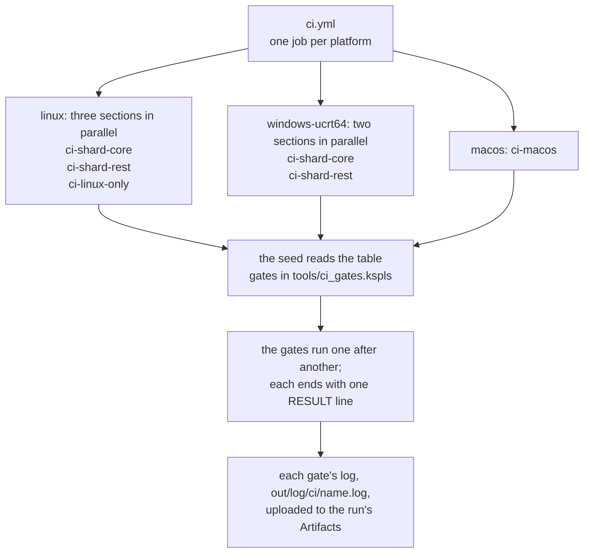

# The specification for the gates

This file says what CI runs, what every gate promises, and what the checks count. CI (continuous integration) is the automatic build-and-test run on GitHub's machines. A gate is one check that CI runs and that can fail the build ("Terms of art" in [`SPEC-documents.md`](SPEC-documents.md)). How to run the gates yourself is in [`HOWTO-build.md`](HOWTO-build.md); why a gate has its shape is in [`DESIGN.md`](DESIGN.md) and in the design document of the package it inspects.

## How CI runs

CI runs the gates on three platforms, Linux, macOS and Windows, with one job for each, as `.github/workflows/ci.yml` sets out. The table in "What each platform runs" below says which job runs which check. Update that table with every addition, so that a check added on one platform and never on another stays visible: `make test-conventions` refuses a gate of `tools/ci_gates.kspls`, or a suite of a `SUITES` list, that the table does not name.

**CI runs only once a week, late at night (the time is `cron` in `.github/workflows/ci.yml`), and when someone launches it by hand from the Actions screen.** It does not run on each push. So "CI is green" does not mean a given commit is green: the scheduled run inspects the default branch as it stands at that moment. After 60 days with no activity in the repository, GitHub stops the scheduled run; re-enable it from the Actions screen.

**A manual launch can choose which jobs run.** "Run workflow" shows a checkbox per job, all ticked by default. An unticked job takes no runner (no machine is started for it) and is not billed. GitHub's billing documentation counts each job's wall-clock time, rounded up to the minute, times the runner's factor, and adds them up:

| Job (its checkbox) | Platform | Factor on each minute |
| :-- | :-- | :-- |
| `linux` | Linux | ×1 |
| `windows-ucrt64` | Windows, in MSYS2's UCRT64 environment | ×2 |
| `macos` | macOS | ×10 |

So macOS has the shortest wall clock but costs the most. A green run with a job unticked covers only the jobs that ran. A scheduled run has no choice (`inputs` is empty).

Caution: **When adding a job, add an input of the same name and an `if:` that reads it.** Either one alone breaks silently: the input alone is a checkbox with no effect, and the job alone runs whatever is ticked. `make test-conventions` checks that they match.

**To drop a job from some scheduled runs, write its condition as "not the cron of the runs it is dropped from", never as "the cron of the runs it runs on".** If the cron changes, a condition that names it stops matching, and the job stops silently and for good. `make test-conventions` also checks that this cron appears in the `schedule:` declaration.

## How a run is read

**Every gate ends with one verdict line**, in one notation for all gates, starting at the head of the line.

| Line | Meaning |
| --- | --- |
| `RESULT: ALL PASS[ (breakdown)]` | Everything passed; the parentheses hold a breakdown such as a count |
| `RESULT: SOME FAILED (count)[ -> name]` | It failed |
| `RESULT: SKIPPED (reason)` | It passed silently, for want of a tool or the like |

CI looks only for `RESULT: ALL PASS` (`Gate.verdict` in `tools/ci_gates.kspls`).

Caution: **When adding a gate, make it print one line in this notation.** A notation per gate needs a reader per gate on the CI side, and a bug in such a reader stays green.

**Do not begin anything but a verdict with `RESULT:`.** Other lines that a gate prints take their own word. The canonical source is `finish` in `std/verdict.kspls`.

| A line that starts with | Holds |
| :-- | :-- |
| `RESULT:` | The gate's verdict, and nothing else |
| `OUTPUT:` | The path of a built file |
| `NOTE:` | A refusal along the way, or a child that took three quarters of its time cap (`run_child` in `std/verdict.kspls`) |

**One gate's full log is in the run's Artifacts** (the files a run keeps for download). The log on screen merges a whole job into one stream, and a reader that gets only the tail (GitHub's API) cannot see its middle. `tools/ci.kspls` writes each gate's log to `out/log/ci/<name>.log`, and the workflow uploads it as `log-<job>-<section>`. It uploads on a failing run too (`if:always()`), which is the run you need it for.

**The log's tail lists what actually ran.** `make ci` / `ci-linux` / `ci-macos` end by listing the gates they ran and the seconds each took (`gate seconds:` is the total). The list is read from `out/log/ci/` itself, not written by hand. Where the time goes, and what shrinks it, is "Where CI's time goes" in [`DESIGN.md`](DESIGN.md).

**A gate that passed silently on an expected SKIP stays in the list as `PASS`, with its `SKIP` lines printed under it** (`test-ksos-link` off Linux, `test-kspage-browser` with no browser), and the count line says how many gates carry one, so only reading the list reveals it.

## How the gates are arranged

**Which gates run, and in which job, is one table: `gates` in `tools/ci_gates.kspls`.** Each row is a gate, what `make` is asked for, and which job runs it. Each make target below only names its set, and the seed runs the table. (The seed is the compiler's frozen copy in C, `ksplc/seed.c`, which every build starts from.) So a compiler that the round is still checking never decides what is checked.

| Target | What it runs |
| :-- | :-- |
| `ci` | The gates common to Linux and Windows (ucrt64) |
| `ci-linux` | `ci` plus the Linux-only gates |
| `ci-linux-only` | The Linux-only gates alone |
| `ci-shard-core`, `ci-shard-rest` | One job's share of `ci`: the two halves the Linux and Windows jobs split it into |
| `ci-macos` | macOS's set |

The workflow only calls the targets, so **to change which gates run, fix the table**, not ci.yml. The same targets reproduce a run on your own machine.

The chart shows one run, from the workflow down to the logs.



**The common gates run as two sections, in parallel, as separate jobs.** `ci-shard-core` runs self-host (the compiler rebuilding itself) and one half of the regression suites, and `ci-shard-rest` runs the rest and the other half. The suites are dealt across both halves rather than kept whole, so that neither half makes its job wait much longer than the other; `SUITES_B` in `mk/test.mk` says which suite goes where. Linux runs three jobs: these two and `ci-linux-only`. The number of sections is set by how many job start-ups can be paid for, not by what divides evenly (the grounds are "Where CI's time goes" in [`DESIGN.md`](DESIGN.md)).

**Always measure the usage time before adding a section.** The cheapest way to shrink the wait is not splitting but choosing which jobs run ("How CI runs" above).

**"Everything ran" rests on a chain of three checks**, since a job sees only its own section, and its tail lists only that section.

1. Every set refuses to start while a gate of the table is in no set.
2. `make test-conventions` checks that every section is in the `.yml`'s matrix (`tests/support/conventions_ci.kspls`).
3. GitHub checks that each job is green.

**Do not remove `fail-fast: false`**: without it the first failing job cancels the rest, and their results are lost.

**The gates run one after another, in the table's order, and a gate that fails does not stop the set**, so one round names every gate that falls. Only the self-host stops it (`Gate.stops` in `tools/ci_gates.kspls`): the gates after it build on what it built, so what falls after it is noise. Inside a gate whose `par` in `tools/ci_gates.kspls` is `parallel` or `synced`, the items run in parallel (`-j<jobs>`). `lint` / `test-suites` / `test-ksos-link` / `test-ksos-posix` / `test-ksos-qemu` are each split into one target per item, so a failing item is named by its target.

**Every demo `test-ksos-posix` and `test-ksos-qemu` run has a time cap** (`KSOS_RUN_CAP` in `ksos/Makefile`). One that hangs fails its item with a `[FAIL] … it hung` line instead of stalling the set; `test-ksos-posix` first checks that a run spinning for ever is stopped that way.

**Items that hold a fixed resource are listed as serial** (`KSOS_QEMU_SERIAL_DEMOS` / `KSOS_POSIX_SERIAL_DEMOS` in `ksos/Makefile`; their comments say which resources, and why the serial items are the ones listed).

## What each platform runs

**The table says what CI runs, not what passed.** ✅ means the job runs the check, and ➖ means it does not. A note number points at the note below that says why, or adds what a reader needs to know. The Linux job runs inside a container image built from `.devcontainer/Dockerfile`. That image is cached at `ghcr.io/<owner>/<repository>/devcontainer` (`imageName` in `.github/workflows/ci.yml`; only a run on main writes it), and is pulled rather than built while the Dockerfile is unchanged. The first run after the Dockerfile changes rebuilds the cache, and on that run alone the Linux job takes several minutes longer.

| Check | Linux (`make ci-linux`) | macOS (`make ci-macos`) | Windows (ucrt64, `make ci`) |
|---|:---:|:---:|:---:|
| self-host (the C backend) | ✅ | ✅ | ✅ |
| self-host-ship (the `-O2` build `make install` and the release ship emits stage2's C to the byte) | ✅ | ➖(note 22) | ➖(note 22) |
| debug tests | ➖(note 29) | ✅ | ➖(note 29) |
| debug-tools (the tests of `tools/`, the one folder of tests without a `Makefile`) | ✅ | ➖(note 29) | ✅ |
| lint | ✅ | ✅ | ✅ |
| lint-cfg (the semantic analysis inside the `#cfg(blas)` branch) | ✅ | ➖(note 2) | ➖(note 28) |
| test-negative | ✅ | ✅ | ✅ |
| test-equiv (C⇔LLVM equivalence) | ✅(note 1) | ✅(note 1) | ✅ |
| test-lsp (the language server, on ksplc's folder as its workspace) | ✅ | ✅ | ✅ |
| test-lsp-tree (the language server over the repository's whole tree) | ✅ | ➖(note 2) | ✅ |
| test-freestanding-math | ✅ | ✅(note 3) | ✅ |
| test-simd | ✅ | ✅ | ✅ |
| test-surface (the published API matches its record) | ✅ | ➖(note 2) | ➖(note 28) |
| test-docs (the language tour matches its program and output) | ✅ | ➖(note 2) | ➖(note 28) |
| test-emit-runtime | ✅ | ✅(note 4) | ✅(note 4) |
| test-ship (two libraries built with `--library`, static and shared, linked into a C and a KSPL program) | ✅(note 21) | ➖(note 2) | ✅(note 21) |
| run (the AI engine, a smoke test) | ➖(note 27) | ✅ | ➖(note 27) |
| test-run (`ksplc run`'s cache) | ✅ | ➖(note 2) | ✅ |
| test-llvm-abi (the calling conventions agree) | ✅ | ➖(note 2) | ✅ |
| test-ksos-posix (running on the POSIX host port) | ✅ | ➖(note 5) | ➖(note 5) |
| test-ksos-link (bare-metal linking, `test-ksos-ramtext` with it) | ✅ | ➖(note 2) | ✅(note 6) |
| test-ksos-qemu (bare-metal execution under QEMU) | ✅ | ➖(note 7) | ➖(note 7) |
| test-kspage-wasm (running the browser-facing wasm) | ✅ | ➖(note 8) | ➖(note 8) |
| test-kspage-browser (the input entry point in a real browser) | ✅(note 9) | ➖(note 10) | ➖(note 10) |
| test-kspage-served (on a page `kssrv --local` served) | ✅ | ➖(note 11) | ➖(note 11) |
| test-kspage-desktop (the `.desktop` entry `make kspage` writes for a double-click is valid) | ✅ | ➖(note 25) | ➖(note 25) |
| test-debug-line (the debug position points at the `.kspls`) | ✅ | ➖(note 2) | ✅(note 12) |
| test-split (split compilation builds the same thing as a single TU) | ✅ | ➖(note 2) | ✅(note 13) |
| test-layout-targets (every size ksplc folds is the target machine's, for each machine it knows) | ✅(note 26) | ➖(note 2) | ✅(note 26) |
| test-ast-cache (the parse cache does not change the result) | ✅ | ➖(note 2) | ✅(note 14) |
| test-property (a random expression matches on both backends) | ✅ | ➖(note 2) | ✅ |
| test-generic-matrix (each shape of a generic, reached each way, in each position: it builds on both backends and prints its value, or is refused at the user's line; a C or LLVM error is never an outcome) | ✅ | ➖(note 2) | ✅ |
| Fuzzing, each package's own `test-fuzz` run on its copy by `test-extract` (a shallow run on a fixed seed, which shows a regression; `make fuzz-long` goes deep, 2000 rounds a reader, with a fresh seed, by hand, and draws ksplc's property check 600 times on the same seed), none may die: ksplc's earlier stages on corrupted source (the compiler the suites run), and, built with the address sanitizer (note 23), kspage opening and laying out a corrupted document, std's readers on a corrupted byte sequence, ksai on a corrupted weights file and vocabulary | ✅ | ➖(note 2) | ✅(note 23) |
| test-kspls (ksplc reads indentation-written source directly, giving the same C, squiggles, hovers, and jump targets) | ✅ | ➖(note 2) | ✅ |
| test-kspls-trip (every tracked source goes round the two notations and comes back byte for byte) | ✅ | ➖(note 2) | ➖(note 28) |
| test-file-path (the logical name is stable however the entry point is written) | ✅ | ➖(note 2) | ✅ |
| test-js-syntax (the page's JS parses as syntax) | ✅ | ➖(note 15) | ➖(note 15) |
| test-broken-pipe (writing to nobody does not die, and output losing its destination ends quietly) | ✅ | ➖(note 2) | ➖(note 16) |
| test-extract (extract-ksplc / extract-rest), every package with its own `Makefile` built and tested from a copy of its folder alone | ✅ | ➖(note 2) | ✅ |
| The checks on the tree's text (conventions / docref / docsnippet / textrip / spec-claims / vscode / lint-gate / recipe-bytes / deps / pytools) | ✅ | ➖(note 2) | ➖(note 28) |
| The other suites (c-warnings / pilot-copy / cli / config / std-dir / thin-use / lint / fmt / link-rules / ext-import / doc / runtime / limits / decl-macros / spawn / place / visibility) | ✅(note 24) | ➖(note 2) | ✅(note 24) |
| self-host (the LLVM backend) | ✅ | ✅ | ✅ |
| debug tests (the LLVM backend) | ✅ | ✅ | ✅ |
| test-llvm-pkgs (kssrv's and ksbind's tests on code the LLVM backend built) | ✅ | ➖(note 30) | ➖(note 30) |
| test-blas (a real build of the optional BLAS backend: ksai's unit tests with `BLAS=1`) | ✅ | ➖(note 17) | ➖(note 17) |
| ksbind's own tests (the OpenSSL and SQLite bindings linked and run, from a copy by `test-extract`) | ✅ | ➖(note 2) | ➖(note 20) |
| perf-log (peak-memory regression, judged by `perf_guard`; time is recorded only) | ✅ | ➖(note 18) | ➖(note 18) |
| test-race (the programs that start threads, built with ThreadSanitizer, report no data race) | ✅ | ➖(note 2) | ➖(note 19) |

**The compiler's own suites run from a copy.** On Linux and ucrt64, `test-extract` copies ksplc's folder alone, rebuilds the compiler there, and runs that folder's suites (`test-negative`, `test-equiv`, `test-run` and the rest of `SUITES` in `ksplc/Makefile`) against it. macOS runs the ones its column marks by name, from the repository.

**The lint gate passes only when every count is 0, hints included.** It analyses the entry points listed in `LINT_TARGETS` in `mk/lint.mk`. A generic (code written once for many types) is analysed only where it is instantiated, that is, used with a concrete type. So code that only one entry point instantiates (`tests/debug/main.kspls`, say) escapes the gate unless that entry point is listed. `make test-lint-gate` checks that a file holding one information diagnostic makes `make lint` exit non-zero.

### Gates that pass silently where a tool is missing

**Some gates need a tool or a library that not every machine has. Without it, the gate says `SKIP` and passes silently.** **A SKIP its platform does not expect fails its gate**: `expected_skips` in `tools/ci_gates.kspls` holds, per platform, the reasons a round may skip for (the rows below), so a runner that loses a tool fails rather than going green. On Linux CI a setting marks most of these tools as required, so a missing tool fails the gate there instead; the devcontainer holds every one of them unless the row says otherwise. Elsewhere a green run has not checked what the gate checks. The note on each row says what the gate itself does.

| Gate | What it needs | On Linux CI | Elsewhere, without it |
| :-- | :-- | :-- | :-- |
| `test-ksos-link` (note 6) | The `arm-none-eabi` toolchain | Required: the root `Makefile` sets `KSOS_REQUIRE_ARM`, and the target fails without the toolchain | Prints `SKIPPED (no ARM toolchain)`, so a green `make ci` on ucrt64 has not checked bare-metal linking |
| `test-kspage-browser` (note 10) | A browser; the bundled one is an amd64 deb, so other machines pass silently too | Required: `ci-linux` sets `KSPAGE_REQUIRE_BROWSER=1`, so not finding one there means the image lost it | Prints `SKIPPED (no browser)`, so the input entry point is unchecked (as with `test-ksos-link`) |
| `test-race` (note 19) | Clang's ThreadSanitizer runtime | Required: `KANSO_REQUIRE_TSAN`, set in `mk/test.mk` on Linux | A C compiler without it gives a `SKIP` line. Windows has no ThreadSanitizer, so ucrt64 does not run it |
| ksbind's own tests (note 20) | OpenSSL and SQLite (libssl-dev, libsqlite3-dev) | Required: `KSBIND_REQUIRE_LIBS`, set in `mk/test.mk` on Linux | Where they do not link, a `SKIP` line, so a green `make ci` on ucrt64 has not run the bindings (as with `test-ksos-link`) |
| The fuzzers of std, kspage and ksai (note 23) | Clang's address sanitizer runtime | Required: `KANSO_REQUIRE_ASAN`, set in `mk/test.mk` on Linux | A `SKIP` line, and the fuzzing runs on a plain build. ucrt64's clang holds none, so a green Windows run has fuzzed those readers without it |
| `cli`'s two cases on a cache folder (note 24) | Root, or `sudo` without a password, which the devcontainer gives its user | Required: `KANSO_REQUIRE_CHOWN`, set in `mk/test.mk` on Linux | Where neither works, a `SKIP` line. Windows: neither case runs |
| `test-kspage-desktop` (note 25) | `desktop-file-validate` (`desktop-file-utils`) | Required: `ci-linux` sets `KSPAGE_REQUIRE_DESKTOP=1`, so a missing validator fails there | Says `SKIPPED` |
| `test-layout-targets`'s wasm32 run (note 26) | `wasm-ld` and `node` | Both are in the image, so the run happens | A `SKIP` line naming the missing tool; the C checks for every machine still run |
| `test-ship`'s Windows half (note 21) | `x86_64-w64-mingw32-gcc`, and Wine to run the result | Not required, and the Linux image does not hold it (its tool list is `.devcontainer/Dockerfile`) | A `SKIP` line naming what is missing, so a green Linux run has not linked for Windows |

### The notes

* **note 1**: `test-equiv` has no platform branch, so macOS runs it too, beside `self-host` / `debug` under `LLVM=1`, which exercise macOS's LLVM path.
* **note 2**: `ci-macos` runs only what is worth running on real macOS hardware (`Gate.macos` in `tools/ci_gates.kspls`). What it leaves out is judged not to depend on the platform, and Linux and Windows already pass it. When adding to it, fix that table and this one together.
* **note 3**: on macOS the gate handles two differences in Apple's toolchain. The linker drops unused code with `ld64`'s `-dead_strip` in place of `-Wl,--gc-sections` (chosen by `PLATFORM` in `GC_SECTIONS_FLAG`). And Mach-O, macOS's object format, needs the "segment,section" form for what `#section("...")` emits (handled by `KSPL_SECTION` in `ksplc/gen/runtime/core.h`). **Such differences cannot be counted in advance**: treat their number as unknown until a gate runs on real hardware.
* **note 4**: a program built by the LLVM backend holds no runtime (the support code every program needs, such as the checks that stop it on a bad index). `ksplc emit-runtime` writes the runtime as a separate C file, and the program is linked with it. A runtime from another ksplc version must not link silently, so the runtime ends with an empty function named after a hash of its whole source (`kspl_runtime_abi_` and 16 hex digits), and the program's `main` calls that function first. A runtime of another version holds another name, so the link stops on an undefined symbol. The gate links a program with a runtime whose function is renamed and checks that the link fails. Each platform's own linker resolves that symbol, so each platform runs the gate.
* **note 5**: `test-ksos-posix` runs demos of ksos's POSIX host port, which runs ksos's tasks inside an ordinary Linux process and switches between them with ucontext. **Nothing else exercises the host-side port layer, task liveness management, the ISR-safe API (the calls an interrupt handler may make) or the stack canary (a guard value that shows a stack overflow)**: `test-ksos-qemu`'s Cortex-M demos exercise the kernel core, not this port layer. It needs `<ucontext.h>`, which Windows lacks and macOS deprecates with no guaranteed behavior, so it is Linux-only.
  * The comment at `KSOS_POSIX_TEMPLATED` in `ksos/Makefile` says how a demo joins it; `KSOS_CM_DEMOS` and `KSOS_RP2040_DEMOS` take the same shape.
* **note 6**: `test-ksos-link` links ksos's bare-metal demos (programs that run on a microcontroller with no operating system) and needs the `arm-none-eabi` toolchain: a libgcc that defines soft-float and 64-bit integer division. **`test-ksos-ramtext` runs first, as its prerequisite**, so the two are green or absent together, never one alone. `test-ksos-ramtext` checks that each window function sits in RAM rather than in flash. A window function is code that must finish within a tight deadline or run while flash cannot be read, such as writing to flash or sending the timed signal of an LED strip (`rp2040_flash_in_window`, `rp2040_ws2812_send_window`); in flash it links fine and freezes only on the real chip. Where the toolchain is required and where the gate passes silently is the table above: the windows-ucrt64 runner holds no ARM toolchain, so it runs the gate and the gate says `SKIPPED`.
  * It checks the bare-metal demos under `ksos/demo/<port>/` (`cortex_m` / `rp2040`); the comment at `demo_stems` in `ksos/Makefile` says how the listing is built, and how a port joins it.
* **note 7**: `test-ksos-qemu` runs ksos's bare-metal demos under `qemu-system-arm` (an emulator of the ARM board) and checks that no failure marker (`[FAIL]` / `N FAIL`) appears in the log. A demo that links may still fail to work, and `test-ksos-link` checks only the link. Do not check the exit code alone: semihosting's exit (the way the demo ends the emulator) returns 0 whatever the demo's own verdict. The macOS and Windows runners have no qemu (as in note 8), so it is a Linux-only gate (`make ci-linux`).
* **note 8**: `test-kspage-wasm` builds `kspage`'s core to wasm32 (WebAssembly, which a browser runs) under `--freestanding` (no operating system, no libc), runs it with `node`, and checks that placing and editing give the expected result. The canvas is not inspected: text sizes are fixed values instead, since a browser's measurements change with the model and version. **The link checks that the set of imported functions has not grown**: `kspage/port/web/imports.txt` constrains it, not `--allow-undefined`, so libc code slipping in fails it. `wasm-ld` and `node` are in `.devcontainer/Dockerfile` but not on the macOS and Windows runners, so it is a Linux-only gate.
* **note 9**: **A gate that dumps the page and quits (`test-kspage-browser`) stalls on requests to outside hosts.** On a network where such a request never returns (a proxy holding the handshake, say), the time budget never runs out, and the gate times out with no marker even when everything works. So `KSPAGE_BROWSER_FLAGS` in `kspage/Makefile` turns off name lookup (`--host-resolver-rules="MAP * ~NOTFOUND, EXCLUDE 127.0.0.1"`), and such a request fails at once.
  * **Keep `127.0.0.1` excluded**: `test-kspage-served` connects to the local server. The bound page uses no outside resource, so cutting the network costs the check nothing.
* **note 10**: `test-kspage-browser` opens the built page in a real browser and checks where the focus is, whether the input field counts as visible, and how many characters each keystroke enters. **Neither running the wasm nor looking at the canvas shows these**, so `test-kspage-wasm` cannot replace it when typing works and only conversion fails. A real conversion is not checked either: a headless browser has no input method. The macOS and Windows runners have no browser (as in note 8), so it is a Linux-only gate.
* **note 11**: `test-kspage-served` starts `kssrv --local`, opens the page it serves in a real browser, and checks opening a file in a local folder and writing it back. **`test-kspage-browser` cannot replace it**: it opens the page from `file://` with no server, and checks only that no tools appear when there is none. The token travels in the opened URL's fragment (`#t=`), on the security grounds in [`DESIGN.md`](DESIGN.md), "A page asks the local machine through one protocol". The gate passes kssrv's printed URL straight to the browser and holds no copy of it. The run ends on the marker the page writes back, in real time, not on `--dump-dom` / `--virtual-time-budget` (why is at `KSPAGE_DUMP_FLAGS` in `kspage/Makefile`).
  * The page writes a marker to a file per item, so the last line of a list cut short names what it was waiting for. It is Linux-only, and does not pass silently, for the same reasons as `test-kspage-browser` (note 10).
* **note 12**: `ksplc/tests/suite/debug_line_test.kspls` has two tiers. The first, a pure text comparison that runs everywhere, checks that the generated C's `#line` points at the source's real line. **The second tier is Linux-only**: it checks that the `.kspl` name survives in the debug information of an executable built with `-g`. When one command compiles and links, macOS leaves `-g`'s DWARF (the debug information) in the `.o` / `.dSYM` rather than the executable, and Windows (MSYS2) is unverified. The LLVM backend emits no debug information, so it is out of scope.
  * Before widening it, confirm **both directions** on the target platform's real hardware: the name appears with `-g` and disappears without. Without that contrast the check goes green even while inspecting nothing.
* **note 13**: `ksplc/tests/suite/split_test.kspls` checks that a program built with `--split=N` (the generated C cut into N files) gives the same output as one built unsplit, and **always links and runs it**, since what splitting breaks shows only at link time. There is no platform branch (`harness_build.build_exe` asks `ksplc info link-libs` for the libraries to link). Splitting is C-backend-only, so the LLVM backend is out of scope; the test also checks that asking for both is refused.
* **note 14**: `ksplc/tests/suite/ast_cache_test.kspls` uses a cache location of its own (`KSPLC_CACHE_DIR`). It checks four things: the generated C matches byte for byte with and without the cache; changing the source rebuilds the entry; a corrupted entry is silently discarded; and old generations do not pile up. There is no platform branch.
  * **Check "changing only the contents rebuilds it" by rewriting the file at the same path.** A copy under another name changes the file name in the key, so an implementation whose key ignores the contents would pass too.
* **note 15**: `test-js-syntax` checks with `node --check` that the page's JS parses, per file and concatenated into the bound page. **It needs `node`, so it is a Linux-only gate** (as in note 8).
  * **Do not put it into the common `ci`**: that runs in three environments, and a local machine without node would fail it.
  * **The target exists in every environment**, so wherever node is installed `make test-js-syntax` runs it (the procedure is in the tools table under "Windows natively, without Docker" in [`HOWTO-build.md`](HOWTO-build.md)). It is a suite but not one of `test-suites`; such suites are listed in `LINUX_SUITES` in `mk/test.mk`.
* **note 16**: `test-broken-pipe` checks POSIX's handling of SIGPIPE (the signal sent when a program writes to a pipe nobody reads), so **Windows has nothing to check**: it has no SIGPIPE, and a write to a closed named pipe merely fails. The suite reads the C compiler's target triple (`-dumpmachine`) and says `SKIPPED` there, so it can be run anywhere. Of its three checks, only "a launched child holds SIGPIPE's default" reads `/proc/self/status`, so that check runs only on Linux (`SKIPPED` elsewhere).
  * Note: The decision's canonical source is "Writing when nobody is left to read it" in `ksplc/gen/runtime/hosted.c`.
* **note 17**: `make test-blas` (ksai's unit tests with `BLAS=1`; ksai is the one package holding `#cfg(blas)`) needs libopenblas, which the windows-ucrt64 and macOS runners lack (as in note 8), so it is a Linux-only gate. **`lint-cfg` cannot replace it**: it only runs semantic analysis inside `#cfg(blas)`, and only a real build shows whether the FFI (the calls into the C library) is right: argument order, types, the library linked. BLAS's library is named in the source (`#link`), so this is also where a named library is seen linked.
* **note 18**: `tests/tools/perf_baseline.json` holds baselines (with tolerance factors) taken on the Linux CI's real hardware. Applied to macOS or Windows as they are, they could raise false alarms or miss regressions, so the gate runs on Linux alone unless another platform's baseline is added.
  * Only the peak memory decides the verdict; the build time is only recorded, as a ratio to the baseline (why is in `tests/tools/perf_guard.kspls`).
* **note 19**: `test-race` builds these through the C backend with clang's `-fsanitize=thread` (ThreadSanitizer, which watches a running program for data races) and runs them: std's and ksplc's own tests (the packages whose tests start threads; the others' start none, which the coverage check below holds), ksai's examples with the tests that run them, ksbind's tests (where OpenSSL and SQLite link; required on Linux, as in note 20), and ksplc itself as the language server, played an editor's session: its supervisor reads the editor on a thread of its own while it restarts a crashed worker, and must end at `exit` with its input still open. It fails on any report from any process, the runtime's and libc's included. **It finds the races the tests reach, not the ones they miss** (why it stands in place of a type-system check is "Why data races are not prevented by the type system" in [`DESIGN.md`](DESIGN.md)).
  * **It shows that it can fire**: a program racing on purpose, built and run the same way, must be reported first. **And that it still covers what starts threads**: every tracked source that starts a thread is compiled into a program it runs, or named with the reason in `left_out` in `tests/suite/race_test.kspls`.
  * **No report is suppressed.** std, the runtime and the program are compiled from source into one unit, so nothing the sanitizer watches is uninstrumented, and a report is a finding to fix.
  * **The LLVM backend is out of scope**: clang instruments only the functions its own front end marks, so IR that `--to=llvm` wrote would run unwatched.
* **note 20**: ksbind's own `make test` links OpenSSL and SQLite, which the devcontainer holds and the windows-ucrt64 runner does not. `test-extract` runs it wherever it runs. `make lint` and `test-c-warnings` still read the bindings where they do not link.
* **note 21**: `test-ship` builds both forms with the host's own toolchain, natively on ucrt64. **Elsewhere it also cross-builds them for Windows where `x86_64-w64-mingw32-gcc` is installed**, and runs them only under Wine.
* **note 22**: `self-host-ship` pays for one `-O2` build of ksplc, so CI runs it once, in `ci-linux-only`, where a minute costs least. **The release runs it on each of its three platforms** before packing the executable (`.github/workflows/release.yml`), so what each platform ships is checked as built there.
* **note 23**: std's, kspage's and ksai's `test-fuzz` build the program they fuzz with the address sanitizer (which stops a program at its first out-of-range memory access) where the C compiler holds its runtime, and the driver prints a line saying which. ksplc's fuzz runs the compiler the suites inspect, which no sanitizer builds.
* **note 24**: two of `cli`'s cases check that ksplc refuses a cache folder others could plant entries in: one everyone can write, and one another user owns. Handing a folder to another user takes root, or `sudo` without a password. Windows's permissions are an ACL, which ksplc does not read, so neither case runs there.
* **note 25**: `test-kspage-desktop` writes the entry alone, building nothing, and checks it with `desktop-file-validate`, which the Linux image holds. A `.desktop` entry is what Linux desktops read; macOS and Windows associate a file with a program another way.
* **note 26**: `ksplc/tests/suite/layout_targets_test.kspls` compiles `ksplc/tests/prog/layout_probe.kspls` with `--machine` for each machine ksplc knows (`machines` in `ksplc/base/target.kspls`), and has clang compile the C for the same machine with warnings refused. The C checks every number ksplc folded, so a size laid out wrongly fails there. **Each check is shown to fire**: a 32-bit machine's C compiled for a 64-bit one, and the other way round, must fail at a check naming the machine. It needs only clang, which builds for every machine. Where `wasm-ld` and `node` are found, the wasm32 build also runs, and each way a folded size decides the program (a static `if`, a constant chain, a `case` label, reflection) must answer as wasm32 lays values out.
* **note 27**: Linux and Windows run the same check through `test-extract`: ksai's own `make test`, run on its copy, trains `llama_engine` and requires the loss to fall (`ksai/tests/examples_main.kspls`). macOS runs no `test-extract`, so it runs `make run` instead.
* **note 28**: what these read is the tree's text, or the text the compiler translates it to, so the answer cannot differ by platform. Run on Windows as well, they would pay a second time (a Windows minute is billed double) for the answer Linux already gave, so they run in `ci-linux-only` (`Shard.linux` in `tools/ci_gates.kspls`; the suites are `SUITES_TEXT` in `mk/test.mk`). What the platform decides stays on Windows: building, linking and running, the language server over the tree (`lsp-tree`), and the C compiler's warnings (`c-warnings`).
* **note 29**: `make debug` runs the tests of every package but kssrv and ksbind in one program (kssrv's start the server as a child, and ksbind's link OpenSSL and SQLite, so each runs only as its package's own `make test`). Linux and Windows run the same tests already, one package at a time, as each package's own `make test` from a copy of its folder (`test-extract`, in `suites_a`), which also proves the package stands alone; a failed check fails that run, since each package's tests end with the checks' own verdict. So there they run only what no copy holds: `tools/`, which has no `Makefile` (`make debug-tools`). macOS runs no copy, so it runs `make debug`, which holds `tools/` too; kssrv's and ksbind's tests go unrun there.
* **note 30**: `make LLVM=1 debug` holds neither kssrv nor ksbind (note 29), so `test-llvm-pkgs` builds the server and ksbind's tests through the LLVM backend and runs kssrv's tests on that server and ksbind's as they are. It runs in `ci-linux-only`, the one job whose image holds ksbind's libraries (OpenSSL, SQLite).

## The shape of a per-item pass/fail line

**Every place inside `make ci` that prints a verdict for one item prints one line in the order marker, label, content.**

```
pass lsp-tree: a workspace query does not stay silent longer than the supervisor's window
FAIL conventions: the letters by which the compiler names std really exist: std/reflect.kspls:17: …
SKIP kssrv: a link inside the root cannot get outside: a link cannot be made with `ln -s` in this environment
```

| Part | What it is |
| :-- | :-- |
| **The marker** | Four characters: `pass` / `FAIL` / `SKIP`, never the pair `OK` / `NG` (why, and why only the passing one is lower case, is at `mark_ok` in `tests/support/conventions_line.kspls`) |
| **The label** | For a suite, its name in the table in `mk/test.mk`; for a kspage probe, the section's name. Do not have the suite write its own label: the table is the one source |
| **The content** | What was confirmed |

**The failing marker is `FAIL`.** `tools/ci.kspls` puts a fallen gate's first such line on GitHub's page, so a failing line worded otherwise never shows there.

**Do not add new places that build the line.** The canonical source is the table in [`../tests/support/conventions_line.kspls`](../tests/support/conventions_line.kspls), and a file that writes the shape without being in that table fails `make test-conventions`. To change the shape, change the table; the failing check names the file to fix.

Caution: **Put the code that reads a marker in the table too.** Otherwise, the day the marker changes, a reader still looking for the old one fails for a false reason: that not one item ran.

**Send output line by line** (`io.set_line_buffered()` in KSPL, `reconfigure(line_buffering=True)` in Python). Fully buffered output can flush in the middle of a line. When `ci` sends many suites into one pipe, that half line joins another suite's line, with no marker or label left to tell them apart.

**`make debug`'s tests take the same shape**, assembled in [`../std/verdict.kspls`](../std/verdict.kspls): `verdict.start` prints nothing, and `verdict.pass` or `verdict.skip` prints one line and ends it. The comments at `start` / `pass` / `skip` in `std/verdict.kspls` say what the line carries, and how a frozen run shows where it stopped.

```
pass NCM: it can assemble the byte run the specification says.
SKIP Fs: directory operations (mkdir/stat/rename/enumerate/delete): LLVM backend has no fs support
```

* **This family has no failing marker**: a failure is `std/lang`'s panic, and `panic: <reason> at <file>:<line>` names the test.
* Caution: **To skip, go through `verdict.skip`.** A silent skip looks exactly like a pass, and a degraded environment then looks like "everything passed".

## The record of a published API

**Each package that publishes an API carries a `SURFACE.txt`**: one line per published (`pub`) declaration, holding its name, its shape and the summary of its `//<` description. `make surface` regenerates all of them, and `make test-surface` refuses a tree whose published API and record have drifted apart.

**Each source is compiled as an entry point of its own**, since no file of a package imports all of it, and the records are joined into `<the package>/SURFACE.txt`. A `pub` in a subfolder is the package's API too. Compiling each source alone also catches a file that does not build alone: say, one that forgot the import of an extension method it uses, hidden while another file brings in the method's definition first.

Caution: **Do not edit a record by hand.** The next `make surface` overwrites the edit, and until then the gate compares the tree against something nobody generated.

**The reference to read is rendered from the same walk when asked**, not committed: `ksplc doc <file>` prints what a file publishes, entry by entry, so it cannot disagree with the record. `make surface` also writes it under `out/docs/` for browsing, and no gate looks at that copy. Why the record is kept at all is "The published API is recorded in the repository" in [`DESIGN.md`](DESIGN.md), and why the reference is not committed is "The reference is rendered when asked, not committed" there.

**Adding, changing or removing a `pub` shows in the record's diff.** A declaration split by `#cfg` appears for both branches, since the record reads the raw syntax tree, not the branch one build enables.

## What the convention checks count

This section says only what `make test-conventions` counts, and where. The principles themselves are "Development Principles" in [`DESIGN.md`](DESIGN.md). **Do not copy the rules here.**

### Principle 3 - what is counted, and how

**Every file written by hand is measured for size** (`.kspls` / `.kspl`, `.c` / `.h`, and the page's `.html` / `.css` / `.js`). Only the generated `ksplc/seed.c` is left out: the split applies to the code that generates it.

**A function's length is lint's to measure** ([H0803], 300 lines), in KSPL source alone; C relies on the C compiler's warnings and on review instead.

**A file over 900 lines fails `make test-conventions` unless "Files near the limit and how they split" in the `README.md` of the top-level folder it sits in names it.** What that section holds is "Where a file's splitting plan is written" in [`SPEC-documents.md`](SPEC-documents.md). A warning on screen alone would let the README's "no file exceeds it" go stale without anyone seeing it (Principle 7).

**In C, splitting only the definitions by subject is enough.** The headers (`.h`) do not multiply: the definition files are joined into one translation unit, so `static` helpers and types from an earlier file stay visible (`ksplc/gen/runtime/hosted*.c` and `write_impl` in `ksplc/gen/runtime.kspls`).
