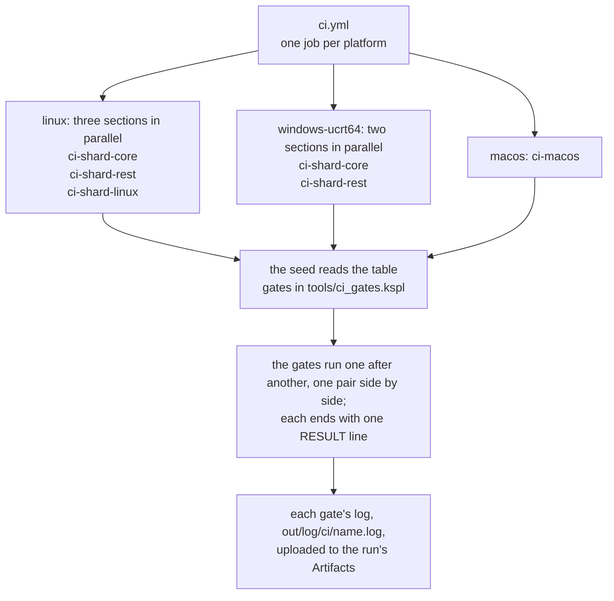

# The specification for the gates

This file says what CI runs, what every gate promises, and what the checks count. CI (continuous integration) is the automatic build-and-test run on GitHub's machines. "Gate" is defined in "Terms of art" in [`SPEC-documents.md`](SPEC-documents.md). How to run the gates yourself is in [`HOWTO-build.md`](HOWTO-build.md).

## How CI runs

CI runs the gates in one job for each of Linux, macOS and Windows (`.github/workflows/ci.yml`). "What each platform runs" below says which job runs which check, and `make test-conventions` refuses a gate or suite it does not name.

**CI runs only once a week, late at night (`cron` in `.github/workflows/ci.yml`), and when someone launches it by hand from the Actions screen.** So "CI is green" does not mean a given commit is green. After 60 days with no activity, GitHub stops the scheduled run; re-enable it from the Actions screen.

**Each job names its runner by the image's version** (`ubuntu-24.04`, `macos-26`, `windows-2025`), never by a `-latest` label. GitHub moves a `-latest` label on its own schedule, so a round could turn red with no commit behind it. `make test-conventions` refuses `-latest` in a workflow (`tests/support/conventions_ci.kspl`). Dependabot does not propose the next image: edit both workflows by hand, and start `ci.yml` on that branch.

**Two parts of a runner still float, by choice**:

* **The Linux image's packages.** `.devcontainer/Dockerfile` pins its base image by digest, but `apt-get` takes each package as Ubuntu's archive holds it that day. The image is rebuilt only when the Dockerfile changes.
* **The Windows jobs' MSYS2 packages** (`tools/msys2-packages.txt`) come as MSYS2's repository holds them that day; pinning would mean naming every package file by hand. A Windows round that turns red with no commit behind it is read against the job's log of what was installed.

**A manual launch can choose which jobs run.** "Run workflow" shows a checkbox per job, all ticked by default. An unticked job starts no runner and is not billed. GitHub bills each job's wall-clock time, rounded up to the minute, times the runner's factor:

| Job (its checkbox) | Platform | Factor on each minute |
| :-- | :-- | :-- |
| `linux` | Linux | ×1 |
| `windows-ucrt64` | Windows, in MSYS2's UCRT64 environment | ×2 |
| `macos` | macOS | ×10 |

A green run with a job unticked covers only the jobs that ran. A scheduled run runs every job (`inputs` is empty).

**Every job in `.github/workflows/ci.yml` and `.github/workflows/release.yml` states `timeout-minutes:`.** Without one, GitHub waits 360 minutes, so one hung test bills six hours of the runner (sixty on macOS). Each value is about three times the job's longest recent run, so a slow runner or the image's rebuild still fits. Raise it when a job's runs grow toward it. **Each value in `ci.yml` also stays above a gate's own cap (below) by about the time the job's other gates take.** So a hung gate is stopped and named before the job is cancelled. That rule, not the factor of three, sets the macOS job's value.

Caution: **When adding a job, give it `timeout-minutes:` too.** One left out falls back to the 360 minutes silently.

**Every gate has a time cap of its own, inside the job's** (`CI_GATE_CAP` in `mk/ci.mk`, in seconds; its comment gives its value and why). A gate past its cap is stopped with every process it started, and its log ends `# gate <gate> ran over <N> s and was stopped`. The round goes on unless `STOP=1` ends it. On a slow machine, raise it (`make ci CI_GATE_CAP=3600`).

Caution: **When adding a job, add an input of the same name and an `if:` that reads it.** Either one alone breaks silently: the input alone is a checkbox with no effect, and the job alone runs whatever is ticked. `make test-conventions` checks that they match.

## How a run is read

**Every gate ends with one verdict line**, in one notation for all gates, starting at the head of the line.

| Line | Meaning |
| --- | --- |
| `RESULT: ALL PASS[ (breakdown)]` | At least one check ran, and everything passed; the parentheses hold a breakdown such as a count. A run that reported no check fails instead, with `no check ran` (`finish` in `std/verdict.kspl`) |
| `RESULT: SOME FAILED (count)[ -> name]` | It failed |
| `RESULT: SKIPPED (reason)` | It passed silently, for want of a tool or the like |

CI looks for `RESULT: ALL PASS`, or `RESULT: SKIPPED` from a gate skipped whole (`said_verdict` in `tools/ci_gates.kspl`), which passes only where a row of `expected_skips` holds its reason.

Caution: **When adding a gate, make it print one line in this notation.** A notation per gate needs a reader per gate on the CI side, and a bug in such a reader stays green.

**Do not begin anything but a verdict with `RESULT:`.** Other lines take their own word (`finish` and `run_child` in `std/verdict.kspl`):

| A line that starts with | Holds |
| :-- | :-- |
| `RESULT:` | The gate's verdict, and nothing else |
| `OUTPUT:` | The path of a built file |
| `NOTE:` | A refusal along the way, or a child that took three quarters of its time cap |

**One gate's full log is in the run's Artifacts**, since the screen's log merges a whole job. `tools/ci.kspl` writes each gate's log to `out/log/ci/<name>.log`. The workflow uploads it as `log-<job>-<section>`, on a failing run too (`if:always()`).

**The log's tail lists the gates that ran and the seconds each took** (`gate seconds:` is the total), read from `out/log/ci/` itself. A gate that passed on an expected SKIP stays `PASS`, with the count of its `SKIP` lines beside it. Examples are `test-ksos-link` off Linux, and `test-ship`'s run under Wine on Linux.

**A round with a fallen gate ends with `# why it failed:`**: each cause on a line opening with the gate's name, then the path of its log. The causes come from the gate's log (`causes` in `tools/ci_gates.kspl`), in this order, each once, up to `CAUSES_SHOWN`:

| A line of the log that | Is shown |
| :-- | :-- |
| Is the runner's own `# gate <gate> ran over <N> s and was stopped`, naming this gate | As it is |
| Starts with `panic: ` | As it is |
| Starts with `FAIL ` or `[FAIL]` | As it is |
| Holds `SKIP`, and no row of `expected_skips` holds it for the platform | After `UNEXPECTED`; the round's last line says to bring the tool back, or add the row |
| Starts with `RESULT: SOME FAILED` | As it is |
| Holds make's `*** [`, which names the target that stopped | As it is, in the language make prints in |

**Where none of the first five is found, the log's last lines follow**, each after `| `. A gate that printed no `RESULT: ALL PASS` it owed says `NO VERDICT` first. On GitHub, the first cause is the gate's error mark.

### Ending a round at the first fall

**`make ci STOP=1` ends the round at the first gate that fails**, for a quicker answer while you work; it is not the verdict for a push. By default only a gate with `stops` in `tools/ci_gates.kspl` (the self-host) ends a round, since the later gates build on it. CI's jobs never set it.

**With `STOP=1`, the gates that fail most often for their time run first.** The gates with `stops` come first, then those with `early`, then the rest, each part in the table's order. `early` marks `lint`, `surface` and `suites_text`. In 59 recorded rounds `suites_text` failed 10 times and `lint` 7, more than any other gate. `surface` failed 3 times and takes about 13 seconds.

**A round that ends early says so in its last two lines**, after the list of the gates that ran:

```
# not run (23): debug_tools, suites_a, …
# ended early at lint: STOP=1 ends the round at the first gate that fails, so this round is not a full verdict
```

A gate that did not run is never shown as `PASS`, and the round returns failure. A round the self-host's fall ended prints the same two lines with its own reason.

### Two gates side by side

**`race` and `selfhost_ship` start at the same time** (`Gate.beside` in `tools/ci_gates.kspl`). Each keeps about one core busy for about two minutes, and they write to different files. So a round on four cores ends that much sooner. Every other gate runs alone. **`ksmd_browser` stays alone**, since another gate's load can upset its browser timing.

**Each gate of the pair is still judged alone**, with its own log, time cap, verdict and summary line. Its time counts from the common start. While the two run, their output goes only to their logs, shown in turn when both end.

**The pair runs together only where the set runs both**: `make ci` on Linux, `make ci-shard-linux`, and `make ci-full` on every platform. **With `STOP=1`, a fall in the pair ends the round after both gates end**; the partner keeps its own verdict. **`make ci CI_SERIAL=1` runs each gate alone**, the pair included. If a fall goes away with it, the load is the cause. CI's jobs do not set it.

To add a pair of gates that share no file, put the two rows next to each other, and let each name the other in `beside`. The runner refuses a pair whose rows are apart, do not name each other, or differ in `stops` or `early`.

## How the gates are arranged

**Which gates run, and in which job, is one table: `GATES` in `tools/ci_gates.kspl`.** Each make target below only names its set, and the seed runs the table, so a compiler under check never decides what is checked.

| Target | What it runs |
| :-- | :-- |
| `ci` | Every gate this host runs natively. Linux: `ci-shard-core`, `ci-shard-rest` and `ci-shard-linux`; Windows and macOS: `ci-shard-core` and `ci-shard-rest` |
| `ci-shard-core`, `ci-shard-rest` | The two shared sections the Linux and Windows jobs run. A gate marked `linux_only` runs only in the Linux job of its section |
| `ci-shard-linux` | Most of the gates that only Linux runs; it refuses to run elsewhere |
| `ci-macos` | The macOS job's set: what differs on macOS, kept small because its minutes cost the most |
| `ci-full` | Every gate this host can answer, for a person checking all on one machine. Linux: the same as `ci`; Windows and macOS: `ci`'s gates and the Linux-only ones too |

The workflow only calls the targets, so **to change which gates run, fix the table**, not ci.yml.

**`make ci` needs no Docker anywhere.** The Linux-only section's tools (the sanitizers, QEMU, a browser and the rest) are in the dev container's image. To run that section off Linux, run `make ci` inside that container. macOS also needs GNU make 4 (`brew install make`); the runner selects `gmake` when available.

**`make ci-full` checks as much as one machine can, with no container.** CI runs a check that cannot differ by platform on Linux alone; `ci-full` runs it on your Windows or macOS machine too. It leaves out three gates where they cannot give a true answer (`Gate.not_on` in `tools/ci_gates.kspl`):

* `test-ksos-posix` on Windows: the POSIX port switches tasks with ucontext, which Windows does not have.
* `test-ksmd-desktop` on Windows and macOS: a `.desktop` entry is what Linux desktops read.
* `perf-log` on Windows and macOS: its baselines were measured on Linux CI's hardware (note 16).

It also leaves out macOS's stand-ins for the copied packages (`debug`, `run` and the rest), since `test-extract` tests the same packages from their copies.

**In `ci-full`, a SKIP passes, and the round lists each one last** under `# not checked on this machine`, so you know what to install. Caution: **Some gates fail rather than skip when their tool is missing** (`test-blas` without OpenBLAS); read such a failure as "not checked here". On Windows, `tools/msys2-packages-full.txt` lists every tool these gates use ("The environment for each platform" in [`HOWTO-build.md`](HOWTO-build.md)).

**A running gate prints its name, elapsed time and log path every fifteen seconds.** Each gate's record carries its platform, so a Linux log read on Windows keeps Linux's expected skips.

The chart shows one run, from the workflow down to the logs.



**The gates that only Linux runs are dealt over the three Linux jobs**, so the three end at about the same time. Most stand in `ci-shard-linux`. The browser gates (`test-ksmd-browser`, `test-ksmd-open`, `test-ksagent-chat`) stand in `ci-shard-core`, and `debug-tools` in `ci-shard-rest`, each with `linux_only` (`Gate.linux_only` in `tools/ci_gates.kspl`). The Windows job of the same section leaves them out. Moving a gate between the Linux jobs costs no start-up, as each job pays its own already.

**The common gates run as two sections, in parallel, as separate jobs.** `ci-shard-core` runs C self-hosting and one share of the regression suites. `ci-shard-rest` runs LLVM self-hosting, LLVM tests and the other share. `SUITES_B` in `mk/test.mk` assigns the root suites. The compiler's extraction checks deal its suite list between the jobs, longest first, in opposite directions for successive pairs. They use separate copies and scratch folders, and `make test-extract-ksplc` runs both shares. std's copy (`extract-std`) runs in the rest job, and every other package's copy (`extract-rest`) in the core job. The number of sections is set by the job start-ups that can be paid for.

**Always measure the usage time before adding a section**; choosing which jobs run is cheaper.

**"Everything ran" rests on a chain of three checks**, since a job sees only its own section:

1. Every set refuses to start while a gate of the table is in no set.
2. `make test-conventions` checks that every section is in the `.yml`'s matrix (`tests/support/conventions_ci.kspl`).
3. GitHub checks that each job is green.

**Do not remove `fail-fast: false`**: without it the first failing job cancels the rest, and their results are lost.

**The gates run one after another, in the table's order**, except the pair in "Two gates side by side" above. Inside a gate whose `par` in `tools/ci_gates.kspl` is `parallel` or `synced`, the items run in parallel (`-j<jobs>`). `lint` / `test-suites` / `test-ksos-link` / `test-ksos-posix` / `test-ksos-qemu` each split into one target per item, so a failing item is named by its target.

**Every demo run of `test-ksos-posix` and `test-ksos-qemu` has a time cap** (`KSOS_RUN_CAP` in `ksos/Makefile`), past which it fails with `[FAIL] … it hung`. `test-ksos-posix` first checks that a run spinning for ever is stopped that way.

**Such a demo run passes only on three things at once** (`ksos_run_gate` in `ksos/Makefile`):

* it exits with 0;
* its log holds no failure mark (`[FAIL]`, `RESULT: SOME FAILED`);
* **its log holds a `RESULT: ALL PASS` line**, which a demo prints only once its checks have run.

The last catches a demo whose checks were never reached, such as a kernel bug that leaves a task waiting for ever.

**Items that hold a fixed resource are listed as serial** (`KSOS_QEMU_SERIAL_DEMOS` / `KSOS_POSIX_SERIAL_DEMOS` in `ksos/Makefile`; their comments say which resources).

## What each platform runs

**The table says what CI runs, not what passed**: ✅ runs, ➖ does not, and a note number points at the note below. The Linux job runs in an image built from `.devcontainer/Dockerfile`, cached at `ghcr.io/<owner>/<repository>/devcontainer` (`imageName` in `.github/workflows/ci.yml`). Only a run on main writes the cache. The first run after the Dockerfile changes rebuilds it, several minutes longer.

| Check | Linux (`make ci`) | macOS workflow (`make ci-macos`) | Windows workflow (ucrt64, shared sections) |
|---|:---:|:---:|:---:|
| self-host (the C backend) | ✅ | ✅ | ✅ |
| test-seed-sum (the seed was re-baked after the last compiler change, by the record `make commit-seed` keeps in `ksplc/seed.sum`) | ✅ | ➖(note 26) | ➖(note 26) |
| self-host-ship (the shipped `-O2` build emits stage2's C to the byte) | ✅ | ➖(note 20) | ➖(note 20) |
| debug tests | ➖(note 27) | ✅ | ➖(note 27) |
| debug-tools (the tests of `tools/`, the one folder of tests without a `Makefile`) | ✅ | ➖(note 27) | ➖(note 27) |
| lint (every entry point; ksai's tests a second time with the `#cfg(blas)` branch on) | ✅ | ➖(note 26) | ➖(note 26) |
| test-negative | ✅ | ✅ | ✅ |
| test-equiv (C⇔LLVM equivalence) | ✅(note 1) | ✅(note 1) | ✅ |
| test-lsp (the language server, on ksplc's folder as its workspace) | ✅ | ✅ | ✅ |
| test-lsp-tree (the language server over the repository's whole tree) | ✅ | ➖(note 2) | ✅ |
| test-freestanding-math | ✅ | ✅(note 3) | ✅ |
| test-simd | ✅ | ✅ | ✅ |
| test-surface (the published API matches its record) | ✅ | ➖(note 2) | ➖(note 26) |
| test-docs (the language tour matches its program and output) | ✅ | ➖(note 2) | ➖(note 26) |
| test-emit-runtime | ✅ | ✅(note 4) | ✅(note 4) |
| test-ship (libraries built with `--library`, static and shared, linked into a C and a KSPL program) | ✅(note 19) | ➖(note 2) | ✅(note 19) |
| run (the AI engine, a smoke test) | ➖(note 25) | ✅ | ➖(note 25) |
| test-run (`ksplc run`'s cache) | ✅ | ➖(note 2) | ✅ |
| test-run-source (`ksplc run -` and `--eval=`) | ✅ | ➖(note 2) | ✅ |
| test-llvm-abi (the calling conventions agree) | ✅ | ➖(note 2) | ✅ |
| test-ksos-posix (running on the POSIX host port) | ✅ | ➖(note 5) | ➖(note 5) |
| test-ksos-link (bare-metal linking, `test-ksos-ramtext` with it) | ✅ | ➖(note 2) | ✅(note 6) |
| test-ksos-qemu (bare-metal execution under QEMU) | ✅ | ➖(note 7) | ➖(note 7) |
| test-ksmd-browser (the ksmd page edited in a browser, and served by `kssrv --local`) | ✅ | ➖(note 31) | ➖(note 31) |
| test-ksmd-desktop (the `.desktop` entry `make ksmd` writes is valid, and installs) | ✅ | ➖(note 23) | ➖(note 23) |
| test-ksmd-open (the ksmd launcher) | ✅ | ➖(note 32) | ➖(note 32) |
| test-ksagent-chat (the launcher's model server, then ksagent's chat page in a browser, through kssrv and `ksagent watch`) | ✅ | ➖(note 33) | ➖(note 33) |
| test-debug-line (the debug position points at the `.kspl`) | ✅ | ➖(note 2) | ✅(note 10) |
| test-split (split compilation builds the same thing as a single TU) | ✅ | ➖(note 2) | ✅(note 11) |
| test-layout-targets (every size ksplc folds is the target machine's, for each machine it knows) | ✅(note 24) | ➖(note 2) | ✅(note 24) |
| test-ast-cache (the parse cache does not change the result) | ✅ | ➖(note 2) | ✅(note 12) |
| test-property (a random expression matches on both backends) | ✅ | ➖(note 2) | ✅ |
| test-generic-matrix (each shape of a generic builds on both backends or is refused at the user's line, never with a C or LLVM error) | ✅ | ➖(note 2) | ✅ |
| Fuzzing: each package's own `test-fuzz`, a shallow run on a fixed seed, on its copy by `test-extract`. No run on corrupted input can die, and what std writes back must read the same. `make fuzz-long` goes deep by hand, with a fresh seed | ✅ | ➖(note 2) | ✅(note 21) |
| test-notation (indentation-written source gives the same C, squiggles, hovers and jump targets) | ✅ | ➖(note 2) | ✅ |
| test-fmt-tree (every tracked source is already formatted, and formatted at other widths it reads back) | ✅ | ➖(note 2) | ➖(note 26) |
| test-file-path (the logical name is stable however the entry point is written) | ✅ | ➖(note 2) | ✅ |
| test-broken-pipe (output losing its destination ends quietly) | ✅ | ➖(note 2) | ✅(note 14) |
| test-extract (extract-ksplc-core / extract-ksplc-rest / extract-rest / extract-std), each package with a `Makefile` tested from a copy of its folder alone | ✅ | ➖(note 2) | ✅ |
| The checks on the tree's text (conventions / docref / docsnippet / spec-claims / vscode / lint-gate / recipe-bytes / deps / pytools) | ✅ | ➖(note 2) | ➖(note 26) |
| The other suites (c-warnings / own-machine / cli / config / std-dir / thin-use / lint / fmt / link-rules / ext-import / doc / runtime / limits / decl-macros / spawn / place / visibility) | ✅(note 22) | ➖(note 2) | ✅(note 22) |
| self-host (the LLVM backend) | ✅ | ✅ | ✅ |
| debug tests (the LLVM backend) | ✅ | ✅ | ✅ |
| test-llvm-pkgs (kssrv's and ksbind's tests on code the LLVM backend built) | ✅ | ➖(note 28) | ➖(note 28) |
| test-blas (ksai's unit tests with `BLAS=1`) | ✅ | ➖(note 15) | ➖(note 15) |
| ksbind's own tests (the OpenSSL binding, from a copy by `test-extract`) | ✅ | ➖(note 2) | ✅(note 18) |
| perf-log (peak memory and the tree types' sizes, judged by `perf_guard`) | ✅ | ➖(note 16) | ➖(note 16) |
| test-race (no data race under ThreadSanitizer) | ✅ | ➖(note 2) | ➖(note 17) |
| test-sanitize (ksplc's, std's and ksmd's tests are clean under the memory and undefined-behaviour sanitizers) | ✅ | ➖(note 29) | ➖(note 29) |

**The compiler's own suites run from copies.** On Linux and ucrt64, the two compiler extraction shares copy ksplc's folder alone, rebuild the compiler there, and split `SUITES` in `ksplc/Makefile` between them. The core share also runs the copy's unit tests and fuzzing. It checks that the copy does not build without its `ksplc.cfg`. macOS runs the suites its column marks from the repository.

**The lint gate passes only when `ksplc lint` exits with 0 and its tally counts 0 of every kind, hints included.** It analyses every entry point in `LINT_TARGETS` in `mk/lint.mk`, each with every file it reads. A source with a line opening `fn main(` outside a string is one; `mk/lint.mk` names the rest by hand. A generic is analysed only where it is instantiated. So code that only one entry point instantiates escapes the gate unless that file is an entry point (`tests/debug/main.kspl`, say). `make test-lint-gate` checks two files that must each make `make lint` exit non-zero. One holds one information diagnostic. The other holds ten errors, and its tally ends in the clean tally's text.

### Gates that pass silently where a tool is missing

**Some gates need a tool or a library that not every machine has. Without it, the gate says `SKIP` and passes silently.** **A SKIP that its platform does not expect fails its gate**: `EXPECTED_SKIPS` in `tools/ci_gates.kspl` holds, per platform, the reasons a round can skip for. So a runner that loses a tool fails rather than going green. **`make test-conventions` holds every reason the tree can print against those rows** (`tests/support/conventions_skip.kspl`), before a platform meets it. The devcontainer holds every tool below.

| Gate | What it needs | Required on Linux by | Without it, unchecked |
| :-- | :-- | :-- | :-- |
| `test-ksos-link` (note 6) | The `arm-none-eabi` toolchain | `KSOS_REQUIRE_ARM` | That ksos's bare-metal demos link, and that each window function sits in RAM. It prints `SKIPPED (no ARM toolchain)`, as on ucrt64 |
| `test-ksmd-browser` (note 31) and `test-ksagent-chat` (note 33) | A Chromium: the image's pinned amd64 build, or one on `PATH` that is not a snap. Windows takes Chrome from its usual folders. Both take the one `ksmd/Makefile` finds | `KSMD_REQUIRE_BROWSER`, for either gate run alone too | ksmd's editing page in a browser, served by `kssrv --local`, and ksagent's chat page. Each prints `SKIPPED (no browser - see docs/SPEC-gates.md)` |
| `test-race` (note 17) | Clang's ThreadSanitizer runtime | `KANSO_REQUIRE_TSAN` | Data races in the programs that start threads. Windows has no ThreadSanitizer, so ucrt64 does not run it |
| `test-sanitize` (note 29) | Clang's address, leak and undefined-behaviour sanitizer runtimes (`libclang-rt-<version>-dev`) | `KANSO_REQUIRE_ASAN` | Memory errors and undefined behaviour in ksplc's, std's and ksmd's tests. ucrt64's clang holds no address sanitizer |
| The fuzzers of std and ksai, in `test-extract` (note 21) | Clang's address sanitizer runtime | `KANSO_REQUIRE_ASAN` | A read past the end, since the fuzzing runs on a plain build, as on ucrt64 |
| `test-c-warnings` and `test-equiv` | Both gcc and clang: each warns about code the other passes, and fills in what C leaves open its own way | `KANSO_REQUIRE_BOTH_CC` | The generated C under the missing family: its warnings, and that it means the same. The windows-ucrt64 runner installs clang alone |
| ksbind's own tests, in `test-extract` and `test-race` (note 18) | OpenSSL (`libssl-dev`) | `KSBIND_REQUIRE_LIBS` | The binding, linked and run, as on macOS. kssrv does not build at all without it |
| `cli`'s two cases on a cache folder (note 22) | Root, or `sudo` without a password, to hand a folder to another user | `KANSO_REQUIRE_CHOWN` | That ksplc refuses a cache folder another user owns. Windows runs neither case |
| `test-ship`'s Windows half, in `test-extract` (note 19) | `x86_64-w64-mingw32-gcc` and its `ar` (`gcc-mingw-w64-x86-64-win32`), and Wine to run the result | `KANSO_REQUIRE_MINGW`, for the cross compiler alone. The image leaves Wine out for its size | That the shipped libraries build and link for Windows, static and DLL. A green Linux run has not run them |
| `test-ksmd-desktop` (note 23) | `desktop-file-validate`, `update-desktop-database` (`desktop-file-utils`), `update-mime-database` (`shared-mime-info`) | The gate's row sets `KSMD_REQUIRE_DESKTOP=1` | The part whose tool is missing |
| `test-layout-targets`'s wasm32 run (note 24) | `wasm-ld`, `node` and clang's wasm32 builtins (`libclang-rt-<version>-dev-wasm32`) | No switch: the image holds them | The wasm32 run; the C checks for every machine still run |
| `test-vscode`'s run of the extension's client side | `node` | No switch: the image holds it | That run; the checks on the extension's files still run |
| std's two tests over the IPv6 loopback (`std/tests/net_test.kspl`) | `::1` on the loopback | No switch (below) | Those two tests. The macOS and Windows runners have `::1` |

**A kernel with no IPv6 at all (`ipv6.disable=1`) stays an expected skip, on Linux alone.** Docker gives a container's loopback `::1` unless IPv6 is turned off. No image or container option changes the host's kernel. The test asks the kernel (`/proc/sys/net/ipv6`), not `std/net` under test.

### The switches that require a tool

**On Linux each switch in the table above is 1, so a gate whose tool is missing fails rather than skips.** CI's Linux image holds every one of these tools, so a skip there would mean that the image lost one. On macOS and Windows each is 0, and the gate says `SKIP`. They are set in one place, `REQUIRE_SWITCHES` in `mk/test.mk`, and each reads `0` or `1` alone. Any other value stops `make`, since reading it as "not 1" would turn the requirement off silently.

**On a Linux machine of your own that lacks a tool, set its switch to 0** (`make ci KANSO_REQUIRE_CHOWN=0`, or in the environment). The gate then skips, and `make ci` lets that skip through (`SWITCH_SKIPS` in `tools/ci_gates.kspl`). **Such a round is not CI's verdict**, so it ends by naming each switch turned off. CI's Linux job never turns one off. Every failure a switch causes names the switch and the `=0` that turns it off.

`KSMD_REQUIRE_DESKTOP` is not a switch of this kind: only the gate's row in `ci-shard-linux` sets it. `make ksmd` checks its desktop entry too, and needs none of these tools for it.

A tool with no switch and no Linux row of `expected_skips` (`wasm-ld` and `node`, say) has no way off. A Linux round fails where it is missing, since only the image is promised to hold it. The devcontainer (`.devcontainer/`) gives every tool at once.

### The notes

The suite a note names says what it checks in its opening comment; a note adds why a platform runs it or not.

* **note 1**: `test-equiv` has no platform branch, so macOS runs it too, beside `self-host` / `debug` under `LLVM=1`.
* **note 2**: `ci-macos` runs only what is worth running on real macOS hardware (`Gate.macos` in `tools/ci_gates.kspl`); the rest is judged not to depend on the platform. Change that table and this one together.
* **note 3**: on macOS, `ld64` drops unused code with `-dead_strip` (`GC_SECTIONS_FLAG`), and Mach-O needs the "segment,section" form for `#section("...")` (`KSPL_SECTION` in `ksplc/gen/runtime/core.h`). **Such differences show only when a gate runs on real hardware.**
* **note 4**: a program built by the LLVM backend holds no runtime; `ksplc emit-runtime` writes it as a separate C file to link with. A runtime of another ksplc version must not link silently. So the runtime ends with an empty function named after a hash of its source (`kspl_runtime_abi_` and 16 hex digits), which `main` calls first. The gate checks that a runtime with that function renamed fails to link. Each platform's own linker resolves the symbol, so each platform runs it.
* **note 5**: `test-ksos-posix` runs demos of ksos's POSIX host port, which runs ksos's tasks inside one Linux process, switching with ucontext. **Nothing else exercises the host-side port layer or task liveness management.** It needs `<ucontext.h>`, which Windows lacks and macOS deprecates, so it is Linux-only.
  * A demo joins its gate by its file alone (`KSOS_POSIX_TEMPLATED` in `ksos/Makefile`). `KSOS_CM_DEMOS`, `KSOS_NRF51_DEMOS` and `KSOS_RP2040_DEMOS` come from their folders the same way. `KSOS_CM0_DEMOS` is written by hand; its comment says which demos fit the Cortex-M0.
* **note 6**: `test-ksos-link` links ksos's bare-metal demos under `ksos/demo/<port>/` (`demo_stems` in `ksos/Makefile`). It needs the `arm-none-eabi` toolchain, whose libgcc defines soft-float and 64-bit integer division. **`test-ksos-ramtext` runs first, as its prerequisite**, so the two are green or absent together. It checks that each window function sits in RAM rather than flash (`rp2040_flash_in_window`, `rp2040_ws2812_send_window`). Such a function must finish within a tight deadline, or run while flash cannot be read. In flash it links fine and freezes only on the real chip. The windows-ucrt64 runner holds no ARM toolchain, so there the gate says `SKIPPED`.
* **note 7**: `test-ksos-qemu` runs ksos's bare-metal demos under `qemu-system-arm` on two boards. `mps2-an385` (a Cortex-M3) runs `ksos/port/cortex_m/`. `microbit` (a Cortex-M0) runs `ksos/port/cortex_m0/`, the CPU layer of the RP2040, which QEMU does not model. A demo ends QEMU by semihosting, which says only "it ended" or "it failed" (exit 1). The macOS and Windows runners have no qemu.
* **note 10**: `ksplc/tests/suite/debug_line_test.kspl` has two tiers. The first, a text comparison of the generated C's `#line`, runs everywhere. **The second tier is Linux-only**: the `.kspl` name must survive in an executable built with `-g`. Compiling and linking in one command, macOS leaves the DWARF in the `.o` / `.dSYM`, and Windows (MSYS2) is unverified. The LLVM backend emits no debug information.
  * Before widening it, confirm **both directions** on the platform's real hardware: the name appears with `-g` and disappears without. Without that contrast the check goes green while inspecting nothing.
* **note 11**: `ksplc/tests/suite/split_test.kspl` has no platform branch (`harness_build.build_exe` asks `ksplc info link-libs` for the libraries). Splitting is C-backend-only.
* **note 12**: `ksplc/tests/suite/ast_cache_test.kspl` has no platform branch. It checks that the C matches with and without the cache, and that a changed source rebuilds. A corrupted entry must be discarded, and old generations must not pile up.
  * **Check "changing only the contents rebuilds it" by rewriting the file at the same path.** A copy under another name changes the key's file name, so a key that ignores the contents would pass too.
* **note 14**: `test-broken-pipe` checks POSIX's handling of SIGPIPE. **Windows has nothing to check**: a write to a closed named pipe merely fails. The suite reads the C compiler's target triple (`-dumpmachine`) and prints a `SKIP` line there. Only its check "a launched child holds SIGPIPE's default" reads `/proc/self/status`, so it runs only on Linux.
  * Note: The decision's canonical source is "Writing when nobody is left to read it" in `ksplc/gen/runtime/hosted.c`.
* **note 15**: `make test-blas` runs ksai's unit tests with `BLAS=1`; ksai is the one package holding `#cfg(blas)`. It needs libopenblas, which the windows-ucrt64 and macOS runners lack. **`make lint` cannot replace it**, since only a real build shows whether the FFI is right: argument order, types, the library linked. So this is also where a library named by `#link` is seen linked.
* **note 16**: `tests/tools/perf_baseline.json` holds baselines (with tolerance factors) taken on the Linux CI's hardware, which would mislead elsewhere.
  * The verdict rests on the peak memory and the exact sizes of `Ast_node` and its list of children. The build time is only recorded, as a ratio to the baseline (`tests/tools/perf_guard.kspl` says why).
* **note 17**: `test-race` builds through the C backend with clang's `-fsanitize=thread`, and runs these programs (`tests/suite/race_test.kspl`):
  * std's and ksplc's own tests, the packages whose tests start threads;
  * ksai's examples, with the tests that run them;
  * ksbind's tests, where OpenSSL links (note 18);
  * ksagent's tests, whose stand-in model server answers from a second thread;
  * ksplc as the language server, played an editor's session. Its supervisor reads the editor on its own thread while it restarts a crashed worker. It must end at `exit` with its input still open.

  * **It shows that it can fire**: a program racing on purpose must be reported first. **Every tracked source that starts a thread is compiled into a program it runs**, or named with the reason in `LEFT_OUT`.
  * **No report is suppressed.** std, the runtime and the program are compiled from source into one unit, so nothing the sanitizer watches is uninstrumented.
  * **Only the C backend is built.** Through LLVM, `-fsanitize=thread` watches only the functions `--sanitize=thread` marks in the IR, as in note 29.
* **note 18**: ksbind's own `make test` links OpenSSL. kssrv links it too, for HTTPS, so the windows-ucrt64 job installs it with `tools/msys2-packages.txt`, and both packages' tests run there. The macOS runner lacks it, and runs neither package's tests (note 27).
* **note 19**: `test-ship` builds both forms with the host's own toolchain, natively on ucrt64. **Elsewhere it also cross-builds them for Windows where `x86_64-w64-mingw32-gcc` is installed**, and runs them only under Wine.
  * **No CI job runs the check "the Windows programs run under Wine".** The Linux image leaves Wine out for its size. The Windows job builds natively, and macOS runs no `test-ship`.
  * **To run it by hand, put Wine on a Linux machine or in the dev container (the `wine` package on Debian and Ubuntu), then run `make test-ship`.** The check's two `pass` lines then stand where its `SKIP` line stood.
* **note 20**: `self-host-ship` pays for one `-O2` build of ksplc, so CI runs it once, in `ci-shard-linux`. **The release runs it on each of its three platforms** (`.github/workflows/release.yml`).
* **note 21**: std's and ksai's `test-fuzz` build what they fuzz with the address sanitizer where the C compiler holds it, and print which build they made. ksplc's fuzz runs the compiler unsanitized.
* **note 22**: two of `cli`'s cases check that ksplc refuses a cache folder that others could plant entries in. Windows's permissions are an ACL, which ksplc does not read, so neither case runs there.
* **note 23**: `test-ksmd-desktop` writes the entry and its MIME declaration, building nothing, and installs them into a scratch data folder as `make install-desktop` does. macOS and Windows associate a file with a program another way.
* **note 24**: `ksplc/tests/suite/layout_targets_test.kspl` needs only clang, which builds for every machine in `MACHINES` in `ksplc/base/target.kspl`. The wasm32 build also needs `wasm-ld`, `node` and clang's wasm32 builtins, for a 128-bit product that links only with them. A folded size decides through a static `if`, a constant chain, a `case` label and reflection; each must answer as wasm32 lays values out.
* **note 25**: Linux and Windows run the same check through `test-extract`, where ksai's own `make test` trains `llama_engine` (`ksai/tests/examples_main.kspl`). macOS runs `make run` instead.
* **note 26**: these read the tree's text, or the C it translates to, so the answer cannot differ by platform, and a Windows minute costs double. So they run in `ci-shard-linux` (`Shard.linux` in `tools/ci_gates.kspl`); the suites among them are `SUITES_TEXT` in `mk/test.mk`. Windows keeps building, linking and running, `lsp-tree` and `c-warnings`.
  * **`lint` and `test-seed-sum` leave macOS too.** The tree holds no `#cfg` branch for an operating system, and `.gitattributes` keeps every text file's line ends LF. `make ci-full` still runs both on every platform.
* **note 27**: `make debug` runs the tests of every package but kssrv and ksbind in one program; those two run only as their package's own `make test`. Linux and Windows run every package's own `make test` from a copy (`test-extract`), which also proves it stands alone. So there `make debug-tools` runs only `tools/`, which has no `Makefile`. macOS runs `make debug` instead, leaving kssrv's and ksbind's tests unrun.
  * **Windows leaves `debug-tools` out**: `make LLVM=1 debug` runs the same tests of `tools/` there, against the same Windows calls. Only the backend differs, and the C backend is checked on Windows on every package's copy. Linux still runs both.
* **note 28**: `make LLVM=1 debug` holds neither kssrv nor ksbind (note 27), so `test-llvm-pkgs` builds and runs them through LLVM. CI runs it in `ci-shard-linux` alone. The windows-ucrt64 job installs OpenSSL too (note 18) but does not run it; `make ci-full` does.
* **note 29**: `test-sanitize` builds ksplc's, std's and ksmd's tests (`<package>/tests/main.kspl`) through both backends with clang's `-fsanitize=address,undefined`, the leak sanitizer included. It runs each as its package's own `make test` does, std's from a fresh folder per build, since they write fixed names. It fails on any report from any process, or on a non-zero exit.
  * **It shows that it can fire.** Four faults are written on purpose: a use after free, a read past an allocation, a leak and a misaligned store. Each must be reported as what it is. **And that the LLVM build is watched through its marks**: the read past the end, built through LLVM without `--sanitize`, must go unreported.
  * **No report is suppressed**, a leak included.
  * **Through the LLVM backend, ksplc marks the IR** (`--sanitize=address`), since clang's `-fsanitize=address` instruments only a marked function. The undefined-behaviour checks belong to clang's front end, so through LLVM they watch only the runtime, compiled from C.
  * ucrt64's clang holds no address sanitizer. macOS's runtime has no leak sanitizer on Apple silicon, and refuses to start when asked for one. So the suite says `SKIP` on both.
* **note 31**: `test-ksmd-browser` drives ksmd's editing page in a headless Chromium through the browser's input events (`ksmd/tests/browser/main.mjs`). It then serves the page with `kssrv --local` and compares the bytes on disk (`ksmd/tests/browser/served.mjs`). The browser looks up no outside name (`--host-resolver-rules` in `ksmd/tests/browser/cdp.mjs`).
  * **The page's link takes from outside only what `ksmd/port/web/imports.txt` names**, not `--allow-undefined`, so a C library routine slipping in fails the link. It takes clang's builtins library for wasm32, for what wasm32 has no instruction for.
  * **A real input method is not driven**, so a composition on a real keyboard remains a manual check. Paste is a synthetic event, since a headless browser has no clipboard.
  * The macOS and Windows runners have no browser. On Windows, `make ci-full` takes Chrome from Program Files or the user's own folder.
* **note 32**: `test-ksmd-open` runs the cases its driver's header lists (`tools/tests/ksmd_launch.kspl`), with `--show`, so no browser starts. The launcher's lock is `flock` on Linux and macOS, and `LockFileEx` on Windows (`open_or_start` in `tools/opener.kspl`). **Only Linux runs the gate**, so launching and that lock are unchecked on Windows and macOS. The file association is checked on no platform.
* **note 33**: `test-ksagent-chat` first checks the launcher's model server with no browser (`tools/tests/chat_launch.mjs`): a stand-in takes the place of `llama-server` and `chat_server`. It then drives ksagent's chat page in a headless Chromium (`tools/tests/chat_page.mjs`), through ksmd's browser driver. The launcher starts with `--show`, so no browser of the desktop starts. It starts kssrv and `ksagent watch`, which asks a stand-in model server in the same script. Without a browser, only the second half is skipped.
  * **It checks the page's Markdown reader alone, then asking.** The answer grows, the checked answer takes its place, and a stopped answer shows as stopped. Markup in an answer stays text, and Japanese shows as written. A write refused after another tab's (409) is made again, and a reload shows each turn.
  * **A real input method is not driven**, as in note 31: Enter during a Japanese composition is checked by review only.
  * **Only Linux runs the gate**: the macOS and Windows runners have no browser.

## The shape of a per-item pass/fail line

**Every place inside `make ci` that prints a verdict for one item prints one line in the order marker, label, content.**

```
pass lsp-tree: a workspace query does not stay silent longer than the supervisor's window
FAIL conventions: the letters by which the compiler names std really exist: std/reflect.kspl:17: …
SKIP kssrv: a link inside the root cannot get outside: a link cannot be made with `ln -s` in this environment
```

| Part | What it is |
| :-- | :-- |
| **The marker** | Four characters: `pass` / `FAIL` / `SKIP`, never the pair `OK` / `NG` (why, and why only the passing one is lower case, is at `MARK_OK` in `tests/support/conventions_line.kspl`) |
| **The label** | For a suite, its name in the table in `mk/test.mk`; for a browser check, the section's name. Do not have the suite write its own label: the table is the one source |
| **The content** | What was confirmed |

**The failing marker is `FAIL`**, which `tools/ci_gates.kspl` shows at the round's end and on GitHub's page.

**Do not add new places that build the line.** The canonical source is the table in [`../tests/support/conventions_line.kspl`](../tests/support/conventions_line.kspl); a file outside it that writes the shape fails `make test-conventions`.

Caution: **Put the code that reads a marker in the table too.** Otherwise, the day the marker changes, a reader still looking for the old one finds that no item ran.

**Send output line by line** (`io.set_line_buffered()` in KSPL, `reconfigure(line_buffering=True)` in Python), or a half line joins another suite's line in one pipe.

**`make debug`'s tests take the same shape**, assembled in [`../std/verdict.kspl`](../std/verdict.kspl) (the comments at `start` / `pass` / `skip`).

```
pass NCM: it can assemble the byte run the specification says.
SKIP Net: connecting over the IPv6 loopback and peer() test: this machine has no IPv6 at all
```

* **This family has no failing marker**: a failure is `std/lang`'s panic, and `panic: <reason> at <file>:<line>` names the test.
* Caution: **To skip, go through `verdict.skip`.** A silent skip looks exactly like a pass, and a degraded environment then looks like "everything passed".
* **A SKIP says this machine lacks something, and nothing else.** A check that cannot run because an earlier check failed fails too, naming that check.

## The record of a published API

**Each package that publishes an API carries a `SURFACE.txt`**, which enrolls it: one line per `pub` declaration, with its name, shape and `//<` summary. `make surface` regenerates them, and `make test-surface` refuses a drift.

**Each source is read on its own by `ksplc doc --emit-surface`**, subfolders included, with nothing compiled. So the gate does not show that each file builds alone.

Caution: **Do not edit a record by hand.** The next `make surface` overwrites the edit.

**The reference to read is rendered from the same walk when asked**, not committed: `ksplc doc <file>`, or the copy `make surface` writes under `out/docs/`.

**Adding, changing or removing a `pub` shows in the record's diff.** A declaration split by `#cfg` appears for both branches, since the record reads the raw syntax tree.

## What the convention checks count

Review checks what the gate cannot measure.

### Executable scripts

**Every tracked regular file beginning with `#!` must have mode `100755` in Git's index**, on Windows too. Set it with `git update-index --chmod=+x -- <path>`, after staging a new file; on Unix, also run `chmod +x <path>`. Symbolic links are excluded.

### Principle 3 - what is counted, and how

**Every file written by hand has at most 1000 lines and is measured for size** (`.kspl`, `.c` / `.h`, and the page's `.html` / `.css` / `.js`). Only the generated `ksplc/seed.c` is left out.

**A function's length is lint's to measure** ([H0803], 300 lines), in KSPL source alone; C relies on the C compiler's warnings and on review. **Block nesting is limited to 8 levels**, with the function body at level 0 ([H0805]).

**A file over 900 lines fails `make test-conventions` unless its top-level folder's `README.md` names it**, as "Where a file's splitting plan is written" in [`SPEC-documents.md`](SPEC-documents.md) sets out.

**In C, splitting only the definitions by subject is enough.** The definition files are joined into one translation unit, so `static` helpers stay visible (`ksplc/gen/runtime/hosted*.c` and `write_impl` in `ksplc/gen/runtime.kspl`).

### Principle 7 - how long a comment is

**A comment's length is lint's to measure** ([H0806]), in KSPL source alone. The caps are "Comment notation and limits" in [`SPEC-plain-language.md`](SPEC-plain-language.md), and `ksplc explain H0806` says what counts. A file that no entry point of the lint gate reads is not measured.

### Principle 7 - how long a sentence is

**A sentence in a published document holds at most 25 words, and a heading at most 10.** The rule is "Length" in [`SPEC-plain-language.md`](SPEC-plain-language.md).

* **The count sees the length alone**, so it holds an instruction to 25 too. Review holds an instruction to 20.
* **Code and link targets count no words.** A code block, a span in backquotes and a link's target are left out. A link counts as its text.
* **A unit is a heading, a table cell, a list item or a paragraph.** A unit splits into sentences after a `.`, `!` or `?` and a space.
