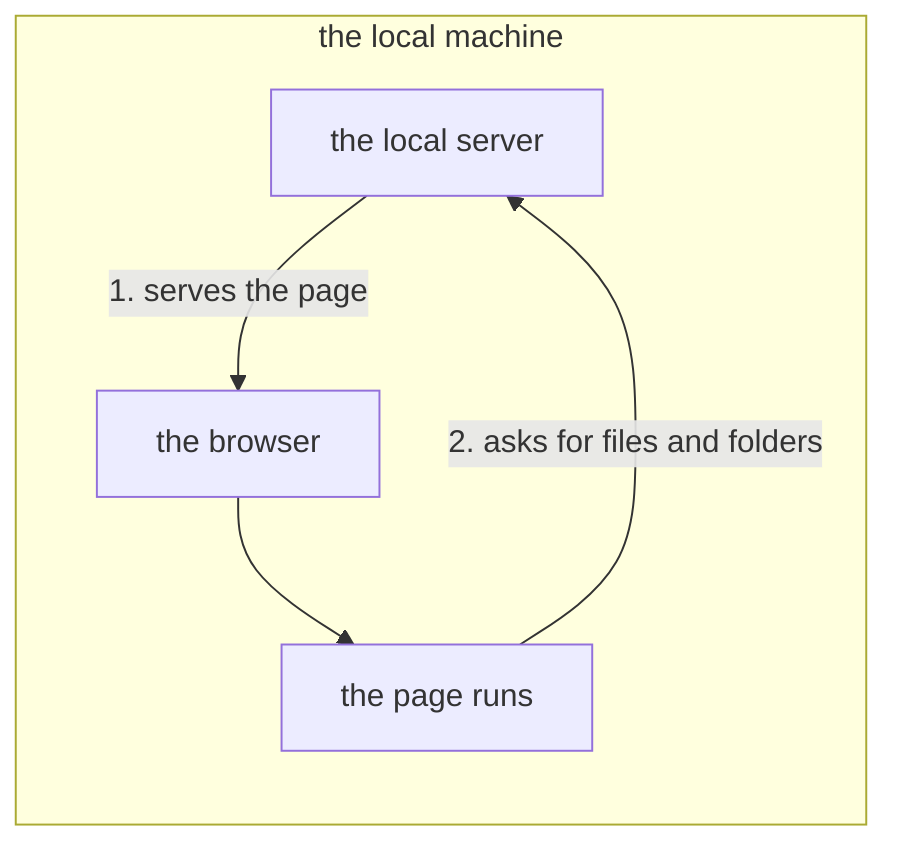

# The local server's protocol

**This document sets the protocol between a page in a browser and a small program on the same machine, the *local server*.** The page asks it to read and write files, which a browser lets a page open only through a window a person chooses. The server also serves the page, so the same-origin rule does not block the requests. **It starts one program at most**: the builder named when it starts, closed to the one file it builds. It builds only a file whose exact bytes the person allowed ("Building a page's own functions"). On a server that started others, every request a page can make would be running code.

**It describes no single implementation**: the server is meant to be replaceable, so only the rules live here.

## Who asks whom

The picture shows the two steps, both on one machine.

**Only the page asks, and the server answers.** The server does not know the document: it delivers text and byte sequences, and the page decides where they go. **Nothing flows the other way**: whether a file changed is asked for ("Watching" below), and no WebSocket is used.

## Where it listens

Words used here: the *loopback* is the address `127.0.0.1`, which only this machine can reach. The *token* is a random secret string the server makes at start-up. The *root* (`<root>`) is the one folder whose files the server reads and writes.

| Rule | Why |
| :-- | :-- |
| **It listens on `127.0.0.1` only** | It is out of reach of other machines. Serving them is a separate matter, which this protocol refuses |
| **It answers only a request whose `Host` names the loopback** (`127.0.0.1` or `localhost`, any port), and refuses any other with 403, the page included | DNS rebinding: a site re-points its own name at `127.0.0.1`, and the browser treats this server as that site. The `Host` header still carries the site's name, so the server can tell |
| **No file under the root is handed out without the token, the page alone excepted**, static serving included | A file served freely comes from the origin that keeps the token. An HTML file in the root, opened in the page's tab, could read the token, and with it the whole root |
| **The server prints a token (`token`) once, at start-up, and knowing the address alone is not enough to ask.** A request without the token is refused with 401 | Only `GET /`, the page, needs none: the page is where the token is handed over |

The page reads what it shows through `GET /api/file`, a picture beside the document included. An `` cannot send the token's header, so the page fetches the bytes and hands them to it.

**The page cannot reach outside the root (`<root>`)**, through any endpoint. Two refusals guard this, and both are needed:

| Refusal | What it refuses | Why it is needed |
| :-- | :-- | :-- |
| **The text** | `..` levels, an absolute path in any system's spelling (`/etc/passwd`, `C:\x`, `\\server\share\x`, refused on every system), a NUL, a Windows device name (such as `CON` or `NUL`). `%XX` is decoded exactly once (`%252e` is a name reading `%2e`, and does not become `.`) | These spellings leave the root by themselves |
| **A link inside the root** | A symbolic link at any level of the path. Each level is inspected | The text check alone cannot close this hole: `link.txt` is a legitimate name, so a check looking for `..` lets it through |

Caution: **Do not inspect only the last level**: a link on a folder would pass unseen.

**A race remains**: another program can replace an inspected folder with a link out of the root before the open. So the two refusals stop a client that can only send a path, as a web page can. They do not stop a local program that writes into the root. Closing the race needs two things together:

* an open that the kernel itself keeps inside the root's folder (on Linux, `openat2` with `RESOLVE_BENEATH`);
* file functions that pass on the file already opened rather than the path's text, so that nothing looks the path up a second time.

**There is exactly one exception: the page named by the person who launches the server** (`kssrv --page=<file>`), returned for `/` and `/index.html`. Only one regular file can be named. A folder would be a second root the refusals do not cover, and a FIFO's or a device's read never ends.

* **Naming it is the launching person's judgment.** Without `--local` that file is served to other machines, so it is a choice as weighty as choosing the root.
* **Do not start up when the named file does not exist**: a later 404 leaves nobody able to tell why the page is blank.
* **Do not start a local server without a named page.** Otherwise the root's own `index.html` answers `/`, and the URL with the token opens it. Any file a person put in the root would then hold the token and every file in the root.

**The server checks the Host and token after reading the headers, before waiting for the body.** Only GET or HEAD for the page with no body needs no token. Syntax and size errors can be refused before authorization.

### How the token gets across

**The token reaches the page once, inside the URL a person opens: the server prints one line, `http://127.0.0.1:<number>/#t=<token>`, and a person opens it once.** Then:

1. The page reads the fragment (after `#`) once, at start, as `name=value` pairs. It moves the value of `t` into `sessionStorage`, the browser's storage for one tab.
2. It at once removes the token from the URL with `history.replaceState`, so the browser history keeps no token.
3. After that, every request carries it in a header (`Authorization: Bearer`).

**The token is 48 lowercase hexadecimal digits**, made from 24 random bytes. A page takes nothing of another form as the token, so a fragment such as `#heart=1` cannot replace it.

**It survives a reload**: `sessionStorage` stays inside the tab until it closes, and cannot be read from another origin.

Caution: **Do not hand it over in the response that serves the page.** Anyone who knows the address could read it there.

The token goes nowhere else either:

* **It is a fragment (`#`), which a browser never sends to the server, not a query (`?`).**
* **Do not return it from an endpoint or in a response's header**: that is the same hole. It is printed once, on the console.
* **Do not hand it over in a cookie**; it travels in `Authorization: Bearer`.
* **Do not take the token from the command line**; the server makes it from the OS's random source.
* **Compare every byte**: stopping at the first differing byte lets the response time reveal the token byte by byte.

### What guards the page in the browser

**Every answer refuses to be framed by any page, and tells the browser to send no referrer.** The server sends `Content-Security-Policy: frame-ancestors 'none'` and `Referrer-Policy: no-referrer`, with `X-Content-Type-Options: nosniff`.

* **Framing is refused** because the page writes files. Another site could show it in a frame, hidden under its own buttons, and turn a person's press into a save.
* **No referrer leaves**, so a link the page opens does not tell another site which file was open.
* **The server sets no policy for the page's scripts.** Only the page knows what it runs, so a page sets that policy itself in a `<meta>` element. Such a policy holds also when the page opens from a file.

## Only five things can be asked for

A page can read and write files, watch whether a file changed, and list a folder. It can also keep the server running or stop it, and build its own functions once the person allows them.

**Do not add another endpoint that starts a program**, for debugging, completion or a plugin. Every one turns a request a page can make into running code. The build is the one exception, and only within the limits of "Building a page's own functions".

### Files

The page reads a file whole and writes a file whole, by its path under the root.

| Request | Response |
| :-- | :-- |
| `GET /api/file?path=
` | That byte sequence. 404 if absent |
| `PUT /api/file?path=
` | Writes the body under that name. On success, `{"wrote":<byte count>}`. 403 if a step of the path starts with `.` |

**A write makes the one folder its file goes in, if that folder is missing.** The folder above it must stand already. So a page puts a document's images in a folder named for it, and never makes a tree of folders by mistake.

Where the folder above is missing, the write answers 409 with `{"error":<message>,"cause":"folders"}`, and the message names that folder. A step of the path that is a file gets the same answer, naming the file. **`cause` keeps this answer apart from a conditional write's mismatch**, which carries none.

A write to a path where a folder stands answers 409 with `"cause":"folder"`, with or without `X-Kanso-If-Content`. The page then offers another name, since writing there again cannot succeed.

**A write never reaches a name that starts with `.`**, at any step of the path, such as `.git/config` or `.env`. A write to `.git/config` can set a command that the next `git status` runs. A read of such a name is answered as any other.

A PUT can carry `X-Kanso-If-Content`: either `missing`, or the 64-character lowercase SHA-256 digest of the expected file bytes. `missing` permits creation only when the path does not exist. A digest permits replacement only when the existing bytes match. A mismatch returns 409 without writing; a malformed guard returns 400. Without this header, PUT replaces unconditionally.

The check and replacement run together before this server handles another request. That protects clients sharing one server, not against other processes.

`GET /api/status` declares `conditional_writes: true` when these guards are supported. A client relying on them must refuse writes when this declaration is absent.

**`HEAD` is not supported**: "Watching" below returns the size and whether the file exists. The server returns `application/octet-stream` (plain bytes), without guessing the type. The character encoding is UTF-8 only.

Caution: **Do not let a write that dies halfway corrupt the original.** Write to another name, then replace. **That other name goes through the same two refusals**: a link already standing there would take the write outside the root.

**The ceiling on a PUT body is 8 MiB (8,388,608 bytes), included.** One byte more is refused with 413, not silently cut short. A page can rely on writing back any file up to that size.

Caution: **Do not lift the ceiling, nor make it unlimited.** The server holds each body in memory until it is whole, so the ceiling bounds what a token holder can make it hold.

### Watching

The page asks whether a file is there, and the server answers with its size and the time it last changed.

| Request | Response |
| :-- | :-- |
| `GET /api/stat?path=
` | `{"size":…,"changed_at":…}`. 404 if absent |

**When to ask is the page's choice**: before writing over a file, before opening it again, or at intervals. **The OS's file watching (inotify / ReadDirectoryChangesW) is not offered**; the next answer gives the final state.

Caution: **Do not return the contents**, only whether the file changed. The page re-reads them through the file endpoint, so the same text never arrives by two paths.

### Listing a folder

A page lists the names in one folder, so that a Save As dialog can show where a file goes.

| Request | Response |
| :-- | :-- |
| `GET /api/list?path=
` | `{"folders":[…],"files":[…],"more":false}`, each list in byte order. An empty or absent path is the root, and so is `.`. 404 if it is not a folder. 403 if a step of the path starts with `.` |

**A listing gives the holder of the token nothing new**, yet it gives as little as it can:

* **Names only.** No size, no time and no content: "Watching" and "Files" give those.
* **A link is left out**, so the dialog never offers a way out of the root. So is anything that is neither a folder nor an ordinary file.
* **A hidden name is left out**: one that starts with `.`, such as `.git`. **A hidden folder is not listed either**: a listing never names one, so a path to it is refused.
* **A name holding a `\` is left out.** Only POSIX allows one, and there the server refuses it in `path=`, since such a file could not be saved.
* **At most 2000 names come back.** `more` is `true` when others stand there, and the page then asks the person to type the name.

Caution: **Do not list more than one folder in one request**: a tree has no size bound.

### Keeping the server alive while a page is open

While a page is open, one connection to the server stays open. When nothing holds one, the server stops after a wait.

| Request | Response |
| :-- | :-- |
| `GET /api/here` | A response whose length is not stated, and **not one byte of it ever arrives**. It ends when the connection does |

**One tab holds the connection for every open tab of the page on that server, and the server stops once nothing holds it.** The wait is set at launch (`--idle=<seconds>`); with none set, it does not stop.

**Do not use a timer on the page instead**, and do not judge use by the last request alone. **Do not rely on the page saying goodbye.**

Caution: **Hold from one tab only.** A browser opens about six connections to one server, so a hold in each tab uses them up, and the next request waits without end. The tabs agree on one holder through the Web Locks API (`navigator.locks`). When the holder closes, another open tab takes the hold over.

Caution: **Open the hold again if it ends.** Otherwise a broken connection lets the server count down while a person is still writing.

#### Stopping it when asked

A page, or any program holding the token, can stop the server at once.

| Request | Response |
| :-- | :-- |
| `POST /api/stop` | `{}`, and then the server stops |

**Whoever holds the token can stop the server**; without it the answer is 401. Facing outward there is no token, so there is no stop either (404).

**The answer goes out before the server stops**, whatever pages hold it, so the asker tells "it stopped" from "the connection broke".

**A server is stopped by this request, not by a signal to its process.**

### Building a page's own functions

A page whose document names a file of functions in KSPL asks the server to build it. The page then runs the result in the browser's sandbox, with no access to anything outside the page.

**Nothing is built until the person allows that exact file.** The server keeps the allows, and refuses to build any other file, whatever the page asks.

| Request | Response |
| :-- | :-- |
| `GET /api/allow?path=
` | `{"allowed":true}` when the person allowed the bytes the file holds now, else `{"allowed":false}`. 404 when the server has no builder, or no such file |
| `POST /api/allow?path=
` | Allows the bytes that `X-Kanso-If-Content` names, the 64-character lowercase SHA-256 digest of the file. `{"allowed":true}`. 409 when the file holds other bytes, 400 when the digest is missing or malformed |
| `DELETE /api/allow?path=
` | Takes the allow back. `{"allowed":false}` |
| `POST /api/build?path=
` | The built module, typed `application/wasm`. 403 with `{"error":<message>}` when the person has not allowed the bytes the file holds. 422 with `{"error":<message>}` when the file does not build. 404 when the server has no builder, or no such file |

* **An allow holds for one file and its exact bytes.** A file whose bytes changed since is not allowed, so the page asks again.
* **Only the person's own act on the page sends a POST.** The token keeps every other program out. Nothing a document holds makes the page send one.
* **The record of allows stands outside the root**, in a file named when the server starts (`--allowed`). It holds the SHA-256 of each file's path and of its allowed bytes. A page, or a document's folder, cannot write it through the file endpoints.
* **The server does not start with a record under the root.** Both paths are made absolute and compared step by step, with ASCII case ignored. A link is not followed, so whoever starts the server names no record that a link leads into the root.
* **A record that cannot be read allows nothing.**

**The server builds only through a builder named when it starts**, by whoever starts it, never by a request. With no builder named, the endpoint does not exist (404). A server facing outward has none.

**The builder gets the digest of the allowed bytes**, and builds only bytes that match it. A file changed between the server's check and the builder's read is refused, not built.

**The build is closed**: it reads the one file named, the standard library, and the sources the builder ships. A path in that file that climbs out of its folder, or names anything else, fails the build. **So does any way to C in it**: `extern`, `##link`, assembler text and the attributes that hand text to the C side. The assembler and the linker would otherwise read files the paths never name. So a request reads nothing the token does not already reach, and the result is code for the page's sandbox, not for the machine.

**The server answers once the build ends**, at most 60 seconds later. It handles no other request in that time.

## How it refuses

Each refusal comes back as one of the HTTP status codes below. **A refusal must not be silent**: every refusal says what happened.

| Status | When it is returned |
| :-- | :-- |
| 400 | A malformed request (a `Host` given twice included), or a malformed `%XX` |
| 401 | No token, or it does not match. **It comes before every answer about a path other than the page's** (403 and 404 alike). So a request without the token learns nothing of the names under the root |
| 403 | It pointed outside the root, wrote to or listed a name that starts with `.`, or named a `Host` other than the loopback. Or it asked to build a file whose bytes the person has not allowed |
| 404 | A name that does not exist, an unknown endpoint, or a build with no builder named |
| 405 | A `HEAD`, `DELETE`, and so on to the file endpoint |
| 409 | The conditional write no longer matches the file, or its target is not a regular file. Or a write's folders do not stand, or an allow names bytes the file does not hold |
| 413 | The body exceeded the ceiling |
| 422 | The file named for a build does not build; `error` holds the builder's message |
| 500 | It could not be written or replaced |

## The answers, request by request

**Each row below is a request, and the answer a server that follows this protocol gives it.** The rows show the rules above at work. `make test-server-claims` sends every row to kssrv, in order, and fails on any other answer.

**The rows start from this state.** The server runs with `--local` and a named page. Its root holds the file `note.txt` and the folder `sub`, which holds `deep.txt`. The file `outside.txt` stands beside the root, outside it.

The columns read as follows:

* **Token**: what `Authorization: Bearer` carries. `the token` is the one the server printed, `another` is 48 hexadecimal digits that are not it, and `none` sends no `Authorization`.
* **Headers**: other header lines the request sends. A row that names no `Host` sends `Host: 127.0.0.1`.
* **Body**: the body sent, as text or as a count of bytes. A row that names a `Content-Length` sends that header and no body.
* **Answer**: the status, then the whole body where the row names one. After `holding`, each text is a part the body holds.

**Every answer in these tables keeps three rules besides its own row.**

* It carries the headers of "What guards the page in the browser".
* It holds the token nowhere, in its headers or in its body.
* A refusal (a status of 400 or more) says what happened in its body, unless it answers a `HEAD`.

### Without the token, only the page

| Request | Token | Headers | Body | Answer |
| :-- | :-- | :-- | :-- | :-- |
| `GET /` | none | — | — | 200 |
| `GET /index.html` | none | — | — | 200 |
| `GET /note.txt` | none | — | — | 401 |
| `GET /note.txt` | another | — | — | 401 |
| `GET /note.txt` | the token | — | — | 200 `note` |
| `GET /api/status` | none | — | — | 401 |
| `GET /api/status` | another | — | — | 401 |
| `GET /api/status` | the token | — | — | 200 holding `"local":true` and `"conditional_writes":true` |
| `GET /api/file?path=note.txt` | none | — | — | 401 |
| `GET /api/file?path=../outside.txt` | none | — | — | 401 |
| `GET /api/file?path=missing.txt` | none | — | — | 401 |
| `GET /api/list?path=sub` | none | — | — | 401 |
| `GET /missing.txt` | none | — | — | 401 |
| `GET /api/missing` | none | — | — | 401 |
| `POST /api/stop` | none | — | — | 401 |
| `PUT /api/file?path=new.txt` | none | `Content-Length: 200000` | — | 401 |

### Only the loopback's name

| Request | Token | Headers | Body | Answer |
| :-- | :-- | :-- | :-- | :-- |
| `GET /` | none | `Host: localhost:8080` | — | 200 |
| `GET /` | none | `Host: attacker.example` | — | 403 |
| `GET /api/status` | the token | `Host: attacker.example` | — | 403 |
| `PUT /api/file?path=new.txt` | the token | `Host: attacker.example` `Content-Length: 200000` | — | 403 |
| `GET /` | none | `Host: 127.0.0.1` `Host: attacker.example` | — | 400 |

### Nothing outside the root

| Request | Token | Headers | Body | Answer |
| :-- | :-- | :-- | :-- | :-- |
| `GET /api/file?path=note.txt` | the token | — | — | 200 `note` |
| `GET /api/file?path=sub/deep.txt` | the token | — | — | 200 `deep` |
| `GET /api/file?path=../outside.txt` | the token | — | — | 403 |
| `GET /api/file?path=%2e%2e/outside.txt` | the token | — | — | 403 |
| `GET /api/file?path=sub/../../outside.txt` | the token | — | — | 403 |
| `GET /api/file?path=/etc/passwd` | the token | — | — | 403 |
| `GET /api/file?path=C:%5Cx` | the token | — | — | 403 |
| `GET /api/file?path=%5C%5Cserver%5Cshare%5Cx` | the token | — | — | 403 |
| `GET /api/file?path=note.txt%00x` | the token | — | — | 403 |
| `GET /api/file?path=CON` | the token | — | — | 403 |
| `GET /api/file?path=%252e%252e/note.txt` | the token | — | — | 404 |
| `GET /api/file?path=%zz` | the token | — | — | 400 |
| `GET /api/file?path=missing.txt` | the token | — | — | 404 |
| `GET /api/file?path=.env` | the token | — | — | 404 |
| `HEAD /api/file?path=note.txt` | the token | — | — | 405 |
| `DELETE /api/file?path=note.txt` | the token | — | — | 405 |

### Writing

The digest in two rows is the SHA-256 of `note`, the bytes `note.txt` holds at the start.

| Request | Token | Headers | Body | Answer |
| :-- | :-- | :-- | :-- | :-- |
| `PUT /api/file?path=new.txt` | the token | — | `abc` | 200 `{"wrote":3}` |
| `PUT /api/file?path=sub/made/new.txt` | the token | — | `abc` | 200 `{"wrote":3}` |
| `PUT /api/file?path=none/deeper/new.txt` | the token | — | `abc` | 409 holding `"cause":"folders"` |
| `PUT /api/file?path=sub` | the token | — | `abc` | 409 holding `"cause":"folder"` |
| `PUT /api/file?path=.env` | the token | — | `abc` | 403 |
| `PUT /api/file?path=sub/.git/config` | the token | — | `abc` | 403 |
| `PUT /api/file?path=../outside.txt` | the token | — | `abc` | 403 |
| `PUT /api/file?path=note.txt` | the token | `X-Kanso-If-Content: missing` | `abc` | 409 |
| `PUT /api/file?path=note.txt` | the token | `X-Kanso-If-Content: 1234` | `abc` | 400 |
| `PUT /api/file?path=note.txt` | the token | `X-Kanso-If-Content: edb465624291e4053c6c5ea4b7eb320dec773e10a57d26b95dcf0564f8e310f8` | `abc` | 200 |
| `PUT /api/file?path=note.txt` | the token | `X-Kanso-If-Content: edb465624291e4053c6c5ea4b7eb320dec773e10a57d26b95dcf0564f8e310f8` | `xyz` | 409 |
| `PUT /api/file?path=big.txt` | the token | — | 8,388,608 bytes | 200 `{"wrote":8388608}` |
| `PUT /api/file?path=big.txt` | the token | — | 8,388,609 bytes | 413 |

### Watching and listing

| Request | Token | Headers | Body | Answer |
| :-- | :-- | :-- | :-- | :-- |
| `GET /api/stat?path=note.txt` | the token | — | — | 200 holding `"size":3` |
| `GET /api/stat?path=missing.txt` | the token | — | — | 404 |
| `GET /api/list?path=sub` | the token | — | — | 200 `{"folders":["made"],"files":["deep.txt"],"more":false}` |
| `GET /api/list?path=note.txt` | the token | — | — | 404 |
| `GET /api/list?path=.git` | the token | — | — | 403 |
| `GET /api/list?path=..` | the token | — | — | 403 |

### Nothing else

| Request | Token | Headers | Body | Answer |
| :-- | :-- | :-- | :-- | :-- |
| `GET /api/run` | the token | — | — | 404 |
| `POST /api/exec` | the token | — | — | 404 |
| `GET /api/allow?path=note.txt` | the token | — | — | 404 |
| `POST /api/build?path=note.txt` | the token | — | — | 404 |

## When it is not connected

A client checks `/api/status` once at startup. The response must declare `local: true`; an ordinary outward-facing server is not a local file service. A 401 means the server is present but the token is missing or refused.

A client that requires file access stops startup and tells the user to open the URL the local server printed ("How the token gets across"). It does not substitute a browser file handle or a plain file fetch. The same page is shipped for every supported browser.

## Further reading

* [`README.md`](README.md) — which reader each document here is for.
* [kssrv](../kssrv/README.md) — the server that answers.
* [ksmd](../ksmd/README.md) — the document editor, whose page is a client.
* [ksagent](../ksagent/README.md) — the folder's question answerer, whose chat page is another client.
