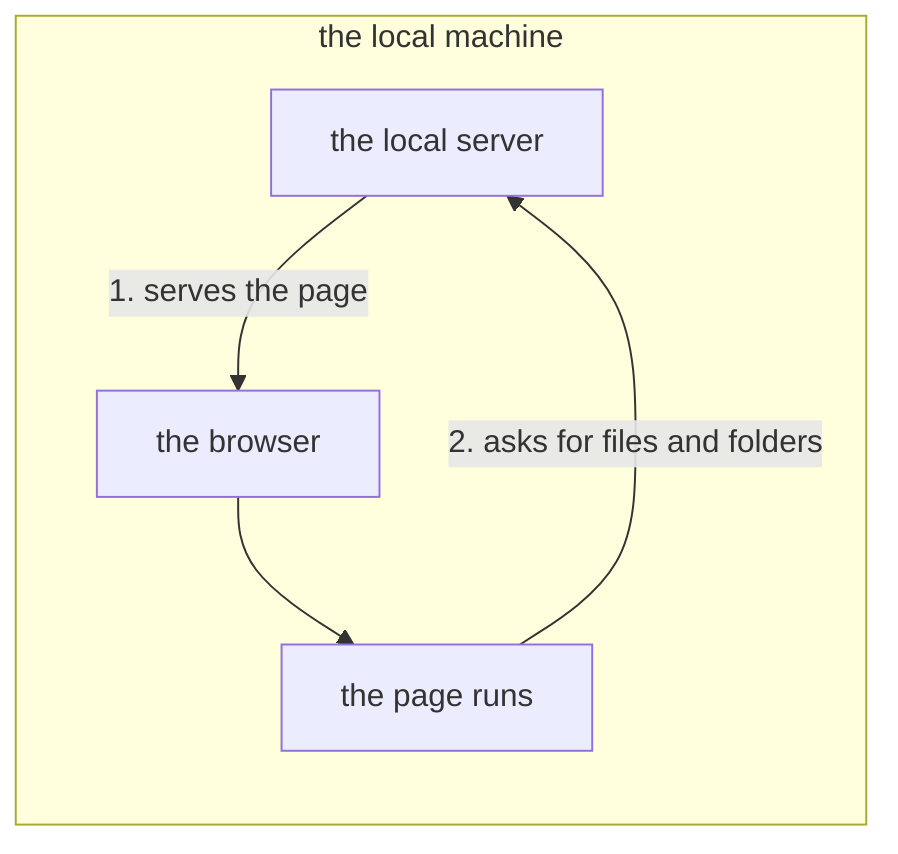

# The local server's protocol

**This document sets the protocol for a page in a browser and a small program on the same machine, the *local server*.** The page asks the program to read and write files for it. The document also sets what that program must refuse. By design, a browser lets a page open a file only through a window a person chooses. A page cannot walk folders or reach a file by its path. So one local program answers these requests. The same program serves the page, so the same-origin rule does not block them. (That rule lets a page freely call only the server the page came from.) **It starts no program.** Take a server that starts programs on a page's request. Every guard of it must hold, for what a page can ask for there is running code.

**It describes no single implementation**: the server is meant to be replaceable, so only the rules live here.

## Who asks whom

The page asks and the server answers; nothing goes the other way. The picture shows the two steps, both on one machine.

**Only the page asks.** The server never touches the page's contents unasked. It does not know the document either: it delivers only text and byte sequences, and the page decides where in the document they go.

**Nothing flows the other way.** Whether a file changed is asked for ("Watching" below). So no connection carries news from the server. No WebSocket (a connection the server can push messages down) is used.

## Where it listens

The server can be reached only from this machine, only with a secret it prints at start-up, and only for files inside one folder. The rules below set each of the three limits.

Words used here: the *loopback* is the address `127.0.0.1`, which only this machine can reach. The *token* is a random secret string the server makes at start-up. The *root* (`<root>`) is the one folder whose files the server reads and writes.

| Rule | Why |
| :-- | :-- |
| **It listens on `127.0.0.1` only** | It is out of reach of other machines. Serving them is a separate matter, which this protocol refuses |
| **It answers only a request whose `Host` names the loopback** (`127.0.0.1` or `localhost`, any port), and refuses any other with 403, the page included | A web page whose name is re-pointed at `127.0.0.1` (DNS rebinding) reaches the port as its own origin and sends its own name. Without this rule it would read whatever the page can |
| **No file under the root is handed out without the token, the page alone excepted**, static serving included | A file served freely would come from the origin that keeps the token. Say an HTML file in the root is opened in the page's tab. It could read the token, and any program on this machine could read the root |
| **The server prints a token (`token`) once, at start-up, and knowing the address alone is not enough to ask.** A request without the token is refused with 401 | Only `GET /`, the page, needs none: the page is where the token is handed over |

DNS rebinding works like this: a site you visit changes what its own name points at to `127.0.0.1`. The browser then treats your local server as part of that site. The `Host` header (which names the server a request is meant for) still carries the site's name, so the server can tell.

The page reads what it shows through `GET /api/file`, a picture beside the document included. An `` cannot send the token's header, so the page fetches the bytes and hands them to it.

**The page cannot reach outside the root (`<root>`)**, through any endpoint. Two refusals guard this, and both are needed:

| Refusal | What it refuses | Why it is needed |
| :-- | :-- | :-- |
| **The text** | `..` levels, an absolute path, a NUL, a Windows device name (such as `CON` or `NUL`). `%XX` is decoded exactly once (`%252e` is a name reading `%2e`, and does not become `.`) | These spellings leave the root by themselves |
| **A link inside the root** | A symbolic link at any level of the path. Each level is inspected | The text check alone cannot close this hole: `link.txt` is a legitimate name, so a check looking for `..` lets it through |

Caution: **Do not inspect only the last level**: a link on a folder would pass unseen.

**A race remains**: the server inspects the path first and opens it afterwards, and the folders can change in between. Say a request asks for `notes/a.txt`. The server finds that `notes` is a real folder, not a link. Before it opens the file, another program replaces `notes` with a link to the user's home folder. The open follows that link out of the root. So the two refusals stop a client that can only send a path. A web page in the browser is such a client: it cannot make a link inside the root. They do not stop a program on the same machine that can write into the root. Closing the race needs two things together:

* an open that the kernel itself keeps inside the root's folder (on Linux, `openat2` with `RESOLVE_BENEATH`);
* file functions that pass on the file already opened rather than the path's text, so that nothing looks the path up a second time.

**There is exactly one exception: the page named by the person who launches the server.** That person can name, at launch, the one file returned for `/` and `/index.html` (`kssrv --page=<file>`). The page still cannot point outside the root: it cannot choose that file with a string it wrote. Only one regular file can be named. It is never a folder, because a folder would be a second root that the two refusals above do not cover. It is never a FIFO or a device, whose read can never end.

* **Naming it is the launching person's judgment.** Named while the server faces outward (without `--local`), that file is served to other machines. So treat it as a choice as weighty as choosing the root.
* **Do not start up when the named file does not exist**: a later 404 leaves nobody able to tell why the page is blank.

**The server checks the Host and token after reading the headers, before waiting for the body.** Only GET or HEAD for the page with no body needs no token. Syntax and size errors can be refused before authorization.

### How the token gets across

**The token reaches the page once, inside the URL a person opens: the server prints one line, `http://127.0.0.1:<number>/#t=<token>`, and a person opens it once.** Then:

1. The page moves the token from the fragment (the part of the URL after `#`) into `sessionStorage`, the browser's storage for one tab.
2. It at once removes the token from the URL with `history.replaceState`, so the browser history keeps no token.
3. After that, every request carries it in a header (`Authorization: Bearer`).

**It survives a reload**: `sessionStorage` stays inside the tab, disappears when the tab closes, and cannot be read from another origin. So a person opens the URL once per start-up.

Caution: **Do not hand it over in the response that serves the page.** Anyone who knows the address could read it there, so "knowing the address alone is not enough to ask" would be false.

The token goes nowhere else either:

| The rule | What is done instead |
| :-- | :-- |
| **It is a fragment (`#`), not a query (`?`).** | The fragment, which a browser never sends to the server |
| **Do not make an endpoint that returns it on request.** Do not put it in a response's header. Both are the same hole as the response above | Printed once, on the console |
| **Do not hand it over in a cookie.** | A header, `Authorization: Bearer` |
| **Do not take the token from the command line** | The server makes it from the OS's random source |
| **Do not stop the comparison at the first differing byte**: the response time would then reveal the token one byte at a time | Every byte is compared |

## Only three things can be asked for

A page can read and write files, watch whether a file changed, and keep the server running or stop it. Nothing else is offered.

**Do not add an endpoint that starts a program**, for building, debugging, completion or a plugin. Every one turns a request a page can make into running code. **Nor one that lists a folder.** The page asks for each file by its name. A listing would hand the names under the root to whoever holds the token.

### Files

The page reads a file whole and writes a file whole, by its path under the root.

| Request | Response |
| :-- | :-- |
| `GET /api/file?path=
` | That byte sequence. 404 if absent |
| `PUT /api/file?path=
` | Writes the body under that name. On success, `{"wrote":<byte count>}` |

A PUT can carry `X-Kanso-If-Content`: either `missing`, or the 64-character lowercase SHA-256 digest of the expected file bytes. `missing` permits creation only when the path does not exist. A digest permits replacement only when the existing bytes match. A mismatch returns 409 without writing; a malformed guard returns 400. Without this header, PUT replaces unconditionally.

The check and replacement run together before this server handles another request. This protects clients sharing one server. It does not lock out other server processes or programs writing directly to the filesystem.

`GET /api/status` declares `conditional_writes: true` when these guards are supported. A client relying on them must refuse writes when this declaration is absent.

**`HEAD` is not supported**: "Watching" below returns the size and whether the file exists. The server does not guess the type; it returns `application/octet-stream` (plain bytes). The character encoding is UTF-8 only, with no way to read another.

Caution: **Do not let a write that dies halfway corrupt the original.** Write to another name, then replace. **That other name goes through the same two refusals**: a link already standing there would take the write outside the root.

**The ceiling on a PUT body is 8 MiB (8,388,608 bytes), included.** A body of exactly that length is written. One byte more is refused with 413, not silently cut short. A page can rely on writing back any file up to that size.

Caution: **Do not lift the ceiling, nor make it unlimited.** The server holds each body in memory until the body is whole, so the ceiling bounds what a token holder can make it hold.

### Watching

The page asks whether a file is there, and when it last changed. The server answers with the file's size and the time it last changed.

| Request | Response |
| :-- | :-- |
| `GET /api/stat?path=
` | `{"size":…,"changed_at":…}`. 404 if absent |

**When to ask is the page's choice.** The page can ask before writing over a file, to see whether something else made or changed it. It can ask before opening one again, or at intervals to follow it. **The OS's file watching (inotify / ReadDirectoryChangesW) is not offered**, so a page that follows a file asks again. However often the file changed in between, the next answer gives its final state.

Caution: **Do not return the contents**, only whether the file changed. Where the page needs the contents, it re-reads them through the file endpoint, so the same text never arrives by two paths.

### Keeping the server alive while a page is open

An open page keeps one connection open to the server. When no page holds one, the server stops after a wait.

| Request | Response |
| :-- | :-- |
| `GET /api/here` | A response whose length is not stated, and **not one byte of it ever arrives**. It ends when the connection does |

**A page holds one connection open for as long as it is open, and the server stops once nothing holds it.** How long it waits with nothing holding it is set at launch (`--idle=<seconds>`); if no time is set, it does not stop.

**Do not use a timer on the page instead**, and do not judge use by the last request alone.

**Do not rely on the page saying goodbye.**

Caution: **Open the hold again if it ends.** A connection can break while the page stays open, and without a new hold the server counts down while a person is still writing.

#### Stopping it when asked

A page, or any program holding the token, can stop the server at once.

| Request | Response |
| :-- | :-- |
| `POST /api/stop` | `{}`, and then the server stops |

**Whoever holds the token can stop the server**, as they can ask for anything else; without it the answer is 401 and the server keeps running. Facing outward there is no token to ask with, so there is no stop either (404).

**The answer goes out before the server stops**, so the asker tells "it stopped" from "the connection broke". It stops once that answer has been sent, whatever pages hold it.

**A server is stopped by this request, not by a signal to its process.**

## How it refuses

Each refusal comes back as one of the HTTP status codes below. **A refusal must not be silent**: every refusal says what happened.

| Status | When it is returned |
| :-- | :-- |
| 400 | A malformed request (a `Host` given twice included), or a malformed `%XX` |
| 401 | No token, or it does not match. **It comes before every answer about a path other than the page's** (403 and 404 alike). So a request without the token learns nothing of the names under the root |
| 403 | It pointed outside the root, or named a `Host` other than the loopback |
| 404 | A name that does not exist, or an unknown endpoint |
| 405 | A `HEAD`, `DELETE`, and so on to the file endpoint |
| 409 | The conditional write no longer matches the file, or its target is not a regular file |
| 413 | The body exceeded the ceiling |
| 500 | It could not be written or replaced |

## When it is not connected

A client checks `/api/status` once at startup. The response must declare `local: true`; an ordinary outward-facing server is not a local file service. A 401 means the server is present but the token is missing or refused.

A client that requires file access stops startup and tells the user to open the URL the local server printed ("How the token gets across"). It does not substitute a browser file handle or a plain file fetch. The same page is shipped for every supported browser.

## Further reading

* [`README.md`](README.md) — which reader each document here is for.
* [kssrv](../kssrv/README.md) — the server that answers.
* [ksmd](../ksmd/README.md) — the editing system that is the client.
* [ksmd](../ksmd/README.md) — the document editor, whose page is a client too.
