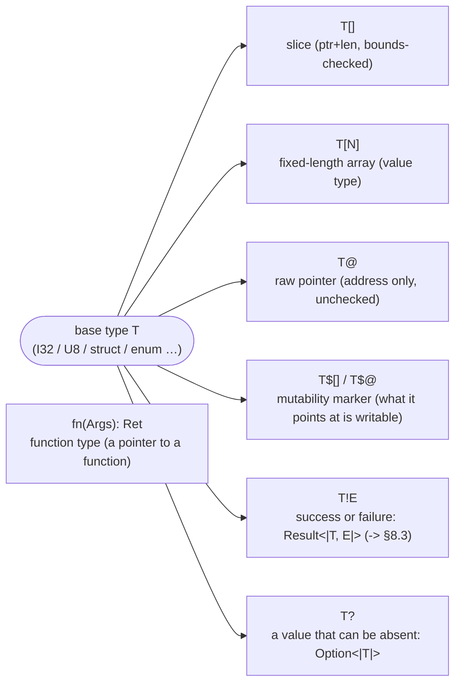
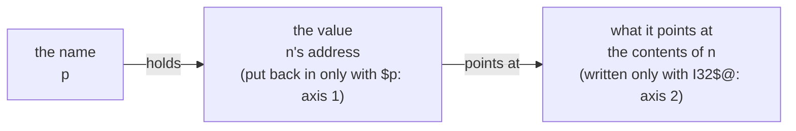
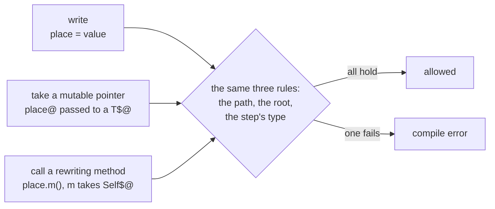
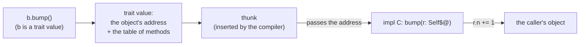
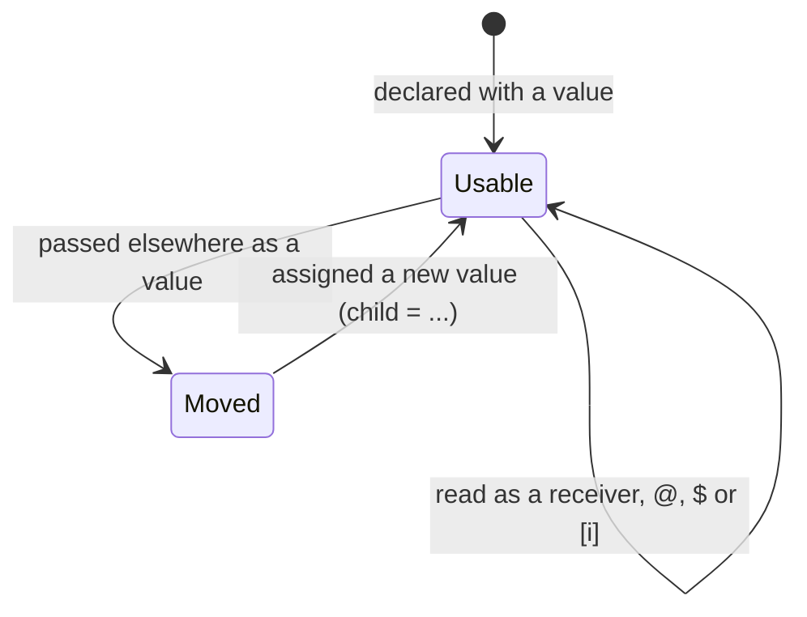
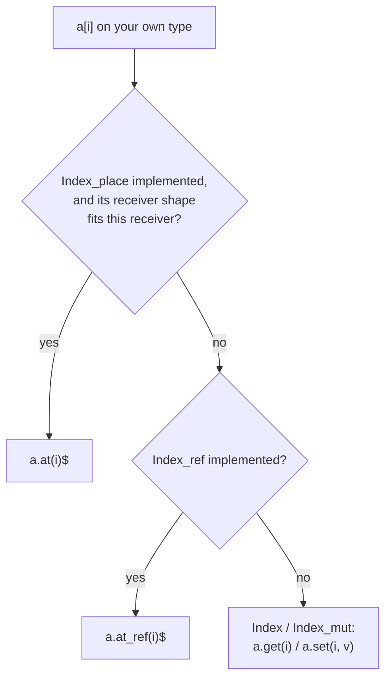
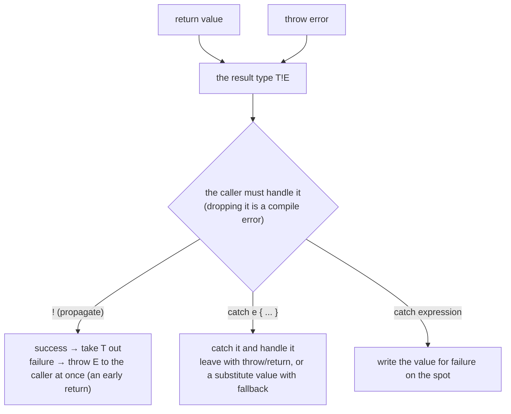
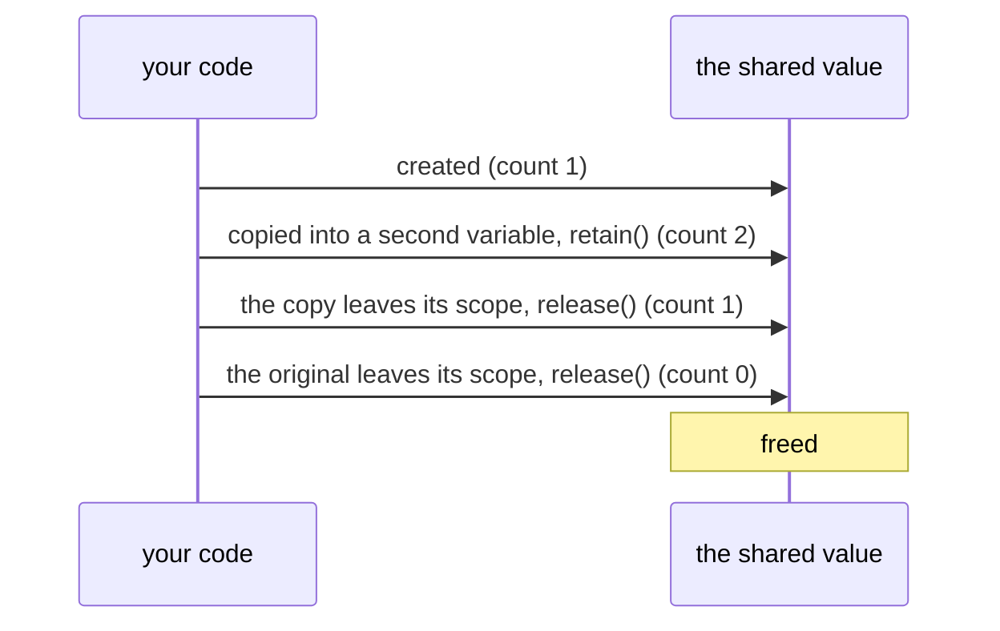
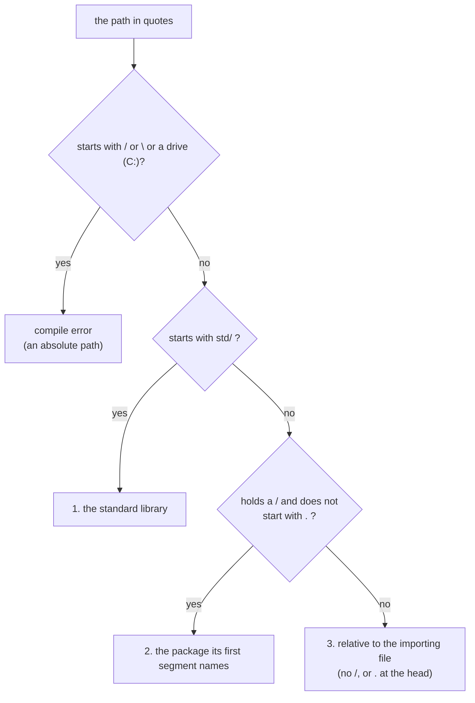
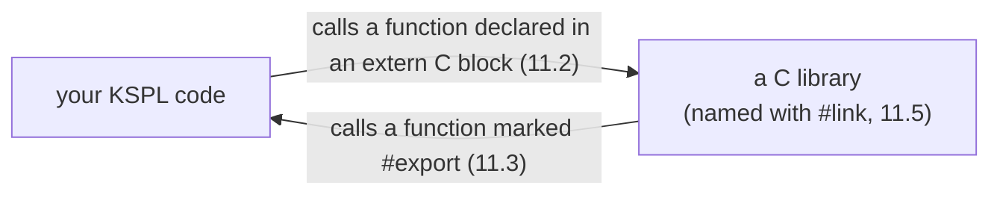

# The kanso programming language specification

## 1. Overview

KSPL is a statically typed language for systems programming, such as a compiler, an operating system or a server. Every value's type is known when the program is compiled, so a type mistake stops the build, not the running program.

**Only what is written happens**: code runs, and memory is allocated and freed, exactly where the code says. There is no garbage collector working in the background.

A feature only some kinds of work need is a standard-library part, not a language rule.

The compiler, `ksplc`, translates KSPL into C (or into LLVM IR), and a C compiler turns that into the program. "The generated C" below is the C text `ksplc` writes for your program.

These marks appear in examples from the first chapter on. Each is defined in the section named.

| Written | What it means | Defined in |
| :-- | :-- | :-- |
| `x: = 1` / `x: I32 = 1` | Declare `x`. Without a type, it is taken from the value | [4.1](#41-declaration-patterns) |
| `$x: = 1` | `x` can be given a new value later; without `$` it cannot | [4.2](#42-the-two-axes-of-mutability) |
| `T@` / `x@` | A pointer to a `T` / the address of `x` | [3.2](#32-derived-types), [4.3.1](#431-the-mutability-of-x-is-fixed-by-xs-declaration-alone) |
| `p$` | What the pointer `p` points at | [6.2](#62-pointer-arithmetic-and-implicit-dereferencing) |
| `T[]` / `T[N]` | A slice (a pointer plus a length) / a fixed-length array of `N` elements | [3.2](#32-derived-types) |
| `T$[]` / `T$@` | A slice whose elements, or a pointer whose target, can be written | [3.2](#32-derived-types) |
| `List<\|I32\|>` | A generic type with its type argument | [3.3](#33-structs-struct) |
| `T::x` / `T::{ … }` | Convert `x` to `T` / build a value of `T` from its parts | [6.4](#64-type-conversion--and-implicit-casts), [6.6](#66-initialization-and-construction) |
| `T!E` | A function's result: a `T` on success, or an error `E` | [8.3](#83-error-handling) |
| `.kspl` | A source file, written in the indentation notation | [2.5](#25-blocks-and-statement-ends) |

---

## 2. Lexical structure

**Source code is encoded in UTF-8, throughout.** A byte that begins no well-formed UTF-8 sequence stops the compile at its line and column. An overlong form and a surrogate's encoding are such bytes too. The rule holds in a comment or a string as anywhere else. A byte that is not text is written as a number (`0xFFU8`), and a character as itself or with `\uXXXX` ([2.3.3](#233-writing-a-code-point-with-uxxxx)).

### 2.1 Comments

KSPL has one kind of comment: `//` to the end of the line. A comment opening with `//<` documents the thing on its own line, and tools show it.

| Written | What it is |
| :-- | :-- |
| `// text` | **Line comment**: from `//` to the end of the line, and the only kind of comment. There is no block comment `/* */` |
| `//< text` | **Documentation comment** (below) |
| `///` or `//!` | **Not a documentation comment.** The compiler warns about a comment opening with either, and does not read it (`ksplc explain W0212`) |
| `////` (four or more slashes) | An ordinary comment |
| `#!` on a file's first line | A shebang, skipped like a comment, so the file can run as a script with `ksplc run` |

**A documentation comment** describes the thing on its own line: a declaration, a field, a variant, a parameter or the return type. It stands after what it describes, not before it:

```kspl
priv fn demangle( //< strips the mangling off a symbol
    raw: U8[], //< the mangled symbol as it was written
    file: U8[], //< the source the symbol came from
): U8[] //< the original name, or the input unchanged
    return raw
```

* **A parameter's description goes on the parameter's line, a field's on the field's, and the return's on the return type's line.**
* **A run**: a line holding only a `//<` and its text continues the description above it, one step deeper. Such lines together are a run. Any other line ends the run, a blank line or a plain `//` included. If the thing described has braces, the run goes inside them; otherwise it stands below, one step in.
* **The summary**: a run's first line with text is its summary, and the detail starts on the next line. **No `//<` with no text follows the summary**, and `ksplc fmt` removes such a line. Further down, a `//<` with no text parts two paragraphs of the detail. An editor's hover and `ksplc doc` show the summary first. It does not open with a `Caution:` or `Note:` label (`ksplc explain W0213`).
* **The anchor shape**: a description longer than one line stands below a `//<` with no text, which only anchors the run. The summary is then the first line below it.
* **A head that wraps**: a declaration's head is everything before its body. When the parameters stand one per line, the head closes on the line holding `)`, and the declaration's run hangs off that line. There a `//<` with no text anchors the declaration's run, and a `//<` with text describes the return type.
* The compiler warns about a `//<` that continues nothing, and about an anchor with nothing under it (`ksplc explain W0209`, `W0210`).
* **A file's description** is a `//<` run before its first line of code, above its imports, with nothing over it but blank lines.

In `twice` the closing line's `//<` has no text, so it anchors the declaration's run below it. In `half` it has text, so it describes what comes back, and the declaration's own summary stands on the first line:

```kspl
priv fn twice(
    n: I32, //< the number to double
): I32 //<
    //< n doubled
    //< A negative is doubled the same way, and nothing is clamped.
    return n * 2

priv fn half( //< n halved, rounded toward zero
    n: I32, //< the number to halve
): I32 //< the half
    return n / 2
```

| Where the `//<` stands | What it describes |
| :-- | :-- |
| On a head's first line, with text | The declaration |
| On a wrapped head's closing line, with no text | The declaration: its run is the lines below |
| On a wrapped head's closing line, with text | The return type |

### 2.2 Identifiers and naming rules

An identifier (a name) starts with a letter (`A-Z`, `a-z`) or `_`, followed by letters, digits or underscores. KSPL's reserved words (keywords) cannot be identifiers.

This naming is recommended; **the compile does not refuse a name that breaks it**, and `ksplc lint` reports one (I0502).

| Style | Used for | Which letters are uppercase | Example |
| :-- | :-- | :-- | :-- |
| `Initial_upper_snake_case` | Types, structs (`struct`), enums (`enum`), typedefs (`typedef`) | Only the first letter; all later letters are lowercase | `File_descriptor` |
| `UPPER_SNAKE_CASE` | Explicit constants (`const`) | All letters | `MAX_BUFFER_SIZE` |
| `snake_case` | Ordinary bindings, functions (`fn`), methods, fields, enum variants, file names | None | `open_file`, `not_found` |

Underscores separate words in all three forms. An ordinary immutable binding follows `snake_case`; immutability alone does not make its name uppercase. A constant generic parameter follows `UPPER_SNAKE_CASE`, as in `const N: Sz`.

**C's reserved words (`int` / `long` / `goto` and so on) are usable as identifiers**, except those that are also KSPL's own: `struct` / `enum` / `typedef` / `const` / `if` / `else` / `for` / `switch` / `return` / `break` / `continue` / `case` / `default` / `extern` / `sizeof` / `offsetof`.

In the generated C, `ksplc` adds the suffix `_kw` to such a name. Only local variables, parameters and struct fields keep their bare names in the generated C, so only those get the suffix. Type and function names carry a prefix made from their file's path; `std/lang`'s types alone go without. In C, `_`, `.` and `/` all become `_`. **Two names spelled alike in C are a compile error naming both**: a `Foo` in each of the files `a_b/c` and `a/b_c`, or two instances of one generic. So is a name spelled like one of the C runtime's: `fn check` in a file `bounds` is `kspl_bounds_check`. So is one spelled like the type C defines for an array or a function type: a `struct Foo_Array_4` beside a use of `Foo[4]`. A suffixed name collides only where it already exists in the same scope (`goto` beside `goto_kw`).

**Two more groups get `_kw` and are usable too:**

* **Names the generated C's preamble headers `#define` as object-like macros**: `NULL` / `EOF` / `errno` from libc, and `far` / `near` / `pascal` from Windows' `windef.h`. A function-like macro (`max(a,b)`) expands only before a `(`, so this group leaves them out.
* **The words a C compiler keeps for itself**: every name opening with `__`, or with `_` and a capital letter; Microsoft's one-underscore synonyms (`_try` for `__try`, `_int64`); `static_assert`; `L__FUNCTION__` / `L__FUNCSIG__`. The suffixed form opens the same way and gets `_kw` in turn, so `__try` beside `__try_kw` is not an error.

Names only OS headers define (`st_mtime` / `O_RDONLY` / `AF_INET`) are usable too, and get no suffix.

**A debugger shows such a variable with its suffix** (`int` becomes `int_kw`), since it shows the generated C's names.

### 2.3 Literals

A literal is a value written directly into the source. There are these seven kinds and no others.

| Category | Example notation | Type / notes |
| --- | --- | --- |
| **Integer** | `123`, `-10`<br>`0xFF` (hex)<br>`0b1010` (binary) | Defaults to `I32`; a suffix states the type (`123U8`, `100Sz`). |
| **Floating point** | `3.14`, `-0.5`<br>`2.5e-10` (exponent notation) | Defaults to `F64`; a suffix states the type (`1.0F32`). IEEE 754 (the usual binary floating-point format). |
| **Boolean** | `true`, `false` | `Bool`. |
| **Null** | `null` | **Becomes the expected pointer type.** Where nothing gives an expected type, `null` has none: `p: = null` is a compile error asking for the type (`p: T@ = null`). |
| **Character** | `'a'`, `'\n'`, `'A'` | `U8`: exactly one byte. `'あ'` (3 bytes in UTF-8) and `'ab'` (2 bytes) are compile errors; longer text is a string (`U8[]`). <br>**There is no character type.** The format specifier `\{b:c\}` writes the byte as a character ([3.6](#36-the-expansion-specification-for-string-interpolation)). A C `char*` is received as `Void@` ([11.1](#111-types-that-cannot-cross-the-c-boundary)). |
| **Ordinary string** | `"Hello\n"`<br>`"Hello, \{name\}!"` | `U8[]`, or an interpolated string.<br>Escape sequences are interpreted. **A line break is written `\n`**; one written as it stands is a compile error. A `\` at the line's end continues the text on the next line ([2.3.4](#234-a--at-a-lines-end-continues-a-string)). A `\{expression\}` makes it an interpolated string ([3.6](#36-the-expansion-specification-for-string-interpolation)). |
| **Raw string** | `"""Path\To\File"""` | `U8[]`, between `"""` and `"""`, with no escapes and no interpolation. Immutable like an ordinary string, and null-terminated. A newline right after the opening `"""` is dropped, and **every line inside ends `\n`**, whatever line ends the file uses. |

**Line ends are the file's spelling, not the program's**: a source with `\r\n` line ends and the same source with `\n` are one program. A text that must hold a `\r` writes the escape.

A numeric literal can carry the digit separator `_` anywhere but first (`1_000_000`).

**A decimal integer does not start with `0` unless it is `0` itself**: `0755`, `09` and `0_1` are syntax errors. KSPL has no octal literal, but C and Java read that spelling as octal. The error names both readings (`755`, or `0x1ed` for the octal one). A floating-point literal is always decimal and can start with `0` (`0.5`, `007.5`).

#### 2.3.1 The rules that fix a literal's type

**A literal's type is fixed by where it is placed.** A number written with no suffix has no type of its own until its position gives it one.

The type a position calls for is the *expected type*: a variable declaration's annotation, an assignment's left side, or a function's argument. The expected type propagates to the right side.

| Where the literal stands | The type it takes | Example |
| :-- | :-- | :-- |
| It carries a suffix | The suffix's type | `300U8` (a compile error: out of range) |
| Where a type is expected | The expected type, if the literal is within its range | `b: U8 = 255`, `for $i: Sz = 0; i < len; i += 1` |
| An integer operand where the two sides would have no common type | The other operand's integer type | `u < 1` with `u: U32` compares at `U32`, so `u < -1` is out of range |
| An integer operand, and the outer expected type is the other operand's type | That type | For `x: U8`, the `1` of `y: U8 = x + 1` is a `U8` |
| Any other operand of a numeric binary operation | Its default; then the operands are promoted to the side holding the other | `x + 100` with `x: I8` (below) |
| Nowhere a type is expected | `I32` for an integer, `F64` for a floating-point number | `x: = 1` |

**A floating-point literal takes only a floating-point type.** Placed where an integer is expected, it stays `F64`, and the implicit conversion is a compile error (`x: I32 = 2.5`, an `I32` argument, a `catch` substitute for an `I32`). **An integer literal likewise takes only an integer type**: `f: F64 = 2` and `x * 2` with `x: F64` are compile errors; write `2.0`.

**An integer literal outside the range is a compile error** (`b: U8 = 300;` / `n: I32 = 2147483648;` / `u: U32 = -1;`). For truncation or a bit pattern, write an explicit cast (`U8::300`, `U32::0xFFFFFFFF`).

* A literal whose type is fixed is checked against that type. A suffix fixes it (`300U8`), and so does an expected type from a declaration, argument, field and so on.
* A literal with no fixed type is checked against the type actually computed (below).
* A literal with more digits than any integer type holds (beyond 64 bits) is an error whatever the expected type.
* **A minus written directly before a literal is checked with it, as one value**, in a function and in a constant alike. So a type's minimum can be written as it reads: `-2147483648` for `I32`, and `-9223372036854775808` for `I64`, although `9223372036854775808` alone fits no `I64`.

**A floating-point literal its type holds only as infinity, or only as zero, is a compile error** (`f: F32 = 1.0e39`, `x: F64 = 1.0e400`, `x: F64 = 1.0e-400`). It is checked against the type it takes, by the same rules as an integer literal. Two kinds of rounding stay accepted, since neither changes what the number is:

* **Rounding to the nearest value the type holds**: a decimal fraction almost never has an exact binary form (`0.1`), so every such literal rounds.
* **A subnormal**, below the type's smallest normal number (`1.0e-45` in an `F32`): it keeps fewer digits, but stays the nonzero number written.

An infinity is the result of arithmetic (`1.0e308 * 10.0`, `1.0 / 0.0`), never a literal.

**The expected type is not propagated into a numeric binary operation**, as a rule: operands of differing types are promoted to the wider one ([6.4](#64-type-conversion--and-implicit-casts)). With `x: I8` holding `100`, `y: I32 = x + 100;` keeps the `100` at `I32` and gives `200`, not an 8-bit `-56`.

The exception is an integer literal with no fixed type (the third and fourth rows of the table). It takes the outer expected type only when that type is the other operand's, so in `y: I32 = x + 100;` the `100` stays `I32`. Such a literal then has a fixed type, so the range check applies (`y: U8 = x + 300;` is a compile error). **Shifts are outside the exception** (the right side is a shift amount, whose type is independent of the left side's).

**To write the type, use a suffix** (`x + 300U8`). A prefix cast (`x + U8::300`) gives the same type, but skips the range check and truncates silently. Use it only when truncation is the intent.

**An integer literal with no type written must fit the type actually computed**, or it is a compile error. It is judged against one of two types:

* **Inside a binary operation**: the type after promoting both sides. Against a `v: U32`, `v * 0x85ebca6b` is correct as `U32` (`0x85ebca6b` does not fit `I32`), and `x: U64 = 4294967296 + 1;` is correct as `U64`. But `x: = 4294967296 + 1;` stays at the default `I32` after promotion, so it is an error.
* **A declaration with no type annotation**: the initializer's type becomes the declaration's type, so `x: = 2147483648;` does not fit the default `I32` and is an error.

Both are fixed the same way: write the width with a suffix, or write the variable's type (`2147483648U32` / `x: I64 = ...`).

#### 2.3.2 Escape sequences

An escape sequence is a `\` followed by a code that stands for one byte. In an ordinary string literal and a character literal, only these ten can follow `\`; in a string, a line terminator can too ([2.3.4](#234-a--at-a-lines-end-continues-a-string)). A raw string (`"""…"""`) interprets no escapes.

| Notation | Byte | Notation | Byte |
| :-- | :-- | :-- | :-- |
| `\n` | 10 (newline) | `\'` | 39 (`'`) |
| `\r` | 13 (carriage return) | `\"` | 34 (`"`) |
| `\t` | 9 (tab) | `\\` | 92 (`\`) |
| `\0` | 0 (NUL) | `\{` / `\}` | 123 / 125 (`{` / `}`) |
| `\uXXXX` | The 1 to 3 bytes representing code point U+XXXX in UTF-8 | | |

**A notation absent from the table is a compile error** (`"\b"` / `"\x41"` / `"\101"`). For the character itself, write no backslash; for the backslash itself, write `\\`. There is no octal or hex notation: a byte written as a number is `0x41U8`.

**In a string, `\{` and `\}` open and close interpolation** (§3.6); only in a character literal do they denote `{` and `}` (`'\{'`). A bare `{` or `}` is written directly in a string, with no doubling.

#### 2.3.3 Writing a code point with `\uXXXX`

`\u` followed by four hex digits writes one Unicode character by its number (its code point). **The hex is exactly four digits** (`"\u00E9"` is `é`, `"\u3042"` is `あ`). Too few is a compile error, and a fifth digit is not taken in (`"\u00410"` is the two characters `A` and `0`).

| Where, or which code point | Result |
| :-- | :-- |
| In a string | **A UTF-8 byte sequence**, which `.len` counts (`"\u3042".len` is 3) |
| In a character literal | **One byte, so only up to U+007F** (`'\u00E9'` is a compile error, and so is `'あ'` written directly) |
| A surrogate code point (U+D800–U+DFFF) | **Cannot be written**: mapped to UTF-8, it gives an invalid byte sequence |
| Above U+FFFF | **Cannot be written with `\u`**: write the character itself into the source, which is UTF-8 (an emoji is accepted as one character) |
| In a comment or a raw string | Nothing: `\u` is expanded only where a literal's bytes are decided |

#### 2.3.4 A `\` at a line's end continues a string

**Inside an ordinary string literal, a `\` at the end of the line carries the text on, and stands for no byte.** The line terminator goes with it, and so does the whitespace at the start of the next line, so

```kspl
long: U8[] = "one \
    two"
```

holds exactly `"one two"`, however deeply its block is indented. **The indentation belongs to the layout, never to the text.**

* **The space at the seam is the writer's**: nothing is added or removed (`"ab\` + `cd"` is `"abcd"`).
* **Only a string has it**: in a character literal, it is a compile error. In a raw string, it is a backslash followed by a newline.
* **Interpolation is unaffected**: a `\{ … \}` can stand on either side of the seam.

Note: **Diagnostics name the lines as written.** A carried string is still open where the line ends, so the line below keeps its own number. The indentation notation reads the same line ends ([2.5](#25-blocks-and-statement-ends)).

`ksplc fmt` (the formatter) uses the mark to bring a line that runs past the file's width back inside it.

### 2.4 Trailing commas

A comma can also follow the last element of a comma-separated list: a function's arguments, struct and array compound literals, a variant's payload, generic arguments.

Note: **Declarations inside `{ … }` are not a comma-separated list.** A struct's fields and an enum's variants alike end with `;` ([2.5](#25-blocks-and-statement-ends)). A comma separates only things listed within one notation, such as a payload's fields.

### 2.5 Blocks and statement ends

**A program is written in the indentation notation, in a `.kspl` file.** Indentation, dedentation and newlines mark blocks and statement ends, as in Python. The compiler reads them as the `{` `}` and `;` of C, and this specification names them so. They are not a form a file is written in.

**Only blocks and terminators are written by indentation**; every other brace and `;` is written as it stands.

| The job of a brace or `;` | Where it stands | In `.kspl` |
| :-- | :-- | :-- |
| A block | `fn` / `struct` / `enum` / `trait` / `impl` / `extern` / `if` / `else` / `for` / `switch`'s `case` and `default` / `defer` / a labelled block / `catch` and `fn(…)` inside an expression | Indentation |
| A value | `T::{ … }`, `::{ … }`, `import … { … }`, string interpolation `"\{ … \}"` | **Unchanged** |
| A terminator | The `;` of declarations and statements | A newline, or the `}` of a block written on one line |
| A separator | The `;` of a C-style loop header (`for init; cond; step`), before a closure's captures (`fn(x: I32; n: I32)`), and between two statements or declarations on one line (`a(); b()`, `import "std/io"; fn main() { … }`) | **Unchanged** |

**Every declaration inside a block ends with `;`, the last one too**: a `struct`'s fields and an `enum`'s values alike (in `.kspl`, a newline). `,` separates only what is listed within one notation: a payload's fields, arguments, compound literals and generic arguments. A `,` between fields or values is a compile error, and so is an `enum` with no value.

**A newline ends a statement unless the line continues.** A block's heading carries no mark (no `:` as in Python). A line continues onto the next in these cases:

| # | The line continues when | For example |
| :-- | :-- | :-- |
| 1 | The newline is inside brackets (`(` `[` `{`). Inside brackets a newline never opens a block | A call whose arguments run over several lines |
| 2 | The line ends in an operator, `,`, `=` or `:`, or in `as`, `in` or `catch` | `total: = a +` with `b` on the next line |
| 3 | The next line starts with `.`, a closing bracket or an operator | A chain of calls with each `.s(…)` on a line of its own |

**A comment line or a blank line in between changes nothing.** Rules 2 and 3 read the next line with code. So a comment can stand between an `=` and its value, or between two links of a chain.

**After `catch`, the column decides.** After `f() catch` or `f() catch e`, a next line at the statement's own column continues the statement. A deeper line opens the handler ([8.3](#83-error-handling)). `ksplc fmt` therefore never breaks a line right after `catch`, and lets it run past the width.

**A line holding only `return`, `throw` or `fallback` is a statement of its own.** A `!` at a line's end is a rethrow (`f()!`, passing an error on to the caller) and ends the statement. A `!` at a line's start continues the line before (a wrapped `T!E` type).

**A value split where no mark continues it goes in parentheses.** This applies to a conditional value (`a if c else b`), and to the value of a `return`, `throw` or `fallback`, whose keyword alone is a statement. A break outside every bracket is a compile error whose message names the parentheses, and `ksplc fmt` puts them in.

**Only a heading's column counts.** A block's body can be indented by any amount, and blocks indented by different widths can stand in one file. A line deeper than a block's heading but shallower than its members matches no block, and is a compile error with no code.

**Indentation is written with spaces.** A tab, U+3000, U+00A0, a form feed or a vertical tab does not count as a column. A line indented with one is read at column 0.

**A block with no heading carries a label**: a name and a `:` on the line above the block (`release_on_exit:`). A lone `{ … }` is a compile error. A block that needs no name takes the label `_`. It can appear any number of times in one scope, so `break` or `continue` to `_` is a compile error.

**Two forms keep their braces in `.kspl`**:

* a closure (a function written inside an expression) with a multi-line body inside a call's arguments, since a newline inside brackets is not a block;
* an empty block, and a block fitting on one line (`f() catch {}`, `fn f() {}`, `case .x {}`). A block holding only a comment counts as empty. No terminator follows such a block, and its last statement takes no `;` (`fn one(x: I32): I32 { return x + 1 }`).

**A `;` at the end of a statement's line in `.kspl` is a compile error with no code.** The line's end already ends the statement.

**A `;` outside every bracket ends a statement, and what follows it on the line is read as if it began a line of its own.** So one line can hold several statements or declarations, a whole program included:

```kspl
import "std/io"; fn main() { $n: = 0; for i in Range.asc(5) { if i % 2 == 0 { n += i } } io.out().s("\{n\}\n") }
```

* **The line's last statement owns the line's end and a deeper line below it.** In `n: = 0; for i in r` with the loop's body on the lines below, the body is the `for`'s.
* **A C-style loop header's `;` belongs to its `for`** until the loop's block has closed on the line, also on a line the header continues onto.
* **A block written on one line ends its statement with its `}`**, so no `;` is needed after it (`for i in r { f(i) } g()`). **A `;` right after such a `}` is a compile error with no code.** A block that is part of a value does not end the statement, and its `;` stays: `x: = f() catch { 0 }; g(x)`.
* `ksplc fmt` puts each statement on a line of its own.

**`switch` carries no block**: its `case` and `default` do. In `.kspl` each `case` and `default` stands at the `switch`'s column, the first on the line below the `switch`.

```kspl
switch e
case .spawn_failed
    io.err().s("could not start\n")
case .timed_out
    io.err().s("timed out\n")
```

**The `switch`'s line goes on into a `case` at its own column**, as a later arm goes on from the block before it. A comment line or a blank line between them changes nothing. Only that shape continues it:

* **A `case` indented deeper is a compile error**: it would open a block under the `switch`, which has none.
* **A `case` at a shallower column belongs to the level outside**, so the `switch` ends without an arm, which is a compile error.
* **A `default` cannot be the first arm**, so it does not continue the `switch`'s line either.

The first `case` can also stand on the `switch`'s own line (`switch e case .spawn_failed`); `ksplc fmt` moves it to the line below.

**Line numbers are those of the file as written.** Reading `.kspl` adds no line, so a diagnostic, a jump to a definition and a hover point at the line written.

---

## 3. The type system

A type fixes the width a value occupies and what can be done with it. Types are primitive ([3.1](#31-primitive-types)), derived from others ([3.2](#32-derived-types)), or declared (`struct` / `enum` / `typedef`). A group of types sharing a behavior is a `trait` ([5. Implementations and traits](#5-implementations-and-traits)).

### 3.1 Primitive types

The primitive types are the built-in numbers, `Bool` and `Void`. Every other type is built from them.

| Category | Type name | Size (bits) | Description |
| --- | --- | --- | --- |
| **Signed integer** | `I8`, `I16`, `I32`, `I64` | 8 ... 64 | Two's complement (the usual binary form for negative numbers). |
| **Unsigned integer** | `U8`, `U16`, `U32`, `U64` | 8 ... 64 |  |
| **Size** | `Sz` | 32, 64 | A **signed integer** for pointer sizes, array indices and memory offsets (C's `ptrdiff_t`). Its width depends on the architecture and is at least 32 bits ([14.1](#141-implementation-defined---the-value-is-fixed-but-differs-per-target)). A function receiving a length or an index must reject negative values itself. |
| **Floating point** | `F32`, `F64` | 32, 64 | IEEE 754 single and double precision. |
| **Boolean** | `Bool` | 8 | `true` (1) or `false` (0). |
| **Empty** | `Void` | 0 | Size zero: holds no value. |

**The sign of one byte is not left to the implementation**, unlike C's `char`. KSPL's one byte is `U8`, unsigned on every target (`unsigned char` in the generated C), so widening `U8::200` to `I32` gives `200` on both backends ([14.3](#143-what-must-be-the-same-in-every-implementation)).

**Byte order is the target's** ([14.1](#141-implementation-defined---the-value-is-fixed-but-differs-per-target)), and the language never reorders. x86-64 and Arm are little-endian. It shows only when a multi-byte value is viewed as bytes: through a hand-built descriptor, or a `mem.copy` into a byte sequence.

Caution: **Do not make an expression that reads or writes a value depend on byte order.** Read and write data with a fixed order (network protocols, file formats) with functions that name the order, such as `std/bytes`'s `get_u32_be` / `put_u32_le`. They have no default order.

### 3.2 Derived types

Six kinds of type are built from a **base type** (a primitive type or a struct), and function types stand beside them. The `T!E` type is in [8.3](#83-error-handling).

The diagram shows each one's notation; each is described below it.



1. **Slice (`T[]`)**:

* **Definition**: a view onto a memory region that something else owns: a *fat pointer*, a pointer and a length together. It has two read-only fields: `.ptr`, a raw pointer to the first element (`T@`), and `.len`, the element count (`Sz`).
* **The only spelling**: it is `std/lang`'s `Slice<|$T|>`, but `Slice<|T|>` written as a type is a compile error naming `T[]` (`T$[]` for writable elements), an `impl`'s target included.
* **Safety**: every read or write by index is checked against the range at run time.
* **Constraint**: there is no slicing syntax (`arr[start .. end]`). `std/chars`'s `sub(start, len)` / `sub_from(start)` / `sub_mut(start, len)` return zero-copy views. They are generic methods on `impl<|T|> T[]`, so an `I32[]` and a `U8[][]` are sliced alike.

2. **Fixed-length array (`T[N]`)**:

* **Definition**: `N` is a compile-time constant (`U8[10]`). An array variable is the contiguous memory itself, not a pointer to its first element: a value type, copied whole when assigned or passed.
* **Letting the compiler count the elements (`T[_]`)**: with a compound literal `::{ ... }` on the right, `_` takes the number of initial values written. With an array of fixed length on the right (a variable, a row `m[1]`, a field `s.a`), `_` takes that length. For `m: I32[3][2]`, `r: I32[_] = m[1]` is `r: I32[3] = m[1]`, whether `m` is immutable or not.
  * **Only in a variable declaration.** `T[_]` as a struct field's type is a compile error (the field layout needs the size first).

3. **Raw pointer (`T@`)**:

* **Definition**: a value holding only a memory address, written with the postfix `@` on a type, for C interoperation and hand-written allocators. It carries no length, so no bounds check is possible.
* `ptr[i]` is forbidden on a raw pointer; unchecked access is written `(ptr + i)$` ([6.2.1](#621-member-access-and-indexing-through-a-pointer)).

4. **Function type (`fn(Args...): Ret`)**:

* A pointer to a function, as in `typedef Callback = fn(val: I32): Void;`.
* **It stands wherever a type can**: a parameter, a field, a return, a local, a type argument (`List<|fn(x: I32): I32|>`), an array's element. A call through such a value is checked against the type.
* **A postfix after a function type belongs to its result.** `fn(x: I32): I32@` returns a pointer. Bracket the function type to apply a postfix to it: `(fn(x: I32): I32)@` is a pointer to a function pointer, and `(fn(x: I32): I32)[4]` an array of four. Diagnostics spell such types the same way.
* **A parameter writes both a name and a type.** A bare name inside `fn(...)` is the parameter's name, so `fn(T): T` is a parameter named `T` with no type (a compile error).

5. **Mutability modifier (`T$[]` / `T$@`)**:

* **Definition**: a `$` directly before a slice's `[]` or a pointer's `@` makes what it points at writable; unmarked is read-only (C's `const T*`). So `U8[]` is a read-only byte slice, `U8$[]` has writable elements, and `U8$@` has a writable target (axis 2 of [4.2](#42-the-two-axes-of-mutability)).
  * Note: Dereferencing's `p$` ([6.2](#62-pointer-arithmetic-and-implicit-dereferencing)) uses the same symbol in another position. In a type it stands only directly before `@` or `[`; in an expression, only directly after the expression.
* **A receiver taken by value carries the `$` on its name** (`$r: Self`; axis 1 of [4.2](#42-the-two-axes-of-mutability)), since it has no `[]` or `@` to mark.
* **Mutable converts to read-only** implicitly, not the reverse, and only at the outermost step ([6.4](#64-type-conversion--and-implicit-casts)).
* **A read-only type is not a constant.** A named compile-time constant is a `const` declaration (`const PI = 3.14;`).

6. **Optional (`T?`)**:

* **Definition**: `T?` is `std/lang`'s `Option<|T|>`, a value that can be absent ("Null safety" in [3.4](#34-enums-enum)). `Option<|T|>` written as a type is a compile error naming `T?`, an `impl`'s target included (`impl<|T|> T?`), and a diagnostic writes the short one.
* **Marks apply from the left**, as `[]` and `@` do: `U8[]?` is an optional slice, `U8?[]` a slice of optional bytes, and `Node$@?` an optional pointer.
* **With a result**: `T?!E` is a result whose value can be absent, and an optional result is bracketed, `(T!E)?`. `T!E?` is a compile error, since the `?` would make the error type optional.
* **A `?` marks a type only.** After a value it is a syntax error: `f()!` passes a failure on, and `if v: = x` takes an optional's value out. Where an expression names the type, it is written `Option<|T|>` (`Option<|I32|>.none`), or left to the place (`.none`).

With a raw pointer's `null` ([2.3](#23-literals)), the writer must guarantee there are contents when dereferencing. For presence and absence checked by the compiler, use `T?` ("Null safety" in [3.4](#34-enums-enum)).

### 3.3 Structs (`struct`)

A struct gathers named fields into one type. It can be generic: it can take parameters between `<|` and `|>`, which are types or values fixed at compile time.

**Memory layout**: fields are laid out in declaration order, with size, alignment and offsets following the target's C ABI on both backends ([14.1](#141-implementation-defined---the-value-is-fixed-but-differs-per-target)). So a struct can be passed straight across an `extern "C"` boundary.

Caution: The default alignment changes with the target. Code relying on the layout (converting to and from a byte sequence) must state it with `#packed` / `#align(N)` ([10](#10-compiler-directives-and-attributes)).

**A `struct` has at least one field.** `struct S;` is a compile error outside an `extern` block, where it declares a C type held by pointer ([11.2](#112-external-functions-and-opaque-structs)). `struct S {}` cannot be written either.

**It cannot hold itself directly** as a field (a compile error); it can hold a raw pointer to itself (`Self@`).

**Visibility**: a field is reachable only from files in the same package unless it carries `pub`. Fields do not inherit the struct's own visibility, so a field without `pub` in a `pub struct` stays in the package.

```kspl
pub struct Matrix<|T, const ROWS: Sz, const COLS: Sz|>
    data: T[ROWS*COLS] // the default is within the package
    pub id: I32 // a public field
```

**A member's visibility cannot be written wider than its enclosing declaration's** (a compile error). This covers a struct's fields, and the methods of an `impl` and a `trait`. Narrower is accepted (a `priv` field inside a `pub struct`).

**A generic type's function without a receiver** is called as `Map<|U8[], V|>.new_with_cap(16, arena)`, and its `new` as the type: `List<|I32|>(null)` ([5.2](#52-implementations-impl-and-receivers)). The type arguments are written on the type; `List(null)` is a compile error that says what to write.

**Type arguments after a type that declares none are a compile error**, in a type position and before a member alike (`p: Plain<|I32|>`, `Plain<|I32|>.mk(3)`). They would bind nothing, as after a function that declares none ([8.1](#81-definitions)).

**A method can introduce its own type parameters**: `fn select<|U|>(...)` inside `impl<|T|> List<|T|>`, as `std/seq`'s `select`. The call site binds `U` from its actual arguments (`xs.select(f)`) or writes it (`xs.select<|Sz|>(f)`). Called through the type, the type's type arguments go on the type and the method's own after the method (`List<|I32|>.select<|Sz|>(xs@, f)`). The enclosing `impl`'s type arguments cannot be written at a method's call site (`q.get<|U8|>()`).

**`impl<|T, U|> List<|T|>` cannot be written** (a compile error): nothing at the impl position binds `U`. A free function can take the receiver as its first argument (`fn map<|T, U|>(o: T?, f: fn(x: T): U): U?`), with both type arguments fixed at the call site.

**What can be written where a value is passed as a type argument**: an integer or boolean literal (`Ring<|512|>`, `Ring<|-3|>`). A `const`'s name (`Ring<|TX_RING_SIZE|>`) can stand there too. A run-time value or a computed expression (`Ring<|2 + 1|>`) is a compile error; declare a `const` holding it. **A value its parameter's type does not hold is a compile error at the use** (`Ring<|3000000000|>` for `const N: I32`, `Ring<|true|>` for an integer). Notations with the same value give the same type (`Ring<|4|>` and `Ring<|CAP|>` for `const CAP: Sz = 4`).

**A parameter takes one kind of argument**: a `const` parameter a value, any other a type. The other kind is a compile error naming the parameter and the kind it takes, at the use (`Ring<|I32|>`, `List<|4|>`) and in a generic's own declaration alike. There a `const` parameter's name stands only where a value does (`fn f<|const N: Sz|>(h: List<|N|>@)` and `x: N` are errors), and a type parameter's only where a type does (`Ring<|T|>`, `I32[T]`).

**The mutable mark (`$`) on a type argument**: a `$` before a type parameter in a declaration (`struct Slice<|$T|>`) makes that position carry immutability onto the actual argument. Unmarked, the argument is immutable.

```kspl
priv struct Box<|$T|>
    p: T$@

b: Box<|$I32|> = ::{ .p = slot@ } // what it points at is mutable (b.p$ = 9 goes through)
r: Box<|I32|> = ::{ .p = slot@ } // what it points at is immutable (r.p$ = 9 is a compile error)
```

* **A `$` written at a position the declaration did not mark is a compile error** (`Plain<|$I32|>`).
* **At a marked position, one step of weakening is accepted** (`Box<|$I32|>` → `Box<|I32|>`), only in that direction (`Box<|I32|>` → `Box<|$I32|>` is a compile error), as for the built-in `T$[]` → `T[]` ([6.4](#64-type-conversion--and-implicit-casts)).
* **The two instantiations share one representation in C**: one C struct (and its tag), equal `sizeof`, and no emitted cast.
* **A `$` written on an `impl`'s target attaches the `impl` to that instantiation only.** Put the methods that write there.

```kspl
impl<|T|> Box<|$T|> // attaches to the mutable version only
    fn poke(r: Self, v: T)
        r.p$ = v
impl<|T|> Box<|T|> // attaches to both
    fn read(r: Self): T
        return r.p$
```

* **A method's body is specialized per instantiation.** So in an `impl` that attaches to both, writing to the element is a compile error on the immutable instantiation.
* **A `$` written on an `impl`'s own type parameter is a compile error** (`impl<|$T|> Box<|T|>`): only the target's type expression decides which instantiation the `impl` attaches to.
* Calling a mutable-only method on an immutable instantiation is an error saying the method does not exist.
* A `const` type parameter (`<|const N: Sz|>`) takes no `$`: it is a value, with no mutability.

### 3.4 Enums (`enum`)

An enum is a type whose value is one of a fixed list of variants. It comes in two kinds:

| Kind | What it is | `==` |
| :-- | :-- | :-- |
| **Simple enum** | Only picks one of several. Its value can be handled like an integer | Compares like an integer |
| **Tagged union** | Its variants can each carry different data (a *payload*). A hidden number, the tag, records which variant a value holds (Rust's `enum`; C's `union` plus a tag) | None built in (below) |

A tag value written by hand (`ok = 0`) can be any expression fixed at compile time: a number, a constant's name, a cast, a character or a `sizeof`. It can also name another variant through its enum (`b = E.a + 1`; a bare `a` is a compile error). A variant with none written takes the previous variant's tag plus one (the first takes 0).

* **On a tagged union the base type is the tag's own type** (`enum E: U8` holds a one-byte tag before its payload).
* **Every tag fits the enum's base type**, a counted one included: `b` after `a = 255` in an `enum E: U8` is a compile error, as is `a = 300`. A base type wider than `I32` holds tags past it (`enum E: U32` with `a = 0x80000000`).
* **No two variants share a tag.** A `switch` could not tell them apart, so the second is a compile error.

```kspl
// 1. a simple enum (a base type can be given; I32 when omitted)
enum Status: U8
    ok = 0
    err = 1

// 2. a tagged union
enum Event
    quit // no data
    message(text: U8[]) // holds a pointer
    click(x: I32, y: I32) // holds coordinate data
    max // the total element count, for convenience

// 3. a generic enum (a tagged union with type parameters)
enum Tree<|T|>
    leaf(value: T)
    node(left: Tree<|T|>@, right: Tree<|T|>@)
```

**A variant's name comes from `variant_name()`**: the compiler synthesizes `fn variant_name(): U8[]` on every `enum`. It returns the name as declared, without the payload, and string interpolation `\{e\}` uses it too.

On a type with a hand-written `fmt`, that one wins (only `variant_name` is synthesized, never `fmt`). Interpolation uses `variant_name` for any expression of an enum type (`\{e\}`, `\{px.c\}`, `\{colors[0]\}`, `\{Color.red\}`). **A variant built with its payload in an interpolation (`\{Shape.circle(3)\}`) is a compile error.** The payload may do work, so it cannot be replaced by the name. Bind it to a name first. An `enum` with a hand-written `variant_name` gets none synthesized.

**An `enum` with no type parameters whose variants carry no payload also gets two functions of the type**, synthesized in the same way:

| Function | What it returns |
| :-- | :-- |
| `E.variants(): E[]` | Every variant, in the order the declaration lists them. The elements are a constant: nothing is allocated, and every call returns the same ones |
| `E.from_variant_name(name: U8[]): E?` | The variant whose `variant_name()` is `name`, the whole name matched byte for byte; `.none` for any other text |

* **An `enum` with a payload variant gets neither.** Naming one is a compile error that names the variant carrying data.
* **A name the file already uses is left to it.** Where the file writes a method of that name for the `enum`, or the `enum` has a variant of that name, that one is not synthesized. `E.x` reads a variant before a function of the type, so with a variant named `variants`, `E.variants` is that variant.

**Generic enums** declare type parameters `<|T|>` as a struct does. One copy of the code is built per filled-in type (monomorphization). A value is built with `Tree<|I32|>.leaf(0)` and taken apart with `switch`.

**A tagged union has no built-in `==`.** A simple enum compares like an integer. On an enum whose variants carry data, `==` and `!=` are refused unless it implements `Eq` ("Its variants carry data, so it has no built-in '=='. Take it apart with 'switch'"). To ask which variant a value is, `switch` on it, or compare `variant_name()`.

**Null safety (`T?`, that is `Option<|T|>`)**: `std/lang`'s `Option<|T|>` (`some(value: T)` / `none`), written `T?` ([3.2](#32-derived-types)), expresses "the value can be absent" with a type, not with a raw pointer's `null`. Its contents come out only through `switch`, and a `switch` missing a case is a compile error ([7.1](#71-branching)). So the `.none` case cannot be forgotten.

Note: **There are exactly two shorter notations.** `if name: = expression` uses the value inside a block ("An `if` that binds an `Option`" in [7.1](#71-branching)). `x: = expression catch { return … }` takes the value or leaves ([8.3.2](#832-catching-an-error-catch)). There is no `?.` or `??`; `unwrap_or(v)` gives a value in place of `.none`.

```kspl
switch find(id)
case .some(u)
    use(u)
case .none {} // the absent case must be written too
```

### 3.5 Typedefs (`typedef`)

A typedef gives an existing type another name, such as a meaningful name for a function-pointer type.

* **Syntax**: `(pub | priv)? typedef NewTypeName = an existing type expression;`
* **The word is C's, the order is not.** The new name comes first. C's `typedef I32 Id;` is a syntax error whose note writes the line in this order.

#### 3.5.1 Visibility

A typedef carries a visibility like any other declaration ([9.4](#94-circular-imports-and-visibility)): `pub` (any file), `priv` (this file only), or nothing (this package).

**A typedef's visibility cannot be wider than that of any name on its right-hand side** (a compile error). The check is "The visibility rules at positions where a value leaves" in [9.4](#94-circular-imports-and-visibility). The check walks inside the type expression: with `Hidden` `priv`, both `pub typedef A = Hidden;` and `pub typedef Cb = fn(h: Hidden);` are refused. `pub typedef Id = I32;` is accepted.

**"Keep the implementation closed and publish only the name" is written on the type itself.** Declare it `pub` under the public name, with no `pub` on its fields. A library's C interface then writes it, reached through a pointer, as a handle without its fields ([11.3](#113-exposing-a-kspl-function-to-c-export)).

#### 3.5.2 A typedef is only another name

A typedef is the same type as the type it names. A typedef and its type, or two typedefs of one type, stand in for each other everywhere with no diagnostic. **A type the compiler keeps apart from another is a struct with one field** (`struct User_id { v: I32 }`). Passing an `Order_id` where a `User_id` is needed is then an error, at no run-time cost.

**A type's members are reached through its typedef as through the type itself**: a variant (`Tone.dark` after `typedef Tone = Shade`), a static `new` (`Nums(null)` after `typedef Nums = List<|I32|>`) and a struct literal (`Pt::{ .x = 1, .y = 2 }`).

**Typedefs can be written in any order, and one can name another** ([4.4.1](#441-top-level-variables)): the compiler follows a chain of typedefs to the underlying type.

**A cycle cannot be written.** A typedef that leads back to itself, directly or through other typedefs, is a compile error: it never reaches an underlying type.

```kspl
typedef A = B // error: circular typedef: 'A' leads back to itself
typedef B = A // error: the same cycle
```

### 3.6 The expansion specification for string interpolation

`\{expression\}` inside a string writes the expression's value there. It is not text substitution. At compile time the string becomes **a chain of method calls on the write destination** `w`:

| Written in the string | Becomes |
| :-- | :-- |
| A run of characters | `w.s("...")` |
| `\{x\}` | `put(w, x)`: a free function in `std/lang` |
| `"Value: \{x\}"` | `put(w.s("Value: "), x)` |

**The call is always `std/lang`'s `put`.** A `put` that the file declares or imports does not take it.

The destination (the `Writer` from `io.out()`, a `Str_builder`, …) must implement the `Writer` trait, which carries writing methods such as `s()`. Each interpolated value's type must implement the `Formattable` trait, which carries `fmt(w: Writer): Writer` ([5.1](#51-traits-trait)).

`put` returns the destination it was given, at its own type. So interpolation on a `Str_builder` can chain `Str_builder`'s own methods (`b.s("n=\{n\}").slice()`). Do not use `Formattable.fmt`'s return value: called through the trait, it has collapsed to `Writer`.

The chain always begins with an `s(...)` on the destination, so a destination held by value (`$b: = Str_builder()`) never reaches `put` as a copy. When `\{…\}` comes first, a step writing the empty string is inserted.

**Interpolation pours into a Writer; it does not build a value.** It can be written only as an argument in a Writer chain (`io.out().s("...")` / `b.s("...")` / `w.s("...")`). In an assignment to a variable, or as an argument to a plain function, it is a compile error. For the string itself, keep it in an arena with `arena.text().s("...").take()` ([8.4](#84-memory-management)), or write into a `Str_builder` / `Buf_writer` and chain `.slice()`.

```kspl
import "std/io"
import "std/str" { Str_builder }

priv fn take(s: U8[])
    io.out().s(s)

n: = 7
io.out().s("n=\{n\}\n") // OK: a Writer chain
defer $b: = Str_builder()
take(b.s("n=\{n\}").slice()) // OK: chain a slice when a value is needed
x: U8[] = "n=\{n\}" // error: it cannot build a value
take("n=\{n\}") // error: the same reason
```

#### 3.6.1 The default notation for primitives

Under `\{x\}`, a type with no hand-written `fmt` comes out as follows.

| Type | What comes out |
| :-- | :-- |
| `I8` `I16` `I32` `I64` `Sz` | Decimal, with a leading `-` when negative |
| `U8` `U16` `U32` `U64` | Decimal; `U8` too is **a number** ([3.1](#31-primitive-types)), written as a character by `\{b:c\}` |
| `Bool` | `true` / `false` |
| `F32` `F64` | **The shortest round trip**: the fewest digits that read back as the same value, with `.0` even for an integral value (`1.5` / `0.1` / `100.0` / `0.30000000000000004`). An `F32` is shortest at `F32`'s width (`0.1F32` gives `0.1`). Exponential below 10^-6 and at or above 10^21 (`1.5e-7` / `1e+21`; JSON's boundaries). `.N` fixes the digit count |
| `U8[]` (a string) | The contents as-is |
| `enum` | The variant's name (a hand-written `fmt` wins; a variant built with its payload in place is refused, [3.4](#34-enums-enum)) |

**An unsigned value with its top bit set also comes out correctly in decimal** (`4294967295` for `U32`, `18446744073709551615` for `U64`).

**A format specifier does not change the answer**: `\{x\}` and `\{x:6\}` differ only in width, never in the number.

#### 3.6.2 Format specifiers

A format specifier controls how one value is written: its width, padding and base. It follows a `:` after the interpolated expression. Its shape is `[0]?[width]?[,]?[.precision]?[xX]?`, or `c` on its own: each item is optional, and the items written keep this order.

| Specifier | Effect | Applies to |
|---|---|---|
| A leading `0` | Zero padding (space padding without it), placed **inside** the sign (`-0042` / `-0003.50`) | Integers, floating point |
| A digit (for example `5`) | The minimum width; a value that does not fit is written whole | Integers, floating point |
| `,` | A comma every three digits (in the integer part only, for floating point) | Integers, floating point |
| `.N` (for example `.2`) | N digits after the decimal point, the digits of C's `%.Nf`. An exact half goes to even. N goes up to 19; more is a compile error, since no more digits are written | Floating point only (without it, the shortest round trip of [3.6.1](#361-the-default-notation-for-primitives)) |
| A trailing `x` / `X` | Hexadecimal (`X` gives `A`-`F`), with no `0x` | Integers only |
| `c` (on its own) | That one byte **as a character** | `U8` only |

```text
"\{n:05\}"      zero-padded width 5        7 -> "00007"
"\{big:,\}"     comma separated            1234567 -> "1,234,567"
"\{pi:08.2\}"   zero-padded, 2 decimals    3.14159 -> "00003.14"
"\{v:08x\}"     zero-padded hexadecimal    0xAF -> "000000af"
"\{b:c\}"       one byte as a character    65 -> "A"
```

A specifier that breaks one of these rules is a compile error, reporting the first thing wrong with it.

| Rule | Refused, for example |
| :-- | :-- |
| **The items go in the order above** (zero padding → width → comma → precision → `x`/`X`), so no item is silently discarded | `\{n:.2,05\}`, reported as "`,05` cannot be read" |
| **Hexadecimal combines only with zero padding and width** | `,` or `.N` beside `x` |
| **A `0` pads to a width**, so it needs a width after it | `\{n:0\}`, `\{n:0.2\}` |
| A `:` needs a specifier after it | `\{n:\}` |
| A character the shape does not read is named | `\{n:q\}`: "could not read 'q'" |
| **`c` stands on its own** | A width, zero padding, `,` or `.N` beside `c` |
| `c` is written only on a `U8`; pass a multi-byte character as text (`U8[]`) | `\{n:c\}` on an `I32`: `format spec: type 'I32' does not take 'c'` |

**In hexadecimal too the width is a minimum** (as in C's `%x`): `\{v:2x\}` on `0xDEADBEEF` writes eight digits.

**A signed integer in hexadecimal writes its type's bits as they are**: `-1` as an `I32` is `ffffffff`, not sixteen digits. `Sz`'s width changes with the target ([3.1](#31-primitive-types)), and so does its digit count.

Note: **For a `0x`, or a digit count fixed regardless of the type, use `strfmt.hex(v, digits)` from `std/strfmt`** ([`../std/README.md`](../std/README.md)).

**The width counts the display after rounding**: `\{x:1.1\}` on `9.99` gives `10.0`, including the digit rounding added.

**`0` and `,` are not written together**: zeros among the groups have no shared reading (`0001,234` or `0,001,234`). It is a compile error that says to drop the `0` or the `,`.

**A file writing a specifier imports `std/strfmt`**, since a specifier desugars to a method `std/strfmt` adds to the number types ("An extension method requires the import" in [9.3](#93-adding-a-method-to-another-files-type)). Without the import, the error names the item as written: `format spec: writing 'x' / 'X' calls 'fmt_hex' in 'std/strfmt', which this file does not import`. A plain `\{x\}` calls `put` in `std/lang` and needs no import.

The expansion runs before types are fixed, so an interpolation with a specifier becomes **a method call that does not look at the type**. Ordinary method resolution then picks the implementation, in four ways by what was written:

| What was written | Expands to | Implementing types |
|---|---|---|
| Width / `0` / `,` only | `value.fmt_spec(width, zero, comma)` | Integers, floating point |
| Contains `.N` | `value.fmt_prec(width, zero, comma, precision)` | Floating point only |
| Contains `x` / `X` | `value.fmt_hex(width, zero, upper)` | Integers only |
| `c` | `value.fmt_char()` | `U8` only |

**The methods are split per item so that a specifier with nothing to apply to is a compile error.** `\{n:.2\}` on an integer calls a method integers do not implement, and stops at the interpolation's position.

## 4. Variables and constants

**Unmarked is immutable, and `$` is written only where rewriting is allowed.** Where it goes, and the three terms every rule below uses, are in [4.2](#42-the-two-axes-of-mutability).

### 4.1 Declaration patterns

A name is given in two ways:

* a variable, whose value goes in at run time;
* a `const`, whose value is fixed at translation time (when the program is compiled).

#### 4.1.1 The shape of a declaration

Declaring a variable needs no keyword such as `var`. The `:` right after the name marks a declaration, as in a struct's field or a function's parameter. The `=` marks the initial value, hence the gap in `x: = 1;`.

**A declaration names one variable.** Two variables take two declarations (`a: = 1;` then `b: U8 = 2;`). A C-style loop's first field uses the same shape, so it declares one variable too, and its last field holds one step ([7.2](#72-loops)). A `,` after the first is a syntax error whose note says this.

**The type annotation can be omitted only on a local variable and a local `const` inside a function**; the compiler infers the type. On a top-level declaration (`const` / a variable / an `extern` variable) it is mandatory: `top-level declaration '<name>' requires a type annotation`.

| Notation | Evaluated | Description |
| --- | --- | --- |
| `x: T = v;` / `x: = v;` | Run time | **The default for a local**: `x = …` cannot put a different value back in later. Either the type annotation or the initializer suffices; omitting both is a compile error. At the top level a binding is `const` or `$` ([4.4.1](#441-top-level-variables)) |
| `$x: T = v;` / `$x: = v;` | Run time | A `$` immediately before the name allows putting a value back in with `x = …`. It is **the only notation** for this |
| `const A = 0xff;` | Compile time | A constant whose value is fixed at compile time ([4.1.2](#412-const-compile-time-constants)) |

#### 4.1.2 `const` (compile-time constants)

A `const` is a constant whose value is fixed at compile time. The word `const` is mandatory, and it can be declared at the top level or inside a function.

Where the value is placed depends on where the `const` is declared:

| Declared | Placed in |
| :-- | :-- |
| At the top level (the elements a slice points at included) | Memory that cannot be written: ROM, such as the `.rodata` section of the program file |
| Inside a function | The value itself goes on the stack (RAM) |

To decide the placement yourself, add the `#section` attribute ([10](#10-compiler-directives-and-attributes)).

**A `const` and a mutable mark ([4.2](#42-the-two-axes-of-mutability)) cannot be written together** (a compile error): the mark would be writable but ineffective.

```kspl
const OK: U8[] = "abc" // OK
const BAD: U8$[] = "abc" // error: const 'BAD' declares writable elements, ...
```

A `const` slice's elements are read-only too, and at the top level they sit in read-only memory. They can come from a string literal, a run of elements (`F64[]::{ 1.5, 2.5 }`) or a `const` array.

This check walks the `const`'s type, step by step, looking for a `$`:

* **Only the array and slice steps are walked**, nesting included, so an array of mutable slices (`const A: U8$[][4]`) is refused as well.
* **It does not descend through a pointer.** What a pointer points at can be in RAM, so `const P: I32$@ = ram_var@;` is legitimate.
* **It does not descend into a `struct`'s fields either.** A `const HOLDER: H` against `struct H { pub buf: U8$[]; }` is accepted. `HOLDER.buf[0] = 'X'` is refused at the use site as `cannot assign to an immutable variable 'HOLDER'` (axis 1).

### 4.2 The two axes of mutability

`$` can be written in two positions, which answer two different questions. Before the name, it means "the value this name holds can be put back in". Inside the type, it means "what this value points at can be rewritten". The two are independent: either can be allowed alone, or both (`$p: I32$@`).

#### 4.2.1 Terms: the name, the value, what it points at

The rules of this chapter use three words, shown here for the declaration `p: I32$@ = n@;` (`p` holds the address of a variable `n`):



| Term | What it refers to | In the example `p: I32$@ = n@;` |
| --- | --- | --- |
| **The name** | The identifier written in the source | `p` |
| **The value** (= that name's binding) | What that name holds right now: an integer, a whole struct, a pointer value, a slice descriptor (ptr+len) | `n`'s address |
| **What it points at** | What that value **points at as a separate place**: a pointer's referent, a slice's elements | The contents of the variable `n` |

**A binding is the tie between a name and the value it holds right now.** "The binding is immutable" means "a different value cannot be put back into that name". It does not freeze what it points at. Conversely, a name whose target is immutable can still take a different pointer (given a `$`).

```
  $x: U8$[]
  ^     ^
  |     +--- axis 2: the $ inside the type … "what it points at, its elements" can be rewritten
  +--------- axis 1: the $ before the name … "the value x itself holds" can be put back in
```

1. **Axis 1 (the `$` before the name)**: `x: = 1;` cannot be put back in, `$x: = 1;` can, and so for a parameter (`$r: Self` for a receiver). It also covers rewriting part of the value: a struct's field, a fixed-length array's element, or a method that writes either.
2. **Axis 2 (the `$` immediately before `[]` / `@`)**: the `T$[]` / `T$@` of §3.2, which allows writing to a pointer's referent and to a slice's elements.

**The list of combinations (when the name holds a *pointer or a slice*)**:

| Declaration | Putting a different value back into `p` | Writing to what it points at, or its elements |
| --- | --- | --- |
| `p: T@` / `p: T[]` | **No** | **No** |
| `$p: T@` / `$p: T[]` | Yes | **No** (the type decides this; a `$` before the name does not reach it) |
| `p: T$@` / `p: T$[]` | **No** | Yes |
| `$p: T$@` / `$p: T$[]` | Yes | Yes |

#### 4.2.2 Where `$` goes for a fixed-length array and a slice

**A fixed-length array's elements are axis 1, and a slice's elements are axis 2.** A fixed-length array's elements are part of the array itself (like a struct's field). A slice's elements live apart from the descriptor (ptr+len).

| Notation | Meaning |
| --- | --- |
| `$a: U8[4]` | A fixed-length array whose elements can be written (and the whole array swapped out) |
| `a: U8[4]` | A fixed-length array whose elements cannot be written |
| `s: U8$[]` | A slice whose elements can be written **even though nothing can be put back into the name** |
| `a: U8$[4]` | **A compile error**: a type-side `$` cannot be written on a fixed-length array's element |

An array is copied when passed, so its permission can sit on the name. A slice or a pointer passes the caller's own elements, so its permission travels in the type.

When a struct's field is a fixed-length array, **the receiver** decides whether its elements can be written, as for any other field. With `fn m(r: Self$@)` they can; with `fn m(r: Self@)` they cannot. An enum payload's fixed-length array is the same: the binding holding the enum decides.

**A copy of a fixed-length array as a value does not ask about the elements' immutability.** The destination's name decides whether the copy's elements can be written, so a `U8[4]` value can go into a `$dst: U8[4]`. What the elements point at (a `T@` element's target) is still matched, so a read-only pointer cannot move into an array of mutable pointers.

### 4.3 Places, and the rules for when they may be written

A **place** is an expression referring to where a value is, roughly what C calls an lvalue. Only these four expressions make a place; anything else (a call's return value, an arithmetic result, a literal, a compound literal) does not.

| Expression | The place it refers to |
| --- | --- |
| A name `x` | The value that binding holds |
| `x.f` | A field inside the receiver's place |
| `x[i]` | An element inside the receiver's place: a fixed-length array's, or that of a type implementing `Index_place` / `Index_ref`, as `std/lang`'s slice `Slice<\|$T\|>` does (§6.1) |
| `p$` | What a pointer points at |

**A field, or an element of a fixed-length array, is a place only where the value holding it is a place.** `f().x` is not a place: it cannot be assigned, and `f().x@` is refused. Through a pointer, `p.x` is a place wherever the pointer comes from. **An element a container owns** (its `Index_place.at` takes `Self$@`, as `List<|T|>`'s does, [6.1.2](#612-indexing)) follows the same rule: `make_list()[0]` can be read but not assigned.

**A subscript through `Index` is a call's result**, `a.get(i)`, so it is not a place. A write to its field (`s[0].x = 5`), its field's address and a `Self$@` method on it (`s[0].bump()`) are refused.

**Three operations touch a place, and the same three rules decide all three.**



| Operation | Notation |
| --- | --- |
| Write | `place = value` |
| Take as a mutable pointer | Pass `place@` to a `T$@` position |
| Call a method that rewrites the value | `place.m()` (where `m` takes `Self$@`) |

| Rule | Content |
| --- | --- |
| **The path** | No read-only pointer (`T@`) is crossed on the way to the place. **A shape whose type cannot be walked counts as crossed too**: defaulting to allow would leave a hole wherever the permission drops along the path |
| **The root** | The root binding, reached without crossing a pointer or a slice, is mutable (`$x`). Where one is crossed, what gets rewritten is what it points at, not the binding, so this rule does not apply |
| **The step's type** | The type of the step being touched is not immutability-qualified (`T$[]` for an element, `T$@` for what it points at) |

Caution: **The three operations must not reach conflicting conclusions.** Blocking only one leaves the others as escape routes (`cs.n = 9` refused but `cs.bump()` let through). A new operation that touches a place applies these three rules as they are.

**Context does not change the answer.** Whether a place can be written is decided by the expression's shape and type alone, not by its position or the expected type.

#### 4.3.1 The mutability of `x@` is fixed by `x`'s declaration alone

`x@` is a mutable pointer (`T$@`) **only when there is a `$` before the name `x`**: `x@` points at the variable `x` itself, so axis 1 applies. Otherwise an output argument could rewrite an immutable variable.

```kspl
priv fn f(p: Sz$@)
    p$ += 1

n: Sz = 0
f(n@) // error: it cannot be passed to f(p: Sz$@)
$m: Sz = 0
f(m@) // OK
```

* **The expected type at the position has no influence.** The address of a read-only element (`RO[0]@` of a `const RO: U8[4]`) is a read-only pointer, refused where a `U8$@` is expected.
* **A pointer and a slice are no exception.** The `s@` of `s: U8[]` is a `U8[]@` and cannot be passed to an output argument (`f(out: U8[]$@)`). A type-side `$` answers only whether what it points at, or its elements, can be written.
* Conversely, the `p@` of `$p: I32@` can be an `I32@$@`: what gets rewritten is the pointer value `p` holds, not what that points at.
* Demoting mutable to immutable (`T$@` → `T@`; [6.4](#64-type-conversion--and-implicit-casts)) holds across a typedef too (`M$@` → `M@`, with `typedef M = I32`).

#### 4.3.2 The path to a write is checked all the way

A write is allowed only when **every step** on the path there allows writing. What each step rewrites differs:

| Step | What gets rewritten | Requirement |
| --- | --- | --- |
| `p$ = v` | What it points at | `p` is a mutable pointer (`T$@`) |
| `p.f = v` | A field of what it points at | The same (if `p` is a value, a `$` before the name) |
| `p[i] = v` | **An element** | For a slice, the elements are mutable (`T$[]`), whatever the descriptor's mutability: the elements of a `U8$[]@` (an immutable pointer to a mutable slice) can be written. For a fixed-length array, the root binding is mutable (`$a`; `T$[N]` cannot be written, [4.2](#42-the-two-axes-of-mutability)) |
| `(p + i)$ = v` | What it points at | `p` is a mutable pointer: pointer arithmetic does not descend a step, so it keeps `p`'s permission |

* A write through an immutable `T@` is refused as `cannot write through a read-only pointer. Use '$@' to allow writing through it`. A write through an immutable `T[]` is refused as `cannot write to an element of the read-only slice 'T[]'. Use '$[]' to allow writing to elements`.
* **A fixed-size array's elements are written with the permission of the path that reaches them.** They are part of the value that holds them, so a method holding `r: Self@` cannot rewrite an array field's elements. A slice (`T$[]`) or a pointer refers to a different object, so its own `$` decides: a `U8$[]` field can be written through `r: Self@`.
* **A mutable mark takes effect only on the step it was written on.** An unmarked step is read-only, so each step of nested view types is given independently:

| Type | Meaning | `p$ = other_slice;` (swapping the descriptor) | `p[0] = v;` (writing to an element) |
| --- | --- | --- | --- |
| `U8$[]$@` | A mutable pointer to a mutable slice | Yes | Yes |
| `U8[]$@` | A mutable pointer to a slice of **immutable elements** | Yes | No |
| `U8$[]@` | An **immutable pointer** to a mutable slice (the descriptor is read-only) | **No** | Yes |
| `U8[]@` | Both read-only | No | No |

#### 4.3.3 The same rule applies to method calls

A method's receiver is the value it is called on. An `impl`'s receiver is written `r: Self@` for reads only and `r: Self$@` to update fields ([5.2](#52-implementations-impl-and-receivers)).

**A method taking `Self$@` implicitly takes the receiver's address**, so it cannot be called on a read-only place. A method that takes `Self@` has declared that it does not write, so it can.

```kspl
struct Box
    n: I32
impl Box
    fn bump(r: Self$@)
        r.n += 1
    fn peek(r: Self@): I32
        return r.n

const CS: Box = ::{ .n = 1 }
CS.bump() // error (bump takes Self$@)
CS.peek() // OK (peek takes Self@)
```

**If the receiver is a value (neither a pointer nor a slice), a `$` is needed before the name**, as `v.f = x` needs a `$v`: `b.s("hello")` needs `$b: = Str_builder()`. Through a pointer `p: Builder$@`, `p.s("world")` rewrites what `p` points at, and `p` needs no `$`.

So a reader can tell whether a variable can change from its `$` alone. The lint [I0601] (an unnecessary `$`) does not report the `$` of a name on which a mutable method is called.

#### 4.3.4 Stripping immutability with an explicit cast

A cast to a mutable pointer, `T$@::(...)`, strips immutability and allows writing through that pointer, for a machine register or an external API. Writing `::` states the intent.

Only the binding's immutability can be stripped. A mutable slice or pointer cannot be made from memory that is itself read-only (a `const` declaration, a string literal): `cannot cast a 'const' declaration to the mutable slice type`. A write there would hit `.rodata`, ROM on a freestanding target.

**A mutable view is made only from an array that is a place.** `I32$[]::make_array()` and `I32$[]::make().arr` are refused, since a write would change only an unnamed copy. Bind the array to a `$` name first.

**A mutable view is made only from an array whose binding has a `$`.** The `U8$[]::buf` of `$buf: U8[64]` is accepted; without the `$` the cast is a compile error. [I0601] counts this `$` as in use.

### 4.4 Initialization rules and definite initialization

The initialization rules differ with where a variable is declared:

| Declared | Without an initializer | What an initializer can be |
| :-- | :-- | :-- |
| At the top level ([4.4.1](#441-top-level-variables)) | Filled with zeros at program start | Only a value fixed at compile time |
| Inside a block ([4.4.2](#442-local-variables)) | Allowed, but it must be assigned on every path before it is read | Any expression |

#### 4.4.1 Top-level variables

**Without an initializer, a top-level (global) variable is zero-initialized** at program start, as in C's BSS section. An initializer must have a value fixed at compile time, for a `const` and a `$` variable alike. Each part of an initializer is one of the following:

* **A number the compiler computes**: an integer, `Bool`, character, scalar enum or floating-point part, folded by the rules in [6.8](#68-integer-arithmetic-folding-overflow-division-shifts). It may use every operator, a conditional, a cast, `sizeof`, `offsetof` and another `const`'s name.
* **A shape kept as written**: a compound literal (`::{ … }`), a string, `null`, a function, or an anonymous function without captures. A tagged union's variant, a trait value and another `const` of such a shape count too.
* **A fixed address**: `g@` of a global `g`, or of a field or a constant index inside one (`g.a[2]@`). A slice over such an array (`T[]::table`) or over an array literal (`T[]::{ … }`) counts too. So does a pointer cast of an address or an integer (`U32@::0x4000_0000`).
* **A conditional whose condition folds**, standing for the branch it picks.

Anything else is refused. A run-time computation (a function call, reading another variable, dereferencing a pointer) is refused as `top-level variable initializer is not a compile-time constant`; for run-time initialization, call an initialization function from `main`. **Nor can an initializer read a part of another value**: an element (`a[2]`, `"abc"[1]`), a field (`p.x`) or a slice's `.len` or `.ptr`, even of a `const`. That is `a top-level initializer cannot read a part of another value`; write the value itself. An array's `.len` is no read: it comes from the type. An address reached through a pointer or a computed index is `a top-level initializer can take only a fixed address`. Any other form that does not fold is `this cannot stand in a top-level initializer`.

**Top-level declarations are not bound by their order.** Code can refer to a function, type or constant defined later in the file, and so can an initializer, an array's length and `sizeof` ([6.7](#67-built-in-operators)). Only constants referring to each other are refused, as `circular constant definition detected`.

**The order of initialization is not observable.** Every initializer is computed at compile time, and reads only a `const` or an address, never another top-level variable's value. So no expression can depend on which variable was initialized first.

**A top-level binding is a `const` or a `$` variable**, in memory that cannot be written ([4.1.2](#412-const-compile-time-constants)) or can. A binding with neither (`limit: I32 = 10`) is a compile error that names both fixes. An initializer can take a `const`'s address (`$limit_at: I32@ = BASE@`); the pointer names that one `const`, never a copy.

**Zero initialization does not ask what is inside the type.** Even a type with invisible fields ("Visibility" in [3.3](#33-structs-struct)), which cannot be built with `::{ ... }` ([6.6.3](#663-what-a-literal-cannot-build)), is filled with zeros. A zero appears in three shapes:

* A top-level binding with no initializer (`priv $g: sync.Mutex;`)
* An array or slice literal (`$slots: Rc<|Conn|>[8] = ::{};`, and any element left unfilled)
* A struct literal omitting visible fields (when something invisible sits **inside** such a field)

Where there is no allocator, the standard shape is `priv $g: sync.Mutex;` with `g.init()` called at startup. The zero value of an ARC handle (`Rc` / `Arc`, [8.4](#84-memory-management)) is a defined state, "owning nothing".

Caution: **A type holding an invariant must express the "not yet opened" state in its own API.** Publish `init`, and define the state until it is called.

#### 4.4.2 Local variables

**A variable inside a block need not be initialized at its declaration.** **It must be initialized on every execution path before the value can be read** (definite initialization); any possible use before initialization is a compile error. A declaration split from its initialization needs a `$` before the name (§4.2).

**What follows a loop is reached by its ways out**: the condition turning false, and each `break` that leaves the loop. A labelled `break` from an inner loop counts too. A variable set before every one of them is initialized after the loop. A `for` with no condition leaves only by its `break`s, so this passes:

```kspl
fn first(n: I32): I32
    $x: I32
    for
        x = n
        break
    return x // OK: the one way out set x
```

**A `defer` body reads on every way out of its scope**, so a variable it reads must be initialized before every way out ([8.4.1](#841-the-defer-statement)). The ways out are `return`, `throw`, `!`, `break`, `continue` and `fallback`.

### 4.5 Scope and shadowing

A name declared inside a block is visible only inside that block. Declaring the same name again in an inner block hides the outer one there (shadowing). **Redeclaring a variable within the same scope is a compile error.** The new name is visible from the statement after its declaration, so its own initializer still reads the outer one (`x: = x + 1`). A function's parameters stand in a scope around its body, so the body can hide them the same way.

```kspl
x: = "10" // x is U8[]
x: = x.len // error: redeclaring a variable within the same scope is forbidden

// the inner scope carries a label — a block with no heading cannot be told from a
// continuation of the line above, so a bare one cannot be written
inner:
    x: = x.len // OK: shadowing in an inner scope is allowed
```

**A local or a parameter named like a module the file imports hides that module the same way**, for the rest of its scope. Below `io: = 5`, `io.out()` reads the local, since a module's member and a value's are both reached with `.`. It stays legal, and gets a warning at its declaration (`ksplc explain W0502`). A name the file does not bind as a module is free: `import "std/mem" { Arena }` binds `Arena` alone.

### 4.6 Embedding resources

`embed "file path" as identifier;` reads an external binary file at compile time and defines it as a read-only byte array (`U8[]`), so the program needs no file at run time.

```kspl
// defines a U8[] holding icon.png's contents (a constant array inside), from the assets/ beside this file
embed "./assets/icon.png" as icon
// a package's file, found wherever the package stands
embed "mylib/data/table.bin" as table
```

**The file is found the way an import's is**, by the three rules of [9.1](#91-import-syntax-and-path-resolution) within the same `uses` limit. It is never looked for in the folder the compiler runs in. A reach past that limit is a compile error at the `embed`. Nothing is added to the name, since an embedded file spells its own extension.

---

## 5. Implementations and traits

KSPL has no classes and no inheritance. `impl` attaches functions to a type, and `trait` names a behaviour that several types share, so code can accept "any type that can do this".

A *method* is a function attached to a type and called as `value.name(…)`. Its *receiver* is the value it acts on, written as its first parameter (`r`). A *trait value* is a value whose type is a trait: the address of a concrete value, paired with a table of that type's methods.

### 5.1 Traits (`trait`)

A trait lists the methods a type must have: each one's name, parameter types and return type. A type that has them all *conforms* to the trait. A method whose first parameter is a receiver is called on a value; one with no receiver is called on the type. No parameter's type can be left out, the receiver's included.

**The receiver is written as a bare `Self`. `Self@` / `Self$@` are compile errors** (§5.3). `Self` stands for whichever type implements the trait, and that implementation decides whether it receives a copy or a pointer. To return one's own type so that calls can be chained, use `Self` as the return type (`std/io`'s `Writer` has this shape).

```kspl
trait Drawable
    fn draw(r: Self)
    fn is_visible(r: Self): Bool
```

**A method can have a default body.** Write a body in place of the `;`, and each implementation that does not write that method gets a copy of the body. An implementation that writes a method of the same name uses its own.

In the copy, `Self` and the `impl`'s own type parameters mean what they mean in the rest of that `impl` block. The trait's type parameters are replaced by the type arguments the `impl` wrote: if `impl<|X, Y|> Pair<|X, Y|>: Seqish<|Y|>` implements `trait Seqish<|E|>`, the `E` inside the body is `Y`.

**A method with a default body holds no slot in a trait value's table**, so calling it through a trait value is a compile error. Call it on a concrete type, or through a type parameter bound by the trait (`<|T: Seqish<|E|>|>`).

```kspl
trait Seqish<|E|>
    fn head(r: Self): E?
    fn head_or(r: Self, alt: E): E // a default body. It can call a declaration-only method
        if v: = r.head()
            return v
        return alt
```

**State the visibility on a method called from outside the package** (`pub fn head_or(…) { … }`). Copied into an `impl`'s block, an unmarked default body takes that block's default visibility, "inside the package". A call from outside is then the compile error `cannot access symbol`, reported at the call.

**A copied body does not become wider than the type that implemented it.** A `priv` type can inherit a `pub` default body, which then reaches only as far as the type does ("Visibility" in [3.3](#33-structs-struct)).

**A method including `Self` as a type argument in its return cannot be implemented** (`fn chain(r: Self): Wrap<|Self|>`; the error stands at each `impl`). Without a body, its table slot's type would differ per implementation. With a default body, the body could not be copied into a generic implementation, where `Self` is not yet known. Write such a chaining method separately on each type. A method that returns `Self` itself is another case (§5.3).

**A method's visibility**: each method inherits the `trait`'s own visibility, and `pub` / `priv` written before it takes precedence (never wider than the `trait`). A `struct`'s fields, by contrast, do not inherit ("Visibility" in [3.3](#33-structs-struct)).

The visibility controls calls through a trait value, not conformance, so the conforming `impl` chooses its methods' visibility independently. So a published trait can have methods only the compiler or the declaring file calls (§8.4.2's `Ref_counted`):

```kspl
pub trait Ref_counted
    priv fn retain(r: Self) // the type name is public, but only the declaring file can write a call
    priv fn release(r: Self) // (only the calls the compiler inserts reach it)
```

### 5.2 Implementations (`impl`) and receivers

`impl TargetType` attaches methods to a type. `impl TargetType: Trait` does the same and also declares that the type has every method the trait requires. Inside the block, **`Self`** is another name for the target type.

**Only the original value type can be written as an `impl`'s target** (`U8` / `Vector` / `U8[]` and so on). An `impl` directly on a pointer type (`@` / `$@`) is a compile error. A slice can carry the mark: `impl U8$[]` attaches to the mutable instantiation ([9.3](#93-adding-a-method-to-another-files-type)).

**How the receiver is written alone decides whether the method gets a copy or a pointer, and whether it can change what it gets.** These are the two axes of [4.2](#42-the-two-axes-of-mutability). A `$` before the name lets the name take a new value. A `$` before `@` lets the method write to what the pointer points at.

| Receiver | How it is received | Rebinding `r` | Writing to what it points at, or to the copy |
| --- | --- | --- | --- |
| `r: Self` | A copy of the value | No | No |
| `$r: Self` | A copy of the value | Yes | Yes (the copy only) |
| `r: Self@` | A pointer | No | No |
| `r: Self$@` | A pointer | No | **Yes** (the most common shape of an updating method) |
| `$r: Self@` | A pointer | Yes (a different pointer) | No |

**The call of a method whose receiver is taken by pointer (`Self@` / `Self$@`) implicitly takes an address** of a value. A pointer is passed as it is. A value that has no variable, such as a call's result, can be the receiver only of a method that does not write:

* **`Self@` accepts it** (`f().m()`, `f().items[0]`, `xs.where(p).to_list(a)`). A copy goes into an automatic variable in the call's block, as `x: = f(); x.m();` would make, with nothing on the heap.
* **`Self$@` refuses it** (`cannot call a method that writes its receiver`, and `cannot write to an element of a temporary object` for `f().items[0] = v`), since the write would go to a thrown-away copy.

**The dividing line is "does it write the receiver's own memory", not whether `Self` is mutable.** `impl U8$[]`'s `fill(r: Self@, …)` is accepted because its receiver is `Self@`: its write reaches the bytes the slice points at, not the copied descriptor. So `buf.sub_mut(0, 4).fill(0)` does fill the caller's memory.

A function whose first parameter has nothing to do with its own type takes no receiver. It is a *static function*, called on the type (`Arena.from_buffer(…)`).

**Calling a type selects its static `new` function**, and is the only way to call it: `Vector(1, 2)` calls `Vector.new`, and `Vector.new(1, 2)` is a compile error naming the type call. A qualified name (`geometry.Vector(1, 2)`), a typedef and `Self(...)` follow the same rule, and generic type arguments are written (`List<|I32|>(arena)`). The call has `new`'s own result type (a value, a pointer, or a result), with no implicit allocation or cleanup. A type with no `new`, or whose `new` takes its own type first (a method, called by its name), is an error. A local value shadowing the type keeps its ordinary call. `Vector.new` is the constructor as a function value, and `I32::value` the conversion of a primitive.

Named through its type without a call (`Vector.length_sq`), a method is a function value whose first parameter is the receiver ([8.1](#81-definitions)).

**Visibility**: a function inside an `impl` block is closed to the package by default. Put `pub` on each one callable from outside the package; it cannot be wider than the target type ("Visibility" in [3.3](#33-structs-struct)).

There are two kinds of implementation.

1. **An inherent implementation**: methods are added to the type directly.

```kspl
pub struct Vector
    x: F32
    y: F32

impl Vector
    // a constructor (a static method)
    pub fn new(x: F32, y: F32): Vector
        return Vector::{ .x = x, .y = y }

    // a method (using automatic dereferencing via dot access)
    pub fn length_sq(r: Self@): F32
        return r.x * r.x + r.y * r.y
```

2. **A trait implementation**: written `impl Type: Trait`, such as `impl Vector: Drawable` for the trait of [5.1](#51-traits-trait).

**A trait's methods are written in the block that names the trait.** Only a method inside `impl Vector: Drawable` counts toward that conformance. A `draw` written in `impl Vector`, or in another trait's block, is a compile error at the conformance block, naming the line where the method stands. A call (`v.draw()`) finds the method whichever block holds it. A trait with no methods takes an empty block (§5.3).

**A file holds one plain `impl` block per type** (one naming no trait). `ksplc lint` reports a second `impl Vector` in the same file (I0801). Two cases are not a second block:

* **A block in another file.** A file that adds methods to another file's type ([9.3](#93-adding-a-method-to-another-files-type)) holds one block of its own.
* **A block for one instance of a generic type.** `impl Box<|I32|>` holds what only that instance has, so it stands apart from `impl<|T|> Box<|T|>`. Two `impl<|T|> Box<|T|>` blocks are one type split in two.

### 5.3 Checking trait conformance

For `impl Type: Trait`, the compiler checks that the block has every method the trait requires, with matching parameters and returns. A method in another block of the type does not count ([5.2](#52-implementations-impl-and-receivers)). A method with a default body that the block does not write is copied in ([5.1](#51-traits-trait)).

| What is compared | What must hold |
| :-- | :-- |
| **The method** | It is present and takes the same number of parameters, the receiver included |
| **Each parameter after the receiver** | The same type, `Self` replaced by the target type. By value and by pointer (`@`) differ, since these arguments are not converted at the call |
| **The return type** | The same underlying type. A value against a pointer is allowed |
| **A return of `Self`** | The implementation returns a pointer (`Self$@`); anything else is a compile error |

**When the return is `Self`, the implementation returns a pointer** (`Self$@`), as every implementation of `std/io`'s `Writer` does. A call through a trait value goes through a *thunk*, which repacks the return into a trait value. That needs an address that stays valid, and a returned value would leave it pointing at a temporary. To return one's own type by value, use a type argument instead of `Self` (the shape of `trait Cast<|Output|>`).

**The trait still writes a bare `Self`** (`Self@` / `Self$@` cannot be written), because the caller receives a trait value (`Writer`), not a pointer.

**The implementation can receive the receiver in any shape**, though the trait writes a bare `Self` ([5.1](#51-traits-trait)). A method declared `r: Self` can be implemented with `r: Self$@` and rewrite the receiver. The change reaches the caller's object: a trait value carries the object's address, and the thunk converts between value and pointer.

The diagram shows a call through a trait value.



**`Self` cannot be written on a parameter other than the receiver** (a compile error): the thunk does not convert an ordinary argument. To receive one's own type, use a type argument (`trait Eq<|Other|> { fn eq(r: Self, other: Other): Bool; }`).

As a result, **a trait cannot declare that "this method does not rewrite the caller's object"**: `fn bump(r: Self)` in a trait can be implemented as `bump(r: Self$@)`. To guarantee by type that nothing is written, call the concrete type's method with the receiver `r: Self@`.

On a generic trait (such as `Add<|Rhs, Output|>`), a type argument not yet fixed at this check is left out of the comparison.

**Marker traits (a `trait` with no methods)** mark that a type "has a certain property". Conformance is declared with an empty body, `impl Type: Marker {}`. The generic constraint `<|T: Marker|>` then makes passing a type without the property a compile error, at no run-time cost.

### 5.4 Worked example: forbidding copies with `Move_only`

Some values must never be copied, such as a handle to a child process. The standard library's marker trait `Move_only` marks such a type. A binding of a conforming type passed elsewhere **as a value** is *moved*: the original binding cannot be used from then on.

```kspl
import "std/subproc"

$child: = subproc.spawn_redirect(U8[][]::{ "make" }, "", "out.log", "err.log") catch
    return
copy: = child // a move (subproc.Child conforms to Move_only)
_code: = child.wait() // error: 'child' was moved out of and cannot be used again
```

A binding of a `Move_only` type moves between two states:



* **What it is for**: an owning handle that would be released twice if it were duplicated. `subproc.Child` holds one child process's handle, whose record the runtime gives back at `wait`, so a copy's own `wait` would be a *double free*.
* **Reads that are not moves**: a method's or field's receiver (`child.wait()`, `child.handle`), and the target of `@`, `$` or `[i]`. To lend the value without moving it, pass a pointer with `@`.
* **Revival**: assigning a different value back into the binding (`child = ...`) makes it usable again.
* **A loop's body runs more than once**, so the next pass sees a move inside it. A value moved on every pass is an error unless a new value is assigned before the pass ends. A binding declared inside the body is a new one on each pass. What follows the loop sees the moves of every way out of it.
* **A field moves on its own**: reading a `Move_only` field of a local as a value (`take(b.m)`) moves that field out. Then neither the field, nor anything below it (`b.m.h`), nor the whole binding (`b`, `b@`, `b.free()`) can be used; the other fields can (`b.n`). Assigning the field or the binding a new value makes it usable again.
* **Structural derivation**: a type with no explicit `impl` is still `Move_only` if even one part of its value is. The parts that count are listed below. Pointers and slices are not walked: they are borrowed views, not owning handles.

  | The type | The parts that count |
  | :-- | :-- |
  | A `struct` | Its fields |
  | An `enum` | The payloads of all its variants |
  | An array | Its elements |
  | A Result (`T!E`) | The success value. `Handle!E` moves as `Handle?` does; the error side is an error enum's tag |

* **The limit**: paths across branches and loops are tracked. Duplication by way of a pointer (`p$` elsewhere, a field reached through a pointer) and reading an element by index (`take(a[i])`) are not detected. So passing the check does not prove that no copy exists.

Only `std.Move_only` **itself** is derived structurally. A trait of the same name declared in your own file needs an explicit `impl`, like any ordinary trait (as with `Ref_counted`; §8.4.2).

**The type system places no constraint on values crossing a thread boundary.** Nothing is required of the `T` of `thread.Thread.spawn<|T|>`, so a single-thread `Rc<|T|>`, a raw pointer or a global can be touched from several threads. Such a *data race* (two threads touching the same memory at once, at least one of them writing) is undefined ([14.2](#142-undefined---no-answer-is-fixed)).

### 5.5 Worked example: synthesizing a field table with `Reflectable`

Declare that a type conforms to `std/reflect`'s `Reflectable` with an **empty body**, and the compiler writes a description of the type's fields. Code such as a JSON reader can then walk the fields by name at run time.

The compiler builds a field table (a `const` of `Field_info`: each field's name, offset and kind) and the body of `fields()`. `std/json`'s `from_struct` / `into_struct` walk it.

```kspl
import "std/ds" { List }
import "std/reflect"

priv struct Metrics
    compile_ms: I64
    peak_bytes: I64
priv struct Baseline
    label: U8[]?
    cold: Metrics
    runs: List<|Metrics|>
impl Baseline: reflect.Reflectable {} // the compiler assembles the table and fields() (nesting and containers included)
```

* **A key is the field's name itself.**
* **The types covered are the integers (`I8` / `I16` / `I32` / `I64` / `U8` / `U16` / `U32` / `U64` / `Sz`), `F32` / `F64` / `Bool` / `U8[]`, and a nested `struct` built from them**, with their `List<|T|>` and `T?`. In JSON, a nested `struct` is a nested object and a `List<|T|>` an array. A `T?` at `.none` writes no key, an absent key reads as `.none`, and an explicit `null` is refused.
  * A type holding any other field **is a compile error naming that field**, nested and contained types included. That covers a container of containers (`List<|List<|T|>|>`), an option holding a container or an option, a non-`struct` type, and a generic type.
* **Nothing is synthesized on an `impl` with a body written.** Write `fields()` yourself to change the key mapping, or to hold a type not covered.
* **Conformance is matched by fully qualified name** (the trait's full path, `std.reflect.Reflectable`). A `trait Reflectable` declared in your own file does not make derivation work.

## 6. Expressions and operators

An expression is anything that produces a value, such as `a + b` or `f(x)`. Assignment is a statement, not an expression, so it is not in the precedence table ([6.5](#65-assignment-and-compound-assignment)).

### 6.1 The operator list and precedence

The table lists every operator and its *precedence*. A smaller number binds more tightly, so `a + b * c` is `a + (b * c)`.

| Precedence | Operators | Description | Associativity |
| --- | --- | --- | --- |
| **1 (high)** | `.`, `[]`, `()`, `@`, `$`, `!` | Member, index, call, take an address, dereference, error propagation | Left |
| **2** | `!`, `~`, `-`, `sizeof`, `offsetof`, `Type::expr` | Logical not, bitwise not, negation, take a size, take a position, type cast (prefix) | Right |
| **3** | `*`, `/`, `%`, `&`, `<<`, `>>` | Multiply and divide, remainder, **bitwise and**, shift | Left |
| **4** | `+`, `-`, `\|`, `^` | Add and subtract, **bitwise or / xor** | Left |
| **5** | `==`, `!=`, `<`, `<=`, `>`, `>=` | Comparison | Left |
| **6** | `&&` | Logical and | Left |
| **7** | `\|\|` | Logical or | Left |
| **8** | `catch` | Catch an error and put a value in its place | Cannot be chained |
| **9 (low)** | `if else` | **The ternary operator** | Right |

**`&` binds more tightly than `+`, and `&` `|` `^` bind more tightly than comparison, the reverse of C**:

| Text | KSPL reads it as | C reads it as |
| :-- | :-- | :-- |
| `a & b == c` | `(a & b) == c` | `a & (b == c)` |
| `6 & 4 == 4` | true | false |

The same text compiles in both languages and only the answer changes, so write the grouping with parentheses. The warning `ksplc explain W0108` reports such a comparison.

**An operator applies to numbers, `Bool`, simple enums and pointers.** A simple enum is one whose variants carry no data. Any other operand is refused at translation time, on either side of the operator:

* A struct, a tagged union or a trait value takes an operator only through a trait in `std/lang` that it implements ([6.1.1](#611-operator-overloading)).
* An array takes no operator. Apply the operator to the elements one at a time (`a[i]`).
* A slice has no arithmetic and no ordering. Compare its contents with `equals`.

**`Bool` has no arithmetic and no shifts.** On a `Bool`, `!`, `&&` `||` (short-circuiting), `&` `|` `^` (not short-circuiting) and the comparisons (`false < true`) are allowed. `+` `-` `*` `/` `%` `<<` `>>` and unary `-` `~` are refused at translation time. To count a `Bool` as a number, convert it first with `I32::flag`.

**A function value takes `==` and `!=` alone**, and a function's name takes the other side's type in either order ([8.1](#81-definitions)).

**A cast is on the same level as a unary operator.** `Type::` binds as strongly as `!` or `-` and can take another unary as its operand (both `I32::-x` and `-I32::x` can be written).

**`catch` does not associate** ([8.3.2](#832-catching-an-error-catch)).

**The ternary operator** is written `a if cond else b`. The side not chosen is not evaluated. Sides of different numeric types are converted to the wider one (`I32` for an `I8` and an `I32`). Split across lines, it goes in parentheses ([2.5](#25-blocks-and-statement-ends)).

#### 6.1.1 Operator overloading

Implement a prescribed trait (`Add` or `Eq` in `std/lang`, and so on), and `+` and `==` work on a type of your own. The compiler rewrites (*desugars*) the operator into the matching method call, so nothing is added at run time.

* **Binary and unary operators**: `a + b` becomes `a.add(b)` and `-a` becomes `a.neg()`. Comparisons (`!=` / `<` / `<=` / `>` / `>=`) and unary `!` / `-` are replaced the same way.
* **A prefix cast**: `Dest::a` becomes a call to `a.cast()` if the source type implements `Cast<|Dest|>` ([6.4](#64-type-conversion--and-implicit-casts)).

**The left operand's type decides.** `1 + v` with a struct `v` is refused even when `v`'s type implements `Add`, because `1` has no `add` method. Write `v + 1`, or call the method.

**Only the operators above have a trait.** `%`, `&`, `|`, `^`, `<<`, `>>`, `~`, `&&` and `||` stay built in. On a type of your own, call a method instead, such as `a.rem(b)`. A compound assignment is not rewritten either ([6.5](#65-assignment-and-compound-assignment)).

#### 6.1.2 Indexing

`a[i]` on a type of your own calls a method you supply. Four traits give it three meanings: a copy of the element, a place you can write through, or a place you can only read ([4.3](#43-places-and-the-rules-for-when-they-may-be-written)).

| Trait | What `a[i]` becomes | What works on `a[i]` |
| :-- | :-- | :-- |
| `Index` / `Index_mut` | A read is `a.get(i)`; a write `a[i] = v` is `a.set(i, v)` | Read and assign only |
| `Index_place` | `a.at(i)$` | Read, assign, compound-assign, take an address |
| `Index_ref` | `a.at_ref(i)$` | Read and take an address only |

* **`Index` / `Index_mut` exchange "a value", not "an element's place"**. On a type implementing only these, three shapes are compile errors:
  * **Taking an element's address** `a[i]@`, which would be the address of a temporary copy.
  * **Compound assignment** `a[i] += v`. Write `a.set(i, a.get(i) + v)`.
  * **A write into the copy**: `a[i].f = v`, `a[i].f@` passed to a `T$@`, and `a[i].m()` for a `Self$@` method.
* **Indexing that returns an element's place (`Index_place`)**: a type implements `Index_place<|Idx, Output|>`, which carries `fn at(r: Self$@, index: Idx, …): Output$@`. Its last two parameters receive the caller's position ([8.1.1](#811-default-arguments)). Then `a[i]` is a "place" just like a built-in slice or array: all four shapes work, and `a[i].f = v` updates the element in place. It takes precedence over `Index`/`Index_mut`.
  * In the standard library, `List<|T|>` implements it naming `Self$@`, and `Slice<|$T|>` / `Tensor<|T|>` naming `Self@`.
  * **The receiver shape an implementation declared decides whether it is chosen when the receiver is read-only**. `at(r: Self$@, …)` touches the descriptor itself, so it is not chosen across a read-only place such as `xs: List<|T|>@`; the choice goes to `Index_ref`. `at(r: Self@, …)` only reads the descriptor and returns the mutable pointer inside, so it is chosen across a read-only place too. A bare `Self` counts as needing a writable receiver.
  * **The method a route calls follows the rule for a method's receiver** ([4.3.3](#433-the-same-rule-applies-to-method-calls)). A `get` or an `at_ref` declared with `Self$@` cannot read through a read-only place or a temporary, `for x in a` included. Declare the receiver `Self@` where the method does not write.
  * **A temporary counts as a read-only receiver here** ([5.2](#52-implementations-impl-and-receivers)). So `make_list()[0]` reads through `at_ref`, and a write to it is refused; without `Index_ref`, the read is refused too. Bind the value to a name first (`$xs: = make_list();`).
  * **Once it is chosen, the returned pointer's type also decides whether a write is allowed** (the path rule in [4.3](#43-places-and-the-rules-for-when-they-may-be-written)). Through `at(r: Self@, …)`, the returned `Output$@` speaks for the permission, as a pointer field's own `$` does (`x.p$ = v` with a read-only `x`). So `x[i] = v` through `at(r: Self@, …)` is accepted on a read-only `x`; with `at(r: Self$@, …)` it is refused.
* **Indexing that returns a read-only place (`Index_ref`)**: a type implements `Index_ref<|Idx, Output|>`, which carries `fn at_ref(r: Self, index: Idx, …): Output@`, with the same two position parameters. Then `a[i]` is a read-only "place": reading and taking an address are accepted (`a[i]@` is an `Output@`). Assignment, compound assignment, a write to the element's field (`a[i].f = v`) and a `Self$@` method on it are refused. The compiler desugars `a[i]` to `a.at_ref(i)$`.
  * **A container whose referent is immutable can implement only this one**, since `Index_place.at` promises an `Output$@`. Where the elements' immutability rides on a type argument (`Slice<|T|>`), this is checked per instantiation. Write a `$` on the `impl`'s target so `Index_place` attaches to the mutable version only ([3.3](#33-structs-struct)).
  * Unlike `Index`, **no copy appears**: `a[i].f` reads one field in place, whatever the element's size.
* On a built-in slice or array, `s[i]` is a "place" from the start, so all four shapes can be written.

On a type implementing several, `a[i]` uses `Index_place` **when it can be chosen** (by the receiver-shape rule above), then `Index_ref`, then `Index`/`Index_mut`. `List<|T|>` in the standard library implements `Index_place` and `Index_ref`; its `get` and `set` are plain methods.

The diagram shows the order.



Desugaring applies only to conformance to the `std/lang` trait **itself**, not to a trait of the same name (`Add` and so on) declared in your own file ([9.2](#92-which-names-an-import-brings-in)).

### 6.2 Pointer arithmetic and implicit dereferencing

A pointer holds an address. **Only a field access with `.` and a method call need no written dereference**, and one `.` serves a value and a pointer alike (no `->`).

* **Taking an address (`@`)**: a postfix operator giving the address of a "place" ([4.3](#43-places-and-the-rules-for-when-they-may-be-written)). An address into the function's own local storage cannot leave it by `return` or `throw` ([8.4.5](#845-tracking-a-free-with-manual_free)).
* **Dereferencing (`$`)**: a postfix operator reaching what a pointer points at. It is written where `.` does not reach: to read or write the pointee itself.

**Pointer arithmetic has only three shapes.**

| Notation | The answer | How it counts |
| :-- | :-- | :-- |
| `p + i` / `p - i` | A pointer | `i` is **how many elements** (not a byte count) |
| `p - q` (pointing at the same type) | `Sz` | **How many elements** lie between the two (as C's `ptrdiff_t`) |
| `p += i` / `p -= i` | - | Moves `p` by the same counting (as `p = p + i`) |

**Anything else is a compile error**: the integer on the left (`i + p`), adding two pointers, and subtracting pointers whose referent types differ. So are `*` `/` `%`, other compound assignments (`p *= 2`), and advancing by a non-integer (`p += q`).

For a byte count, multiply by `sizeof`: a difference counts elements, not bytes.

```kspl
cells: I32[4] = ::{ 10, 20, 30, 40 }
d: Sz = cells[3]@ - cells[0]@ // 3 (three elements' worth; not 12)
```

#### 6.2.1 Member access and indexing through a pointer

**`.` and `[]` reach through pointers for you, regardless of the number of steps.** `p.f` is the same code as `p$.f`, and `p[i]` as `p$[i]`; a multiple pointer such as `p: T@@` is peeled down to the entity. A written `$` there changes nothing, and the linter reports it (`[I0309]`).

But **`[]` is allowed only when what it points at carries its own length**, so that a *bounds check* can compare the index with it.

| Receiver | `p[i]` | Reason |
| :-- | :-- | :-- |
| `T$[]@` / `T[]@` (a pointer to a slice) | ✅ | The slice carries `len`, so the bound can be checked |
| A pointer to a type implementing `Index` / `Index_place` / `Index_ref` | ✅ | The implementation defines the index's meaning and range |
| `T$@` (a raw pointer to a scalar) | ❌ | No length, so the index's range cannot be checked |

**A cast to a slice cannot change the element size.** `T[]::x` keeps `x`'s pointer and length, so with another element size the bounds check would let reads pass the end (`I32[]::small` on `small: U8[8]` would read 32 bytes). A reinterpretation at equal size (`U8[]` ↔ `I8[]`, `U32[]` ↔ `I32[]`) is accepted. To reinterpret as bytes, build the descriptor yourself (`U8$[]::{ .ptr = ..., .len = ... }`), so the text shows the length is unchecked.

**`[]` is kept apart from `(p + i)$`**: `[]` is always the bounds-checked access, and `(p + i)$` the unchecked walk over a raw pointer.

```kspl
s: U8$[] = ...
ps: U8$[]@ = s@
ps[1] = 'X'     // OK: what it points at is a slice = it carries a length
n: = ps.len     // OK: `.` is peeled the same way (the same as `ps$.len`)

raw: I32$@ = ...
v: = raw[0]     // error: a pointer with no length cannot be indexed
v: = (raw + 0)$ // OK: an unchecked address computation is written with this text
```

A type that implements none of `Index`, `Index_place` and `Index_ref` cannot be read with `[]`, as a value or through a pointer alike. `std/ds`'s `Map` implements `Index` (`get`, which returns `V?`) and `Index_mut` (`set`), so `m[k]` reads an optional value and `m[k] = v` writes a pair.

**A pointer to a fixed-length array (`T[N]@` / `T[N]$@`) cannot be made.** `a@` decays to a pointer to the first element (`T$@`), and writing that type is a compile error. To carry a length around, use a slice (`T$[]`).

### 6.3 Method calls and namespaces

**One `.` does both jobs.** It calls a method on a value or a pointer alike (`vec.length_sq()`). It also walks down from a type's name or an import's alias to a name held there (`Sz.width()`, `io.out().s("Hi\n")`). The left side tells which is meant.

**A type's name walks down; on its own it is not a value.** Written where a value goes (`x: = Vector`, `x: = Sz`), it is rejected. Build a value instead (`Vector(...)`, `Vector::{ ... }`).

**The other way round, a value's name is not a type.** Written where a type goes, the name of a function (`x: twice`, `same<|I32|>`), a variable (`y: g`) or a member reached through a type (`Point.x`, `Box<|I32|>.keep`) is a compile error. A pointer to a function has a function type, `fn(x: I32): I32` ([8.1](#81-definitions)).

### 6.4 Type conversion (`::`) and implicit casts

An explicit cast is `Type::expression`. It converts between numeric types (narrowing a width, changing the signedness) and to a different pointer type. **The cast takes a unary operator and a run of postfix operators as its operand** (`::` is on the unary level; [6.1](#61-the-operator-list-and-precedence)). Casts can be written in a row (`Type::a::b`). An addition is enclosed in parentheses (`Type::(a + b)`).

The example also writes a hardware register at a fixed address (*MMIO*, memory-mapped I/O).

```kspl
f: = F32::10
b: = U8::255

// an example of writing to an absolute address (MMIO)
const UART_TX_REG: U32 = 0xFFFFFFF0
(U32@::UART_TX_REG)$ = 0x01
```

**A cast from floating point to an integer truncates toward zero, and saturates where the type cannot hold the result.** The answer is the same on every target and both backends.

| The value | The result |
| :-- | :-- |
| Fits once truncated | Truncated toward zero: `2.9` gives `2`, `-2.9` gives `-2`, `-0.0` gives `0` |
| Below the type's range (`-inf` included) | The type's minimum: `I8::-300.0` gives `-128`, `U8::-1.0` gives `0` |
| Above the type's range (`inf` included) | The type's maximum: `I8::300.0` gives `127`, `U32::1.0e20` gives `4294967295` |
| `NaN` | `0` |

Each width saturates at its own bounds; nothing goes through a wider integer first. `Sz` saturates at the machine's width.

**A constant that does not fit is a compile error** (`I32::1.0e20`, `U8::-1.0`, `I32::(0.0 / 0.0)`), as a constant integer overflow is ([6.8](#68-integer-arithmetic-folding-overflow-division-shifts)). A constant here is what folds at translation time: a literal, a `const`, `-`, `+ - * /`, parentheses and casts between numbers. `Sz` is checked at 32 bits, the bound every target holds.

**To notice instead of saturating, compare the value with the type's range before the cast**, with bounds one past the range. For `I8`, `x > -129.0 && x < 128.0` is true for every `x` that fits, and false for `NaN`.

**A cast to an enum gives the variant whose tag equals the value**, an integer or another enum's. The value is compared before any narrowing (`E::300` is not the tag `44` of an `enum E: U8`). A value that is no tag is refused: a constant at translation time (`cannot cast 300 to 'E'`), a run-time value by stopping the program ([13](#13-conditions-that-stop-execution-at-run-time)). A float or a `Bool` casts to an integer first (`E::(I32::f)`). Nothing casts to an enum whose variants carry data.

**There is no cast to `Bool`**: `Bool::x` is a compile error unless `x` is a `Bool`. Write the comparison that is meant (`x != 0`, `p != null`). The other way is a cast: `I32::b` is `0` or `1`. **A struct, a slice, an array, a tagged union, a Result or a trait value does not cast to a number** either.

**Casting to an aggregate, and `Cast`**: a cast to a struct or a fixed-length array is a compile error. So is a cast to an enum with a payload (`T?` included), a Result or a trait. It is accepted only between the same concrete type, the source's immutability aside (`P::ps[1]` for an immutable `ps: P[2]` copies a `P`). Build such values with a constructor, a compound literal (§6.6) or a variant (`.some(v)`). A value becomes a trait value with no `::` where the trait is the expected type ([5](#5-implementations-and-traits)).

The one exception is a source type implementing `std/lang`'s `Cast<|Output|>` (`fn cast(r: Self): Output;`): `Output::expression` resolves at compile time to that `cast()` call.

```kspl
struct Meters
    val: I32

impl I32: Cast<|Meters|>
    fn cast(r: Self$@): Meters
        return Meters::{ .val = r$ }

a: = Meters::123 // OK: resolves to the equivalent of 123.cast()
b: = Meters::(10 + 20) // OK: an expression enclosed in parentheses can be the receiver too
```

**A function type casts only to its own signature.** `(fn(x: I64): I64)::f` for an `f: fn(x: I32): I32` is a compile error. The parameters' names and an alias do not count. A function pointer that arrives as `Void@` from C casts to a function type.

**A fixed-length array `T[N]` casts explicitly to a slice `T[]`** of the same base type (`s: = I32[]::a;`): a slice over the whole array, with no allocation. The length comes from the type.

Caution: Do not build the descriptor by hand. `T[]::{ .ptr = a@, .len = 4 }` fixes the length as a literal, which does not follow when the array is widened.

**Implicit casts**: only these conversions, which lose no data and carry no undefined behavior, happen without a written `::`.

1. **A safe numeric widening**, such as `I8` to `I32`, `F32` to `F64`, or `U8` to `I32`.
   * `I32` to `Sz` is a safe sign extension on the 32-bit and 64-bit environments KSPL presupposes.
   * **Conversion from unsigned or huge types is forbidden.** An implicit conversion to `Sz` from `U32`, `U64` or `I64` needs an explicit `::`, and so does a narrowing such as `I32` to `I8`.
   * **Between integers and floating point there is none**, either way and for a literal too (`2` is not an `F64`; [2.3.1](#231-the-rules-that-fix-a-literals-type)).
2. **Generalizing a pointer**: from any pointer type (`T@`) to the generic pointer (`Void@`).
3. **From mutable to read-only**: from a mutable reference type carrying `$` (a pointer, a slice, and so on) to its read-only version. So an immutable type's method can be called on a mutable value (a `U8[]` method on a `U8$[]`).

   **Only the outermost step of what it points at, or of the elements, can be made immutable implicitly.** The conversion does not propagate inside a type constructor: `Box<|U8$@|>` to `Box<|U8@|>` is refused. Only the built-in type constructors (`@` / `$@` / `[]` / `$[]`) carry the weakening, and a position where the declaration named mutability (`struct Box<|$T|>`) takes the same single step ([3.3](#33-structs-struct)).

   | Conversion | Accepted? |
   | :-- | :-- |
   | `U8$[]` → `U8[]`, `U8$@` → `U8@` (the outermost step) | Yes |
   | `U8$[]$[]` → `U8[]$[]`, `U8$@@` → `U8@@` (an inner step) | No |
   | `U8$[][]` → `U8[][]` | No |
   | `Box<\|U8$@\|>` → `Box<\|U8@\|>` (inside a user's generic) | No |

   Weakening an inner step is a compile error. Given a `U8$[]$[]` as a `U8[]$[]`, a callee could store a slice over a string literal into an element, which the caller would write through. To make an inner step read-only, declare the element type so from the start (`U8[]$[]`, the standard library's shape). Or lend at the descriptor step (`List<|T|>@`), or cast explicitly (`U8[][]::(x)`). Generic types are *invariant*: `List<|U8$[]|>` never converts to `List<|U8[]|>`.

**Two numeric operands of different types** (a binary operator, a ternary's two branches) **compute in the one that converts the other by rule 1**. The result is always one of the two operand types.

| Operands | Computed in |
| :-- | :-- |
| `U8 + I16` | `I16` |
| `I32 + Sz` | `Sz` |
| `Sz + I64` | `I64` |
| `F32 + F64` | `F64` |

**Where neither holds every value of the other, it is a compile error.** These pairs are refused:

* a signed and an unsigned type of one width (`I32` with `U32`, `I8` with `U8`, `I64` with `U64`);
* a signed type with a wider unsigned one (`I8` with `U16`);
* `Sz` with `U32` or `U64`;
* any integer with a float.

Cast one side to say which reading is meant (`I64::a < I64::b`). A shift is outside this: its amount keeps its own type.

### 6.5 Assignment and compound assignment

**Assignment changes a value in place. It and compound assignment are statements of their own, never part of a larger expression.** They return no value, so they cannot be chained (`a = b = 0`) or embedded in an expression.

* **Assignment**: `=`
* **Arithmetic compound assignment**: `+=`, `-=`, `*=`, `/=`, `%=`
* **Bitwise compound assignment**: `&=`, `|=`, `^=`, `<<=`, `>>=`

**`a op= b` takes the operands `a = a op b` takes**, and the place must be a number or a `Bool` (on a `Bool`, `&=` `|=` `^=` alone). A pointer takes `+=` and `-=` alone, counting elements. **On a type of your own, write `a = a + b`**: an operator trait ([6.1.1](#611-operator-overloading)) rewrites the binary operator, not its compound form.

**Two numbers are promoted as `a op b` promotes them** ([6.4](#64-type-conversion--and-implicit-casts)), and the place is never converted:

| Shape (`b: U8`, `w: I64`, `f: F32`, `n: I32`) | Result |
| :-- | :-- |
| `w += n` | Accepted: `n` widens to `I64` |
| `b += n` | A compile error, as `b = b + n` is: the sum is an `I32`, which `U8` cannot hold |
| `b <<= n` | Accepted: a shift amount keeps its own type |
| `f += 1.0`, `b -= 2 * 3` | Accepted: a right-hand side written in literals alone has no width of its own and takes the place's, as an initializer does |

#### 6.5.1 Evaluation order

**Subexpressions are evaluated in the order written in the source (left to right).** This matters when they have side effects, such as printing or changing a variable. **An assignment is the one exception: it evaluates its value first, then its place, then writes.**

| Shape | Order |
| :-- | :-- |
| `f(a(), b())` | `a()` → `b()` |
| `a() + b()` | `a()` → `b()` |
| `f(x, g())` / `x + g()` | `x` is read → `g()` (a read is part of the order) |
| `o.m(a()).m(b())` | `a()` → `b()` (a receiver before the arguments) |
| `S::{ .p = a(), .q = b() }` | `a()` → `b()` |
| `place = value` | **The value** → the place's subexpressions, left to right → the write |
| `place op= value` | The value → the place's subexpressions → the place's old value is read → the write |
| `a[i()][j()] = v()` | `v()` → `i()` → `j()` |
| `m[k()] = v()`, through `Index_mut.set` ([6.1.1](#611-operator-overloading)) | `v()` → `m` → `k()` → `set` |

**The value comes first** because a call in it can move the place's memory: in `nodes[i].left = grow()`, `grow()` can grow `nodes`.

Caution: **KSPL must leave no order to the C implementation**, where gcc and clang differ, so that its C and LLVM backends agree.

The short-circuiting operators (`&&` / `||`) and the conditional expression (`x if c else y`) add to this rule: the left is evaluated, and depending on the result the right is **not evaluated** ([7](#7-control-flow)).

### 6.6 Initialization and construction

A struct's or an array's value is built with a **compound literal**: `::{ … }` holding the values of its fields or elements.

#### 6.6.1 Compound literal forms

**With the type written, `::{ ... }` follows the type name.** A struct's field is written with a leading `.` (`.field_name = value`), which tells it apart from a variable of the same name. An array's element is `[index] = value`.

```kspl
p: = Point::{ .x = 10, .y = 20 }
arr: = I32[4]::{[0] = 100, [3] = 400 }
```

**Values can stand with no names.** Field names (`.name =`) and indices (`[i] =`) can be left out, and the values go in declaration order: a struct's field order, and from index 0 for an array. After an element with a name or an index, the unnamed elements continue from the position after it (as in C).

```kspl
fib: I32[5] = ::{ 1, 1, 2, 3, 5 } // assigned in order from [0]
sparse: I32[5] = ::{ 1, 2, [4] = 99 } // becomes [0]=1, [1]=2, [4]=99
inferred_sparse: I32[_] = ::{[9] = 100 } // inferred as I32[10]
```

* **A field or element not written is filled with 0.** `::{}` can nest to initialize a nested array or struct.
* **Each field or element is written at most once.** A second value for one already written is a compile error naming the line of the first. That holds by name twice (`::{ .x = 1, .x = 2 }`), by name after its place (`::{ 5, .x = 6 }`), or by index after its place (`I32[3]::{ 1, 2, [0] = 9 }`).
* **An index and a field cannot be joined in one step**: `[0].x = 10` cannot be written; write it per step, `[0] = ::{ .x = 10 }`.
* **A run passed to a slice type is a sequence of elements.** `T[]::{ v1, v2, … }` gives a slice over an array made from those elements (as `T[]::(T[_]::{ v1, v2, … })`). A slice's descriptor (`.ptr` / `.len`) built by hand needs the names written.

    ```kspl
    fn keywords(xs: U8[][])
        ...
    keywords(U8[][]::{ "fn", "struct", "impl" }) // OK: a sequence of elements
    s: = U8[]::{ .ptr = buf[0]@, .len = 4 }      // OK: a descriptor is named
    ```

    **The array that results is an unnamed temporary** in the function's frame, freed when the function returns. So the compiler refuses to let a slice over it leave the function by `return` or `throw`. It also refuses its store into a global, or into a place reached through a pointer (`g = U8[]::a`, `p.s = U8[]::a` with `p: Holder$@`). The refusal covers three sources, also inside the value returned or stored (`return Holder::{ .s = U8[]::a }`):

    * a run of elements, `T[]::{ v1, v2, … }`;
    * a local fixed-length array cast to a slice, `T[]::a`;
    * a local variable set from either, by its declaration or by a later `x = …`, directly or through another such variable.

    ```kspl
    priv fn chain(): U8[] // error: its return hands out a slice over its own array
        a: U8[4] = ::{ 1, 2, 3, 4 }
        s: = U8[]::a
        t: = s
        return t // refused: `t` was set from `s`, which was set from `U8[]::a`
    ```

    The check follows names only. These copies pass unchecked, and the writer must get them right:

    * a slice stored into a local struct's field after the struct is built, and then returned (`h.s = U8[]::a; return h`);
    * a slice passed through a call (`return id(s)`);
    * a slice reached through a pointer.

     To return a slice, point it at arena or heap memory, or have the caller pass in the memory to write to. A run for a mutable slice (`T$[]`) cannot be written: writable memory needs a binding's `$`, and this array has no name ([4.2](#42-the-two-axes-of-mutability)).

#### 6.6.2 Where the type may be omitted

**You can write `::{ … }`, or an enum's `.variant`, without a type name only where the expected type ([2.3](#23-literals)) is fixed to one.** There are nine such places:

1. **The right-hand side of a variable declaration**
2. **The right-hand side of `=`** (`held = .some(3)`); a compound assignment is not one
3. **A direct argument of a call**, a generic one's where its type arguments are written (`Box<|P|>.make(::{ .x = 2 })`). Where they are inferred from the arguments, the argument needs its type
4. **A payload of an enum's variant** (`.some(.green)`)
5. **A field's value in a struct literal** (`Slot::{ .kind = .big(1) }`)
6. **An element of an array or slice literal** (`ks: Kind[2] = ::{ .small, .big(3) }`)
7. **The value a `catch` stands in for**, after `catch` or `fallback` (`sized(n) catch .small`)
8. **The right-hand side of a `return` statement**
9. **The right-hand side of a `throw` statement**, which takes the `E` of the function's `T!E` (`throw .lost`)

**An `if … else` expression standing in one of these places passes the place's type to both of its sides.** So each side can leave the name out: `return .some(n) if n > 0 else .none` in a function returning `I32?`, or `held = .some(3) if ok else .none`.

**Anywhere else it is a compile error**: inside a comparison (`if x == .ok`), either side of an `if … else` whose own place fixes no type (`v: = .ok if cond else .err`), and a standalone expression statement. There, write from the type name (`Status.ok`).

#### 6.6.3 What a literal cannot build

* **A struct with invisible fields cannot be built with a literal.** Every field must be visible where the literal is written, the fields not written included (a compile error otherwise). Otherwise code that cannot read the type could build a value breaking the type's invariant. Use what the declaring file publishes (its constructor function).
* Note: **Only the fields of the struct the literal writes are inspected.** Invisible fields further inside a visible field's type are accepted as zero initialization ([4.4.1](#441-top-level-variables)).
* **Fields cannot be written on a type that has no fields** (a compile error). Numbers, `Bool` and enums, `Result` (`T!E`) among them, give `::{ ... }` nothing to fill. Write the value itself (`n: I32 = 0;`).
  * An empty `::{}` writes nothing, so it is accepted on these types too, meaning zero.
* **A `Result` is built from its value, not from fields.** Its success side is the value written as it is, with `return` or as `.ok(v)`, and its failure side is `throw` or `.err(e)` ([8.3](#83-error-handling)).
  * If the success side is a struct, a `::{ ... }` writing that struct's fields is accepted (`p: Point!E = ::{ .x = 1, .y = 2 };`).

### 6.7 Built-in operators

`sizeof` and `offsetof` ask the compiler about sizes and positions in memory. They never become run-time calls: the answer is fixed at compile time.

| Operator | Answers | Takes |
| :-- | :-- | :-- |
| `sizeof(…)` | The size in bytes, as an `Sz` | A type or an expression (not evaluated) |
| `offsetof(Type, field)` | The byte offset of `field` inside `Type`, as an `Sz` | A `struct` type and a field name |

* **`sizeof(a type or an expression)`**: an expression passed is not evaluated; only its type is analyzed. **A name reads as a variable or a constant where one of that name is in scope**, and as a type otherwise. So `sizeof(x)`, `sizeof(x.a)`, `sizeof(a[0])` and `sizeof(x@)` take the value's type.
* **A function's name has no size**: `sizeof(twice)`, `sizeof(same<|I32|>)` and `sizeof(Meter.twice)` are compile errors ([8.1](#81-definitions)). The size of a pointer to a function, the target machine's pointer width, is `sizeof` of a function type (`sizeof(fn(x: I32): I32)`) or of a variable holding one. A field reached through its type (`sizeof(Point.x)`) is a compile error too; reach it through a value (`sizeof(p.x)`).

**A size is the target machine's**, the one named with `--machine` (by default the machine ksplc runs on). That covers the widths of a pointer, `Sz` and a function pointer, and the alignment of `I64` / `U64` / `F64`. **A size folded into the output is checked by the C compiler.** Where an answer becomes a number in the generated C (an array's length, a `case` label, reflection's offsets), the C checks it against its own layout. C compiled for another machine is refused at that line.

**`sizeof` does not depend on the declaration order.** `sizeof` of a type declared later in the same file can stand in an array's length, a typedef, a function's return type, or another type's field. A shape whose size depends on itself cannot be written (`struct A { f: U8[sizeof(B)] }` with `struct B { g: U8[sizeof(A)] }`). Hold one of them with `@`, or write the length directly.

* **`offsetof(Type, field)`**: the byte offset at which `field` starts within `Type`, as a compile-time `Sz`. The first argument is a type only: a value's name there (`offsetof(twice, a)`) is a compile error. The second is the field name itself, not an expression.

**It differs from adding up the fields' sizes.** A field is placed at a position rounded up to its own alignment, so padding can go before it. `#packed` stops the padding, and `#align(N)` changes the struct's alignment.

**It can be written only on a `struct`.** `offsetof(E, a)` on an enum is a compile error, as is a name absent from the target type's fields.

```kspl
priv struct Row
    a: U8
    b: I64
    c: U8
first: = offsetof(Row, a) // 0
second: = offsetof(Row, b) // 8  (not 1; `b` rounds up to its own alignment of 8)
third: = offsetof(Row, c) // 16
whole: = sizeof(Row) // 24 (the tail rounds up to the struct's alignment too)
```

### 6.8 Integer arithmetic: folding, overflow, division, shifts

Integer arithmetic gives the same answer whether the compiler works it out ahead of time or the running program computes it. The one difference is that a signed overflow the compiler can see is an error. How a literal's type is fixed is [2.3.1](#231-the-rules-that-fix-a-literals-type).

*Folding* is the compiler computing a constant expression itself. To *wrap `mod 2^N`* is to keep only the low `N` bits of the result, `N` being the type's width. For a signed type, past the maximum comes the minimum.

**Folding a constant expression gives the same answer as run time.** The operands' types fix the width and the signedness. A binary operation uses the wider of its two operands' types (an unsuffixed literal takes the other side's). A shift uses its left operand's type. A comparison is judged at its operands' type, not at its result's `Bool`. **A cast folds as it converts at run time**: an integer keeps the target type's low bits (`U8::300` is `44`, `I8::200` is `-56`, `I32::(U8::(0 - 1))` is `255`). Where nothing is typed yet (an array length, an enum tag), the types are read from what is written. That is a literal's suffix, a cast's target, or a constant's declared type.

* **Unsigned wraps `mod 2^N`** (`1U32 - 2U32` is `4294967295`), as it does at run time, so it is not refused as a constant.
* **A signed overflow is a compile error** (`integer overflow in compile-time constant expression`), although it wraps `mod 2^N` at run time. It is judged at the operands' type width, intermediate results included: `(2147483647 + 1) - 1` overflows along the way and is an error. A left shift is judged as the multiplication by `2^amount` it is: `1 << 31` at `I32` and `1I64 << 63` are errors. A bit pattern is written unsigned and cast (`I32::(1U32 << 31)`).
* **Division, remainder, right shift, and ordering comparisons change their answer with signedness.** On an unsigned type everything is evaluated as unsigned (`(1U32 - 2U32) >> 1U32` is `2147483647`, not an arithmetic shift of `-1`).
* **A shift amount must be smaller than the operand's width** (`shift amount is out of range in compile-time constant expression`): `1U64 << 40` can be written, `1U32 << 40` cannot.

**The folding rules above take effect in two places.** One is a context that cannot go on without the value (an array length, an enum tag, a generic's `const` argument). The other is a top-level initializer, whose numbers the program holds as folded ([4.4.1](#441-top-level-variables)). An ordinary expression inside a function (`x: I32 = a + b;`) is generated unfolded, and so follows the next rule.

**A run-time overflow wraps `mod 2^N`, signed or not**, though C leaves signed overflow undefined. When `+` `-` `*` `<<` or unary minus exceeds the type's width, the value wraps in two's complement. Adding `1` to `I32`'s maximum gives its minimum, and unary minus on `I32`'s minimum gives that minimum itself.

**Unary minus takes a signed integer or a float, never an unsigned integer**: `-u` with `u: U32 = 5` could only wrap to `4294967291`. Write `0 - u` for the wrapping negation, or cast to a signed type first (`-I64::u`). A literal under the minus follows the literal's range rule instead (`u: U32 = -1` is out of range; [2.3.1](#231-the-rules-that-fix-a-literals-type)).

**A comparison whose answer the types already fix is a compile error.** That is an integer compared with a constant its type cannot hold (`x == -1` and `x < 300` with `x: U8`, `200 < s` with `s: I8`). Compare with a value the type can hold, or cast to the reading meant first (`I8::x == -1`). A constant outside the type the comparison computes in is the literal's range error (`u == -1` with `u: U32`).

**Division's and remainder's overflow wraps too**: at `I32`, `min / -1` is `min` and `min % -1` is `0`.

**`U8` and `U16` wrap at the operands' width too.** With `a: U8 = 255; b: U8 = 1;`, `a + b` is `0`, also in a wider context (`I32::(a + b)` is `0`).

* **To wrap at a bound other than `2^N`**, write `% bound` yourself (`std/ring`'s `Ring<|CAP|>` does it for a ring buffer's index).
* **For a checked operation**, import `std/checked_int` and call `checked_add`, `checked_sub`, `checked_mul`, `checked_div` (and, on signed integers, `checked_neg`) on a native integer, `Sz` included. The result is the native type, or `Checked_error.overflow` / `Checked_error.div_by_zero`. Native `+`, `-` and `*` keep wrapping.

For a formula, check each step and propagate its failure with `!`:

```kspl
import "std/checked_int" { Checked_error }

fn batch_bytes(count: Sz, width: Sz, header: Sz, copies: Sz): Sz!Checked_error
    body: = count.checked_mul(width)!
    one: = body.checked_add(header)!
    return one.checked_mul(copies)!

fn main()
    n: = batch_bytes(3, 4, 8, 2) catch panic("these sizes fit")
    assert(n == 40, "each copy includes its header")
```

**An integer division's or remainder's divisor must not be `0`** (`/` `%` `/=` `%=` alike). **A shift amount must be inside the left-hand side type's width**: at or above `0`, and below the width (`<<` `>>` `<<=` `>>=` alike). What happens when one is broken depends on when the value is fixed:

| Broken rule | Value fixed at translation time | Value fixed at run time |
| :-- | :-- | :-- |
| A divisor of `0` | A compile error (`division or modulo by zero`) | Execution stops ([13](#13-conditions-that-stop-execution-at-run-time)) |
| A shift amount out of range | A compile error (`shift count 40 is out of range for the left-hand side type 'I32' (must be 0..31)`) | Execution stops ([13](#13-conditions-that-stop-execution-at-run-time)) |

A run-time shift amount is judged at its own type, before anything narrows it: `1 << m` with `m: U64` holding `2^32` stops rather than shifting by `0`. In a generic's template body the left-hand side's width changes with the type argument, so there even a constant amount is checked at run time.

**Floating point is outside this rule**: `1.0 / 0.0` is `+inf` and `0.0 / 0.0` is `NaN`. **`%` and `%=` do not apply to floating point**, whose remainder can truncate or floor; write the one meant (`a - b * F64::(I64::(a / b))` truncates).

**A shift's type is fixed by the left operand alone** (the shift amount's type is independent). So the outer expected type passes to the left-hand side unchanged: the `1` of `x: I64 = 1 << 40;` is an `I64`.

**`Sz`'s width is judged at the lower bound every target guarantees (32 bits)**, since `Sz` depends on the environment ([3.1](#31-primitive-types)).

* `1Sz << 40` is therefore a compile error, and a literal that does not fit 32 bits, such as `4294967296Sz`, cannot be written; use `U64` / `I64` for a 64-bit width.
* The lower bound is used only for checking shift amounts and literal ranges. The run-time check counts at it too, so `1Sz << n` stops at the same place on a 64-bit machine as on a 32-bit one.
* The generated code's width (`sizeof`, LLVM's `zext`/`trunc`) is the environment's actual `Sz`.

---

## 7. Control flow

A condition is written without parentheses `()`, and a block is always written, one level deeper ([2.5](#25-blocks-and-statement-ends)). **A block's last expression never becomes the return value**; write `return` to return a value.

### 7.1 Branching

* **`if` / `else`**: the ordinary conditional branch.
* **`switch`**: branches by value. The expression follows the `switch` keyword, then `case` or `default` clauses. No braces `{}` enclose the whole.
* **Unlike C's `switch`, it never falls through to the next `case`** (no `break` ends a branch). Several candidates on one `case` are separated by commas `,`, and the case is entered if any of them matches.
* **A case value is a compile-time constant, and no two cases name one value**: `case 'a'` beside `case 97` is a compile error, as is `case ONE` beside `case 1` for `const ONE: I32 = 1`.
* **What `switch` can be applied to**: an integer, a `Bool` or an enum, read-only or not (`switch r$` on an `r: Self@`). A string (`U8[]`) cannot be the subject, since its comparison costs grow with its length unseen. Compare strings with `if` and `.equals()`.
* **A case names an enum's variant in one form only: a dot and the variant's name (`.click`).** The type's name before the dot (`case Event.click`) is a compile error whose message gives the form to write.
* **An omission is a compile error.** The compiler checks that the cases cover every value (an *exhaustiveness* check), so the day a variant is added, the places to fix are known.

  | Subject | What must be written |
  | :-- | :-- |
  | An enum | Every variant, or a `default` clause |
  | A `Bool` | Both `true` and `false`, or a `default` |
  | An integer | A `default` |

* **Attached data is extracted once**: variants lined up with commas can hold attached data of the same shape. Then `(variable_name)` written once after the first candidate reads the contents under that name, whichever candidate was entered.
* **Write the payload only when it is needed.** Where the case does not use a variant's payload, omit the `(...)` and write `.variant`. The exhaustiveness check still takes effect. The linter reports a payload nothing reads (`ksplc explain I0313`).
  * **Do not line up discarding names such as `(_a, _b)`.** They look like an extraction, and must be rewritten the day a variant's attached data grows.
  * **Variants with differently shaped payloads can be folded together with commas too** (nothing is bound, so the shapes need not agree). "Do nothing for the rest" is written as one clause:

```kspl
// Caution: Line the variants up rather than using default. A default silently swallows "a variant that was added" too.
switch change
case .size(axis, index, _v)
    return Size_at::{ .axis = axis, .index = index, .found = true }
case .add, .cut, .open, .close, .face, .link, .note, .remark, .name, .refer {}
```

* **An `if` that binds an `Option`**: `if name: = expression { … }` binds and enters when a value is present, and does nothing when there is none. An added `else` is the branch for none. An `else if name: = expression` binds the same way, at any place in an `else if` chain. It expands mechanically into `switch expression case .some(name) { … } case .none { … }`.

**It takes effect on an optional (`T?`) only**; written on another `enum`, it is refused at translation time. A user's `enum` can gain variants, which such an `if` would pass silently; name every variant in a `switch` instead.

**A `typedef` over an `Option` is one too.** `typedef Opt = I32?` names the same type, so its value binds here exactly as `Option`'s does, as with `switch`. A typedef over another `enum` is still refused: the check looks at the type the name resolves to, not at the name.

**Neither a `$` nor a type annotation can be written** (the binding only reads, and the `Option`'s contents fix the type).

### 7.2 Loops

Every loop is written with one keyword, `for`, in four notations.

| Notation | Form | C equivalent |
| :-- | :-- | :-- |
| 1. C style | `for init; condition; step` | `for (…; …; …)` |
| 2. While style | `for condition` | `while (condition)` |
| 3. Infinite | `for` | `for (;;)` |
| 4. For-in | `for item in sequence` | - (Python's `for item in sequence`) |

**Counting is written with `for … in`** (`Range`, below), or `for x in xs` where the index would only read `xs[i]`. The C style is for a loop whose body changes its index or its bound; `ksplc lint` reports a C-style loop that only counts.

```kspl
for $i: = 0; i < 10; i += 1 // 1. the C style, for an index the body moves too
    if skip_next(i)
        i += 1
for remaining > 0 // 2. the while style
    remaining -= step
for // 3. an infinite loop
    if check()
        break
for item in list // 4. for-in
    io.out().s("\{item\}\n")
```

`for item in sequence` is **the only notation** that takes elements out in order. At compile time it expands mechanically into one of two shapes. The sequence's type decides which; the writer cannot choose.

| Shape | Which types take it | What it expands into |
| :-- | :-- | :-- |
| 1. Driven by an index (the default) | A type with a `.len: Sz` field that can be indexed with `[i]`: built-in slices and arrays, and a type implementing any one of `Index` / `Index_place` / `Index_ref` ([6.1](#61-the-operator-list-and-precedence)) | A C-style `for` over `i`, reading `collection[i]` |
| 2. Driven by `next()` | A type implementing `std/lang`'s `trait Iter<\|T\|> { fn next(r: Self): T?; }`, such as a sequence built by layering filters, with no length | `for { switch collection.next() case .some(item) { … } case .none { break; } }` |

In both shapes the call target is fixed at compile time.

```kspl

// a type naming `Iter` is walked, from the writer's point of view, in the same notation as a `List`.
impl Countdown: Iter<|I32|>
    fn next(r: Self$@): I32?
        if r.n <= 0
            return .none
        r.n -= 1
        return .some(r.n)
for v in Countdown::{ .n = 4 } // 3, 2, 1, 0
    ...
```

There is no shape for driving the iteration yourself, such as `for it.has_next() { x: = it.next(); … }`.

**On a type satisfying both shapes, `Iter` wins.**

Caution: **Do not have a type you want walked by index name `Iter`**: `.len` and `[]` still work when written directly, but `for x in` goes to the `next()` side.

**A sequence that is a place is read where it stands.** Such a place is a variable, a constant, or a `.field` chain of them, with no call and no index. The loop holds a pointer to the place, and reads the length and the element from it at each step. So it also visits an element that the body pushes.

* **A fixed-length array is read through a slice over it**, since no pointer to an array carries its length ([6.2.1](#621-member-access-and-indexing-through-a-pointer)). An array of arrays is copied, since a slice cannot hold an array as its element.
* **The loop reads the place with the place's permission.** A type that is indexed only through `Index_place` with `at(r: Self$@, …)` needs the `$` on the place, as `xs[i]` does.
* **Any other sequence is evaluated only once**, into a temporary. So a function call written there is not called repeatedly.
* **A sequence that implements `Iter` is always copied.** `next()` moves the copy's position, so each loop starts from the sequence's own position, and the sequence keeps it.

**Repetition that only counts integers** walks `std/lang`'s `Range`, an ordinary struct with `.len` and an index: `Range.asc(n)` counts up from 0, `Range.desc(n)` down to 0, and `Range(start, stop, step)` takes an exclusive `stop` (`Range(2, 10, 3)` gives 2, 5, 8). There is no operator such as `..`. Where the step is 0, or the direction disagrees with the start and the stop, the element count is 0.

**A `for` with no condition that no `break` leaves never ends.** Control does not pass beyond it, so a function returning a value can end on it with no `return` after it ([8.1](#81-definitions)). A statement after it is unreachable (the warning `ksplc explain W0201`).

* **What leaves it is a `break` that targets it** ([7.3](#73-labelled-blocks-and-breaking-out-of-nested-constructs)): an unlabelled one not inside an inner `for`, or one naming its label. A `break` naming a construct around the loop leaves that construct, and control goes on after it. `continue` does not leave the loop.
* **A condition makes it a loop that can end**, even a constant `true`. `for true` is warned about (`ksplc explain W0205`), and the fix drops the condition.
* **`for x in` can end**: the `next()` shape's expansion holds a `break` for when nothing is left.

### 7.3 Labelled blocks and breaking out of nested constructs

A *label* is a name written before a construct (`my_label:`). `break my_label` jumps out of that construct from any depth. `for` / `switch` / `if` and a plain block `{}` can carry a label.

| Statement | Where control goes |
| :-- | :-- |
| `break;` (unlabelled) | Out of the nearest `for`, passing straight through any `switch`, `if` or block in between |
| `break my_label;` | Out of whatever carries that label (a `for` / `switch` / `if` / block) |
| `continue;` (unlabelled) | To the next round of the nearest `for` |
| `continue my_label;` | To the next round of the `for` carrying that label |

```kspl
// 1. a labelled block (escaping from somewhere deep without using goto)
my_block:
    if condition
        break my_block // escape the block to the outside
    // ...

// 2. the transparency of an unlabelled break
for
    switch event
    case .quit
        break // ignore the switch and escape the for
```

However it escapes, every `defer` registered along the way runs ([8.4.1](#841-the-defer-statement)).

---
## 8. Functions and error handling

### 8.1 Definitions

A function is defined with `fn`, always at the top level or inside an `impl` block. Each parameter's type is written out. A method receives the value it acts on as its first argument, in a shape written by hand ([5.2](#52-implementations-impl-and-receivers)).

* **Generics and their constraints**: `fn name<|T|>(...): return type` declares a type parameter `T`, which each use fills with a real type. `<|T: Trait|>` admits only types implementing that trait, and `+` joins several constraints (`<|T: Drawable + Serializable|>`).
* **A generic method body is checked when used.** A call or a function-value reference requires its body. A trait view requires all methods in its table. ARC requires `retain` and `release`. Signatures and trait requirements are checked independently of bodies. An unused copying method does not prevent storing a `Move_only` element in that type.

```kspl
// it writes to what they point at, so the pointers must be `T$@` (mutable) (§3.2)
fn swap_items<|T|>(a: T$@, b: T$@)
    temp: = a$
    a$ = b$
    b$ = temp

// accepts only types satisfying both Drawable and Serializable
fn process_item<|T: Drawable + Serializable|>(item: T)
    item.draw()
```

* **A call infers a generic function's type arguments from its actual arguments** where none are written. Each parameter's declared type is matched against its argument's type part by part. The parts are these:
  * a pointer's target, an array's or a slice's element, and a result's value and error;
  * a generic type's arguments, or those of the generic trait the argument conforms to (as a closure conforms to `Callable1<|T, U|>`);
  * a function type's parameters and result.

  A type parameter takes the type found where it stands bare, its immutability included. For example, an immutable `v` passed as `v@` to `a: T$@` makes `T` immutable, so the instance cannot write through `a`. The first argument to reach a type parameter decides it.

  A `const` parameter takes the value found where it stands as an array's length or as a generic's value argument. `sum(s)` with `s: I32[3]` for `fn sum<|const N: Sz|>(v: I32[N])` makes `N` 3, and `cap(b@)` with `b: Buf<|8|>` for `fn cap<|const N: Sz|>(b: Buf<|N|>@)` makes it 8. This holds inside a nested array (`I32[C][R]`, `Buf<|N|>[K]`) or another generic's type argument (`Hold<|I32[N]|>@`) alike. Two arguments fixing it to different values are a compile error naming both.

  A function's name passed as an argument binds only what the other arguments left open. Where they fixed its parameter's type, the name is checked against it. The arguments are then checked against the instance, as any call's are.
* **A type parameter no argument fixes is a compile error at the call**, asking for the type arguments to be written: `zero<|U8|>(5)` for `fn zero<|T|>(n: I64): T`. The type the call's result is given does not fix it, so `y: U8 = zero(5)` is the same error. A `const` parameter is written where no array's length or value argument gives it: a slice's length is not fixed at translation time (`sum<|3|>(I32[]::s)`). A length written as arithmetic (`I32[N + 1]`), or the result alone, gives none.
* **A generic function used as a value is one specialization, named by its type arguments.** `f: fn(x: I32): I32 = same<|I32|>` holds the `I32` copy of `fn same<|T|>(x: T): T`. The bare name (`f: fn(x: I32): I32 = same`, or `pass(same)` to a generic parameter) is a compile error, since a value has no actual arguments to infer `T` from.
* **Type arguments after a function that declares none are a compile error**, at a call and on a value alike (`twice<|I32|>(2)`, `f: Op = twice<|I32|>`, `Meter.twice<|I32|>`).
* **A method used as a value is named through its type** (`f: fn(r: Meter@): I32 = Meter.read`): the function whose first parameter is the receiver as the method declares it ([5.2](#52-implementations-impl-and-receivers)). A generic type's type arguments go on the type and a generic method's own after the method (`Keeper<|I32|>.pair<|U8|>`); leaving out either is a compile error. A method named through a value (`p.read`) or through a trait (`Shape.area`) is a compile error.
* **A function's name takes its type from where it is written.** Each of these stands for one function: a non-generic function's name (`twice`), a written specialization (`same<|I32|>`), a method named through its type (`Meter.read`) and an anonymous function ([8.1.2](#812-anonymous-functions)). Used as a value:
  * where a function type is expected (a typed variable, an argument, a returned value, the other side of `==`), it is checked against that type;
  * passed to a parameter typed by the called generic's type parameter (`fn pass<|F|>(f: F): F`), or bound to a declaration with no type (`f: = twice`), it gives its function type. So `pass(Meter.read)` binds `F` to `fn(r: Meter@): I32`. A variadic function, which no function type holds, and a bare generic name (`f: = same`) are compile errors there;
  * anywhere else it has no type, and is a compile error (two names compared with each other, `sizeof`).
* **A function's name compared with `==` or `!=` takes the other side's function type**, on either side (`twice == f`). Two names (`twice == thrice`) are a compile error; bind one to a variable of a function type first.
* **Only a function, a method or a value of a function type is called.** `(…)` after any other value is a compile error, a call's result included (`twice(1)(5)` with `twice` returning `I32`). A function value has no members either: `P.make.qq(3)` is a compile error.
* **A function value takes `==` and `!=` alone.** Ordering (`<`), arithmetic, a unary operator (`-f`, `!f`) and a compound assignment (`f += g`) on it are compile errors; a null check is `f == null`.

* **Variadic arguments**: `...` at the end of the argument list receives a variable number of arguments as C does, for interoperating with C.
* **A function returning a value must not reach the end of its body** (a compile error). Every path ends in `return` or `throw`. These also count as an end:
  * a `for` that never ends ([7.2](#72-loops));
  * an `if` with an `else`, or a `switch`, each of whose branches ends so.

  A statement a `break` leaves does not count, whatever its inside does: in `blk: { if c { break blk; } return 1; }`, the `break` reaches the end.

#### 8.1.1 Default arguments

A parameter can end in `= literal`, and a call can then leave that argument out.

```kspl
fn starts_with(r: U8[], prefix: U8[], offset: Sz = 0): Bool
    …

s.starts_with(head)    // offset is 0
s.starts_with(head, 3) // the written value wins
```

A default value is **a single literal** only (a number, `true` / `false`, a character, a string, `null`), or one of the two position names `caller_file` / `caller_line` (below). An expression cannot be written (both `= 1 + 1` and `= max_depth` are refused).

Each of these placements is a compile error:

| The shape written | Why it is refused |
| --- | --- |
| Not at the end (`fn f(a: I32 = 1, b: I32)`) | Call positions would not map to parameters uniquely |
| The **implementation** of a `trait` method | A call on the concrete type and one through the `trait` would resolve to different declarations, giving one spelling of a call two values. The `trait`'s declaration can carry it (below) |
| A parameter whose type contains a type argument (`fn f<\|T\|>(a: T = 0)`) | A literal of `T` cannot be written |
| A closure's parameters and captures | Nothing calls it by name, so a default would have no effect |
| An `extern` function | C has no default values |

An omitted argument takes the declaration's default **at the call's position**: the default is evaluated per call.

##### A default written on a `trait`'s declaration

A default value is **written on the `trait`'s declaration**. The implementation declares the same parameters without `=`, and the compiler passes the declared default to each implementation.

```kspl
priv trait Sited
    fn where_from(r: Self, file: U8[] = caller_file, line: Sz = caller_line): Site

impl Marker: Sited
    fn where_from(_r: Self, file: U8[], line: Sz): Site // Caution: do not write '='
        return Site::{ .file = file, .line = line }
```

* It applies both to a call on the concrete type (`m.where_from()`) and to one through a `trait` value (`t.where_from()`).
* Indexing (`a[i]`) works the same way. In the standard library, `Index_place` and `Index_ref` receive the caller's position, so `List<|T|>`'s out-of-range error names **the use site** (`index out of bounds in List.at (idx: 9, len: 1) at file:12`).
* **`Index` / `Index_mut`, which exchange values, do not receive it** (`Map` returns `V?` for an absent key instead of stopping).

##### The caller's position (`caller_file` / `caller_line`)

Two names give a function the file and line it was called from, so an error message can point at the caller's code. They can be written only as a default value: `caller_file` becomes the caller's file name (`U8[]`), and `caller_line` its line number (`Sz`, 1-based).

```kspl
pub fn assert(cond: Bool, msg: U8$[], file: U8[] = caller_file, line: Sz = caller_line)
    if !cond
        panic(msg, file, line) // Caution: forward them (leaving it to the default gives this line)
```

* They take **the call's position**, and an explicit argument overrides them.
* **They go back only one step.** To carry the position down a chain of calls, have each function in between take the same two parameters and pass them on (the `panic(msg, file, line)` above).
* They work on a `trait`'s method too. **An entry point that does not receive the position emits none** (`std/ds`'s `bounds_panic` is passed an empty one). The library's own line never stands for a user's mistake.
* Note: The out-of-range check on a built-in slice or array embeds the position in the generated code instead ([13. Conditions that stop execution at run time](#13-conditions-that-stop-execution-at-run-time)).

#### 8.1.2 Anonymous functions

A function can be written without a name, right where it is used: `fn(arguments): return { body }` is an **expression**. Its type is the function-pointer type of the same shape (`fn(arguments): return`), so it can be passed wherever a function pointer is taken.

```kspl
// `walk_files` takes an `fn(name: U8[]): Bool` (a function pointer), so it can be passed as it is
files: = fs.walk_files(".", fn(name: U8[]): Bool {
    return name.equals(".git");
}, arena)
```

* **The argument and return types cannot be omitted.** They are not inferred from where it is passed. The same holds for a top-level declaration, a parameter, a return and a `struct`'s field.
* **The body is written as a named function's is**: a value is returned only with `return` ([7](#7-control-flow)).
* **Bound with no type written** (`p: = fn(x: I32): Bool { … };`), it gives the declaration its own function type ([8.1](#81-definitions)). A closure with a capture list has a type of its own, `Callable`.

**It captures no outer names (it is not a closure).** The body is lifted to a top-level function, so it sees only its own arguments and the file's top-level declarations. Referring to the enclosing function's locals, parameters or type parameters, or to an `impl`'s receiver, is a compile error; pass the values as arguments.

Name a function called from two or more places; an anonymous function keeps a predicate used at one call site close to it.

#### 8.1.3 Closures

A *closure* is an anonymous function that can also use values from the code around it. You list those values in a **capture list**, written after a `;` that follows the arguments. The body refers to a captured name as it is.

```kspl

priv fn count_over(xs: I32[4], pred: Callable1<|I32, Bool|>): Sz
    …

n: = 5
c: = count_over(a, fn(x: I32; n: I32): Bool { return x > n; })
```

The two kinds of nameless function differ as follows; the rules after the table give the details and the reasons.

| | Anonymous function `fn(x: I32): Bool { … }` | Closure `fn(x: I32; n: I32): Bool { … }` |
| :-- | :-- | :-- |
| Its type | A function pointer, `fn(x: I32): Bool` | `Callable1<\|I32, Bool\|>` / `Callable2<\|…\|>` |
| Uses outer values | No (pass them as arguments) | Yes: the names in its capture list, read-only |
| Number of arguments | Any | One or two |
| Can stand at the top level | Yes | No: only inside a function's body |
| The enclosing type parameters (`T`) | Cannot be written | Can be written |
| Bound to a variable | The type must be written | Needs no type written |

**The `;` fixes the type.** Without it the function is a function pointer ("Anonymous functions" above). With it, the function is a `Callable1<|argument, return|>` / `Callable2<|argument1, argument2, return|>`, carrying the place of its captured values with the function. Even with zero captures, the `;` makes it a `Callable`, for an API that takes no function pointer, such as `std/seq`'s:

```kspl
big: = xs.where(fn(x: I32@; ): Bool {
    return x$ > 5;
}).to_list(arena)
sorted: = names.order_by(fn(a: U8[]@, b: U8[]@; ): I32 {
    return a.compare(b$);
}, arena)
```

* **Write the type on a capture too** (`n: I32`): a capture in a signature is treated as a parameter ([4.1](#41-declaration-patterns)).
* **It takes one or two arguments**, as `Callable1` / `Callable2` do; for three or more, move the rest into captures or write a named function.
* **A capture is read-only.** It cannot carry `$`, and rewriting it in the body is a compile error; receive what is to be rewritten as a pointer argument.
* **A captured value is read as it stands at the call**: a capture is the entity the name refers to, not a copy. Rewrite the original variable after building the closure, and the call sees the new value. Copy the value yourself when needed (as with `defer`; [8.4.1](#841-the-defer-statement)).

**A closure cannot leave its function**, since its captured values live on the function's frame. Returning it (`return` / `throw`) or storing it in a global or a place reached through a pointer, also inside the value stored (`g = .some(c)`), is a compile error. It can be kept in locals and passed down for a call. A call that stores it (`list.push(c)`) is not followed. Nor can it cross the C boundary ([11.1](#111-types-that-cannot-cross-the-c-boundary)).

```kspl
priv fn make(): Callable1<|I32, Bool|> // error: the place of the captured values vanishes with the function
    n: = 5
    return fn(x: I32; n: I32): Bool
        return x > n
```

**A closure can be written only inside a function's body**, even with zero captures, so it cannot stand in a top-level `const` or a variable's initializer. An anonymous function, being a function pointer, can. A predicate reused from several functions is a closure in each, or the API takes a function pointer.

**The enclosing declaration's type parameters can be written** in a closure's parameters, return and captures, inside a generic function or `impl`. A closure is specialized with the function around it. An anonymous function, one plain function, cannot use them; writing `T` there gives an error asking for a capture list, even an empty one (`fn(x: T; ): T { … }`).

```kspl
impl<|T|> Holder<|T|>
    pub fn largest(r: Self$@, floor: T): T
        // T can be written in a closure
        return pick<|T|>(r.v, fn(x: T; floor: T): T {
            return x if x > floor else floor;
        })
```

**A closure cannot be captured.** To combine closures, pass one as an argument: make the receiving function take a `Callable2`, and take the inner result as its second argument.

#### 8.1.4 A function is defined where it is declared

**Every function is written with its body; there are no separate header declarations as in C.** A `;` in place of it is a compile error, for a free function and for a method in an `impl` alike. A signature stands alone in two places only: a trait's required method ([5.1](#51-traits-trait)) and a function in an `extern "C"` block ([11](#11-c-interoperability)).

**A function defined in another artifact (a separately built program or library) is reached through C.** It is declared in an `extern "C"` block, as a library built from KSPL ships its interface ([11.3](#113-exposing-a-kspl-function-to-c-export)). KSPL code reaches another package's KSPL functions, generics and methods included, through its source.

### 8.2 The entry point

A program begins at `main`, which takes no arguments (command-line arguments are read with `sys.args()`). What `main` returns becomes the program's exit status.

**`main` is a function with no parameters and no type parameters** (`main() takes no parameters`, `main() cannot take type parameters`). **A program that is built to run has a `main`** (`this program has no main()` from `ksplc run`, `ksplc build` and `--program`); a `main` that names a constant or a variable is refused there too. A compile to C alone can lack one.

**`main` cannot be `priv`** (`main() cannot be 'priv'`): the start-up code calls it from another file.

Caution: **Do not write more than one `main` in a program.** Two or more across all the files in the compilation are refused (`this program defines main() N times`), whether or not they stand in the entry file. So importing a file that holds a `main` is refused too.

**The return type must be one that can become the process's exit status**, the number a program hands back to the shell; `0` means success.

| `main`'s return | The exit status |
| :-- | :-- |
| None (`fn main()`) | Always `0` |
| An integer (`fn main(): I32` and so on) | **That value** |
| `Void!E` | `0` on success. On failure, `E`'s value where it is an integer from 1 to 255, and **`1` for any other**: an integer outside that range, an enum, a struct |
| `I32!E` and so on | **That value** on success, as above on failure |

Any other type (`Bool` / `U8[]` / `F64` / a struct) is **a compile error**.

**A failing `main` always exits non-zero**, since a shell reads only the low 8 bits of the status. Before exiting, it writes a line naming the error to standard error, whatever the program imports. Then the path the error came through follows (`stack backtrace:`, one line per `throw` or `!`):

| `E` | The line |
| :-- | :-- |
| An integer | `[Kanso] Error: main() failed with code 256`, the value as thrown |
| An enum | `[Kanso] Error: main() failed with bad`, the variant's name as declared, payload left out |
| Any other type | `[Kanso] Error: main() failed.` |

**`main`'s error type can be `priv`** (`priv enum Er` beside `fn main(): Void!Er`): only the start-up code receives it, so it leaks to no code ([9.4](#94-circular-imports-and-visibility)).

### 8.3 Error handling

**A function that can fail says so in its return type, `T!E`. No exception leaves a function without appearing there.** It returns with `return` on success and `throw` on failure ([8.3.1](#831-success-and-failure-return-vs-throw)). The caller takes the contents out with `catch` ([8.3.2](#832-catching-an-error-catch)) or `!` ([8.3.4](#834-error-propagation-)).

* **The `T!E` type** holds either the success value `T` or the failure value `E`. It is `std/lang`'s enum `Result<|T, E|>`, with the variants `ok(value: T)` and `err(error: E)`; under `Void!E`, `ok` carries nothing. **The `!` takes the whole type after it**: `I32!A!B` is `Result<|I32, Result<|A, B|>|>`, and `(I32!A)!B` is a result whose value is a result.
* **A result is an ordinary value**: it can be stored, passed, returned and kept in a field, and a `switch` takes it apart with `case .ok(v)` / `case .err(e)`. `.ok(v)` and `.err(e)` build one where a `T!E` is expected; a value's own enum comes first, so `.red` against a `Color!E` is the `Color`.
* **It is written `T!E` wherever a type is written.** `Result<|I32, E|>` as a type is a compile error; the long form stands only in an expression (`Result<|I32, E|>.ok(1)`). A diagnostic writes the short form, bracketing a value side that is itself a result (`(A!B)!E`).
* **A result nobody takes apart is a compile error**: a call standing as a statement (`f()`), or one bound to a name opening with `_` (`_r: = f()`). `f() catch {}` drops a failure on purpose.
* **The error type cannot be omitted**: there is no `T!`. For a type compatible with C's `int`, write `T!I32`.
* **`E` can be any type** (a number, an enum, a struct), any token returned to the caller, as `kspeg/`'s parser uses it. When it is a struct, decide who frees its contents.
* **A result has no fields**: the success value is reached only through `!`, `catch` or a `switch`. Its one method, `is_err()`, answers whether it failed.

Building a result (`return` / `throw`) and receiving it (`!` / `catch` / `fallback`) fit together as follows.



#### 8.3.1 Success and failure (`return` vs `throw`)

In a function returning a `T!E`, `return` hands back the success value and `throw` the failure value.

* **`return value;`** returns the success value `T` (for `Void`, simply `return;`).
* **`throw error value;`** returns the failure value `E`.

```kspl
// return an Enum on failure
fn check_value(v: I32): Void!My_error
    if v < 0
        throw My_error.invalid
    return // success (Void)

fn read_file(): Handle!My_error
    // ...
    return Handle::{ .id = 1 }
```

#### 8.3.2 Catching an error (`catch`)

`catch` takes the contents out of a `T!E` value. The value cannot be used without it, so nothing proceeds until success or failure is decided.

`catch` can be written **only on a `T!E` or a `T?` left-hand side**; on any other expression it is a compile error. A `T?` takes only the block form, which must leave ([8.3.3](#833-catching-an-optional-catch-on-t)). `a[i] catch v` requires `Index` / `Index_place` / `Index_ref` to return a `T!E`.

It has two forms:

| Form | Written | On failure |
| :-- | :-- | :-- |
| Block | `catch e { … }` | Runs the block with the failure value named `e` |
| Expression | `catch substitute` | Uses `substitute` as the value |

* **The block form (`catch e { ... }`)** leaves with `throw` / `return` / `break` / `continue`, or passes on a substitute value with `fallback`.
  * **A block whose value can be read is refused if control can reach its end**, as such a function is. Otherwise it would silently pass on the zero value. A call to a `#noreturn` function (`sys.exit`, `panic`) ends the block, so a handler closing on one needs no `fallback`.
  * **Where nobody can read the value, no `fallback` is needed.** That holds for a `catch` standing as its own statement, a binding whose name opens with `_`, and a subject producing nothing (a `Void!E`). There the block runs for its effect, and `catch { }` says exactly that.
* **The expression form (`catch substitute`)** writes the value for failure inline, without `{}` (it means `catch e { fallback substitute; }`).
  * **The substitute must have the success side's type** (`T` for a `T!E`). The one exception is a call to a `#noreturn` function (`#noreturn` in [10](#10-compiler-directives-and-attributes)), whose value is never used: `text: = io.read_file(path) catch panic("cannot read: \{path\}");`.
* **There is at most one `catch` per expression.** Chaining, as in `a() catch b() catch c`, is a syntax error: after the first `catch`, the subject is a `T`.

```kspl
// 1. the block form (flow control)
file: = open("data.bin") catch e
    io.err().s("Failed to open\n")
    throw e // or return;

// 2. the block form (a fallback with work attached)
port: = parse_port(str) catch e
    io.out().s("Invalid port, using default.\n")
    fallback 8080 // return a value and complete the catch block

// 3. the expression form (using a default value)
port: = parse_port(str) catch 8080
```

#### 8.3.3 Catching an optional (`catch` on `T?`)

**On a `T?`, `catch` takes the value or leaves.** With a value present, the block is skipped and the value is bound. With `.none`, the block runs and must leave.

```kspl
user: = find(id) catch
    return .not_found
for line in lines
    n: = parse_count(line) catch { continue }
    total += n
```

* **Only the block form is accepted, and it names nothing**: `catch { … }`. `.none` carries no value to name, so `catch e { … }` is a compile error.
* **The block must leave**: with `return`, `throw`, `break` or `continue`, or by a call to a `#noreturn` function such as `panic`. A block whose end control can reach is a compile error, in every position, as a statement too. So the name is always bound after the `catch`.
* **`fallback` cannot be written in it.** A value in place of `.none` is `unwrap_or`'s job.
* **The expression form (`opt catch v`) is a compile error.** Its note writes `opt.unwrap_or(v)`, which gives the same value in one spelling.

#### 8.3.4 Error propagation (`!`)

**`!`** takes the value out on success; on failure it `throw`s the failure from the function at once, handing it to the caller. These two mean the same:

```kspl
x: = parse_data()!
x: = parse_data() catch e
    throw e
```

**`!` can be written only inside a function returning a `T!E`**, since it passes the failure straight to the caller. `!` on a `T?` is a compile error: `.none` is an answer, not a failure. Take the value or leave with `catch { … }` ([8.3.3](#833-catching-an-optional-catch-on-t)).

**The failure types must agree** (`!` on an `EB` failure inside a function returning `I32!EA` is a compile error). When they differ, take the failure with `catch`, convert it yourself, and `throw` it.

### 8.4 Memory management

There is no garbage collector, and no type frees itself. Each type uses manual cleanup, an arena, or reference counting, and these can coexist within one program.

| Method | Where it fits | When it frees |
| :-- | :-- | :-- |
| **A manual owner (`Manual_free`) + `defer`** ([8.4.1](#841-the-defer-statement), [8.4.5](#845-tracking-a-free-with-manual_free)) | A value owning a buffer or another resource (`Str_builder`, `io.File_stream`, a `List` on the heap) | Where `defer` in front of its declaration says: when the block ends |
| **A raw pointer (`T@`) + `defer`** ([8.4.1](#841-the-defer-statement)) | C interoperation and bare metal, where maximal control is needed | Where its `defer x.free()` was written; ownership is the programmer's to track |
| **An arena (`Arena`)** ([8.4.3](#843-arenas-arena)) | Data whose lifetime is one bundle, such as one request | All at once, untracked, when the arena is freed |
| **ARC (`Ref_counted` conformance)** ([8.4.2](#842-automatic-reference-counting-via-ref_counted-conformance)) | Data shared by several owners, whose lifetime does not fit one scope | When the last owner disappears |

**All four work on bare metal with no `malloc`**: pass one static buffer to `mem.init_freestanding_heap()` in the startup routine.

**A lint reports a notation departing from the chosen policy**: [W0601], off by default, reports an ARC-managed type in a local variable or an argument. The Lint section of the development tools specification says how to enable it.

#### 8.4.1 The `defer` statement

`defer` schedules a statement to run when the current scope ends, however it ends, mostly to free what was just allocated.

* **Syntax**: `defer statement`. One statement goes bare (`defer buf.free()`); several go in a block, one level deeper. `ksplc fmt` writes a one-statement block the bare way.
* **When it runs**: at the end of the scope, or on leaving it with `return`, `throw`, `break`, `continue` and the like, in reverse order of registration.
* **Nothing escapes from inside a `defer`**: `return` / `throw` / `fallback` inside it, a `break` / `continue` aimed at an outer scope, and a `!` that can fail are compile errors.
* **Values are read when it runs, not when it is registered**: `defer f(x)` reads `x` at the moment of leaving. To use the value at registration, copy it into a variable first. A capture list (`defer a, b { ... }`) cannot be written.
* **`defer` in front of a declaration frees what it declares** when the block ends: `defer $b: = Str_builder()` means `$b: = Str_builder()` followed by `defer b.free()`. It takes one name.
  * **The call goes through `Manual_free`** ([8.4.5](#845-tracking-a-free-with-manual_free)), matched by its full name. A type that does not conform is a compile error, even where it has a method named `free`. A cleanup other than `free()` (`unlock`, a child's `wait`) is a `defer` statement of its own.
  * **Such a value cannot be handed over**, since the block's end frees it. Returning or throwing it is a compile error. So is storing it whole (into a variable, a field, a struct or an array), or moving it where its type is `Move_only`. Declare it without `defer` to hand it over. A pointer declared this way is handed over only by `return` or `throw`; stored elsewhere, it lends what it points at, as `x@` does.
  * A `catch` under the declaration belongs to its initializer. The `free()` is registered after the whole declaration, so a failed initializer frees nothing.
* **Another cleanup is a `defer` statement of its own**, on the line after the binding, naming what it cleans up (`defer g.unlock()`). A `.free()` with nothing in front is a compile error on any line. A `defer` behind a declaration on its line is a syntax error.
  * **Put it right after the binding.** A statement that can leave the scope placed between the two leaves before the `defer` is registered, and nothing cleans up.
* **The linter asks for every free a function owes.** `ksplc explain W0109` reports a `Manual_free` value that this function makes and that some path leaves unfreed, an exit before its `defer` included. `ksplc explain H0303` reports `defer x.free()` on the line after the declaration of `x`, which `defer` in front says in one line.

#### 8.4.2 Automatic reference counting via `Ref_counted` conformance

*Reference counting* keeps a count of how many owners a value has, and frees the value when the count drops to zero. With ARC (Automatic Reference Counting), on a struct conforming to the `Ref_counted` trait, the compiler inserts the counting calls. A `retain()` raises the count when the value is copied. A `release()` lowers it on leaving a scope, and frees the value at 0.

The sequence below follows one shared value through its life.



**ARC in capitals and the type name `Arc` are different things.** ARC is the compiler inserting retain/release. `Arc<|T|>` is a reference-counting type that can be shared between threads.

**How conformance is written**: conform to the `Ref_counted` that `std/lang` declares. It is a `pub trait` with `priv` methods, so the type name can be written but `retain`/`release` cannot be called.

```kspl
import "std/mem"

// make the conforming impl's methods priv too (otherwise a direct call on the concrete type would go through).
impl My_handle: Ref_counted
    priv fn retain($r: Self$@)
        r.ctrl.count += 1
    priv fn release($r: Self$@)
        ...
```

`Ref_counted` is **a trait known to the compiler**, but only conformance to `std.Ref_counted` itself counts. A trait of the same name in your own file does not enable ARC. `std/mem` can be imported from a freestanding build too.

Caution: **Do not call `retain` / `release` by hand.** Such a call doubles up with the compiler's, whose `release` then writes into freed memory. `priv` on the trait blocks a call through a trait value, and `priv` on the `impl` a direct call on the type. The compiler's own calls still reach them.

`std/mem.kspl` offers these concrete types:

| Type | What it is |
| :-- | :-- |
| **`Rc<\|T\|>`** | A reference count for use within one thread |
| **`Arc<\|T\|>`** | A reference count several threads can touch (raising and lowering it cannot be interrupted) |
| **`Weak_rc<\|T\|>` / `Weak_arc<\|T\|>`** | Point without holding a count, to break the cycles in which things pointing at each other are never freed |

**A type holding an ARC-managed type by value is counted too.** An ordinary type that does not implement `Ref_counted` itself still has its contents' counts raised on copy and lowered on leaving a scope. This holds when it has an ARC-managed type as a value in:

* a `struct`'s fields
* an `enum`'s variant payload (the run-time tag is inspected, and only the live variant's payload counts)
* an array's elements
* a `Result`'s (`T!E`'s) success payload (freed even when discarded without `catch`/`!`)

Held through a pointer or a slice (a field of `Rc<|T|>$@` and the like), it is borrowed, not owned, and not counted. Nesting is walked to any depth (an enum wrapping a struct holding an array, and so on).

**A value no variable takes is counted too.** A call made a statement (`mk(5)`) is released at once, as is a value a statement's `catch` throws away (`maybe(2) catch mk(0)`). A value built in place and only read from (`mk(8).id`, `arr()[1]`, `switch Wrap.filled(mk(9))`) lives as if bound to a hidden variable to the end of the enclosing block. A field or element read off it gets its own count where a variable, an argument, a literal's field or a `return` takes it.

**A value is counted the same whichever way it was reached.** Each branch of `x if c else y`, and a `catch`'s substitute, hands over a count of its own. A `switch` arm's binding, and `if v: = o`'s, holds a count until the arm ends, so the arm can reassign its subject. When a later operand's `!` leaves the statement (`two(mk(1)!, mk(k)!)`), the counts earlier operands hold are given back.

**A function call on the left-hand side of an assignment to an ARC-managed place is a compile error** (`rc.get().field = x`). The old value's count could be lowered only by running the call twice. Take the place into a variable first.

**A container holds the counts of its elements.** An ARC-managed value put into a `List<|T|>` / `Map<|K, V|>` keeps its count balanced on every path: taking out, overwriting, growing, `remove`, `free`.

**The last owner of an `Rc<|T|>` / `Arc<|T|>` takes the value apart**: every ARC-managed value `T` holds by value is released too, to any depth. So leaving one scope can free a whole tree, at a line that shows no call. A long chain recurses once per link and can run the stack out; walk it in a loop (`head = head.get().next`). The release runs on the thread, or in the interrupt handler, where the last owner goes. So an `Rc` inside an `Arc`'s value can be released from another thread, a data race ([14.2](#142-undefined---no-answer-is-fixed)).

A cycle of owners is never released; make one side a `Weak_rc` / `Weak_arc`. A value that is not ARC-managed (a `List`, a file) is not freed by this; it keeps its own `free()`.

For these APIs, see [Appendix B](#appendix-b-the-standard-library).

#### 8.4.3 Arenas (`Arena`)

An arena is one large block of memory that hands out pieces of itself and lets all of them go at once. Allocation only advances a pointer. `save()` notes a position and `restore()` rewinds to it, for throwaway data inside a loop.

#### 8.4.4 What may be handed to `dealloc`

**`mem.dealloc` frees only memory that `mem.alloc` itself gave out, and nothing else.** The ownership methods of §8.4 handle the same `T$@`, so the origin cannot be told from the type. Three things must not be passed to it:

* A pointer from an arena (`arena.alloc_as<|T|>()` / `arena.create(v)`); an arena is let go all at once with `Arena.free()`.
* A pointer to the **inside** of an allocation: `rc.get()`, the address of a field or an array element.
* Static or automatic memory: a static buffer handed to `Arena.from_buffer`, the address of a local variable.

**Passing an arena pointer to `dealloc` is mostly caught at translation time.** A binding that is never rewritten (`p: = arena.alloc(n);`) keeps the origin its declaration shows, so passing it to `dealloc(p)` is reported as `[W0104]`.

Caution: **It stays silent on a binding carrying `$`**, which can later point at another allocation. The run-time check below covers it. Nor does the check cover `x.free()`, which lets go of `x`'s contents, so freeing the contents of a container placed in an arena is correct.

**A mistake does not break quietly.** `mem.alloc` records its own address inside the block it returns, and `dealloc` stops without touching the heap unless that record agrees. On bare metal it also checks that the address lies within the heap.

The record uses a free field in the header, so **an allocation takes no extra bytes**. Passing the same pointer twice mostly stops here (through a local variable, at translation time: [8.4.5](#845-tracking-a-free-with-manual_free)).

#### 8.4.5 Tracking a free with `Manual_free`

The compiler notices when a local variable is used after it was freed. It recognizes a free by the variable's type conforming to `Manual_free`, or by a call to `dealloc`.

**Touching memory whose lifetime has ended is undefined** ([14.2](#142-undefined---no-answer-is-fixed)). KSPL has no borrow check, so it refuses only what one function's code shows:

* **A pointer into the function's frame cannot leave by `return` or `throw`.** The frame holds its local variables and by-value parameters. The rule covers a written address (`x@`, `a[0]@`, `s.f@` of a local `s`, `v@` of a parameter `v`). It also covers one the compiler makes: a slice over a local array ([6.6.1](#661-compound-literal-forms)), or a trait value, a closure among them ([8.1.3](#813-closures)). It is refused anywhere inside the value (`.some(x@)`, a struct's field, a pointer stepped by `+`) and through a local set from one (`p: = x@; return p`).
* **A store of a written address into a global or behind a pointer is allowed** (`g = x@`), for a place cleared before the function returns. One the compiler makes is refused there as well.

A pointer parameter's target (`p$@`, `p.f@`), a global's address and a call's result are not the frame's and pass. Beyond these, the writer is responsible for not touching such memory. A pointer handed to a call that keeps it, or set into a local struct's field afterwards, is not followed.

**Whether something was freed is tracked through the type's contract.** KSPL recognizes `x.free()` on a local whose type conforms to `Manual_free`, and the free function `dealloc(x)`, as freeing the local's resource. A path reaching that variable after the free is refused as `variable 'x' may already be freed here (use-after-free or double free)`. A free registered with `defer` counts at the point of leaving the scope.

```kspl
pub struct Buf
    …
impl Buf
    pub fn free(r: Self$@)
        …
impl Buf: Manual_free {} // without this the check does not work (an empty block keeps its braces)
```

* **A non-conforming type is not tracked.** Conformance makes the compiler confirm the required shape, and renaming `free` cannot silently switch the check off. The linter reports, at the declaration, a type whose conformance was forgotten, and a type freeing under another name such as `close`.
* **`Manual_free`'s `free` returns no failure**: a free runs from a `defer` or along an escape path, where the caller could do nothing with one. Put cleanup that needs confirming in a separate method (`sync(): Void!Io_error` for `io.File_stream`).
* **A pointer's `free()` leaves its block, which `dealloc` can still give back.** On a local pointer (`T$@`), `p.free()` releases what `p` points at, so `dealloc(p)` or `dealloc(Void$@::p)` can follow it, as the one use allowed. After it any use is refused, a second `dealloc` included. `dealloc(p@)` gives back the variable's own address and is never this shape. A `free()` whose own body gives back its receiver (followed one level, as below) leaves nothing, so a `dealloc` after it is refused.
* Only a **bare local variable** is inspected. A per-field free such as `r.field.free()`, and a free through an index, are not tracked.
* A free wrapped in another function is followed **one level only**. If the callee's body always frees the matching parameter, in the `x.free()` or the `dealloc(x)` shape, the caller's argument counts as freed. A method shape (`x.close_it()`) is followed the same way, with the receiver as the first parameter.
  * So a body that frees the parameter itself is tracked whatever its name or conformance. `Manual_free` supplies the contract when `free()` frees **a field** instead.
* **An owner frees the owners it holds in its fields.** No field frees itself, so a struct holding a `Str_builder` frees it in its own `free()`.

### 8.5 Tests: functions named `test_`, run by a suite

**A test is written once: a function whose name starts with `test_`.** No list names it again, and no mark stands on it. A suite finds it by its name and runs it.

```kspl
import "std/mem" { Arena }
import "std/suite"
import "std/verdict"

priv struct Tests //< what the tests take, each by the name of its parameter
    arena: Arena$@

impl Tests: suite.Suite {} // the compiler writes `run`

fn test_sum()
    verdict.start("sum")
    assert(1 + 1 == 2, "the sum")
    verdict.pass("one and one make two")

fn test_text(arena: Arena$@)
    verdict.start("text")
    assert(arena.dup_str("ab").len == 2, "the length")
    verdict.pass("a copy keeps its length")

fn main(): I32
    defer arena: = Arena(4096)
    $t: = Tests::{ .arena = arena }
    t.run()
    return verdict.finish()
```

**A suite is a struct that conforms to `std/suite`'s `Suite`.** A suite whose tests take nothing can be an enum with one variant. For each such `impl`, the compiler writes the method `run`. The trait is matched by its full name, `std.suite.Suite` ([5.5](#55-worked-example-synthesizing-a-field-table-with-reflectable)).

**A test is a top-level function whose name starts with `test_`.** A method of that name is not a test.

**`run` calls the tests the suite's file reaches**: first the suite's own file's, then those of each file it imports. The files go in the order of the import lines, which `ksplc fmt` sorts by path. Each file's tests go in declaration order. A file that an imported file imports is not reached. **A test that must run first is placed first by this order.**

**A test takes nothing, or values the suite holds**: for each parameter, the suite hands its field of the same name and type. A test returns nothing, and reports a failure by stopping the program (`assert`, `panic`). These are compile errors:

| Refused | Why |
| :-- | :-- |
| A parameter the suite has no field for, or a field of another type | `run` would have no value to hand |
| A test that returns a value, or a generic test | Nothing reads the value; no type argument is given |
| A `priv` test in a file other than the suite's | The suite's file cannot call it |
| A file of tests imported by selected names only (`import "p" { x }`) | No alias reaches its tests. Import it whole, or add `+` |
| An `impl` of `Suite` that writes `run` itself | That is the second list the suite removes |
| A suite that is generic, or neither a struct nor an enum | `run` is written once, and the fields are what the tests take |

**A step that another test calls is not named `test_…`** (`check_…` is the usual name).

**`before_each` and `after_each` run around each test**, each given the test's name; their default bodies do nothing. `after_each` does not run after a test that failed, since that test stopped the program.

**A test that would not run is reported**, for a compile that has a `main`:

* [W0503]: a function in a file of tests that nothing calls, and whose name does not start with `test_` (a misspelt `tset_sum`). A file of tests is the suite's own file, or a file it imports that holds a test.
* [W0214]: a function named `test_…` that no suite in the program runs.

---

## 9. Files and import

A KSPL program is made of files. To use something declared in another file, you `import` that file ([9.1](#91-import-syntax-and-path-resolution)). Your own declarations are marked `pub` or `priv`, or left unmarked ([9.4](#94-circular-imports-and-visibility)).

**`import`'s counterpart is not `#export`.** `import` and `pub` work on *names*: what another KSPL file can write. `#export` works on *symbols*: the names the linker sees, through which C code reaches a function. So `#export` does not make a declaration importable, and `pub` does not make it callable from C.

| Axis | Bringing in | Publishing | What it fixes |
| :-- | :-- | :-- | :-- |
| **A name** (between KSPL files) | `import` | `pub` (unmarked: within the package; `priv`: within the file) | From where the name can be named |
| **A symbol** (the C / wasm ABI) | `extern "C" { … }` ([11](#11-c-interoperability)) | `#export` ([11.3](#113-exposing-a-kspl-function-to-c-export)) | Whether the linker's name carries the file's position (it does unless `#export` is written) |
| **A file → a value** | `embed "…" as name` ([4.6](#46-embedding-resources)) | (absent) | Turns a file's contents into a read-only byte sequence |

**A combination across the axes that would have no effect is refused**: an `#export` on a `priv` is a compile error ([11.3](#113-exposing-a-kspl-function-to-c-export)).

### 9.1 import syntax and path resolution

**Syntax**: `import "path" (as identifier)?` imports the whole file at that path.

**The path is a plain string literal** in one pair of double quotes: it names a file at compile time and is not a value.

| The path written | Accepted? |
| :-- | :-- |
| `import "std/io"` | Yes |
| `import "std/\{x\}"` (string interpolation), `import """std/io"""` (a raw string) | No, a compile error: nothing can be computed into a path |
| `import "../lib/x"`, `import "switch"` | Yes: a path can hold `/`, `.` and `..`, and name a file spelt like a keyword (`switch.kspl`) |

**Write `as` only to change the name.** Without `as`, the alias (the name you write before the dot) is the path's last segment.

| You write | The alias | What it means |
| :-- | :-- | :-- |
| `import "std/io"` | `io` | Write `io.out()` |
| `import "std/io" as io` | `io` | Exactly the unmarked form, so [I0310] reports that the `as` adds nothing |
| `import "ksplc/base/ast" as base_ast` | `base_ast` | `as` renames |
| `import "std/strfmt" as _strfmt` | `_strfmt` | An alias that starts with `_` lets the import go unused |

**One alias cannot name two different files.** Two `import`s in one file that give the same alias are a compile error (`import alias 'ctx' already points at 'a/ctx'`), whether the alias comes from the last segment (`import "a/ctx"` and `import "b/ctx"`) or from `as`. Otherwise the formatter's sorting of import lines could change what `ctx.X` names. Rename with `as` (`import "ksplc/gen/c/ctx" as gen_c_ctx`). The same path on several lines is accepted, and so is an `import` under an inactive `#cfg` ([10.1](#101-dropping-in-bulk-with-cfg)).

**The three strict rules of path resolution**: an import path is never searched for implicitly; it resolves by exactly these three rules, tried in order.

The diagram shows which rule a path takes, and the list after it gives each rule's details.



1. **The standard library**: a path beginning with `"std/"` resolves to the standard library the compiler offers.
   * **The standard library is closed.** An `import` or `embed` in one of its files names one of its own files, and a path beginning with `std/` holds no `..` segment. Either kind of reach out of it is a compile error at that line.
   * **A file standing in its place is one of its files.** A file opened inside the folder the standard library is read from, as the entry file or an editor's document, is named `std/…`.
2. **By the package it names**: a path that contains `/` and does not begin with `.` (`"ksplc/base/ast"`). The first segment names a package ([9.4](#94-circular-imports-and-visibility)).
   * **A package that names itself** has `name = <package>` in a `[package]` section of the `ksplc.cfg` (the compiler's settings file) at its top folder. It finds its own files in that folder, wherever it stands and whatever it is called. Its files are still named `<package>/…`.
   * **Any other package** is found in a folder of its name under the current directory, or where the compiler is told packages are.
   * **A package that names itself imports only itself, `std`, and what it lists under `uses`** in the same section (`uses = ksai ksdb`). Importing any other package is a compile error at that `import`.
3. **Relative to the importing file**: every other path, one with no `/` (`"context"`) or beginning with `.` (`"./x"`, `"../x"`, `".lib/x"`), resolves against the importing file's directory.

**An absolute path is none of the three, and a compile error** at that line, for an `import` and an `embed` alike. It begins with `/` or `\` (`"//host/share/x"` included) or with a drive (`"C:/x"`). It is refused before anything is opened, since on Windows opening another machine's path already offers it the user's credentials.

**Every spelling of a file's path gives one logical name**, so one file never becomes two modules:

| Step | Written | Logical name |
| :-- | :-- | :-- |
| The separator becomes `/` | `a\b` | `a/b` |
| A `.` segment is dropped | `./x`, `a/./x` | `x`, `a/x` |
| Each `x/..` is folded by spelling | `sub/../lib/n` | `lib/n` |

**Two `..` are kept**, where the name does not say which folder the `..` leads to:

* **A `..` at the head**, as in `../lib/n`.
* **A `..` right after a package read from a place of its own.** Such a package is `std`, a package that names itself, or one found where the compiler is told packages are. Such a folder need not stand at its name, so `ksdb/../x` stays as written. Under `std/` such a name is the compile error above.

**Which package holds a file is read the same way.** A file named by its path belongs to a package by the `ksplc.cfg` files above it. The nearest one at or above its folder that names a package decides. Each `x/..` is folded by spelling first, so `pkg/../other/x.kspl` is walked as `other/x.kspl`. The fold does not look at the disk, so through a symbolic link `link`, `a/link/..` is read as `a`.

**The entry file's name follows the same rules**: `main.kspl`, `./main.kspl` and `.\main.kspl` are one logical name.

**An import that writes no extension opens a `.kspl` file**: `import "lib"` opens `lib.kspl`. The extension is not part of a logical name, nor of the alias: `import "lib.kspl"` is `lib` too.

### 9.2 Which names an import brings in

After an import, you reach the file's names through its alias (`math.sin()`). Or you list the names you want in braces, and write them bare.

| You write | You can then write | You cannot write |
| :-- | :-- | :-- |
| `import "std/math"` | `math.sin()` | `sin()` |
| `import "std/prng" { Prng }` | `Prng` | `prng.Prng` |
| `import "std/mem" + { Arena, dealloc }` | `Arena`, `dealloc`, and `mem.` before any name | |
| `import "std/mem" as m + { Arena }` | `Arena`, and `m.` before any name | |
| `import "std/mem" as m { Arena }` | (nothing: a compile error) | |

**The alias always goes in front**: a whole file's names cannot be used without its alias.

**Bringing in selected names (`{ }`)**: `import "path" { name, ... }` makes only the selected names usable, with nothing in front.

* **Anything the file publishes can be selected**: a type (`struct` / `enum` / `trait` / `typedef`), a function, or a constant. An enum's variants (`Checked_error.overflow`) can then be written with nothing in front too.
* **Visibility does not change.** Selecting what is not visible is a compile error at that `import` line (`cannot access symbol`).
* **Generics get the same type too**: `Map<|U8[], I32|>` and `ds.Map<|U8[], I32|>` are one type.
* **Selecting a name that does not exist makes that `import` line a compile error** (`file 'p' has no symbol named 'X'`), even if the name is never used.
* **A selected name keeps its name**: `import "p" { A as B }` is a syntax error. Its note names the other ways: import the file under a name (`import "p" as q`, then `q.A`), or `typedef B = A` for a type.
* **A selected name colliding with another declaration in the same file is always a compile error**, another selective import included. No first-wins or last-wins precedence applies.

**`+` brings in the qualified name as well** (`import "std/mem" + { Arena, dealloc }`), "in addition to the selected names". Without it, only the selected names enter, and `mem.` cannot be written. Combine it with `as` to rename (`import "std/mem" as m + { Arena }`). `as` without `+` is a compile error (`'as' names the file, so the selector list needs '+'`).

**`std/lang` is in every file without being written**, and writing `import "std/lang"` is a compile error. It enters every file as a selective import of everything it publishes, together with the alias `lang`.

* **An implicit name is the weakest.** The file's own declarations and the names a selective import lists come first. Declare `Manual_free` or `Ref_counted` in your own file, and the unqualified name refers to yours.
* **`lang.X` always refers to `std/lang`'s declaration**, so `impl My_type: lang.Ref_counted` conforms to `std/lang`'s trait even when your own declaration holds the name. The compiler matches the traits it knows (`Ref_counted` / `Move_only` / `Manual_free` / `Callable1` / `Callable2` and the operator group) by FQN. Dropping the qualification there loses ARC ([8.4](#84-memory-management)) or operator desugaring. The linter reports it as W0501 for the first three; for an operator trait the operator's use is an error (`Operator '+' requires 'V' to implement 'Add' interface`).
* **Write `lang.` only when the unqualified name is blocked** (the linter reports it otherwise, `ksplc explain I0312`).
* **Only what `std/lang` publishes with `pub` enters bare.** A declaration of `std/lang` without `pub` is reached inside `std/` only through `lang.`.
* When the file declares a name `lang`, the alias does not enter (your own declaration wins).

### 9.3 Adding a method to another file's type

An `impl` block can add methods to a type declared in another file ([5.2](#52-implementations-impl-and-receivers)).

**An extension method requires the import**: an extension method is one that an `impl` block adds to a type defined in another file. To call it, the calling file must `import` the file that defines it, so no dependency is implicit (no lookup through the arguments' types).

```kspl
import "std/io"
import "std/str" // `equals` on U8[] is added by std/str, so this import is needed

fn main()
    s: = "kanso"
    if s.equals("kanso")
        io.out().s("same\n")
```

* **A built-in type counts as `std/lang`'s.** A type no declaration names (a scalar, a slice, a fixed-length array, a `Result`) is taken as declared there. The methods `std/lang` adds to it need nothing; one that another file adds (`impl U8[]` in `std/str`, `impl I32` in `std/strfmt`) needs that file imported ([3.6.2](#362-format-specifiers)).
* **It does not matter whether another file brought the definer into the program.** An import that makes such a call valid counts as used, so [I0401] names only an import nothing needs.
* **Any form of import satisfies it**: the whole file (`import "m"` / `import "m" as _m`) or a selective import (`import "m" { X }`).
* It applies to every `impl` on a type defined in another file, a generic method (`pub fn m<|T|>(...)`) and an `impl` on a generic type (`impl<|T|> m.Box<|T|>`) included.
* **Not inside a generic's instantiation**: `put<|W, T: Formattable|>` reaches each type's `fmt` wherever its `impl` stands. A conformance (`impl I32: Formattable`) holds wherever its file is part of the program. A file imported only for its conformances takes a `_` alias (`import "std/strfmt" as _strfmt`).

**Which types an `impl` can target** is set by the table. Generic code is monomorphized: one copy is built per concrete type it is used with.

| Target written | Accepted? | What it attaches to, or why it is refused |
| :-- | :-- | :-- |
| `impl<\|T\|> Checked<\|T\|>` | Yes | A template: every instantiation |
| `impl Checked<\|I32\|> { ... }` | Yes | That one instantiation only |
| `impl Map<\|U8[], T\|>` | Yes | A partial specification (the rule below) |
| `impl<\|T\|> T$[] { ... }` | Yes | Every slice at once, as an ordinary generic impl on `Slice<\|$T\|>` |
| `impl U8[] { ... }` | Yes | One instantiation, by the rule below (`std/str`'s byte-sequence methods have this shape) |
| Type arguments on a non-generic type | No: `'X' is not a generic type, so it takes no type arguments here` | The `impl` block would attach to nothing |
| `impl<\|T: Trait\|> T: Other_trait { ... }` (a blanket impl) | No, a compile error | A type parameter as the target gives monomorphization no type to build for. Write an `impl` per type, or put the constraint on a generic free function (`fn f<\|T: Trait\|>(x: T)`) |

**One instantiation of a generic type can be an impl's target.** A target that contains the impl's own type parameters is a template; one without them names a single instantiation. It is judged per position: a position holding one of the impl's own type parameters binds to anything, and a concrete type must match. So a partial specification such as `impl Map<|U8[], T|>` works too.

* Where a type's immutability rides on a type argument (`struct Slice<|$T|>`), the target's `$` decides the instantiation ("The mutable mark (`$`) on a type argument" in [3.3](#33-structs-struct)).
* Write `$` on the target for a method that **writes** to the elements (`impl U8$[]`). An unmarked target (`impl U8[]`) attaches to the immutable version, which a mutable slice reaches by the implicit conversion of [6.4](#64-type-conversion--and-implicit-casts).
* **Two `impl`s placing the same method name are a compile error** (`method 'm' is already defined for this type`).

Caution: The blanket impl and type arguments on a non-generic type are refused where the `impl` is defined. **If they could be written, the `impl` block would be silently discarded**, and only a far-away use would report the method missing.

### 9.4 Circular imports and visibility

* **Within the same folder, files can import each other.** The compiler reads the whole source before resolving names. Importing each other across folders is a compile error, since it would leave undecided which folder is above the other.
* **From where it is visible**: there are three levels. A package here is the file's logical name up to the first `/` (`ksplc` for `ksplc/sema/decl/access`, `ksai` for `ksai/tensor`), so the folders below it belong to the same unit. Files with no `/` (directly under the project) form one unit. So do files outside the project that no package claims, named by their path from the root (`C:/…` too).

| You write | Visible from |
| :-- | :-- |
| Nothing (within the package) | Only the files in the same package. This is the default, so an entry point used only inside the unit need not be put outside |
| `priv` (within that file) | Only that file, not even other files in the same package |
| `pub` (from anywhere) | Any file |

From narrowest to widest, the levels are `priv`, unmarked, `pub`.

**The visibility rules at positions where a value leaves**: a type narrower than the position cannot be written there (a compile error). The positions are a function's return, a `struct`'s field, and the type annotation of a top-level declaration (`const` / `var`). Otherwise code that cannot name the type could still receive and use the value.

* What is compared is the position's effective visibility. For a method, that is the narrower of the function and the `impl`'s target type; for a field, the narrower of the field and the `struct`. An unmarked method of a `priv struct S` cannot be called from code that cannot name `S`, so it is effectively `priv`; a `pub` there is refused by [3.3](#33-structs-struct).
* Every named type in the position's type expression is checked, generic type arguments included.
* **Not covered** are a function's argument positions, non-`pub` fields and `main`'s return. None lets the type leak outside.

**`pub` / `priv` cannot be written on a block itself** (before `extern "C" { ... }` or `impl { ... }`). Write them on each item inside.

---

## 10. Compiler directives and attributes

A notation beginning with `#` speaks to the compiler: it checks something at compile time, chooses what is compiled, or gives an optimization hint. **Deleting every line carrying a `#` leaves the program's logic unchanged**, without exception. So nothing that makes a definition (an `import`, an `embed`) is written in this form.

There are two kinds, told apart only by the number of `#`s. Both are written before their target.

| Kind | A directive | An attribute |
| :-- | :-- | :-- |
| Written as | Two `#`: `##error(…)` | One `#`: `#inline`, `#cfg(debug)` |
| Acts on | What encloses it: the file | What comes next: one declaration or statement |

**The `#` or `##` must touch the name** (they are one token), so `# cfg` is a syntax error.

**A directive (`##`)** instructs the compiler itself and stands alone as one statement. Only a line where `/` follows a first line's `#!` is a shebang (`#!/usr/bin/env -S ksplc run`).

| Notation | Target | Description |
| --- | --- | --- |
| `##error(cond, msg)` | A top-level statement | **A compile-time assertion**: when `cond` is false, compilation stops at once and shows `msg`. |
| `##lint(CODE = level, ...)` | A top-level statement | **A level per diagnostic code**: `off` emits nothing, `on` emits at the default severity (enabling a code off by default), and `error` promotes it to an error. It acts on the whole file, wherever it is written. An unknown code or level is a compile error. An error carries no code, so this cannot silence a real defect. Details are in the Lint section of the development tools specification. |

**A directive name absent from this table is a compile error** (`unknown directive '##foo'`); this table is the single list of names. The argument shape is matched per name as well: `##error(CODE = level)` and `##lint(<expression>)` are both errors. An attribute name written as a directive (`##cfg(x)`) gets a note to write `#cfg`.

**An attribute (`#`)** goes before its target, ahead of `pub` / `priv`, with one `#` per attribute and no separator (`#export #noinline`). It is written on a declaration or a statement:

| Position | Attributes it takes |
| :-- | :-- |
| A declaration at the top level, inside an `impl`, or inside an `extern` block | Those whose "Target" column below lists it |
| A `struct` inside an `extern` block | `#cfg` only (the reason is below) |
| A statement in a function body | `#cfg` only: nothing reads the others there, so they are compile errors as a position violation |
| A declaration's part: a parameter, a field, an enumerator | None: there is no `fn f(#cfg(x) a: I32)` |
| An expression | None: there is no `f(#cfg(x) a, b)` |

A declaration's parts take no `#cfg`: dropping one (a function's argument, for one) would need a matching `#cfg` at every use. Write `#cfg` on the declaration, and two declarations when needed.

The table lists the attributes, what each can stand before, and which backend honors it (the C output, or the LLVM IR output).

| Notation | Target | Backends supported | Description |
| --- | --- | --- | --- |
| `#cfg(flag)` | Every position an attribute can be written | C / LLVM | **Conditional compilation**: compiled only when the flag is defined on the command line (`ksplc --define=flag`), or with `!flag` only when it is absent. What is left out does not appear at all in later processing ([10.1](#101-dropping-in-bulk-with-cfg)). |
| `#inline` | A function | C / LLVM | **An optimization hint** strongly recommending inlining; the behavior does not change. |
| `#export` | A function (free functions only), a variable, a `const` | C / LLVM | **Disables name mangling (FFI)**: emitted under its name as defined, so C can call it directly ([11.3](#113-exposing-a-kspl-function-to-c-export)). |
| `#link("name")` | An `extern` block | C / LLVM | **Names the library the block's declarations are found in** ([11.5](#115-naming-the-library-an-extern-block-needs-link)). |
| `#section("name")` | A function, a variable, a `const` | C / LLVM | **Places it in a named linker section**, such as a ROM bank. The name is letters, digits, `_` and `.` in a plain string (a compile error otherwise). It must match the linker's layout exactly (`.foo`, no dot added); a mismatched section lands at the default location. On a function it requires `#noinline` (a compile error otherwise). |
| `#noinline` | A function | C / LLVM | **Forbids inlining**: exactly one definition, never expanded into a caller. A compile error with `#inline`. |
| `#interrupt` | A function | **C only** | **A hardware interrupt handler**, for bare metal: `__attribute__((interrupt))`. A compile error under `--to=llvm`. |
| `#naked` | A function | C / LLVM | **No compiler-built prologue or epilogue** (the stack frame's set-up and removal), for code that writes its own, such as a context switch. Its body holds only `__kspl_asm_volatile(...)` statements, and the assembly returns by itself. |
| `#noreturn` | A function | C / LLVM / type checking | **The function never returns** (an infinite loop, a panic handler). As a `catch`'s substitute value, in the expression form or `fallback`, a call to it is not asked for a type. Elsewhere it is (`return panic(…);` is an error). **The promise is checked in the body**: a `return`, a `throw`, a `!` or a reachable end is a compile error. An `extern` declaration's promise is the foreign library's (`exit` in `std/libc`). |
| `#packed` | A struct | C / LLVM | **No padding** between the fields. A field this leaves under-aligned has no address (the paragraph "A field `#packed` leaves under-aligned" below). |
| `#align(N)` | A struct, a function, a variable, a `const` | C / LLVM<br>(**C only** for anything but a struct) | **Forces an alignment of `N` bytes**. `N` must be a positive constant and a power of two (a compile error otherwise); the upper bound is the target C's. Except on a struct, it is a compile error under `--to=llvm`. |

**Any name parses as an attribute** (the `attribute` rule in `ksplc/kspl.kspeg`), but an attribute name absent from the table is a compile error:

```
error: unknown attribute '#inlne'. The compiler would silently ignore it
```

The table is the single canonical source: a new attribute goes into the table and the compiler alike.

**An attribute in a position its "Target" column does not list is a compile error too**, such as an `#inline` on a field.

```
error: attribute '#inline' does nothing here; it applies to functions
```

**No attribute is interpreted by one backend and silently ignored by the other.** One whose backends column says "C only" is a compile error under `--to=llvm`.

**A `struct` inside an `extern` block takes no attribute but `#cfg`** (a compile error otherwise). The generated C emits only its forward declaration, so its layout belongs to the C header; hold it by pointer (`@`). A C type held by value is declared outside the block, with its fields ([3.3](#33-structs-struct)).

**No attribute keeps ARC-managed types off a real-time path**: raise lint [W0601] to `error` instead (`--lint=W0601=error` or `ksplc.cfg`).

**A field `#packed` leaves under-aligned can be read and written by any path, but its address cannot be taken.** In `#packed struct Rec { tag: U8; n: I32 }` the `n` of `rs[i]` sits at an odd address. Reading, writing and updating it (`rs[i].n *= 4`) work, since the compiler accesses it byte by byte. A pointer assumes its type's alignment, though, so whatever would take such a field's address is a compile error:

| Refused | Example |
| :-- | :-- |
| `@` | `rs[i].n@` |
| A method, an operator or a subscript whose receiver is a pointer (`Self@` / `Self$@`, `Index_place` / `Index_ref`) | `r.inner.bump()`, `r.inner + other`, `r.items[0]` on a slice field |
| A slice cast of an array field | `I32[]::r.nums` |

The fix the message names is to copy the field into a local, use the local, and assign it back. **An ARC-managed field (`Rc`, `Arc`, or a struct holding one) left under-aligned is refused where the struct declares it**, since its count is kept through its address. A field that keeps its type's alignment passes. Such are a one-byte field, a field of a nested `#packed` struct's type, and one aligned within a struct both `#packed` and `#align(N)`.

```kspl
// a size check (a compile error when it fails)
##error(sizeof(Sz) == 8, "Sz mismatch: 64-bit required")

// attributes go before the declaration, lined up with a `#` on each (there is no separator)
#export #noinline
fn process_helper()
    ...

// compiled only when the "debug" flag is enabled
#cfg(debug)
fn print_debug_info()
    ...

```

### 10.1 Dropping in bulk with `#cfg`

`#cfg` is written per declaration and per statement, but **a construct that gathers things drops whole with it**. There is no range of lines as in C's `#if`, since a range could cut through the middle of a construct. Four constructs take it:

| Notation | What drops |
| --- | --- |
| `#cfg(blas) impl T { ... }` | Every method in that block |
| `#cfg(blas) extern "C" { ... }` | Every prototype in that block |
| `#cfg(rp2040) import "..." as m` | The whole import. **The file is not even read** (a nonexistent path is accepted while the flag is unset). The alias (`as m`) drops with it |
| `#cfg(debug) { ... }` | Every statement in the block: the way to gather statements inside a function body |

Put a per-machine or per-backend implementation in a file of its own, and choose it with a `#cfg` on the import. No notation lets a file drop itself.

On a statement, `#cfg` drops that one statement, as syntax counts it. On an `if` / `for` / `switch` the contents drop with it; there is no keeping only an `if`'s `else`.

**`#cfg`'s argument is one flag name, optionally with a leading `!`.** A logical combination such as `all(a, b)` / `any(a, b)` / `a && b` is a compile error. For two conditions, add one more flag and combine them on the build side.

---

## 11. C interoperability

KSPL calls C through declarations in an `extern` block ([11.2](#112-external-functions-and-opaque-structs)), and C calls KSPL through functions marked `#export` ([11.3](#113-exposing-a-kspl-function-to-c-export)). `import` reads only KSPL files, never a compiled C library.

The diagram shows the two directions and where each is specified.



### 11.1 Types that cannot cross the C boundary

A type whose memory layout is KSPL's own cannot be an argument or a return at the C boundary (`extern "C"`). Such a type there is a compile error.

| Type | Can it cross? |
| :-- | :-- |
| A single value, such as a number or a `Bool` | Yes |
| A raw pointer (`T@`) | Yes |
| A plain `struct` | Yes, if every field can cross. Under `--to=llvm` not by value: pass it by pointer (`T@`) |
| The `T!E` type | No |
| A slice (`T[]`) | No |
| An array (`T[N]`) | No |
| A trait value (an address paired with a table of call targets) | No |
| An `enum` holding attached data | No |

To cross with one of the refused types, pass a raw pointer (`T@`) and the size as separate arguments. **The check walks inside a `struct`**: wrapping, as in `W { items: U8[] }`, does not let a type cross.

A KSPL string (`U8[]`) carries its length, while a C function takes **a null-terminated pointer**. `slice.to_cstr()` allocates one and returns a `U8$@?` (`.none` when the input contains a NUL).

Caution: The caller must `dealloc` it.

**Declare the receiving parameter `Void@`, not `U8@`.** `U8@`'s signedness disagrees with C's on one of the two kinds of target, hosted or bare metal. A string literal can be written directly at a `Void@` position (`libc.snprintf(buf, 16, "hi %d", 42)`).

### 11.2 External functions and opaque structs

Declare each C function you call inside an `extern "C"` block. C or C++ data can be carried around by pointer as an opaque struct: a `struct` with no fields.

```kspl
// libc.kspl (a wrapper)
extern "C"
    // 1. declaring opaque structs (a C++ object whose internal layout need not be known, and the like)
    struct llama_model
    struct llama_context

    // 2. declaring external functions
    pub fn malloc(size: Sz): Void@
    pub fn free(ptr: Void@)
    // Caution: receive a format with `Void@` (the signedness does not agree with `U8@`; see 11.1).
    pub fn printf(fmt: Void@, ...): I32

    // an example of handing a C++ class pointer back and forth
    pub fn kai_init(model_path: Void@): llama_model@

    // 3. declaring an external variable (binding a C global variable)
    pub errno: I32
```

### 11.3 Exposing a KSPL function to C (`#export`)

A KSPL function that C is to call carries `#export`. Without it, KSPL weaves the file's position into the symbol's name (name mangling), and C cannot name it.

```kspl
// defining a callback function passed as a C function pointer
#export
fn my_kanso_callback(status: I32)
    io.out().s("Called from C!\n")
```

**`#export` touches only the symbol's name; visibility decides whether the symbol connects** (the table in [9](#9-files-and-import)). For the C or wasm boundary alone, unmarked visibility (within the package) is enough. `pub` is needed to publish a name to another KSPL package.

**`#export` on a method inside an `impl` or a `trait` is a compile error**: a method's name is not unique once its type is stripped. Wrap it in a free function. `#export` on a `priv` is a compile error too: the generated C makes it `static`.

**A library built from KSPL is reached through its `#export` functions.** Built with `--library=<FILE>` (in the development tools specification), a program becomes a library. Everything else in it stays private, its copy of the runtime and std included.

**The same compilation writes the library's interface** to the file `--library=` names, one file per form: a C header (`greet.h`), or a KSPL file holding an `extern "C"` block. It lists every `#export` function and the types their signatures name, each with its `//<` summary. A `struct` reached only through a pointer is written as a *handle*, without its fields, unless every field is `pub` and can cross to C.

* **A library cannot hold a `main`, or an `#export` variable or constant, and must export at least one function** (compile errors). A variable is refused because on Windows a DLL's variable needs `__declspec(dllimport)` and a static library's must not, and one header cannot serve both. To share a value, export a function that returns it.
* **Every `#export` is the library's interface**, a callback passed to C included. So it is named as an API name is, since a library's C names share one space with every other library's.

**On wasm32 (32-bit WebAssembly), `#export` also makes the function an entry point exposed outside the assembled wasm.** The generated C marks each `#export` function `KSPL_EXPORT` (`export_name` on wasm, empty on other targets), so `--gc-sections` keeps it. An `#export` called only from inside (such as the `memcmp` a target without libc needs) is exported too.

### 11.4 Bare-metal primitives

OS and driver code reads and writes hardware registers at fixed memory addresses (MMIO), and sometimes needs one machine instruction. These built-in functions compile to C's `volatile` operations and inline assembler with zero overhead.

| Built-in | What it does | Backends |
| :-- | :-- | :-- |
| `__kspl_read_volatile(ptr: T@): T` | Always reads the address afresh, for a register the hardware changes | C / LLVM |
| `__kspl_write_volatile(ptr: T@, value: T): Void` | Always writes the address, never dropped as overwritten later | C / LLVM |
| `__kspl_asm_volatile(asm_str: String, ...)` | Embeds the assembler instruction its first argument, a string literal, holds; values can follow C-style | C. **Under `--to=llvm` only an instruction taking no values** (`hlt` / `nop` / `wfi`); values there are a compile error |

```kspl
// an example of operating an interrupt controller's register
const UART_TX_REG: U32 = 0xFFFFFFF0
status: = __kspl_read_volatile(U32@::UART_TX_REG)
__kspl_write_volatile(U32@::UART_TX_REG, 0x01)

// the CPU's Halt instruction via inline assembly
__kspl_asm_volatile("hlt")
```

### 11.5 Naming the library an `extern` block needs (`#link`)

**`#link` on an `extern` block names the C library that defines the block's functions.** A program taking the block in takes its library with it, and no build file carries the name.

```kspl
// the gemm OpenBLAS defines, kept (and linked) only by a `--define=blas` build
#cfg(blas) #link("openblas")
extern "C"
    fn cblas_sgemm(order: I32, ta: I32, tb: I32, m: I32, n: I32, k: I32, alpha: F32, a: F32$@,
        lda: I32, b: F32$@, ldb: I32, beta: F32, c: F32$@, ldc: I32)
```

**The name is the one `-l` takes.** `#link("openblas")` links whichever of `libopenblas.so`, `libopenblas.a` or `libopenblas.dylib` the linker finds, and `openblas.lib` on an MSVC target.

**One name per attribute, as a plain string** of letters, digits and `_` `+` `.` `-`, beginning with a letter, a digit or `_`.

| Written | Accepted? |
| :-- | :-- |
| `"openblas"` | Yes: a library name |
| `"-lopenblas"` | No, a compile error: a flag |
| `"/opt/blas/openblas"` | No, a compile error: a path |
| `"libopenblas.so"` | No, a compile error: a file name |

Two libraries take two `#link`s, each before the ones it uses (`#link("ssl") #link("crypto")`).

* **Only a block the compile keeps names its library**, whether or not a call reaches it. A block `#cfg` drops names nothing.
* **The order**: a file's libraries stand before those of the files it imports, and within a file in the order written. A library named twice is linked once, at its first place.
* **Where the library is looked for, and static or dynamic linking, are the environment's and the linker's choice** (`LIBRARY_PATH`, `LIB`, a `-L` passed to the link).

**`ksplc run` links the names itself.** A build that links by hand has the compiler write them out (`--emit-libs` in the development tools specification), and passes that file to the C compiler.

---

## 12. Implementation limits

The grammar does not limit nesting, but the compiler spends its own stack on each level, so it must cut off somewhere. **A KSPL implementation must accept at least the following depths**, and can accept deeper.

| What is nested | The depth guaranteed | Example |
| :-- | --: | :-- |
| Blocks `{ }` | 64 | `{ { { … } } }` inside a function body |
| An expression's parentheses `( )` | 64 | `x: = ((((…1…))))` |
| A type's postfix steps (`@` / `[]` / `[N]` / `!`) | 64 | `I32@@@…@` |
| A `struct` embedded as a field | 64 | A run of `struct S64 { inner: S63; }` |
| A generic's type arguments | 64 | `List<\|List<\|…I32…\|>\|>` |
| A chain of typedefs | 256 | `typedef A256 = A255; … typedef A1 = I32;` |
| A chain of references between constants | 256 | `const C256 = C255; … const C1 = C0;` |

**A chain of references between constants is measured where its value must be fixed at translation time** (an array length, an enum tag, `#align`).

**Every place that counts a depth must allow at least the guaranteed value**, or a later stage would pass on a half-built structure.

Caution: **Input beyond the guaranteed value must be refused with a diagnostic naming depth as the cause.** It must not be cut off silently, nor left to overflow the stack.

**Up to the guaranteed value, every target must accept the same input.** Beyond it, the accepted depth can vary with the output language's limits. The implementation still diagnoses the cutoff itself: the output compiler's error must not reach the user.

## 13. Conditions that stop execution at run time

The rules that **cannot be decided at translation time** are checked while the program runs. A program breaking one stops at once and never continues with a wrong value. With an OS, it writes one line to standard error and calls `abort`; on bare metal, it enters an infinite loop.

| Rule | What comes out when it is broken |
| :-- | :-- |
| A slice's or fixed-length array's index is at or above `0` and below `len` ([6.2.1](#621-member-access-and-indexing-through-a-pointer)) | `panic: index out of bounds in Slice.at_ref (idx: 4, len: 4)`. **`in <what>` names what stopped it**: for a container its implementation (`Slice.at` / `List.at` / `Tensor.at`), for a fixed-length array `array` |
| A shift amount is inside the left-hand side type's width ([6.8](#68-integer-arithmetic-folding-overflow-division-shifts)) | `panic: shift amount out of range (amount: 32, width: 32)`. **The amount is printed as its own type reads it**: a `U64` amount of 2^64-1 is `18446744073709551615`, never `-1` |
| An integer division's or remainder's divisor is not `0` ([6.8](#68-integer-arithmetic-folding-overflow-division-shifts)) | `panic: division by zero` |
| A cast to an enum gives one of its tags ([6.4](#64-type-conversion--and-implicit-casts)) | `panic: enum E has no tag 300` |

**Every stop has one notation**: the prefix `panic: `, a wording that begins in lower case, and the position at the end as `at <file>:<line>`, as `std/lang`'s `panic` emits it ([8.1.1](#811-default-arguments)). `make test-conventions` holds it.

**Stopping is the only outcome.** No value is rounded into range (the shift amount taken modulo the width, the index truncated), and nothing proceeds undefined.

**Only this table is checked at run time.** Overflow wraps `mod 2^N` unchecked, `I32::MIN / -1` included ("A run-time overflow" in [6.8](#68-integer-arithmetic-folding-overflow-division-shifts)).

**The checks cannot be removed.** The unchecked address computation is spelt apart as `(p + i)$` ([6.2.1](#621-member-access-and-indexing-through-a-pointer)).

**A shift amount, a cast to an enum or an index fixed at translation time is caught then.** The shift amount and the cast give a compile error ([6.8](#68-integer-arithmetic-folding-overflow-division-shifts), [6.4](#64-type-conversion--and-implicit-casts)), and the index the warning `[W0101]`.

**A fault the OS stops is not one of these stops.** A write through a null pointer, or a stack run out, is refused by the OS. With an OS, the runtime names it in one line opening `crash: ` (`crash: null pointer dereference (SIGSEGV at address 0x0)`), and the program ends as the fault ends it. The line carries the address the fault names, not `at <file>:<line>`.

## 14. What the implementation decides

The same source can mean different things per implementation or target. **The rules live in the body**; this chapter shows only each one's category and where to look.

| Category | What it means | Can a program rely on it? | Listed in |
| :-- | :-- | :-- | :-- |
| Implementation-defined | The value is fixed, but differs per target | Yes, on its target, by asking (`sizeof`) rather than writing the number | [14.1](#141-implementation-defined---the-value-is-fixed-but-differs-per-target) |
| Undefined | No answer is fixed; anything can happen | No: these shapes must not be written | [14.2](#142-undefined---no-answer-is-fixed) |

There are only these two categories. **There is no "unspecified" category**, where the implementation would choose freely without showing what it chose.

### 14.1 Implementation-defined - the value is fixed but differs per target

| What is fixed | Where it is fixed |
| :-- | :-- |
| The width of `Sz` and of a pointer (32 / 64) | [3.1](#31-primitive-types): the target machine's ([6.7](#67-built-in-operators)). A constant expression is **checked** against 32 bits, the lower bound every target guarantees ([6.8](#68-integer-arithmetic-folding-overflow-division-shifts)) |
| A `struct`'s size, alignment, and field offsets | [3.3](#33-structs-struct): laid out as the target's C compiler lays it out ([6.7](#67-built-in-operators)) |
| The byte order of a multi-byte value (endianness) | [3.1](#31-primitive-types) |
| Which notations touching hardware directly can be used | `__kspl_asm_volatile` carrying values is for the C backend only ([11.4](#114-bare-metal-primitives)) |

A program can rely on the value on its target.

Caution: **Do not burn it into the source.** An expression assuming `Sz` is 8 bytes breaks silently on a 32-bit target; ask with `sizeof` ([6.7](#67-built-in-operators)).

### 14.2 Undefined - no answer is fixed

These shapes must not be written. The implementation need not diagnose them, and anything can happen at run time.

| Shape | Where it is written |
| :-- | :-- |
| A write to read-only data (`.rodata` / ROM) | [4.3](#43-places-and-the-rules-for-when-they-may-be-written) |
| A dangling pointer (one to memory already freed), use after free | [8.4](#84-memory-management) |
| A data race: two threads touching one place, at least one writing, with no lock or atomic operation ordering them | [5.4](#54-worked-example-forbidding-copies-with-move_only) |
| An enum value that is none of its variants, made through raw memory (a write through a pointer cast, a C function). The cast checks its own | [6.4](#64-type-conversion--and-implicit-casts) |

**What is fixed at translation time is not left undefined.** Of the shapes above, those whose value is visible at translation time are compile errors. These are a constant expression's overflow, a shift amount and a divisor ([6.8](#68-integer-arithmetic-folding-overflow-division-shifts)), and a cast to an enum ([6.4](#64-type-conversion--and-implicit-casts)). Of those fixed only at run time, only what [13. Conditions that stop execution at run time](#13-conditions-that-stop-execution-at-run-time) lists is checked.

### 14.3 What must be the same in every implementation

Every KSPL implementation, and both of the compiler's backends, must agree on these three points.

* **The two backends, C and LLVM, must give the same answer** for the same source, which is stronger than "it works on both". What C leaves open, such as an assignment's evaluation order, is fixed by the language ([6.5.1](#651-evaluation-order)).
* **The lower bounds of [12. Implementation limits](#12-implementation-limits) must be accepted.**
* **[13. Conditions that stop execution at run time](#13-conditions-that-stop-execution-at-run-time) must be checked.**

## Appendix A: Features not carried, and what to write instead

KSPL leaves these features out on purpose. The table names each one and what to write instead.

| Feature | The alternative in KSPL |
| --- | --- |
| **try-finally** | The `defer` statement, which runs on every way out (`return` / `throw` / `break` / `continue`) ([8.4.1](#841-the-defer-statement)). |
| **Automatic cleanup** (a destructor, as Rust's `Drop` or C++'s) | `defer` in front of the declaration ([8.4.1](#841-the-defer-statement)); for shared ownership, `Ref_counted` ([8.4.2](#842-automatic-reference-counting-via-ref_counted-conformance)). |
| **Garbage collection** | `defer`, and values kept on the stack. |
| **A cleanup joined behind its declaration** (Lombok's `@Cleanup`, GCC's `cleanup` attribute, `buf: = Str_builder() defer .free()`) | `defer buf: = Str_builder()` for `free()`. Another cleanup is a `defer` of its own on the next line: `defer g.unlock()` ([8.4.1](#841-the-defer-statement)). |
| **Class inheritance** | Hold a struct inside another, and gather common behavior in a `trait`. |
| **Named actual arguments** (`f(offset = 0)`) | Take the settings as a struct, written `::{ .name = value }` (an omitted field is 0). |
| **Function overloading** (several functions with one name, told apart by their parameters) | Make it generic, or give each its own name. |
| **A distinct type made from another** (Go's `type Id int`, Haskell's `newtype`), or another spelling of a type's second name (`type Id = I32`, `typealias`, `using Id = I32;`, C's `typedef I32 Id;`) | A struct with one field (`struct User_id { v: I32 }`), or `typedef Id = I32` for another name ([3.5](#35-typedefs-typedef)); each other spelling is a syntax error whose note writes this line. |
| **`?` for a result** (Rust's `f()?`, and `T?E` for its type) | `f()!` passes the failure on and `T!E` is the type ([8.3](#83-error-handling)). `T?` is an optional ([3.2](#32-derived-types)); a `?` after a value, or a name after `T?`, is a syntax error whose note names the `!` form. |
| **The abbreviated error type `T!`** | `T!I32` ([8.3](#83-error-handling)). |
| **Several variables in one declaration, and several inits or steps in a loop's header** (`a: = 1, b: = 2`, C's `for (i = 0, j = n; i < j; i++, j--)`) | One declaration for each variable, a second loop variable before the loop ([4.1.1](#411-the-shape-of-a-declaration)). The `,` is a syntax error whose note says so. |
| **The type's name in a `case`** (`case Event.quit`) | `case .quit`; the type's name is an error naming this form ([7.1](#71-branching)). |
| **Another language's word for a loop or a branch** (`while`, Rust's `loop`, `match`) | `for x > 0` for `while`, a bare `for` for `loop`, and `switch x case ...` for `match` ([7.1](#71-branching), [7.2](#72-loops)). Each is a syntax error whose note writes the KSPL head. The three words stay usable as names. |
| **`::` as a path separator** (`Arena::new(1024)`, `io::out()`, `Shade::dark`) | `.`, for a module's member, a type's own and a value's alike: `io.out()`, `Shade.dark`, and `Arena(1024)` for `new` ([6.3](#63-method-calls-and-namespaces)). Written as a path, `::` is an error naming the `.` spelling. |
| **Range syntax (`a..b`)** | `for x in` over `std/lang`'s `Range` (`Range.asc(n)` / `Range.desc(n)` / `Range(start, stop, step)`; `stop` is exclusive). |
| **A rename inside an import's braces** (Python's `from p import a as b`, JavaScript's `import { a as b }`) | The file under a name of its own (`import "p" as q`, then `q.a`), or `typedef B = A` for a type ([9.2](#92-which-names-an-import-brings-in)). `{ A as B }` is a syntax error whose note says so. |
| **`a[i..j]` for cutting out a slice** | `s.sub(start, len)` / `s.sub_from(start)` / `sub_mut` from `std/chars`: a view, not a copy, for any element type ([3.2](#32-derived-types)). `std/seq`'s `take` / `skip` copy into a `List`. |
| **Tuples** (unnamed groups of values, such as `(1, "a")`) | A struct (`struct`). |
| **A named local function** | Bind a closure ([8.1](#81-definitions)), or write a non-public method or a top-level function. |
| **A closure that can be taken outside its function** | A `struct` holding the values to capture, passed as an argument. |
| **A trailing closure** (Swift's `xs.sorted { … }`, Kotlin's `xs.filter { … }`) | The closure inside the call's parentheses, or bound to a name first ([8.1.3](#813-closures)). A `fn` right after a call's `)` is an error naming both. |
| **A static variable inside a function** | A top-level variable whose name shows its purpose. |
| **`guard let`, `?.` and `??`** | `x: = expression catch { return … }` to take an `Option`'s value or leave ([8.3.3](#833-catching-an-optional-catch-on-t)); `if name: = expression` to use it inside a block ([7.1](#71-branching)); `expression.unwrap_or(v)` for a value in place of `.none`. |
| **A separate prefixed string form for formatting** (Python's `f"…"`) | An ordinary string literal with `\{x\}` ([3.6](#36-the-expansion-specification-for-string-interpolation)). |
| **Block comments `/* */`** | Line comments `//` ([2.1](#21-comments)). |
| **A documentation comment in front of what it documents** (`///`, `/** */`, a `@param x` tag), or inside it (`//!`) | `//<` after the thing, on its own line ([2.1](#21-comments)). `///` and `//!` are a warning. |
| **Escapes outside the ten** (`\b` `\x41` `\101`) | The character itself (`\\` for a backslash, `\uXXXX` for a code point) ([2.3.2](#232-escape-sequences)). |
| **A built-in `Char` type** | `U8`, printed as a character with `\{b:c\}` ([3.6.2](#362-format-specifiers)). |
| **A multi-byte character literal** (`'あ'` / `'ab'`) | A string (`U8[]`); a character literal holds exactly one byte ([2.3](#23-literals)). |
| **An octal literal** (`0755`, `0o755`), and a decimal integer that starts with `0` | Hexadecimal (`0x1ed`) ([2.3](#23-literals)). |
| **Link flags in the source** (Go's `#cgo LDFLAGS`, MSVC's `#pragma comment(linker, ...)`) | `#link("name")` on the `extern` block; a search path and every other flag stay with the build ([11.5](#115-naming-the-library-an-extern-block-needs-link)). |
| **A postfix `if` / a conditional `break`** (`break if done`) | `break` / `continue` inside an ordinary `if` block. |
| **A deprecation mark** (Rust's `#[deprecated]`, Java's `@Deprecated`, Swift's `@available(*, deprecated)`) | Remove the feature, and change its callers in the same change; `#deprecated` is an unknown attribute ([10](#10-compiler-directives-and-attributes)). |

## Appendix B: The standard library

The standard library under `std/` is part of the language's foundation, which the compiler itself depends on too. How an import is written, and that only `std/lang` enters implicitly, are in ["9. Files and import"](#9-files-and-import). [`../std/README.md`](../std/README.md) lists the files by purpose, with the way into each file's design grounds.
