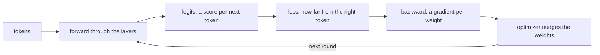

# ksai

ksai is the KSPL-native AI engine: a small neural-network engine written in KSPL alone, with its own matrix computation, training, tokenizer, and saving and loading of weights. It can train a tiny language model from nothing and run it to generate text. To see it work, run `make run` at the repository's root.

**This guide assumes no AI knowledge.** It maps each concept to the KSPL type or function that holds it, and gives the order to read the code in, before any formula.

## Run it

```sh
make test    # here in ksai/: the tests that check ksai's parts (matrix product, gradients, training) are correct
make run     # at the repository's root: the demo that trains a tiny language model further from the weights built into it, and generates characters
```

`make run` shows the loss falling, which means the model is learning: the numbers shrink as training proceeds.

| Command | Where | What it does | What it needs |
| :-- | :-- | :-- | :-- |
| `make test` | `ksai/` | Checks the parts, and builds and runs the examples ("The examples" below; [`ksai/Makefile`](Makefile)). It also runs the programs that must stop on purpose (an empty `argmax`, a shape whose product overflows), each as a child that has to say why ([`ksai/tests/stops_main.kspl`](tests/stops_main.kspl)) | A `ksplc` and a C compiler, nothing else |
| `make test BLAS=1` | `ksai/` | The same, with `matmul` passed to OpenBLAS (a widely used library of fast matrix routines) | OpenBLAS |
| `make test-fuzz` | `ksai/` (from the repository, `make test-ksai-fuzz`) | Feeds broken weights files and vocabularies to the readers, to catch a crash. They are built with the address sanitizer (a compiler option that stops a program at a bad memory access) where the C compiler has it; `KANSO_REQUIRE_ASAN=1` makes it required | A `ksplc` and a C compiler |
| `make run` | the repository's root | Trains the demo model and generates characters | A C compiler (it builds the compiler first) |

ksai names itself in [`ksai/ksplc.cfg`](ksplc.cfg), so a copy of this folder alone runs the tests the same way.

## The idea

At bottom it does two things.

1. **Inference**: it takes an input (a token sequence) and, through many matrix multiplications, outputs scores (logits) for the token likely to come next.
2. **Training**: it measures the gap between its answer and the correct one (the loss). It corrects each matrix (the weights) little by little to shrink it. Working out how much to correct is the backward pass.

The picture shows one round of training. Inference is the first three boxes alone: tokens in, scores out.



The cast in everyday words:

| AI term | Roughly | In KSPL |
|---|---|---|
| tensor | a multi-dimensional box of numbers (a matrix, generalized) | `Tensor<\|T\|>` |
| weights | the "knowledge" training adjusts (itself a tensor) | the `Tensor` each layer (`Linear` and the rest) holds |
| forward | input → computation → output | each layer's `forward(...)` |
| backward | the output's gap → which way to correct each weight | `grad_*` in `ksai/grad.kspl` / `ksai/nn_grad.kspl` |
| gradient | for one weight, which way and how much to nudge it | the tensors `backward(...)` and `grad_*` return |
| loss | the size of the gap (smaller is better) | `cross_entropy_loss(...)` |
| optimizer | the rule updating the weights from the gap | `sgd_step` / `optim.Adam` |
| activation | a fixed curve applied between layers, so the stack can learn more than straight lines | `silu` |
| token | the smallest unit text is cut into (≒ a piece of a word) | `tokenizer.Tokenizer` |

## What is here

| Where | What it holds |
| :-- | :-- |
| `ksai/*.kspl` | The parts: tensors, layers, training, the tokenizer and the weights format, in the order "Reading order" below gives |
| [`ksai/examples/`](examples/) | Programs built from the parts, as someone using `ksai` would write them ("The examples" below) |
| [`ksai/benches/`](benches/README.md) | The speed bench for one training step, with how to run it and what it shows |
| [`ksai/tests/`](tests/) | The tests `make test` runs |
| [`ksai/docs/`](docs/) | The design and the generated reference |

## Reading order

Read the files in the four steps below; each builds on the one before.

The groundwork stacks up in this order, which **differs from the `import` order in one place**. `ksai/nn.kspl` refers to `Lora` in `ksai/lora.kspl` (`forward_lora` takes it). But `forward` reads fine without LoRA, so by concept `nn.kspl` comes first.

### ① The groundwork: tensors — `ksai/tensor.kspl`
The container for every computation: a box of numbers plus the operations on it (matrix product, element-wise operations).
- `Tensor<|T|>` holds `data` (the body), `shape` (each dimension's size) and `size` (the total element count).
- Look first at `matmul` (the heart of AI computation), `add_bias`, `softmax` (scores → probabilities), `silu` (activation), `+`/`-`/`*`, and `x[i]` (element access).
- `x[i]` is an element's place (an `Index_place`): read, assign, compound-assign (`x[i] += v`) or take its address (`x[i]@`), with no copy. **The receiver needs no `$`** (KSPL's mark for "may be written"), so `out[i] = v` works even on a by-value tensor like `matmul_into`'s `out` ("The receiver shape an implementation declared decides whether it is chosen when the receiver is read-only" in [`docs/SPEC-language.md`](../docs/SPEC-language.md)).
- Memory comes from an arena (`Arena`): one large block that many values are carved from and that is freed all at once. The tensors of an intermediate computation are built on one arena and released together (deterministic and fast).
- The optional BLAS backend: `matmul` is pure KSPL by default (zero dependencies, portability first). `make BLAS=1` (needs `libopenblas-dev`) passes it to OpenBLAS's gemm (its general matrix product) through FFI (a call into a C library) for server-level throughput. **The block declaring the gemm names its library** (`#cfg(blas) #link("openblas")`). So any build given `--define=blas` links OpenBLAS with no build file naming it (`ksplc run --define=blas main.kspl` in a project using ksai).
  * Caution: **Do not copy the speed figures here.** The bench measures them again in [`ksai/benches/README.md`](benches/README.md), and only there.
- SIMD (one CPU instruction working on several numbers at once) comes from `-O3` auto-vectorizing `matmul_kernel`'s loop: the C compiler turns the plain loop into such instructions by itself. `make test-simd` checks it ("The kernels are spelt for the auto-vectorizer, not with intrinsics" in [`ksai/docs/DESIGN-learning.md`](docs/DESIGN-learning.md)).
- Optional weight quantization (storing each weight in fewer bits): `ksai/quant.kspl` provides `Tensor<|T|>.quantize()` (int8, one scale per row) and `Quantized_tensor.dequantize<|T|>()` (back to F32/F64). Opt-in like BLAS, it cuts memory (weights to a quarter) rather than time. `matmul` and the rest run unchanged on the expanded tensor.

### ② The parts: layers — `ksai/nn.kspl`
The parts built from tensor operations. A model stacks them like blocks.

| Layer | What it does |
| :-- | :-- |
| `Linear` | `matmul` + a bias |
| `Rms_norm` | normalization (keeps the numbers in a steady range) |
| `Mlp` / `Swiglu_mlp` | the intermediate layer |
| `Self_attention` / `Gqa_attention` | mixing the context (each token draws on the other tokens of the sequence) |
| `Embedding` | a token → a vector |
| `Transformer_block` | all of the above as one repeated unit |

- Note: **`Self_attention` (one head, trainable) and `Gqa_attention` (per head, inference only) are split on purpose** ("The attention mechanisms are split by the head count" in [`ksai/docs/DESIGN-learning.md`](docs/DESIGN-learning.md)).
- Each returns an output tensor from an input tensor through `forward(...)`. Read `Linear.forward` and `Transformer_block.forward` first to see what one unit does.

### ③ How training works — `ksai/grad.kspl`, `ksai/nn_grad.kspl`, `ksai/optim.kspl`

| File | What it holds |
| :-- | :-- |
| `ksai/grad.kspl` | The tensor-level backward-pass steps (`grad_matmul_input/weight`, `grad_silu`, `cross_entropy_loss`, `grad_softmax_cross_entropy`, `sgd_step`). There is no automatic-differentiation tape (a record of every operation, replayed backwards): each forward's backward is called explicitly (simple and easy to follow) |
| `ksai/nn_grad.kspl` | `backward(...)` per layer, which works out the gradient, updates the weight on the spot, and returns the gradient for the layer before |
| `ksai/optim.kspl` | `Adam` (a cleverer update rule than SGD, plain gradient descent), and `Updater`, which moves a whole model's weights by SGD or by Adam. Each layer's `backward_grads` works out its weights' gradients, and its `apply_grads` passes them to the `Updater`. A batch sums its sequences' gradients with `accumulate` first, so one `apply_grads` moves the weights once |
| `ksai/attention_train.kspl` / `ksai/block_train.kspl` | The whole-sequence forward/backward used only in training, split off so an inference binary carries no training code |

**`_grad` vs `_train`**: both hold backward-pass code. `_grad` holds only gradient functions (for layers whose backward needs no value from the forward pass). `_train` holds a struct saving the forward pass's intermediate values (`Attention_train` / `Block_train`, like PyTorch's `save_for_backward`).

### ④ Input and output: the tokenizer and persisting weights

| File | What it holds |
| :-- | :-- |
| `ksai/tokenizer.kspl` | `Tokenizer`, string ↔ token IDs (the GPT-2/Qwen family's byte-level BPE, which builds tokens by merging frequent byte pairs): `encode` / `decode` / `load` (reading a vocabulary file) |
| `ksai/safetensors.kspl` | Weights in the industry-standard format: `Safetensors_writer.add` + `finish` (to a byte sequence), `set_meta` (into `__metadata__`, for facts the weights need but are not), `load_from_bytes` + `get_tensor` (zero-copy views onto the original bytes: the tensor points into the bytes instead of copying them). Only byte sequences: the function taking a path is in `ksai/model_file.kspl` |
| `ksai/sampler.kspl` | Picks the actual token from the scores — `argmax` (the top one) or `sample` (by temperature, top-k and top-p) |
| `ksai/lora.kspl` | `Lora`, lightweight fine-tuning (LoRA) that trains only small added matrices rather than the whole model. **It imports no safetensors.** It saves raw bytes with zero dependencies (`save_raw` / `load_raw`) |
| `ksai/lora_set.kspl` | `Qkv_lora` / `Mlp_lora`, the adapters bundled per block, and the naming that lays them into safetensors (`load_set_from` / `save_set_into`, given an already parsed `Safetensors`) |
| `ksai/model_file.kspl` | Calls the two above by path (`load_safetensors` / `save_qkv_lora_set` and the rest) |

* **Load into a model with `map_into`, not `get_tensor`.** Why, and what `get_tensor` leaves unchecked, is what `ksplc doc ksai/safetensors` says of each.
* **Which LoRA format to use**: `ksai/lora_set.kspl` (the standard format) to carry a result elsewhere. `Lora.save_raw` (no JSON, no allocation) only to save and re-read in the same environment.
* **`ksai/model_file.kspl` and `ksai/tokenizer.kspl` (whose `Tokenizer.load` reads a vocabulary by path) are the only files of the library itself that import `std/io`**, split off so code using only tensors skips the file-I/O cost. With no filesystem, pass an `embed`ed byte sequence (one baked into the program at build time) instead: the weights through `load_from_bytes` → `load_set_from`, the vocabulary and its merges through `Tokenizer.load_text`.

## Pitfalls

| Question | Answer |
| :-- | :-- |
| **What is `T`?** | The element type. Inference uses `F32` (single precision); the numerical gradient checks use `F64` (double). The same code runs on both |
| **`@` and `$`** | `X@` is a pointer type and `ptr$` what it points at. A tensor's `data` is a raw pointer, so `(t.data + i)$` is the i-th element (low-level, speed first) |
| **Freeing the arena invalidates the tensors made from it.** | The zero-copy views and intermediate results live on it. `free` it while they are in use and they break (the compiler's use-after-free check catches the simple cases) |

## The examples

**Programs built from these parts, as someone using `ksai` would write them.** Read `llama_engine` first (training and inference in the shortest form), then `qwen_infer` (reading real weights), then `fim_coder` (training on a real corpus over every CPU).

| Folder | What it does | How to build it |
| :-- | :-- | :-- |
| `examples/llama_engine/` | Trains a tiny language model further from the weights embedded in it, and generates: `main.kspl` (load → train → generate) and `model.kspl` (the layer stack) | `make run` at the root: builds and runs |
| `examples/qwen_infer/` | A CLI inferring from real Qwen2.5-Coder weights; the model sits inside `main.kspl` | `make qwen` at the root: builds only |
| `examples/fim_coder/` | A small coding model trained from scratch on a FIM corpus (fill-in-the-middle: a hole cut from code, to be filled from the code around it). `train` writes its weights (a batch of sequences a step, spread over every CPU). `complete` fills holes with candidates, greedy first. It takes the corpus and the tokenizer by path | `make fim-model` at the root: trains on this repository |

**They stand inside the package, as Cargo keeps a crate's `examples/`.** `make test` here builds every one and checks that they print what they must ([`tests/examples_main.kspl`](tests/examples_main.kspl)). So an example that stops building fails the package's own tests, and a copy of this folder carries them.

The bundled weights `examples/llama_engine/mini_llama.safetensors` (vocabulary 12, 2 layers) are our own, borrowing only Llama's shape ([`THIRD-PARTY-NOTICES.md`](../THIRD-PARTY-NOTICES.md)). **`llama_engine` bakes them in with `embed`**, found through the package wherever it stands, so it runs from any folder. It trains a copy and writes nothing back (the entry point that writes is `model.kspl`'s).

**`qwen_infer` needs real weights converted first** (`tools/ai_assist/export_qwen_to_kspl.py`), which is why `make qwen` stops at building.

**Read this before deleting or moving an example**: every gate below depends on them.

| Gate | What it uses them for |
| :-- | :-- |
| `make run` (CI's AI step on macOS) | `llama_engine` really trains, and reports for itself that the loss fell |
| `make test-extract` (runs this folder's `make test` from a copy) | `llama_engine` trains from a folder holding nothing else (Linux and Windows run this in place of `make run`). `qwen_infer` reads small Qwen-shaped weights written by a fixed formula and gives the reference answers ([`tests/examples_qwen.kspl`](tests/examples_qwen.kspl)). `fim_coder` trains a few steps on a corpus written on the spot, writes the same weights on one thread and two, and answers a hole ([`tests/examples_main.kspl`](tests/examples_main.kspl)) |
| `make test-simd` | Compiles `llama_engine` and `qwen_infer` to C and checks that each `ksai` loop whose comment names it auto-vectorizes at `-O3` |
| `make lint` | Every example's `main.kspl` is in `LINT_TARGETS` (`mk/lint.mk`) |
| `make test-ksos-link` / `make test-ksos-qemu` | `ksos`'s Cortex-M demo `embed`s the weights, bringing trained weights into an environment with no file system |

**That `make test-simd` needs the examples is easy to miss.** The loops it inspects sit in generic functions, written once for any element type (`matmul_kernel<|T|>` in `ksai/tensor.kspl`). The compiler writes C for a generic function only where a program calls it with a concrete type, such as `F32`, so `ksai` compiled on its own holds none of those loops. The gate therefore compiles `llama_engine` and `qwen_infer` to C and looks for the loops there; without them it has nothing to inspect. `make test-fuzz` does not use the examples: it writes its own seeds, the inputs it starts breaking from ([`tests/fuzz_main.kspl`](tests/fuzz_main.kspl)).

## Further reading

* [`ksai/docs/DESIGN-learning.md`](docs/DESIGN-learning.md) — why it took this shape (how the optimizer is picked, how a batch is spread over threads, how LoRA is split, which matrix backend to deploy).
* [`ksai/benches/README.md`](benches/README.md) — the speed bench: how to run it, and the relations it shows.
* [`ksai/SURFACE.txt`](SURFACE.txt) — the record of the published API, written and checked by the same two targets ("The record of a published API" in [`docs/SPEC-gates.md`](../docs/SPEC-gates.md)).
* [std](../std/README.md) — the way in to the standard library; every file it publishes is listed by `ksplc doc std`. The `mem` / `math` / `bytes` that `ksai` stands on are there.

The packages built on this, and the tools for growing it, stand elsewhere, listed in the root README's [Repository layout](../README.md#-repository-layout). **Do not copy where they are into this README**: a lower tier would then know its users' names ("Reference direction between documents" in [`docs/SPEC-documents.md`](../docs/SPEC-documents.md)). The examples and the bench above are this package's own.
