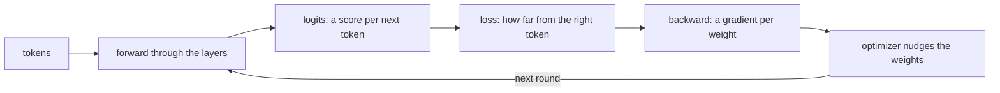

# ksai

ksai is a small neural network engine written entirely in KSPL. It provides matrix operations, training, a tokenizer, and functions to save and load weights. It can train a tiny language model from scratch and generate text.

**This guide assumes no AI knowledge.** It explains concepts through their KSPL types and functions, and introduces the code before formulas.

## Run it

```sh
make test    # here in ksai/: checks ksai's parts and builds the examples
make run     # at the repository's root: trains a tiny language model and generates characters
```

`make run` shows the loss decreasing as the model learns.

| Command | Where | What it does | What it needs |
| :-- | :-- | :-- | :-- |
| `make test` | `ksai/` | Checks the components, then builds and runs the examples ([`ksai/Makefile`](Makefile)). Programs that must stop, such as an empty `argmax`, run as child processes and must report their reason ([`ksai/tests/stops_main.kspl`](tests/stops_main.kspl)) | `ksplc` and a C compiler |
| `make test BLAS=1` | `ksai/` | Runs the same checks with OpenBLAS, a library of fast matrix operations, for `matmul` | OpenBLAS |
| `make test-fuzz` | `ksai/` | Feeds broken weights files, GGUF model files and vocabularies to the readers, to detect crashes. At the repository root, use `make test-ksai-fuzz` | `ksplc` and a C compiler |
| `make run` | Repository root | Trains the demo model further from its built-in weights and generates characters | A C compiler; the target builds `ksplc` first |

The fuzz tests use the address sanitizer when the C compiler supports it. This compiler option stops a program when it accesses memory incorrectly. Set `KANSO_REQUIRE_ASAN=1` to require it.

[`ksai/ksplc.cfg`](ksplc.cfg) declares the package name, so a copy of this folder runs the same tests independently.

## The idea

ksai supports two operations:

1. **Inference** takes a sequence of tokens as input. Repeated matrix multiplication produces scores, called logits, for the next token.
2. **Training** measures the difference between the model's answer and the correct answer. This difference is the loss. The backward pass calculates how to change the weights to reduce the loss.

The diagram shows one training step. Inference uses only the first three boxes.



| AI term | Meaning | In KSPL |
|---|---|---|
| tensor | An array with one or more dimensions; a matrix has two | `Tensor<\|T\|>` |
| weights | Numbers that training adjusts | The `Tensor` each layer holds |
| forward | Compute an output from an input | Each layer's `forward(...)` |
| backward | Calculate gradients from the output error | `grad_*` in `ksai/grad.kspl` and `ksai/nn_grad.kspl` |
| gradient | How the loss changes with a weight; used to calculate weight updates | The tensors that `backward(...)` and `grad_*` return |
| loss | A measure of error; smaller is better | `cross_entropy_loss(...)` |
| optimizer | The rule for updating weights from gradients | `sgd_step` and `optim.Adam` |
| activation | A nonlinear function between layers that lets the model learn nonlinear relationships | `silu` |
| token | A unit of text, such as part of a word | `tokenizer.Tokenizer` |

## What is here

| Where | What it contains |
| :-- | :-- |
| `ksai/*.kspl` | Tensors, layers, training, the tokenizer, and the weights formats; see “Reading order” below |
| [`ksai/examples/`](examples/) | Programs that use these components; see “The examples” below |
| [`ksai/benches/`](benches/README.md) | Benchmarks for one training step, a quantized product and a whole Qwen model, with their results |
| [`ksai/tests/`](tests/) | Tests run by `make test` |
| [`ksai/docs/`](docs/) | Design documents and the generated reference |

## Reading order

Read the following sections in order. Each introduces concepts used by the next.

This order differs from the import order. `forward_lora` in `ksai/nn.kspl` uses `Lora` from `ksai/lora.kspl`, but ordinary `forward` calls need no LoRA, so read `nn.kspl` first.

### Tensors: `ksai/tensor.kspl`

A tensor contains numbers and supports operations such as matrix multiplication and element access.

Start with `matmul`, `add_bias`, `softmax`, and `silu`. Then read `+`, `-`, `*`, and `x[i]`.

- `Tensor<|T|>` holds `data`, `shape` (the size of each dimension), and `size` (the total element count).
- `softmax` converts scores to probabilities. `silu` is an activation function.
- `x[i]` provides an element's location through `Index_place`. You can read, assign, compound-assign (`x[i] += v`), or take its address (`x[i]@`) without copying it.
- The receiver needs no `$`, KSPL's marker for a writable receiver. Thus, `out[i] = v` works on a tensor passed by value, such as `matmul_into`'s `out`. See the receiver selection rules in [`docs/SPEC-programming-language.md`](../docs/SPEC-programming-language.md).
- An arena (`Arena`) supplies memory for multiple values and releases it together. Intermediate tensors share an arena for fast, deterministic release.

By default, `matmul` uses only KSPL and has no library dependencies. The optional BLAS backend (Basic Linear Algebra Subprograms) calls OpenBLAS's general matrix product, gemm, through the foreign function interface. `make BLAS=1` requires `libopenblas-dev`.

The gemm declaration names its library with `#cfg(blas) #link("openblas")`. So a build with `--define=blas` links OpenBLAS without a library entry in the build file, for example `ksplc run --define=blas main.kspl`.

The C compiler turns the kernels' loops into SIMD instructions (one instruction on several numbers), and `make test-simd` checks it. A large `matmul` splits its columns over the CPU's cores (`ksai/parallel.kspl`), with the same bits for any thread count. Why both work so is in [`ksai/docs/DESIGN-learning.md`](docs/DESIGN-learning.md).

### Quantized weights: `ksai/quant.kspl`, `ksai/quantize.kspl`

A 9B model's weights take about 36 GB as 32-bit floats, more than most machines hold. Quantized weights keep each number in 3 to 8 bits, with one scale for each block of 32 or 256 numbers. A 9B model then takes 4 to 6 GB.

`Quant_matrix` holds a weight matrix in one of these formats. Its bytes are GGUF's own, so a tensor read from a GGUF file is used with no conversion. GGUF is the file format of llama.cpp, in which most models are shared.

| Format | One block | Bits per number |
| :-- | :-- | :-- |
| `f32`, `f16`, `bf16` | One plain float | 32, 16, 16 |
| `q8_0` | 32 signed bytes and one F16 scale | 8.5 |
| `q5_0` | 32 five-bit numbers and one F16 scale | 5.5 |
| `q3_k` | 256 three-bit numbers in 16 groups, each with a 6-bit scale | 3.4 |
| `q4_k` | 256 four-bit numbers in 8 groups, each with a 6-bit scale and minimum | 4.5 |
| `q5_k` | 256 five-bit numbers in 8 groups, each with a 6-bit scale and minimum | 5.5 |
| `q6_k` | 256 six-bit numbers in 16 groups, each with an 8-bit scale | 6.6 |

A file in llama.cpp's "Q4_K_M" mix holds mostly `q4_k` and some `q6_k` weights, with `f32` for the norms. A "Q3_K_M" file holds mostly `q3_k`, with `q4_k`, `q5_k`, `q6_k` and `q8_0` for the weights that matter most. Where a row is not a multiple of 256 long, as in a 0.5B Qwen model, it uses `q5_0` or `q8_0` instead.

- `Quant_matrix.from_bytes` checks the sizes against the bytes before anything reads them, and refuses a wrong size by name (`Quant_error`).
- `dequantize_row` decodes one row to F32, for example a token's embedding.
- `mul_mat` multiplies the matrix by F32 inputs, one block at a time, with no F32 copy of the matrix. It splits its rows over the CPU's cores.
- `Quant_matrix.quantize` in `ksai/quantize.kspl` makes Q8_0 or Q4_K from F32, as llama.cpp's own quantizer does. Only a program that converts weights needs it.

The tests compare every format and product with llama.cpp, through small reference files in [`tests/quant_data/`](tests/quant_data/). [`tools/ai_assist/make_quant_fixtures.py`](../tools/ai_assist/make_quant_fixtures.py) writes them.

### Models from GGUF files: `ksai/gguf.kspl`, `ksai/qwen.kspl`

A GGUF file holds a whole model: its settings, its vocabulary, its chat template and its weights.

- `Gguf.parse` reads a file the caller holds in memory, and refuses a broken file by an error that names the part at fault (`Gguf_error`). `model_file.load_gguf` reads the file from disk first, once, into an arena.
- Its values are read by type: `integer`, `float`, `flag`, `text`, and the arrays `texts`, `ints` and `floats`. A value of another type is refused, never converted.
- `Gguf.tensor` gives a tensor's name, shape and format, and its bytes in the file. `matrix()` makes it a `Quant_matrix` with no copy.
- `Qwen.load` builds a Qwen2, Qwen3 or Qwen3.5 model from the file, with a cache of the positions asked for. `Qwen.forward` reads tokens and returns the scores for the next one.
- Qwen3.5's delta-net blocks (`ksai/delta_net.kspl`) keep a running state that cannot go back by itself, so `Qwen_state` copies it and puts it back.

The tests read a tiny Qwen3 model and a tiny Qwen3.5 model in [`tests/qwen_data/`](tests/qwen_data/), which [`tools/ai_assist/make_qwen_fixtures.py`](../tools/ai_assist/make_qwen_fixtures.py) and [`tools/ai_assist/make_qwen35_fixtures.py`](../tools/ai_assist/make_qwen35_fixtures.py) write. Why the reader and the model take this shape is in "A GGUF file is read once and used in place" in [`ksai/docs/DESIGN-learning.md`](docs/DESIGN-learning.md).

### Layers: `ksai/nn.kspl`

A model combines layers built from tensor operations.

| Layer | What it does |
| :-- | :-- |
| `Linear` | Matrix multiplication plus a bias |
| `Rms_norm` | Normalization to keep values in a steady range |
| `Mlp` / `Swiglu_mlp` | Intermediate computation |
| `Self_attention` / `Gqa_attention` | Combine information from other tokens in the sequence |
| `Embedding` | Convert a token to a vector |
| `Transformer_block` | Combine these layers into a repeated unit |

`Self_attention` supports training with one head. `Gqa_attention` operates per head and supports inference only. Their separation is deliberate; see [`ksai/docs/DESIGN-learning.md`](docs/DESIGN-learning.md).

Each layer's `forward(...)` returns an output tensor from an input tensor. Read `Linear.forward` and `Transformer_block.forward` first.

### Training: `ksai/grad.kspl`, `ksai/nn_grad.kspl`, `ksai/optim.kspl`

| File | What it contains |
| :-- | :-- |
| `ksai/grad.kspl` | Tensor gradient functions: `grad_matmul_input/weight`, `grad_silu`, `cross_entropy_loss`, `grad_softmax_cross_entropy`, and `sgd_step`. Each forward operation has an explicitly called backward operation, with no automatic differentiation tape |
| `ksai/nn_grad.kspl` | Each layer's `backward(...)` calculates gradients, updates weights immediately, and returns the gradient for the previous layer |
| `ksai/optim.kspl` | `Updater` updates model weights by stochastic gradient descent (SGD) or Adam |
| `ksai/attention_train.kspl` / `ksai/block_train.kspl` | Forward and backward operations for whole sequences during training, kept out of inference binaries |

Each layer's `backward_grads` calculates weight gradients, and its `apply_grads` sends them to the `Updater`. For a batch, `accumulate` sums the sequence gradients before one `apply_grads` updates the weights.

Both `_grad` and `_train` files contain backward operations. `_grad` contains functions that need no saved values from the forward pass. `_train` contains the structures that save them: `Attention_train` and `Block_train`.

### Input, output, and saved weights

| File | What it contains |
| :-- | :-- |
| `ksai/tokenizer.kspl` | `Tokenizer` converts strings to token IDs with `encode` and back with `decode`, by byte-level byte pair encoding (BPE), which merges frequent byte pairs. `load` reads a vocabulary file, and `load_lists` a GGUF file's vocabulary. For Qwen's vocabulary it gives llama.cpp's IDs |
| `ksai/pretokenizer.kspl` | `chunk_end` splits text into the chunks that BPE merges within, by Qwen2's rule or Qwen3.5's (`Split_rule`) |
| `ksai/safetensors.kspl` | Reads and writes weights in the standard safetensors format: `Safetensors_writer` (`add`, `set_meta`, `finish`) and `load_from_bytes`. `get_tensor` borrows aligned elements or copies misaligned ones into the supplied arena |
| `ksai/sampler.kspl` | Chooses a token from scores. `argmax` selects the highest score. `sample` uses temperature, top-k, and top-p |
| `ksai/lora.kspl` | `Lora` supports low-rank adaptation (LoRA), which trains small added matrices instead of all model weights. `save_raw` and `load_raw` use raw bytes with no dependencies |
| `ksai/lora_set.kspl` | Groups `Qkv_lora` and `Mlp_lora` adapters per block and defines their names in safetensors. `load_set_from` and `save_set_into` use a parsed `Safetensors` |
| `ksai/model_file.kspl` | Provides path operations such as `load_safetensors`, `load_gguf` and `save_qkv_lora_set` using the modules above |

Use `map_into` to load weights into a model. The reference from `ksplc doc ksai/safetensors` explains its checks and those omitted by `get_tensor`.

Use the standard format in `ksai/lora_set.kspl` to exchange results between environments. Use `Lora.save_raw` only to save and reload in the same environment; it requires no JSON or allocation.

Within the library, only `ksai/model_file.kspl` and `ksai/tokenizer.kspl` import `std/io`, so code that uses only tensors pays nothing for files. `Tokenizer.load` reads a vocabulary by path, and `model_file` also imports `std/fs` to replace whole model files.

Without a filesystem, use `embed` to include bytes in the program at build time. Load weights with `load_from_bytes`, then `load_set_from`. Load the vocabulary and merges with `Tokenizer.load_text`.

## Pitfalls

| Question | Answer |
| :-- | :-- |
| What is `T`? | The element type. Inference uses single-precision `F32`; numerical gradient checks use double-precision `F64`. Both use the same code |
| What are `@` and `$`? | `X@` is a pointer type. `ptr$` accesses the value it points to. A tensor's `data` is a raw pointer for fast access. `(t.data + i)$` accesses element `i` |
| When do tensor references become invalid? | Freeing the arena invalidates its tensors, views, and intermediate results. The type system does not check lifetimes, so invalid access can produce wrong values or crashes. `--sanitize=address` reports accesses to freed memory |

## The examples

The examples show how programs use ksai. Read `llama_engine` first for basic training and inference. Then read `qwen_infer` for real weights and `fim_coder` for training on a corpus across CPUs.

| Folder | What it does | How to build it |
| :-- | :-- | :-- |
| `examples/llama_engine/` | Trains a tiny model further from embedded weights and generates text. `main.kspl` loads, trains, and generates. `model.kspl` defines the layers | Root `make run` builds and runs it |
| `examples/qwen_infer/` | A command-line interface for inference with real Qwen2.5-Coder weights in 32-bit floats, with LoRA adapters. `model.kspl` contains the model | Root `make qwen` builds it only |
| `examples/fim_coder/` | Trains a small coding model from scratch by fill-in-the-middle (FIM): predict missing code from its surroundings. `train` spreads batches across CPUs; `complete` produces candidates, greedy first | Root `make fim-model` trains it on this repository |
| `examples/car_pilot/` | Trains a small car's driving policy from written rules into one safetensors file ("The car's policy file" below). `policy.kspl` holds the rules and the net; `encoding.kspl` holds what both the trainer and the car read | `make car_pilot` here builds it |
| `examples/chat_server/` | Serves a Qwen3-Instruct-2507 or Qwen3.5 model from its GGUF file over HTTP to a client with tools, such as ksagent ("The chat server" below) | Root `make chat-server` builds it |

The examples belong to the package, like a Cargo crate's `examples/` folder. `make test` builds each example and checks its output ([`tests/examples_main.kspl`](tests/examples_main.kspl)), so a broken example fails the package tests.

The bundled `examples/llama_engine/mini_llama.safetensors` weights are our own, with a vocabulary of 12 and two layers. They use Llama's architecture; see [`THIRD-PARTY-NOTICES.md`](../THIRD-PARTY-NOTICES.md). `llama_engine` includes them with `embed`, which resolves them through the package regardless of the current folder. It trains a copy without writing back; the entry point in `model.kspl` writes weights.

Before running `qwen_infer`, convert real weights with `tools/ai_assist/export_qwen_to_kspl.py`, which is why `make qwen` only builds the program. Keep downloaded and converted model files in `models/` at the repository's root; [`models/README.md`](../models/README.md) says which models and how to get them.

### The car's policy file

`car_pilot <out.safetensors>` trains the policy and writes it, the same file on every run. The car keeps a copy of the file; write that copy again with `car_pilot` after the rules, the net or the encoding change. The file holds everything the car needs to decide as the trainer does:

| Content | Shape | What it means |
| :-- | :-- | :-- |
| `fc1.weight` / `fc1.bias` | [5, 24] / [24] | the input layer. The activation is SiLU (the curve applied to each layer's output) |
| `fc2.weight` / `fc2.bias` | [24, 10] / [10] | the output layer: 10 logits, one score per manoeuvre. The highest wins |
| `maneuvers` | [10, 3] | a manoeuvre's number, as `lon, lat, rot` (whole numbers stored as F32) |
| `__metadata__.far_mm` | — | the cap [mm] used when the distance is normalized |
| `__metadata__.kspl_pilot` | — | the format's version. Always check it before reading |

The five inputs are, in order: whether the distance was measured, the normalized distance, and the left, centre and right line sensors.

The net learns from the rules in `rule_action` ([`ksai/examples/car_pilot/policy.kspl`](examples/car_pilot/policy.kspl)). An obstacle comes before the line: the car stops at an unmeasured distance, backs off under 150mm and dodges sideways under 400mm. Otherwise it follows the line, and stops where all three sensors see black.

Caution: **Check `__metadata__.kspl_pilot` before using the weights, and refuse a version the reader was not written for.** The version rises when the order of the inputs, the activation or the meaning of a row of `maneuvers` changes. None of these changes a tensor's shape, so a reader that checks only the shapes loads a newer file and steers wrongly.

`make test` runs `car_pilot` and reads the file it writes without the trainer's constants ([`ksai/tests/examples_car.kspl`](tests/examples_car.kspl)). The reasons for this shape are in "The car's policy: learned from rules, kept as one file" in [`ksai/docs/DESIGN-learning.md`](docs/DESIGN-learning.md).

### The chat server

`chat_server` lets ksagent, or another client with tools, run with nothing from outside. It answers `POST /v1/chat/completions` in the OpenAI style, with tool calls, whole or streamed, as `llama-server` does. Why it is shaped this way is [`ksai/docs/DESIGN-serving.md`](docs/DESIGN-serving.md).

It runs Qwen3-4B-Instruct-2507 or Qwen3.5-9B from one GGUF file, which holds the weights, the vocabulary and the chat template. [`models/README.md`](../models/README.md) says where to download them.

**The root's `make chat DIR=<folder>` starts it where llama.cpp's `llama-server` is not on PATH.** Where it is not built either, `make chat` stops and names the first command below. Run that command again after a change to the server's sources. To build it and start it alone, at the repository's root:

```sh
make chat-server NATIVE=1
./out/chat_server.exe models/Qwen3-4B-Instruct-2507-Q4_K_M.gguf     # or models/Qwen3.5-9B-Q3_K_M.gguf
```

`NATIVE=1` builds the server for this machine's own CPU, which makes it faster. Leave it out for a program that runs on another machine. Why is "A build for the machine's own CPU is asked for" in [`ksai/docs/DESIGN-learning.md`](docs/DESIGN-learning.md).

It is ready when it prints the line `listening on http://127.0.0.1:8081`, the address ksagent asks by default. It prints one line per request on standard error.

| Option | What it does |
| :-- | :-- |
| `--port=<n>` | The loopback port. The default is 8081; 0 lets the system choose, and the server prints the port it got |
| `--max-tokens=<n>` | The most tokens one answer can take, Qwen3.5's thinking included. The default is 1024; a request can ask for fewer with `max_tokens` |
| `--context=<n>` | The most tokens a conversation and its answer can hold together. The default is 16384, a cache of 4.5 GiB for Qwen3-4B and 1 GiB for Qwen3.5-9B. At most the context the model was trained on |

Its limits:

* **It listens on the loopback only, with no accounts and no encryption.** So any program on this machine can ask, whichever user runs it. A web page in a browser can reach the loopback too. So the server refuses a request with another site's `Origin` or another `Host`, or whose body is not `application/json`.
* **It is several times slower than llama.cpp on the same file**, most of all in reading a prompt. A question to ksagent about a small folder takes minutes, so give ksagent a longer `--timeout`; `make chat` gives it one hour. The measurements are in [`ksai/benches/README.md`](benches/README.md).
* **Qwen3.5 thinks before it answers**, which makes an answer several times longer. A request turns it off with `"chat_template_kwargs": {"enable_thinking": false}`.
* **It runs Qwen3-Instruct-2507 and Qwen3.5 models only.** It checks the file's chat template by its hash and refuses another.

Before moving or deleting an example, check these dependencies:

| Gate | How it uses the examples |
| :-- | :-- |
| `make run` | The macOS CI AI step trains `llama_engine` and checks that its loss decreased |
| `make test-extract` | Runs the package tests, and so every example, from an independent copy, on Linux and Windows instead of `make run`. The checks are in [`tests/examples_main.kspl`](tests/examples_main.kspl) and the files beside it whose names start with `examples_` |
| `make test-simd` | Compiles `llama_engine` and `qwen_infer` to C, and checks that each named `ksai` loop is vectorized at `-O3` |
| `make lint` | Analyses each example's `main.kspl`, which `mk/lint.mk` finds by its `fn main` |
| `make test-ksos-link` / `make test-ksos-qemu` | Use embedded weights in the `ksos` Cortex-M demo, without a filesystem |

The SIMD gate needs the examples. The compiler writes C for a generic function such as `matmul_cols<|T|>` only where a call gives it a concrete type, such as `F32`.

`make test-fuzz` does not use the examples ([`tests/fuzz_main.kspl`](tests/fuzz_main.kspl)).

## Further reading

* [`ksai/docs/DESIGN-learning.md`](docs/DESIGN-learning.md) explains optimizer selection, training across threads, LoRA separation, matrix backend choices, and the GGUF reader and the Qwen model.
* [`ksai/docs/DESIGN-serving.md`](docs/DESIGN-serving.md) explains the chat server: the loopback, one request at a time, the template, the markers and the cache kept across requests.
* [`ksai/benches/README.md`](benches/README.md) explains the benchmark and its results.
* [`ksai/SURFACE.txt`](SURFACE.txt) records the published API. See the targets that write and check it in [`docs/SPEC-gates.md`](../docs/SPEC-gates.md).
* [std](../std/README.md) introduces the standard library, including ksai's `mem`, `math`, and `bytes` dependencies. `ksplc doc std` lists its published files.

The root README's [Repository layout](../README.md#-repository-layout) lists the packages that use ksai and the development tools.
