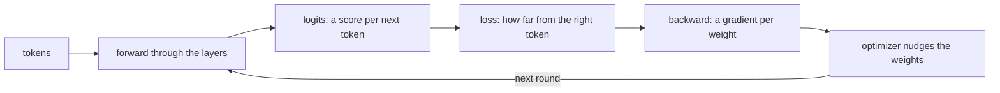

# ksai

ksai is a small neural network engine written entirely in KSPL. It provides matrix operations, training, a tokenizer, and functions to save and load weights. It can train a tiny language model from scratch and generate text. To try it, run `make run` at the repository root.

**This guide assumes no AI knowledge.** It explains concepts through their KSPL types and functions. The reading order introduces the code before formulas.

## Run it

```sh
make test    # here in ksai/: the tests that check ksai's parts (matrix product, gradients, training) are correct
make run     # at the repository's root: the demo that trains a tiny language model further from the weights built into it, and generates characters
```

`make run` shows the loss decreasing as the model learns.

| Command | Where | What it does | What it needs |
| :-- | :-- | :-- | :-- |
| `make test` | `ksai/` | Checks the components, then builds and runs the examples ([`ksai/Makefile`](Makefile)). It also checks programs that must stop: an empty `argmax` and a shape whose size overflows. Each runs as a child process and must report its reason ([`ksai/tests/stops_main.kspl`](tests/stops_main.kspl)) | `ksplc` and a C compiler |
| `make test BLAS=1` | `ksai/` | Runs the same checks with OpenBLAS for `matmul`. OpenBLAS is a library of fast matrix operations | OpenBLAS |
| `make test-fuzz` | `ksai/` | Tests readers with broken weights files and vocabularies to detect crashes. At the repository root, use `make test-ksai-fuzz` | `ksplc` and a C compiler |
| `make run` | Repository root | Trains the demo model and generates characters | A C compiler; the target builds `ksplc` first |

The fuzz tests use the address sanitizer when the C compiler supports it. This compiler option stops a program when it accesses memory incorrectly. Set `KANSO_REQUIRE_ASAN=1` to require it.

[`ksai/ksplc.cfg`](ksplc.cfg) declares the package name. A copy of this folder runs the same tests independently.

## The idea

ksai supports two operations:

1. **Inference** takes a sequence of tokens as input. Repeated matrix multiplication produces scores, called logits, for the next token.
2. **Training** measures the difference between the model's answer and the correct answer. This difference is the loss. The backward pass calculates how to change the weights to reduce the loss.

The diagram shows one training step. Inference uses only the first three boxes.



| AI term | Meaning | In KSPL |
|---|---|---|
| tensor | An array with one or more dimensions; a matrix has two | `Tensor<\|T\|>` |
| weights | Numbers that training adjusts | The `Tensor` each layer holds |
| forward | Compute an output from an input | Each layer's `forward(...)` |
| backward | Calculate gradients from the output error | `grad_*` in `ksai/grad.kspl` and `ksai/nn_grad.kspl` |
| gradient | How the loss changes with a weight; used to calculate weight updates | The tensors that `backward(...)` and `grad_*` return |
| loss | A measure of error; smaller is better | `cross_entropy_loss(...)` |
| optimizer | The rule for updating weights from gradients | `sgd_step` and `optim.Adam` |
| activation | A nonlinear function between layers that lets the model learn nonlinear relationships | `silu` |
| token | A unit of text, such as part of a word | `tokenizer.Tokenizer` |

## What is here

| Where | What it contains |
| :-- | :-- |
| `ksai/*.kspl` | Tensors, layers, training, the tokenizer, and the weights format; see “Reading order” below |
| [`ksai/examples/`](examples/) | Programs that use these components; see “The examples” below |
| [`ksai/benches/`](benches/README.md) | A benchmark for one training step, with instructions and an explanation of the results |
| [`ksai/tests/`](tests/) | Tests run by `make test` |
| [`ksai/docs/`](docs/) | Design documents and the generated reference |

## Reading order

Read the following four sections in order. Each introduces concepts used by the next section.

This order differs from the import order. The `forward_lora` function in `ksai/nn.kspl` uses `Lora` from `ksai/lora.kspl`. You can understand ordinary `forward` calls without LoRA, so read `nn.kspl` first.

### Tensors: `ksai/tensor.kspl`

A tensor contains numbers and supports operations such as matrix multiplication and element access.

Start with `matmul`, `add_bias`, `softmax`, and `silu`. Then read `+`, `-`, `*`, and `x[i]`.

- `Tensor<|T|>` holds `data`, `shape` (the size of each dimension), and `size` (the total element count).
- `softmax` converts scores to probabilities. `silu` is an activation function.
- `x[i]` provides an element's location through `Index_place`. You can read, assign, compound-assign (`x[i] += v`), or take its address (`x[i]@`) without copying it.
- The receiver needs no `$`, KSPL's marker for a writable receiver. Thus, `out[i] = v` works on a tensor passed by value, such as `matmul_into`'s `out`. See the receiver selection rules in [`docs/SPEC-programming-language.md`](../docs/SPEC-programming-language.md).
- An arena (`Arena`) supplies memory for multiple values and releases it together. Intermediate tensors share an arena for fast, deterministic release.

By default, `matmul` uses only KSPL for portability and has no library dependencies. The optional BLAS backend uses OpenBLAS's general matrix product, gemm, for server throughput. BLAS means Basic Linear Algebra Subprograms. `make BLAS=1` requires `libopenblas-dev` and calls OpenBLAS through the foreign function interface (FFI).

The gemm declaration names its library with `#cfg(blas) #link("openblas")`. A build with `--define=blas` therefore links OpenBLAS without a library entry in the build file. For example, a project using ksai can run `ksplc run --define=blas main.kspl`.

Keep speed measurements in [`ksai/benches/README.md`](benches/README.md). Do not duplicate them here.

At `-O3`, the C compiler converts `matmul_kernel`'s loop to SIMD instructions automatically. SIMD means single instruction, multiple data: one instruction operates on several numbers. `make test-simd` checks this conversion. See the kernel design in [`ksai/docs/DESIGN-learning.md`](docs/DESIGN-learning.md).

### Layers: `ksai/nn.kspl`

A model combines layers built from tensor operations.

| Layer | What it does |
| :-- | :-- |
| `Linear` | Matrix multiplication plus a bias |
| `Rms_norm` | Normalization to keep values in a steady range |
| `Mlp` / `Swiglu_mlp` | Intermediate computation |
| `Self_attention` / `Gqa_attention` | Combine information from other tokens in the sequence |
| `Embedding` | Convert a token to a vector |
| `Transformer_block` | Combine these layers into a repeated unit |

`Self_attention` supports training with one head. `Gqa_attention` operates per head and supports inference only. Their separation is deliberate; see [`ksai/docs/DESIGN-learning.md`](docs/DESIGN-learning.md).

Each layer's `forward(...)` returns an output tensor from an input tensor. Read `Linear.forward` and `Transformer_block.forward` first.

### Training: `ksai/grad.kspl`, `ksai/nn_grad.kspl`, `ksai/optim.kspl`

| File | What it contains |
| :-- | :-- |
| `ksai/grad.kspl` | Tensor gradient functions: `grad_matmul_input/weight`, `grad_silu`, `cross_entropy_loss`, `grad_softmax_cross_entropy`, and `sgd_step`. Each forward operation has an explicitly called backward operation. There is no automatic differentiation tape, which records operations for a backward pass |
| `ksai/nn_grad.kspl` | Each layer's `backward(...)` calculates gradients, updates weights immediately, and returns the gradient for the previous layer |
| `ksai/optim.kspl` | `Updater` selects stochastic gradient descent (SGD) or Adam to update model weights. Adam uses a more complex update rule than SGD |
| `ksai/attention_train.kspl` / `ksai/block_train.kspl` | Forward and backward operations for whole sequences during training. Their separation keeps training code out of inference binaries |

Each layer's `backward_grads` calculates weight gradients. Its `apply_grads` sends those gradients to the `Updater`. For a batch, `accumulate` sums the sequence gradients before one `apply_grads` updates the weights.

Both `_grad` and `_train` files contain backward operations. `_grad` contains functions that need no saved values from the forward pass. `_train` contains structures that save those intermediate values: `Attention_train` and `Block_train`. PyTorch's `save_for_backward` serves a similar purpose.

### Input, output, and saved weights

| File | What it contains |
| :-- | :-- |
| `ksai/tokenizer.kspl` | `Tokenizer` converts strings to token IDs with `encode` and back with `decode`. `load` reads a vocabulary file. It uses GPT-2/Qwen byte-level byte pair encoding (BPE), which merges frequent byte pairs |
| `ksai/safetensors.kspl` | Reads and writes weights in the standard safetensors format. `Safetensors_writer.add` and `finish` produce bytes. `set_meta` writes supporting information into `__metadata__`. `load_from_bytes` parses the bytes. `get_tensor` borrows aligned elements or copies misaligned elements into the supplied arena. Path operations belong to `ksai/model_file.kspl` |
| `ksai/sampler.kspl` | Chooses a token from scores. `argmax` selects the highest score. `sample` uses temperature, top-k, and top-p |
| `ksai/lora.kspl` | `Lora` supports low-rank adaptation (LoRA), which trains small added matrices instead of all model weights. It imports no safetensors code. `save_raw` and `load_raw` use raw bytes with no dependencies |
| `ksai/lora_set.kspl` | Groups `Qkv_lora` and `Mlp_lora` adapters per block and defines their names in safetensors. `load_set_from` and `save_set_into` use a parsed `Safetensors` |
| `ksai/model_file.kspl` | Provides path operations such as `load_safetensors` and `save_qkv_lora_set` using the modules above |

Use `map_into` to load weights into a model. The reference from `ksplc doc ksai/safetensors` explains its checks and those omitted by `get_tensor`.

Use the standard format in `ksai/lora_set.kspl` to exchange results between environments. Use `Lora.save_raw` only to save and reload in the same environment. The raw format requires no JSON or allocation.

Only `ksai/model_file.kspl` and `ksai/tokenizer.kspl` import `std/io` within the library. `Tokenizer.load` reads a vocabulary by path. `model_file` also imports `std/fs` to replace whole model files. This separation avoids file input and output costs for code that uses only tensors.

Without a filesystem, use `embed` to include bytes in the program at build time. Load weights with `load_from_bytes`, then `load_set_from`. Load the vocabulary and merges with `Tokenizer.load_text`.

## Pitfalls

| Question | Answer |
| :-- | :-- |
| What is `T`? | The element type. Inference uses single-precision `F32`; numerical gradient checks use double-precision `F64`. Both use the same code |
| What are `@` and `$`? | `X@` is a pointer type. `ptr$` accesses the value it points to. A tensor's `data` is a raw pointer for fast access. `(t.data + i)$` accesses element `i` |
| When do tensor references become invalid? | Freeing the arena invalidates its tensors, views, and intermediate results. Do not free it while they remain in use. The type system does not check lifetimes. Invalid access can produce wrong values or crashes. `--sanitize=address` reports accesses to freed memory |

## The examples

The examples show how programs use ksai. Read `llama_engine` first for basic training and inference. Then read `qwen_infer` for real weights and `fim_coder` for training on a corpus across CPUs.

| Folder | What it does | How to build it |
| :-- | :-- | :-- |
| `examples/llama_engine/` | Trains a tiny model further from embedded weights and generates text. `main.kspl` loads, trains, and generates. `model.kspl` defines the layers | Root `make run` builds and runs it |
| `examples/qwen_infer/` | Provides a command-line interface for inference with real Qwen2.5-Coder weights. `main.kspl` contains the model | Root `make qwen` builds it only |
| `examples/fim_coder/` | Trains a small coding model from scratch using fill-in-the-middle (FIM): predict missing code from its surrounding code. `train` distributes sequence batches across CPUs and writes weights. `complete` produces candidates, starting with greedy selection. It takes corpus and tokenizer paths | Root `make fim-model` trains it on this repository |
| `examples/car_pilot/` | Trains a small car's driving policy from written rules and writes it to one safetensors file ("The car's policy file" below). `policy.kspl` holds the rules and the net; `encoding.kspl` holds what both the trainer and the car read | `make car_pilot` here builds it |

The examples belong to the package, like a Cargo crate's `examples/` folder. `make test` builds each example and checks its output ([`tests/examples_main.kspl`](tests/examples_main.kspl)). Build failures therefore fail the package tests. Copying the package folder includes the examples.

The bundled `examples/llama_engine/mini_llama.safetensors` weights are our own, with a vocabulary of 12 and two layers. They use Llama's architecture; see [`THIRD-PARTY-NOTICES.md`](../THIRD-PARTY-NOTICES.md). `llama_engine` includes them with `embed`, which resolves them through the package regardless of the current folder. It trains a copy without writing back. The entry point in `model.kspl` writes weights.

Before running `qwen_infer`, convert real weights with `tools/ai_assist/export_qwen_to_kspl.py`. Thus, `make qwen` only builds the program.

### The car's policy file

`car_pilot <out.safetensors>` trains the policy and writes it. The seeds are fixed, so one build writes the same file on every run. The car keeps a copy of the file; write that copy again with `car_pilot` after the rules, the net or the encoding change.

The file holds everything the car needs to decide as the trainer does:

| Content | Shape | What it means |
| :-- | :-- | :-- |
| `fc1.weight` / `fc1.bias` | [5, 24] / [24] | the input layer. The activation is SiLU (the curve applied to each layer's output) |
| `fc2.weight` / `fc2.bias` | [24, 10] / [10] | the output layer: 10 logits, one score per manoeuvre. The highest wins |
| `maneuvers` | [10, 3] | a manoeuvre's number, as `lon, lat, rot` (whole numbers stored as F32) |
| `__metadata__.far_mm` | — | the cap [mm] used when the distance is normalized |
| `__metadata__.kspl_pilot` | — | the format's version. Always check it before reading |

The five inputs are, in order: whether the distance was measured, the normalized distance, and the left, centre and right line sensors.

The net learns from these rules (`rule_action` in [`ksai/examples/car_pilot/policy.kspl`](examples/car_pilot/policy.kspl)). The distance is looked at first; `line` holds the sensors as `left<<2 | centre<<1 | right`, with 1 for black:

| Observation | Manoeuvre |
| :-- | :-- |
| distance 0 (not measured) | `stop`: it does not drive without seeing ahead |
| distance under 150mm | `back` |
| distance under 400mm | `strafe_left` where the right sensor is black, else `strafe_right`: it dodges to the side with no line |
| all three sensors black | `stop`: a junction or the end |
| the left or right sensor alone | `track_left_hard` / `track_right_hard` |
| an end sensor and the centre | `track_left` / `track_right` |
| the centre alone | `forward` |
| none, or the two ends only | `creep`: the line's place is unknown, so it goes slower than `forward` |

Caution: **Check `__metadata__.kspl_pilot` before using the weights, and refuse a version the reader was not written for.** The version rises when the order of the inputs, the activation or the meaning of a row of `maneuvers` changes. None of these changes a tensor's shape. So a reader that checks only the shapes loads a newer file with no error, then steers wrongly. With left and right swapped among the inputs, every weight still fits.

`make test` runs `car_pilot` and reads the file it writes without the trainer's constants ([`ksai/tests/examples_car.kspl`](tests/examples_car.kspl)). The reasons for this shape are in "The car's policy: learned from rules, kept as one file" in [`ksai/docs/DESIGN-learning.md`](docs/DESIGN-learning.md).

Before moving or deleting an example, check these dependencies:

| Gate | How it uses the examples |
| :-- | :-- |
| `make run` | The macOS CI AI step trains `llama_engine` and checks that its loss decreased |
| `make test-extract` | Runs the package tests from an independent copy. Linux and Windows use this instead of `make run`. `llama_engine` trains from that copy. `qwen_infer` checks reference answers using Qwen-shaped weights from a fixed formula ([`tests/examples_qwen.kspl`](tests/examples_qwen.kspl)). `fim_coder` trains briefly on a generated corpus. It checks identical weights with one and two threads, then completes missing code ([`tests/examples_main.kspl`](tests/examples_main.kspl)). `car_pilot` writes its policy file, which is read back as the car reads it |
| `make test-simd` | Compiles `llama_engine` and `qwen_infer` to C. It checks automatic vectorization at `-O3` for each named `ksai` loop |
| `make lint` | Analyses each example's `main.kspl`, which `mk/lint.mk` finds by its `fn main` |
| `make test-ksos-link` / `make test-ksos-qemu` | Use embedded weights in the `ksos` Cortex-M demo, without a filesystem |

The SIMD gate needs programs that instantiate generic functions, such as `matmul_kernel<|T|>` in `ksai/tensor.kspl`. The compiler generates their C code only for calls with concrete types, such as `F32`. Compiling ksai alone does not produce these loops. The gate therefore inspects C generated from `llama_engine` and `qwen_infer`.

`make test-fuzz` does not use the examples. It generates its own initial inputs for mutation ([`tests/fuzz_main.kspl`](tests/fuzz_main.kspl)).

## Further reading

* [`ksai/docs/DESIGN-learning.md`](docs/DESIGN-learning.md) explains optimizer selection, training across threads, LoRA separation, and matrix backend choices.
* [`ksai/benches/README.md`](benches/README.md) explains the benchmark and its results.
* [`ksai/SURFACE.txt`](SURFACE.txt) records the published API. See the targets that write and check it in [`docs/SPEC-gates.md`](../docs/SPEC-gates.md).
* [std](../std/README.md) introduces the standard library, including ksai's `mem`, `math`, and `bytes` dependencies. `ksplc doc std` lists its published files.

The root README's [Repository layout](../README.md#-repository-layout) lists dependent packages and development tools. Do not duplicate that list here. A lower-level package must not depend on its users' names; see [`docs/SPEC-documents.md`](../docs/SPEC-documents.md). The examples and benchmark belong to ksai itself.
