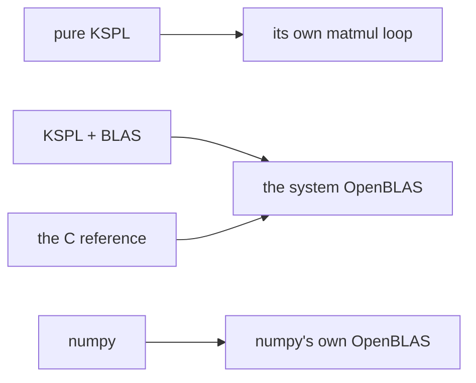

# ksai/benches

Three benchmarks live here. The first times one training step. The second times a quantized weight's product with one input row and with 64 ("The quantized product" below). The third runs a whole Qwen model from its GGUF file ("A whole model" below).

The first benchmark compares four implementations of one training step for a Linear layer. That layer multiplies its input by a weight matrix. The implementations use pure KSPL, KSPL with OpenBLAS, C, and numpy. Each performs the same work at the same sizes with float32 values.

Each step contains three matrix products: forward `Y=X@W`, then backward `dW=Xᵀ@dY` and `dX=dY@Wᵀ`. The transpose symbol `ᵀ` exchanges a matrix's rows and columns. Shorter execution time provides an indirect check of energy savings for the same work. The benchmark does not measure energy directly.

After building the compiler with `make`, run `ksplc run ksai/benches/run_bench.kspl 1` from the repository root.

## Run it

```sh
make                                         # build the stage1 compiler first (out/ksplc_stage1.exe)
ksplc run ksai/benches/run_bench.kspl 1     # pinned to one core (a fair kernel comparison)
ksplc run ksai/benches/run_bench.kspl 4     # 4 cores (how each library scales with threads)
```

Run these commands from the repository root. The benchmark prints microseconds (μs) per step for each size and backend. If `python3` or numpy is missing, it reports that condition and skips the numpy reference.

## The idea

Each implementation uses the matrix multiplication code shown below.



`run_bench.kspl` reduces interference from other work on a shared machine.

| Method | Reason |
| :-- | :-- |
| Measure elapsed time with `sys.mono_us()` and C's `CLOCK_MONOTONIC` | These clocks do not move backward. CPU time sums time across threads, so it does not directly measure throughput |
| Pin cores with `taskset` | Prevents the scheduler from moving work between cores |
| Use the fastest of seven runs per size | Reduces the effect of contention from other work |
| Reuse output buffers through `*_into` | Excludes memory allocation costs |
| Link KSPL with BLAS and the C reference to the same system OpenBLAS | Removes differences within the library from their comparison. Remaining differences come from the calling code. numpy uses its own OpenBLAS and provides another reference |

## What is here

| File | What it does |
| :-- | :-- |
| [`run_bench.kspl`](run_bench.kspl) | Pins cores, sets thread counts, and builds and runs each backend |
| [`bench_train.kspl`](bench_train.kspl) | Benchmarks KSPL training with reused `*_into` buffers. It uses pure KSPL by default or BLAS with `--define=blas` |
| [`bench_ref.c`](bench_ref.c) | Calls system OpenBLAS directly for the C reference |
| [`bench_np.py`](bench_np.py) | Provides the numpy reference |
| [`bench_quant.kspl`](bench_quant.kspl) | Times a quantized weight's product with one input row and with 64, on one thread and on every CPU. It also checks real tensors' decoding |
| [`bench_qwen.kspl`](bench_qwen.kspl) | Runs a Qwen model from its GGUF file on token IDs, and times reading the prompt and generating |

## What the results show

Measurements describe one operation on one machine. They depend on hardware, OpenBLAS and numpy versions, and compiler output. Run the benchmark locally to get current figures. These results do not describe whole-model training.

The following relationships hold across measured runs:

- KSPL with BLAS, C, and numpy finish within a few percent of each other, with one thread and four threads. All use OpenBLAS gemm, its general matrix product. The KSPL wrapper adds at most a few percent.
- With the same OpenBLAS, KSPL with BLAS gains speed from additional cores as the other implementations do. Larger matrices benefit more.
- Pure KSPL `matmul` takes about ten times as long as BLAS. BLAS uses manually optimized SIMD (single instruction, multiple data) code. Each instruction operates on several numbers.

See the matrix backend selection guidance in [`ksai/docs/DESIGN-learning.md`](../docs/DESIGN-learning.md).

## The quantized product

A model generating text multiplies each weight matrix by one input row per token. A model reading a prompt multiplies it by 64 rows at a time, as `chat_server` reads them. So these two products set a model's speed in tokens per second. `bench_quant.kspl` times both on one thread and on every CPU, the fastest of seven runs each.

```sh
out/ksplc_stage1.exe build --cflags=-O3 ksai/benches/bench_quant.kspl out/bench_quant.exe
out/bench_quant.exe                          # a 4096 × 4096 Q4_K matrix of random blocks
```

That matrix has the shape of one weight of a 7B to 9B model. The multiply-adds a second, divided by those of one token through the model, bound the tokens a second. For the build for the machine's own CPU, add `-march=native` to `--cflags`.

**Real tensors are checked by hand, not by a gate.** The models are large and are not in this repository. `tools/ai_assist/gguf_quant_check.py` takes a few tensors of each format out of GGUF files. It writes each tensor's bytes and the numbers llama.cpp's `gguf` package decodes from them. Given those files, `bench_quant` checks that ksai decodes the same bits, and times the larger tensors:

```sh
python3 tools/ai_assist/gguf_quant_check.py --out-dir out/gguf_check <model.gguf>...
out/bench_quant.exe out/gguf_check/*.bin     # exits 1 if one number differs
```

The following relationships held on a 4-CPU x86-64 machine with AVX-512 that other work shared:

- A product rounds its inputs to 8 bits and sums whole numbers. With one input row it runs about four times as fast as decoding each block to F32 did. With 64 rows it runs about twice as fast.
- With 64 input rows, a block's numbers are made once for all of them. The multiply-adds a second are then two to three times those with one row.
- Four CPUs take 3 to 3.5 times less time than one.
- The build for the machine's own CPU takes a tenth to a fifth less time than the default build. The C compiler makes the same 128-bit multiply-adds in both; the rest of the work gains from the wider vectors.
- The real Q4_K, Q5_0, Q6_K and Q8_0 tensors of 0.5B Qwen models decode to the reference's bits.

## A whole model

`bench_qwen.kspl` reads token IDs from standard input as a prompt, then generates greedily. It prints each generated token with its two top scores, and how many tokens a second it read and generated. `tools/ai_assist/qwen_gguf_check.py` runs it beside llama.cpp on the same file, to compare both the tokens and the speed. Its docstring says how to run it.

```sh
out/ksplc_stage1.exe build "--cflags=-O3 -march=native" ksai/benches/bench_qwen.kspl out/bench_qwen.exe
echo "151644 872 198 9707 151645 198 151644 77091 198" | \
    out/bench_qwen.exe models/Qwen3-4B-Instruct-2507-Q4_K_M.gguf --generate=32 --threads=4
```

`-march=native` builds it for this machine's CPU, as `make chat-server NATIVE=1` builds the server; leave it out for the default build.

`--piece` sets how many prompt tokens are read together, 64 as in `chat_server`. `--scores=<file>` writes the scores after the prompt as raw F32 numbers.

`qwen_gguf_check.py` takes the median of three runs of each side: its longest prompt, the conversation with tools, then 64 generated tokens. That prompt is 350 tokens long in Qwen3-Instruct-2507's template and 475 in Qwen3.5's. The following relationships held for Qwen3-4B-Instruct-2507's Q4_K_M file on a 4-CPU x86-64 machine with AVX-512 that other work shared:

- Built for the machine's own CPU, ksai generated at about half llama.cpp's speed, and read the prompt at about a fifth. Before the products multiplied whole numbers, llama.cpp was about five times faster in generating and fifteen times in reading.
- The default build was about a tenth slower than the build for the machine's own CPU.
- Reading a prompt 64 tokens at a time is several times faster than one token at a time. A block's numbers are made once for all the tokens it multiplies.
- ksai's scores differ from llama.cpp's by less than llama.cpp's own differ between reading a prompt in one batch and token by token.
- What stands in the way of reading faster is in the ksai section of [`docs/PLAN.md`](../../docs/PLAN.md).

For Qwen3.5-9B's Q3_K_M file, on the same machine and built for its CPU:

- ksai generated at about two fifths of llama.cpp's speed, and read the prompt at about a sixth.
- The delta nets' recurrence took no share of the time that could be measured. With it left out, reading and generating ran equally fast.
- After a short English prompt, ksai's scores differed from llama.cpp's by up to about half a unit. llama.cpp's own scores differed by up to 0.6 between reading a prompt in one batch and token by token.

## Further reading

* [ksai](../README.md) introduces the package. Its “Reading order” section explains `make BLAS=1`, which also works for the examples.
* [`ksai/docs/DESIGN-learning.md`](../docs/DESIGN-learning.md) explains why pure KSPL is the default and BLAS is optional.
