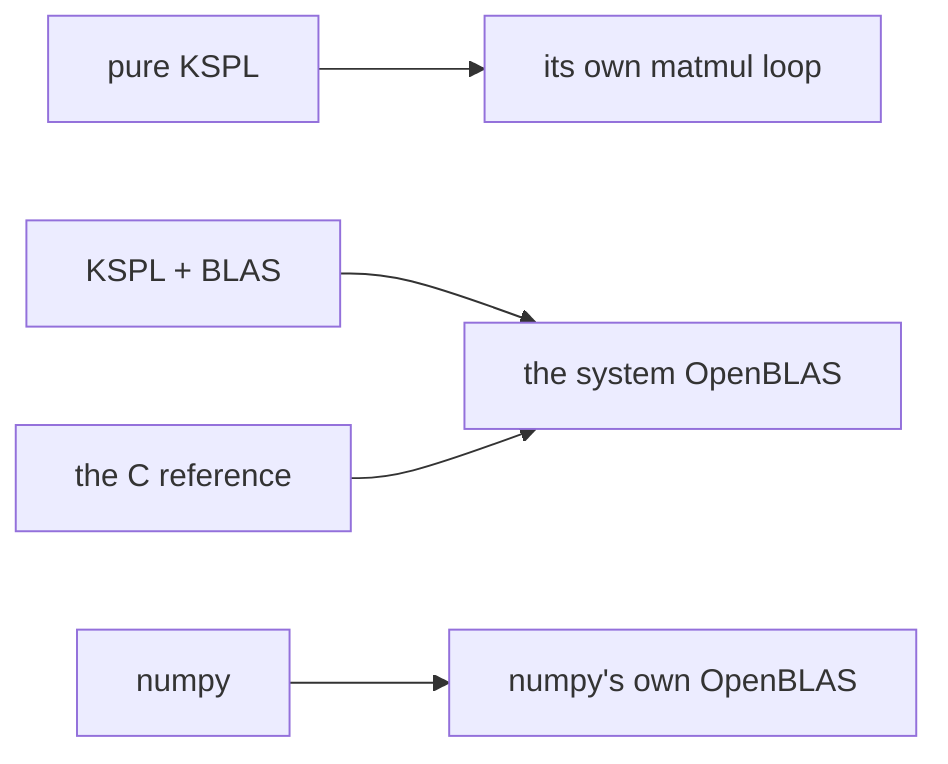

# ksai/benches

This benchmark compares four implementations of one training step for a Linear layer. That layer multiplies its input by a weight matrix. The implementations use pure KSPL, KSPL with OpenBLAS, C, and numpy. Each performs the same work at the same sizes with float32 values.

Each step contains three matrix products: forward `Y=X@W`, then backward `dW=Xᵀ@dY` and `dX=dY@Wᵀ`. The transpose symbol `ᵀ` exchanges a matrix's rows and columns. Shorter execution time provides an indirect check of energy savings for the same work. The benchmark does not measure energy directly.

After building the compiler with `make`, run `ksplc run ksai/benches/run_bench.kspl 1` from the repository root.

## Run it

```sh
make                                         # build the stage1 compiler first (out/ksplc_stage1.exe)
ksplc run ksai/benches/run_bench.kspl 1     # pinned to one core (a fair kernel comparison)
ksplc run ksai/benches/run_bench.kspl 4     # 4 cores (how each library scales with threads)
```

Run these commands from the repository root. The benchmark prints microseconds (μs) per step for each size and backend. If `python3` or numpy is missing, it reports that condition and skips the numpy reference.

## The idea

Each implementation uses the matrix multiplication code shown below.



`run_bench.kspl` reduces interference from other work on a shared machine.

| Method | Reason |
| :-- | :-- |
| Measure elapsed time with `sys.mono_us()` and C's `CLOCK_MONOTONIC` | These clocks do not move backward. CPU time sums time across threads, so it does not directly measure throughput |
| Pin cores with `taskset` | Prevents the scheduler from moving work between cores |
| Use the fastest of seven runs per size | Reduces the effect of contention from other work |
| Reuse output buffers through `*_into` | Excludes memory allocation costs |
| Link KSPL with BLAS and the C reference to the same system OpenBLAS | Removes differences within the library from their comparison. Remaining differences come from the calling code. numpy uses its own OpenBLAS and provides another reference |

## What is here

| File | What it does |
| :-- | :-- |
| [`run_bench.kspl`](run_bench.kspl) | Pins cores, sets thread counts, and builds and runs each backend |
| [`bench_train.kspl`](bench_train.kspl) | Benchmarks KSPL training with reused `*_into` buffers. It uses pure KSPL by default or BLAS with `--define=blas` |
| [`bench_ref.c`](bench_ref.c) | Calls system OpenBLAS directly for the C reference |
| [`bench_np.py`](bench_np.py) | Provides the numpy reference |

## What the results show

Measurements describe one operation on one machine. They depend on hardware, OpenBLAS and numpy versions, and compiler output. Run the benchmark locally to get current figures. These results do not describe whole-model training.

The following relationships hold across measured runs:

- KSPL with BLAS, C, and numpy finish within a few percent of each other, with one thread and four threads. All use OpenBLAS gemm, its general matrix product. The KSPL wrapper adds at most a few percent.
- With the same OpenBLAS, KSPL with BLAS gains speed from additional cores as the other implementations do. Larger matrices benefit more.
- Pure KSPL `matmul` takes about ten times as long as BLAS. BLAS uses manually optimized SIMD (single instruction, multiple data) code. Each instruction operates on several numbers.

See the matrix backend selection guidance in [`ksai/docs/DESIGN-learning.md`](../docs/DESIGN-learning.md).

## Further reading

* [ksai](../README.md) introduces the package. Its “Reading order” section explains `make BLAS=1`, which also works for the examples.
* [`ksai/docs/DESIGN-learning.md`](../docs/DESIGN-learning.md) explains why pure KSPL is the default and BLAS is optional.
