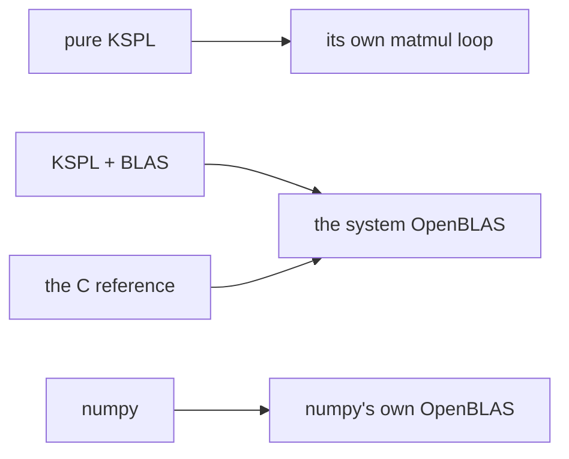

# ksai/benches

**This folder times one training step of ksai's simplest layer, a Linear layer (one that multiplies its input by a weight matrix), written four ways, so you can see how fast KSPL's matrix code is beside C and numpy on your own machine.** That step is three matrix products: forward `Y=X@W`, and backward `dW=Xᵀ@dY` and `dX=dY@Wᵀ` (`ᵀ` is the transpose, the matrix flipped over its diagonal). It runs pure KSPL, KSPL passing `matmul` to OpenBLAS, a C reference and numpy on exactly the same work, at the same sizes, in float32. It is an indirect check of "training faster means finishing the same work on less energy". Once `make` has built the compiler, one command runs it from the repository's root: `ksplc run ksai/benches/run_bench.kspls 1`.

## Run it

```sh
make                                         # build the stage1 compiler first (out/ksplc_stage1.exe)
ksplc run ksai/benches/run_bench.kspls 1     # pinned to one core (a fair kernel comparison)
ksplc run ksai/benches/run_bench.kspls 4     # 4 cores (how each library scales with threads)
```

Run it from the repository's root. It prints μs per step for each size and each backend. Without `python3` or numpy, it says so and skips the numpy reference.

## The idea

The four contenders differ in who does the multiplying. The picture shows which library each one calls.



`run_bench.kspls` is shaped to keep a shared machine's noise out.

| Measure | What it keeps out |
| :-- | :-- |
| **Real time (wall)**: `sys.mono_us()`, a clock that only goes up. The C reference (`bench_ref.c`) reads the same `CLOCK_MONOTONIC` | CPU time adds up every thread of a multi-threaded run, so it misreads throughput |
| **Pinned cores**: `taskset` | The scheduler moving the work between cores |
| **min-of-7**: each size runs 7 times, and the fastest run counts | Contention: the least contention is closest to the true speed |
| **Reused output buffers** (the `*_into` API) | The cost of allocating memory |
| **A controlled comparison**: KSPL+BLAS and the C reference link the same system OpenBLAS | Differences inside the library. Where the two agree, any difference lies in the code that calls the library, not in the library. numpy carries its own OpenBLAS, so it stands beside them for reference |

## What is here

| File | What it is |
| :-- | :-- |
| [`run_bench.kspls`](run_bench.kspls) | The harness: it pins cores, sets the thread count, and builds and runs every backend. |
| [`bench_train.kspls`](bench_train.kspls) | The KSPL training bench (`*_into` reuse; pure KSPL by default, BLAS with `--define=blas`). |
| [`bench_ref.c`](bench_ref.c) | The C reference, calling the system OpenBLAS directly. |
| [`bench_np.py`](bench_np.py) | The numpy reference. |

## What the results show

**The figures are one machine's, for one kernel.** They change with the hardware, the OpenBLAS and numpy versions, and the compiler's code generation, so none is written here. Run the bench to measure them. They say nothing about training a whole model. Read the relations, which hold across runs:

- **KSPL+BLAS, the C reference and numpy come within a few percent of each other**, on one thread and on four. All three call an OpenBLAS gemm (its general matrix product), so only the calling code differs. KSPL's wrapper costs a few percent at most.
- **KSPL+BLAS scales with the core count as the others do** on the same OpenBLAS, and the larger the matrix, the better it scales.
- **Pure KSPL `matmul` is about an order of magnitude slower than BLAS** (about ten times). That is the difference a hand-tuned SIMD kernel makes (code that has each CPU instruction work on several numbers at once).

Which backend to pick, and why, is "The matrix backend is chosen where it is deployed" in [`ksai/docs/DESIGN.md`](../docs/DESIGN.md).

## Further reading

* [ksai](../README.md) — the package's entry point. `make BLAS=1`, explained under "Reading order" there, works on the examples too.
* [`ksai/docs/DESIGN.md`](../docs/DESIGN.md) — why `matmul` is pure KSPL by default and BLAS on request.
