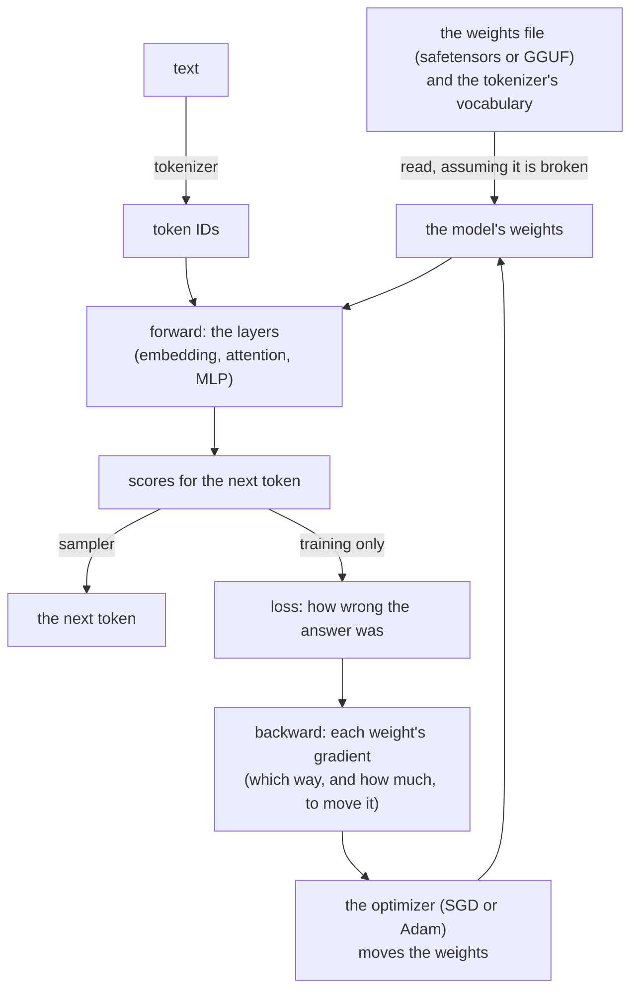
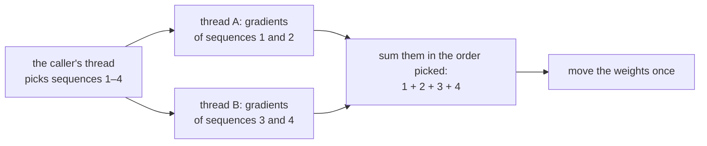

# The design decisions of ksai

`ksai` is a small neural-network engine in KSPL. It runs a model (inference) and can train one lightly, using nothing but the local machine. This document says **why it took this shape**. Each file's purpose is in [ksai](../README.md), and "The idea" there explains the AI words: tensor, weights, forward, backward, loss, optimizer and token.

The diagram shows the path data takes through ksai. Inference stops at the next token; training goes on from the scores and loops back to the weights.

## The caller picks the optimizer

The optimizer is the rule that moves the weights after each step. *SGD* (stochastic gradient descent) moves each weight a fixed step against its gradient. *Adam* also keeps a running state per weight, which adapts the step to each weight. The caller chooses by calling a different function.

| Function | Works out the gradients | Moves the weights | Optimizer |
| :-- | :-- | :-- | :-- |
| `backward` / `backward_lora` | yes | yes | fixed to SGD |
| `backward_grads` / `backward_lora_grads` | yes | no; the caller passes the gradients to an `Updater` | SGD, or Adam ([`optim.kspl`](../optim.kspl)) |

**The applying versions are built on the `_grads` ones**, so the computation sits in one place.

A whole model moves through one `Updater`, and each layer's `apply_grads` passes it that layer's weights with their gradients. **The list of a layer's weights stays in the layer's own `apply_grads`**, beside the `backward_grads` that fills them. So a weight added to a layer is added in one file.

* **Adam's states are paired with the weights by position.** The n-th weight a step passes keeps the n-th state, which needs no key. A step passing another number of weights stops the run (`begin_step`), rather than let the states slide onto the wrong weights.
* **Every gradient is worked out before any weight moves.** No weight is read after its own update, so for SGD this is the same arithmetic as updating each layer as it is reached. The one exception is the embedding (the table turning a token into a row of numbers). There, a token met twice in a sequence takes the sum of its rows' gradients in one step, as Adam needs it.

## Threads split a batch, and give the same weights

**Training on several CPU threads gives exactly the same weights, byte for byte, as training on one.** `fim_coder train --batch=B` moves the weights by the sum of B sequences' gradients. **`--threads` only splits the batch**, so the thread count only changes the speed. The diagram shows one training step with a batch of four on two threads.

Each thread works out whole sequences' gradients on its own arena (a block of memory freed all at once), and only reads the weights (`grads_seq` in [`examples/llama_engine/model.kspl`](../examples/llama_engine/model.kspl)). The gradients are summed in the order the caller's thread picked the sequences (`accumulate`). So one thread and every CPU write the same bytes.

| Not taken | Why |
| :-- | :-- |
| **Splitting each matrix product over threads** | At this model's size a product is too small to share, while a whole sequence pays for a thread. So with several threads, `fim_coder train` sets `parallel.set_threads(1)`, and `make fim-model` holds OpenBLAS to one thread. Only large products split ("Products split their outputs over the cores" below) |
| **A batch per process, as PyTorch's `DistributedDataParallel` does** | The effective batch, and with it the result, then moves with the number of processes. Here **the batch belongs to the training, the thread count to the machine** |
| **Averaging the gradients instead of summing** (PyTorch's default) | Summed, `--lr` (the learning rate) stays how far each sequence moves the weights, whatever the batch. Averaged, the user must scale the rate with the batch by hand |
| **Hogwild!** (threads moving shared weights without a lock) | The result depends on how the threads happened to interleave, so no run could be repeated |

**A step's memory stays taken for the next** (`Arena.reset`). An arena wound back to empty returns its chunks to the OS. Taking them again page by page costs a large share of each step, more so with several threads.

## LoRA keeps the adapter apart from bundle reading and writing

LoRA (low-rank adaptation) fine-tunes a model by training small added matrices, called adapters, instead of the whole model. Three files hold it, each heavier than the one before.

| File | What it holds | What it brings in |
| :-- | :-- | :-- |
| [`lora.kspl`](../lora.kspl) | Only the adapter `Lora` | Nothing for formats |
| [`lora_set.kspl`](../lora_set.kspl) | The per-block bundle (`Qkv_lora` / `Mlp_lora`) and its safetensors layout | A `Safetensors` (the weights format) |
| [`model_file.kspl`](../model_file.kspl) | Loading and saving by file path | `std/io`, `std/fs` |

**The split follows what the signatures import.** [`nn.kspl`](../nn.kspl) uses only `Lora`. In one file with the bundle, it would bring the weight format and JSON parsing along. Split, `json` / `safetensors` / `bytes` / `strnum` drop out of the inference path.

**Do not move the code that takes a `Safetensors` into [`model_file.kspl`](../model_file.kspl)**, which imports `std/io` and `std/fs`. Bare metal (a chip with no operating system and no file system) passes an `embed`ed byte sequence through `Safetensors.load_from_bytes` to `lora_set`. Requiring `std/io` there would close that path.

**`Lora.save_raw` / `load_raw` are the smallest format, for a place with no heap.** The safetensors path resolves names through `Str_builder`, which needs the global heap, and a bare-metal probe has only `Arena.from_buffer`. So one adapter goes out as raw bytes.

## The attention mechanisms are split by the head count

*Attention* is the layer that lets each token look at the tokens before it. A *head* is one independent copy of that look; several heads split each row into parts. *RoPE* (rotary position embedding) marks each token's position by rotating pairs of numbers in its row. *GQA* (grouped-query attention) lets several heads share one set of keys and values, to save memory.

[`nn.kspl`](../nn.kspl) holds two attention mechanisms, split by **the head count and whether they can be trained**.

| | Heads | RoPE | Backward pass |
| :-- | :-- | :-- | :-- |
| `Self_attention` | one | the whole row, in adjacent pairs | **yes** ([`attention_train.kspl`](../attention_train.kspl)) |
| `Gqa_attention` | split per head (GQA too) | per head's width, variable base (NeoX-style) | none (inference only) |

Caution: **Do not let `Self_attention` take a head count.** Nothing in it splits Q/K/V per head, so the count would have no effect (Principle 5). `n_heads=2` would change only the scale `1/sqrt(dim/n_heads)`, unnoticed.

Nor is the per-head code copied into it. `Gqa_cache` already has it, for `Gqa_attention` and the Qwen model alike, and a copy would give one purpose two means (Principle 6).

**`dim` has to be even**, since RoPE rotates adjacent elements in pairs. An odd `dim` stops `new` on the spot, rather than fail inside the first `forward` with nothing naming the cause.

## Each layer initializes its own weights

Before training, every layer fills its weights with small random values, through its own `init_uniform`.

`nn.*.new` defaults to the same value in every element (0.1 for `Linear`, 0.01 for `Embedding`). Training then sends the same gradient to every output unit. So **the units stay identical to the end while the loss still falls**, with nothing to notice it by.

Caution: **Do not enumerate the weight tensors one by one from outside.** A layer that gains a weight tells the enumerating code nothing, and the forgotten weight stays at the same value. So each layer's `init_uniform` spreads its own weights, called once per layer.

**The normalization's weights are not spread** (they start training at 1.0).

**A test checks that `init_uniform` misses none of them** ([`tests/grad_test.kspl`](../tests/grad_test.kspl)). It checks only the weights listed there, so add a new weight to that list in the same commit (Principle 8).

## The weights' gradients are matched against numerical differentiation too

**A wrong gradient in the backward pass still makes the loss fall, so a test that watches the loss lets it through.** It only makes training worse. So [`tests/param_grad_test.kspl`](../tests/param_grad_test.kspl) matches each trained weight's gradient against a central difference.

A *central difference* estimates a gradient without the backward pass. It nudges one weight up a little, then down a little, and divides the change in the loss by the size of the nudge. It is slow, but it is hard to get wrong.

* **The input's gradient (dX) alone is not enough.** A 1% error in RMSNorm's dW (the weight's gradient) passes the dX test and fails this one.
* **The analytic gradient is worked back from how SGD moved the weight** (`sgd_step` is `w -= lr*g`, so `g = (before - after)/lr`).
  * Caution: **Do not add a separate function that returns the gradient alone.** The path training uses would then split from the path the test checks.
* **Do not check with every weight at the same value.** `Linear.new` defaults to 0.1 everywhere, and there even a gradient with rows and columns swapped matches.

## The matrix backend is chosen where it is deployed

**Matrix multiplication (`matmul`) is plain KSPL by default, and OpenBLAS (a fast C library for matrix math) only on request** (`make BLAS=1`, or `--define=blas`). Through OpenBLAS it comes within a few percent of C calling the same library. Pure KSPL is about an order of magnitude slower. The measurement, and the command that repeats it, are in [`ksai/benches/README.md`](../benches/README.md).

| Where it runs | Backend | Why |
| :-- | :-- | :-- |
| **At the edge, embedded, and in short-lived jobs** | Pure KSPL | Zero dependencies, a much shorter start-up, and a fraction of the memory and of the size to distribute. The code around the kernel is compiled either way |
| **On servers and in large-scale training** | OpenBLAS | It is the same gemm (general matrix multiply) a C program would call |

## The kernels are spelt for the auto-vectorizer, not with intrinsics

*SIMD* means one CPU instruction working on several numbers at once. An *intrinsic* is a function that names one such instruction for one CPU family. The *auto-vectorizer* is the part of the C compiler (Clang at `-O3`) that turns an ordinary loop into SIMD code when it can.

**ksai's kernels hold no hand-written intrinsic.** The default `matmul_cols` in [`tensor.kspl`](../tensor.kspl) is a cache-efficient i-k-j loop, which Clang's `-O3` vectorizes. So it needs no particular instruction set and checks correctly on any target.

**`make test-simd` checks that the hot loops stay vectorized**, in [`tensor.kspl`](../tensor.kspl), [`nn.kspl`](../nn.kspl) and [`quant.kspl`](../quant.kspl). Each loop it checks carries a comment naming it on the line before, and is checked at its own place in the optimization record. So a function whose other loop vectorizes does not pass for it.

**A loop of 32 is vectorized whole, not as a loop.** The C compiler unrolls it and turns its sum into vector code (the SLP vectorizer), which the loop vectorizer's record does not show. A comment saying "sees this sum vectorize" makes the gate look in the SLP vectorizer's record instead.

A loop reaches the vectorizer only through one of two techniques.

1. **Swap the loop nesting alone, keeping the order of the additions into each output element.** It then accumulates each element in parallel rather than by a horizontal sum (adding the lanes of one vector together). The result is unchanged bit for bit (as in `grad_matmul_weight_into`).
2. **Replace a division inside the loop with one reciprocal computed outside it and a multiplication** (division has lower per-lane throughput).

Caution: **`-ffast-math` is not used**, since accuracy comes first. Without it, the vectorizer cannot reach a horizontal sum over one accumulator, or a loop with `exp` / `sin` / `cos` / `sqrt`, unless one technique applies. `-Rpass-analysis=loop-vectorize` says why.

**One shape fits neither technique**: where the inner product runs along both rows (C = A·Bᵀ: `matmul_transb`, and `grad_matmul_input_into`'s dY·Wᵀ). A transposed copy would allocate in an `_into` (a function that writes into memory the caller gave). So `transb_kernel` in [`tensor.kspl`](../tensor.kspl) **sums four outputs side by side**, each in ascending order, so the result is unchanged bit for bit.

**An F32 dot product keeps 16 or 8 sums side by side, added in a fixed order at the end** (`dot_lanes` in [`quant.kspl`](../quant.kspl) and in [`nn.kspl`](../nn.kspl)). So the C compiler packs the sums into vector registers, and the result does not depend on the thread count.

**The integer products sum 16-bit whole numbers in groups of 32, exactly in 32 bits** (`dot_block` and `dot_ints` in [`quant.kspl`](../quant.kspl)). Integer addition gives the same result in any order, so the C compiler vectorizes the sums without `-ffast-math`. Each group becomes four `pmaddwd` instructions. How the loops around them are shaped to reach the vectorizer is in their comments.

**What the auto-vectorizer does not reach.** Clang 18 makes the 128-bit `pmaddwd` from these loops, eight multiply-adds an instruction, even for a CPU with AVX2 or AVX-512. It forms neither the 256-bit `vpmaddwd`, nor AVX2's `vpmaddubsw` (32 multiply-adds), nor AVX-512 VNNI's `vpdpbusd` (64). llama.cpp writes those by hand. That gap is most of the difference left in reading a prompt ([`benches/README.md`](../benches/README.md) has the measurements).

**The exponential of an F32 is KSPL code** (`exp_f32` in [`tensor.kspl`](../tensor.kspl)), as ggml's `ggml_v_expf` is. `math.exp` calls the C library on an F64, and no loop that calls it can be vectorized. SiLU and the attention's softmax use `exp_f32` for F32 tensors, and `math.exp` for F64 ones.

## Weights stay in GGUF's formats

**A quantized weight matrix (`Quant_matrix` in [`quant.kspl`](../quant.kspl)) holds GGUF's bytes exactly as GGUF stores them.** GGUF is llama.cpp's file format, in which most models are shared. Each format is a block of 32 or 256 numbers with one scale, or with a scale per group inside the block.

* **Why GGUF's own layouts**: a tensor read from a GGUF file is used as it stands. A layout of ksai's own would need a conversion at every load, and a second file format to keep in step.
* **Why no full F32 copy**: a 9B model takes about 36 GB as F32 and about 6 GB as 4-bit numbers. So `mul_mat` turns one block at a time into numbers in a buffer on the stack, and multiplies it with the inputs at once.
* **Why Q5_0 too**: llama.cpp's Q4_K_M mix needs rows that are a multiple of 256. Where a row is shorter, as the 896 numbers of a 0.5B Qwen model, the file holds Q5_0 and Q8_0 instead.

**Decoding gives the reference's numbers bit for bit.** Each block decoder follows ggml's `dequantize_row_*`, product by product. A product and a subtraction stay in separate statements, since a C compiler can fuse `a * b - c` into one rounding on some machines. The tests compare every format with llama.cpp's Python package `gguf`, on random blocks that reach every bit of the packed scales ([`tests/quant_test.kspl`](../tests/quant_test.kspl)). The reference files are committed, so the tests need no Python.

**A product rounds each input row to 8 bits, then multiplies whole numbers, as llama.cpp's CPU backend does.** A weight's numbers are small whole numbers times a scale. With whole-number inputs, a block's product is a sum of whole numbers, exact in 32 bits, which the two blocks' scales multiply once.

* **Why**: it runs several times faster than decoding each block to F32. And llama.cpp computes the same numbers, which the comparison with it needs ("One model for the Qwen families, from a GGUF file" below).
* **The inputs are rounded as llama.cpp's CPU backend rounds them on x86.** A K format's inputs become Q8_K blocks, and Q8_0's and Q5_0's become Q8_0 blocks. F32, F16 and BF16 weights keep F32 inputs. `quant.kspl` gives each rounding rule.
* **Each weight block becomes 16-bit whole numbers once**, and four weight rows go together, so an input block is read once for the four.
* **Each output adds its blocks' parts in ascending order, in F32**, each product and sum in its own statement. So neither the thread count nor the batch changes a bit.

**The tests hold the products to four references** ([`tests/quant_test.kspl`](../tests/quant_test.kspl)). The files come from llama.cpp's own C library, through its Python package (`tools/ai_assist/make_quant_fixtures.py`).

| Reference | How close |
| :-- | :-- |
| llama.cpp's rounding of the same inputs | The same bytes: every scale, number and sum, ties included |
| A plain sum of the same whole numbers, each read straight from its block | The same bits |
| llama.cpp's `vec_dot` functions on the same blocks | Within 1e-5 of the sum of the products' sizes; only the order of F32 sums differs |
| The F32 product of the decoded weights with the unrounded inputs | Within 0.6 of an input step times the sum of the weights' sizes, the rounding's own bound |

**The quantizers follow the ones llama.cpp uses without an importance matrix** (`quantize_row_q8_0_ref` and `quantize_row_q4_K_ref`), in [`quantize.kspl`](../quantize.kspl), apart from the decoding that every program needs. Q8_0's bytes equal the reference's in the tests. `gguf` has no Q4_K quantizer, so the test holds each number within one step of its group instead. Only these two formats have a quantizer, since converting a model needs no other.

## Products split their outputs over the cores

**A large product splits its outputs over a pool of threads, and any thread count gives the same bits as one** ([`parallel.kspl`](../parallel.kspl)). `Quant_matrix.mul_mat` splits the weight's rows, and `Tensor.matmul` the result's columns.

* **One thread computes each output whole**, with the same code and order of additions as on one thread. So a test compares one thread with four bit for bit, and results compare across machines.
* **The attention splits the key heads.** Each thread takes a key head with the query heads that share it. So each row of the cache is read once for all of them.
* **The pool keeps a thread per CPU but the caller's, which computes a share too.** A small product stays on the caller's thread, and a freestanding build has no threads at all. The thresholds and their reasons are in `parallel.kspl`'s comments.
* **The threads spin briefly before they sleep** (`SPIN`), since a model asks for products a few microseconds apart. Waking a sleeping thread took about 55 microseconds a product; spinning, a split takes about 9.
* **A second caller while the pool is busy computes alone**, with the same result, a little later. So two threads that each run a model never wait on each other.
* **`parallel.set_threads(n)` caps the threads one product uses.** A program whose own threads already keep every CPU busy sets 1.

The race gate runs ksai's unit tests, so the pool runs under ThreadSanitizer there.

## The tokenizer gives llama.cpp's tokens

**A model reads well only the token IDs it was trained on.** One text can be written as several ID sequences that decode to the same bytes. The model answers worse on those it did not see. So `encode` must give the IDs the model's own tokenizer gives. The measure is llama.cpp, which runs the same GGUF files. `tools/ai_assist/check_qwen_tokenizer.py` compares the two on a real GGUF file, text by text.

**The text is split into chunks first, and no merge crosses a chunk.** Each kind of chunk, in the order Qwen's rule tries them (`tokenizer.ggml.pre = "qwen2"`, the same for Qwen2.5 and Qwen3):

| Chunk | Examples |
| :-- | :-- |
| An English contraction, in any case | `'s`, `'RE`, `'ll` |
| Letters, with at most one leading code point that is not a letter, a digit or a newline | ` hello`, `_case`, `(a`, `KSPLは簡素` |
| One digit, in any script | `1`, `１`, `Ⅻ` |
| Other code points, with at most one leading space and the newlines after them | ` +=`, `.\n\n`, `。」\n` |
| White space up to its last newline | `\n\n`, `  \n  \n` |
| White space before a non-space, without its last code point | the `  ` of `a   b` |

**Qwen3.5's rule (`qwen35`) differs in the marks alone.** A combining mark, such as an accent or a Devanagari vowel sign, joins the letter run it stands in. Qwen2's rule reads it as punctuation, so a word with marks splits there.

* **The GGUF file names its rule**, and the server sets it on the tokenizer (`Tokenizer.set_split`, `Split_rule.named`). A file that names another rule is refused, since its vocabulary was made from other chunks.
* **A vocabulary of `train_bpe.kspl` is split by Qwen2's rule**, the default, both when it is trained and when it encodes. A merge learnt across a boundary that encoding keeps would never apply.

**The letter, mark, number and white-space classes are llama.cpp's own.** Which code points are letters changes with the Unicode version, and llama.cpp keeps its own white-space list. So `ksai/unicode_class.kspl` is generated from llama.cpp's `unicode-data.cpp`, never from another library's data, as a table of 1,921 range bounds. The classes stay inside ksai, because nothing in `std/` reads Unicode categories.

**The rule is written out by hand, not as a regular expression**, as llama.cpp writes it, which keeps llama.cpp's reading in its corners. One corner differs on purpose. A byte that starts no valid UTF-8 code point is read as U+FFFD but kept, where llama.cpp writes U+FFFD's bytes. So `decode` gives back any input, and only text that is not UTF-8 encodes differently.

**Markers are matched as llama.cpp matches them.** A GGUF vocabulary marks control tokens (type 3, such as `<|im_end|>`) and user-defined ones (type 4, such as `<think>`). A user-defined marker's text becomes its ID wherever it appears, before the split, since the chat template writes it as text. A control token is never matched in text, since a server puts its ID into the sequence itself ("Markers go in by their IDs" in [`DESIGN-serving.md`](DESIGN-serving.md)).

**The merging is llama.cpp's too.** `load_lists` maps each GGUF word back from GPT-2's printable mapping to its bytes, so the merging works on raw bytes. Each chunk starts as one ID per byte, and the pair of the lowest rank merges first, the leftmost on a tie. A merge rule whose result is not a word is refused when it loads, so no fall-back to bytes is needed.

* **A queue holds every adjacent pair that a rule merges**, as llama.cpp keeps it. A pair queued before one of its pieces merged is skipped when it comes up, and each merge queues the new pairs on either side.
* **So a chunk of n bytes takes time in proportion to n log n.** A run of letters, digits or spaces is one chunk, however long. A scan for the best pair after each merge would take time in n². One long word in a request would then hold the server for minutes.

## A GGUF file is read once and used in place

**`model_file.load_gguf` reads the whole file with one read, into one block of the caller's arena.** `Gguf.parse` in [`gguf.kspl`](../gguf.kspl) then indexes it, and every tensor stays where it lies in those bytes.

* **The peak memory is the file's size**, plus the lists of keys and tensors: a few MB for a vocabulary of 150 000 tokens. Reading onto the heap and copying into the arena would hold the file twice.
* **No weight is copied.** A matrix is a `Quant_matrix` over its bytes. A norm's weights are a `Tensor` that borrows them, copied only where they are not aligned to 4 bytes.
* **The file is read, not mapped.** `std` has no memory map, and one read works the same on every system. A model reads every weight for each token, so a mapped file would be in memory whole anyway.

**Every number the file claims about itself is checked before it is used** ("A byte sequence from outside is assumed to be broken" below). Each check has its case in `Gguf_error`, which names the part at fault. A length is compared with the bytes left before it is converted to `Sz`, and a tensor's size is multiplied with an overflow check. Each tensor must start where the one before it ends, so no two tensors share a byte.

The tests build broken files that each break one claim ([`tests/gguf_test.kspl`](../tests/gguf_test.kspl)). The fuzz check reads each broken file, decodes every tensor, builds the vocabulary and runs the model on two tokens ([`tests/read_prog.kspl`](../tests/read_prog.kspl)).

## One model for the Qwen families, from a GGUF file

**[`qwen.kspl`](../qwen.kspl) runs the three families from their GGUF files.** They share the blocks' frame, and `FAMILIES` names what differs in one place:

| Part | Qwen2 (`qwen2`) | Qwen3 (`qwen3`) | Qwen3.5 (`qwen35`) |
| :-- | :-- | :-- | :-- |
| A bias on the queries, keys and values | Yes (`attn_q.bias`) | No | No |
| An RMS norm of each query and key head, before RoPE | No | Yes (`attn_q_norm`) | Yes |
| A gate per query head on the attention's output | No | No | Yes: the query weight writes it beside each head |
| Blocks that keep a running state instead of attending | No | No | Three of every four (`full_attention_interval`) |
| The name of the feed-forward part's norm | `ffn_norm` | `ffn_norm` | `post_attention_norm` |
| RoPE's sections for images and video | No | No | Read, and checked to turn text as plain RoPE does |

The rest is the same: grouped-query attention, RoPE of the NeoX kind with the file's base, SwiGLU and RMS norms. The output is the embedding where `output.weight` is absent. The settings come from the file's `<arch>.*` keys.

* **Why one file for all three**: three models would hold the same frame three times. A family that differs in one more part adds a column to `FAMILIES`. The delta net, the one large part of its own, has its own file ("Qwen3.5's linear layers keep a state" below).
* **RoPE can turn part of a head.** Qwen3.5 turns 64 of each head's 256 numbers (`rope.dimension_count`), and leaves the rest as they are.
* **RoPE's sections change nothing for text.** Qwen3.5's file divides RoPE's pairs among a time, a height and a width position, for images and video (`rope.dimension_sections`). A text token sets all three to its position, so the rotation is the plain one. A file whose sections leave a pair over is refused: llama.cpp gives that pair a position always 0 for text, so it would not turn.
* **Why it is in the package, not in an example**: the chat server, `benches/bench_qwen.kspl`, the tests and the fuzz check all run it.
* **Every tensor's shape is checked against the settings, and every tensor must be read.** An unread tensor means a layer not computed, so the answers would be another model's (`Qwen_error.unread`).
* **Each setting has a cap, and so does the memory the settings ask for together.** One copy of every delta net's state may take 1 GiB, and the cache 256 GiB. A small file whose settings fit its tensors can still ask for more than a machine holds. It is refused by name (`Qwen_error.bad_setting`), not stopped by a failed allocation.
* **The keys and values go to `nn.Gqa_cache`**, which `nn.Gqa_attention` uses too, so the attention is written once.

**A prompt is read many tokens at a time.** A product turns each block into whole numbers once for all the tokens it multiplies. So a piece of 64 tokens costs far less than 64 single tokens. **The scores after a token are the same bits however the prompt was cut into pieces.** Each output is summed in a fixed order, and each query row attends only to its own past. The tests compare one call, two pieces and twelve single tokens bit for bit ([`tests/qwen_test.kspl`](../tests/qwen_test.kspl)).

**Each block's working tensors are freed before the next block** (`Arena.restore` in `Qwen.forward`), so a block reuses memory still in the cache. Without it, a piece of 64 prompt tokens took hundreds of megabytes of fresh memory, every page faulted in again.

**The reference is llama.cpp, run on the same file.** Both round each product's inputs to 8 bits, and the RMS norm, RoPE's angles and the softmax's sum round as llama.cpp's CPU backend does. **The two sides' scores still never agree exactly**, and no implementation that differs in a single bit can make them agree:

* **Rounding to 8 bits makes the last bit matter.** A difference of one unit in an activation can move a number to the next whole step, and the step grows through 36 blocks.
* **llama.cpp shows the same against itself.** After a prompt of 29 tokens, read in one batch and token by token, its own scores differ by up to 1.15. ksai's differ from llama.cpp's by about half that.
* **So the greedy tokens agree where the two top scores lie far apart; near a tie they can part.** `tools/ai_assist/qwen_gguf_check.py` measures both on a real model, with llama.cpp against itself beside them.

The tiny model's scores are checked against an F64 computation of the same graph, with each product's input rounded as llama.cpp rounds it. llama.cpp's own scores for that model agree with it within 2e-6.

## Qwen3.5's linear layers keep a state

**Three of every four Qwen3.5 blocks are gated delta nets** ([`delta_net.kspl`](../delta_net.kspl)). Such a block keeps no keys and values of past tokens. It keeps a square of 128 × 128 numbers per value head, and the last three inputs of a short convolution. Each token decays the square, writes its value into it under its key, and reads it with its query. The steps are llama.cpp's `qwen35` graph and its fused `gated_delta_net`, which its CPU backend runs.

* **A token costs the same at every position**, so only the attention blocks' cache grows with the conversation. For Qwen3.5-9B, 8 of its 32 blocks attend: the cache takes 64 KiB a token, a quarter of what 32 would take. Each delta-net block's state takes about 2.1 MiB, whatever the length.
* **The square is updated one row at a time**, in one pass per token, which gives llama.cpp's numbers. The value heads are split over the cores.
* **A prompt is read token by token through the delta nets**, as llama.cpp's CPU backend reads it. With the recurrence left out, reading a prompt and generating ran equally fast. So the chunked form, which llama.cpp keeps for other backends, would buy nothing here.
* **The convolution's weights are turned once, when the model loads**, so its loop runs on vectors. They are 128 KiB a block, the only weights copied.

**The state follows one run of tokens and cannot be rewound.** The cache can go back by writing over the rows past a point, but the state holds no positions at all.

* **So `Qwen.forward` reads on only from where the state stands.** Position 0 starts the state afresh; any other position must be the number of tokens the state follows, or the call stops.
* **`Qwen_state` copies the whole state, and puts it back** (`save_state`, `restore_state`). A copy made after N tokens is good while the cache still holds those N rows. The chat server keeps such copies to reuse the start of a conversation ("The cache is kept across requests" in [`DESIGN-serving.md`](DESIGN-serving.md)).

The tests run a tiny Qwen3.5 model against an F64 computation of the same graph, which llama.cpp's own scores match within 1e-6 ([`tests/qwen_test.kspl`](../tests/qwen_test.kspl)). They also restore a copied state after other tokens, and compare the scores with one run bit for bit.

**`qwen_infer` keeps its own Qwen2.5 model on 32-bit weights**, read from the safetensors that `export_qwen_to_kspl.py` writes. Its LoRA adapters attach to `nn.Gqa_attention`, and the coding assistant's plan uses them ("tools" in [`docs/PLAN.md`](../../docs/PLAN.md)).

## A build for the machine's own CPU is asked for

**`make chat-server NATIVE=1` builds the AI programs for the CPU of the machine that builds them** (`-march=native`). The default build runs on every CPU of its architecture. The programs are `chat-server`, `qwen`, `run` and `fim-model`.

* **Why it is asked for**: a program built for one CPU stops with "illegal instruction" on a CPU that lacks one of those instructions. CI, and a program copied to another machine, keep the default.
* **What it gives**: the C compiler can use every instruction the CPU has, such as AVX2 on most x86-64 CPUs since 2013. The measurement is in [`ksai/benches/README.md`](../benches/README.md).
* **The numbers**: the integer products give the same numbers in both builds. The F32 steps can differ in their last bit, where the C compiler fuses a multiplication and an addition into one rounding.

## What a call returns goes on the caller's arena

**A tokenizer and a set of adapters live as long as the program, so whatever a call leaves on their arena is never freed.** An `encode` that used the tokenizer's own arena would grow it with every request a server answers, by about the size of the text.

| What | Where it goes | Why |
| :-- | :-- | :-- |
| `encode`'s IDs and `decode`'s text | The arena the caller passes | The caller knows when it is done with them, and frees or resets that arena |
| `decode_one`'s text | Nowhere: it is the vocabulary's own bytes | Printing each generated token allocates nothing |
| A chunk's merging | Working lists on the heap, freed before `encode` returns | No working memory outlives the call |
| An adapter file's bytes (`load_qkv_lora_set` in [`model_file.kspl`](../model_file.kspl)) | The caller's required arena | All views share one file copy and are released together |

**The result is not written into a buffer of the caller's fixed size.** How many IDs a text becomes is known only after merging, so a short buffer means encoding the whole text again. An arena grows as the result does, and freeing it is one call.

## Tensors and weights share an explicit arena lifetime

**Tensor and adapter allocation requires a non-null arena**, which the caller releases or resets after all views are finished. There is no per-tensor `free`, heap fallback or ownership flag, even for an empty result or a failed partial load.

| Result | Shape | Elements |
| :-- | :-- | :-- |
| `Tensor.new` | arena | arena |
| `view_rows` | arena | borrowed from the source tensor |
| `Safetensors.get_tensor`, aligned bytes | arena | borrowed from the file |
| `Safetensors.get_tensor`, misaligned bytes | arena | an aligned copy on the arena |
| `Quant_matrix.from_bytes` | none: a value | borrowed from the caller's bytes |
| `Quant_matrix.quantize` | none: a value | on the arena passed |

**Only constructors make these descriptors.** A tensor's arena and a parsed weights file's representation are not public fields; tensor elements stay open to numerical kernels. Copying a view does not extend the arena's or the file's lifetime.

**A parsed header lives on the supplied arena.** `model_file.load_safetensors` reads the file straight into the arena, so the file is held once and never on the heap.

**Replacement checks precede assignment.** `map_into` leaves the destination intact when the shape differs. **An adapter read from a file must fit its base layer**: `load_set_from` refuses an A or B that does not match `Lora_widths`, with `shape_mismatch(label)`. Otherwise an adapter for another model would stop the first forward pass, on a mismatch that names neither the adapter nor the file.

## A byte sequence from outside is assumed to be broken

`ksai` receives three things from outside: a weights file (safetensors), a model file (GGUF) and the tokenizer's vocabulary. It chooses the writer of none of them, so it checks every number each claims about itself. The GGUF reader's checks are in "A GGUF file is read once and used in place" above.

**The weights file is the more dangerous.** Its header names its own length and each tensor's range, and trusting those reads out of bounds. `get_tensor` in [`safetensors.kspl`](../safetensors.kspl) returns a view onto the raw bytes, so no error comes until an element is read, as garbled weights. So the range checks are layered:

| Layer | What it checks |
| :-- | :-- |
| 1 | The dtype's width (how many bytes one element takes) |
| 2 | `data_offsets`' start and end |
| 3 | `shape`'s element count |
| 4 | That count's cap |

Caution: **Keep the layers so that taking one out leaves the others to catch it.** Feeding in broken inputs (fuzzing) confirms it.

**The shape is allocated only after validation**, so no owned shape exists on a refused path. The element count is multiplied in reverse order, so a trailing zero dimension empties it before large dimensions are multiplied.

**The fuzzing check is [`../tests/fuzz_main.kspl`](../tests/fuzz_main.kspl)** (`make test-fuzz`). `Safetensors_writer` writes its seeds (the valid files the fuzzer starts from) on the spot, since sample files would go stale when the format's spelling changes.

**Build what is fuzzed with the sanitizer (ASan) on.** Built plain, a read past the bounds inside the same allocation or page returns 0, so the breakage most worth finding is the least visible. ASan (AddressSanitizer) stops it one byte over, at a reported `.kspl` line. **It is mandatory on Linux** (`KANSO_REQUIRE_ASAN=1`), since the devcontainer holds the tool.

**Fuzzing alone is still not enough.**

* The sanitizer watches the allocation's edges, not the header's named range. So reading a neighbouring tensor inside the same allocation does not stop.
* A random single-byte flip almost never produces a wrong range (a few hundred to one against).

**So the known invariants are built by hand and tested directly** ("refusing a weight whose named range is wrong" in [`tests/tensor_test.kspl`](../tests/tensor_test.kspl)). Fuzzing hunts unknown breakage and does not replace this (Principle 8).

## A model file is trusted, a prompt is not

**A model file is trusted input, as a program that a person chooses to run is.** This covers a GGUF file, a weights file and the tokenizer's vocabulary files. The person who starts the program chooses the file. A model they cannot trust gives answers they cannot trust either.

* **So the model's own names go into `ds.Map`s.** These are the GGUF reader's index of keys and tensors, the tensor names `Qwen.load` has read, and the tokenizer's words and merge rules. Each line that names such a map says "keys from the model" in its comment.
* **The trust covers speed only.** `ds.Map` hashes with a fixed seed. A file written with names chosen to share one slot makes each insertion walk past the earlier ones. Loading n such names then takes time in proportion to n², at the start the person chose to make.
* **The reader still refuses a broken file**, whoever wrote it. Every length, range and count is checked ("A byte sequence from outside is assumed to be broken" above).

**A prompt is not trusted.** It can carry anyone's text, such as a document that ksagent quotes, or a request to the chat server. So no part of a prompt goes into a `Map`.

* **Looking up a prompt's pairs in the merge rules is safe.** A lookup adds no key, so the file alone sets the longest run that a lookup can walk.
* **`encode` keeps no cache of merged chunks.** Chunks chosen to collide in such a cache would slow every later request for as long as the server runs.
* **A cache would also save little.** Encoding runs at millions of tokens a second, so a whole conversation encodes in milliseconds. Reading it through the model on a CPU takes seconds, even when the server keeps its cache ("The cache is kept across requests" in [`DESIGN-serving.md`](DESIGN-serving.md)). [`benches/bench_qwen.kspl`](../benches/bench_qwen.kspl) times the model.

**`make test-conventions` holds every file in `ksai/` to this.** A line that names a `Map` there must carry the mark in its comment. The check reads only where a map is named. A prompt's text written into a marked map still breaks the rule, and only review finds it.

## The car's policy: learned from rules, kept as one file

`examples/car_pilot` trains a net of 394 weights from written rules (`rule_action` in [`../examples/car_pilot/policy.kspl`](../examples/car_pilot/policy.kspl)) and writes it to one file. A small car reads that file once and then decides every manoeuvre itself.

* **Why a net**: the rules as written would need none, and the net is not cleverer. It shows that a function learned on a PC runs inside a car's control loop.
* Caution: **Do not make the rules a fallback at run time.** Overriding a disagreement with them makes the net an ornament and the agreement rate meaningless. The rules are only the teacher and the answer key.
* **Measure the agreement rate by stepping through the whole range, not by random samples.** Disagreements gather within a few tens of mm past the boundaries (150mm and 400mm), which random samples can miss.
* **The agreement rate and the refusal at close range are tested together** ([`../tests/examples_car.kspl`](../tests/examples_car.kspl)). The test needs 95% agreement or more, and no forward motion at an unmeasured or very close distance. A change that lowers the rate must still not tip toward danger.
* **The battery is not an input.** Stopping on a flat battery is the car's own decision, as are backing off at very close range and the other safety stops.

**Training runs offline, and the file is what is kept.** A trainer run at each start of a server made that start wait, and the car's copy could drift from one trained again. With one kept file, the car drives on exactly what was tested.

**The file holds more than the weights: also how the inputs are made (`far_mm`), the manoeuvre table and the format's version.**

* **Why all of it**: with the weights alone, the reader keeps its own copy of the input encoding and of the manoeuvres' meaning. That copy cannot notice when the trainer's code is fixed.
* **Why safetensors**: it is ksai's one format for named tensors, with a reader and a writer in place.
* **Why it is not quantized**: the weights are about a kilobyte even as F32. As int8, the reader's answers would drift from the trainer's, and "the same observation gives the same manoeuvre" could not be tested.
* **What tests it: a policy rebuilt from the file alone gives the trainer's manoeuvre at every point** ([`../tests/car_pilot_blob.kspl`](../tests/car_pilot_blob.kspl)). The checker computes in double precision, so points where the top two logits nearly tie are not judged, up to a cap.
* **Do not forget to raise the version (`__metadata__.kspl_pilot`)** when the input order, the activation or the manoeuvre table's meaning changes. No tensor's shape shows these, so an old reader would apply new weights the old way with no error.

## Further reading

* [ksai](../README.md) — each file's purpose and how to use it.
* [`../../docs/DESIGN-principles.md`](../../docs/DESIGN-principles.md) — Kanso's Development Principles as a whole, and the grounds for the language design.
