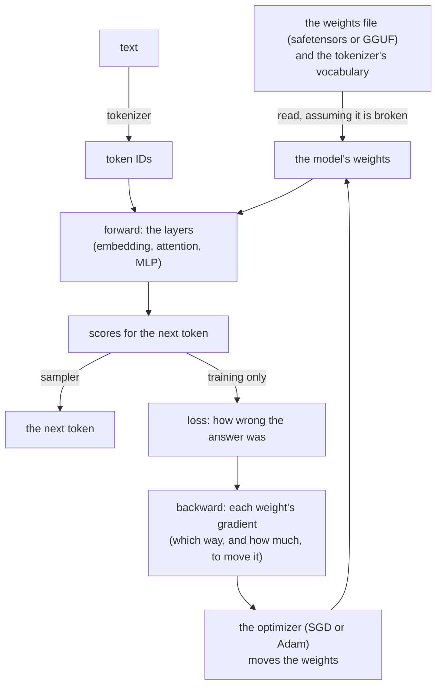
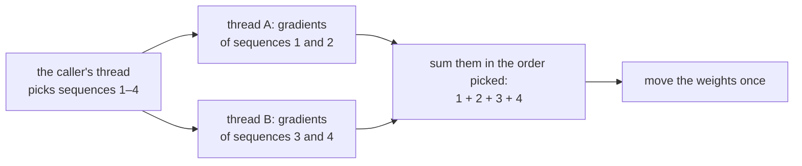

# The design decisions of ksai

`ksai` is a small neural-network engine in KSPL. It runs a model (inference) and can train one lightly, using nothing but the local machine. This document says **why it took this shape**. Each file's purpose is in [ksai](../README.md). "The idea" there explains the AI words for a reader new to them: tensor, weights, forward, backward, loss, optimizer and token.

The diagram shows the path data takes through ksai. Inference stops at the next token; training goes on from the scores and loops back to the weights.

## The caller picks the optimizer

The optimizer is the rule that moves the weights after each step. ksai offers two, SGD and Adam, and the caller chooses by calling a different function.

*SGD* (stochastic gradient descent) moves each weight a fixed step against its gradient. *Adam* also keeps a running state per weight, which adapts the step to each weight.

| Function | Works out the gradients | Moves the weights | Optimizer |
| :-- | :-- | :-- | :-- |
| `backward` / `backward_lora` | yes | yes | fixed to SGD |
| `backward_grads` / `backward_lora_grads` | yes | no; the caller passes the gradients to an `Updater` | SGD, or Adam ([`optim.kspl`](../optim.kspl)) |

**The applying versions are built on the `_grads` ones**, so the computation sits in one place.

A whole model moves through one `Updater` (SGD, or Adam with a state per weight). Each layer's `apply_grads` passes it that layer's weights with their gradients. **The list of a layer's weights stays in the layer's own `apply_grads`**, beside the `backward_grads` that fills them. So a weight added to a layer is added in one file (the reason "Each layer initializes its own weights" below gives for `init_uniform`).

* **Adam's states are paired with the weights by position.** The n-th weight a step passes keeps the n-th state. This needs no key, and holds while every step passes them in one order. A step passing another number of weights stops the run (`begin_step`), rather than let the states slide onto the wrong weights.
* **Every gradient is worked out before any weight moves.** No weight is read after its own update within one backward pass. So for SGD this is the same arithmetic as updating each layer as it is reached. The one exception is the embedding (the table turning a token into a row of numbers). There, a token met twice in a sequence takes the sum of its rows' gradients in one step, as Adam needs it.

## Threads split a batch, and give the same weights

**Training on several CPU threads gives exactly the same weights, byte for byte, as training on one.** `fim_coder train --batch=B` moves the weights by the sum of B sequences' gradients. **`--threads` only splits the batch**, so the thread count only changes the speed. The diagram shows one training step with a batch of four on two threads.

Each thread works out whole sequences' gradients on its own arena (a block of memory freed all at once), and only reads the weights (`grads_seq` in [`examples/llama_engine/model.kspl`](../examples/llama_engine/model.kspl)). The caller's thread picks the sequences, and their gradients are summed in the order picked (`accumulate`). So one thread and every CPU write the same bytes.

The table lists the other ways to split the work and why each is not taken.

| Not taken | Why |
| :-- | :-- |
| **Splitting each matrix product over threads** | At this model's size a matrix product is too small to share. A whole sequence is work enough to pay for a thread. So with several threads, `fim_coder train` holds products to one thread (`parallel.set_threads(1)`), and `make fim-model` holds OpenBLAS to one. Products split themselves only where they are large ("Products split their outputs over the cores" below) |
| **A batch per process, as PyTorch's `DistributedDataParallel` does** | It averages a batch per process, so the effective batch, and with it the result, moves with the number of processes. DeepSpeed spells the batch out as micro-batch × accumulation × processes to hold it still. Here **the batch belongs to the training, the thread count to the machine**, and the thread count never enters the arithmetic |
| **Averaging the gradients instead of summing** (PyTorch's default) | Summed, `--lr` (the learning rate, the step size) stays how far each sequence moves the weights, whatever the batch. Averaged, a batch of four at one sequence's step size moves the weights a quarter as far. It keeps pace only at four times that step. That is the linear scaling rule (Goyal et al.), which the user then applies by hand |
| **Hogwild!** (threads moving shared weights without a lock) | It is fast, but the result depends on how the threads happened to interleave, so no run could be repeated |

**A step's memory stays taken for the next** (`Arena.reset`). An arena wound back to empty returns its chunks to the OS. Taking them again page by page costs a large share of each step, more so with several threads sharing one address space.

## LoRA keeps the adapter apart from bundle reading and writing

LoRA (low-rank adaptation) fine-tunes a model by training small added matrices, called adapters, instead of the whole model. The adapter and the code that saves and loads it live in separate files.

The three tiers, the body / the format / the file, grow heavier in the order `lora` → `lora_set` → `model_file`.

| File | What it holds | What it brings in |
| :-- | :-- | :-- |
| [`lora.kspl`](../lora.kspl) | Only the adapter `Lora` | Nothing for formats |
| [`lora_set.kspl`](../lora_set.kspl) | The per-block bundle (`Qkv_lora` / `Mlp_lora`) and its safetensors layout | A `Safetensors` (the weights format) |
| [`model_file.kspl`](../model_file.kspl) | Loading and saving by file path | `std/io`, `std/fs` |

**The split follows what the signatures import.** Reading and writing the bundle takes a `Safetensors`. In one file, [`nn.kspl`](../nn.kspl), which uses only `Lora`, would bring the weight format and JSON parsing along. Split, `json` / `safetensors` / `bytes` / `strnum` drop out of the inference path.

**Do not move the code that takes a `Safetensors` into [`model_file.kspl`](../model_file.kspl)**, which imports `std/io` and `std/fs`. Bare metal is a chip with no operating system and no file system. It passes an `embed`ed byte sequence straight through `Safetensors.load_from_bytes` to `lora_set`. Requiring `std/io` there would close that path.

**`Lora.save_raw` / `load_raw` are the smallest format, for a place with no heap.** The safetensors path resolves names through `Str_builder` and so needs the global heap. A bare-metal probe that has only `Arena.from_buffer` cannot give it one. So one adapter goes out as raw bytes, and `load_raw` rebuilds it independently of the instance that saved it.

## The attention mechanisms are split by the head count

Ksai has two kinds of attention layer. One has a single head and can be trained; the other has several heads and only runs inference.

*Attention* is the layer that lets each token look at the tokens before it. A *head* is one independent copy of that look. A layer with several heads splits each row into parts and lets each head work on one part. *RoPE* (rotary position embedding) marks each token's position by rotating pairs of numbers in its row. *GQA* (grouped-query attention) lets several heads share one set of keys and values, to save memory.

[`nn.kspl`](../nn.kspl) holds two attention mechanisms, split by **the head count and whether they can be trained**.

| | Heads | RoPE | Backward pass |
| :-- | :-- | :-- | :-- |
| `Self_attention` | one | the whole row, in adjacent pairs | **yes** ([`attention_train.kspl`](../attention_train.kspl)) |
| `Gqa_attention` | split per head (GQA too) | per head's width, variable base (NeoX-style) | none (inference only) |

Caution: **Do not let `Self_attention` take a head count.** Nothing in it splits Q/K/V per head, so the count would be accepted yet have no effect (Principle 5). `n_heads=2` would change only the scale `1/sqrt(dim/n_heads)`, while the heads stay at one, unnoticed.

Nor is the per-head code copied into it: `Gqa_cache` already has it, for `Gqa_attention` and the Qwen model on GGUF weights alike. A copy would give one purpose two means (Principle 6).

**`dim` has to be even**, since RoPE rotates adjacent elements in pairs. An odd `dim` stops `new` on the spot. Unstopped, it would fail inside the first `forward`, with nothing there saying the dimension was odd.

## Each layer initializes its own weights

Before training, every layer fills its weights with small random values, through its own `init_uniform`. Weights that all start equal never learn different things.

`nn.*.new` defaults to the same value in every element (0.1 for `Linear`, 0.01 for `Embedding`). Training then sends the same gradient to every output unit. So **the units stay identical to the end while the loss still falls**, with nothing to notice it by.

Caution: **Do not enumerate the weight tensors one by one from outside.** A layer that gains a weight tells the enumerating code nothing, and the forgotten weight stays at the same value. The spreading is written in each layer's `init_uniform`, called once per layer.

**The normalization's weights are not spread** (they start training at 1.0).

**A test checks that `init_uniform` misses none of them** ([`tests/grad_test.kspl`](../tests/grad_test.kspl)). It checks only the weights listed there, so add a new weight to that list in the same commit (Principle 8).

## The weights' gradients are matched against numerical differentiation too

**A mistake in the backward pass (a wrong gradient) passes the tests and only makes training worse.** **So a test checks each weight's gradient against a slow but simple estimate.** A roughly right gradient still makes the loss fall, so a test watching the loss fall lets a wrong gradient through. [`tests/param_grad_test.kspl`](../tests/param_grad_test.kspl) matches each trained weight against a central difference.

A *central difference* estimates a gradient without the backward pass. It nudges one weight up a little, then down a little. It then divides the change in the loss by the size of the nudge. It is slow, but it is hard to get wrong.

* **The input's gradient (dX) alone is not enough.** dW (the weight's gradient) can be wrong on its own, and a 1% error in RMSNorm's dW passes the dX test and fails this one.
* **The analytic gradient is worked back from how SGD moved the weight** (`sgd_step` is `w -= lr*g`, so `g = (before - after)/lr`).
  * Caution: **Do not add a separate function that returns the gradient alone.** The path training uses would then split from the path the test checks, leaving the one in use unchecked.
* **Do not check with every weight at the same value.** `Linear.new` defaults to 0.1 everywhere, and there even a gradient with rows and columns swapped matches.
* Other frameworks do the same: PyTorch's `gradcheck` and ggml's `test-grad0` both check weights too.

## The matrix backend is chosen where it is deployed

**Matrix multiplication (`matmul`) is plain KSPL by default, and OpenBLAS (a fast C library for matrix math) only on request** (`make BLAS=1`, or `--define=blas`). Through OpenBLAS it comes within a few percent of C calling the same library. Pure KSPL is about an order of magnitude slower. The measurement, and the command that repeats it, are in [`ksai/benches/README.md`](../benches/README.md). Pick by where the program runs.

| Where it runs | Backend | Why |
| :-- | :-- | :-- |
| **At the edge, embedded, and in short-lived jobs** | Pure KSPL | It has zero dependencies, a much shorter start-up, and a fraction of the memory and of the size to distribute. The code around the kernel (tokenizing, preprocessing, control) is compiled rather than interpreted either way |
| **On servers and in large-scale training** | OpenBLAS | It is the same gemm (general matrix multiply) a C program would call, called from compiled code |

## The kernels are spelt for the auto-vectorizer, not with intrinsics

The inner loops are written so that the C compiler turns them into SIMD code by itself. No CPU-specific instructions are written by hand.

*SIMD* means one CPU instruction working on several numbers at once. An *intrinsic* is a function that names one such instruction for one CPU family. The *auto-vectorizer* is the part of the C compiler (Clang at `-O3`) that turns an ordinary loop into SIMD code when it can.

The default `matmul_cols` in [`tensor.kspl`](../tensor.kspl) holds no hand-written SIMD intrinsic. Clang's `-O3` auto-vectorizes a cache-efficient i-k-j loop, so it needs no particular instruction set and checks correctly on any target.

`make test-simd` checks that these loops stay vectorized:

* `matmul_cols`'s inner loop;
* the hot loops of `add_bias` / `rmsnorm` / `softmax` / `silu` in [`tensor.kspl`](../tensor.kspl);
* `Gqa_cache.attend`'s exponentials and its attn@V gathering, in [`nn.kspl`](../nn.kspl);
* the integer products, the rounding of their inputs and the integer forms of the K blocks, in
  [`quant.kspl`](../quant.kspl).

Each loop it checks carries a comment naming it on the line before. Each is checked at its own place in the optimization record. So a function whose other loop vectorizes does not pass for it.

**A loop of 32 is vectorized whole, not as a loop.** The C compiler unrolls it and turns its sum into vector code (the SLP vectorizer), which the loop vectorizer's record does not show. A comment saying "sees this sum vectorize" makes the gate look for that sum in the SLP vectorizer's record instead.

A loop reaches the vectorizer only through one of two techniques.

1. **Swap the loop nesting alone, keeping the order of the additions into each output element.** It then accumulates each element in parallel rather than by a horizontal sum (adding the lanes of one vector together). The result is unchanged bit for bit (as in `grad_matmul_weight_into`).
2. **Replace a division inside the loop with one reciprocal computed outside it and a multiplication** (division has lower per-lane throughput).

Caution: **`-ffast-math` is not used**, since accuracy comes first. Without it, auto-vectorization cannot reach a horizontal sum over a single accumulator, or any loop with `exp` / `sin` / `cos` / `sqrt`, unless one technique applies (`-Rpass-analysis=loop-vectorize` says why).

**One shape fits neither technique**: where the inner product runs along both rows (C = A·Bᵀ: `matmul_transb`, and `grad_matmul_input_into`'s dY·Wᵀ). Making it fit would need a transposed copy, and that copy would allocate in an `_into` (a function that writes into memory the caller gave). So `transb_kernel` in [`tensor.kspl`](../tensor.kspl) **sums four outputs side by side**. One running sum waits on its last addition at every step, but four independent ones overlap. Each still adds in ascending order, so the result is unchanged bit for bit. Under `cfg(blas)` it is `gemm` with B transposed, as `matmul_kernel` is.

**An F32 dot product keeps several sums side by side.** A float weight's product keeps 16 (`dot_lanes` in [`quant.kspl`](../quant.kspl)). A query's product with a key keeps 8 (`dot_lanes` in [`nn.kspl`](../nn.kspl)). Number `i` goes to sum `i % 16` (or `i % 8`), and the sums are added in order at the end. The order is fixed, so the result does not depend on the thread count. The C compiler makes vector code of it by packing the sums into registers, not by vectorizing the loop.

**The integer products sum 16-bit whole numbers in groups of 32, exactly in 32 bits** (`dot_block` and `dot_ints` in [`quant.kspl`](../quant.kspl)). Integer addition gives the same result in any order, so the C compiler vectorizes the sums without `-ffast-math`. Each group becomes four `pmaddwd` instructions, each multiplying eight pairs of 16-bit numbers and adding them in pairs.

* **The two functions stay out of their callers** (`#noinline`). Inlined into the product's loops, the groups were unrolled first and left as scalar code, about three times slower.
* **A Q6_K block's 6-bit numbers are put together in bytes, and widened only then.** Built in 32-bit numbers, as C promotes them, the loop handled few numbers at a time and ran about three times slower.
* **A loop over a Q3_K or Q6_K block fills four groups at once.** Each byte holds bits of four numbers, one in each group. A loop of 16 that filled one group was unrolled whole and left out of the vectorizer.
* **What the auto-vectorizer does not reach.** Clang 18 makes the 128-bit `pmaddwd` from these loops, eight multiply-adds an instruction, even for a CPU with AVX2 or AVX-512. It forms neither the 256-bit `vpmaddwd`, nor AVX2's `vpmaddubsw` (32 multiply-adds), nor AVX-512 VNNI's `vpdpbusd` (64). llama.cpp writes those by hand. That gap is most of the difference left in reading a prompt (the ksai section of [`docs/PLAN.md`](../../docs/PLAN.md)).

**The exponential of an F32 is KSPL code** (`exp_f32` in [`tensor.kspl`](../tensor.kspl)). `math.exp` calls the C library on an F64, and no loop that calls it can be vectorized. `exp_f32` follows ggml's `ggml_v_expf`, which llama.cpp's SiLU and softmax use, within 2 units in the last place. Each product and sum is its own statement, so no compiler fuses two roundings into one. SiLU and the attention's softmax use it for F32 tensors, and keep `math.exp` for F64 ones.

## Weights stay in GGUF's formats

**A quantized weight matrix (`Quant_matrix` in [`quant.kspl`](../quant.kspl)) holds GGUF's bytes exactly as GGUF stores them.** GGUF is llama.cpp's file format, and most models are shared in it. Each format is a block of 32 or 256 numbers with one scale, or with a scale per group inside the block. The layouts are ggml's `block_q5_0` and `block_q8_0`, the K blocks `block_q3_K` to `block_q6_K`, and rows of F32, F16 and BF16.

* **Why GGUF's own layouts**: a tensor read from a GGUF file is then used as it stands. A layout of ksai's own would need a conversion at every load, and a second file format to keep in step.
* **Why no full F32 copy**: a 9B model takes about 36 GB as F32 and about 6 GB as 4-bit numbers. A product that expanded the matrix to F32 first would need the 36 GB again. So `mul_mat` turns one block at a time into numbers in a buffer on the stack, and multiplies it with the inputs at once.
* **Why Q5_0 too**: llama.cpp's Q4_K_M mix needs rows that are a multiple of 256. Where a row is shorter, as the 896 numbers of a 0.5B Qwen model, the file holds Q5_0 and Q8_0 instead.

**Decoding gives the reference's numbers bit for bit.** Each block decoder follows ggml's `dequantize_row_*`, product by product. A product and a subtraction stay in separate statements. In one C expression, `a * b - c` can be fused into one rounding, and then the bits would depend on the machine. The tests compare every format with llama.cpp's Python package `gguf` ([`tests/quant_test.kspl`](../tests/quant_test.kspl)). Random blocks reach every bit of the packed scales, and the reference files are committed, so the tests need no Python.

**A product rounds each input row to 8 bits, then multiplies whole numbers, as llama.cpp's CPU backend does.** A weight's numbers are small whole numbers times a scale. With the inputs whole numbers too, a block's product is a sum of whole numbers, exact in 32 bits. The two blocks' scales multiply it once.

* **Why**: it runs several times faster than decoding each block to F32. And llama.cpp computes the same numbers, which the comparison with it needs ("One model for the Qwen families, from a GGUF file" below).
* **A K format's inputs become Q8_K blocks**: 256 numbers with an F32 scale, the number of largest size becoming -127 (ggml's `quantize_row_q8_K`).
* **Q8_0's and Q5_0's inputs become Q8_0 blocks** of 32 with an F16 scale. They are rounded as the CPU backend rounds them on x86: `x × 127 / max`, with halves to even. The reference quantizer that makes Q8_0 weights multiplies by `1 / d` and rounds halves away from 0. llama.cpp uses each in its own place, and so does ksai.
* **F32, F16 and BF16 weights keep F32 inputs**, through the 16-lane dot product above.
* **Each weight block becomes 16-bit whole numbers once**, with its group's integer scale folded in, at most 4096 in size. The mins of Q4_K and Q5_K stay apart and multiply the input's sums over each group. Four weight rows go together, so an input block is read once for the four.
* **Each output adds its blocks' parts in ascending order, in F32.** Each product and sum is its own statement. So neither the thread count nor the batch changes a bit, and one input row gives the same bits alone and in a batch.

**The tests hold the products to four references** ([`tests/quant_test.kspl`](../tests/quant_test.kspl)). The files come from llama.cpp's own C library, through its Python package (`tools/ai_assist/make_quant_fixtures.py`), so the tests need no Python.

| Reference | How close |
| :-- | :-- |
| llama.cpp's rounding of the same inputs | The same bytes: every scale, number and sum, ties included |
| A plain sum of the same whole numbers, each read straight from its block | The same bits |
| llama.cpp's `vec_dot` functions on the same blocks | Within 1e-5 of the sum of the products' sizes; only the order of F32 sums differs |
| The F32 product of the decoded weights with the unrounded inputs | Within 0.6 of an input step times the sum of the weights' sizes, the rounding's own bound |

**The quantizers follow llama.cpp's reference quantizers** (`quantize_row_q8_0_ref` and `quantize_row_q4_K_ref`), in [`quantize.kspl`](../quantize.kspl). So weights that ksai quantizes are the weights llama.cpp writes when no importance matrix is given. Q8_0's bytes equal the reference's in the tests. `gguf` has no Q4_K quantizer, so the test holds each number within one step of its group instead.

* **They live apart from the decoding**, since a program that only runs a model never quantizes.
* **Only Q8_0 and Q4_K have one.** Converting a model needs those two; a GGUF file brings the others already made.

**Quantized weights serve a model that would not fit in memory as F32**, such as a 7B to 9B model on an ordinary machine. A matrix that expanded itself back to F32 before each product would save nothing. So there is no such matrix, and no format of ksai's own beside GGUF's.

## Products split their outputs over the cores

**A large product splits its outputs over a pool of threads, and any thread count gives the same bits as one** ([`parallel.kspl`](../parallel.kspl)). `Quant_matrix.mul_mat` splits the weight's rows, and `Tensor.matmul` the result's columns.

* **One thread computes each output whole**, with the same code and in the same order of additions as on one thread. Threads change which output is computed when, never how. So results can be compared across machines, and a test compares one thread with four bit for bit.
* **The attention splits the key heads.** Each thread takes a key head with the query heads that share it. So each row of the cache is read once for all of them.
* **The pool starts on the first product that pays for it, and keeps a thread per CPU but the caller's.** The caller computes a share too. Each thread takes pieces of a few outputs as it finishes, so one slow thread holds up the end by one piece only.
* **A small product stays on the caller's thread.** Waking a thread costs a few microseconds. A product is split only where each thread gets about a tenth of a millisecond of work (`WORK_PER_THREAD`).
* **The threads look for the next round for about a tenth of a millisecond before they sleep** (`SPIN`). A model asks for one product after another, a few microseconds apart. Waking a sleeping thread and waiting for it took about 55 microseconds a product; spinning, a split takes about 9. A program with no work for longer sleeps, so it takes no CPU while it waits.
* **A second caller while the pool is busy computes alone.** It gets the same result, a little later. So two threads that each run a model never wait on each other.
* **A freestanding build has no threads**, so its products always run on the caller's thread. `set_threads` does not exist there.
* **`parallel.set_threads(n)` caps the threads one product uses.** A program whose own threads already keep every CPU busy sets 1. Threads beyond the CPUs would only take turns.

The race gate runs ksai's unit tests, so the pool runs under ThreadSanitizer there.

## The tokenizer gives llama.cpp's tokens

**A model reads well only the token IDs it was trained on.** One text can be written as several ID sequences that decode to the same bytes. The model saw one of them in training and answers worse on the others. So `encode` must give the IDs the model's own tokenizer gives. The measure is llama.cpp, which runs the same GGUF files.

**The text is split into chunks first, and no merge crosses a chunk.** Each kind of chunk, in the order Qwen's rule tries them (`tokenizer.ggml.pre = "qwen2"`, the same for Qwen2.5 and Qwen3):

| Chunk | Examples |
| :-- | :-- |
| An English contraction, in any case | `'s`, `'RE`, `'ll` |
| Letters, with at most one leading code point that is not a letter, a digit or a newline | ` hello`, `_case`, `(a`, `KSPLは簡素` |
| One digit, in any script | `1`, `１`, `Ⅻ` |
| Other code points, with at most one leading space and the newlines after them | ` +=`, `.\n\n`, `。」\n` |
| White space up to its last newline | `\n\n`, `  \n  \n` |
| White space before a non-space, without its last code point | the `  ` of `a   b` |

**Qwen3.5's rule (`qwen35`) differs in the marks alone.** A combining mark, such as an accent written after its letter or a Devanagari vowel sign, joins the letter run it stands in. Qwen2's rule reads it as punctuation, so a word with marks splits there.

* **The GGUF file names its rule**, and the server sets it on the tokenizer (`Tokenizer.set_split`, `Split_rule.named`). A file that names another rule is refused, since its chunks would not be the ones its vocabulary was made from.
* **A vocabulary of `train_bpe.kspl` is split by Qwen2's rule**, the default, both when it is trained and when it encodes. A merge learnt across a boundary that encoding keeps would never apply.

**The letter, mark, number and white-space classes are llama.cpp's own.** Which code points are letters changes with the Unicode version. White space is a list llama.cpp keeps itself, with U+0085 and U+3000 in it. So `ksai/unicode_class.kspl` is generated from llama.cpp's `unicode-data.cpp`, never from another library's Unicode data. A table of code point ranges keeps it at 1,921 numbers. The classes stay inside ksai, because nothing in `std/` reads Unicode categories.

**The rule is written out by hand, not as a regular expression**, as llama.cpp writes it. That keeps llama.cpp's reading in its corners. A lone space at the text's end is a chunk of its own. A byte that starts no valid UTF-8 code point is read as U+FFFD. llama.cpp then writes U+FFFD's bytes in place of the byte, but ksai keeps the byte. So `decode` gives back any input, and only text that is not UTF-8 encodes differently.

**Markers are matched as llama.cpp matches them.** A GGUF vocabulary marks control tokens (type 3, such as `<|im_end|>`) and user-defined ones (type 4, such as `<think>` and `<tool_call>`). A user-defined marker's text becomes its ID wherever it appears, before the split. The chat template writes these markers as text, and the model learnt their single IDs. A control token is never matched in text: a server puts its ID into the sequence itself. A user's message that holds `<|im_end|>` then stays plain text.

**The merging is llama.cpp's too.** A GGUF word is written in GPT-2's mapping, which shows each byte as one printable character. `load_lists` maps each word back to its bytes, so the merging works on raw bytes. Each chunk starts as one ID per byte, and the pair of the lowest rank merges first, the leftmost on a tie. A pair listed twice keeps its first rank. A merge rule whose result is not a word is refused when it loads. So a chunk never ends as a word the vocabulary lacks, and no fall-back to bytes is needed. A byte the vocabulary lacks is `UNK_ID`, but a byte-level vocabulary holds all 256.

**A merge rule's key is hashed from both IDs mixed.** An XOR of the two IDs stays below the vocabulary's size and gives (a, b) and (b, a) one bucket. With Qwen's 151,387 merge rules, the lookups then crowd into long probe runs.

## A GGUF file is read once and used in place

**`model_file.load_gguf` reads the whole file with one read, into one block of the caller's arena.** `Gguf.parse` in [`gguf.kspl`](../gguf.kspl) then indexes it, and every tensor stays where it lies in those bytes.

* **The peak memory is the file's size**, plus the lists of keys and tensors: a few MB for a vocabulary of 150 000 tokens. Reading onto the heap and copying into the arena would hold the file twice at the peak.
* **No weight is copied.** A matrix is a `Quant_matrix` over its bytes. A norm's weights are a `Tensor` that borrows them, copied only where they are not aligned to 4 bytes.
* **The file is read, not mapped.** `std` has no memory map, and one read works the same on every system. A model also reads every weight for each token, so a mapped file would be in memory as a whole anyway.

**Every number the file claims about itself is checked before it is used.** It is a byte sequence from outside ("A byte sequence from outside is assumed to be broken" below). A refusal names the part at fault (`Gguf_error`).

| What the file claims | The check |
| :-- | :-- |
| The magic and the version | `GGUF`, and version 2 or 3, which share this layout |
| The counts of keys and tensors | Each is at most the bytes left divided by the smallest entry's size |
| A string's length, an array's length | Inside the bytes left, compared before it is converted to `Sz` |
| A value's type | One of GGUF's 13 types. An array of arrays is refused; no model file holds one |
| A key's or a tensor's name | Not given twice |
| `general.alignment` | A power of two, held as a U32 |
| A tensor's shape | 1 to 4 dimensions, each at most the file's size. The first is a whole number of blocks, and the size in bytes is multiplied with an overflow check |
| A tensor's format | One that `quant.kspl` decodes |
| A tensor's offset | It starts where the tensor before it ends, padded to the alignment, and ends inside the file. So no two tensors share a byte |

The tests build broken files field by field, so each test breaks one claim ([`tests/gguf_test.kspl`](../tests/gguf_test.kspl)). The fuzz check reads each broken file, decodes every tensor whole, builds the vocabulary and runs the model on two tokens ([`tests/read_prog.kspl`](../tests/read_prog.kspl)). Its seed is the tiny model in [`tests/qwen_data/`](../tests/qwen_data/), which llama.cpp's own writer made.

## One model for the Qwen families, from a GGUF file

**[`qwen.kspl`](../qwen.kspl) runs the three families from their GGUF files.** They share the blocks' frame, and `FAMILIES` names what differs in one place:

| Part | Qwen2 (`qwen2`) | Qwen3 (`qwen3`) | Qwen3.5 (`qwen35`) |
| :-- | :-- | :-- | :-- |
| A bias on the queries, keys and values | Yes (`attn_q.bias`) | No | No |
| An RMS norm of each query and key head, before RoPE | No | Yes (`attn_q_norm`) | Yes |
| A gate per query head on the attention's output | No | No | Yes: the query weight writes it beside each head |
| Blocks that keep a running state instead of attending | No | No | Three of every four (`full_attention_interval`) |
| The name of the feed-forward part's norm | `ffn_norm` | `ffn_norm` | `post_attention_norm` |
| RoPE's sections for images and video | No | No | Read, and checked to turn text as plain RoPE does |

The rest is the same: grouped-query attention, RoPE of the NeoX kind with the file's base, SwiGLU and RMS norms. The output is the embedding where `output.weight` is absent. The settings come from the file's `<arch>.*` keys.

* **Why one file for all three**: the frame of a block is the same, so three models would hold it three times. A family that differs in one more part adds a column to `FAMILIES`. The delta net is the one large part of its own, so it has its own file ("Qwen3.5's linear layers keep a state" below).
* **RoPE can turn part of a head.** Qwen3.5 turns 64 of each head's 256 numbers (`rope.dimension_count`), and leaves the rest as they are.
* **RoPE's sections change nothing for text.** Qwen3.5's file divides RoPE's pairs among a time, a height and a width position, for images and video (`rope.dimension_sections`). A text token sets all three to its position, so the rotation is the plain one. llama.cpp gives a fourth position, always 0 for text, to any pair the sections leave over. A file whose sections leave a pair over is refused, since that pair would not turn.
* **Why it is in the package, not in an example**: the chat server, `benches/bench_qwen.kspl`, the tests and the fuzz check all run it.
* **Every tensor's shape is checked against the settings, and every tensor must be read.** A tensor left unread means a layer not computed, so the answers would be another model's (`Qwen_error.unread`).
* **The keys and values go to `nn.Gqa_cache`**, which `nn.Gqa_attention` uses too. The attention is written once, for weights of every kind.

**A prompt is read many tokens at a time.** A product turns each block into whole numbers once for all the tokens it multiplies. So a piece of 64 tokens costs far less than 64 single tokens. **The scores after a token are the same bits however the prompt was cut into pieces.** Each output is summed in a fixed order, and each query row attends only to its own past. The tests compare one call, two pieces and twelve single tokens bit for bit ([`tests/qwen_test.kspl`](../tests/qwen_test.kspl)).

**Each block's working tensors are freed before the next block** (`Arena.restore` in `Qwen.forward`). A block then reuses the memory the block before it used, still in the cache. Without it, a piece of 64 prompt tokens took hundreds of megabytes of fresh memory, and every page faulted in again. The last block's tensors stay until the caller resets the step arena, so the reset keeps one chunk as large as a block needs.

**The reference is llama.cpp, run on the same file.** Both round each product's inputs to 8 bits. The RMS norm, RoPE's angles and the softmax's sum also round as llama.cpp's CPU backend does. **The two sides' scores still never agree exactly**, and no implementation that differs in a single bit can make them agree:

* **Rounding to 8 bits makes the last bit matter.** A difference of one unit in an activation can move a number to the next whole step, and the step grows through 36 blocks.
* **llama.cpp shows the same against itself.** After a prompt of 29 tokens, read in one batch and token by token, its own scores differ by up to 1.15. ksai's differ from llama.cpp's by about half that.
* **So where the two top scores lie far apart, the greedy tokens agree; near a tie they can part.** `tools/ai_assist/qwen_gguf_check.py` measures both on a real model, with llama.cpp against itself beside them.

The tiny model's scores are checked against an F64 computation of the same graph, with each product's input rounded as llama.cpp rounds it. llama.cpp's own scores for that model agree with it within 2e-6.

## Qwen3.5's linear layers keep a state

**Three of every four Qwen3.5 blocks are gated delta nets** ([`delta_net.kspl`](../delta_net.kspl)). Such a block keeps no keys and values of past tokens. It keeps a square of 128 × 128 numbers per value head, and the last three inputs of a short convolution. Each token decays the square, writes its value into it under its key, and reads it with its query. The steps are llama.cpp's `qwen35` graph and its fused `gated_delta_net`, which its CPU backend runs.

* **A token costs the same at every position**, so only the attention blocks' cache grows with the conversation. For Qwen3.5-9B, 8 of its 32 blocks attend: the cache takes 64 KiB a token, a quarter of what 32 attending blocks would take. Each delta-net block's state takes about 2.1 MiB, whatever the length.
* **Value head `h` reads query and key head `h mod 16`**, as llama.cpp pairs the 32 value heads with the 16 key heads.
* **The square is updated one row at a time.** A row's decay, its read with the key, its write and its read with the query touch that row alone. So one pass over the square per token gives llama.cpp's numbers, and the value heads are split over the cores.
* **A prompt is read token by token through the delta nets**, as llama.cpp's CPU backend reads it. Its other steps are matrix products, which read the prompt many tokens at a time as in Qwen3. The recurrence takes no share of the time that can be measured: with it left out, reading a prompt and generating run equally fast. So the chunked form, which llama.cpp keeps for other backends, would buy nothing here.
* **The convolution's weights are turned once, when the model loads**, so its loop reads each position's channels in order and runs on vectors. They are 128 KiB a block, the only weights copied.

**The state follows one run of tokens and cannot be rewound.** The keys and values sit in the cache one row per position, so going back means writing over the rows past that point. The state holds no positions, so it cannot go back at all.

* **So `Qwen.forward` reads on only from where the state stands.** Position 0 starts the state afresh; any other position must be the number of tokens the state follows, or the call stops.
* **`Qwen_state` copies the whole state, and puts it back** (`save_state`, `restore_state`). A copy made after N tokens is good while the cache still holds those N rows. The chat server keeps such copies to reuse the start of a conversation ("The cache is kept across requests" in [`DESIGN-serving.md`](DESIGN-serving.md)).

The tests run a tiny Qwen3.5 model of two delta nets and two gated attention blocks against an F64 computation of the same graph ([`tests/qwen_test.kspl`](../tests/qwen_test.kspl)). llama.cpp's own scores for that model agree with the computation within 1e-6. They also restore a copied state after other tokens and compare the scores with one run, bit for bit.

**`qwen_infer` keeps its own Qwen2.5 model on 32-bit weights**, read from the safetensors that `export_qwen_to_kspl.py` writes. Its LoRA adapters attach to `nn.Gqa_attention`, and the coding assistant's plan uses them ("tools" in [`docs/PLAN.md`](../../docs/PLAN.md)).

## A build for the machine's own CPU is asked for

**`make chat-server NATIVE=1` builds the AI programs for the CPU of the machine that builds them** (`-march=native`). The default build runs on every CPU of its architecture. The programs are `chat-server`, `qwen`, `run` and `fim-model`.

* **Why it is asked for**: a program built for one CPU stops with "illegal instruction" on a CPU that lacks one of those instructions. CI, and a program copied to another machine, keep the default.
* **What it gives**: the C compiler can use every instruction the CPU has, such as AVX2 on most x86-64 CPUs since 2013. The measurement is in [`ksai/benches/README.md`](../benches/README.md).
* **The numbers**: the integer products give the same numbers in both builds. The F32 steps can differ in their last bit. Where the CPU has the instruction, the C compiler fuses a multiplication and an addition into one rounding.

## What a call returns goes on the caller's arena

**A tokenizer and a set of adapters live as long as the program, so whatever a call leaves on their arena is never freed.** A server keeps one tokenizer for its lifetime. Suppose an `encode` put its result, or its working memory, on the tokenizer's own arena. It would grow that arena with every request, by about the size of the text.

| What | Where it goes | Why |
| :-- | :-- | :-- |
| `encode`'s IDs and `decode`'s text | The arena the caller passes | The caller knows when it is done with them, and frees or resets that arena |
| `decode_one`'s text | Nowhere: it is the vocabulary's own bytes | Printing each generated token allocates nothing |
| A chunk's merging | The end of the list `encode` returns, merged in place | No working memory outlives the call |
| The cache of merged chunks | The tokenizer's arena, up to `chunk_cache_cap` chunks | A text repeats its words, and the cap bounds an endless stream of new ones |
| An adapter file's bytes (`load_qkv_lora_set` in [`model_file.kspl`](../model_file.kspl)) | The caller's required arena | All views share one file copy and are released together |

**The result is not written into a buffer of the caller's fixed size.** How many IDs a text becomes is known only after merging, so a buffer that is too short means encoding the whole text again. An arena grows as the result does, and freeing it is one call.

## Tensors and weights share an explicit arena lifetime

**Tensor and adapter allocation requires a non-null arena.** The caller releases or resets that arena after all views are finished. There is no per-tensor `free`, heap fallback or ownership flag; even an empty result follows the same rule. A failed partial load leaves its allocations on the caller's arena until that arena is released.

| Result | Shape | Elements |
| :-- | :-- | :-- |
| `Tensor.new` | arena | arena |
| `view_rows` | arena | borrowed from the source tensor |
| `Safetensors.get_tensor`, aligned bytes | arena | borrowed from the file |
| `Safetensors.get_tensor`, misaligned bytes | arena | an aligned copy on the arena |
| `Quant_matrix.from_bytes` | none: a value | borrowed from the caller's bytes |
| `Quant_matrix.quantize` | none: a value | on the arena passed |

**Constructors control allocation details.** A tensor's arena and a parsed weights file's representation are not public fields. Public callers use constructors instead of fabricating these descriptors. Tensor elements remain accessible for numerical kernels. Copying a view does not extend the arena or file's lifetime.

**A parsed header lives on the supplied arena.** `metadata()` returns its JSON value; no separate JSON owner is needed. `load_from_bytes` borrows the caller's file bytes, while `model_file.load_safetensors` reads the file straight into the arena, so the file is held once and never on the heap. A model needs no extra file-owner field to keep its weights alive.

**Replacement checks precede assignment.** `map_into` leaves the destination intact when the shape differs. Adapter errors carry stable labels (`q`, `v`, `fc1`, `fc2`) that survive temporary lookup strings. **An adapter read from a file must fit its base layer.** `load_set_from` takes each base layer's widths (`Lora_widths`). It refuses an A or B that does not match with `shape_mismatch(label)`. Otherwise an adapter for another model would stop the first forward pass on a matrix mismatch. That mismatch names neither the adapter nor the file. Lifetime tests exercise empty values, borrowed and copied weights, refused reads, replacement and incomplete adapter sets; freeing the arena releases their storage together.

## A byte sequence from outside is assumed to be broken

Ksai checks every number a weights file or a vocabulary claims about itself, because someone else wrote that file.

`ksai` receives three things from outside: a weights file (safetensors), a model file (GGUF) and the tokenizer's vocabulary. It chooses the writer of none of them (a checkpoint someone passed on, a model another tool converted, a vocabulary another tool made). The GGUF reader's checks are in "A GGUF file is read once and used in place" above.

**The weights file is the more dangerous.** Its header names its own length and each tensor's range, and trusting those reads out of bounds. `get_tensor` in [`safetensors.kspl`](../safetensors.kspl) returns a view onto the raw bytes, so no error comes until an element is read. By then garbled numbers are in use as weights. So the range checks are layered:

| Layer | What it checks |
| :-- | :-- |
| 1 | The dtype's width (how many bytes one element takes) |
| 2 | `data_offsets`' start and end |
| 3 | `shape`'s element count |
| 4 | That count's cap |

Caution: **Keep the layers so that taking one out leaves the others to catch it.** Feeding in broken inputs (fuzzing) confirms it.

**The shape is allocated only after validation.** A temporary JSON list supplies the dimensions for the bounded reverse product; a second walk converts them directly into the final shape. No owned shape exists on a refused path, and no second integer list is needed. The reverse order makes a trailing zero dimension empty the product before large dimensions are multiplied.

**The fuzzing check is [`../tests/fuzz_main.kspl`](../tests/fuzz_main.kspl)** (`make test-fuzz`). `Safetensors_writer` writes its seeds (the valid files the fuzzer starts from and breaks) on the spot. Sample files would leave the seeds stale the day the format's spelling changes.

**Build what is fuzzed with the sanitizer (ASan) on.** ASan (AddressSanitizer) is a compiler option that stops a program the moment it reads memory that it has no right to read. Built plain, a read past the bounds inside the same allocation or page does nothing and returns 0. So the breakage most worth finding is the least visible. With the sanitizer, the read stops one byte over, at a reported `.kspl` line.

**Make it mandatory on Linux** (`KANSO_REQUIRE_ASAN=1`, which the repository sets on Linux for every fuzzed reader). The devcontainer holds the tool, so its absence means it dropped out of the image, not an environment gap.

**Fuzzing alone is still not enough.**

* The sanitizer watches the allocation's edges, not the header's named range. So reading a neighbouring tensor inside the same allocation is valid memory access and does not stop.
* A random single-byte flip almost never produces a wrong range (a few hundred to one against).

**So the known invariants are built by hand and tested directly** ("refusing a weight whose named range is wrong" in [`tests/tensor_test.kspl`](../tests/tensor_test.kspl)). Fuzzing hunts unknown breakage and does not replace this (Principle 8).

## The car's policy: learned from rules, kept as one file

`examples/car_pilot` trains a net of 394 weights from written rules (`rule_action` in [`../examples/car_pilot/policy.kspl`](../examples/car_pilot/policy.kspl)) and writes it to one file. A small car reads that file once and then decides every manoeuvre itself.

* **Why a net**: the rules as written would need no net. The net is not cleverer than the rules. It shows that a function learned on a PC runs inside a car's control loop.
* Caution: **Do not make the rules a fallback at run time.** Overriding a disagreement with them makes the net an ornament and the agreement rate meaningless. The rules are only the teacher and the answer key.
* **Measure the agreement rate by stepping through the whole range, not by random samples.** Disagreements gather within a few tens of mm past the boundaries (150mm and 400mm). As many random samples as training used can show "100%" without touching that band.
* **The agreement rate and the refusal at close range are tested together** ([`../tests/examples_car.kspl`](../tests/examples_car.kspl)). The test needs 95% agreement or more, and no forward motion at an unmeasured distance or at very close range. The rate alone is not enough: a change that lowers it must still not tip toward danger.
* **The battery is not an input.** Stopping on a flat battery is the car's own decision, as are backing off at very close range and the other safety stops.

**Training runs offline, and the file is what is kept.** A trainer run at each start of a server made that start wait. Also, the copy the car carried could drift from the one trained again. With one kept file, the car drives on exactly what was tested.

**The file holds more than the weights: also how the inputs are made (`far_mm`), the manoeuvre table and the format's version.**

* **Why all of it**: with the weights alone, the reader keeps its own copy of the input encoding and of the manoeuvres' meaning. A copy cannot notice when the trainer's code is fixed.
* **Why safetensors**: it is ksai's one format for named tensors ([`../safetensors.kspl`](../safetensors.kspl)), with a reader and a writer in place.
* **Why it is not quantized** (stored as smaller, less exact numbers): the weights are about a kilobyte even as F32. Storing them as int8 would save about three quarters of that, but the reader's answers would drift from the trainer's. As F32, "the same observation gives the same manoeuvre" can be tested.
* **What tests it: a policy rebuilt from the file alone gives the trainer's manoeuvre at every point** ([`../tests/car_pilot_blob.kspl`](../tests/car_pilot_blob.kspl) reads it with no constant of the trainer's). The trainer computes in F32 and the checker in double precision. So points where the top two logits nearly tie are not judged, and a cap limits how many there can be.
* **Do not forget to raise the version (`__metadata__.kspl_pilot`).** The input order, the activation and the manoeuvre table's meaning cannot be told from a tensor's shape. Left unraised, an old reader applies new weights the old way and goes wrong with no error.

## Further reading

* [ksai](../README.md) — each file's purpose and how to use it.
* [`../../docs/DESIGN-principles.md`](../../docs/DESIGN-principles.md) — Kanso's Development Principles as a whole, and the grounds for the language design.
