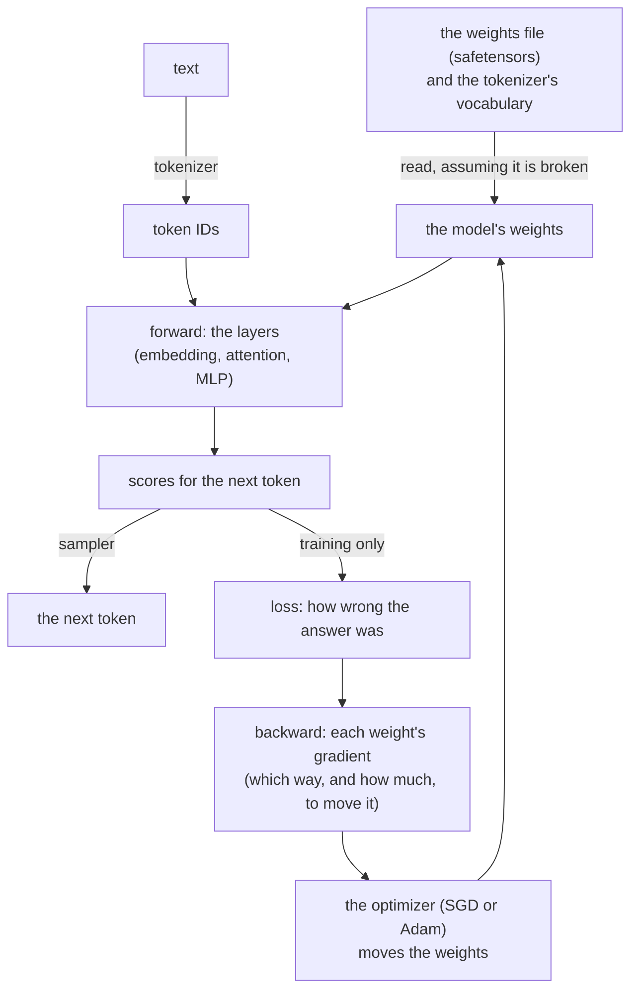
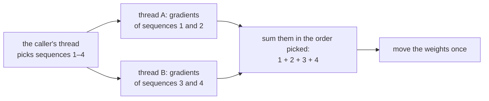

# The design decisions of ksai

`ksai` is a small neural-network engine in KSPL. It runs a model (inference) and can train one lightly, using nothing but the local machine. This document says **why it took this shape**. Each file's purpose is in [ksai](../README.md), and "The idea" there explains the AI words (tensor, weights, forward, backward, loss, optimizer, token) for a reader new to them.

The diagram shows the path data takes through ksai. Inference stops at the next token; training goes on from the scores and loops back to the weights.

## The caller picks the optimizer

The optimizer is the rule that moves the weights after each step. ksai offers two, SGD and Adam, and the caller chooses by calling a different function.

*SGD* (stochastic gradient descent) moves each weight a fixed step against its gradient. *Adam* also keeps a running state per weight, which adapts the step to each weight.

| Function | Works out the gradients | Moves the weights | Optimizer |
| :-- | :-- | :-- | :-- |
| `backward` / `backward_lora` | yes | yes | fixed to SGD |
| `backward_grads` / `backward_lora_grads` | yes | no; the caller passes the gradients to an `Updater` | SGD, or Adam ([`optim.kspls`](../optim.kspls)) |

**The applying versions are built on the `_grads` ones**, so the computation sits in one place.

A whole model moves through one `Updater` (SGD, or Adam with a state per weight). Each layer's `apply_grads` passes it that layer's weights with their gradients. **The list of a layer's weights stays in the layer's own `apply_grads`**, beside the `backward_grads` that fills them. So a weight added to a layer is added in one file (the reason "Each layer initializes its own weights" below gives for `init_uniform`).

* **Adam's states are paired with the weights by position.** The n-th weight a step passes keeps the n-th state. This needs no key, and holds while every step passes them in one order. A step passing another number of weights stops the run (`begin_step`), rather than let the states slide onto the wrong weights.
* **Every gradient is worked out before any weight moves.** No weight is read after its own update within one backward pass. So for SGD this is the same arithmetic as updating each layer as it is reached, except for the embedding (the table turning a token into a row of numbers). There, a token met twice in a sequence takes the sum of its rows' gradients in one step, as Adam needs it.

## A batch is spread over threads, and the weights come out the same for any count

**Training on several CPU threads gives exactly the same weights, byte for byte, as training on one: `fim_coder train --batch=B` moves the weights by the sum of B sequences' gradients, and `--threads` only splits the batch**, so the thread count only changes the speed. The diagram shows one training step with a batch of four on two threads.

Each thread works out whole sequences' gradients on its own arena (a block of memory freed all at once), and only reads the weights (`grads_seq` in [`examples/llama_engine/model.kspls`](../examples/llama_engine/model.kspls)). The caller's thread picks the sequences, and their gradients are summed in the order picked (`accumulate`). So one thread and every CPU write the same bytes.

The table lists the other ways to split the work and why each is not taken.

| Not taken | Why |
| :-- | :-- |
| **Splitting each matrix product over threads** | At this model's size a matrix product is too small to share. BLAS's own threads make a step slower than one thread does, so `make fim-model` holds OpenBLAS to one thread. A whole sequence is work enough to pay for a thread |
| **A batch per process, as PyTorch's `DistributedDataParallel` does** | It averages a batch per process, so the effective batch, and with it the result, moves with the number of processes. DeepSpeed spells the batch out as micro-batch × accumulation × processes to hold it still. Here **the batch belongs to the training, the thread count to the machine**, and the thread count never enters the arithmetic |
| **Averaging the gradients instead of summing** (PyTorch's default) | Summed, `--lr` (the learning rate, the step size) stays how far each sequence moves the weights, whatever the batch. Averaged, a batch of four at one sequence's step size moves the weights a quarter as far, and keeps pace only at four times that step. That is the linear scaling rule (Goyal et al.), which the user then applies by hand |
| **Hogwild!** (threads moving shared weights without a lock) | It is fast, but the result depends on how the threads happened to interleave, so no run could be repeated |

**A step's memory stays taken for the next** (`Arena.reset`). An arena wound back to empty returns its chunks to the OS. Taking them again page by page costs a large share of each step, more so with several threads sharing one address space.

## LoRA keeps the adapter apart from reading and writing the bundle

LoRA (low-rank adaptation) fine-tunes a model by training small added matrices, called adapters, instead of the whole model. The adapter and the code that saves and loads it live in separate files.

The three tiers, the body / the format / the file, grow heavier in the order `lora` → `lora_set` → `model_file`.

| File | What it holds | What it brings in |
| :-- | :-- | :-- |
| [`lora.kspls`](../lora.kspls) | Only the adapter `Lora` | Nothing for formats |
| [`lora_set.kspls`](../lora_set.kspls) | The per-block bundle (`Qkv_lora` / `Mlp_lora`) and its safetensors layout | A `Safetensors` (the weights format) |
| [`model_file.kspls`](../model_file.kspls) | Loading and saving by file path | `std/io` |

**The split follows what the signatures import.** Reading and writing the bundle takes a `Safetensors`. In one file, [`nn.kspls`](../nn.kspls), which uses only `Lora`, would bring the weight format and JSON parsing along. Split, `json` / `safetensors` / `bytes` / `strnum` drop out of the inference path.

**Do not move the code that takes a `Safetensors` into [`model_file.kspls`](../model_file.kspls)**, which imports `std/io`. Bare metal (a chip with no operating system and no file system) passes an `embed`ed byte sequence straight through `Safetensors.load_from_bytes` to `lora_set`, and requiring `std/io` there would close that path.

**`Lora.save_raw` / `load_raw` are the smallest format, for a place with no heap.** The safetensors path resolves names through `Str_builder` and so needs the global heap. A bare-metal probe that has only `Arena.from_buffer` cannot give it one. So one adapter goes out as raw bytes, and `load_raw` rebuilds it independently of the instance that saved it.

## The attention mechanisms are split by the head count

Ksai has two kinds of attention layer. One has a single head and can be trained; the other has several heads and only runs inference.

*Attention* is the layer that lets each token look at the tokens before it. A *head* is one independent copy of that look; a layer with several heads splits each row into parts and lets each head work on one part. *RoPE* (rotary position embedding) marks each token's position by rotating pairs of numbers in its row. *GQA* (grouped-query attention) lets several heads share one set of keys and values, to save memory.

[`nn.kspls`](../nn.kspls) holds two attention mechanisms, split by **the head count and whether they can be trained**.

| | Heads | RoPE | Backward pass |
| :-- | :-- | :-- | :-- |
| `Self_attention` | one | the whole row, in adjacent pairs | **yes** ([`attention_train.kspls`](../attention_train.kspls)) |
| `Gqa_attention` | split per head (GQA too) | per head's width, variable base (NeoX-style) | none (inference only) |

Caution: **Do not let `Self_attention` take a head count.** Nothing in it splits Q/K/V per head, so the count would be accepted yet have no effect (Principle 5). `n_heads=2` would change only the scale `1/sqrt(dim/n_heads)`, while the heads stay at one, unnoticed.

Nor is the per-head code copied into it: `Gqa_attention` already has it, and a copy would give one purpose two means (Principle 6).

**`dim` has to be even**, since RoPE rotates adjacent elements in pairs. An odd `dim` stops `new` on the spot. Unstopped, it would fail inside the first `forward`, with nothing there saying the dimension was odd.

## Each layer initializes its own weights

Before training, every layer fills its weights with small random values, through its own `init_uniform`. Weights that all start equal never learn different things.

`nn.*.new` defaults to the same value in every element (0.1 for `Linear`, 0.01 for `Embedding`). Training then sends the same gradient to every output unit. So **the units stay identical to the end while the loss still falls**, with nothing to notice it by.

Caution: **Do not enumerate the weight tensors one by one from outside.** A layer that gains a weight tells the enumerating code nothing, and the forgotten weight stays at the same value. The spreading is written in each layer's `init_uniform`, called once per layer.

**The normalization's weights are not spread** (they start training at 1.0).

**A test checks that `init_uniform` misses none of them** ([`tests/grad_test.kspls`](../tests/grad_test.kspls)). It checks only the weights listed there, so add a new weight to that list in the same commit (Principle 8).

## The weights' gradients are matched against numerical differentiation too

**A mistake in the backward pass (a wrong gradient) passes the tests and only makes training worse, so a test checks each weight's gradient against a slow but simple estimate.** A roughly right gradient still makes the loss fall, so a test watching the loss fall lets a wrong gradient through. [`tests/param_grad_test.kspls`](../tests/param_grad_test.kspls) matches each trained weight against a central difference.

A *central difference* estimates a gradient without the backward pass: nudge one weight up a little, then down a little, and divide the change in the loss by the size of the nudge. It is slow, but it is hard to get wrong.

* **The input's gradient (dX) alone is not enough.** dW (the weight's gradient) can be wrong on its own, and a 1% error in RMSNorm's dW passes the dX test and fails this one.
* **The analytic gradient is worked back from how SGD moved the weight** (`sgd_step` is `w -= lr*g`, so `g = (before - after)/lr`).
  * Caution: **Do not add a separate function that returns the gradient alone.** The path training uses would then split from the path the test checks, leaving the one in use unchecked.
* **Do not check with every weight at the same value.** `Linear.new` defaults to 0.1 everywhere, and there even a gradient with rows and columns swapped matches.
* Other frameworks do the same: PyTorch's `gradcheck` and ggml's `test-grad0` both check weights too.

## The matrix backend is chosen where it is deployed

**Matrix multiplication (`matmul`) is plain KSPL by default, and OpenBLAS (a fast C library for matrix math) only on request** (`make BLAS=1`, or `--define=blas`). Through OpenBLAS it comes within a few percent of C calling the same library. Pure KSPL is about an order of magnitude slower. The measurement, and the command that repeats it, are in [`ksai/benches/README.md`](../benches/README.md). Pick by where the program runs.

| Where it runs | Backend | Why |
| :-- | :-- | :-- |
| **At the edge, embedded, and in short-lived jobs** | Pure KSPL | It has zero dependencies, a much shorter start-up, and a fraction of the memory and of the size to distribute. The code around the kernel (tokenizing, preprocessing, control) is compiled rather than interpreted either way |
| **On servers and in large-scale training** | OpenBLAS | It is the same gemm (general matrix multiply) a C program would call, called from compiled code |

## The kernels are spelt for the auto-vectorizer, not with intrinsics

The inner loops are written so that the C compiler turns them into SIMD code by itself. No CPU-specific instructions are written by hand.

*SIMD* means one CPU instruction working on several numbers at once. An *intrinsic* is a function that names one such instruction for one CPU family. The *auto-vectorizer* is the part of the C compiler (Clang at `-O3`) that turns an ordinary loop into SIMD code when it can.

The default `matmul_kernel` in [`tensor.kspls`](../tensor.kspls) holds no hand-written SIMD intrinsic. Clang's `-O3` auto-vectorizes a cache-efficient i-k-j loop, so it needs no particular instruction set and checks correctly on any target.

`make test-simd` checks that these loops stay vectorized:

* `matmul_kernel`'s inner loop;
* the hot loops of `add_bias` / `rmsnorm` / `softmax` in [`tensor.kspls`](../tensor.kspls);
* `Gqa_attention.forward_lora`'s attn@V gathering in [`nn.kspls`](../nn.kspls).

Each loop it checks carries a comment naming it on the line before, and is checked at its own place in the optimization record, so a function whose other loop vectorizes does not pass for it.

A loop reaches the vectorizer only through one of two techniques.

1. **Swap the loop nesting alone, keeping the order of the additions into each output element.** It then accumulates each element in parallel rather than by a horizontal sum (adding the lanes of one vector together), and the result is unchanged bit for bit (as in `grad_matmul_weight_into`).
2. **Replace a division inside the loop with one reciprocal computed outside it and a multiplication** (division has lower per-lane throughput).

Caution: **`-ffast-math` is not used**, since accuracy comes first. Without it, auto-vectorization cannot reach a horizontal sum over a single accumulator, or any loop with `exp` / `sin` / `cos` / `sqrt`, unless one technique applies (`-Rpass-analysis=loop-vectorize` says why).

**One shape fits neither technique**: where the inner product runs along both rows (C = A·Bᵀ: `matmul_transb`, and `grad_matmul_input_into`'s dY·Wᵀ). Making it fit would need a transposed copy, and that copy would allocate in an `_into` (a function that writes into memory the caller gave). So `transb_kernel` in [`tensor.kspls`](../tensor.kspls) **sums four outputs side by side**. One running sum waits on its last addition at every step, but four independent ones overlap. Each still adds in ascending order, so the result is unchanged bit for bit. Under `cfg(blas)` it is `gemm` with B transposed, as `matmul_kernel` is.

## What a call returns goes on the caller's arena

**A tokenizer and a set of adapters live as long as the program, so whatever a call leaves on their arena is never freed.** A server keeps one tokenizer for its lifetime: an `encode` that put its result, or its working memory, on the tokenizer's own arena would grow it with every request, by about the size of the text.

| What | Where it goes | Why |
| :-- | :-- | :-- |
| `encode`'s IDs and `decode`'s text | The arena the caller passes | The caller knows when it is done with them, and frees or resets that arena |
| `decode_one`'s text | Nowhere: it is the vocabulary's own bytes | Printing each generated token allocates nothing |
| A chunk's merging | The end of the list `encode` returns, merged in place | No working memory outlives the call |
| The cache of merged chunks | The tokenizer's arena, up to `chunk_cache_cap` chunks | A text repeats its words, and the cap bounds an endless stream of new ones |
| An adapter file's bytes (`load_qkv_lora_set` in [`model_file.kspls`](../model_file.kspls)) | The arena the adapters are allocated from | Every matrix is a view into them, so they go when the adapters go |

**The result is not written into a buffer of the caller's fixed size.** How many IDs a text becomes is known only after merging, so a buffer that is too short means encoding the whole text again. An arena grows as the result does, and freeing it is one call.

## A byte sequence from outside is read on the assumption that it is broken

Ksai checks every number a weights file or a vocabulary claims about itself, because someone else wrote that file.

`ksai` receives two things from outside: the weights file (safetensors) and the tokenizer's vocabulary. It chooses the writer of neither (a checkpoint someone passed on, a vocabulary another tool made).

**The weights file is the more dangerous.** Its header names its own length and each tensor's range, and trusting those reads out of bounds. `get_tensor` in [`safetensors.kspls`](../safetensors.kspls) returns a view onto the raw bytes, so no error comes until an element is read. By then garbled numbers are in use as weights. So the range checks are layered:

| Layer | What it checks |
| :-- | :-- |
| 1 | The dtype's width (how many bytes one element takes) |
| 2 | `data_offsets`' start and end |
| 3 | `shape`'s element count |
| 4 | That count's cap |

Caution: **Keep the layers so that taking one out leaves the others to catch it.** Feeding in broken inputs (fuzzing) confirms it.

**The fuzzing check is [`../tests/fuzz_main.kspls`](../tests/fuzz_main.kspls)** (`make test-fuzz`). `Safetensors_writer` writes its seeds (the valid files the fuzzer starts from and breaks) on the spot. Sample files would leave the seeds stale the day the format's spelling changes.

**Build what is fuzzed with the sanitizer (ASan) on.** ASan (AddressSanitizer) is a compiler option that stops a program the moment it reads memory it should not. Built plain, a read past the bounds inside the same allocation or page does nothing and returns 0. So the breakage most worth finding is the least visible. With the sanitizer, the read stops one byte over, at a reported `.kspls` line.

**Make it mandatory on Linux** (`KANSO_REQUIRE_ASAN=1`, which the repository sets on Linux for every fuzzed reader). The devcontainer holds the tool, so its absence means it dropped out of the image, not an environment gap.

**Fuzzing alone is still not enough.**

* The sanitizer watches the allocation's edges, not the header's named range. So reading a neighbouring tensor inside the same allocation is valid memory access and does not stop.
* A random single-byte flip almost never produces a wrong range (a few hundred to one against).

**So the known invariants are built by hand and tested directly** ("refusing a weight whose named range is wrong" in [`tests/tensor_test.kspls`](../tests/tensor_test.kspls)). Fuzzing hunts unknown breakage and does not replace this (Principle 8).

## Further reading

* [ksai](../README.md) — each file's purpose and how to use it.
* [`../../docs/DESIGN.md`](../../docs/DESIGN.md) — Kanso's Development Principles as a whole, and the grounds for the language design.
