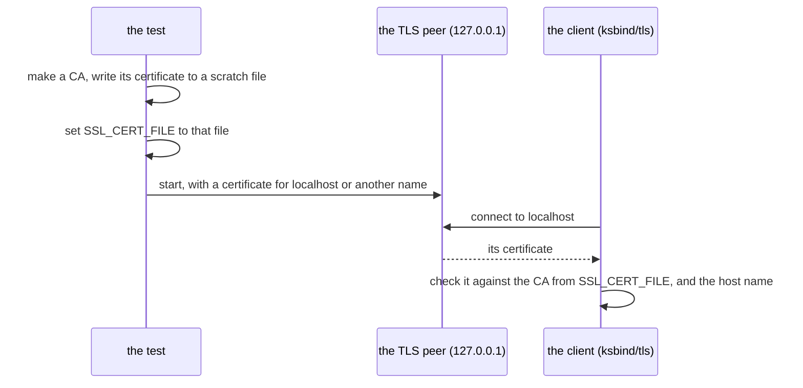

# ksbind — the design

`ksbind` lets a KSPL program use OpenSSL for TLS (an encrypted connection, as HTTPS uses), as a client and as a server. OpenSSL is a C library that does not come with the toolchain. Two requirements decide nearly all of the binding's shape.

| Requirement | What it means for a program |
| :-- | :-- |
| **A program that binds no outside library needs nothing installed** | `std`, which every program reads, holds no binding, and the runtime every program carries holds none of OpenSSL's C |
| **A binding is KSPL and nothing else** | It calls the library's own functions, so `import` and `ksplc run` are all a program needs, with no C file to build and no switch to set |

## The design decisions

### The bindings stand apart from `std`

**The bindings to outside C libraries live in their own package.** `std` is plain KSPL over the runtime every program carries, and **builds anywhere with nothing installed** ("The standard library reaches only itself" in [`../../docs/DESIGN-repository.md`](../../docs/DESIGN-repository.md)). A program that wants TLS imports `ksbind/tls`.

**Inside `std`, a binding would need a switch**, and both possible switches are bad:

* `std` builds only where OpenSSL is installed; or
* each binding is compiled out by default and answers `unsupported` at run time.

The second leaves a call that compiles everywhere and does nothing until a build flag is set: writable but ineffective (Principle 5 in [`../../docs/DESIGN-principles.md`](../../docs/DESIGN-principles.md)).

**Kanso writes no TLS of its own**, since a home-made implementation of the protocol is a risk nothing here makes worth taking. So TLS is OpenSSL's, bound outside the standard library, as Rust and C++ take TLS from outside libraries.

**What it gives up**:

* **The bindings do not ship with `ksplc`.** A release carries `ksplc` and `std`. A program using `ksbind` is told where the folder stands (`--pkg-src-dir`), as for any package ("Outside parts are not fetched; only their location is stated" in [`../../docs/DESIGN-repository.md`](../../docs/DESIGN-repository.md)).
* **A program's import names the package** (`ksbind/tls`, not `std/tls`), and its `ksplc.cfg` lists `ksbind` under `uses` where the program is a package.

### Each binding calls its library directly, holding no C

**Each binding declares the C functions it calls in its own `.kspl` file, and each `extern` block names its libraries with `#link`** (`ssl` and `crypto`). So `ksplc run` links them and no build file carries the names. No header of the library is in any translation unit: the declarations in the `.kspl` are the only ones C sees.

**A macro is reached through what it expands to.** OpenSSL spells several settings as macros over `SSL_CTX_ctrl` and `SSL_ctrl`, each taking a command number:

| The macro | What `ksbind/tls.kspl` calls |
| :-- | :-- |
| `SSL_CTX_set_min_proto_version(ctx, TLS1_2_VERSION)` | `SSL_CTX_ctrl(ctx, 123, 0x0303, null)` (`SSL_CTRL_SET_MIN_PROTO_VERSION`) |
| `SSL_set_tlsext_host_name(ssl, name)` | `SSL_ctrl(ssl, 55, 0, name)` (`SSL_CTRL_SET_TLSEXT_HOSTNAME`, `TLSEXT_NAMETYPE_host_name`) |
| `SSL_library_init()` | Nothing: OpenSSL 1.1.0 and later initialise on first use |

**The numbers are part of OpenSSL's ABI** (the numbers and layouts a compiled program relies on). They are the same in 1.1.0, 1.1.1 and 3.x, as are `SSL_VERIFY_PEER` (1) and `X509_V_OK` (0). Each stands once, as a named constant beside the declarations.

**C's `long` crosses without C as well.** The two `ctrl` functions and `SSL_get_verify_result` take or return a `long` whose every value fits in 32 bits. A `long` parameter is declared `Sz` and a `long` result `I32`, which is right on every target KSPL builds for ("What cannot be written in C's types" in [`../../docs/DESIGN-programming-language.md`](../../docs/DESIGN-programming-language.md)).

**What it gives up**:

* **OpenSSL before 1.1.0 is not bound**: `TLS_client_method` and `SSL_set1_host` begin there.
* **A future OpenSSL renumbering a command would go unnoticed until a run.** The tests drive both `ctrl` calls on every connection, and a refused one fails the connection as `ctx_failed`.
* **The MSVC toolchain does not link `ksbind/tls`**: it names OpenSSL's libraries `libssl` and `libcrypto`. No `#cfg` names the toolchain ("The library an `extern` block needs is named on the block" in [`../../docs/DESIGN-programming-language.md`](../../docs/DESIGN-programming-language.md)).

### What each binding guards against

| File | The usual way to do it | The known problem | How ksbind handles it |
| :-- | :-- | :-- | :-- |
| `tls` | Calling OpenSSL directly | **Forgotten verification.** Not calling `SSL_CTX_set_verify`, or setting SNI (`SSL_set_tlsext_host_name`) without the host name check (`SSL_set1_host`), are the standard mistakes | A client context always verifies (`SSL_VERIFY_PEER`, the default CA store), at TLS 1.2 or above; SNI and the host name check are both set |
| `tls` (the end of a stream) | `SSL_read` | **A cut stream read as a proper end.** `SSL_read` returns 0 both for the peer's close_notify and for a TCP connection dropped without one | `read` returns 0 only after a close_notify; a connection ending any other way is `io_failed` |
| `tls` (a peer that is gone) | `SSL_set_fd`, OpenSSL writing to the socket itself | **A write to a peer that is gone kills the program.** OpenSSL writes with no `MSG_NOSIGNAL` and cannot be asked to, so SIGPIPE is raised. The program a KSPL library is linked into can leave it in force | OpenSSL reads and writes memory. Every byte crosses the socket through `std/net`, whose write never raises SIGPIPE. A write to a peer that is gone fails as `io_failed` |
| `tls_server` (the key) | `PEM_read_bio_PrivateKey` with no callback | **A start that waits for good.** For a key under a passphrase, OpenSSL's own callback prompts on the terminal, and a server restarted unattended waits there | A callback that answers no passphrase and marks the request. The key is refused as `key_encrypted` |
| `tls_server` (plain HTTP) | `SSL_accept` on the first bytes | **A refusal nobody can read.** OpenSSL answers plain HTTP with a TLS alert, which a browser shows as an empty failure | The first byte is looked at before OpenSSL sees it. Anything but a handshake record is `not_tls`, so the caller can answer in plain text |
| `tls_server` (the suites) | OpenSSL's defaults | **Weak suites left on.** OpenSSL's TLS 1.2 list keeps suites without forward secrecy, and CBC suites. Renegotiation lets a peer make the server spend CPU | TLS 1.2 or above. The 1.2 suites are ECDHE with AES-GCM or ChaCha20-Poly1305; TLS 1.3's are OpenSSL's, all AEAD. Renegotiation is off |

**`tls`: forgotten verification.** Verifying means checking that a trusted authority (a CA) signed the server's certificate, and that it names the host you asked for. SNI tells the server which host name you want, and checks nothing.

* The floor of TLS 1.2 holds whatever openssl.cnf says.
* **The verification's own answer decides the error.** A certificate that does not verify stops the handshake as `cert_verify_failed`. A peer that speaks no TLS is `handshake_failed`.
* A host name holding a NUL, or longer than OpenSSL takes, **fails rather than being cut**, which would verify a different host.

**The handshake has one deadline.** `Tls_stream.connect` gives it 10 seconds by default, or the budget `handshake_ms` sets; a non-positive budget expires at once. The TCP connection and certificate-store setup come before it. The deadline covers every handshake read and write, the final queued message included, so a peer sending occasional bytes cannot restart it.

The socket is non-blocking during the handshake, and success restores blocking mode. A failure frees the TLS state and closes TCP without a shutdown exchange, so cleanup cannot wait for the peer.

**`tls`: the end of a stream.** A close_notify is the message a TLS peer sends to say "I am finished". Taking a dropped TCP connection as the end too lets whoever can drop it cut a reply short unnoticed (a truncation attack).

* `read` knows the close_notify came when `SSL_get_error` says `SSL_ERROR_ZERO_RETURN`.
* **A cut is not told apart from a reset**: both leave what arrived unconfirmed. Telling them apart would mean reading OpenSSL's error codes, laid out differently in 1.1.1 and 3.x.

**`tls`: a peer that is gone.** `std/net` passes `MSG_NOSIGNAL` (or sets `SO_NOSIGPIPE`), so the rule lives there once. So OpenSSL is handed two memory buffers rather than the socket, and the binding moves the bytes between them and the `std/net` connection.

* **The process's signal setting is never touched.** It belongs to the host program, and changing it, even for one call, would change it for every thread.
* **Blocking SIGPIPE for the calling thread around each call is not used either.** It would wrap every OpenSSL call that can write: the handshake, a read answering the peer, the close. A blocked signal stays pending, and must then be drained without taking one owed to another thread.
* **What it gives up**: each record is copied once more, through the memory buffer. A read or write drives OpenSSL in a loop of its own rather than letting it wait on the socket.

### The server half never waits

**Every call on a server connection returns at once.** A `Tls_session` reads and writes a non-blocking socket, and gives `would_block` where the socket is not ready. The handshake runs inside `read`. So one thread can serve many connections.

**The caller keeps each deadline**, the handshake's included. Waiting with a deadline inside the binding, as the client does, would stop every other connection a one-thread server holds. So the client's `wait_before` is not used here, except by the tests' own server thread.

* **A slow reader holds one record at most.** `write` takes nothing more while encrypted bytes still wait for the socket, and `pending` tells the caller to watch for writable.
* **A fast peer does not hold the thread.** `read` makes at most four socket reads per call. It stops there only once OpenSSL has taken in every byte read, so what is left stays in the socket. The caller's wait reports it again.
* **Records already taken in are not reported by the socket.** One `read` gives one record at most. Records that came in the same socket read stay inside OpenSSL. `buffered` is true while any wait there, so the caller reads again before it waits.
* **0 from `read` means the peer has ended**, after a close_notify or a TCP close alike. A server reads requests, and a request's own length shows one cut short. The client keeps the stricter rule, since a cut reply has no such length.

**TLS 1.3 alone is not required.** A client that speaks only TLS 1.2, such as a small device, would be shut out, and TLS 1.2 with the suites above has no known weakness.

**A blocking server form with its own deadline is not offered.** Its one user would be a server with a thread per connection, and none exists.

**`Tls_server.load` reads text, not files.** Where the files stand, and who may read them, stay with the caller, which checks the key's permissions first. It states the certificate's dates, chain and subject, and the caller decides what to refuse. An expired certificate still loads.

### The tests run only through this package's own `make test`

**The tests link OpenSSL, so they run from this folder's own `make test`, not from the `make debug` every environment runs.** `make test-extract` runs that `make test` from a copy of the folder.

| Situation | Result |
| :-- | :-- |
| A library is not installed (not on Linux) | The run says `SKIPPED` and names the library |
| A library is not installed, on Linux | The run fails (`KSBIND_REQUIRE_LIBS`), since the image the gates run in holds it |
| A binding names a function wrongly | The run fails wherever the libraries are |

The test of "do they link" is an empty program linked against the libraries the sources name (`--emit-libs`).

**The TLS peer makes its keys and certificates in memory, through OpenSSL** (`ksbind/tests/cert.kspl`). No private key stands in the repository, and no `openssl` command is needed. The key is Ed25519, which needs no `ctrl` macro, but needs OpenSSL 1.1.1, one version later than the binding.

**A connection that succeeds is made through a CA the test makes**, without changing `ksbind/tls`:

OpenSSL reads `SSL_CERT_FILE` when the client loads the default store, so the client runs as a program runs it. The client connects to `localhost`, so the host name check is tested without editing the machine's host table.

**What it gives up**: the macOS gates' machine does not have OpenSSL. There the binding is analysed by `make lint`, but never linked or run. The Windows job installs OpenSSL, so `make test-extract` links and runs the tests there.
