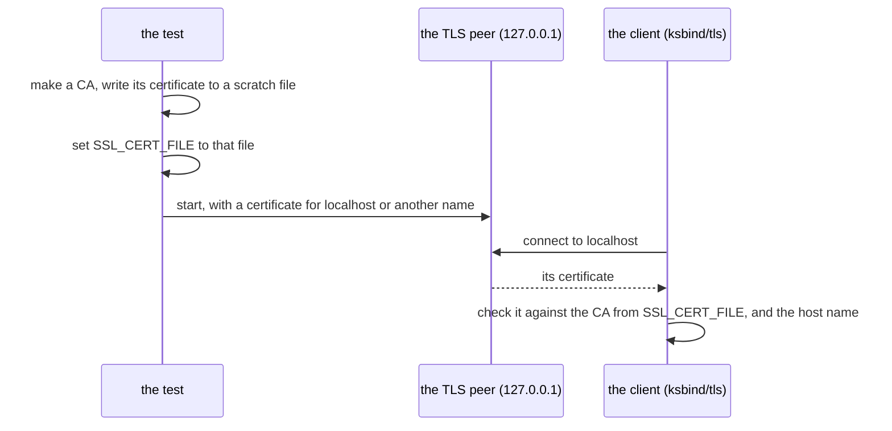

# ksbind — the design

`ksbind` lets a KSPL program use OpenSSL for a TLS client (an encrypted connection, as HTTPS uses). OpenSSL is a C library that does not come with the toolchain. The binding is plain KSPL that calls the library's own functions.

Two requirements decide nearly all of its shape.

| Requirement | What it means for a program |
| :-- | :-- |
| **A program that binds no outside library needs nothing installed** | `std`, which every program reads, holds no binding, and the runtime every program carries holds none of OpenSSL's C |
| **A binding is KSPL and nothing else** | It calls the library's own functions, so `import` and `ksplc run` are all a program needs, with no C file to build and no switch to set |

## The design decisions

### The bindings stand apart from `std`

**The bindings to outside C libraries live in their own package, not in the standard library.** `std` is plain KSPL over the runtime every program carries. **It builds anywhere with nothing installed** ("The standard library reaches only itself" in [`../../docs/DESIGN-repository.md`](../../docs/DESIGN-repository.md) states it for `std`). A program that wants them imports `ksbind/tls`.

**Inside `std`, a binding would need a switch.** There are only two ways to have one, and both are bad:

* `std` builds only where OpenSSL is installed; or
* each binding is compiled out by default and answers `unsupported` at run time.

The second leaves a call that compiles everywhere and does nothing until a build flag is set: writable but ineffective (Principle 5 in [`../../docs/DESIGN-principles.md`](../../docs/DESIGN-principles.md)). And where a binding needs C, the only C `std` has is the runtime every program carries.

**How the standard libraries KSPL is matched against draw the line**:

| Language | TLS in the standard library |
| :-- | :-- |
| Rust, C++ | No; it comes from outside libraries |
| Go, Java | Yes, written in the language itself with no C library beneath it |
| Python | An `ssl` module that binds the system's OpenSSL, so what it can do follows the version of OpenSSL it was built against |

**Kanso writes no TLS of its own**: a home-made implementation of the protocol is a risk nothing here makes worth taking, so TLS is OpenSSL's. That leaves Python's shape or Rust's, and Python's puts into `std` the binding to an outside library that this design keeps out of it. So the shape is Rust's and C++'s: outside the standard library.

**What it gives up**:

* **The bindings do not ship with `ksplc`.** A release carries `ksplc` and `std`. A program using `ksbind` is told where the folder stands, as any package is (`--pkg-src-dir`). The rule is "Outside parts are not fetched; only their location is stated" in [`../../docs/DESIGN-repository.md`](../../docs/DESIGN-repository.md).
* **A program's import names the package** (`ksbind/tls`, not `std/tls`), and its `ksplc.cfg` lists `ksbind` under `uses` where the program is a package.

### Each binding calls its library directly, holding no C

**Each binding declares the C functions it calls inside its own `.kspl` file, and each `extern` block names its libraries with `#link`** (`ssl` and `crypto`). An `extern` block is where KSPL declares functions written in C. `#link` names the library to link, so `ksplc run` links it and no build file carries the names. No header of the library is in any translation unit (the C file a compiler turns into one object file). The declarations in the `.kspl` are the only ones C sees.

**A macro is reached through what it expands to.** A C macro is text the C preprocessor replaces before compiling, so it is not a function KSPL can call. OpenSSL spells several settings as macros over two functions, `SSL_CTX_ctrl` and `SSL_ctrl`, each taking a command number:

| The macro | What `ksbind/tls.kspl` calls |
| :-- | :-- |
| `SSL_CTX_set_min_proto_version(ctx, TLS1_2_VERSION)` | `SSL_CTX_ctrl(ctx, 123, 0x0303, null)` (`SSL_CTRL_SET_MIN_PROTO_VERSION`) |
| `SSL_set_tlsext_host_name(ssl, name)` | `SSL_ctrl(ssl, 55, 0, name)` (`SSL_CTRL_SET_TLSEXT_HOSTNAME`, `TLSEXT_NAMETYPE_host_name`) |
| `SSL_library_init()` | Nothing: OpenSSL 1.1.0 and later initialise on first use |

**The numbers are part of OpenSSL's ABI** (the binary interface: the numbers and layouts a compiled program relies on). They are the same in 1.1.0, 1.1.1 and 3.x, as are `SSL_VERIFY_PEER` (1) and `X509_V_OK` (0). Each stands once, as a named constant beside the declarations.

**C's `long` crosses without C as well.** The two `ctrl` functions take a `long` and return one, and so does `SSL_get_verify_result`, each value fitting in 32 bits. A `long` parameter is declared `Sz` (KSPL's pointer-sized unsigned integer) and a `long` result `I32`. This is right on every target KSPL builds for. The rule and its reason are "What cannot be written in C's types" in [`../../docs/DESIGN-programming-language.md`](../../docs/DESIGN-programming-language.md).

**What it gives up**:

* **OpenSSL before 1.1.0 is not bound**: `TLS_client_method` and `SSL_set1_host` begin there.
* **A future OpenSSL renumbering a command would go unnoticed until a run.** The tests drive both `ctrl` calls on every connection, and a refused one fails the connection as `ctx_failed`, so a run notices; the compile does not.
* **The MSVC toolchain does not link `ksbind/tls`**: it names OpenSSL's libraries `libssl` and `libcrypto`. No `#cfg` names the toolchain ("The library an `extern` block needs is named on the block" in [`../../docs/DESIGN-programming-language.md`](../../docs/DESIGN-programming-language.md)).

### What each binding guards against

Each binding closes off one well-known way that code using the library directly goes wrong. The table names the danger and what ksbind does; the paragraphs after it give the details and what each choice gives up.

| File | The usual way to do it | The known problem | How ksbind handles it |
| :-- | :-- | :-- | :-- |
| `tls` | Calling OpenSSL directly | **Forgotten verification.** Not calling `SSL_CTX_set_verify`, or setting SNI (`SSL_set_tlsext_host_name`) without the host name check (`SSL_set1_host`), are the standard mistakes | A client context always verifies (`SSL_VERIFY_PEER`, the default CA store), at TLS 1.2 or above; SNI and the host name check are both set |
| `tls` (the end of a stream) | `SSL_read` | **A cut stream read as a proper end.** `SSL_read` returns 0 both for the peer's close_notify and for a TCP connection dropped without one | `read` returns 0 only after a close_notify; a connection ending any other way is `io_failed` |
| `tls` (a peer that is gone) | `SSL_set_fd`, OpenSSL writing to the socket itself | **A write to a peer that is gone kills the program.** OpenSSL writes with no `MSG_NOSIGNAL` and offers no way to ask for it, so SIGPIPE is raised. A program that has not set it aside dies. A KSPL program ignores it, but the program a KSPL library is linked into can leave it in force | OpenSSL reads and writes memory. Every byte crosses the socket through `std/net`, whose write never raises SIGPIPE. A write to a peer that is gone fails as `io_failed` |

**`tls`: forgotten verification.** Verifying means checking that the server's certificate was signed by a trusted authority (a CA) and names the host you asked for. SNI tells the server which host name you want; it checks nothing by itself.

* The floor of TLS 1.2 holds whatever openssl.cnf says.
* **The verification's own answer decides the error.** A certificate that does not verify stops the handshake, and is reported as `cert_verify_failed`. A peer that speaks no TLS is reported apart from it (`handshake_failed`).
* A host name holding a NUL, or longer than OpenSSL takes, **fails rather than being cut** (cut, it would verify a different host).

**The handshake has one deadline.** `Tls_stream.connect` gives it 10 seconds by default; `handshake_ms` sets another budget. A non-positive budget expires immediately. TCP connection and certificate-store setup precede this budget. The deadline covers every handshake read and write, including the final queued message. A peer sending occasional bytes cannot restart it.

The socket is non-blocking during the handshake and uses readiness waits for the remaining time. Success restores blocking mode for normal reads and writes. Expiry returns `handshake_timed_out`. Failure frees the TLS state and closes TCP without a shutdown exchange, so cleanup cannot wait for the peer. Established-stream reads, writes and graceful close have no new timeout.

**`tls`: the end of a stream.** A close_notify is the message a TLS peer sends to say "I am finished". Taking a dropped TCP connection as the end too lets whoever can drop the connection cut a reply short unnoticed (a truncation attack).

* `read` knows the close_notify came when `SSL_get_error` says `SSL_ERROR_ZERO_RETURN`.
* **A cut is not told apart from a reset**: both leave what arrived unconfirmed. Telling them apart would mean reading OpenSSL's error codes, which are laid out differently in 1.1.1 and 3.x.

**`tls`: a peer that is gone.** On Linux a write to a socket whose peer has gone raises SIGPIPE unless the call passes `MSG_NOSIGNAL`, and its default ends the process. `std/net` passes it (`SO_NOSIGPIPE` on the socket where the OS has no such flag), so the rule lives there once. So OpenSSL is handed two memory buffers rather than the socket. The binding moves the bytes between them and the `std/net` connection. Whatever OpenSSL sends goes out by `std/net`'s write.

* **The process's signal setting is never touched.** It belongs to the host program. A library that set SIGPIPE aside, even for one call, would change it for every thread of a program that chose otherwise.
* **Blocking SIGPIPE for the calling thread around each call is not used either.** It touches every OpenSSL call that can write: the handshake, a read answering the peer, and the close as well as a write. A signal blocked is not one ignored: it stays pending. It then has to be drained without taking one that another thread was owed.
* **What it gives up**: each record is copied once more, through the memory buffer. A read or write drives OpenSSL in a loop of its own rather than letting it wait on the socket.

### The tests run only through this package's own `make test`

**The tests link OpenSSL, so they run from this folder's own `make test`, not from the `make debug` every environment runs.** `make test-extract` runs that `make test` from a copy of the folder.

**Where the libraries do not link, the run skips and says so. On Linux it fails instead** (`KSBIND_REQUIRE_LIBS`), since the image the gates run in holds it.

| Situation | Result |
| :-- | :-- |
| A library is not installed (not on Linux) | The run says `SKIPPED` and names the library |
| A library is not installed, on Linux | The run fails |
| A binding names a function wrongly | The run fails wherever the libraries are |

The test of "do they link" is an empty program linked against the libraries the sources name (`--emit-libs`). So a library that is not installed skips, while a binding that names a function wrongly fails everywhere the libraries are.

**The TLS peer makes its keys and certificates in memory, through OpenSSL.** No private key stands in the repository, and no `openssl` command is needed. The key is Ed25519, which asks for no parameters and so for no `ctrl` macro; it needs OpenSSL 1.1.1, one version later than the binding itself.

**A connection that succeeds is made through a CA the test makes.** The diagram shows how the test reaches the client without changing `ksbind/tls`.

The CA's certificate (not its key) is written to a scratch file that `SSL_CERT_FILE` names for the length of the test. OpenSSL reads the variable when the client loads the default store. So the client runs as a program runs it, with no call added to `ksbind/tls` for the tests. The peer answers at `127.0.0.1` with a certificate for `localhost` or for another name. The client connects to `localhost`, so the host name check is tested without editing the machine's host table.

**What it gives up**: on Windows and macOS, the gates' machines do not have OpenSSL. There the binding is analysed by `make lint`, and on Windows compiled by `make test-c-warnings`. It is never linked or run there.
