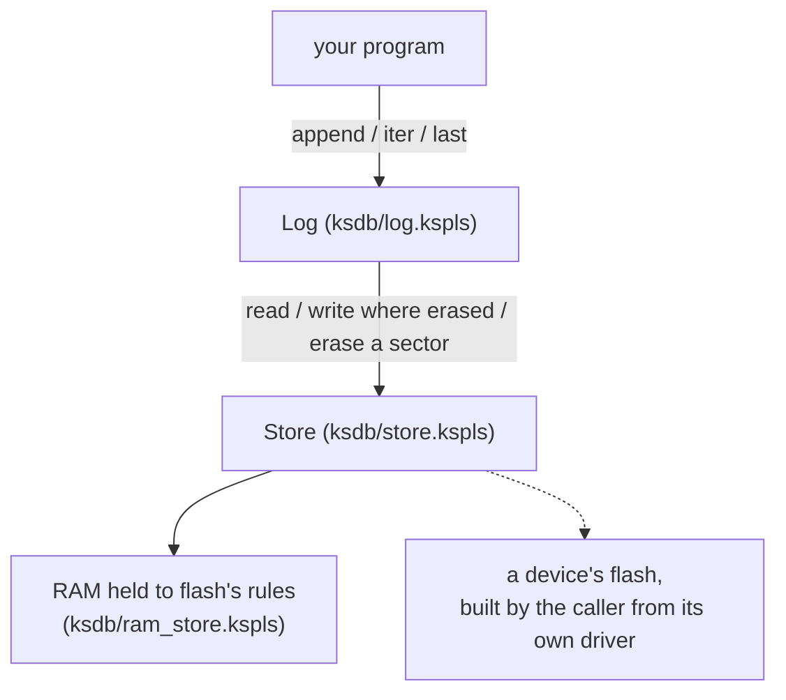

# ksdb

**An append-only record with zero dependencies: every finished record reads back, even when the power fails mid-write.** *Append-only* means records are only ever added at the end, never changed. On a device it keeps a sensor time series and a policy (a setting the device was sent) across power cuts; on a desk, a document's change history.

It is for whoever needs a small, durable log in a KSPL program, above all on a microcontroller with flash memory. [`ksdb/docs/DESIGN.md`](docs/DESIGN.md) says why not SQLite through FFI (calling a C library from KSPL), why appending only, and why a record is laid out as it is.

## Run it

**`make test` runs the tests from this folder** with nothing but a `ksplc` ([`ksdb/Makefile`](Makefile)). ksdb names itself in [`ksdb/ksplc.cfg`](ksplc.cfg), so a copy of this folder alone runs them the same way. What they cut and check is in "Power cuts are tested at every point, not at chosen ones" in [`ksdb/docs/DESIGN.md`](docs/DESIGN.md).

A program keeps its record like this. It tags each record with a `kind` number, appends one, reads them all back oldest first, and then takes the newest record of one kind:

```kspls
import "ksdb/log" as ksdblog
import "ksdb/ram_store" as ram
import "std/io"

const kind_sample: U16 = 1
const kind_policy: U16 = 2

$buf: U8[8192]

fn main()
    store: = ram.make(U8$[]::buf, 4096) // a 4KB sector
    $lg: = ksdblog.Log.open(store) // scans the place and settles where it can append

    lg.append(kind_sample, "dist=180 line=2") catch
        return

    // Reading it back, oldest first.
    $payload: U8[64] = ::{}
    $it: = lg.iter()
    for it.next()
        // it.kind and it.len are the kind and content length of the record now pointed at. A
        // record longer than `payload` throws `too_small`, as `last` does, instead of being cut.
        n: = it.read(U8$[]::payload) catch
            continue
        io.out().s("kind \{it.kind\}: \{n\} bytes\n")

    // "The newest one" per kind. This is the shape for taking the policy handed down.
    // With not one record it throws `not_found`, which is not length 0.
    $policy: U8[2048] = ::{}
    n: = lg.last(kind_policy, U8$[]::policy) catch
        return
    io.out().s("the policy holds \{n\} bytes\n")
```

The caller decides what a `kind` means. `ksdb` matches kinds and never reads the content.

## What is here

The record (`Log`) writes through a *place*: a `Store` that knows how to read, write and erase one kind of memory. The diagram shows the layers; the dashed line marks what the caller builds.



| File | Content |
| :-- | :-- |
| [`ksdb/log.kspls`](log.kspls) | The record itself. |
| [`ksdb/store.kspls`](store.kspls) | The swappable place: three functions ("read", "write where erased", "erase a sector") and the sector's size. A *sector* is the smallest block flash can erase at once. |
| [`ksdb/ram_store.kspls`](ram_store.kspls) | A place in RAM that keeps flash's constraints (a write where nothing was erased only turns bits to 0). |
| [`ksdb/tests/ksdb_test.kspls`](tests/ksdb_test.kspls) | The tests, on RAM held to flash's constraints. |

## What it can do

ksdb does five things, each one call on the `Log`.

| What it can do | How to write it |
| :-- | :-- |
| Append | `append(kind, payload)` |
| Read oldest first | `iter()` → `next()` / `read()` |
| Take the newest of a kind | `last(kind, dst)` (`not_found` if none) |
| Erase everything | `reset()` |
| Know the bytes in use | `used()` |

**ksdb has no rewriting, deleting of one record, wrapping round to an old sector, or index.** A full record returns `full` rather than overwrite. Why is in "It holds no rewriting, only appending", "Full comes back as `full`, and nothing is silently overwritten" and "It holds no index" in [`ksdb/docs/DESIGN.md`](docs/DESIGN.md).

## Adding a place

To keep the record in another kind of memory, build the `Store` of [`ksdb/store.kspls`](store.kspls) and pass it in. What each field must do is what `ksplc doc ksdb/store.Store` prints. Besides `ksdb/ram_store.kspls` (portable, host or device), the caller builds a device's flash (the RP2040's QSPI Flash, say) from its own driver, `flash` below. `ksdb` itself names no device.

```kspls
store: = Store::{
    .read_at = flash.read_at,
    .program_at = flash.program_at,
    .erase_sector = flash.erase_sector,
    .capacity = flash.region_size,
    .sector_size = flash.sector_size,
}
```

## Further reading

* [`ksdb/docs/DESIGN.md`](docs/DESIGN.md) — why appending only, and why a record is laid out as it is.
* [`ksdb/SURFACE.txt`](SURFACE.txt) — the record of the published API, written by `make surface` and checked by `make test-surface` ("The record of a published API" in [`docs/SPEC-gates.md`](../docs/SPEC-gates.md)).
* [std](../std/README.md) — the way in to `ksdb`'s only dependency; every file it publishes is listed by `ksplc doc std`.
