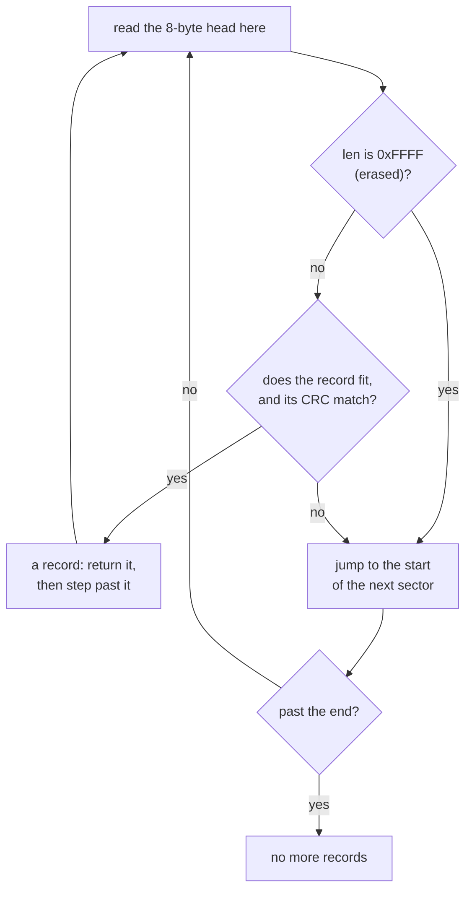

# ksdb — the design

`ksdb` is a small log a device keeps in its own flash memory. It only ever adds records at the end, and every record finished before a power cut can still be read afterwards. Three requirements decide nearly all of its shape.

| Requirement | What it means | What follows from it |
| :-- | :-- | :-- |
| **It fits a freestanding microcontroller, with zero dependencies** | A *freestanding* target is a small chip with no operating system and no C library to call | A binding to SQLite does not fit. It passes the work to libsqlite3 through FFI (calling a C library from KSPL), which needs the library and a C backend |
| **The power can fail at any moment** | The device can lose power in the middle of any write | The one record being written at that instant can break, but the records finished before it must always read back |

**The third requirement: the place is flash**, which works differently from RAM:

* *Erasing* sets every bit to 1, so erased flash reads as `0xFF` bytes.
* *Writing* (also called programming) can only turn bits from 1 to 0. To write a byte again, you must erase first.
* Erasing works only on a whole *sector* (a fixed-size block, often 4 KB). The flash wears out after a limited number of erase cycles.

## The design decisions

### It holds no rewriting, only appending

A record is never changed after it is written. On flash, rewriting one record means erasing and rewriting its whole sector. **Every other record there is rewritten with it**, and a power loss in between loses them all. Appending erases no sector; `reset` and `reset_keeping` do, once nothing there is needed.

Caution: **Do not erase a sector on the appending path.** Where `tail` (where the next record goes) is partway through a sector, erasing it erases the finished records there too.

Given up: deleting one record, and updating in place. A changing value such as a policy is appended again under the same `kind`, the number that the caller tags each record with. `last` reads the newest one, so the old value survives a power loss while the new one is written.

### The place is swapped through a struct of function pointers

The log does not know what memory it writes to. The caller hands it a `Store` (`ksdb/store.kspl`), which holds the four things `ksdb/log.kspl` needs:

| Field | What it does |
| :-- | :-- |
| `read_at` | Reads bytes |
| `program_at` | Writes bytes where the memory is erased |
| `erase_sector` | Erases one sector |
| `sector_size` (and `capacity`) | The sector's size (and the whole memory's size) |

`Store` is not a trait, so the caller picks the memory explicitly, in one spot, with no hidden table of functions.

**No context pointer is held.** Every place holds one set of state per file, so none is needed. Add one when a device needs two media of the same kind.

### `Store` exposes flash's write and erase asymmetry as it is

A write can be a few bytes, while an erase is a whole sector. Hiding that difference would stop the layer above from writing correctly.

On most media, a write where nothing was erased returns no failure: bits merely turn to 0 and leave a garbled value. So `program_at` returning `true` cannot mean "written correctly", and **checking that the place was erased is `ksdb/log.kspl`'s job**.

### A record's layout — `len` comes first and `0xFFFF` is 'empty'

Each record starts with an 8-byte head:

```text
 offset 0      2      4              8                    8+len   (rounded up to 4)
        +------+------+--------------+--------------------+--------+
        | len  | kind |     crc      |   content (len B)  | padding|
        +------+------+--------------+--------------------+--------+
          2 B    2 B       4 B          the head is the first 8 bytes
```

| Field | Size | What it holds |
| :-- | :-- | :-- |
| `len` | 2 bytes | The content's length. `0xFFFF` means the slot is empty |
| `kind` | 2 bytes | The caller's own tag for the record |
| `crc` | 4 bytes | A CRC (a checksum that changes when any byte changes) over `len`, `kind` and the content |
| content | `len` bytes | The data |
| padding | 0 to 3 bytes | Fills up to the next multiple of 4 |

Erased flash has every bit at 1, so an unwritten `len` reads as `0xFFFF`. So **the end is found without writing an extra marker**. With `crc` first instead, a record whose CRC happens to be `0xFFFFFFFF` would read as empty.

**The price is a content cap of `0xFFFE` bytes** (`MAX_PAYLOAD` in `log.kspl`). A small sector caps it lower ("One record is kept inside one sector" below).

**The CRC covers `len` and `kind` too.** Over the content alone, a garbled length would pass as a correct record of another length and shift every record after it.

A record's boundaries are aligned to 4 bytes, so the head's 2-byte integer never sits at an odd address and faults.

### The content is written first and the head last

`append` writes the record's content, then its head. **The order has to read correctly wherever a power cut lands**:

| The power is cut… | What is left on flash | What the next scan sees |
| :-- | :-- | :-- |
| before anything is written | Nothing | No record, as before |
| while the content is written, or after it | Some or all of the content; the head is still erased | `len` reads `0xFFFF`: an empty slot, as if the record never existed |
| while the head is written | The content and part of the head | A CRC that does not match: a broken record, which the scan skips |
| after the head is written | The whole record | The record |

**The other order breaks**: a cut after the head leaves a head naming a correct length over missing content.

### A garbled record sends the scan to the next sector

When the scan meets something it cannot read as a record, it skips to the start of the next sector and goes on. It never stops early.



A half-written record fails its CRC. **A scan that stopped there would leave everything appended after one power loss unreadable forever.** Skipping costs only the rest of that sector. The scan does not stop at an erased place either, since appending leaves a gap at a sector's end rather than straddle two sectors.

**How it walks is written once, in `Cursor.next`**, which `Log.open` and the latest-record lookup both use. `Log.last` reads through `Cursor.read`, so buffer-size refusal and copying have one owner too.

### `open` scans every time

`open` finds where to append by reading the records themselves. A saved position would be a second source of truth, which goes stale when the power fails.

### One record is kept inside one sector

A record never crosses into the next sector, since a straddling record keeps only its head once the other sector is erased. A record that would straddle starts at the next sector's head instead, leaving a gap. Content that does not fit in one sector returns `too_large`.

The picture shows two sectors after a few appends. Record C did not fit in sector 0, so it went to sector 1.

```text
 sector 0                                   sector 1
+--------+--------+-----------------------+--------+--------+----------------+
| rec A  | rec B  |  gap (erased, 0xFF)   | rec C  | rec D  |  erased ...    |
+--------+--------+-----------------------+--------+--------+----------------+
                                                             ^ tail: the next append goes here
```

The content cap is therefore the **smaller** of "the sector's size − the 8-byte head − the padding" and `0xFFFE`. To keep more, the caller splits it into several records; `ksdb` does no splitting.

### A place that cannot be written is skipped

Before writing, `append` checks that the place is still erased. If it is not, `append` moves on to the next sector.

Caution: **Do not stop when it is not erased.** A half-written record from a power loss can sit in a sector beyond `tail`'s, sent there to avoid straddling. `open` checks only the rest of `tail`'s sector, so that record is not found. A stopping `append` would stop there after every reopen, until `reset` threw everything away.

**Do not erase a sector here either** (erasing is `reset`'s job). Skipping on until nothing fits gives `full`.

### Full comes back as `full`, and nothing is silently overwritten

When nothing more fits, `append` returns `full`, with every record so far still readable. There is no erasing of an old sector to go round, as a ring buffer would.

Caution: **Do not make it overwrite silently.** A lost record cannot be recovered, and nobody can even notice it disappeared. Once the records are read off, `reset` empties the place.

### Keeping a few records through an erase

A device that empties its log usually still needs a few records: the marker that claims the region, and the policy it was sent. **Erasing everything and writing them back after loses them to a power cut in between**, and with no link the device then has no policy. `reset_keeping` takes the kinds to keep and keeps the newest record of each, in four steps:

1. It finds a *spare sector*: the first one after the head (sector 0) that holds none of the kept records. It erases that sector and copies the kept records into it.
2. It erases every other sector, **from the head upward**.
3. It copies the kept records from the spare sector back to the head.
4. It erases the spare sector. The next append goes right after the kept records.

Each copy is written as `append` writes: the content first, the header last, with the header copied unchanged (the same `len`, `kind` and content give the same CRC). What a power cut leaves, for each kept kind:

| The power is cut… | What the next start reads as that kind's newest record |
| :-- | :-- |
| in step 1 (the spare sector erased, or a copy half-written) | The original: the spare sector held none of the kept records, and a half copy fails its CRC |
| in step 2 | The original while it is still there, then the copy in the spare sector. Both have the same content |
| in step 3 | The copy in the spare sector: it sits after the half-written one at the head |
| in step 4 | The copy at the head, once the spare sector's copy is garbled or gone |

After a cut in steps 1 to 3, the sectors not yet erased still hold old records, and appending goes after them, so less room is free. **Running `reset_keeping` again finishes the job**.

Caution: **Keep the erase in step 2 going upward.** A kind's older records lie before its newest one, so they go first. Erased downward, a cut just after the newest original went would leave an older one beyond the spare sector. That older one would then read as the newest.

**The kept records must fit in one sector together**, and at most eight kinds can be listed, since their places are held on the stack. Otherwise it returns `too_large` and erases nothing. A device keeps a marker and a policy, a few KB in a 4KB sector.

**The test cuts every write and every erase it makes** (`tests/ksdb_test.kspl`). A cut during an erase leaves the sector's first bytes erased and the rest as it was (`arm_erase_cut` in `ksdb/ram_store.kspl`). The test tries 0 bytes, 1 byte and half the sector. The medium it erases holds an older policy between the spare sector and the newest one, so erasing in the wrong order fails it.

### `last` reports a missing record as `not_found`, not as length 0

A record with empty content is legitimate (a marker can carry its kind alone). If "there is none" were length 0, **one empty record appended would answer "there is none"**, and the writer would see "written, yet unreadable". So `last` returns `Ksdb_error.not_found`, distinct from length 0.

**A caller that can use 0 when there is none writes `catch 0`**, as a count kept across restarts does.

Caution: **Do not append an empty record to a kind read with `catch 0`.** There the two cases merge.

### Power cuts are tested at every point

**The tests cut the power at every write the log makes, and check after each cut that nothing finished was lost.** A hand-picked cut point tests only where it was picked. `tests/ksdb_test.kspl` cuts each write in turn, after 0, 1 and 4 bytes of it. Each time it does three things:

1. it reopens the log;
2. it checks that the finished records read back in order;
3. it checks that more can be appended after them.

This is affordable because the record only appends and has no index. **What was appended has to vary too, or the cut never hits**:

| What the test mixes in | Why it is needed |
| :-- | :-- |
| **A cut after just one byte of a write** | An erase check that is one byte off still catches garbling from the second byte on, so only this cut shows the mistake |
| **A record with empty content** | Only its head is written, so a cut there leaves a sector where that one byte alone is not erased |
| **A length that straddles a sector** | Records that all fit neatly never build a cut right after a record is sent to the next sector's head |
| **More than one record appended after the cut** | Where the half-written record sits in a sector beyond `tail`'s, the next record still fits in the earlier sector. Only the one after it hits |

Caution: **Do not drop the cut after one byte** (the first row above).

**Only the four together build the case that "A place that cannot be written is skipped" exists for.**

**Test bit corruption separately**, as SQLite does: no cut point produces a bit decayed with age.

### It holds no index

`last` walks every record oldest first and returns the last match. A separate index would be a second truth that disagrees with the records after a power loss. **The walk grows with the record count**, which is enough for what a device keeps (a few sectors' worth).

### The RAM place keeps flash's constraints too

The tests run the log on a stand-in for flash in RAM (`ksdb/ram_store.kspl`), whose `program_at` **only turns bits to 0**.

Caution: **Do not make it a plain assignment because "it is RAM".** Loosened, it lets code above pass here and break on real flash.

It also counts erases and writes. Erasing is flash's costliest operation and wears it out, so the tests check that appending erases no more than it must. `arm_cut` names the write, and the byte count into it, where the power is cut; `arm_erase_cut` names an erase, and how much of the sector it erased. So the tests can move the cut everywhere.
