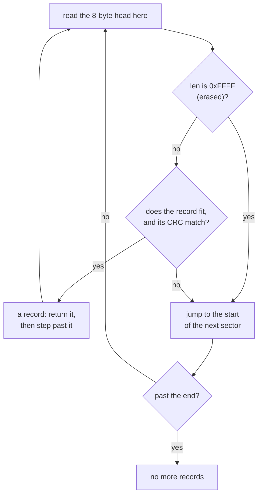

# ksdb — the design

`ksdb` is a small log a device keeps in its own flash memory. It only ever adds records at the end, and every record finished before a power cut can still be read afterwards.

A device uses it to keep, for example, a sensor's readings over time, or a setting it was sent. Three requirements decide nearly all of its shape.

| Requirement | What it means | What follows from it |
| :-- | :-- | :-- |
| **It fits a freestanding microcontroller, with zero dependencies** | A *freestanding* target is a small chip with no operating system and no C library to call | A binding to SQLite does not fit. It passes the work to libsqlite3 through FFI (calling a C library from KSPL), which needs the library and a C backend |
| **The power can fail at any moment** | The device can lose power in the middle of any write | The one record being written at that instant can break, but the records finished before it must always read back |

**The third requirement: the place is flash**, which works differently from RAM. Its three rules shape everything below.

* *Erasing* sets every bit to 1, so erased flash reads as `0xFF` bytes.
* *Writing* (also called programming) can only turn bits from 1 to 0. To write a byte again, you must erase first.
* Erasing works only on a whole *sector* (a fixed-size block, often 4 KB). The flash wears out after a limited number of erase cycles.

## The design decisions

### It holds no rewriting, only appending

A record is never changed after it is written. New data is always added at the end.

On flash, rewriting one record means erasing and rewriting its whole sector. **Every other record there is rewritten with it**, and a power loss in between loses them all. Appending erases a sector only once nothing in it is needed (`reset`).

Caution: **Do not erase a sector on the appending path.** Where `tail` (the position the next record is written at) is partway through a sector, erasing it erases the finished records there too.

Given up: deleting one record, and updating in place. A changing value such as a policy is appended again under the same `kind`. The `kind` is a number that the caller tags each record with. The caller reads the value with `last`, which returns the newest one. So the old value survives a power loss while the new one is written.

### The place is swapped through a struct of function pointers

The log does not know what memory it writes to. The caller hands it a `Store`: a struct holding the functions to read, write and erase that memory.

`ksdb/log.kspl` needs only four things, gathered into `Store` in `ksdb/store.kspl`:

| Field | What it does |
| :-- | :-- |
| `read_at` | Reads bytes |
| `program_at` | Writes bytes where the memory is erased |
| `erase_sector` | Erases one sector |
| `sector_size` (and `capacity`) | The sector's size (and the whole memory's size) |

`Store` is not a trait (KSPL's form of an interface, called through dynamic dispatch). So the caller picks the memory explicitly, in one spot, with no hidden table of functions (vtable) and no inheritance.

**No context pointer is held.** Every place holds one set of state per file, so none is needed. Add one when a device needs two media of the same kind.

### `Store` exposes flash's write and erase asymmetry as it is

`program` and `erase` work at different granularities (sizes of the unit they act on): a write can be a few bytes, an erase is a whole sector. Hiding that stops the layer above from writing correctly.

On most media, a write where nothing was erased returns no failure: bits merely turn to 0 and leave a garbled value. So `program_at` returning `true` cannot mean "written correctly", and **checking that the place was erased is `ksdb/log.kspl`'s job**.

### A record's layout — `len` comes first and `0xFFFF` is 'empty'

Each record starts with an 8-byte head. Its first field is the content length, and the value `0xFFFF` there means "nothing written here yet".

One record on flash looks like this.

```text
 offset 0      2      4              8                    8+len   (rounded up to 4)
        +------+------+--------------+--------------------+--------+
        | len  | kind |     crc      |   content (len B)  | padding|
        +------+------+--------------+--------------------+--------+
          2 B    2 B       4 B          the head is the first 8 bytes
```

| Field | Size | What it holds |
| :-- | :-- | :-- |
| `len` | 2 bytes | The content's length. `0xFFFF` means the slot is empty |
| `kind` | 2 bytes | The caller's own tag for the record |
| `crc` | 4 bytes | A CRC (a checksum that changes when any byte changes) over `len`, `kind` and the content |
| content | `len` bytes | The data |
| padding | 0 to 3 bytes | Fills up to the next multiple of 4 |

Erased flash has every bit at 1, so an unwritten `len` reads as `0xFFFF`. With the length field at the head and `0xFFFF` as the empty marker, **the end is found without writing an extra marker**. With `crc` first instead, a record whose CRC happens to be `0xFFFFFFFF` would read as empty.

**The price is a content cap of `0xFFFE` bytes**, since the empty marker takes `0xFFFF` (`max_payload` in `log.kspl`). A small sector caps it lower ("One record is kept inside one sector" below).

**The CRC covers `len` and `kind` too.** Over the content alone, a garbled length would pass as a correct record of another length and shift every record after it.

A record's boundaries are aligned to 4 bytes. Unaligned, the head's 2-byte integer can sit at an odd address and fault on a target that reads it directly.

### The content is written first and the head last

`append` writes the record's content, then its head. So a power cut at any moment leaves either a whole record or one the scan treats as never written.

A power loss can land anywhere, so **the order has to read correctly wherever it lands**. The table shows each place a cut can land.

| The power is cut… | What is left on flash | What the next scan sees |
| :-- | :-- | :-- |
| before anything is written | Nothing | No record, as before |
| while the content is written, or after it | Some or all of the content; the head is still erased | `len` reads `0xFFFF`: an empty slot, as if the record never existed |
| while the head is written | The content and part of the head | A CRC that does not match: a broken record, which the scan skips |
| after the head is written | The whole record | The record |

**The other order breaks**: a cut after the head leaves a head naming a correct length over missing content.

### A garbled record sends the scan to the next sector

When the scan meets something it cannot read as a record, it skips to the start of the next sector and goes on. It never stops early.

The diagram shows how the scan steps from one record to the next.



A half-written record fails its CRC. **A scan that stopped there would leave everything appended after one power loss unreadable forever.** Skipping costs only the rest of that sector.

For the same reason, the scan does not stop at an erased place either. Appending leaves a gap at a sector's end rather than straddle (span the boundary between two sectors). A scan that stopped there would miss the next sector's records.

**How it walks is written once, in `Cursor.next`.** `Log.open` uses it to find the append position, and the latest-record lookup returns a cursor on its match. `Log.last` reads through `Cursor.read`, so buffer-size refusal and copying have one owner too.

### `open` scans every time

`open` finds where to append by reading the records themselves, not from a saved position. A saved position is a second source of truth, and it goes stale when the power fails. The scan's answer is right even after a power loss.

### One record is kept inside one sector

A record never crosses from one sector into the next.

A straddling record keeps only its head once the other sector is erased. So content that does not fit in one sector returns `too_large`. A record that would straddle starts at the next sector's head instead, leaving a gap.

The picture shows two sectors after a few appends. Record C did not fit in sector 0, so it went to sector 1.

```text
 sector 0                                   sector 1
+--------+--------+-----------------------+--------+--------+----------------+
| rec A  | rec B  |  gap (erased, 0xFF)   | rec C  | rec D  |  erased ...    |
+--------+--------+-----------------------+--------+--------+----------------+
                                                             ^ tail: the next append goes here
```

The content cap is therefore the **smaller** of "the sector's size − the 8-byte head − the padding" and `0xFFFE`. To keep more, the caller splits it into several records. `ksdb` does no splitting.

### A place that cannot be written is skipped

Before writing, `append` checks that the place is still erased. If it is not, `append` moves on to the next sector instead of giving up.

Caution: **Do not stop when it is not erased.** A half-written record from a power loss can sit in a sector beyond `tail`'s. It was sent there to avoid straddling, then cut off partway. `open` checks only the rest of `tail`'s sector, so that record is not found.

A stopping `append` would stop at the same place after every reopen. Nothing could be appended until `reset` threw everything away, yet appending after a power loss is what this record is for. So **an unerased place is skipped, and `append` looks further on**.

**Do not erase a sector here either** (erasing is `reset`'s job). Skipping on until nothing fits gives `full`.

### Full comes back as `full`, and nothing is silently overwritten

When the flash is full, `append` returns the error `full`. There is no machinery for erasing an old sector and going round, as a ring buffer would.

Caution: **Do not make it overwrite silently.** A lost record cannot be recovered, and nobody can even notice it disappeared. Once nothing fits, `append` returns `full` and stops, with every record so far still readable. Once they are read off, `reset` empties the place.

### `last` reports a missing record as `not_found`, not as length 0

"there is no record of this kind" and "the newest record is empty" are different answers, so `last` returns an error for the first.

A record with empty content is legitimate (a marker can carry its kind alone). If "there is none" were length 0, **one empty record appended would answer "there is none"**. The writer would see only "written, yet unreadable", with nothing to trace the cause by. So `last` returns `Ksdb_error.not_found`, distinct from length 0.

**A caller that can use 0 when there is none writes `catch 0`.** A count kept across restarts takes that shape: the first start finds none and begins from 0.

Caution: **Do not append an empty record to a kind read with `catch 0`.** There the two cases merge.

### Power cuts are tested at every point

**The tests cut the power at every write the log makes. After each cut, they check that nothing finished was lost.** "The records finished before it must always read back" is this package's promise. A hand-picked cut point tests only where it was picked, not every point. `tests/ksdb_test.kspl` cuts each write in turn, after 0, 1 and 4 bytes of it. Each time it does three things:

1. it reopens the log;
2. it checks that the finished records read back in order;
3. it checks that more can be appended after them.

Cutting at every write is affordable because the record only appends and has no index.

Where it cuts is not enough: **what was appended has to vary too, or the cut never hits**.

| What the test mixes in | Why it is needed |
| :-- | :-- |
| **A cut after just one byte of a write** | An erase check that is one byte off still catches garbling from the second byte on, so only this cut shows the mistake |
| **A record with empty content** | Only its head is written, so a cut there leaves a sector where that one byte alone is not erased |
| **A length that straddles a sector** | Records that all fit neatly never build a cut right after a record is sent to the next sector's head |
| **More than one record appended after the cut** | Where the half-written record sits in a sector beyond `tail`'s, the next record still fits in the earlier sector. Only the one after it hits |

Caution: **Do not drop the cut after one byte** (the first row above).

**Only the four together build the case that "A place that cannot be written is skipped" exists for.** A hand-chosen test misses it.

**Test bit corruption separately**, as SQLite does. Sweeping every cut point never produces a bit decayed with age.

### It holds no index

The log keeps no separate table of where records are. `last` walks every record oldest first and returns the last one found. A separate index would itself be a second truth that disagrees with the records after a power loss. **The walk grows with the record count**, which is enough for what a device keeps (a few sectors' worth).

### The RAM place keeps flash's constraints too

The tests run the log on a stand-in for flash that lives in RAM (`ksdb/ram_store.kspl`), and it obeys flash's rules: its `program_at` **only turns bits to 0**.

Caution: **Do not make it a plain assignment because "it is RAM".** Loosened, it lets code above pass here and break on real flash. The imitation is there for the checks, not for convenience.

For the same reason it counts erases and writes for the tests to read. Erasing is flash's costliest operation and wears it out, so the tests check that appending erases no more than it has to.

`arm_cut` causes on a host what a real device meets only at the instant of power loss. It names the write, and the byte count into it, where it cuts, so the tests can move the cut everywhere.
