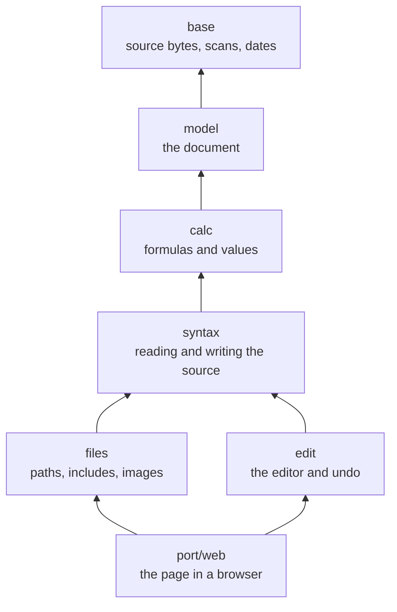

# ksmd

**ksmd is Kanso's document editor:** an editor for prose and tables with calculations, using its own Markdown-inspired `.ksmd` document language. It replaced an earlier editor, kspage, and reads none of its documents.

## Status

This folder contains the design, native examples, source validation, a reader and writer, and an editing page. Source validation checks the version header, UTF-8, line endings and file size. It preserves byte offsets for diagnostics. The reader models every structure of the design: blocks, inline markup, and table, chart, include and image clauses. The writer saves them in canonical form. A document opens inside a workspace folder, with each included file shown in place, and each source saves alone. Tables calculate, and table edits keep each formula's references on their cells.

The editing page edits one document in a browser: prose, formatting, lists and checklists, quotes, code and calculating tables, with undo and redo. Its commands stand in a ribbon, as in Office, beside a menu bar of File, Edit and View; a table's stand in its right-click menu. Cells take colours, a font size and alignment, text a colour, and paragraphs alignment. A column takes a number format, a list of choices and a colour rule for its values. A table's rows sort, filter and group, its columns resize and fit their values, and a right-click opens its menu. A range of cells is chosen with Shift or a drag, and fills down or right. The fill handle goes on with a series, and a long table keeps its heading in sight. Find and replace reach text and cells, and a contents panel lists the headings. AutoSum totals a column in one press. View, Read-only shows a document with editing switched off. File, Print saves a PDF too, without the editing marks, and a table that only feeds a chart can be left out of it. The status line shows the sum of the chosen cells, or the word count, and the page turns dark with the system. Each edit is a model transaction. Served by the local server on a workspace folder, the page opens and saves files. It shows includes and images in place, takes a pasted or dropped image, notices a change on disk, and holds unsaved edits as drafts. Opened from a file, it edits a source that a host gives it. A `.ksmd` file double-clicked in a file manager opens in the browser, on its workspace.

Markdown supplies familiar notation, but compatibility with `.md` is not a requirement. Presentations are outside ksmd's scope.

## Open a document by double-clicking it

From the repository root, `make ksmd` builds what a double-click needs: the page, the local server and a launcher. On Linux, `make install-desktop` then ties `.ksmd` files to the launcher for your user, with their icon; `make install` does this too. On Windows and macOS, `make ksmd` prints the steps that tie them by hand. "Opening a `.ksmd` document on a double-click" in [`docs/HOWTO-set-up-a-project.md`](../docs/HOWTO-set-up-a-project.md) gives the steps for each system, and how to reset them.

* **The workspace is the document's own folder**, or the nearest folder above it that holds a file named `.ksmd-workspace`. Put that empty file in a folder to open its documents together, with includes that climb with `../`.
* **Each workspace keeps its own port**, worked out from its path. So the drafts the browser holds for that address come back on the next opening.
* **On Windows, `make ksmd` and `make clean` first stop the servers the launcher left running.** Windows cannot replace a running program's file. An open page keeps its edits as a draft; open the document again after the build.

## Start ksmd on a folder by hand

Without the launcher, start the local server yourself. The folder you name is the workspace: every document, include and image stays inside it.

1. From the repository root, run `make ksmd-web kssrv`.
2. Run `./out/kssrv.exe 8090 <folder> --local --page=out/ksmd/web/ksmd.html`, with your folder in place of `<folder>`.
3. Open the whole URL it prints, `http://127.0.0.1:8090/#t=…`, in a browser. The part after `#` is the token. Without it, the page reads no file.
4. Choose File, Open (Ctrl+O), and choose a document in the dialog.

To open a document at once, put `?doc=notes.ksmd` before the `#` in the URL. Ctrl+S saves. Save as (Ctrl+Shift+S) opens a dialog that lists the workspace's folders, to choose where the document goes and its name. Open uses the same dialog. To start a new document, type it and press Ctrl+S: a document with no file yet asks where it goes. An include's Edit button opens the included file in a tab of its own.

Use the same port each time. The browser keeps drafts per address, so on another port the page finds none of them. Ctrl+C in the server's terminal stops it, and each start prints a new token.

## Open the editing page without a server

1. From the repository root, run `make ksmd-web`.
2. Open `out/ksmd/web/ksmd.html` in a browser. It is one file, and opens no other file.

The page starts with an empty document. To open a source, run `ksmd.load(text)` in the browser's console, where `text` holds the source. `ksmd.source()` returns the canonical source to save. In this folder alone, `make web` writes the page to `out/web/ksmd.html`.

## Test the model, the editor and the page

With `ksplc` installed, run `make test` in this folder. From the repository root, `make debug-ksmd` builds and runs the same tests. They check source validation, the model the reader builds, canonical saves and the refusals. They also check includes, workspace paths and saves, in scratch folders under `out/tmp`, and table edits and calculated values against results worked out by hand. They check each editing action and its undo by the source it saves.

`make test-ksmd-browser` from the root, or `make test-browser` here, drives the page in a headless Chromium. It types, composes, pastes and uses the commands through the browser's own input events, and checks the source the page gives back. It wants `node` and a Chromium, as `.devcontainer/Dockerfile` installs them.

The same run then serves the page with `kssrv --local` on a scratch workspace. It checks opening, saving and reopening, a change on disk, drafts, an included file, images and the refusals, each against the bytes on disk. From the root, the server is built and passed in. Here, pass `KSSRV=<path to kssrv>`, or that part reports itself skipped.

`make measure-ksmd` from the root, or `make measure` here, times opening, editing and saving three documents, from a typical one to one near the size limit. It runs outside the browser and in the page, and checks nothing. "What a document costs" in the [design](docs/DESIGN-ksmd.md#what-a-document-costs) records what it measured.

## Folder map

**The code is split into folders by what each one knows.** A folder imports only the folders below it, and `make test-conventions` refuses an import that goes up. The diagram lists them from the bottom; each arrow points at what a folder builds on.

| Folder | What it holds | What it knows |
| :-- | :-- | :-- |
| `base/` | Validated source bytes and their locations, the small scans the readers share, keys from a document, dates, and `name=value` attributes | nothing else in ksmd |
| `model/` | The document: blocks, inline nodes, tables, and what a column or a cell carries (a look, a format, a colour rule, choices, groups) | `base` |
| `calc/` | A formula, the values it calculates, and the calculation of every table | `base` `model` |
| `syntax/` | The reader and the writer of the `.ksmd` source, clauses and inline markup among them | the three above |
| `files/` | How a path leads to a file, the workspace on disk, what a page fetched, the assembled view of includes, and image headers | the four above |
| `edit/` | The editor: table edits, styled text, units of blocks, undo and redo, and every action | the four below `files/`; never `files/` |
| `port/web/` | The editing page: the wasm bridge and the view, and the page's scripts and style | all of the above |
| `tests/` | The tests of the package's inside | all of the above |

**`files/` and `edit/` stand side by side.** The editor changes one source and never reads a file, so it does not import `files/`; the page joins the two. Under one layer, a file may import any file of its own folder.

| File | Purpose |
| :-- | :-- |
| [ksmd/docs/DESIGN-ksmd.md](docs/DESIGN-ksmd.md) | Document syntax, model, editor, file lifecycle and limits |
| [ksmd/docs/DESIGN-page.md](docs/DESIGN-page.md) | The editing page: input, menus, tables on the page and its tools |
| [examples/](examples/) | Prose, calculating tables, includes and literal syntax |
| [base/source.kspl](base/source.kspl) | Borrowed source views and diagnostic locations |
| [base/marker.kspl](base/marker.kspl) | Which line starts a block, shared by the reader and the writer |
| [base/attribute.kspl](base/attribute.kspl) | Reads `name=value` pairs: a clause's, and a look's in braces |
| [base/dates.kspl](base/dates.kspl) | Dates: a day from and to `2026-10-23`, and the calendar's arithmetic |
| [base/keyed.kspl](base/keyed.kspl) | Values by a text key from a document, in a balanced tree instead of a hash map |
| [model/model.kspl](model/model.kspl) | The blocks, inline nodes, tables and images a document holds, and the identities of table rows and columns |
| [model/look.kspl](model/look.kspl) | A look: a cell's colours, font size and alignment, or a paragraph's alignment, and a note, read from braces and written back |
| [model/choice.kspl](model/choice.kspl) | A column's list of choices: read from `choices`, written back, and the choice a typed value is |
| [model/format.kspl](model/format.kspl) | A column's number format: read from `formats`, written back, and the text it shows for a number |
| [model/rule.kspl](model/rule.kspl) | A column's colour rule: read from `rules`, written back |
| [model/group.kspl](model/group.kspl) | A table's groups of rows: read from `groups`, written back, checked, and moved by a row edit |
| [calc/formula.kspl](calc/formula.kspl) | A formula's tokens, how its references attach to rows and columns, and how it is written back |
| [calc/value.kspl](calc/value.kspl) | A value a formula calculates, and the arithmetic and comparisons between values |
| [calc/calc.kspl](calc/calc.kspl) | Calculates every table cell, apart from the document |
| [syntax/reader.kspl](syntax/reader.kspl) | Reads paragraphs, headings, code fences and lists into the model |
| [syntax/inline.kspl](syntax/inline.kspl) | Reads the inline markup of a paragraph, a heading or a list item |
| [syntax/clause.kspl](syntax/clause.kspl) | Reads a table, an include or an image clause |
| [syntax/chart.kspl](syntax/chart.kspl) | A chart: its clause's names, the table and columns they name, and the clause written back |
| [syntax/writer.kspl](syntax/writer.kspl) | Saves the model as canonical source |
| [files/files.kspl](files/files.kspl) | Which paths are refused by their text alone, and `Files`, where a document's files are read from |
| [files/workspace.kspl](files/workspace.kspl) | The workspace on disk: the refusal of links, and reading and saving one source |
| [files/fetched.kspl](files/fetched.kspl) | The files a page fetched through the local server, and the ones it still lacks |
| [files/assemble.kspl](files/assemble.kspl) | The assembled view: each included file in place, with where each block came from |
| [files/image.kspl](files/image.kspl) | An image's format and size, read from its header before anything decodes it |
| [edit/series.kspl](edit/series.kspl) | How a line of cells goes on when the fill handle drags it: numbers by their step, text ending in a number |
| [edit/edit.kspl](edit/edit.kspl) | Inserts, removes and moves rows and columns, sets and copies cells, and adds, removes and renames tables |
| [edit/styled.kspl](edit/styled.kspl) | Styled text: a block's text as segments with marks, and the inline nodes built from them |
| [edit/region.kspl](edit/region.kspl) | Blocks taken apart into units of text, and settled into blocks again, checked by reading them back |
| [edit/history.kspl](edit/history.kspl) | Undo and redo: each action's changes, kept to swap back |
| [edit/editor.kspl](edit/editor.kspl) | The editor: the selection, and every action on prose as one transaction |
| [edit/editor_charts.kspl](edit/editor_charts.kspl) | The editor's actions on charts: a new chart of a table, and new settings |
| [edit/editor_tables.kspl](edit/editor_tables.kspl) | The editor's actions on tables: rows, columns, cells, looks, sorting, pasting, filling |
| [edit/editor_replace.kspl](edit/editor_replace.kspl) | The editor's replace action: text found in prose and cells, replaced as one step |
| [port/desktop/](port/desktop/) | The `.ksmd` file icon, a white page with the KSPL K: `ksmd.svg`, the `ksmd.ico` rendered from it, and `ksmd.rc`, which puts it into a Windows program |
| [port/web/](port/web/) | The editing page: the wasm bridge (`bridge.kspl`, `view.kspl`), and its scripts and style. `range.js` holds ranges of cells, `outline.js` groups of rows, `choices.js` choice lists, `rules.js` colour rules, `chart.js` charts, `notes.js` notes, `find.js` find and replace, and `contents.js` the contents. `file.js`, `local.js` and `keep.js` hold files and drafts, and `browse.js` the Save As and Open dialog. `touch.js` takes a touch screen's presses. `bundle.kspl` makes the page one file |
| [tests/main.kspl](tests/main.kspl) | Source validation and boundary tests |
| [tests/document.kspl](tests/document.kspl) | Reader and writer tests: expected models, canonical saves, refusals |
| [tests/include.kspl](tests/include.kspl) | Include, path, limit and save tests, each in a scratch folder it removes, and the rounds a page fetches in |
| [tests/image.kspl](tests/image.kspl) | Image header tests: formats, the pixel limit, damaged headers and windows |
| [tests/editing.kspl](tests/editing.kspl) | Table edit tests: the source each edit saves, and each refusal |
| [tests/calculation.kspl](tests/calculation.kspl) | Calculation tests: values and errors against results worked out by hand, and a document of 2,000 table names that share a hash slot |
| [tests/prose.kspl](tests/prose.kspl) | Editing actions on prose: typing, deleting, Enter, kinds, marks, undo and refusals |
| [tests/tables.kspl](tests/tables.kspl) | Editing actions on tables: adding, removing, rows and columns, cells and names, filling, and their undo |
| [tests/replacing.kspl](tests/replacing.kspl) | The replace action: text in prose and cells as one step, marks kept, and its refusals |
| [tests/blocks.kspl](tests/blocks.kspl) | Checklists, quotes and dividers: reading, saving, ticking a box, and making each |
| [tests/charts.kspl](tests/charts.kspl) | Charts: reading, refusals, following a renamed column, and inserting and setting one |
| [tests/choices.kspl](tests/choices.kspl) | Choice lists: reading, what a typed value becomes, the refusals, and their undo |
| [tests/rules.kspl](tests/rules.kspl) | Colour rules: reading, refusals, setting one and its undo |
| [tests/notes.kspl](tests/notes.kspl) | Notes on cells and paragraphs: reading, refusals, adding, resolving and their undo |
| [tests/groups.kspl](tests/groups.kspl) | Groups of rows: reading, refusals, edits and their undo, and what a row edit or a sort does to them |
| [tests/format.kspl](tests/format.kspl) | Number formats: the text each kind shows, rounding and edges, reading, refusals, and setting one with its undo |
| [tests/browser/](tests/browser/) | The page in a headless Chromium, driven over the DevTools protocol, and served by the local server (`served.mjs`). `tools.mjs` checks the tools over a whole document or a range of cells. `measure.mjs` times the page on the documents `tests/measure.kspl` writes |
| [tests/measure.kspl](tests/measure.kspl) | Writes a typical, a medium and a large document, and times their view, values, an edit and a save outside the browser |

## Further reading

Read the [design](docs/DESIGN-ksmd.md) for the document language, the model, the file lifecycle, the limits and what the editor does not do yet. The [page's design](docs/DESIGN-page.md) covers the editing page. The repository's [development principles](../docs/DESIGN-principles.md) explain how to weigh reuse and complexity.
