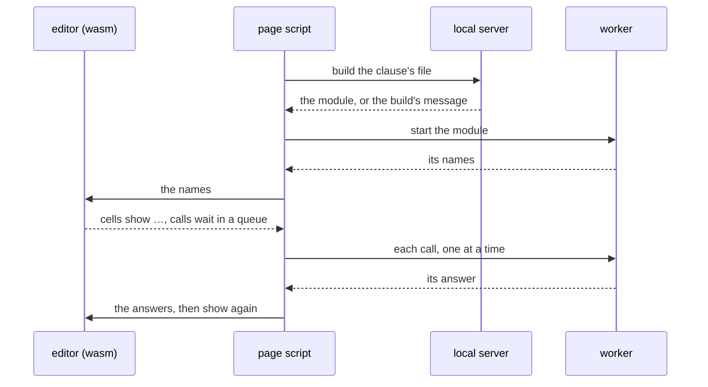

# The ksmd editing page

**This document says why the editing page in a browser works the way it does**: its input, its menus, its tables and its tools. The document language, the model, the editor's actions and the file lifecycle are in [`DESIGN-ksmd.md`](DESIGN-ksmd.md).

## Input, menus and tables

`ksmd/port/web/` holds the page: `bridge.kspl`, `bridge_tables.kspl` and `view.kspl` built as wasm32, and the script and style that show the model. `make ksmd-web` builds it as `out/ksmd/web/ksmd.html`.

**Text arrives through `beforeinput`, which the page cancels.** The page runs the matching action, renders the blocks it changed, and puts the selection back from model spots. So the browser's own undo has nothing to undo. A dropped item is refused.

**An input method's composition is the one edit the browser makes itself**, since it cannot be cancelled. While a composition lasts, the page renders nothing and runs no action. When it ends, the page waits one turn, then takes the change in the element's text as one transaction. The key press that starts an input method deletes a selection first.

**The selection is two model spots.** A spot names a block, a list item and a UTF-8 offset into its text, or a gap. The page maps between spots and places on the page at each action, and keeps no place across one.

**Only the blocks an action changed are rendered again.** A table edit shows every table again, since a value can depend on another table.

**The menu bar holds every command: File, Edit, View, Insert, Format and Table.** Each item shows its icon, its name and its shortcut. One list in `ksmd/port/web/commands.js` gives each command its name, key and icon, and builds the menus, the right-click menu and the quick access bar. Open and Save stand in File only where the local server opens files.

**A command's work stands in the script that does it, which registers it by name** (`ks.handle` in `ksmd/port/web/core.js`). The registration also says what the command needs: a chosen cell, Repeat, or nothing that edits under Read-only. That file only looks a command up, so a new command touches its list entry and its own script.

* **The page does not start while a command lacks a handler, or a handler its command.** An item that does nothing would otherwise be found only by pressing it.
* **The chosen cell has one keeper, `ksmd/port/web/table.js`.** Another script changes it through `ks.table.chooseCell`, and a plain write throws, so a wrong choice has one door to look at.

* **A menu opens on a press of its name, not on pointing.** While one menu is open, pointing at another name opens that one. A flyout opens on pointing, on a press, or with Right.
* **Esc, a press outside and a chosen command close every menu**, and the focus goes back where it was. The arrow keys move through the menus and flyouts.
* **Edit holds Cut and Copy, which run the browser's own cut and copy.** So each acts as its key does where the focus stands, and a touch screen without keys reaches them.
* **Paste stands after them, and reads the clipboard through the browser, as Excel for the web does.** It hands what it read to the place the focus stands, as a paste with Ctrl+V would. So it acts as Ctrl+V does there, through the same code.
  * **A browser may ask the person first, or refuse.** Without Paste, a person whose mouse is in hand, or who has no keys, has no way to paste.
  * **Where the browser refuses, or cannot read the clipboard, the page says "Press Ctrl+V to paste." and changes nothing.** A cut that waits in the page still moves, since it needs nothing from the clipboard.
  * **The browser hands a page only plain text and HTML.** So a whole table copied from ksmd pastes from the menu as tab-separated rows, and whole with Ctrl+V.

**A table command that cannot act is disabled, not hidden**, so the menu does not change shape.

**A right-click on a cell, a row number or a column letter opens the table menu at that place.** It chooses that cell first, but keeps a chosen range it falls inside, and whole rows or columns chosen. Shift+F10 or the menu key in an open cell opens it too. Cut, Copy and Paste stand first, as in Excel's cell menu. The Table menu's commands follow (`TABLE_GROUPS` in `ksmd/port/web/commands.js`). Rows, Columns and Note stand in the menu itself, and the other groups are flyouts, so the menu fits a window 600 pixels tall.

**A command's key stands beside its item, and the same list runs it from a cell**, so the two keys cannot differ.

**A table shows as an HTML table of calculated values**, with column letters and row numbers. The row of names under the letters is the table's heading. A press chooses a cell. A double press or F2 opens it in an input of its own. Typing on a chosen cell replaces its value. Enter, Tab and the arrow keys move the choice, passing over hidden rows, except in a cell opened to edit (below). Esc drops the open cell's edit. The arrow keys past the first or last row leave the table for the gap there.

**Alt+Enter types a line break inside an open cell**, as in a spreadsheet, and the cell shows its lines. A line break typed into a cell that held none turns its Wrap text on, in the same step, as Excel does. Unwrapped, the lines after it would run past the column and be cut. The open cell's box is as tall as the lines it shows, those its column's width breaks included. So no line scrolls out of sight while the cell is edited.

**An open cell has Excel's two modes.** A cell opened by a double press or F2 is *edited*. Every arrow key, with Shift or Ctrl or neither, then works on its text, and the caret never leaves the cell. A cell typed into is *entered*. Up and Down then take the text and move to the next cell. Left and Right move the caret inside the text, and to the next cell at its edge. F2 in an entered cell edits it. Enter, Tab and Esc act the same in both.

**Sorting orders a table's data rows by the chosen cell's column, as one step of undo.** Numbers come first, smallest first, then text from A to Z without regard to case, then `false` and `true`, then errors. Descending reverses that order. Empty cells stand last either way. Rows with equal values keep their order, so a sort by one column after another sorts by both. A formula sorts by its calculated value.

**A column filters from its heading.** Each name carries an arrow, and pressing it opens a panel under that column (`ksmd/port/web/filter.js`):

* The panel holds the two sorts, Clear filter from this column, a search box, and the column's values with tick boxes. OK applies them.
* A condition is folded away under the list: is, is not, contains, is greater than, is less than, is empty, is not empty.
* Typing in the search box narrows the list shown, and never unticks a value.
* The values are listed in the order the column sorts in. Values that differ only in case are one value, and empty cells one value listed last. The list stops at 1,000 values and says so.
* **Past 1,000 values, the search looks through all of them**, and lists the first 1,000 it finds.
* **A value the list never showed was never unticked, so it stays shown.** Past 1,000 values, OK keeps whichever is fewer: the values ticked (`in:`), or those left out (`out:`), which lets a value added later show. Up to 1,000, OK keeps the values ticked.
* **A column's dates stand in a tree: years, then months, then days.** Each year and month starts folded, and its button or Right and Left open and fold it. A month is named in the browser's language. A day stands by its date, whatever format its cell shows it in, so a year stands once.
* **A year's or a month's box ticks every day under it.** Where only some are ticked, it shows a mix, as (Select all) does.
* **A search opens the years and months that hold a match**, and hides those that hold none. A day matches by its whole date, `2026-01-15`, or as its format shows it.
* **The column's other values, text, numbers and blanks, stand after the tree, as a list.** A date column that holds a stray text keeps it in sight to be ticked or not.
* **The tree is a way of listing, so the filter stays a set of ticked values.** A year ticked whole holds its days as they stand, and a date added later is not in it.

**Each column holds one condition, and a row shows when it meets every column's.** A narrowed column's arrow is marked, and a line above the table says how many rows are shown. The right-click menu's Filter group opens the same panel, and can show only the rows with the chosen cell's value.

**A filter is kept in the file, so a document opens with the rows it was left with** (`filter` in [`DESIGN-ksmd.md`](DESIGN-ksmd.md)). A person who narrowed a long table to their own rows finds it so the next day, as in Excel.

* **The next reader sees at once that rows are hidden.** The line above the table says how many of how many rows show, and its Show all rows takes the filter away.
* **The file still holds every row**, and a formula counts every row, shown or not. Only the page hides them.
* **Each change of a filter is one step of undo**, since it changes the file.
* **A new row keeps the filter, and shows until the filter is chosen again**, as in Excel. The filter would hide the empty row at once, and the person could not type in it. A value typed in the new row leaves it in sight.
* **A row is new where the table did not hold it when its filter last changed.** A row inserted, a row a paste adds past the end, and a row an undo or a redo brings back are new. A row moved by Insert cut rows is not, and the filter shows it as before.
* **Choosing the filter again applies it to every row**, as Excel's Reapply does. OK in its panel and Show all rows choose it again, and so does an undo that changes it. So does opening the document again: the file holds no mark of which row is new.
* **The filter stays the same in the file**, and one undo takes away the new row alone.
* **With no value ticked and no condition, OK cannot be pressed**, as in Excel: no row would show. A condition counts once its value is typed, or at once for is empty and is not empty.
* **In Read-only, a filter is the viewer's alone.** It narrows the rows for them, and the file keeps its own. Editing again shows the file's.

**Under the menu bar stands a quick access bar: one row of the tools the person chose, as icons.** The menus hold every command, so the bar needs only the few a person uses most. View, Quick access bar opens the chooser, and a right-click on a command adds it or takes it off. The bar keeps the menus' order, and a tool its menu hides stands nowhere on it.

**The bar shows what stands at the caret.** The kind of block shows in its list. A mark, a kind of list and an alignment are pressed in where all the selected text has them. At a caret, they are pressed in where typed text would take them. A tool that cannot act there is greyed out.

**The choice of tools is this browser's own**, so nothing goes into the file. Reset brings back the tools every page starts with (`QUICK_DEFAULT` in `ksmd/port/web/commands.js`).

* **The font colour acts on the selected text or the chosen cells; fill and size act on cells alone.** With nothing selected, a colour applies to the text typed next; Automatic takes it away.
* **The colour tools are split**: the face applies the colour shown on it, and the arrow opens a palette.
* **Clear format takes colours, size, alignment and a cell's own number format away in one step.** In text it takes the colour and the paragraphs' alignment away; the marks stay, as part of what the text says.
* **Paragraph (Ctrl+Alt+0) turns every selected block back into a plain paragraph, in one step.** A heading, a list item, a checklist item, a quote and a code block all go. Ctrl+Alt+1 to 6 make headings.
* **Clear format leaves the kind of block**, as it leaves the marks. A heading and a list say how the text is built, and the contents are made from the headings. A command that cleared both would turn a whole document flat in one press. So clearing the kind is one command and clearing the look another.

**A look acts on the cells where a cell was worked in last, and on the selected text otherwise.** Alignment on text aligns the paragraphs and headings the selection touches.

**Shift+click chooses a range of cells from the chosen one, and so does a drag across cells** ("Ranges of cells" below). Once the drag reaches another cell, the open cell closes unchanged, and the range follows the pointer until the button comes up.

**The Number format group sets the format of the chosen cells in one step**, or of columns chosen whole by their letters. Currency asks for a code, and takes no places for JPY and KRW and two for every other code. The filter panel lists and matches the text a format shows. So a change of format takes the filter of each column it reaches away, in the same step: its entries would match no row.

**Three ways choose a whole table: Ctrl+A twice in a cell, the corner left of its column letters, and Select table.** Select table stands in the Table flyout. The first Ctrl+A chooses the data cells, as in Excel, and the second adds the names. A frame shows round the table. Only these three choose it whole: in a table with no data rows, a press on a name chooses that cell alone.

* **A copy of the whole table carries it three ways**: as ksmd's own source (`application/x-ksmd`), as tab-separated rows, and as an HTML table. A spreadsheet takes the rows, a word processor the HTML, and ksmd its own source, so nothing is lost between two ksmd documents.
* **A paste of it in text puts the same table after the caret's paragraph**, as one step: its formulas, looks, formats, widths, heights and filter. A paste on a whole table chosen puts it after that table.
* **A name another table has gains `_2`, `_3` and on**, and the table's own formulas follow the new name. `_` keeps a plain name plain, so a formula still names it without quotes.
* **Delete, Backspace and Cut on the whole table remove it, as one step.** On the data cells alone, Delete clears them, as it clears any range. Word's Delete clears a selected table's text and only Backspace removes it, which people find hard to tell apart.
* **The caret takes the table's place** ("Removing a whole block" below).

**Ctrl+C on a range puts its values on the clipboard as tab-separated rows**, which a spreadsheet takes, each number as calculated. A paste of such rows fills the table from the chosen cell, as one step, growing the table as needed. Each pasted value reads as typed text does, and `1,234.5` is a number. Rows pasted into text make a new table, whose first row gives the names.

**The document fills the window's width by default, with a margin of 32 pixels**, so a table has a spreadsheet's room. View, Reading width keeps lines about 50 characters long instead, for long prose. The choice belongs to the browser, not to the document.

**Ctrl+; types today's date, and Ctrl+: the time**, in a cell and in the text; the Insert menu holds both. They are written `2026-10-23` and `14:05`, ISO 8601's forms. In a cell, the date is a date and the time is text.

**A cell is chosen when the mouse button goes down, not on the click.** The press can remove a gap above the table and move the table up a line, so no click would come. For the same reason, the second press of a double-click opens the cell the first chose.

**While a person works in a table, the page draws no caret in the text.** A caret beside a table would stand in a gap, which would push the table down a line after each action. So the keys go to the chosen cell. Esc, a press in the text, and an arrow key past the table's edge leave the table. The caret then comes back where the model holds it.

**Removing a whole block puts the caret on the block that takes its place** (`remove_whole` in `ksmd/edit/editor.kspl`). That is the start of the text after it, else the end of the text before it. A table, chart, image, include or divider goes this way, by its Remove button, the table menu, or Delete on a whole table.

* **The window scrolls only as far as it must to show the caret.** The person goes on working where the block stood, not at the top of the document.
* **The caret takes a gap only where no text stands on either side**, as in an empty document. A gap shows as an empty line, which looks like a paragraph no one typed.

**Ctrl+End and Ctrl+Home reach the gap after a last block, or before a first one, that holds no text**, such as a chart. The browser cannot put its caret beside such a block, and would leave it where it was. Where text stands at that end, the browser's own move stays.

**An image and an include show what their clauses say.** Opened from a file, the page shows an image's path, alternate text and caption, and a marked box naming an include's path. Served by the local server, it shows the image and the included blocks in place ("The file lifecycle" in [`DESIGN-ksmd.md`](DESIGN-ksmd.md)).

**An image goes in three ways: Insert ▸ Image…, a paste, or a drop.** Each takes a PNG or a JPEG, asks for its alternate text, and writes the file beside the document under the first free name (`<name>-image-<n>.png`). Its clause goes in at the caret. The menu item opens the system's file chooser, so a person who has no image on the clipboard can still add one.

**A paste takes the clipboard's plain text.** Each line starts a block of the caret's kind. When the clipboard also held formatting, the page says that it was not kept.

**The page is built as wasm32 with no C library**, using clang's bulk-memory instructions to copy and fill memory. **It is one file**: `ksmd/port/web/bundle.kspl` puts its style, its scripts and its wasm, as base64, inside `ksmd.html`. So the page opens from a file, and the local server hands it out alone.

**Opened from a file, the page reaches no file: a host opens and saves through two calls.** `ksmd.load(source)` opens a source, or names the line and column it refuses. `ksmd.source()` returns the canonical source to save, and `ksmd.onchange` learns of each change.

**The editor's memory is a fixed 128 MiB.** An action that starts with less than 16 MiB free is refused, and the page asks the person to save and open the document again. The document and its whole history stay in that memory until another document opens.

## Column widths and row heights

**A table's columns and rows keep the sizes a person gives them, as in a spreadsheet** (`sizes.js`). The file holds them as `char_widths` and `heights` ("Model and editor architecture" in [`DESIGN-ksmd.md`](DESIGN-ksmd.md)).

* **A column is as wide as its width in characters, and the table as wide as its columns.** A narrow window makes the page scroll sideways, and no text wraps to fit it. A table that filled the window wrapped its text differently on each screen, and a person could not make one column stay narrow.
* **A column with no width fits its text**: its widest value or its name, from 3 to 60 characters. Rows a filter hides count too, so a filter moves no column.
* **A cell's text stays on its lines.** Alt+Enter's line breaks still show as lines, and nothing else breaks a line, unless the cell wraps.
* **Wrap text, as Excel's, breaks a cell's text into lines at its column's width.** It is set on each cell, as `wrap="on"` in its braces. Its row grows to show the lines, unless the row has a height. A word too long for the column breaks inside the word.
* **A text runs on over the empty cells to its right, and is cut where the next cell holds a value**, as Excel shows it. It is cut at the table's right edge too.
* **A number, a date or an error is always cut at its own cell.** A number or a date too wide for its column shows `###`, as in Excel: cut, 1200 would read as 120. Opening the cell shows the value.
* **A row with a height is that tall, and text taller than it is cut.** A row without one fits its lines.

**Dragging the right edge of a column letter sets that column's width**, and every other column keeps its own. The last column has an edge too. When the button comes up, the width is saved in characters, as one step of undo.

* **Where the chosen cells run through every row of their columns and the edge is one of theirs, each takes the width**, as in Excel. Column letters, Ctrl+A and the corner choose such cells.
* **While the edge moves, the status line shows the width in characters.** A press that does not move changes nothing.

**Dragging the bottom edge of a row number sets that row's height in points**, as one step of undo. A dashed line with the height shows where the row's bottom will stand. Chosen cells that run across every column take the height together.

**A double-click on an edge fits it to its text.** On a column's edge, or on the border between two cells, the column takes the width of its widest value, and keeps it. On a row's edge, the row's height goes, so the row fits its lines again. The chosen columns or rows fit together, as a drag sets them.

**In a cell, chosen or open, Alt+Right makes its column one character wider and Alt+Left one narrower.** Each press is one step of undo. The keys work in the cell because a keyboard already reaches it; a focusable edge would be one more Tab stop on every table.

**Column width… and Row height… ask for a number**, as Excel's dialogs do. Both stand in the Size flyout of the Table menu and the right-click menu, beside Fit column width. Each change is one step of undo.

* **Column width takes 0.5 to 255 characters, with at most one decimal place.** The chosen columns each take it. An empty answer lets them fit their text again.
* **Row height takes whole points from 6 to 409.** An empty answer takes the height away. The rows keep their heights on paper too.
* **Only the data rows in sight take the height**, as in Excel. A row a filter or a closed group hides keeps its own. Row height cannot be pressed on the names row, which takes the height its text needs.
* **A number outside the limits is refused, and the page says which numbers it takes.** Nothing changes then.
* **Neither has a key of its own.** Excel's Alt, H, O, W and Alt, H, O, H walk its ribbon, which the page does not have.

## Ranges of cells

**A range of cells runs from the chosen cell to a far corner.** Shift+click and Shift with an arrow key reach it from the chosen cell. A press on a row number chooses that row, and one on a column letter that column's data cells. Shift with either press reaches from the chosen cell's row or column.

* **The range keeps the identities of its rows and columns, as a formula's range does.** A row added above it, a sort or an undo leaves it on the same cells.
* **On a chosen cell that is not open, the keys act on the range.** Delete and Backspace clear its cells as one step, and each cell keeps its look. A typed character opens the chosen cell with that character in place of its value.
* **An input method composes from the first key.** The focus stands in an invisible text box over the chosen cell, since Windows keeps an input method off where no text can be typed. What is typed or composed there opens the cell, and the box becomes its input, so a composition goes on unbroken.
* **Copy, cut and paste act on the range.** A paste of one value fills every cell of the range. A paste of rows fills the table from the range's corner. A cut clears nothing: its cells wait for a paste that moves them ("Moving cells" below).
* **A look applies to every cell of the range in one step.**

## Pointing at cells in a formula

**While a formula is typed, a press on a cell writes its reference at the caret, and a drag writes a range.** Excel calls this point mode (`ksmd/port/web/point.js`). Typing `=sum(`, then a drag from A1 to A2, gives `=sum(A1:A2`.

* **It acts only where a reference can go.** The cell's text starts with `=`, and the caret stands after `=`, `(`, `,`, `:`, an operator, or the word `and`, `or` or `not`. Inside quoted text it does not act.
* **Only the data cells of the same table are pointed at.** A press on a name, on another table or outside the table ends the edit as before. So does a press where no reference can go, such as after a number.
* **The cell stays open, with the caret after the reference.** Enter takes the formula, and Esc drops the edit, as in any open cell.
* **Pointing again replaces the reference just written**, until the person types or moves the caret. Shift with a press reaches a range from the cell pointed at last.
* **A frame shows the cells pointed at while the button is down.**
* **A selection is replaced by the reference.** So AutoSum's selected range changes by a drag.
* **The arrow keys do not point.** In Excel they point while a formula is being typed, and move the caret once F2 has opened the cell. People find the two modes hard to tell apart. In the page, the arrow keys act in a formula as in any open cell.

## Moving rows and columns

**Rows move by a cut and Insert cut rows, as Excel's Insert Cut Cells moves them.** Columns move the same way, by Insert cut columns. Excel users already move rows this way, so the page has no Move row up or Move row down.

1. Choose whole rows by their row numbers, or whole columns by their letters. Shift with a press reaches across several.
2. Cut them with Ctrl+X or Edit, Cut. Nothing is removed yet: a dashed frame marks the lines, as Excel's moving border does.
3. Right-click a row number, or a column letter, and choose Insert cut rows or Insert cut columns. The lines move to stand above that row, or left of that column. The lines between close up.

**Insert cut rows stands in place of Insert row above while rows of that table are cut**, as Excel's Insert reads Insert Cut Cells then. Insert cut columns likewise stands in place of Insert column left. So the menu keeps its shape, and the item stands where a person looks for Insert.

* **The move is one step of undo, and the moved lines stay chosen at their new place.**
* **Each line keeps its identity** (`move_lines` in `ksmd/edit/editor_tables.kspl`). A formula's reference follows its row or column, so no `#REF!` appears. A row takes its height and notes along. A column takes its name, width, number format, filter, choices and colour rule, and a chart still finds it by name.
* **A group keeps its places, as after a sort**: it belongs to the table's layout ("Groups of rows and columns" in [`DESIGN-ksmd.md`](DESIGN-ksmd.md)).
* **A move is refused whole when a formula would grow past 4,096 bytes**, or when a chart would no longer find its column. Nothing changes then, and the page says why.
* **Esc, or any other change to the document, drops the cut**, as in Excel. A place inside the cut lines, or just after them, changes nothing, and the cut stays.
* **The cut also puts the lines' values on the clipboard as tab-separated rows.** So a paste in another program takes them, and the lines stay, as in Excel.
* **Ctrl+V or Paste on a row moves cut rows there, writing over the rows they land on**, as Excel's Paste does. Their own rows are left empty. Cut columns go to the chosen column the same way, names included. Insert cut rows and Insert cut columns still insert, and write over nothing. The paste works as a paste of cells ("Moving cells" below).
* **Lines move only inside their own table.** Insert cut rows reads so only in the menu of the table they were cut from.
* **A drag does not move rows.** Excel's drag with Shift held inserts, without Shift it writes over the cells it lands on, and its browser version swaps the two. A press that slips then overwrites data. A cut and an explicit Insert never write over a cell.

## Moving cells

**A cut of cells and a paste in the page move them, as in Excel.** The cut removes nothing: a dashed frame marks the cells until the paste.

* **The cells there take the cut cells whole**: their values, formulas, looks, number formats and notes (`move_cells` in `ksmd/edit/editor_tables.kspl`). The cells the move leaves behind become empty.
* **A reference to a moved cell follows it, wherever its formula stands**, as in Excel. A formula moved keeps pointing at the same cells.
* **A range follows when it moves whole.** A range moved in part stays where it is. Excel moves each corner of a range on its own. So a range's end cell moved inside it drops cells from a sum, without a word.
* **A reference to a cell written over becomes `#REF!`, as in Excel**, and so does a range whose two corners were written over. The value it named is gone.
* **The move is one step of undo, and the moved cells stay chosen at their new place.** The table grows rows and columns where the cells reach past it, as a paste of rows grows it.
* **A move is refused whole when a formula would grow past 4,096 bytes**, or when the table would pass its limits. Nothing changes then, and the page says why.
* **A cut pastes once.** Esc, or any other change to the document, drops it, as in Excel.
* **The cut puts the cells' values on the clipboard as tab-separated rows**, so another program takes them, and the cells stay. Text on the clipboard other than the cut's own was copied later, so a paste drops the cut and pastes that text.
* **Cells move only inside their own table.** A paste in another table is refused, and the page says to copy instead. A reference across tables would need the same care, and a person rarely moves cells between two tables.
* **The names move only along the names row**, since a name names a column, not a value.

## Filling cells

**Ctrl+D fills a range down from its top row, and Ctrl+R right from its left column.** A range of one row fills down from the cell above it, and a range of one column right from the cell left of it. The right-click menu holds both, and each fill is one step of undo.

* **Each cell is copied through the model's copy of a cell** (`copy_cell` in `ksmd/edit/edit.kspl`), look included, so references shift as a copy shifts them.
* **A fill is refused whole.** A copy that would write a formula longer than 4,096 bytes puts back every cell copied before it.
* **A drag of the square at a range's lower right corner goes on with a series, where the cells make one, or repeats them.** Ctrl+D and Ctrl+R always copy (`ksmd/edit/series.kspl`).
  * **Two or more numbers with one step between each go on by that step**: `1, 2` gives `3, 4`, and `10, 7.5` gives `5, 2.5`. The arithmetic is in decimal digits, so `0.1, 0.2` gives `0.3`.
  * **Text that ends in a number goes on by its step, or by one from a single cell**: `Item 1` gives `Item 2`, and `Q1, Q3` gives `Q5`. A number with leading zeros keeps its width: `Week 08` gives `Week 09`.
  * **Anything else repeats**: one number alone, numbers whose steps differ, a formula, a mix of kinds, and a date or a time written as text. A date cell goes on by days. Steps that differ repeat rather than fit a straight line, so a person can work out every value from the cells.
* **Ctrl+D and Ctrl+R act only while a cell or a range is chosen.** Elsewhere the browser keeps them.

## Exporting a table

**The right-click menu's Export as CSV downloads the table**, so another program can take its values.

* **The file holds the names, then each row's calculated values**, every row whether hidden or not. A number is written before any format, with `.` for its point and no separators.
* **A value is quoted only where it holds a comma, a quote or a line break**, and a quote inside is doubled. Lines end in CR LF, as RFC 4180 writes them.
* **Text that starts with `=`, `+`, `-`, `@`, a tab or a CR gets a `'` before it, and is quoted.** A spreadsheet would run such text as a formula, and a formula can open a link or start a program. A number is never changed, so `-5` stays a number.
* **The file is UTF-8 with a byte order mark.** Without one, a spreadsheet can read the bytes in the computer's own code page, and text outside ASCII comes out wrong.
* **The file is named after the table**, with the characters a file name cannot hold made `_`.

## Find and replace

**Ctrl+F opens a find bar under the quick access bar, and Ctrl+H opens it with its replace part.** The Edit menu and the bar's Find tool open it too. A short selection on one line becomes the search text.

* **Find looks in the text the page shows, and in each cell's text as a person edits it.** So a formula's source is searched, and its calculated value is not.
* **A match can cross formatting**, but stays inside one paragraph, heading, list item, code block or cell.
* **Without Match case, each character is compared in lower case, alone**, so a match keeps the text's own places in every script.
* **Enter and F3 go to the next match, and Shift+Enter and Shift+F3 to the one before.** The bar says which match is current, and of how many. Esc closes the bar and selects the current match.
* **The matches show through the browser's highlights, which add no element**, so the find bar never disturbs an input method's composition.
* **Only Replace and Replace all change the document.** Replace all changes every match as one step of undo, prose and cells together.
* **The new text takes the marks of the first character it replaces.** So a bold word stays bold, and text inside a link stays in the link.
* **A replace is refused whole**, as every action is. A cell text the file cannot hold, or a match that no longer stands where it was found, changes nothing.
* **Find does not look in an included file's blocks, nor in rows a filter hides.** An included file edits in a tab of its own, and Replace all changes nothing a person cannot see.

## The heading row of a long table

**A table's column letters and names stay in sight under the header while the page scrolls through the table** (`position: sticky` on the table's `thead`).

* **A table never scrolls in a box of its own.** A box would take the mouse wheel in the middle of a document, and its heading would hide under the header. A table wider than the page reaches past it, and the page scrolls sideways.
* **The row numbers and the first column stay in sight while the page scrolls sideways** (`position: sticky` on each row's first two cells). So a row of a wide table keeps its name, as a spreadsheet's frozen first column does. `table.js` measures the row numbers' width, so the first column stands just right of them. It measures a table that an include shows too.
* **Every table's heading sticks, and no source notation chooses it.** A choice per table would change the file for a way of looking.
* **On paper, the browser repeats the `thead` on each page.**

## Colour rules on the page

**The right-click menu's Look flyout holds Colour by value…, which opens a small panel over the table.** It holds the condition (below, above, equal to, empty, or no rule), its value and a style. The styles are ready-made pairs, such as a light red fill with dark red text, so a person picks one rather than two colours. Apply sets the rule as one step.

**A colour scale is one more condition in the panel**, with the colour of the greatest number: yellow, green, red or blue. The least number's cell stays white.

**The panel keeps colours written in the file that it does not offer.** It lists them as one more choice, chosen, so Apply changes only what the person changed. A new scale starts from white.

## Notes on the page

**A cell with a note has a red corner, and a paragraph or a heading with one has a bar at its left.** Pointing at it shows the note.

* **Insert, Note asks for the note of the chosen cell, or of the paragraph the caret stands in.** An empty answer resolves it.
* **The table's right-click menu holds Note… and Resolve note.** Each change is one step of undo.

## Choices on the page

**The right-click menu's Columns group holds Choices…, which asks for the column's list as one line**, such as `Open, In progress, Done`. An empty line clears it.

* **An open cell of the column offers the list while one types** (an HTML `datalist`).
* **A value off the list stays in its cell to be put right, and the page says why.** Esc, or leaving the cell, drops it.
* **A cell that holds a value off its column's list has a wavy underline**, and its title names the choices.
* **A choice takes a colour after `=` in that line**, such as `Open=red, Done=green`. The names are red, yellow, green, blue, orange, purple and gray, each a fill and a text colour that read together. `=own` keeps colours the file gave, and `=none` gives none.
* **Text after the last `=` that names no colour is part of the choice**, so `1+1=2` is a choice of its own. A choice with no colour whose text ends in `=` and a colour's name shows with `=none` after it. So the line reads back as the same choices.
* **A cell that holds a coloured choice shows its colours**, as a tag does in a list of tasks.
* **Colour rows by this column, in the Look flyout, colours each row by the choice that column holds.** Pressed again on that column, it stops. A column's colour rule stands over a row's colours.
* **A column with choices opens its cells in a box of one line**, the only box a browser offers a list in. Other cells open in a text area that keeps line breaks.

## A link in a cell

**Insert ▸ Link… on a chosen cell links the cell's text**, and an empty answer takes the link away. The text shows as a link. It opens in a new tab on Ctrl+press, or on a press while read-only, as a link in the text does. A plain press chooses the cell, so it can still be edited.

## Groups of rows and columns on the page

**A table's outline of rows stands left of its row numbers, and its outline of columns above its letters.** Each has one line of marks per level of groups (`outline.js`).

* **Each group has a button on the line before it: − while its lines show, + while they are hidden.** A hidden row or column could not hold the button. A line runs beside the lines of a group that shows.
* **The right-click menu's Group flyout holds Group rows (Alt+Shift+Right), Ungroup rows (Alt+Shift+Left), Hide detail and Show detail.** They act on the chosen cells' rows.
* **The same flyout holds Group columns, Ungroup columns, Hide column detail and Show column detail.** They act on the chosen cells' columns.
* **A hidden column takes no width, and the arrow keys and Tab pass over it.** Its `col` stays, so each `col` keeps standing over its own cells.
* **A row shows only when neither a hidden group nor a filter hides it.**

## A chart's panel

**A chart's Edit button opens a panel**: the kind, series in columns or in rows, the labels column, the series drawn and the title (`chart.js`). In rows, the panel lists the rows that the editor takes as series, and asks for the first and last columns drawn. Such a row holds text written in the labels column, not a calculated value. The saved chart finds the row by that text, so the text holds no `,` and no row above it holds the same text. The view sends these rows for each column (`sr` in `ksmd/port/web/view.kspl`), so the panel and the editor apply one rule. Apply sets the chart as one step.

## Page setup, numbers and references

**File ▸ Page setup… opens a panel for the document's settings.** It holds the paper, the orientation, the header and the footer. It also holds where heading numbers start, and the words before table and image numbers. Apply sets them as one step (`settings.js`).

* **The settings stand at the document's top as a dashed bar** that says what they set, with Edit and Remove. Paper never shows the bar.
* **A heading's or a caption's number is drawn by CSS from an attribute, never written into the text.** The editor counts the text of each block, so a number inside it would move every caret after it. The contents list shows the numbers too.
* **A reference's `#` stays in the text and takes no room.** Its number is drawn after it.
* **Ctrl+press on a reference, or a press while read-only, scrolls to what it names.**
* **Table ▸ Caption… sets a table's caption, and the Look flyout's Merge repeated values merges the chosen column** (`merge.js`). Each is one step of undo, and pressed again on a merged column, it stops.

## Drawing on an image or a chart

**An image and a chart each have the tools Rectangle, Arrow, Line, a colour, Text… and Delete** (`drawings.js`). The shapes are saved in the picture's clause ("Shapes drawn over an image or a chart" in [`DESIGN-ksmd.md`](DESIGN-ksmd.md)).

* **A shape is drawn by a drag across the picture once its tool is pressed.** The new shape is then chosen.
* **A press on a shape chooses it, and a drag moves it**, kept inside the picture. Delete takes the chosen shape away, and Esc lets it go.
* **A chosen shape takes the keyboard's focus.** Where the focus then goes to the text or to a field, Delete and Backspace act there and leave the shape. Any change to the document lets the chosen shape go, as another shape can then stand in its place.
* **A shape stands no further than 20,000 pixels from the picture's corner**, the most the file's reader takes, however large the image is.
* **The colour list sets the colour of new shapes and of the chosen one.** Text… writes the words inside the chosen rectangle.
* **Each change is one step of undo.** The page sends the whole list as `draw` lines, so the file's reader checks every change.
* **The shapes are drawn in the picture's own pixels**, so they scale with it. A line's width, an arrow's head and the words keep a size a person reads.
* **Read-only, an included file and paper show the shapes without the tools.**

## A diagram on the page

**Insert ▸ Diagram puts an empty drawing area at the caret** (`diagram.js`). Its tools draw a box, a diamond, a start or end dot, a group and a note. They also draw an arrow or a line between two shapes. The file's form is "Diagrams" in [`DESIGN-ksmd.md`](DESIGN-ksmd.md).

* **A shape is drawn by a drag across the area once its tool is pressed**, or at its own size by one press. An arrow is drawn by a drag from one shape to another.
* **A press chooses a shape or an arrow.** A drag moves a shape and its arrows follow, kept inside the area. A group carries the shapes it holds whole.
* **A chosen shape's corner handle resizes it, and the area's corner handle resizes the area**, never smaller than what it holds.
* **A chosen arrow shows a handle halfway along each stretch; a drag of one adds a bend there.** A bend's own handle moves it, and two presses on it take it away.
* **Two presses on a part, or Text…, open a box for its words.** Ctrl+Enter or a press elsewhere takes them, and Esc drops them. A shape's words may have several lines.
* **Mono, the colour list and the ground list change the chosen part**, and the next one drawn. Caption… writes the words under the diagram.
* **Delete takes the chosen part away, and a shape's arrows go with it.** An arrow key nudges a chosen shape one pixel, ten with Shift.
* **Each change is one step of undo.** The page sends the whole clause, so the file's reader checks every change.
* **The area shows at its own size, and a wide one reaches past the page**, as a wide table does. Paper shrinks it to the page's width. Read-only, an included file and paper show it without its tools.
* **The page tells two presses apart itself.** The first press draws the area again, so the browser sends no double-click.
* **The box for a part's words stands outside the document**, as the chart's panel does. Inside it, the document's own keys would type into its text.

## AutoSum

**Sum (Alt+=) puts a total in the chosen cell** (`autosum.js`). The AutoSum flyouts of the Table menu and the right-click menu also give Average, Count numbers, Max and Min.

* **In one cell, it types `=sum(...)` over the whole column above, and leaves the cell open with the range selected.** Enter takes it, and typing changes the range. Where nothing stands above, it takes the row to the left.
* **The range is the whole column above, not the numbers up to the first gap**, which would leave out the numbers above an empty cell. The names' row is never in the range.
* **With a range chosen, each column of numbers gets its total under them, as one step.** The total goes in the range's last row where that row is empty, or else in the row under it. A row that holds a value is never written over.
* **A row added after the last row of the sum stays outside it**, as "How references follow edits" in [`DESIGN-ksmd.md`](DESIGN-ksmd.md) says.

## Print and PDF

**File, Print or save as PDF (Ctrl+P) opens the browser's print dialog, which also saves a PDF.** Print and PDF are one output, made by the same rules.

* **The output shows the document, and nothing only editing uses.** The menus, the bars, the status line and the contents go. So do the column letters, row numbers, table names, filter marks and block buttons. An include's frame, the marks of notes and choices, and the chosen cells go too.
* **Rows a filter or a closed group hides stay hidden on paper**, so a printout shows what the person sees.
* **A divider ends a page.** Its line still shows at the page's end.
* **The page always prints light, and the author's fills and colours print as the page shows them.** The browser would otherwise leave background colours out.
* **A table keeps its columns' widths on paper.** A table wider than the paper prints smaller, so all its columns fit, and no text wraps to fit the paper. The paper is the one File, Page setup… names, else A4.
* **The page says when a table will print smaller.** While editing, "Prints at 72% to fit the paper" stands beside the table's name. Before a print, the status line names each such table. A shrunk table is harder to read, so the person learns of it before the paper does.
* **The row numbers' column keeps its place with no width**, so no value moves under another column's name.

**Each page has a header and a footer of the page's own**, drawn with the margin boxes of CSS (`@page` in `print.css`).

* **The header holds the time of the print at the left and the document's name in the middle of the page.** The footer holds "page / pages" at the right.
* **The document's settings can put their own text in the header's middle and at the footer's left.** They also set the paper and its orientation ("The document's own settings" in [`DESIGN-ksmd.md`](DESIGN-ksmd.md)).
* **A document with no file yet is named "Untitled", as Excel names a new workbook Book1.** The menu bar, the window's title ("Untitled - ksmd") and the printed header show it, so each still says which document is open. Saving asks for a path as before.
* **The browser's own line would put the title off the middle.** Chrome centres it in the room after the date, so a longer date moves it further right.
* **A browser that draws margin boxes then draws no line of its own at that edge**, so the person changes no setting. Chrome 153 does so, as the checks here found.
* **The browser's line would also print the page's address**, which only names the local server and tells the reader of the paper nothing.
* **A browser without margin boxes still prints its own line**, and its print dialog turns that line off.

**A table, chart, image or include can be left out of the output: `invisible="printing"` in its clause.** A table that only feeds a chart is the usual case. It still calculates, and the chart still draws from it.

* **The attribute names the exception, so a new block is in the output until its author says otherwise.**
* **While editing, such a block has a dashed frame and the words "Not in print or PDF".**
* **The table menu's Table flyout holds Leave out of print. A chart, an image and an include have the button beside Remove.** Each change is one step of undo, and the button reads Put back in print once it is set.

## Repeat

**With nothing to redo, Redo becomes Repeat: Ctrl+Y or F4 does the last command again where the person works now.** Insert column right then F4 inserts another column; Bold on one word then F4 makes the next selection bold.

* **The button reads Repeat while it repeats, and Redo while something is left to redo.**
* **A command that asks for something is not repeated**, such as Rename or a note. Nor are typing and pasting.
* **Any other change forgets what would be repeated**, so F4 never repeats a command from before the person typed.

## Read-only

**View, Read-only shows the document and takes no edit**, so a person reading a file changes nothing by a stray key.

* **Every action that changes the document is refused at one place**, the call that runs it, so no key, paste or drop gets past. The commands that edit are greyed out.
* **What only looks still works**: finding, filters for the viewer alone, the contents, printing, saving a copy and exporting CSV. A press on a cell chooses it without opening it.
* **A press on a link opens it in a new tab.** While editing, Ctrl+press does. The page's own tab never follows a link, since it holds the unsaved edits and the local server's token.
* **The choice is this browser's own and is kept.** Nothing goes into the file.

## The figures in the status line

**With two or more cells chosen, the status line's right end shows their sum, average and count** (`figures.js`).

* **The sum and average take the numbers alone. The count takes every cell that holds a value.** Rows a filter hides are left out.
* **The sum and average are written as a cell writes a number without a format**, by the engine. The page has no rule of its own for a number's digits, so a cell, `text(A1, "")` and the status line never round one value differently.
* **Otherwise it shows the words and characters of the selection, or of the whole document.** A word is a run of letters or digits. Japanese has no spaces between words, so the count of characters stands beside it.

## A compact page

**The page is compact, as a spreadsheet or a file manager's compact list is.** So more of a document stands in the window. The sizes are custom properties at the top of `page.css`, each set in that one place.

* **Prose has a line height of 1.4 and half a line between blocks.** The text keeps its size of 16 pixels, so nothing becomes harder to read.
* **A table's cells have a line height of 1.3 and a padding of 2 by 6 pixels.** A row of one line is 26 pixels tall, near a spreadsheet's 20 or 21.
* **Anything a pointer presses is at least 24 pixels tall**, the least size that the web's accessibility guidelines ask for (WCAG 2.2, "Target Size (Minimum)"). This holds for the menus, the quick access bar, the column letters and the contents.
* **A row height the person typed stays as typed**, and the compact padding only lowers the rows that have none.
* **View, One line per cell keeps every row one line tall.** A text of several lines shows them on one line, cut at its cell's edge with `…`, and shows whole while the cell is edited. The choice is kept by this browser and leaves the file unchanged, as the page's width does.
* **The page has no setting for a roomier look.** The browser's zoom makes everything larger, and a second size would double what the checks must look at.

## A dark scheme

**The page follows the system's choice of a light or a dark scheme** (`prefers-color-scheme`), with no switch of its own.

* **The page's own colours are tokens, and the dark scheme gives them other values.** The document's colours are the author's, and a print shows them.
* **A cell with a colour or a fill of its own keeps a white ground and dark text in both schemes.** Yellow text on a dark ground, or light text on a yellow fill, would be unreadable.

## The contents

**View, Contents shows the document's headings in a panel at the window's left**, each indented by its level.

* **A press on a heading scrolls to it, and puts the caret at its start.** A heading from an included file only scrolls, and its file's path stands beside it.
* **The heading being read is marked as the page scrolls**: the last one above the top of the reading area.
* **The list follows every edit.** An action that changes no heading builds no list.
* **Whether the panel shows is kept in the browser's storage, for each viewer.** Where storage is off, the panel starts hidden.
* **The edge between the panel and the document drags to change the panel's width**, from 160 to 480 pixels. The document keeps at least 400 pixels beside it. Below 48rem the panel lies over the document instead.
* **The edge is eight pixels wide** and shows itself when pointed at, so it is easy to hit, unlike a one-pixel border.
* **The edge is a separator that Tab reaches.** Left and Right move it by 16 pixels, and Home and End go to the limits. A double-click gives the first width, 240 pixels, back.
* **The width is kept in the browser's storage, as whether the panel shows is.** It is a way of looking, so the file never holds it.

## A touch screen

**On a touch screen, a long press on a cell opens the table's menu, and a double tap opens the cell** (`touch.js`).

* **A single tap chooses the cell**, through the mouse events the browser makes of a tap.
* **A finger that moves more than a few pixels scrolls**, and presses nothing.
* **A cell takes no text selection and no callout of its own**, so the system's menu does not cover the table's.
* **In a narrow window the quick access bar is one row that scrolls sideways**, so the document keeps the height.

## The page and its files

Served by the local server, the page opens and saves files itself ("The file lifecycle" in [`DESIGN-ksmd.md`](DESIGN-ksmd.md)). This section gives the page's own choices.

* **One tab holds the server open for all the page's tabs on it.** A browser opens six connections to one server, so a hold in each of six tabs would leave no connection for a save. The tabs share one lock (`navigator.locks`).
* **Text typed in a cell still open is unsaved at once, and its draft holds it** beside the document's source. Taking the cell to hold a draft would close it under the person's typing.
* **A draft brought back first holds aside the edits made since the document opened**, as a draft of their own. So neither version is lost.
* **The open document's path, its file's digest and its saved text are one record in `ksmd/port/web/file.js`, changed in one place.** The editor, the menu bar, the window's title and the address follow from it, so the address cannot name a document that did not open.
* **A change time in the same second as the ask cannot rule out a later write**, since the server gives whole seconds. Until an ask comes in a later second, and once after its own save, the page compares the file's bytes too.
* **Whether a draft is held is the answer of the last write, not whether the browser has storage.** A browser whose storage is full opens its store, but every write fails.
* **Where no draft could be held, leaving a document with unsaved edits asks first**: save, discard, or cancel. A change on disk then offers to load the file's version only as a discard.
* **Leaving the page asks first while no draft holds the latest edits**: in the second after typing, and where no draft can be held. A draft written as the page goes may not land before the page closes.
* **A document named in the address that does not open leaves the address.** The new document is then open, and its draft is offered.
* **Text typed in a cell that the editor refuses stays in its cell, and the draft holds it.** A save writes nothing, another document does not open, and a menu command does nothing until the text is put right or Esc drops it. A press in the menu bar or in a dialog leaves the cell open.
* **Save As into another folder writes each include's, image's and functions file's path again, so it names the same file from there** (`ksmd/port/web/moving.kspl`). The file is written from a copy with the new paths. The page's document takes them, as one step of undo, only after the write succeeds. So a save that fails changes nothing, and text typed during the write stays.
* **A notice runs one choice.** The first press closes it, so a double press does not save twice or hold a second draft.
* **Before the page lays another file in, a draft holds what the page shows.** Text typed while the draft is written makes the page write the draft again, so no key is lost.
* **The Save as and Open dialog shows the folder pressed last, and a choice waits for its listing.** A listing that arrives after a newer one is let go.
* **Pasted text larger than a document can hold is refused before it reaches the editor's fixed memory.**

## A document's own functions on the page

What a person's own functions are, and their limits, is "Your own functions" in [`DESIGN-ksmd.md`](DESIGN-ksmd.md). This section gives how the page runs them (`ksmd/port/web/functions.js`, `ksmd/port/web/bridge_own.kspl`).

* **The editor never waits.** A calculation answers from the answers already come; a call with none goes into a queue once and shows `…`. Then the page takes the queue, and shows the document again after each round of answers, at most eight rounds after one showing.
* **One call at a time, each with its own time limit.** So a function that never ends is named by its own cell, and the others still answer.
* **A worker that ran past its time, or stopped, is ended and started afresh.** A module stopped part-way may hold half-changed memory.
* **The worker gets the module and nothing else.** Its one import throws, so a panic reaches the page as `#STOPPED!`; it cannot reach the document, the files or the network.
* **An answer is kept by its call's bytes**, the name and every argument. So the same call is answered at once, and an argument changed asks again. After 4,096 answers, all are forgotten between two rounds.
* **A functions file is fetched as an image is**: the page asks whether it stands, and keeps its bytes. When those bytes change, it is built again.

## What the editing page does not do yet

* It does not convert a rich paste; it takes the plain text and says so.
* Find has no whole-word search and no regular expressions. It does not search table names.
* A browser without the highlight API (`CSS.highlights`) marks no match in text. The current match still scrolls into sight, and the count still shows.
* A filter's hidden rows are filled as the shown ones are.
* It never trims the undo history. A long session can use up the editor's memory, and the page then asks the person to save and open the document again.
* The browser checks run in headless Chromium alone. Firefox, Safari, a real input method on a real keyboard and screen readers are not checked.
* A person switching tabs in a desktop browser is not checked: the checks send the focus event themselves, and hide the page by script.
