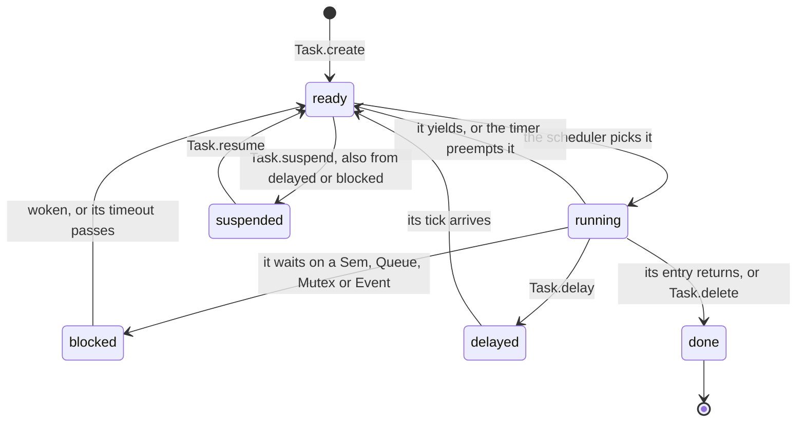

# ksos

**Kanso OS, a light real-time OS (RTOS) written in KSPL alone.** An RTOS runs several *tasks* (functions that each behave as if they had the CPU to themselves) and switches between them by priority, so urgent work is never kept waiting behind less urgent work. ksos offers priority scheduling, cooperative yield and preemption, semaphores, message queues, mutexes and event flags. It runs the same kernel code on a microcontroller with no operating system under it (*bare metal*) and on a Linux host, and it drives a small robot car.

**This guide is the map to read first**, for anyone who wants to try ksos or read its code. It says where everything is in the code and in what order to read it, assuming no RTOS knowledge. The quickest try is `make ksos` (below). The design's grounds, and what each make target checks, are in [`ksos/docs/DESIGN.md`](docs/DESIGN.md).

## Run it

`clang` alone runs it; no ARM cross compiler (a compiler that builds for another CPU) or QEMU (an emulator that runs a microcontroller's program on the PC) is needed.

```sh
make ksos   # on a POSIX host, runs the demo where two tasks (producer/consumer) cooperate on a semaphore
```

The producer makes five items, sleeping on `Task.delay` between them. The higher-priority consumer takes each the moment it is made. Watch `tick` advance: at the end both tasks are `done`, and `start_scheduler()` returns to its caller.

```
=== Kanso OS (POSIX port) — producer/consumer demo ===
[producer] produce 10 (tick=0)
[consumer] consume 10 (tick=0)
[producer] produce 20 (tick=2)
[consumer] consume 20 (tick=2)
...
[consumer] done
[producer] done
=== scheduler finished (all tasks done) ===
```

**This folder's own [`Makefile`](Makefile) lets a copy of it build and test alone.** `make test` and every demo and gate below have the same names there. They find `ksai` and `ksdb` where the compiler is told packages are (what else each target needs is at the head of that file). From the repository's root, the same names call these with the repository's compiler. The tests are in `ksos/tests/`: the unit tests, the USB descriptors read as text, elf2uf2 (the tool that makes a firmware file for the real chip) and the UART (serial port) checks.

## The idea

An RTOS does two things:

1. **Scheduling**: pick by priority which of several tasks (≒ threads) runs next, and swap in its whole set of CPU registers (its context).
2. **Synchronizing**: let tasks wait on each other and hold things exclusively (semaphores, message queues, mutexes, event flags).

The diagram shows the states a task moves through; the scheduler always runs the highest-priority `ready` task.



The table maps each RTOS word to everyday words and to the name in the code.

| RTOS term | In everyday words | In KSPL |
|---|---|---|
| TCB (task control block) | holds one task's state (priority, stack, run state) | `Task`, allocated statically by the caller |
| the scheduler | picks which task runs next | `pick_next` / `schedule` |
| a context switch | swaps the whole set of CPU registers to change task | `ksos_port_switch`, a C ABI the port implements |
| a cooperative yield | a task gives up the CPU on its own | `Task.yield()` |
| preemption | a timer interrupt forces a task to give way | `enable_preemption()` + `ksos_tick()` |
| blocking | a task sleeps until a condition holds | `block_current` / `block_and_rearm` |
| a tick | one beat of the periodic timer; delays and timeouts are counted in ticks | `ksos_tick()` |
| a semaphore | a counter of available things: `take` waits while it is 0, `give` adds one | `Sem` (`ksos/kernel/sync.kspls`) |
| a message queue | a fixed-size line of values one task sends and another receives | `Queue<\|T\|>` (`ksos/kernel/sync.kspls`) |
| a mutex | a lock only one task holds at a time | `Mutex` (`ksos/kernel/sync.kspls`) |
| priority inheritance | a waiter lends the holder its priority, so nothing inverts (a low-priority holder cannot keep a high-priority waiter waiting behind a middle task) | `Mutex` (`ksos/kernel/sync.kspls`) |
| an event flag | waits on an AND/OR of several bits | `Event` (`ksos/kernel/sync.kspls`) |
| tickless idle | with nothing to do, moves **logical** time to the next delay's expiry | the fallback inside `pick_next` |
| a port | the architecture-dependent part: context switching, the timer, interrupt control | `ksos_port_*` (POSIX and Cortex-M implement it) |
| an interrupt handler (ISR) | code the hardware runs at once when something happens, cutting into whatever task was running | `ksos_port_in_isr()` tells the kernel it is inside one |
| a critical section | a stretch of code run with interrupts off, so nothing can cut in | `irq_save()` / `irq_restore(state)` |

**It does not depend on malloc.** The caller allocates the `Task`, the stacks and a queue's buffer as globals or static arrays (`tcb_p`/`stack_p` and the rest in `ksos/demo/posix/producer_consumer.kspls`). The kernel only takes them and allocates nothing inside.

## What is here

| Folder | What it holds |
| :-- | :-- |
| `ksos/kernel/` | The scheduler and the synchronizing primitives, with neither hardware nor libc |
| `ksos/port/` | One folder per architecture and OS: the context switch, the timer and the boot |
| `ksos/drivers/` | Drivers reading and writing a microcontroller's registers directly |
| `ksos/net/` | The smallest network stack (ARP, IPv4, UDP, TCP) |
| `ksos/boards/` | What one real board wires to what |
| `ksos/demo/` | The demos, one firmware each; the POSIX and Cortex-M ones are tests too |
| `ksos/tests/` | The unit tests, the USB descriptors read as text, elf2uf2 and the UART checks |
| [`ksos/docs/`](docs/) | The design, the board's facts and the bring-up ("Further reading" below) |

**A folder imports only those below it**: `kernel` < `drivers` < `boards` < `demo`, with `net` beside `drivers` (it needs neither the kernel nor a register) and used only by `demo`. A driver that imports a board builds, but then serves that board alone. `make test-conventions` holds the order.

## Reading order

Read from the bottom of the dependencies up, so each file's prerequisites come first.

### ① The foundation: tasks and the scheduler — `ksos/kernel/task.kspls`
Remember three things (register a task, pick the next, switch) and the rest follows. The grounds for each call are in "⚙️ What sets the scheduler apart" in [`ksos/docs/DESIGN.md`](docs/DESIGN.md).
- `Task.create(stack, entry, arg, prio, name): Bool` is called on the `Task` it fills (`tcb.create(...)`). `stack` is the task's stack as a slice (`U8$[]::stack_a`), whose length is its size. **The larger `prio`, the higher**, and 0 is the idle task's. Past `max_tasks` it changes nothing and returns `false`.
- `start_scheduler()` runs the registered tasks until none is runnable, then returns. `run_single_task(tcb, stack, entry, name, on_idle)` wraps both for a one-task `ksos_main`, then calls `on_idle` and loops forever.
- `Task.yield()`, `Task.delay(ticks)`, and `Task.delay_until(wake_tick)`, which names an absolute tick so a periodic task does not drift by the length of its work. **`ticks` are logical, not real time** (the tickless idle bullet in that DESIGN section).
- `Task.suspend()` / `Task.resume()` pause and resume another task, which carries on whatever it was waiting on. `Task.delete()` makes a task `done` and returns its slot and its port context; its memory stays the caller's. Deleting a task that holds a mutex panics.
- `irq_save()` / `irq_restore(state)`: the critical section (interrupts off) that every primitive in `ksos/kernel/sync.kspls` builds on.
- A *canary*, a known value at the stack's lowest address, is checked on every `schedule()`. A task whose stack grew past its end overwrites it, and ksos panics (stops with a message: `ksos: stack overflow detected`).
- **The eight `ksos_port_*` functions declared `extern "C"` at the top are the only boundary to the port layer.** The kernel knows their signatures and nothing of the register work behind them.

### ② The synchronizing primitives — `ksos/kernel/sync.kspls`
All four rest on `block_and_rearm`/`wake` in `ksos/kernel/task.kspls`, in one shape inside `task.irq_save()` … `task.irq_restore()`: check the condition, block where it does not hold, and check again once woken (wake-and-recheck).
- `Sem` (a semaphore): `take`/`give`.
- `Queue<|T|>` (a message queue of any `T`): `send`/`recv`, blocking when full too.
- `Mutex` (priority-inheriting): `lock`/`unlock`.
- `Event` (event flags): `wait`/`set` on an AND (`.all`) or OR (`.any`) of bits.
- **Only what does not wait may be called from an interrupt handler (ISR)** (`give` / `set` / `try_*`).
- **How long a call waits is in how it is written.** The bare form waits until woken, `try_` answers at once, and `_for(ticks)` gives up after a timeout. The rules for each, and the conversion from real time, are in "⚙️ What sets the scheduler apart" in [`ksos/docs/DESIGN.md`](docs/DESIGN.md).

### ③ The dynamic API that allocates on the heap, and the task manager — `ksos/kernel/heap.kspls`, `ksos/kernel/dynamic.kspls`
Where the API above takes the `Task`, the stacks and a queue's buffer from the caller, these allocate them on the heap:
- `ksos/kernel/heap.kspls`: `heap_alloc`/`heap_free`, `std/mem.kspls`'s freestanding heap made safe from a task or an ISR.
- `ksos/kernel/dynamic.kspls`: **making is an associated function, the static verb plus `_dyn`** (`Task.create_dyn` …), and throwing away is a method on the instance (`t.delete_dyn()` …). The names are listed in [`ksos/docs/DESIGN.md`](docs/DESIGN.md#-what-sets-the-scheduler-apart). A task deleting itself writes `Task.current().delete_dyn()` out. Its stack is reclaimed later, by the next call into this file or by `install_idle_reap(stack)`.
- `enable_idle_task(stack, hook)` in `ksos/kernel/task.kspls`: an opt-in prio-0 task that runs only while nothing else can, calling `hook` between `Task.delay(1)` sleeps. Without it, `start_scheduler()` returns once every task is done.
- `t.cpu_percent()` in `ksos/kernel/task.kspls`, with `Task.get_prio`/`get_name`/`get_state` and `Task.count`/`Task.at`, is what a task manager lists. The kernel does no I/O to show it (`make ksos-task-manager`). The heap's use is `heap_used_bytes`/`heap_peak_used_bytes` in `std/mem.kspls`, called directly.

### ④ The port layer — `port/posix/`, `port/cortex_m/`, `port/cortex_m0/`, `port/rp2040/`
Each port implements the eight functions `ksos/kernel/task.kspls` declares `extern "C"`. The files and their design are in "🔌 The ports" in [`ksos/docs/DESIGN.md`](docs/DESIGN.md).
- `ksos/port/posix/`: `ucontext` switching and `SIGALRM` preemption. **It needs nothing special, so run things here first** (`make ksos` and the rest).
- `ksos/port/cortex_m/`: ARMv7-M (thumbv7m) bare metal. Every task switch goes through PendSV, a low-priority exception the CPU offers for this. It runs under QEMU as the real chip would (`make ksos-cm-run` and the rest).
- `ksos/port/cortex_m0/`: ARMv6-M (thumbv6m, Cortex-M0/M0+), with its own `startup.S` and `switch.S` for Thumb-1 (the smaller instruction set these CPUs have) and the rest of `cortex_m/` recompiled.
- `ksos/port/rp2040/`: the real chip (Raspberry Pi Pico / Pico W, RP2040, Cortex-M0+) on `ksos/port/cortex_m0/`. The build and objdump check its boot ROM's 256-byte stage-2 bootloader and checksum (`make ksos-rp2040`).

**Only the RP2040 (the mecanum car) is checked on a real chip.** For bare metal without the car, run `ksos/port/cortex_m/` under QEMU (`mps2-an385`).

### ⑤ Run the worked examples and get the feel — `demo/`

**Directly under `demo/<port>/` sit only demos that stand on their own.** The listing is derived from the directory (`demo_stems` in `ksos/Makefile`), so a file there with no `ksos_main` is linked as a demo and fails.

| Place | What is in it |
| :-- | :-- |
| `demo/<port>/` | that port's demos; one file = one firmware |
| `demo/<port>/common/` | parts only that port's demos share (the RP2040's USB CDC console, …) |
| `ksos/demo/common/` | parts shared across ports (the semihosting console, which prints through the debugger QEMU provides; the reader of a policy passed down) |

One demo per feature. The POSIX ones need no special tools:

| The demo | The make target | What it demonstrates |
|---|---|---|
| `ksos/demo/posix/producer_consumer.kspls` | `make ksos` | cooperating on a semaphore (run in "Run it" above) |
| `ksos/demo/posix/msgq_demo.kspls` | `make ksos-mq` | a message queue blocking when full |
| `ksos/demo/posix/mutex_demo.kspls` | `make ksos-mutex` | exclusive holding with a mutex |
| `ksos/demo/posix/mutex_nested_demo.kspls` | `make ksos-mutex-nested` | two mutexes held at once, released in either order: the priority lent through the one still held stays |
| `ksos/demo/posix/wake_preempt_demo.kspls` | `make ksos-wake-preempt` | a higher-priority task woken by `give`/`unlock`/`send`/`set`/`resume` runs before the waker's next line, with no timer |
| `ksos/demo/posix/event_demo.kspls` | `make ksos-event` | waiting on an AND/OR of event flags |
| `ksos/demo/posix/posix_preempt_demo.kspls` | `make ksos-preempt` | timer-driven preemption |
| `ksos/demo/posix/delay_until_demo.kspls` | `make ksos-delay-until` | a period with no drift, via `Task.delay_until` |
| `ksos/demo/posix/lifecycle_demo.kspls` | `make ksos-lifecycle` | `Task.suspend`/`Task.resume`/`Task.delete` |
| `ksos/demo/posix/panic_demo.kspls stack-overflow` | `make ksos-stack-overflow` | the canary catching a stack overflow |
| `ksos/demo/posix/isr_signal_demo.kspls` | `make ksos-isr` | `Queue<\|T\|>.try_send` from an ISR (SIGUSR1 stands in for the interrupt) |
| `ksos/demo/posix/task_manager_demo.kspls` | `make ksos-task-manager` | tasks and queues on the heap (`dynamic.kspls`), and the task manager's CPU use per task (`Task.cpu_percent` in `ksos/kernel/task.kspls`) |
| `ksos/demo/posix/kernel_check.kspls` | `make ksos-kernel-check` | the kernel's edges: waking in priority order and the longest waiter among equals, suspend/delete while blocked, a `delay_until` into the past, a deleted waiter's lent priority taken back, the cap on seats |
| `ksos/demo/posix/panic_demo.kspls mutex-relock` | `make ksos-mutex-relock` | the holder relocking stops rather than waiting forever (the panic is the pass) |
| `ksos/demo/posix/panic_demo.kspls mutex-foreign-unlock` | `make ksos-mutex-foreign-unlock` | a non-holder's unlock stops rather than being silently ignored (panic = pass) |
| `ksos/demo/posix/panic_demo.kspls delete-holder` | `make ksos-delete-holder` | deleting a task that holds a mutex stops rather than leaving the mutex held forever (panic = pass) |
| `ksos/demo/posix/timeout_demo.kspls` | `make ksos-timeout` | timeouts (`take_for`/`recv_for`/`send_for`/`lock_for`/`wait_for`), a timeout too large for the clock, `try_take`/`try_lock`, and `ms_to_ticks` rounding up |
| `ksos/demo/posix/panic_demo.kspls timeout-zero` | `make ksos-timeout-zero` | a timeout of 0 stops rather than meaning `try_` (panic = pass) |
| `ksos/demo/posix/tick_mid_switch_demo.kspls` | `make ksos-tick-mid-switch` | a tick held over a switch into a task that has never run arrives after the switch, and the task still runs its code |

The Cortex-M demos need a cross compiler and QEMU (both in the development container), and `make test-ksos-qemu` runs them all. `make ksos-cm` builds `cortex_m_min.kspls` and checks its vector table and PendSV with objdump. `make ksos-cm-run` runs that ELF under QEMU (`mps2-an385`). Every other target builds and runs in one.

| The demo | The make target | What it demonstrates |
|---|---|---|
| `ksos/demo/cortex_m/cortex_m_min.kspls` | `make ksos-cm-run` | the cooperative scheduler on bare metal |
| `ksos/demo/cortex_m/cortex_m_preempt.kspls` | `make ksos-cm-preempt` | preemption by SysTick (the Cortex-M's built-in timer): two tasks that never yield both run, and a monitor's `Task.delay` still wakes |
| `ksos/demo/cortex_m/cortex_m_pi.kspls` | `make ksos-cm-pi` | priority inheritance: the high-priority requester gets the lock past a mid-priority task that never `yield`s |
| `ksos/demo/cortex_m/cortex_m_event.kspls` | `make ksos-cm-event` | a barrier of event flags: three workers' bits raised under preemption, and clear-on-exit |
| `ksos/demo/cortex_m/cortex_m_mq.kspls` | `make ksos-cm-mq` | a queue under preemption (the critical section) |
| `ksos/demo/cortex_m/cortex_m_timeout.kspls` | `make ksos-cm-timeout` | SysTick alone carrying `take_for`'s timeout while a spinner that never yields holds the CPU |
| `ksos/demo/cortex_m/cortex_m_isr_block.kspls` | `make ksos-cm-isr-block` | `Sem.take` inside an interrupt handler panics rather than silently stopping the interrupted task (panic = pass) |
| `ksos/demo/cortex_m/cortex_m_isr_unlock.kspls` | `make ksos-cm-isr-unlock` | `Mutex.unlock` inside an interrupt handler panics rather than releasing the interrupted task's mutex (panic = pass) |
| `ksos/demo/cortex_m/cortex_m_isr_give.kspls` | `make ksos-cm-isr-give` | tasks woken by an interrupt handler's `give`s run as it returns, highest first, before the interrupted task's next line |
| `ksos/demo/cortex_m/cortex_m_heap_probe.kspls` | `make ksos-cm-heap-probe` | the freestanding heap (`mem.init_freestanding_heap`) and `Arc<T>`, with no OS or `malloc`, and 120 tasks made and deleted on it against the port's 33 contexts |
| `ksos/demo/cortex_m/cortex_m_panic_probe.kspls` | `make ksos-cm-panic-probe` | a panic's crash record read back across a real soft reset |
| `ksos/demo/cortex_m/cortex_m_uart_echo.kspls` | `make ksos-cm-uart-echo` | UART0's receive path, judged by an outside echo test |
| `ksos/demo/cortex_m/cortex_m_uart_irq_echo.kspls` | `make ksos-cm-uart-irq-echo` | the same receive path driven by an interrupt (NVIC IRQ0 plus `WFI`: the interrupt controller's line 0, and the instruction that sleeps until an interrupt) |
| `ksos/demo/cortex_m/cortex_m_ai_probe.kspls` | `make ksos-cm-ai-probe` | `ksai` inference (a whole `Transformer_block`) on bare metal, matching the host's numbers |
| `ksos/demo/cortex_m/cortex_m_ai_train_probe.kspls` | `make ksos-cm-ai-train-probe` | on-device LoRA training (a small add-on to the weights, trained on the device), the adapter persisted with `Lora.save_raw` / `load_raw` |
| `ksos/demo/cortex_m/cortex_m_ai_weights_probe.kspls` | `make ksos-cm-ai-weights-probe` | real weights (a safetensors made a static array by `embed`) read with zero copies and no filesystem |
| `ksos/demo/cortex_m/cortex_m_control_ai_probe.kspls` | `make ksos-cm-control-ai-probe` | a control loop and continuing AI inference side by side, undisturbed |
| `ksos/demo/cortex_m/cortex_m_pilot_probe.kspls` | `make ksos-cm-pilot-probe` | a policy passed down deciding the next manoeuvre inside the car alone |
| `ksos/demo/cortex_m/cortex_m_car_model_probe.kspls` | `make ksos-cm-car-model-probe` | the car training, on the spot, a net that predicts the result of its own movement |

#### How far CI looks, per port

**The three places differ, and treating them as one hides which demos may be deleted.**

| Place | What CI does | Checking on the real board |
| :-- | :-- | :-- |
| `ksos/demo/posix/` | runs every one; `assert` stops a failing path (`make test-ksos-posix`) | not needed |
| `ksos/demo/cortex_m/` | runs every one under QEMU (`make test-ksos-qemu`) | not needed |
| `ksos/demo/rp2040/` | links only (`make test-ksos-link`); QEMU has no RP2040 | a person flashes it |

**Every demo `make test-ksos-posix` and `make test-ksos-qemu` run has a time cap** (`KSOS_RUN_CAP` in `ksos/Makefile`, whose comment gives its value and how it was chosen). A demo that hangs, a task left spinning by a kernel bug for one, fails its gate with `[FAIL] ksos-<demo> did not finish in <N>s: it hung (timeout killed it)` instead of stalling it. On a slow machine, raise the cap on the command line (`make test-ksos-posix KSOS_RUN_CAP=120`).

**The POSIX and Cortex-M demos are the tests themselves.** Deleting one deletes a check. Merging them into one big demo hides which feature broke, and leaves everything after the first stop unrun.

Caution: **In a POSIX demo, stop with `assert` on anything unexpected.** The gate reads the exit code and the `RESULT:` line, so a demo that prints "UNEXPECTED" and carries on passes green.

**The RP2040's demos run only on the real board, where a small demo is the smallest unit to flash** when narrowing down what does not work.

#### The RP2040's demos come three ways

The file names do not tell them apart (every one is a `*_probe.kspls`), so they are listed in the order they are flashed. Flashing one is stage 1 in [`ksos/docs/HOWTO-bring-up.md`](docs/HOWTO-bring-up.md), and `make ksos-rp2040` alone stops at the `.elf`.

**The first step** confirms that ksos runs on the real chip.

| The make target | What it confirms |
| :-- | :-- |
| `make ksos-rp2040-buzzer` | that the flashed firmware starts running; the buzzer is the output device (semihosting is unavailable) |

**Confirming the board**, on the desk with USB still connected. Come back here when something is wrong.

| The make target | What it confirms |
| :-- | :-- |
| `make ksos-rp2040-board` | the whole board in one: the USB CDC console, the calendar RTC, the free list's allocation and atomics (SIO spinlock), the record at Flash's end, the sensors (battery / light / line following / ultrasound / IR), the I2C LED matrix (`ht16k33`) and the WS2812, one file per stage under [`ksos/demo/rp2040/board_probe/`](demo/rp2040/board_probe/) |
| `make ksos-rp2040-motor` | the four wheels' PWM. **Try it with the wheels off the ground** |
| `make ksos-rp2040-net` | USB Ethernet in one: from the PC over CDC-NCM, ARP requests, then TCP / HTTP, while still answering ARP and ping |

**Running them together**, closer to real use.

| The make target | What it confirms |
| :-- | :-- |
| `make ksos-rp2040-car-loop` | the closed loop asking the layer above on every observation |
| `make ksos-rp2040-car-pilot` | takes a policy home, cuts the line, decides inside the car |
| `make ksos-rp2040-car-ir` | driving it with a remote |

**The car's firmware links different code from the board's.** By the symbols linked, `board` and `net` use shared code that `car-pilot` does not (the LED matrix's I2C, the calendar RTC, ARP/ICMP, atomics, 64-bit shift helpers). Only `car-ir` uses `__aeabi_llsr` / `__lshrdi3`. The link gate is there for symbols like these.

### ⑥ Beyond that: the peripheral drivers and the AI integration — `drivers/`, `net/`, `boards/`
For the IoT and embedded side; not needed on a first read.
- `ksos/boards/`: what one real board wires to what, above `ksos/port/` (which CPU) and `ksos/drivers/` (which peripheral). The board is a Freenove 4WD mecanum car with a Pico W (RP2040), the hardware behind Phase 3 of [What works, and how far](../README.md#-what-works-and-how-far). Its wiring is in [`ksos/docs/SPEC-board.md`](docs/SPEC-board.md), and bringing it up is in [`ksos/docs/HOWTO-bring-up.md`](docs/HOWTO-bring-up.md).
- `ksos/drivers/`: drivers reading and writing a microcontroller's MMIO registers (memory addresses that control the hardware) directly (UART, GPIO, PWM, clocks, ADC, I2C, USB CDC and more), each under "🔧 The peripheral drivers" in [`ksos/docs/DESIGN.md`](docs/DESIGN.md). `putc`/`getc`/`transfer` and the rest give up at a cap on iterations rather than stall on hardware that does not answer. They return a failure as a `Bool` or a `T?`.
- `ksos/net/`: the smallest network stack. `ksos/net/tcp_conn.kspls` (TCP) runs on `ksos/net/mini_ipv4.kspls` (ARP, IPv4, UDP without fragmentation). See "🌐 The network stack" in [`ksos/docs/DESIGN.md`](docs/DESIGN.md).
- **`ksai` runs beside a control loop with no malloc**, as the AI rows of the Cortex-M table show. What it needs is in "🤖 The AI on bare metal" in [`ksos/docs/DESIGN.md`](docs/DESIGN.md), and `ksai` itself is [ksai](../ksai/README.md).
- **A panic leaves a crash record** (freestanding only, that is, with no OS underneath) in `.noinit_panic`, RAM that `ksos/port/*/link.ld` (the linker script, which says where each part of the program goes in memory) leaves unzeroed. The next start-up after a warm reset (a restart without losing power) reads it once with `take_panic_record` in `std/lang.kspls`. `make ksos-cm-panic-probe` runs it across a watchdog reset, a panic and a soft reset (`system_reset()` in `ksos/drivers/cortex_m/scs.kspls`) in one QEMU run.

## Pitfalls

These are the traps the next person is likely to hit.

| The trap | What goes wrong | What to do |
| :-- | :-- | :-- |
| **On bare metal, libc comes in without being called** (how is in "The digits of a floating-point number are assembled here" in [`std/docs/DESIGN.md`](../std/docs/DESIGN.md)) | A libc call added to `std` that bare metal cannot use breaks the bare-metal build | Pair it with a `cfg(freestanding)` version. `make test-ksos-link` links every demo, and `make test-ksos-qemu` runs them to catch what links but fails at start |
| **Linking `ksos-cm*`/`ksos-rp2040*` needs arm-none-eabi's libgcc** | The link fails without it | Use the development container, which has it |
| **Shared state touched outside a critical section** (a `Task`'s fields and the rest) | An interrupt or preemption can race it (a dropped wakeup, and the like). `block_current`/`block_and_rearm` assume the caller holds one; outside it they protect nothing | Touch it inside `irq_save`/`irq_restore` |
| **The POSIX port's signal mask** | Two ways to break it. A task left with `SIGALRM` (the timer tick) blocked is never switched out by the timer again: preemption stops. And a tick let through in the middle of a switch runs on the old task's stack while the new one already counts as current, so the new task never runs its own code again (it hangs, or another task is reported never to have run); under load a tick is often pending at the moment of a switch. So `ksos_port_switch` keeps the interrupt signals blocked across the whole `swapcontext` and gives the task its own mask back only once control has returned to it, and every saved context, a new one too, holds them blocked. A switch made inside the tick's handler leaves `SIGALRM` blocked in the task it leaves until that task resumes and returns from the handler. A new task unblocks them as its first code (`ksos_task_start`) | Leave the mask to `ksos_port_switch` and `ksos_task_start` (`ksos/port/posix/ksos_port_posix.c`): `swapcontext` alone installs the next task's mask before its registers, which opens the window. `make ksos-tick-mid-switch` holds a tick over a switch into a new task on every run |
| **On Cortex-M, the saved frame and the initial frame** | A task that has never run starts at a wrong address, or faults. A switch (`PendSV_Handler`) keeps a task's registers on that task's stack as 16 words: `r4`–`r11`, then the 8 the CPU saves by itself (`r0`–`r3`, `r12`, `lr`, `pc`, `xPSR`). For a new task, `ksos_port_ctx_create` writes those 16 words by hand. If its layout differs, the first switch to the task loads the wrong words into its registers, `pc` included. Every switch, cooperative or preemptive, goes through `PendSV_Handler`, so no task avoids it | When rewriting either by hand, keep the frame `ksos/port/cortex_m/switch.S` saves matching the initial frame `ksos_port_ctx_create` builds. `ksos/port/cortex_m0/switch.S`, the RP2040's, saves the same frame and must match it too |

## What has been checked on real hardware

**Each row is one part of the real car, and whether someone has seen it work on the car itself: this table is the canonical source for what was confirmed on the real board.** ✅ means confirmed on this unit's real chip, a Freenove 4WD car carrying a Raspberry Pi Pico W ([`ksos/docs/SPEC-board.md`](docs/SPEC-board.md)). The AI cannot add a ✅; only whoever has the hardware can. A stage named below is one of [`ksos/docs/HOWTO-bring-up.md`](docs/HOWTO-bring-up.md)'s.

| Item | State |
|---|---|
| The Arduino sample (`06.2_Multi_Functional_Car`) | ✅ (the car moves) |
| `make ksos-rp2040`'s build, link and objdump | ✅ |
| `make ksos-rp2040-buzzer`'s UF2 | ✅ (with the format's own self-check) |
| The bundled firmware (`make ksos-rp2040-board` / `make ksos-rp2040-net`) | **not confirmed** (each ✅ below is from per-feature firmware) |
| **ksos running** | ✅ (stage 1: the buzzer sounded on a real Pico W, the whole path from boot ROM to GPIO output) |
| GPIO output (`ksos/drivers/rp2040/gpio`) | ✅ |
| The clock tree (`ksos/drivers/rp2040/clocks`) and µs timer (`rp2040/timer`) | ✅ (pitch and interval matched; stage 2a) |
| PWM (`ksos/drivers/rp2040/pwm`) and the driving control (`motor.kspls`) | ✅ (all four wheels turned; stage 3) |
| The mecanum's signs (is positive = right / clockwise?) | ✅ (sideways motion and turning went as intended) |
| USB CDC (`ksos/drivers/rp2040/usb_cdc`) | ✅ (a COM port on Windows, text reaching the Serial Monitor; stage 2b) |
| The ADC (`ksos/drivers/rp2040/adc`) and GPIO input | ✅ (battery voltage, light and line tracking followed real changes; stage 4) |
| Ultrasound (`ksos/drivers/rp2040/hcsr04`) | ✅ (a hand close by shrank the distance; stage 5a) |
| IR receiving (`ksos/drivers/rp2040/ir_nec`) | ✅ (a different command per button, repeats counted while held; stage 5b) |
| Driving from the IR remote alone (`rp2040_car_ir_probe`) | **not confirmed** beyond receiving (the frames arrive and each key hits its assignment): not the wheels, the face or each mode's motion (stage 12) |
| I2C (`ksos/drivers/rp2040/i2c`) and the LED matrix (`ht16k33`) | ✅ (0x71 found, a band flowed; stage 5c) |
| USB Ethernet (`rp2040/usb_cdc`'s CDC-NCM part) | ✅ (a network adapter beside the COM port, `alt=1 link=up`; stage 6a) |
| The closed loop with kssrv (`rp2040_car_loop_probe`) | ✅ (all seven manoeuvres reached the wheels, meshing with kssrv's `commands`: `to=0 bad=0 drop=0`; stage 6e) |
| Receiving a policy and deciding inside the car (`rp2040_car_pilot_probe`) | ✅ (received a policy, closed the line, kept deciding after `kssrv` went down; **one inference takes around 10ms**; stage 7) |
| The NTB framework (`cdc_ncm`) and the link layer (`ksos/net/link`) | ✅ (`ping` from the PC got through, this side's MAC in `arp -a`; stage 6b) |
| ARP's requesting side (`build_arp_request` / `parse_arp_reply`) | ✅ (resolved the peer's MAC; stage 6b covers only answering) |
| The TCP 3-way handshake (`mini_ipv4`'s `build_tcp_segment` / `parse_tcp_segment`) | ✅ (SYN → SYN-ACK → ACK) |
| TCP data both ways (`ksos/net/tcp_conn`'s `tcp_stream_send` / `tcp_stream_recv`) | ✅ (an HTTP GET out, a 200 back) |
| The round trip as an HTTP client | ✅ (`status200=1`: the request arrived and was interpreted) |
| `alloc` / `Arena` / `Arc` / `std/http.parse_response` | ✅ (`RESULT pass=11 fail=0`, the atomics filled in from SIO's hardware spinlock by `ksos/port/rp2040/ksos_atomic_sio.c`; stage 6d) |
| The four atomics (`kspl_atomic_add`/`cas`/`load`/`store`) | ✅ (taking and releasing the SIO spinlock meshes on the real chip) |
| What the car learned surviving power-off (`car_model` plus ksdb) | ✅ (a restart says `resumed the forward model — N steps learned`, **the step count grows across start-ups**, and `drop=0` holds while learning a step) |
| Learning a step at a time while the car runs | ✅ (on most laps run) |
| The prediction beating "the same as last time" on the floor | **unmet**: at best a draw, and `base=` moves with the place. Under bare-metal QEMU it wins (`make ksos-cm-car-model-probe`), but that floor is one function. Why it cannot win on the floor is "🤖 The AI on bare metal" in [`ksos/docs/DESIGN.md`](docs/DESIGN.md) |
| `car-pilot`'s remote, run-time limit and speed cap | ✅ (any button gives `HALTED: stopped by remote`, 60 seconds `HALTED: run time limit`; all six manoeuvres came out within the cap, and press and release brought it back with `n` growing; "How to stop it when it drives itself" in `ksos/docs/HOWTO-bring-up.md`) |
| Starting with no PC, on the policy kept in the car (`rp2040_car_pilot_probe`) | ✅ (with no kssrv up it used the stored policy (`no fresh policy — using the one stored on board`), drove all six manoeuvres to the wheels, read back the last observation (`last run ended`), and left an unchanged policy unwritten (`policy unchanged`); stage 9) |
| Writing the flash (`ksos/drivers/rp2040/flash`) and the on-device record | ✅ (`boot #` grew at every power-on, `records`/`used` matched the append's arithmetic exactly, and a record round-tripped across a flash page boundary; stage 8) |
| The USB CDC send queue (`Ring<\|512\|>` in `std/ring.kspls`) | ✅ (the three lines of `make ksos-rp2040-board` keep flowing; a line over one packet takes the multi-packet path, and the bytes per round do not divide 512, so the wrap shifts every round) |
| The calendar RTC ticking (`ksos/drivers/rp2040/rtc.kspls`) | **not confirmed** (it is once `make ksos-rp2040-board`'s `[rtc]` line reads `ticking=yes` across rounds) |
| The Flash chip's part number | **not confirmed** (the expected part is in "Flashing the firmware, and the debug output" in [`ksos/docs/SPEC-board.md`](docs/SPEC-board.md); the boot depends on no particular chip) |

## Files near the limit and how they split

**No file in ksos exceeds 900 lines.**

**Only a range that touches no state can be cut out.** *State* here means a file's global variables, the ones declared at the top level with `$` (such as `$halted: Bool = false`). The functions of a driver or a demo share them, so a range that reads or writes them cannot move to another file without taking them along or passing each one in and out. Those variables decide where a file can be cut, not its line count. These ranges stay where they are:

| Range | Its file | The state it shares with the rest of the file |
| :-- | :-- | :-- |
| the USB enumeration, the first exchange in which the PC asks the board what it is (EP0, USB's control endpoint) | `ksos/drivers/rp2040/usb_cdc.kspls` | `stage` (how far enumeration got, one of the `stage_*` values) and `ncm_alt` (the network setting the PC chose), which `init`, `poll_once` and the network side also use |
| the remaining safety timeouts (the remote, the running time) | `ksos/demo/rp2040/rp2040_car_pilot_probe.kspls` | the stop (`halted`, `halt_state`, `halt_needs_remote`), the counts of the remote's presses (the `ir_*` variables), the driving time (`driving_rounds`), and the requests to dump or erase the record, which the main loop reads and writes too |
| the one-line report | the same file | nearly every running total and last value the main loop keeps (`loops`, `decisions`, `steers`, `last_lon` and the rest), and the stop |

## Further reading

| Document | What it is for | Who reads it |
| :-- | :-- | :-- |
| [`ksos/docs/HOWTO-bring-up.md`](docs/HOWTO-bring-up.md) | Bringing the real board up one stage at a time, how each stage is confirmed, and what each probe prints | Whoever has **the car on the desk**, a USB cable, and a PC that can copy files to it |
| [`ksos/docs/SPEC-board.md`](docs/SPEC-board.md) | The car's own facts: pin assignment, motor polarity, conversion formulae | Whoever wires or drives the car, or writes a driver against it |
| [`ksos/docs/DESIGN.md`](docs/DESIGN.md) | The grounds for the design: kernel, port layer, drivers, network stack, AI on bare metal | Whoever changes ksos |
| [std](../std/README.md) | The standard library it stands on; every file it publishes is listed by `ksplc doc std` | Whoever changes ksos |
| [ksai](../ksai/README.md) | The inference that runs beside the control loop, with no malloc | Whoever changes ksos |
| [ksdb](../ksdb/README.md) | The append-only record kept inside the device | Whoever changes ksos |
| The "ksos" section of [`docs/PLAN.md`](../docs/PLAN.md) | What is left, and what marks each stage as done | Whoever changes ksos |
