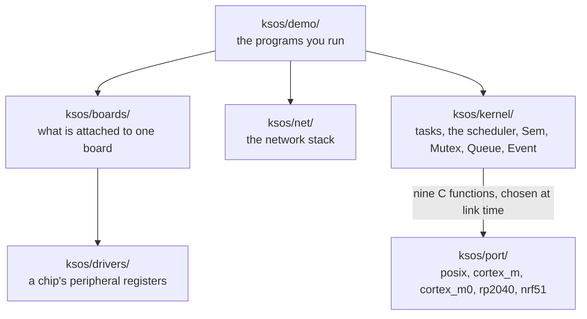
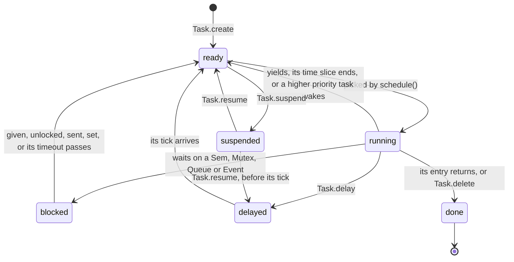
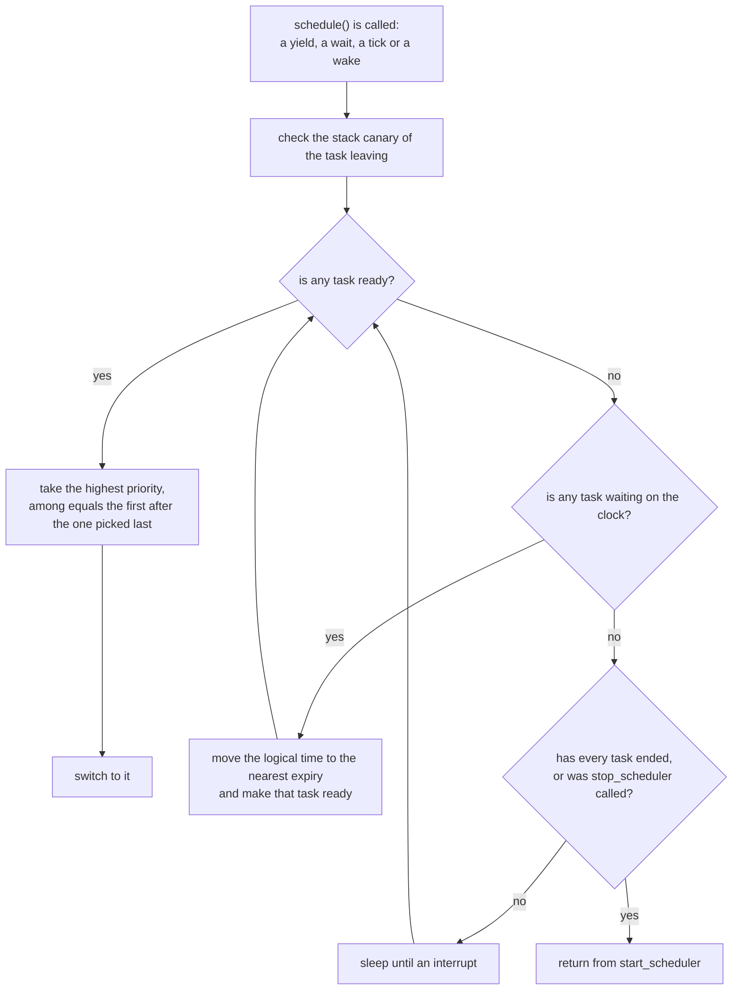
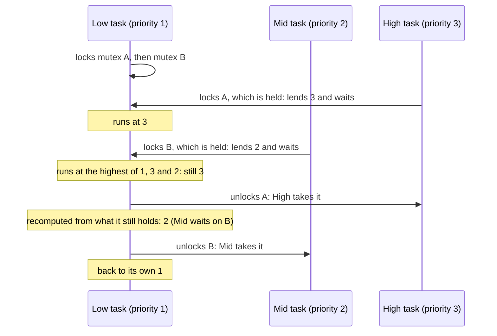
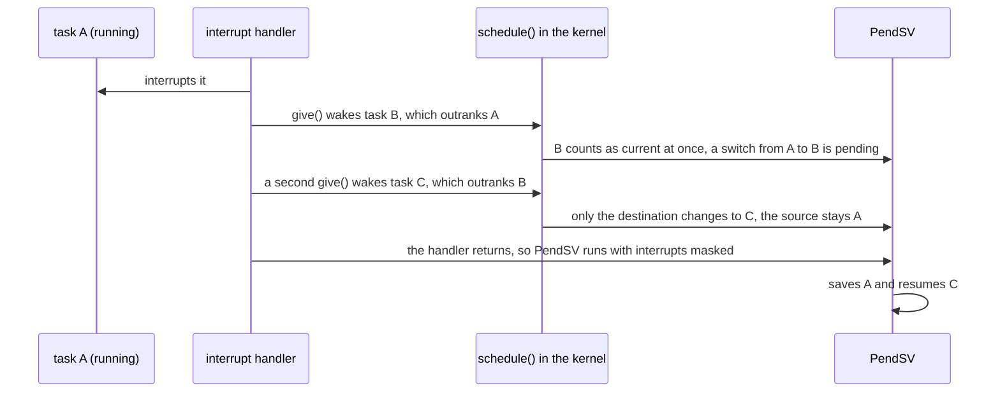
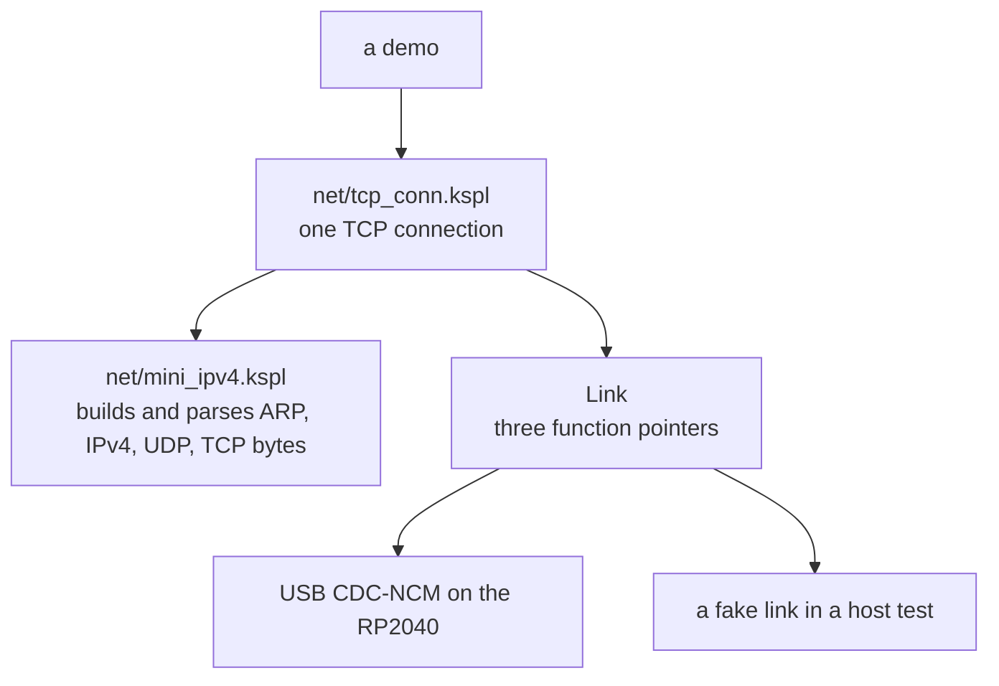

# Kanso OS — the design and how it is checked

Ksos is a small real-time operating system (RTOS) written in KSPL. An RTOS runs several *tasks*: functions that each look like they have the CPU to themselves. It switches between them by priority, so urgent work never waits behind less urgent work.

**A portable kernel core is kept apart from a thin port layer per architecture and OS.** The kernel runs on the same source from a microcontroller (bare metal, with no operating system under it) to a Linux host. Only the port layer, which absorbs each CPU's and OS's differences, is swapped. So the scheduler is checked as an ordinary Linux process with no hardware. The same checks extend to Cortex-M bare metal and a real chip. Where to start reading the code, and the demos by make target, are in [ksos](../README.md) ("Run the worked examples and get the feel").

## 🏗 The architecture

The kernel knows nothing about the hardware. Everything that differs between a Linux PC and a microcontroller sits in a small *port* underneath it, picked when the program is linked.



**The kernel core (`ksos/kernel/`) depends on neither hardware nor libc** (the C standard library). The caller allocates the stacks, the `Task` and a queue's buffer statically (as fixed variables, not from a heap). So it runs unchanged on a microcontroller with no `malloc`. Where each folder sits, and what the kernel offers, is the map in [ksos](../README.md).

**The port layer is swapped at link time.** The kernel declares this C ABI (the calling convention C functions use) with `extern "C"`, and each port implements it. A *context* below is a saved set of CPU registers and a stack: enough to resume a task where it stopped.

| function | its role |
|------|------|
| `ksos_port_ctx_create(stack, size)` | makes the context that enters `ksos_trampoline` on its first start (the kernel `#export`s it; it runs the current task's entry) |
| `ksos_port_ctx_create_main()` | captures the scheduler's (initial) context |
| `ksos_port_ctx_free(ctx)` | takes back a deleted task's context, which a later create reuses. The task can be the running one; its switch away then saves nothing into it |
| `ksos_port_switch(from, to)` | saves `from` and switches to `to`; a null `from` (the running task was just deleted) saves nothing |
| `ksos_port_tick_start(reload)` | starts the periodic timer for preemption: `SIGALRM`+`setitimer` on POSIX, `SysTick` on Cortex-M |
| `ksos_port_irq_save() / _restore(s)` | a critical section: blocking and restoring `SIGALRM` through `sigprocmask` on POSIX, `PRIMASK` on Cortex-M |
| `ksos_port_in_isr()` | non-zero inside an interrupt handler: `IPSR` on Cortex-M; always 0 on POSIX, which has no handler mode (a signal handler runs on top of the interrupted task) |
| `ksos_port_wait_irq()` | called inside a critical section, sleeps until an interrupt and lets its handler run. It opens the section and sleeps in one step: `wfi` then a brief `cpsie i` on Cortex-M, `sigsuspend` on POSIX |

**Preemption is opt-in.** *Preemption* means the kernel can take the CPU from a task that has not given it up. `enable_preemption(reload)` starts the port's periodic timer. On every timer interrupt (a *tick*), `ksos_tick()` advances the logical time and reschedules. So a task that never yields still gives way at its time slice.

## ⚙️ What sets the scheduler apart

**Ksos offers what FreeRTOS (a widely used RTOS) offers, taking its API as the reference.** It offers four things:

* a portable kernel core apart from a port layer;
* both static and heap allocation;
* a priority-inheriting mutex;
* lazy freeing on the idle task. It is redesigned as methods in KSPL's manner (`Task.suspend()`, `Sem.take()`), not the free-function C API carried over. Where FreeRTOS lets a mistake pass without a word, ksos stops at once or makes the mistake impossible to write. The names correspond like this; the grounds for each difference are in the subsections below.

| kind | FreeRTOS | ksos |
|---|---|---|
| making and deleting a task | `xTaskCreate` / `vTaskDelete` | `Task.create` / `Task.delete` (dynamic: `Task.create_dyn` / `t.delete_dyn()`) |
| pausing and resuming | `vTaskSuspend` / `vTaskResume` | `Task.suspend` / `Task.resume` |
| delaying | `vTaskDelay` / `vTaskDelayUntil` | `Task.delay` / `Task.delay_until` |
| a counting semaphore | `xSemaphoreCreateCounting` + `Take`/`Give` | `Sem.init`/`take`/`give` |
| an exclusive lock (priority inheritance) | `xSemaphoreCreateMutex` + `Take`/`Give` | `Mutex.init`/`lock`/`unlock` |
| a message queue | `xQueueCreate` + `Send`/`Receive` | `Queue<\|T\|>.init`/`send`/`recv` |
| event flags | `xEventGroupCreate` + `SetBits`/`WaitBits` | `Event.init`/`set`/`wait` |
| task notifications | the `xTaskNotify` family | not offered: the existing primitives express it |
| dynamic heap allocation | `pvPortMalloc` / `vPortFree` | `heap_alloc` / `heap_free` |
| watching the stack | `configCHECK_FOR_STACK_OVERFLOW`, once configured | a canary written on creation and matched on every `schedule()`; nothing to configure |
| statistics and a task listing | `uxTaskGetSystemState` and the rest | `t.cpu_percent()` plus `Task.get_prio`/`get_name`/`get_state` |

A *semaphore* (`Sem`) is a counter: `give` adds one, and `take` waits until it can subtract one. A *mutex* (`Mutex`) is a lock one task holds at a time. A *queue* passes values from one task to another.

Each task is in one of these states (`Task_state` in `ksos/kernel/task.kspl`):



`Task.suspend` works from any state but `done`, not only from `ready`.

**A suspended task keeps what it was waiting for.** Suspending stops a task from running; it does not end its wait. A task paused in `Task.delay` or `Task.delay_until` goes back to its delay on `Task.resume`. It wakes at the tick it asked for, or at once if that tick passed while it was paused (`make ksos-kernel-check`). Ending the delay at the resume would make `delay` return early with nothing to show it. A settling time or a debounce built on it would then be cut short in silence. FreeRTOS's `vTaskResume` makes the task ready, so its `vTaskDelay` returns early; Zephyr and RTEMS keep the timeout running under a suspension, as ksos does. A task paused while blocked becomes ready at the resume and checks its condition again, since a `give` made while it was paused passed it by. Its timeout is an absolute deadline, so the recheck keeps it.

### Which task runs

The ready task with the highest number runs. Tasks with the same number take turns.

This is how `schedule()` picks the next task (`pick_next` in `ksos/kernel/task.kspl`):



**`start_scheduler` returns when no task remains, or when the application calls `stop_scheduler()`.** A task remains until it ends (its entry returns, or `Task.delete`); a blocked or suspended one remains. While every task that remains is blocked with no deadline, the scheduler sleeps until an interrupt (`ksos_port_wait_irq`) and looks again (`make ksos-sleep`, `make ksos-nrf51-wfi`).

* **Why it does not return when every task is merely blocked**: a task can wait on a semaphore that an interrupt handler gives. That task would never run again. A handler's `give` cannot restart a scheduler that has returned, since the code after `start_scheduler` already runs in its place. Looping instead would hold the CPU at full use for as long as the wait lasts.
* **Why it still returns once every task has ended**: a program on a host goes on after its tasks. That is where a demo checks what they did.
* **`stop_scheduler()` returns past tasks that remain**, for a program whose tasks never end. From a task it switches to `start_scheduler`'s caller at once, and the task stays ready. From an interrupt handler it takes effect as the handler returns. A later `start_scheduler` carries every task on from where it stopped. Called while no scheduler runs, it panics (`make ksos-stop-outside`).
* Caution: **A task left waiting on something that never comes keeps the scheduler asleep for ever**, rather than letting `start_scheduler` return. On a host, a demo's time cap reports it as hung ("A demo passes only by saying so" in [ksos](../README.md)).

* **Priority scheduling**: the runnable task with the highest priority runs, and equal priorities go round-robin (each in turn). **The larger the number, the higher the priority** (`prio=0` is the idle task's alone; an application's tasks are 1 or more). The direction differs per RTOS (FreeRTOS agrees with ksos, Zephyr is the reverse). `Task.create` has neither a cap nor a check, so taking it the other way inverts the whole system's behavior without one diagnostic.
  * **A task made ready that outranks the running one runs at once**, before the code that woke it goes on. `give`, `unlock`, `send`/`recv`, `set`, `Task.resume` and `Task.create` switch to it on the way out of their critical section (`make ksos-wake-preempt`). From an interrupt handler on Cortex-M the switch is taken as the handler returns (PendSV, `make ksos-cm-isr-give`; "The design of the context switch" below). The POSIX stand-in handler switches inside itself, as the tick's handler does. Otherwise the woken task would wait for the waker's next yield or the next tick, and with no timer, for the yield alone. A woken task of equal priority does not cut in; it waits its turn in the round-robin.
  * **It holds whether or not the timer runs.** `enable_preemption` adds time slicing and the tick, and nothing else. FreeRTOS ties both to one switch (`configUSE_PREEMPTION`), so turning the slicing off also leaves a woken high-priority task waiting. Zephyr and RTEMS keep them apart, and so does ksos.
  * **Nothing is asked of an interrupt handler.** FreeRTOS hands the handler a flag (`xHigherPriorityTaskWoken`) and leaves the switch to its `portYIELD_FROM_ISR`. If the handler forgets it, the woken task waits for the next tick or kernel call with no diagnostic. ksos decides inside `give` itself, as Zephyr and RTEMS decide on the interrupt's exit.
* **The task manager (`cpu_percent` in `ksos/kernel/task.kspl`) samples.** On every periodic-timer interrupt, `ksos_tick()` adds 1 to whichever task is running, the same idea as top and ps.

### Waiting and waking

Every primitive waits and wakes through the same two functions. A woken task always checks again whether it can go on.

* **Blocking**: every primitive shares `block_current`/`wake`. By an argument, `wake` wakes the highest-priority waiter or every waiter. Checking the condition and blocking happen indivisibly inside a critical section, and a woken task checks again (*wake-and-recheck*).
  * Caution: **Do not pick by registration order when waking one.** A low-priority waiter that registered earlier would take the resource while the high-priority one keeps waiting. That is the inversion priority inheritance exists to prevent, returning in the code that does the waking. Among equal priorities, the same order lets the waiter earlier in the table take every `give` while the other *starves* (never gets a turn). So `wake` takes "the longest waiter among the highest priority", as FreeRTOS, Zephyr and RTEMS do. `block_current` stamps each wait with a running count, and the lowest stamp wins a tie (`make ksos-kernel-check` checks both).
  * **A wake one waiter has not acted on passes to the next if that waiter stops first.** Waking one waiter only makes it ready; it takes the resource when it runs and checks again. Suppose it is deleted or suspended before then. The mutex would stay free, or the count or the queue's slot would stay given. Meanwhile the next waiter waits for ever. So the waiter keeps what it was woken from until its recheck runs (`woken_from` in `ksos/kernel/task.kspl`), and `Task.delete` and `Task.suspend` wake the next waiter in its place. If the resource has gone by then, the newly woken waiter checks, finds nothing and waits again. This covers every primitive that wakes one waiter (`Sem`, `Queue` in both directions, `Mutex`). `Event.set` hands its answer to each waiter it satisfies as it wakes them, so it has nothing to pass on (`make ksos-wake-pass-on`).
    * Why the wake is passed on, rather than the resource handed to the waiter: a hand-off would need `delete` and `suspend` to undo it. Only each primitive knows how to undo it (a count to give back, a queue slot, a mutex's holder). Passing the wake on is one rule in the kernel core, and every primitive's recheck already serves it. A hand-off would also leave the resource with a suspended task until it is resumed.
  * **A woken task that finds the resource gone waits again at the back.** Wake-and-recheck lets a task that never waited take what was given before the woken one runs. The woken one's new wait gets a new stamp. FreeRTOS behaves the same (it re-inserts the task behind its equals). Zephyr instead hands the resource to the waiter as it wakes it; ksos keeps the one recheck path that every primitive shares.
* **The critical section** is a stretch of code during which no interrupt can run (`irq_save`/`irq_restore`). On Cortex-M it is `cpsid/cpsie i`. On POSIX it blocks `SIGALRM` and `SIGUSR1` (the tick and the stand-in interrupt) through `sigprocmask`. It protects the scheduler's state and the primitives from interrupts. Blocking releases it so the switch can happen, and waking takes it again. So `sem`/`queue`/`mutex`/`event` are safe under preemption (`make ksos-cm-mq`, `ksos-cm-event` and `ksos-preempt`).
* **Hold something exclusively with `Mutex`, never with `Sem`.** Inheritance (below) assumes one known holder, so it cannot apply to a counting semaphore, which can stand for several resources. A binary semaphore used as a lock, as FreeRTOS allows, is open to inversion. `Sem` and `Mutex` are two types to force that difference (whether there is an owner) through the type. They do not narrow the API, so they are not merged.

### The priority-inheriting mutex

**While a high-priority task waits for a lock, the task holding the lock runs at the waiter's priority.** **A task locking a held mutex lends the holder its priority, then blocks.** This prevents *priority inversion*: a mid-priority task keeps preempting the low-priority holder, and the high-priority requester waits forever (`make ksos-cm-pi`).

**The holder runs at the highest of its own priority and every priority waiting on any mutex it holds.** That priority is recomputed on every release from the mutexes it still holds. So mutexes held together can be released in any order, and only the last release returns the task to its own priority (`make ksos-mutex-nested`). This is what happens with two mutexes:



| How the lent priority is returned | What goes wrong |
| :-- | :-- |
| a priority saved per mutex, restored on its release | a priority lent through the mutex still held is dropped as the other is released |
| FreeRTOS: kept until every mutex is released | it errs the other way: the holder runs high after nobody waits on what it holds |
| Zephyr, RTEMS and ksos: recomputed from the mutexes held | nothing above |

**A chain is not followed.** When the holder itself waits on a mutex held by a third task, what it was lent does not pass on to that task. RTEMS follows it; ksos keeps one stage, so a lock's cost stays a walk of the waiters.

**The kernel core keeps who holds which mutex** (`Holding` in `ksos/kernel/task.kspl`, which each `Mutex` embeds). So `Task.delete` sees a holder, and deleting a waiter takes back what it lent: every holder's priority is recomputed as on a release (`make ksos-kernel-check`). **Suspending a waiter takes it back too**, until it is resumed and waits again. A paused task cannot use the mutex. Lending its priority would only let the holder run ahead of tasks that can (`make ksos-wake-pass-on`).

**A holder that drops below a ready task gives way at once.** A priority is returned on `unlock`, or when a waiter is deleted or suspended. Then the running task is compared with every ready task, not only with one just woken. A middle-priority task can have been kept waiting by the lent priority. It runs before the holder's next line, not at the next tick or, with no timer, at the holder's next wait (`make ksos-wake-pass-on`).

**Misuse is not silenced.** Three mistakes panic on the spot (`make ksos-mutex-relock`, `make ksos-mutex-foreign-unlock` and `make ksos-delete-holder` check them):

| The mistake | What it would do if allowed |
| :-- | :-- |
| the holder locking again | left to wait, it hangs, waiting for itself to let go |
| `unlock` by a task that is not the holder (of a free mutex too) | ignored, it leaves the caller believing it released |
| a task ending while it holds a mutex (deleted, or its entry returning) | nobody can unlock the mutex again, so every later `lock` waits forever; after `delete_dyn` the mutex names freed memory |

All three break with no diagnostic. FreeRTOS and Zephyr leave a deleted task's mutex held; RTEMS stops with a fatal error, as ksos does. FreeRTOS returns a failure (`pdFAIL`) and Zephyr an error (`-EPERM`), but a return value gets forgotten, so ksos stops. Re-entry by a count (FreeRTOS's recursive mutex, Zephyr's `lock_count`) is not taken: whoever miscounts the `unlock`s delays the release silently.

### Event flags

**Each bit of a `U32` is an event, waited on as an AND (all) or OR (any).** Clearing the bits as the wait ends (*clear-on-exit*) makes taking and consuming indivisible (`make ksos-event` and `ksos-cm-event`).

**One `set` releases every waiter it satisfies, clear-on-exit or not.** `set` judges every blocked waiter on the flags as set, and hands each one it satisfies those flags. Only then does it clear the clear-on-exit bits of all of them together. Suppose each waiter cleared as it ran. The first to run would clear the bit the others wait on. They would then wait again for a set that has already happened (`make ksos-event` releases three listeners with one set). So the waiter keeps what it asked for in a record on its own stack. The record is `Event_wait` in `ksos/kernel/sync.kspl`, reached through `wait_note` in `ksos/kernel/task.kspl`. `set` reads it only while that waiter is blocked on the event.

* **A suspended waiter is passed by**: it cannot act on the flags, so it does not consume them. It looks at the flags for itself once resumed, as a paused waiter of every primitive does.
* **A waiter deleted between the set and its run loses what it was handed**, as it loses everything else. The others were handed theirs by the same `set`, so nobody waits in its place. **A wait on no bits stops the program.** Under OR it would wait forever, since no bit of none is ever set. Under AND it would hold at once. So neither is a wait (`make ksos-event-no-bits`).

### Time: ticks, delays and timeouts

Ksos counts time in *ticks*, a logical counter. When nothing can run, it jumps the counter straight to the next wake-up instead of waiting. So `Task.delay` is "at least N ticks", not a real-time clock.

* **Tickless idle**: where no task is runnable, the kernel moves the logical time forward to the nearest `delay` expiry instead of waiting in real time. The aim is determinism: `Task.delay` works with no timer, and a test ends in the same order every time without waiting. In a cooperative arrangement, there is no `enable_preemption`, so tasks switch only when they yield or wait. There this is the only path that advances `g_tick`, so without it a `delay` never wakes.
  * **So `Task.delay(n)` counts logical ticks, not real time.** It never wakes before the expiry (`g_tick` always advances `n` first). But where no other task runs, it returns in zero real time, even with a real timer running. Moving the time forward ignores the timer and reads no elapsed time. It matches real time only while another task is runnable. So `cortex_m_control_ai_probe`'s `max_jitter` is in logical ticks under that condition, not real-time jitter against an independent clock.
  * Caution: **Where the real board needs a real-time period, use a hardware timer rather than `Task.delay`.** On the RP2040 that is `delay_us`/`delay_ms` in `ksos/drivers/rp2040/timer.kspl`, which the peripheral probes use. Power-saving tickless idle is in the "ksos" section of [`docs/PLAN.md`](../../docs/PLAN.md).
* **A timeout on a wait**: a blocking call is written three ways.

  | Form | Example | What it does |
  | :-- | :-- | :-- |
  | the bare form | `take` / `recv` / `send` / `lock` / `wait` | waits until another task wakes it |
  | `try_` | `try_take` | answers at once, without waiting |
  | `_for(ticks)` | `take_for(10)` | gives up with `false`/`none` at a timeout in logical ticks |

  The timeout runs on `Task.delay`'s clock (`g_tick`). So tickless idle counts it as a point to move the time to, and `_for` wakes even in a cooperative arrangement. A blocked task carries one timeout. `ksos_tick` / tickless idle move whoever expired back to ready without saying why. The woken task's wake-and-recheck takes the condition if it can, and gives up if the timeout has passed (`make ksos-timeout` and `make ksos-cm-timeout`).
  * **When `lock_for` gives up, return the priority it lent.** The holder is recomputed as on a release. It gets the highest of its own priority and the priorities still waiting on the mutexes it holds, whose lending is still live. FreeRTOS does the same (`vTaskPriorityDisinheritAfterTimeout`) while the holder holds that one mutex alone, and leaves the priority raised when it holds more.
  * **A timeout too large for the clock waits rather than wrapping.** `deadline_after` in `ksos/kernel/task.kspl` turns every relative tick count into an absolute deadline, saturating at the last tick. A plain sum wraps for a huge count to a deadline already passed, and the long wait ends at once (`make ksos-timeout`).
  * **The bare form is the `_for` form with no deadline.** Each primitive has one wait loop per direction (`take_until` and the like in `ksos/kernel/sync.kspl`), so a fix to it reaches both forms.
  * **A tick is logical time**, as FreeRTOS's is. The kernel does not know a tick's real length. `enable_preemption`'s reload is in the port's unit, and only the application that set it can turn it into Hz. So an application writing a timeout in real time names the rate with `declare_tick_hz(hz)` and converts with `ms_to_ticks(ms)`. That panics if the rate was never named. It rounds up: a timeout means "wait at least ms", and rounding down turns a short ms into 0 ticks, giving up without waiting. FreeRTOS's `pdMS_TO_TICKS` rounds down, so an ms under one tick becomes 0.
  * Caution: **Do not fold how long it waits into one argument.** FreeRTOS gives every API an `xTicksToWait`, reading 0 as "do not wait" and `portMAX_DELAY` as "forever". `portMAX_DELAY` means forever only while `INCLUDE_vTaskSuspend` is on; turn it off and it becomes a finite wait. ksos separates the cases by how the call is written. It refuses `_for(0)` with a panic (0 is `try_`'s job). It holds no sentinel for forever (call the bare form).

### Interrupt handlers

**An interrupt handler (ISR, interrupt service routine) never waits: ksos stops one that tries to.** An interrupt handler has nothing to switch to, so `take` or `Task.delay` inside one would block the interrupted task, silently stopping an unrelated task. `refuse_in_isr` in `ksos/kernel/task.kspl` checks the port's `ksos_port_in_isr` and panics on the spot. **It runs first in every waiting call** (each `*_until` loop, `Task.delay`, `Task.yield`), before the call looks at its resource. Checked only on the way to waiting, a `take` that finds a count would pass. The misuse would then show on the day the count is 0 (`make ksos-cm-isr-block` takes a semaphore that holds a count). `Task.yield` is refused too: from a handler it would switch the interrupted task out behind its back. `Mutex.unlock` goes through `require_current` too: an ISR holds no mutex, and an unlock there would release the interrupted task's mutex behind its back (`make ksos-cm-isr-unlock`).

**Only what does not wait can be called from an ISR** (`give` / `set` / `try_*`, `Queue<|T|>.try_send`/`.try_recv` among them). Those need no dedicated version, because `irq_save` nests (`make ksos-isr`).

| | How a wait inside an ISR is caught |
| :-- | :-- |
| FreeRTOS | separate `FromISR` versions, and `configASSERT` once configured |
| Zephyr | an assert |
| ksos | a panic, with nothing to configure |

Only Cortex-M has a handler mode (`IPSR`). POSIX's signal handler runs on top of the interrupted task, so the breakage cannot happen there and nothing detects it (`make ksos-cm-isr-block`). The POSIX stand-in interrupt is a real signal (`SIGUSR1`). Its handler does only async-signal-safe work (what POSIX allows inside a signal handler): `try_send` and a counter, no I/O, no allocation.

### A task's life, its stack and the idle task

* **Pausing, resuming and deleting a task** (`Task.suspend`/`Task.resume`/`Task.delete`; `make ksos-lifecycle`): the Task and the stack are allocated statically. So, as with a `done` task, a delete reclaims neither. A task paused or deleted between being woken and taking what woke it passes the wake to the next waiter ("Waiting and waking" above). It does return the scheduler's slot and the port's context, so create and delete repeat without running out. A task whose entry returned is `done` but keeps both until it is deleted, so a task manager still lists it.
* **The stack-overflow canary**: `Task.create` writes a known byte run at the stack's lowest-address end, and every `schedule()` matches it. Damage panics at once (`make ksos-stack-overflow`). The demo damages the canary directly rather than overflowing by recursion. The bytes a call uses change with the optimization and the ABI, so a real overflow is not deterministic. It can also reach an unmapped region first and die as a SEGV instead of at the canary.
* **The idle task (`enable_idle_task` in `ksos/kernel/task.kspl`)** runs when nothing else can, calling its hook between pauses. **With no other task ready and none waiting on the clock, it sleeps until an interrupt**, as the scheduler does. Going round again would hold the CPU at full use while the rest stay blocked (`make ksos-sleep` measures it). While a task waits on the clock, it pauses on `Task.delay(1)` instead, so tickless idle still moves the time. `install_idle_reap` in `ksos/kernel/dynamic.kspl` makes reclaiming deleted tasks its hook. It is opt-in like `enable_preemption`. Once on, it never ends, so `start_scheduler` returns only on `stop_scheduler` (or the process is ended, `sys.exit()` or the like).

### The heap

* **ISR-safe heap allocation (`ksos/kernel/heap.kspl`)**: `std/mem.kspl`'s freestanding heap is a free list that joins neighbors. It holds a CAS lock (a lock built on an atomic compare-and-swap) for several cores, but is not ISR-safe on one. A task interrupted while holding the lock leaves that ISR spinning on the same lock, deadlocked. So `heap_alloc`/`heap_free` disable interrupts (`task.irq_save`/`irq_restore`) around the allocation and the free alone. **Calling `alloc`/`dealloc` directly skips this, so on ksos always use these for the heap from a task or an ISR.** `make ksos-cm-heap-probe` checks the allocator's independence, reuse and joining of neighbors. It also shows `Arc<T>` holding on a chip with no heap. So refusing ARC on the main thread with [W0601], and using it only on the other threads, can be relied on there.
* **Dynamic creation using the heap (`ksos/kernel/dynamic.kspl`)**: an extension impl on each static type (`Task`/`Sem`/`Mutex`/`Event`/`Queue<|T|>`). This is the source for the list of names (the README writes only the approach). Creating and destroying are symmetric.

  | | the names |
  | :-- | :-- |
  | **creating** — an associated function, the static side's verb with `_dyn` added | `Task.create_dyn` / `Sem.init_dyn` / `Mutex.init_dyn` / `Event.init_dyn` / `Queue<\|T\|>.init_dyn` |
  | **destroying** — a method on the instance | `t.delete_dyn()` / `s.destroy_dyn()` / `m.destroy_dyn()` / `e.destroy_dyn()` / `q.destroy_dyn()` |

  The Task, the stack and a queue's buffer come from `heap.kspl`. A delete returns them besides the slot and the context that `Task.delete` returns. So create and delete repeat without running out. `make ksos-cm-heap-probe` makes and deletes 120 tasks against the port's 33 contexts, ending each of the three ways. **A task deleting itself cannot be freed at once**, since it still runs on that stack. `Task.current().delete_dyn()` leaves the reclaim to the next call another task makes into this file, or to the idle task above. Deleting another task reclaims at once.

  **The table of dynamic tasks is read and written only inside a critical section**, as `Task.create` chooses its slot in one. A tick can come between choosing an entry and writing it. It would let another task do one of three things:

  * take the same slot;
  * free the same Task twice;
  * free a self-deleting task that has marked itself but not yet left its stack.

  So a self-deleting task is reaped only once `Task.delete` has made it `.done`, which happens inside the critical section that ends in the switch away. The allocations and the frees stay outside it: `heap_alloc`/`heap_free` take their own, and an entry is claimed in it before its memory is handed back. Deleting another task claims its entry and runs `Task.delete` in the same critical section. Otherwise a task released but not yet deleted could be switched to as the section ends. It would find no entry for its own `delete_dyn`, and keep running (`make ksos-dyn-race` cuts the work with a tick every 100 µs).

  **The convention of passing `null` as the receiver to mean "myself" is not taken.** If the caller always spells out `Task.current()`, the reader needs no unwritten knowledge.

## 🔌 The ports

Five ports sit under the kernel, and `ksos/kernel/` changes for none of them. `posix`, `cortex_m` and `cortex_m0` implement the nine port functions above; `rp2040` and `nrf51` add a chip's boot and memory map to `cortex_m0`.

| Port | Runs on | How it is checked |
| :-- | :-- | :-- |
| `port/posix/` | a Linux process | run directly |
| `port/cortex_m/` | an ARMv7-M microcontroller | run under QEMU, as a Cortex-M3 board |
| `port/cortex_m0/` | Armv6-M (Cortex-M0/M0+): the CPU layer for the RP2040 and the nRF51 | run under QEMU on the nRF51 |
| `port/rp2040/` | the RP2040 chip itself | built here, run on the real board |
| `port/nrf51/` | the nRF51 (the BBC micro:bit's chip), only as QEMU models it | run under QEMU, as a Cortex-M0 board |

**The one real chip is the RP2040** (a Raspberry Pi Pico / Pico W). It is checked on Freenove's mecanum car ("🚗 The board: Freenove's 4WD car with a Pico W" below). What is confirmed on it is in "What has been checked on real hardware" in [ksos](../README.md), and nowhere here. Each port's demos are in that README's tables.

Note: **No external SWD probe is needed.** The buzzer (sounding the stage as a number of beeps) and USB CDC (a virtual serial port) are enough to bring the real board up ([`HOWTO-bring-up.md`](HOWTO-bring-up.md)). (An SWD probe is the debugging adapter usually wired to a microcontroller's debug pins.)

### The POSIX host port (`port/posix/`)

It runs the kernel core in Linux user space, so the scheduler and the synchronizing primitives are checked with no microcontroller. `ksos_port_posix.c` does a real context switch with `ucontext` (`makecontext`/`swapcontext`, the POSIX calls that save one stack and registers and resume another).

**It stays in C.** `makecontext` is variadic (it takes any number of arguments), and how it passes control to the function given is hidden behind the header's macros. KSPL's `extern "C"` crosses only scalars and raw pointers, so it cannot declare that function (the types it cannot cross are listed in [`../../docs/SPEC-programming-language.md`](../../docs/SPEC-programming-language.md)).

#### Preemption

The timer is `SIGALRM` (`setitimer`, on a period of `reload` microseconds). **The switch happens inside the signal handler.** `ksos_tick()` → `schedule()` → `ksos_port_switch()` calls `swapcontext` directly, swapping the handler's own return point for another task's context.

**The next tick cannot interrupt a task mid-switch.** `ksos_port_switch` blocks the interrupt signals before `swapcontext`. It gives the task its own mask back only once control has returned to it, so every saved context holds them blocked. A task switched out inside the handler therefore keeps `SIGALRM` blocked until control returns to it and the handler returns. A new task unblocks them as its first code, as a Cortex-M task begins with interrupts enabled. The Cortex-M port gets the same protection from SysTick and PendSV sharing a priority, and from PendSV running with interrupts masked.

**`swapcontext` alone would not give it.** It installs the next context's mask before it loads that context's registers. A tick can be pending at that moment (under load, often). It would run its handler on the old task's stack while the kernel already counts the new task as current. That handler's own switch would save the half-made state as the new task's context. The new task would never run its own code again. `make ksos-tick-mid-switch` holds a tick over a switch into a new task, from `start_scheduler` and from a yield, on every run.

**The port guards the switch; the kernel guards the moment before it.** Every path that chooses the next task and switches into it, `start_scheduler` included, does both inside one critical section. A tick between the two would find the next task already counted as current. Its own switch would save the code still running (on a start, the scheduler's caller) as that task's context. The task would never run its own code, on either port (on Cortex-M, PendSV would save `main`'s registers into it). The held tick above cannot reach this gap, because the caller's critical section that holds it covers the gap too. So `make ksos-tick-mid-switch` also starts the scheduler thousands of times under a tick every 30 µs, with no critical section of the caller's around it.

**The critical section blocks and restores `SIGALRM` with `sigprocmask`**, together with `SIGUSR1`, the stand-in for an external interrupt. It nests as PRIMASK's save/restore does: a restore unblocks only what its own save blocked (`make ksos-isr` raises the interrupt inside one).

### The Cortex-M port (`port/cortex_m/`)

It runs the kernel core bare-metal on an ARMv7-M (`thumbv7m`) microcontroller. It differs from the POSIX port only in the context switch and the boot.

**Its `.c` and `.S` stay in C and assembly.** The PendSV handler saves named registers, which needs a variable bound to a register name (`register ... __asm__("r0")`). KSPL's inline assembler can emit an instruction but not that binding. Each file's head says what it holds.

#### The design of the context switch

On Cortex-M every task switch is done by one low-priority exception, PendSV. So a switch asked for by a task and one forced by the timer look exactly the same.

A Cortex-M CPU has two stack pointers: PSP (the process stack, used by normal code) and MSP (the main stack, used by exception handlers). *PendSV* is an exception that software can make pending; it runs once no higher-priority handler is running.

**A thread runs on PSP, an exception handler on MSP, and every switch goes through PendSV.** So the saved frame is the same for the cooperative switch (`yield`/`delay`/`sem`/`msgq`) and for timer-driven preemption, and the two mix safely. `ksos_main` (the scheduler included) also moves onto PSP at reset, making every thread context uniform. So `start_scheduler`'s own loop is a thread context that PendSV switches to like any task's. That is how it sleeps between tasks, and returns to its caller once they have all ended.

**The kernel picks the next task before PendSV runs, so a second pick can come in between.** `schedule()` counts the task it picked as current at once, while the switch waits for PendSV. An interrupt handler's `give` (or two `give`s in one handler) schedules again inside that window. This is the case `make ksos-cm-isr-give` checks:



Three things keep it sound:

* **PendSV alone records which thread is running** (`g_pendsv_running` in `port/cortex_m/ksos_port_cm.c`), and `ksos_port_switch` sets only the destination. The thread really running is still the last switch's destination, not the task the kernel counts as current. Saving it into the context of the task picked first would lose both (`make ksos-cm-isr-give` gives twice in one handler).
  * Caution: **Do not let a caller decide from "is PendSV pending" whether it names the source.** An interrupt above PendSV's priority can arrive after PendSV has become active, so it is no longer pending, and before its first instruction masks interrupts. A `give` there would overwrite the source with the task already picked, and PendSV would save one thread into another's context. Neither QEMU nor a desk run hits that window on demand. That is why the record lives in PendSV rather than in a check of the window.
* **PendSV runs with interrupts masked** from its first instruction. A handler's `schedule()` after that point would rewrite the destination it is reading.
* **`ksos_tick` takes the critical section**, although no tick re-enters it: an interrupt above SysTick's priority can `give` during it.

FreeRTOS avoids the window by picking inside PendSV itself, which an interrupt only pends. ksos keeps one `schedule()` for every port, and the POSIX port switches inside it directly.

Caution: **The window reaches into a critical section an application holds itself.** A `give` inside one that wakes a higher-priority task has already made that task current, and the switch waits for the application's `irq_restore`. Until then, anything that acts on the running task (`Task.current`, a delay, a yield, a lock, a take) acts on the woken one instead. `irq_restore` in `ksos/kernel/task.kspl` says so where it is called.

#### Preemption

The timer is SysTick (the timer built into every Cortex-M core). PendSV is set to the lowest priority, so it does not interrupt SysTick. It *tail-chains* behind it: it runs straight after it, without returning to the task in between.

**QEMU (`qemu-system-arm`, `mps2-an385`) checks it running as the real chip would.** The demos write to the console through ARM semihosting (a debug channel that lets bare-metal code ask the emulator to print). They end QEMU through it once their checks are done. **The exit carries the verdict.** Semihosting's exit on a 32-bit core takes a reason rather than a status. QEMU exits with 0 only for "the application ended". A run ends with another reason, and QEMU exits with 1, in three cases (`exit` and `on_panic` in `ksos/demo/common/semihost_console.kspl`):

* its checks failed;
* it never reached its checks;
* it panicked.

**Automated emulators have no terminal input or monitor.** Parallel runs sharing a terminal can suspend each other while changing its settings. The demos use semihosting and discard UART input. Every run has a time limit followed by a forced kill if graceful shutdown stalls, so a stopped emulator cannot hold the gate indefinitely.

### The Cortex-M0/M0+ port (`port/cortex_m0/`)

The Cortex-M0+ (inside the RP2040) has a smaller instruction set, so two assembly files are rewritten for it. Everything else is reused.

It runs the kernel core on Armv6-M (`thumbv6m`, Cortex-M0/M0+), with the Cortex-M port's role and saved-frame format. **Armv6-M cannot reuse `cortex_m/`'s assembly.** Its Thumb-1 instruction set lacks two encodings `cortex_m/` uses, which fail to assemble under `clang --target=thumbv6m-none-eabi -mcpu=cortex-m0plus`. So two files are rewritten here:

| File | What Armv6-M lacks | What is done instead |
| :-- | :-- | :-- |
| `startup.S` (the `.data`/`.bss` copy) | the post-indexed `ldr r3, [r2], #4` / `str r3, [r0], #4` | the pointer advances with an explicit `adds` |
| `switch.S` | `stmia`/`ldmia` reaching past r0-r7 | r8-r11 go by way of r4-r7 with `mov`, as RTOS ports on the Cortex-M0/M0+ do |

The saved frame stays exactly `cortex_m/switch.S`'s.

Caution: **A Cortex-M33 (Armv8-M Mainline) does not run on `cortex_m/` by switching `-mcpu` either.** Its instructions assemble, but with its FPU in use the saved frame is wrong. An exception then stacks the extended frame (s0–s15 and FPSCR besides the eight words), which EXC_RETURN's bit 4 records. `switch.S` neither saves s16–s31 nor keeps EXC_RETURN per task. It returns with the outgoing task's value, so a task is restored with another task's frame shape and FPU registers. A port for it needs these:

* in `switch.S`, saving EXC_RETURN with each task, and s16–s31 when that bit is clear, and returning with the incoming task's;
* in `ksos_port_ctx_create`, an initial EXC_RETURN for a basic frame;
* to use what Armv8-M adds, PSPLIM set per task (the hardware stack limit);
* with TrustZone, the EXC_RETURN bits for the task's security state.

Built with the FPU left off, the frames stay Armv7-M's, but nothing in the build enforces that.

[`port/cortex_m/ksos_port_cm.c`](../port/cortex_m/ksos_port_cm.c) and [`port/cortex_m/semihost.c`](../port/cortex_m/semihost.c) hold no instruction the M0+ lacks, so they are recompiled with `-mcpu=cortex-m0plus` and reused. `link.ld` needs the board's memory map, so it sits with each chip's port ([`port/rp2040/link.ld`](../port/rp2040/link.ld), [`port/nrf51/link.ld`](../port/nrf51/link.ld)). This layer is built once and linked by both chips. It runs under QEMU on the nRF51 ("The nRF51 under QEMU" below).

#### Armv6-M has no atomics, so the port supplies them

**Armv6-M has no exclusive-access instructions** (`LDREX`/`STREX`, which other ARM cores use to change memory atomically). So the atomic helpers in `ksplc/gen/runtime/core.c` (`kspl_atomic_add` and the rest) are not defined for it. ksplc does not know the target CPU, so the C preprocessor tests whether pointer-wide atomics are always lock-free. The test is that `__GCC_ATOMIC_POINTER_LOCK_FREE` or clang's `__CLANG_ATOMIC_POINTER_LOCK_FREE` is 2 (clang targeting MSVC defines only the latter).

Caution: **Do not put a stand-in built on an interrupt mask into the runtime.** It is right on a single core, but breaks quietly on a chip with several cores, such as the RP2040. Stopping at a link error is better than running non-atomically without a word. Only the port layer knows the chip, so only it can supply a substitute, not the CPU layer (this directory).

| the port | atomics | what can be used |
|---|---|---|
| RP2040 ([`port/rp2040/ksos_atomic_sio.c`](../port/rp2040/ksos_atomic_sio.c)) | ✅ the SIO's hardware spinlock plus PRIMASK | `alloc` / `Arena` / `Arc` / `Atomic_sz` / `std/http` |
| any other Armv6-M | ❌ none | referring to those stops at `undefined symbol: kspl_atomic_cas`; not using them has no effect (`--gc-sections` drops the references) |

Caution: **When starting a port for a new Armv6-M chip, look into that chip's locking between cores.** The SIO's spinlock is the RP2040's own, and an interrupt mask alone must not replace it: PRIMASK stops only its own core. Why the RP2040's implementation uses both is at the top of `ksos_atomic_sio.c`.

### The nRF51 under QEMU (`port/nrf51/`)

**QEMU has no RP2040, and the RP2040's demos run one task that waits in busy loops.** So neither CI nor the real board runs a preempted switch on Armv6-M. Without a run, `switch.S`'s handling of r8-r11 would be correct only by reading. The canary's check after a switch and `ksos_port_wait_irq` would never run there. The nRF51 port gives that layer a board to run on: QEMU's `-M microbit`, its only Cortex-M0 machine. That is the BBC micro:bit's nRF51822, a Cortex-M0 with 256KB of flash and 16KB of RAM. The MPS2 boards refuse any CPU but their own.

**The port adds only what the board itself fixes**, and copies nothing of `cortex_m0/` or `cortex_m/`:

| File | What it holds |
| :-- | :-- |
| [`link.ld`](../port/nrf51/link.ld) | the memory map (flash at 0x0, RAM at 0x20000000), the stacks' places, and an ASSERT that the data leave the main stack its room |
| [`vectors.S`](../port/nrf51/vectors.S) | the nRF51's own interrupt lines, IRQ1 to TIMER0's IRQ8, placed straight after `cortex_m0/startup.S`'s table. The M0 has no VTOR, so the table must be whole at 0x0 |

**One build serves the M0 and the M0+.** Both execute Armv6-M, so the layer built with `-mcpu=cortex-m0plus` for the RP2040 runs on QEMU's `cortex-m0` unchanged. QEMU's M0 faults on an instruction that only Armv7-M has (`cortex_m/switch.S` linked in its place hangs the run in the fault handler). So a run also shows that nothing outside Armv6-M slipped into the layer. IRQ0, the line the shared demos raise from software, is the nRF51's POWER_CLOCK, which QEMU never raises itself.

**16KB of RAM sets the stacks.** The MSP (the handlers') keeps the top 1KB, a quarter of `cortex_m/link.ld`'s 4KB, and the demos run here give each task 1KB. Both are a few times what the deepest path takes. For the MSP, that path is a panic stopping the run from SysTick. For a task, it is printing the verdict. To measure again, dump the RAM at the run's end (semihosting's `SYS_WRITE` to a host file) and find each stack's lowest non-zero byte above its canary. The same demos run on the Cortex-M3 with those stacks, so one source serves both ports. A demo whose data leave the main stack under 1KB stops at the link with the ASSERT's message rather than overwriting its own data.

**What it runs** (`make test-ksos-qemu` runs every one, as `ksos-cm0-*` and `ksos-nrf51-*`; the list is in [ksos](../README.md)):

| What on Armv6-M | The demo |
| :-- | :-- |
| r4-r11 restored by each preempting switch | `cortex_m_preempt.kspl`: two tasks hold their own values in r4-r11 by assembly and read them back while SysTick switches between them |
| the cooperative switch, a queue, priority inheritance, event flags and a timeout carried by SysTick, under preemption | `cortex_m_min` / `_mq` / `_pi` / `_event` / `_timeout` |
| PendSV's own record of the running context, with two gives in one handler | `cortex_m_isr_give.kspl` |
| an ISR refused a waiting call | `cortex_m_isr_block` / `_isr_unlock` |
| a panic's record kept across a soft reset | `cortex_m_panic_probe.kspl` |
| the canary checked at a preempting switch away from a task already switched once | `cortex_m_stack_guard.kspl` |
| `ksos_port_wait_irq` (WFI with interrupts masked) woken by an interrupt that gives | `demo/nrf51/nrf51_wfi.kspl`, on TIMER0's interrupt (`drivers/nrf51/timer.kspl`) |

Caution: **Keep the register check in `cortex_m_preempt.kspl`: it is the only demo that sees r8-r11 lost.** With their four restoring `mov`s taken out of `switch.S`, `ksos-cm0-preempt` fails and every other demo passes. C code built for Thumb-1 seldom keeps a value in r8-r11 across a switch.

**The WFI demo shows the wake, not the sleep.** An interrupt can arrive while every task waits with no deadline. It must still be taken, and its give must wake the task, or the run hangs and its cap fails it. Whether the CPU slept or went round the scheduler's loop cannot be told here. The Cortex-M0 has no cycle counter, and QEMU's clock follows the instructions run. `make ksos-sleep` measures that on the POSIX port, by the CPU time the process used.

**What only the real RP2040 can show**:

* the atomics: `port/rp2040/ksos_atomic_sio.c` takes the SIO's hardware spinlock, which no other chip has;
* the boot: boot2, the flash's XIP mode and the vector table at flash+0x100 through VTOR;
* the second core, which ksos does not start (the "ksos" section of [`docs/PLAN.md`](../../docs/PLAN.md));
* the RP2040's peripherals and its real timing (the drivers under `drivers/rp2040/`, each "real chip only" below).

### The RP2040 port (`port/rp2040/`)

The port layer for the **RP2040** (a Raspberry Pi Pico or Pico W; Cortex-M0+ / Armv6-M). Its CPU layer is `ksos/port/cortex_m0/`. This port adds the boot, the memory map, the atomics above and the tool that makes a UF2.

#### About UF2

UF2 is the file format you copy onto the Pico's USB drive to install firmware. `elf2uf2.kspl` makes it from the linked program and checks it before saying it succeeded.

`elf2uf2.kspl` turns an ELF (the linker's output) into a **UF2** (pico-sdk's `elf2uf2`, narrowed to the features needed). Copying that to the USB drive that BOOTSEL brings up writes it, so the real board is checked with no SWD probe.

**It lays the blocks out by `p_paddr` (the load address), never `p_vaddr`.** `.data`'s run-time address (RAM) differs from its load address (Flash) (the `AT > FLASH` in `link.ld`). So by `p_vaddr` it would write to a RAM address.

Caution: If UF2's format is wrong (the fixed 512-byte blocks, the magic, the family ID `0xe48bff56`), the boot ROM **silently ignores it**. The copy to the drive succeeds and nothing happens. So `elf2uf2.kspl` reads its output back before reporting success. It checks the block length, the magic, the family ID, `blockNo`/`numBlocks` and that the addresses are contiguous.

**Reading back cannot catch a wrong destination.** targetAddr is 32 bits, so an ELF whose `p_paddr + p_filesz` passes 32 bits wraps the destination. The read-back passes, since the address is still a multiple of 256, and the first block has nothing to compare against. Written to the wrong address (0 is where boot2 lives), the chip stops starting. So such an ELF is refused at the start as `load_address_out_of_range`.

**A program-header stride (`e_phentsize`) other than ELF32's 32 bytes is refused too.** The reader fixes field positions (`p_paddr` = the head + 12), so another stride reads another field. The regression runs in `make debug-ksos`.

#### How the RP2040 boots

The chip's built-in ROM cannot run code from Flash by itself. It first runs a 256-byte helper (*boot2*) that switches Flash into a mode where it reads like memory, then jumps to ksos.


**The RP2040's boot ROM cannot read the QSPI Flash directly.** After a reset it copies the "stage 2" bootloader in Flash's first 256 bytes (`boot2_generic_03h.S`) to the end of SRAM and runs it. That sets the SSI (the QSPI controller) into XIP mode (execute in place), turning later reads of Flash's address space into 03h read commands. It then jumps through VTOR (the register holding the vector table's address) to ksos's real vector table (`g_vector_table`) at Flash+0x100.

`boot2_generic_03h.S` rewrites the SSI setup sequence and the exit of `raspberrypi/pico-sdk`'s `boot_stage2/boot2_generic_03h.S` and `boot_stage2/asminclude/boot2_helpers/exit_from_boot2.S` (Raspberry Pi (Trading) Ltd., BSD-3-Clause). It uses bare register offsets taken from `hardware_regs/include/hardware/regs/{addressmap,ssi}.h`, with none of pico-sdk's headers.

**It takes the "anything that answers the 03h command works" setting** (the standard 1-bit SPI 03h read, no QSPI fast read). So it depends on no particular Flash chip: starting where the part number is unknown comes before speed.

`pad_checksum.kspl` shapes it into 256 bytes (the code, padding and a 4-byte checksum) by the algorithm of pico-sdk's `boot_stage2/pad_checksum` (as called with `-s 0xffffffff`). The boot ROM's CRC32 comes out in the reverse bit order of a standard CRC32. So the input bytes and the result are both bit-reversed around a standard one.

#### Building

```sh
make ksos-rp2040          # builds and links for the RP2040 and checks the layout and the checksum with objdump (it does not run)
```

`clang --target=thumbv6m-none-eabi -mcpu=cortex-m0plus` compiles the C and the assembly. The stage-2 bootloader is assembled (position-independent, so it needs no link), extracted as a raw binary and shaped by `pad_checksum.kspl`. `link.ld` links it as the `.boot2` section of `out/ksos_rp2040/ksos_rp2040.elf`. QEMU has no RP2040 board model, so CI reaches only the build, the link and static checking through `objdump`. Its CPU layer runs under QEMU on the nRF51 ("The nRF51 under QEMU" above).

#### Code that runs in RAM, and the record's region

**While Flash is written or erased, XIP stops and no instruction in Flash can be read.** So the code calling the boot ROM's write function must sit in RAM ("Writing Flash" below). `link.ld` puts code marked `#section(".ram_text")` inside `.data`, so the start-up copies it to RAM with the initial values. There is no dedicated copy, and no second place that knows where it goes.

**Delete the `.ram_text` line and the link still passes.** The linker puts a section with no destination in Flash. It shows only on the real board, as a freeze the moment the write begins. So `make test-ksos-link` checks every time that the window function's address is in RAM.

**The last 64KB of Flash (from `0x1f0000`) is left for the record inside the device.** An ASSERT in `link.ld` confirms the image does not reach it; if it did, the two would overwrite each other. [`drivers/rp2040/flash.kspl`](../drivers/rp2040/flash.kspl) holds the same position, and `make test-conventions` checks that they agree. The record survives writing new firmware: writing a UF2 touches only the range the image takes.

## 🔧 The peripheral drivers

A driver talks to one piece of hardware by reading and writing its *registers*: fixed memory addresses that the hardware watches (MMIO, memory-mapped I/O). The drivers do this directly, with `__kspl_read_volatile`/`__kspl_write_volatile`. They take from the kernel core only its critical section (`irq_save`/`irq_restore`), and, where an interrupt hands data to a task, a `Sem` to wait on.

| Driver | What the hardware does | Checked where |
| :-- | :-- | :-- |
| RTC | a clock that keeps the date and time | the real chip |
| GPIO | pins switched on or off, or read | the real chip |
| PWM | a pin switched on and off fast, for motor speed | the real chip |
| clocks, µs timer | the chip's clock speeds, and a microsecond counter | the real chip |
| USB CDC | the chip appears to the PC as a serial port and a network adapter | the real chip |
| CDC-NCM | packing network frames for USB | a host test, no hardware |
| ADC | reads a voltage as a number | the real chip |
| HC-SR04 | an ultrasonic distance sensor | the real chip |
| IR (NEC) | a TV-style infrared remote | the real chip |
| I2C | a two-wire bus to other chips | the real chip |
| HT16K33 | an LED matrix on I2C | the real chip |
| Flash | writes the chip's own Flash memory | the real chip |
| WS2812 | a chain of colour LEDs on one wire | the real chip |
| nRF51 TIMER0 | an interrupt once a set time has passed | QEMU (the micro:bit) |

What each is confirmed to do on the real chip is in "What has been checked on real hardware" in [ksos](../README.md). **Every RP2040 register value comes from pico-sdk's register headers, and every procedure from its implementations or from pico-examples** (Raspberry Pi (Trading) Ltd., BSD-3-Clause). QEMU has no RP2040, so nothing else can confirm them. The addresses and bit fields are the constants in each driver under `ksos/drivers/rp2040/`. This section holds only why each driver is shaped as it is.

### Which folder a driver goes in

**What is bound to a chip goes in the folder named for that chip, and what is not goes directly under `drivers/`.** `rp2040/gpio.kspl` is the RP2040's register layout itself. `ht16k33.kspl` (an I2C LED driver) runs on any chip with I2C, and `cdc_ncm.kspl` is a USB class specification. Mixed, the listing would not say which drivers can be ported.

| the place | what is in it |
| :-- | :-- |
| `rp2040/` `nrf51/` `cortex_m/` | what hits that chip's or IP's registers directly |
| directly under `drivers/` | what does not depend on a chip: an outside part (`ht16k33`), a class specification (`cdc_ncm`), and what every driver relies on (`mmio`) |

Caution: **Do not repeat the folder's name in a file name** (`rp2040/gpio.kspl`, not `rp2040/rp2040_gpio.kspl`). An import's alias is the last name, so the caller would read `rp2040_gpio.set_dir(...)`.

The port layer (`port/`) is something else: the boot and the C/asm glue (startup, the linker script, the context switch), not KSPL's MMIO drivers.

**`wait` in `ksos/drivers/mmio.kspl` is the one home of the busy wait every driver shares** (`mmio.wait(addr, mask, want_nonzero)!`). A *busy wait* reads a register over and over until a bit changes. It gives up with `timed_out` after `POLL_TIMEOUT_ITERS` iterations, so hardware that does not answer cannot stall a driver forever. Do not copy the loop or the constant into a driver.

**A driver's call that can fail returns `Void!Driver_error`** (`Driver_error` in the same file), not a `Bool`. A `Bool` said only "it did not work", and a caller could drop it unseen. A result must be passed on with `!` or handled with `catch`. Its kind (`timed_out`, `no_answer`, `not_found`, `out_of_range`, `full`) says why. A board passes a driver's failure on; a demo decides there what to leave out and how to say so. Two kinds stay `Bool`: a question (`i2c.present`, `usb_cdc.is_configured`), and a try that is answered at once (`usb_cdc.write`, `flash.program_at`, which implements ksdb's `Store`).

### The RTC (`rtc.kspl`) — real chip only

The RP2040's RTC (real-time clock) holds the calendar date and time directly, ticking on clk_rtc, which `clocks.init()` supplies at 48MHz / 1024. `rtc.init` lifts the block's reset. The `[rtc]` stage of `make ksos-rp2040-board` reports whether it keeps ticking (`ticking=yes`). Its register layer is matched against pico-sdk's `regs/rtc.h` and `regs/addressmap.h`; only the real chip shows it ticking.

### GPIO (`gpio.kspl`) — real chip only

GPIO (general-purpose input/output) pins are switched high or low, or read. Making a line an output touches three blocks:

| Block | What it sets |
| :-- | :-- |
| PADS_BANK0 | the pin's electrical settings |
| IO_BANK0 | FUNCSEL, the function the pin is joined to |
| SIO | the output value and the direction |

Caution: Miss even one and **it does nothing, with no error**, so `init_out()` does all three together.

The inputs, the pulls and `spin()` are described at each function in `ksos/drivers/rp2040/gpio.kspl`. The analog setting is under "The ADC" below.

### PWM (`pwm.kspl`) — real chip only

PWM (pulse-width modulation) switches a pin on and off at a fixed rate. The share of time it is on (the *duty*) sets, for example, a motor's speed.

**The RP2040's PWM has 8 slices of 2 channels (A/B). The period (DIV/TOP) is per slice, the duty (CC) per channel.** So two lines needing different periods cannot share a slice. Which slice and channel a pin maps to is fixed. The slice is the GPIO number / 2, mod 8. The channel is the GPIO number mod 2, 0 being A. Confirm it before choosing the pins, or the periods collide later. On the Freenove car, each motor's two pins are exactly the A/B of one slice (shared period, independent duty). That fits an H bridge (the circuit that drives a motor both ways) unchanged.

**`set_percent` takes the duty as a proportion, and TOP as an argument.** DIV's integer part is only 8 bits. So a period that fits DIV on the reset-default ROSC overflows it once clk_sys runs at 125MHz. TOP can then be raised without changing the callers. The driving control (each wheel's polarity, composing a mecanum's motion) is in [`boards/freenove_4wd_pico/motor.kspl`](../boards/freenove_4wd_pico/motor.kspl) (`make ksos-rp2040-motor`).

Caution: **Write it with the wheels off the ground** (stage 3 in [`HOWTO-bring-up.md`](HOWTO-bring-up.md)).

### The clocks and the µs timer (`clocks.kspl` / `timer.kspl`) — real chip only

`clocks.init()` moves the chip from its rough built-in oscillator to an exact crystal, which USB needs. It also makes everything run about 19 times faster.

Out of reset the RP2040 runs on the built-in ROSC (ring oscillator: nominally about 6.5MHz, varying with the unit and the temperature). GPIO and PWM run on any clock. But **USB needs exactly 48MHz on clk_usb** (full speed's tolerance is ±0.25%). On the ROSC it does not even reach enumeration (the PC recognising the device). So `clocks.init()` starts the crystal (XOSC, 12MHz) and moves each clock to a fixed value through the two PLLs (circuits that multiply a clock).

**Calling it changes the scale of time about 19-fold.** `gpio.spin`'s iteration counts, SysTick's reload and PWM's divisors all need revisiting. Time is then taken from `rp2040/timer`'s real microseconds (`now_us`/`delay_us`/`delay_ms`).

**That timer needs `clocks.init()` too.** TIMER counts a 1µs pulse from the watchdog's tick generator, which `clocks.init()` sets up, rather than dividing for itself. Without it, `delay_us` never returns.

The clock tree it sets up (the procedures follow pico-sdk's `hardware_xosc/xosc.c`, `hardware_pll/pll.c` and `pico_runtime_init/runtime_init_clocks.c`):

```
  XOSC 12MHz ─┬─ PLL_SYS  VCO 1500MHz / 6 / 2 → clk_sys  125MHz → clk_peri
              ├─ PLL_USB  VCO 1200MHz / 5 / 5 → clk_usb   48MHz
              │                                → clk_adc   48MHz
              │                                → clk_rtc   46875Hz (= 48MHz / 1024)
              └────────────────────────── → clk_ref   12MHz → watchdog tick 1MHz
```

### USB CDC (`usb_cdc.kspl`) — real chip only

Over one USB cable, the car appears to the PC as two devices at once: a serial port for text, and a network adapter.

A composite device that offers **two functions** on one USB cable:

| Function | What the PC sees | What it is for |
| :-- | :-- | :-- |
| **CDC-ACM** | a virtual serial port | the output device with no SWD probe, printing characters on the PC's Serial Monitor. Before it is up, the only debugging output on the real board is the buzzer. |
| **CDC-NCM** | a USB LAN adapter | raw 802.3 (Ethernet) frames cross the bus, so it fills the `Link` in `ksos/net/link.kspl` unchanged (`send_frame` / `rx_available` / `recv_frame`). With internet connection sharing on the PC, it reaches the internet even far from the wireless router. |

**The two live together so the network side can be narrowed down.** With NCM alone, the only clue left when something fails is the buzzer.

**It runs by polling, not by interrupt.** The SIE's state (the USB controller's) is read from `SIE_STATUS` / `BUFF_STATUS`, so a task calls `poll_once()` on a schedule. That keeps ksos's scheduler out of interrupt priorities and is easier to narrow down (once dropping becomes a problem, move to the NVIC). Keep calling `poll_once()` while waiting too: the host drops a device that does not answer.

**`write(data)` only queues.** `poll_once()` sends a packet (64 bytes) at a time, so the caller never handles the 64-byte cut or waits for the previous line. A line that does not fit is not queued at all, and `false` comes back. Part of a line would tear it and make the log meaningless. `has_room(n)` asks first (the queue is 512 bytes). So the caller can turn `poll_once()` until there is room before printing a line it cannot make again.

**EP0's control transfer does not end in one round trip.** EP0 is the endpoint every USB device answers setup requests on. Enumeration needs three things from it (the procedures follow pico-examples' `usb/device/dev_lowlevel`):

* the 67-byte configuration descriptor sent as two packets, 64+3 (exactly 64 is not a short packet, so the host waits for more);
* a way to receive the zero-length OUT after the data stage;
* a STALL, not an empty answer, for a request it cannot answer (a host expecting content stops at an empty one).

Caution: **Always run ksos's `make test` after touching a descriptor** (`make debug-ksos` from the repository's root). A descriptor is a byte run that claims its own length, and one byte out of place makes enumeration fail without a word. So each descriptor is a `U8[_]` array, whose length is its element count: a length written out pads what is short with 0 without complaint. `ksos/tests/usb_descriptors.kspl` imports the arrays and checks their length bytes.

### The CDC-NCM framework (`cdc_ncm.kspl`) — **independent of the hardware**

NCM packs raw 802.3 frames into a container called an NTB to carry them over the bus. `cdc_ncm.kspl` only assembles and parses NTBs, touching no register. **It is kept apart so it can be tested with no hardware.** Failing USB says only "it is not recognized", so a mistake at the level of bytes is found on a host by `make debug` (`ksos/tests/ncm_test.kspl`). Always run it before going to the real board.

### The ADC (`adc.kspl`) — real chip only

The ADC (analog-to-digital converter) turns a pin's voltage into a number. Channels 0 to 3 are GPIO 26 to 29, and channel 4 is the built-in temperature sensor (`pin_channel()` converts). A reading needs preparation in **three places**. Miss any one and it returns 0 or a stuck value, with no error.

1. `clocks.init()`: the ADC runs from `clk_adc` (48MHz). Unset, the conversion never starts and READY never goes up.
2. `gpio.init_analog(pin)`: turns the pin's digital input buffer and pull off. Left on, they pull at the analog voltage and the reading drifts. It leaves FUNCSEL alone, since the ADC joins by a path apart from a pin's digital function.
3. `adc.init()`: lifts the ADC block's reset, and sets EN.

**It returns 12 bits (0 to 4095).** Arduino's `analogRead` returns 10 bits (0 to 1023) by default. So a conversion formula or a threshold copied from an Arduino sketch is out by a factor of 4 (`battery_mv` in `boards/freenove_4wd_pico/board.kspl` is written for 12 bits). A single read wobbles by a few LSB (the lowest bits), so compare an average (`read_pin_avg(pin, n)`) against a threshold.

### Ultrasound (`hcsr04.kspl`) — real chip only

The HC-SR04 is **an outside device**, not an RP2040 peripheral. It uses two GPIO (TRIG out, ECHO in) and the µs timer. ECHO's High width is the round-trip time of flight of the sound. It has no registers, so its numbers come from Freenove's sample ("The ultrasonic sensor (HC-SR04)" in [`SPEC-board.md`](SPEC-board.md)). The timing is at the code in `ksos/drivers/rp2040/hcsr04.kspl`.

**"No reflection came back" and "the sensor does not answer" are returned apart** (`timed_out` / `ok`). Both look like "no distance" to the caller. But the first only means far away or absorbed, while the second is the moment to suspect the wiring.

**The pin numbers are the board definition's, not the driver's**, so the driver takes `trig`/`echo` as arguments; do not embed them. Where the board material's pins are wrong, it stays at `----` and does nothing.

### IR receive (`ir_nec.kspl`) — real chip only

It receives an infrared remote (the NEC scheme) on one GPIO, an outside device like the ultrasound. The frame's timings and the receiver's negative logic are at the code in `ksos/drivers/rp2040/ir_nec.kspl`.

**Only the command's inverse is checked.** NEC sends the address, its inverse, the command and its inverse. But extended NEC uses the address's inverse byte as the top half of a 16-bit address, so checking it stops some remotes being received.

**The tolerances are loose on purpose.** The caller's polling interval cuts off the start of the leader (the long pulse that opens a frame), and remotes' crystals vary between units.

**Mind the interval between calls.** One frame is only about 70ms, so watching on a coarser period drops it whole. The caller enters `try_receive()` only where `is_idle()` is false, so the idle cost is one GPIO read (`ksos-rp2040-board`'s sensor stage looks every 1ms). While receiving, it blocks for at most 70ms.

### The I2C master (`i2c.kspl`) — real chip only

I2C is a two-wire bus (SCL, the clock, and SDA, the data) over which one chip, the *master*, talks to others by address. The RP2040's I2C is a Synopsys DesignWare block (DW_apb_i2c). Its SCL divisors and initialization follow pico-sdk's `hardware_i2c/i2c.c` and the example `bus_scan.c`.

**Each byte goes into DATA_CMD with its control bits.** STOP and RESTART are those bits, not separate registers: forget the STOP on the last byte and it holds the bus. Pass the address as 7 bits (0x70 and the like): the hardware attaches the direction bit, so the caller does not shift it.

Four more details are each written at the code that meets them in `ksos/drivers/rp2040/i2c.kspl`:

* the configuration takes effect only while ENABLE is down;
* the built-in pull-ups;
* `IC_SLAVE_DISABLE`;
* a bus scan that waits on the abort as well as the receive.

Caution: **Match not only the registers' values but "what to call in the initialization" against the implementation.** The pull-ups and `IC_SLAVE_DISABLE` can be right in value and still fail with the procedure unconfirmed, and only the real board shows it.

### The LED matrix (`ht16k33.kspl`) — real chip only

The VK16K33 / HT16K33 holds display RAM and scans it by itself, so once a picture is written the CPU need do nothing.

**The demo scans the bus for its address** rather than fixing it. A solder jumper moves the address over 0x70 to 0x77, and a fixed address gets stuck at "the wiring is right and nothing lights". `draw()` sends the whole display RAM (16 bytes, a known cost), since a partial update leaves the previous picture behind. The start-up order is at `init` in `ksos/drivers/ht16k33.kspl`.

### Writing Flash (`flash.kspl`) — real chip only

The driver lets ksos keep a record in the last 64KB of the chip's own Flash. Writing Flash stops the chip from reading its program from Flash, so the writing code has to run from RAM.

It offers that region as a place that can be erased and written, where the append-only record ([ksdb](../../ksdb/README.md)) goes; the caller does the assembling. **It alone hits no MMIO.** Writing and erasing are left to the boot ROM's functions, whose addresses are looked up from the ROM's fixed table. This driver holds only the procedure and the range. What those functions ask for:

| The operation | The unit | The position |
| :-- | :-- | :-- |
| Erase | a sector, 4096B | a multiple of 4096 |
| Write | a page, 256B | a multiple of 256 |
| Read | free | read the XIP space directly |

A range spanning pages is written page by page, with 0xFF written to the bytes not being touched. 0xFF changes no cell, so the page can take more later.

**XIP is stopped while writing and erasing.** So the procedure calling the ROM functions must be a function put in RAM (`#section(".ram_text")` plus `#noinline`; [`port/rp2040/link.ld`](../port/rp2040/link.ld) copies it to RAM with `.data`). For the same reason:

* **Stop interrupts before entering.** An ISR is in Flash, so one firing inside the window has no way back. PRIMASK stops only this core: once core1 is used, stop that core too for the window (the port uses core0 alone; "The RP2040 port" above).
* Inside the window, make **only ROM calls through a function pointer**. Calling one function in Flash crashes the chip. `init` looks the addresses up beforehand.
* The source data passed to `flash_range_program` must be **in RAM**. Data in Flash (a string literal and the like) is unreadable during the window.

**A page is staged in RAM inside the same critical section that programs it** (`run_in_window`). The staging page is one buffer for the whole driver. Staged with interrupts on, a task switched in between could stage its own page over it. The first task's address would then be programmed with the second task's bytes. Interrupts are off for the window anyway, and the copy of 256 bytes is short beside a page program. So neither a lock nor a rule for the caller is needed, and a write can come from any task.

**The ROM's `flash_enter_cmd_xip` is enough to put XIP back.** It sets up the 03h 1-bit SPI read, the same shape `boot2_generic_03h.S` builds, and does not touch BAUDR. If boot2 is changed to a fast QSPI setting, change this to call boot2 again from RAM too. Otherwise, after one write, Flash reads stay slow.

### The WS2812 full-color LED (`ws2812.kspl`) — real chip only

A WS2812 LED reads its colour from how long each pulse on one wire stays high. The PWM block makes the pulses; the CPU only feeds it the next value in time.

The WS2812 is one 800kHz line where **High's length is the bit's value**:

| | Length |
| :-- | :-- |
| one bit | 1.25µs |
| a 0 | High for 0.4µs |
| a 1 | High for 0.8µs |
| the end (latches the colors) | Low for 50µs or more |

There are 24 bits per element, in G→R→B order.

**The PWM counts the time.** It makes the waveform, and the driver only rewrites the duty (CC) once per period (GPIO 16 is PWM slice 0, channel A). The CPU counting cycles is not taken. How it counts depends on the C compiler's output. So the day the optimization or the code's layout changes, the colors turn strange with nobody having touched the driver.

**The write has a grace period, once per period.** CC is not double-buffered, so the rewrite must land after that bit's pulse ends and before the counter wraps. At 125MHz that is 54 counts of 156. So:

* Interrupts are **stopped** while sending. One getting in delays a bit, and the colors go wrong.
* The sending loop is **put in RAM** (`#section(".ram_text")` plus `#noinline`). A Flash read is held up dozens of cycles depending on XIP's cache. `make test-ksos-ramtext` checks it, as it does the Flash-write window.
* **The values written into CC are all made in `init`.** Scaling and composing with the other channel inside the loop lets the C compiler move that arithmetic behind the wait. That uses up most of the grace. With the address and the value coming in as arguments, the write fits with room to spare.
  * **After adding arithmetic to the loop, read the generated instructions again.**

**PIO is not used.** PIO is the RP2040's small programmable I/O engine. It would remove the grace period, but it adds a block only the RP2040/RP2350 has. Two means would also serve one purpose, sending bits out of one pin at an exact interval (Principle 6). This judgement holds as long as the grace period is kept.

Caution: **Mind the current.** One element uses close to 60mA at most, so eight all white is 0.5A, and the low-voltage watch fires on its own light. The caller keeps the brightness down (`WS2812_LEVEL` in `ksos/boards/freenove_4wd_pico/board.kspl`).

**Only one line can be driven** (the driver holds the address and the run being assembled). Once a second is needed, move that state into a struct.

**The verdict is the color seen by eye.** Each round, the `[led]` stage of `make ksos-rp2040-board` lights every element red → green → blue, sweeps a single white element across, and turns all off. Right colors show that the period, High's length and the grace period are right.

## 🌐 The network stack

Ksos has the smallest network stack that lets the car talk to a PC. It can answer `ping`, find a MAC address (ARP) and hold one TCP connection. It knows nothing about the hardware the frames travel over.

It is the smallest ARP/IPv4/UDP/TCP stack: no fragmentation, no IP options, no routing table. It runs on an Ethernet link (on the real RP2040, USB CDC-NCM). `make ksos-rp2040-net` runs ARP/TCP/HTTP on the car ("The USB-Ethernet probe's steps and what the PC needs" below).



### How the bytes are assembled

* **The fields are written into and read out of the bytes directly in network byte order** (big endian: the most significant byte first). `put_u16_be` and the rest in `std/bytes` spell out the position, the width and the endianness per call.
* **The UDP checksum is 0** (IPv4 allows leaving it out). The IP and TCP header checksums are the 16-bit one's-complement sum that RFC 1071 defines. TCP must include the pseudo header in the sum, so `checksum16_step`/`checksum16_finish` let the sum span several regions. The receiver (`parse_tcp_segment`) does not check the checksum. That the sender assembles it correctly is checked by an outside test harness that recomputes it independently.
* **What ARP resolved (the gateway's MAC) is held by the caller**, not by `mini_ipv4.kspl`, which holds no hidden global state. The caller sends the ARP request, receives and parses the reply, and assembles the UDP/TCP explicitly. The TCP sequence and ACK numbers are the caller's too.

**The TCP is the smallest implementation**: a single connection with no options (always a fixed 20-byte header). It has no retransmit timer, no congestion control, no handling of reordering and no concurrent connections. It takes one connection straight through handshake, send and receive, then close (the comment at the top of `ksos/net/mini_ipv4.kspl`). It is extended only as far as real use needs, when it needs it.

**What it receives it acknowledges, and the peer's close reaches the caller** (`ksos/net/tcp_conn.kspl`, tested over a fake link in `ksos/tests/net_test.kspl`):

* **An ACK goes once a segment has been handed over whole**, and again for a segment that arrives at a seq already passed. Without it the peer resends what it sent and stops once its window is full. The peer's resend is what recovers a lost ACK, so the ACK's own send is not retried.
* **The peer's FIN reads as 0**, the end of the stream in `mbedtls_ssl_recv_t`'s contract, after the data before it. **Its RST reads as `mbedtls_err_net_conn_reset`.** Either holds on every later call, rather than "nothing yet" for ever.
* **An RST counts only at the expected seq.** At any other a third party could guess one into the window and cut the connection.

### The receiver does not trust what the sender claims

A received frame was written by someone else, so every length and offset in it is checked before any byte is read.

What is sent is bytes we wrote ourselves, but **what is received is bytes the peer chose**. `parse_tcp_segment` returns no content until it has confirmed these six. Let any one through, and it reads outside the buffer or passes on what must not be read.

| what is confirmed | what happens if it is let through |
|---|---|
| the payload's length comes from IP's Total Length, not from the frame's length | Ethernet's zero padding flows in as data. A pure ACK (54 bytes) arrives padded to 60, 6 zero bytes mix in, and `peer_seq` advances by that much. Every later segment fails the seq check, and **that connection can never be read again** |
| the version is 4 and the IHL is 20 bytes or more | a header of another shape is read as IPv4 |
| the TCP header's position comes from the IHL, not a fixed 20 bytes | against a peer that sends a header with options, the middle of the options is read as the port number |
| the data offset is 20 bytes or more | the TCP header's own bytes are passed up as the payload |
| it is not a fragment (MF / the fragment offset) | nothing reassembles it, so what is not a header is read as one |
| as much has arrived as Total Length claims | a payload pointing outside the buffer is returned |

(IHL is the IP header's own length field; the data offset is the TCP header's.)

**We pad with zeros too when sending** (`pad_to_min`), so a peer doing the same subtraction breaks the same way. That the padding lies outside Total Length is the one thing to rely on.

#### Replies are checked just as strictly

`build_arp_reply` and `build_icmp_echo_reply` **put the peer's bytes back on the wire under our own IP**, so they confirm as much as `parse_tcp_segment` does. Answering a shape that other stacks throw away would send out bytes the peer chose, under our name.

| what is confirmed | what happens if it is let through |
|---|---|
| ICMP: the version is 4 | other stacks throw a different version away even with EtherType 0x0800; we alone would answer |
| ICMP: it is not a fragment | a later fragment holds no ICMP header, so the byte read as the kind is payload the peer chose. Where it happens to be 8, **its content goes out as an "echo reply" under our own IP** |
| ARP: hwtype/ptype/hwlen/protolen are Ethernet+IPv4's 6/4 | the sender's MAC (22), IP (28) and the IP asked about (38) sit there only at 6/4; answering another claim sends unrelated bytes out as "that peer's address" |

Caution: **When passing a received frame as `(buf, len)`, keep `len <= buf.len`.** The caller promises this; `mini_ipv4` does not check it. The checks look at `len` while the reads index `buf`, so a larger `len` reads bytes that never arrived as if they had. A link layer's `recv_frame` returns how many bytes it copied, which meets this. `cdc_ncm.datagram_at`, with only one entry point, checks it itself.

**The assembling functions write nothing and return 0** for a frame that does not fit the buffer (`fits`). `copy_from` and `sub_mut` both silently cut off what does not fit. So writing unchecked would give "part written, the full length returned", and the caller would send that length onto the wire. The 0 is also the answering functions' "0 where it is not addressed to us". The caller takes it as "nothing to send" (`net_client.send_now` rejects 0 in one place).

The regressions are tested on a host by `ksos/tests/net_test.kspl`.

### Whether a send succeeded — `Link.send_frame` returns a `Bool`

`Link.send_frame` returns **`true` where it could send and `false` where it cannot right now**. `false` means not "it broke" but "queue up": the caller waits and retries with the same content.

Caution: **Do not throw the outcome away.** A polling link (`rp2040/usb_cdc`) holds one send buffer, and throws a frame away when called before the host has read the previous one. Where the amount sent advances a state, as with TCP, `our_seq` would claim bytes the peer can never ACK. With no retransmit, that connection breaks without a word (classically, a data segment sent straight after the handshake's last ACK).

**`tcp_stream_send` does not advance `our_seq` and returns 0** where it could not send. In `mbedtls_ssl_send_t`'s contract, too, 0 means "not written this time; call again with the same content". The signature is exactly mbedTLS's, so no trampoline (an adapter function) is needed. The regression is `test_tcp_conn_send_failure_does_not_advance_seq` in `ksos/tests/net_test.kspl`, over a fake link, since the real board cannot choose the moment of failure.

Waiting for `usb.ncm_tx_busy()` to go down before sending is **for efficiency** (fewer wasted `false`s), not correctness. `drain_tx()` plus `send_now()` in `ksos/demo/rp2040/common/net_client.kspl` take that shape.

### Where a link layer is swapped in (`link.kspl`)

**`ksos/net`'s upper layers do not know what hardware they go through.** They need three things (send one frame, has one arrived, receive one), gathered into a struct `Link` of three function pointers. The caller (a demo) passes in the implementation it chose.

```kspl
link: = netlink.Link::{
    .send_frame = eth.send_frame, .rx_available = eth.rx_available, .recv_frame = eth.recv_frame,
}
conn: = tcpconn.make(link, ...)
```

**Only a link that moves raw 802.3 frames fills `Link`.** A chip that runs TCP/IP itself and offers sockets or AT commands would stand in place of `ksos/net`, not beneath it. Then none of the upper layers would be used.

**`net/mini_ipv4.kspl` holds not one import** (it only assembles and parses bytes). Only the three calls through `Link` in `net/tcp_conn.kspl` touch the hardware, so all of `ksos/net` is independent of the NIC (the network hardware).

**`Link` takes the shape of ksdb's `Store`**: a struct of function pointers rather than an interface, with no context pointer. The reason is "The place is swapped through a struct of function pointers" in [`ksdb/docs/DESIGN-storage.md`](../../ksdb/docs/DESIGN-storage.md). It is also how ksos passes mbedTLS its bio callbacks. Every link layer is a per-file singleton (one per file, with no second instance). So add a context pointer only when something like two NICs of the same kind comes up (Principle 5).

## 🚗 The board: Freenove's 4WD car with a Pico W

**This section covers what ksos puts on the one real board.** The board is a toy car with four mecanum wheels and a Raspberry Pi Pico W. It has distance and line sensors, a remote and LEDs.

The hardware's own facts (the pin assignment, the motors' polarity, the conversion formulae) are in [`SPEC-board.md`](SPEC-board.md), since they are not ksos's to decide. Bringing it up stage by stage, with what each probe prints, is in [`HOWTO-bring-up.md`](HOWTO-bring-up.md). This section holds ksos's part: where the board's code goes, and what each probe (a test firmware) is for. Why wireless is not taken is in "🚫 What is out of scope, and why" below.

### What is in `boards/freenove_4wd_pico/`

**Only the things attached to this board, and how they are handled**, on top of the CPU layer ("The RP2040 port" above). It is the layer below the demos, using `ksos/drivers/` and used by `ksos/demo/`.

Caution: Do not make the reverse reference (pointing at a demo from here). Once the board knows a particular demo, it cannot be reused for another.

| File | What it holds |
| :-- | :-- |
| `board.kspl` | The pin assignment. Which GPIO has what attached |
| `motor.kspl` | The four wheels' driving control (composing a mecanum's motion), and the speed cap the instruction is brought within |
| `track.kspl` | The three reflective sensors for line tracking |
| `range.kspl` | The sense of the distance ahead (an HC-SR04) |
| `face.kspl` | The face (an 8×16 LED matrix) |
| `head.kspl` | The servo swinging the ultrasonic's head, held to its range of motion |
| `status.kspl` | The states' names and how they are shown (the report's line, and WS2812) |

**What differs from unit to unit is a table of constants that is always read**, in `board.kspl`. The vendor's sample keeps each motor's direction as a commented-out `#define`, and reading one does not tell off from on (Principle 5). So `wheel_polarity` holds each wheel's direction. `line_sensor_swapped` corrects a unit whose outer line sensors are mounted swapped. [`SPEC-board.md`](SPEC-board.md) gives the facts under two headings:

* "The direction of rotation differs from unit to unit";
* "Line tracking".

**Only `track.kspl` reads the line sensors.** Its three packed bits go unchanged into the policy's features, the record and obstacle avoidance. A copy of the packing could take a left-right fix in one place only, and nothing would show that the copies disagree.

**Putting them together** (keeping the observations, bringing a distributed policy home) belongs to the demos (`ksos/demo/rp2040/common/`). It combines the console and the link, not what is attached to the board.

### What the self-driving probe does, and where its judgement lives

The car downloads its driving policy (a small neural net) once, and saves it in its own Flash. From then on it drives by itself with no PC.

At start-up it fetches one whole policy as a file from kssrv (`GET /pilot_policy.safetensors`), keeps it inside the device and disconnects. From then on, round after round, it reads the sensors, decides the next manoeuvre in the car, turns the four wheels and keeps the observation.

**The policy file is `ksos/demo/cortex_m/pilot_policy.safetensors`, the one copy that the car and `cortex_m_pilot_probe` both use.** `ksai/examples/car_pilot` writes it offline, and kssrv only hands it out as a file. After the rules, the net or the encoding change, write it again with `ksplc run ksai/examples/car_pilot/main.kspl ksos/demo/cortex_m/pilot_policy.safetensors`.

The policy and the observations live in **the record inside the device** (the last 64KB of Flash; "ksdb" in the root README). That lets it start with no upstream. Where the link cannot be raised, or kssrv is not running, it decides with the policy it took last time.

**The car does not ask the PC on each observation.** A car that asks can decide nothing once the link drops, and a TCP round trip has to fit inside each 100ms round. A car that holds the policy needs the link only once.

**The safety timeouts are in the car, outside the policy.** They have to hold whatever the policy answers, and with no policy at all, and once the link drops nothing upstream can stop the car. Bringing the policy home does not change that. Which ones each firmware carries is in "The safety timeouts of each firmware" in [`HOWTO-bring-up.md`](HOWTO-bring-up.md).

**How it reads and steers:**

* **The distance is read once per control lap (100ms), and the line every 10ms.** An HC-SR04 measurement blocks up to 36ms and needs 36ms before the next, while the line is three GPIO reads. When the line moves mid-lap, only the steering is redone. It is not redone during the close-range reverse or while stopped, which are the safety timeouts' instructions.
* **The speed cap scales the triple as a whole** (the three numbers of a manoeuvre). Capped per component, a manoeuvre mixing forward and turning would turn harder than instructed.
* **The policy gets the median of the last three distance readings** (`range.steady_mm`), so one stray value does not make it dodge. Only the close-range timeout uses the raw reading (`emergency_mm`): a false alarm is safe, a miss is not.
* **The wheels need no tighter timing than 10ms.** `motor.drive` writes the PWM compare registers directly, and the motors' 500Hz PWM ("The motors" in [`SPEC-board.md`](SPEC-board.md)) gives five periods per instruction. What is coarse is the outputs (the manoeuvre table's ten), not the timing.

**A long press on the remote prints the kept record to the console**, with no link and no PC. A record that can be kept but not read gives nothing to judge by.

**Only the first run needs the PC**, to take the policy from kssrv (its stages 7 and 9, in [`HOWTO-bring-up.md`](HOWTO-bring-up.md)). Later runs start from the record.

### The USB-Ethernet probe's steps and what the PC needs

It runs three stages, in this order. What each prints is stages 6a to 6c in [`HOWTO-bring-up.md`](HOWTO-bring-up.md).

| Stage | What it does |
| :-- | :-- |
| (a) Enumeration and raising the link | waits until it is enumerated as a composite device (CDC-ACM + CDC-NCM). The host chooses alt 1 for NCM's data interface. The car's notification then makes the link "connected" |
| (c) The upper layers | asks 192.168.137.1 for its MAC over ARP, raises TCP, and sends an HTTP GET |
| (b) Answering | keeps answering the ARP requests and ICMP echoes addressed to the car |

**`ksos/net/tcp_conn`'s `tcp_stream_send`/`recv` have their one real run in (c)**; each QEMU probe tracks seq/ack itself.

**(c) comes before (b) because (c) ends once and (b) does not.** (c)'s result is repeated on (b)'s line every second, so a Serial Monitor opened late still shows it.

**What the PC must provide** (the shared connection and an HTTP server) is in stages 6b and 6c in [`HOWTO-bring-up.md`](HOWTO-bring-up.md). With no server up, (c) merely reports TIMEOUT, and (b)'s ping is unaffected.

There is no DHCP (the protocol that hands out addresses), so **the addresses are fixed** (`net_client.init_addrs`).

## 🤖 The AI on bare metal

The car runs a small neural net with no operating system and no `malloc`.

**The policy is carried into the car and decided there.** Why, and the safety timeouts kept outside it, are in "What the self-driving probe does, and where its judgement lives" above. `ksos-cm-pilot-probe` and the car's firmware read one safetensors file written into Flash with `embed` (the weights, the manoeuvre table and the preprocessing constants). They check the format's version and every tensor's shape, and decide the next manoeuvre inside the car alone:

* Caution: **Confirm the version before reading it.** The order of the features, the activation and what the manoeuvre table means cannot be told from a tensor's shape. The probe also tests that a truncated file is refused.
* **A tie goes to the smaller number (= stopping).** An observation where nothing can be measured and there is no line makes every feature 0, and so every logit (the net's raw score per manoeuvre). That really happens, so the probe's first case tests it.

### What the car does not learn on board

**The car trains no net while it drives.** Two kinds of learning on the car were weighed, and neither pays its way:

* **Training the policy further on its own record learns nothing.** The record's manoeuvres are the ones that net chose, so training with them as the teacher converges on the net unchanged. The loss falls (the logits sharpen toward its own argmax, its top choice), but the driving does not change. It looks alive and has no effect, so it is not built.
* **The record as it stands is no training set for the policy either.** Lines a safety timeout drove (`safety=1`) are not the policy's choices, and after the cap the triple alone cannot tell them apart. That is why each line keeps that origin bit. The record keeps only laps where the triple changed, plus a heartbeat. So training on it unweighted imitates only the instants the car hesitated.
* **A net that predicts the next line reading gains nothing on a real floor.** The car's position on the course and its heading decide the next reading, and neither is among the inputs the car has. Where the line barely moves between rounds, such a net learns at best "no change", which repeating the last reading already gives.

Training on a microcontroller itself is checked apart from the car: `make ksos-cm-ai-train-probe` trains a LoRA adapter on bare metal and saves and restores it.

### What lets ksai run with no malloc

**What puts `ksai` on the kernel core's malloc-free footing** (*freestanding*: with no OS and no C library under the program):

| What | What it does |
| :-- | :-- |
| **The `cfg(freestanding)` branches of `panic`/`alloc`/`dealloc`/`mem.copy`**, turned on by `--freestanding` | `panic` (`std/lang.kspl`) touches no libc and stops deterministically, with diagnostics only through `panic_hook` (null by default). `alloc`/`dealloc` assume no global heap and panic at once if called by mistake. `mem.copy` is a plain byte loop, not `memcpy`. |
| **The `cfg(freestanding)` versions of `std/math`** (sqrt/exp/log/sin/cos/tan/pow) | With no libm either, they are software implementations with no dependency (the methods are at the top of `std/math.kspl`). `make test-freestanding-math` checks them against a real libm to a relative error under 1e-9 (`tests/freestanding/probe.kspl` plus `tests/freestanding/harness.c`). |
| **`--gc-sections` (with `-ffunction-sections -fdata-sections`)** | removes at link time the libc references that `std/sys`, `std/io`, `std/str` and the rest bring in through the import graph but never call |
| **`arm-none-eabi`'s `libgcc`** | joins the final link (the `nofp` build matching the core, from `apt install gcc-arm-none-eabi`). F32/F64 arithmetic compiles to software floating point on Cortex-M (`__aeabi_fadd` and the rest). |
| **`memcmp`/`__aeabi_memclr*`/`__aeabi_memcpy*` in `std/mem`**, as pure algorithms | libgcc has no body for the `libc.memcmp` that `std/json` calls to parse safetensors' header, or for the AAPCS calls clang generates for zero-initialization and struct copies |
| **`std/ds`'s bounds check is not split by `cfg`** | It builds the message with `Panic_msg` (`std/lang.kspl`), so with neither allocation nor libc the same `index out of bounds in List.get (idx: 5, len: 1)` as hosted is printed. `io.err()` would make the cycle `ds → io → str → ds`, and code merely using a `List` would pay for all of `io` and `str`. |

## 🧭 The guidance for adding an API or an implementation

**ksos does not let its primitives, build-time flags and implementations multiply.** No mechanical check can force this, so these are the checklist to put to yourself whenever an extension is considered.

| Do not | Because | Instead |
| :-- | :-- | :-- |
| **add a synchronizing primitive lightly** | FreeRTOS's Task Notification overlaps its semaphore, queue and event group. So more than one of them fits the same job, and nothing decides which to use | first consider whether a combination of `Sem`/`Queue<\|T\|>`/`Mutex`/`Event` expresses it. Even where it cannot, tidy up or merge the overlapping primitives first, then add |
| **add a build-time configuration flag** | FreeRTOS's `FreeRTOSConfig.h` grew to a hundred `config...` macros, and a missed setting (`configASSERT` left unconfigured) leaves a fault with no diagnostic | ksos is limited to the single axis `#cfg(freestanding)`. For a new build-time branch, first consider whether that axis expresses it. Where one is added even so, leave its reason in a comment near the code |
| **hold several allocator implementations** | FreeRTOS has the user choose from `heap_1` to `heap_5`, and a choice that does not fit the use fragments the heap | ksos uses only `std/mem.kspl`'s single implementation (a free list, joining neighbors). A new allocation policy extends it rather than adding another to choose from |

**Do not mix the roles of `Queue<|T|>` and `Ring<|cap|>` in `std/ring.kspl`.** In both, one end puts in and the other takes out, but they suit different situations, so they are not merged.

| | `Queue<\|T\|>` (ksos) | `Ring<\|cap\|>` (std) |
| :-- | :-- | :-- |
| waiting | blocks on empty/full (it needs the scheduler) | never; it returns how much went in and how much came out |
| the unit | one element | **a run of bytes together** |
| taking out | a copy of the value | **a slice pointing inside** (`peek()`; no copy) |
| locking | its own | **the caller's responsibility** |
| where it can go | between ksos's tasks | between an ISR and a task, before the scheduler starts, on a host |

**Do not add a `peek` or a bulk API to `Queue`.** Its role would overlap `Ring`'s, and the reader could not decide which to use (the opposite prohibition is in `std/docs/DESIGN-core.md`). Bytes streamed from an interrupt handler go through `Ring`; a typed value waited for between tasks goes through `Queue`.

**ksos marks nothing `pub`: no package builds on it.** Everything that calls the kernel, the drivers and the board (`Task`, `Event`, `gpio.read`, `rtc.Date_time` and their kind) stands inside `ksos/`, and an unmarked name is visible across the whole package. `pub` is a promise to another package, and none has asked for one.

* **The package that first builds on ksos adds `pub` to what it calls**, in the same change, so the promise and its first user arrive together. Once given, it is not removed because nothing outside refers to it ("Whether `pub` is needed is not settled by walking the references" in `std/docs/DESIGN-core.md`).
* **`ksos/demo/` has no `pub` either, and must keep none.** It holds the entry points and their shared parts, and no package imports it, so a `pub` widens nothing. `make test-conventions` watches it; why a diagnostic cannot is in "A test of a unit's inside goes inside that unit" in [`../../docs/DESIGN-repository.md`](../../docs/DESIGN-repository.md).

## 🚫 What is out of scope, and why

**It assumes a single core (core0).** The atomics already hold between cores, so starting core1 needs no fix to the runtime. What it does need is in the "ksos" section of [`docs/PLAN.md`](../../docs/PLAN.md).

**Hardware checks cover only the RP2040**, which QEMU does not model. The bare metal seen under QEMU is `mps2-an385` (Cortex-M3) alone. There is no port or driver for a real Cortex-M33 chip (a Renesas RA6M4, or a Raspberry Pi Pico 2 W / RP2350). One is in the "ksos" section of [`docs/PLAN.md`](../../docs/PLAN.md).

### TLS

**TLS is out of scope: a decision, not a queue position.** (TLS is the encryption layer under HTTPS.) The PC's TLS goes through FFI to OpenSSL to avoid the risk of our own implementation. Nothing makes the case for writing our own on thinly checked freestanding code. With no wireless, the only link is a USB cable to one PC, so there is nobody to guard against.

**The place to connect one is ready**: `tcp_stream_send`/`tcp_stream_recv` in `net/tcp_conn.kspl` are `#export`ed with the signatures of mbedTLS's `mbedtls_ssl_send_t`/`mbedtls_ssl_recv_t`.

### WiFi (CYW43439) — not implemented in this design

**This arrangement implements no wireless link: a decision, not a place in a queue.** (The CYW43439 is the WiFi chip on a Pico W.) There are three reasons:

1. **The license conflicts with what this repository states** (the table below), and effort cannot buy that back.
2. **Almost no reason for wireless is left.** The car holds the policy inside the device, so it runs on the battery alone, with no PC (stage 9 in [`HOWTO-bring-up.md`](HOWTO-bring-up.md)). Wireless would add only watching from a distance while it runs, and reading the record afterwards (stage 8) gives the same content.
3. **It shows no more technique.** The USB device stack that exists (a composite CDC plus NCM device, `ping` getting through on the real board) is the harder thing to make. Wireless is one more implementation of `Link`.

**It is not "because wireless is hard".** The place to swap it in (`Link` in `ksos/net/link.kspl`) is ready: three functions that put frames in and out make the upper layers work unchanged. Filling it is a judgement of license, and of cost against effect:

* The CYW43439 is a chip apart from the RP2040, on a dedicated serial link (its own protocol, using PIO). It needs firmware transferred to it (some hundreds of KB), plus control and event handling on top.
* **Delegating to `cyw43-driver` over FFI moves the heavy parts outside**: the firmware transfer, the WiFi protocol, and the CLM. The CLM is the chip's table of which radio channels and power levels each country allows. That leaves ksos the PIO driver, the HAL glue and the link layer. But it needs a bus layer driving half-duplex SPI with PIO, and ksos has no PIO driver. Linking `pico_cyw43_arch` whole brings async_context and the rest, a second execution environment beside ksos's scheduler, so only the lower `cyw43-driver` would be taken. With `CYW43_LWIP=0`, raw 802.3 frames come up through `cyw43_cb_process_ethernet` and work with `mini_ipv4` unchanged.
* The license differs in kind from the existing external dependencies. `cyw43-driver` is dual-licensed. Its `LICENSE` says "for personal benefit only, not commercial", and its `LICENSE.RP` says "only in combination with Raspberry Pi-made silicon such as the RP2040". The firmware blob carries no license of its own and comes under the same terms. **Neither can be shipped inside an MIT tree.**

  | The dependency | The license | The obligation on the user |
  |---|---|---|
  | OpenSSL / mbedTLS | Apache-2.0 | Attribution only |
  | SQLite | Public domain | Effectively none |
  | **cyw43-driver** | **Non-commercial only, or RP2040 only** | **A restriction on the use and the hardware** |

  Delegating over FFI instead of vendoring keeps the repository MIT, but **what a user builds is a combined work under those restrictions**. No existing dependency carries such an obligation. It would also break the root README.md's statement that the repository is "free to modify, redistribute and use commercially alike". Taking it on would have to be said plainly.
