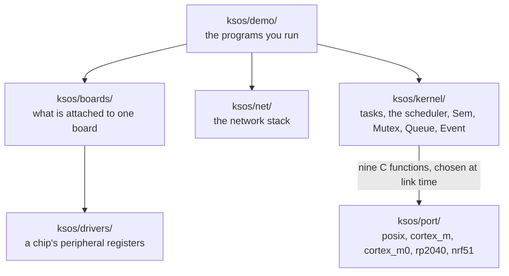
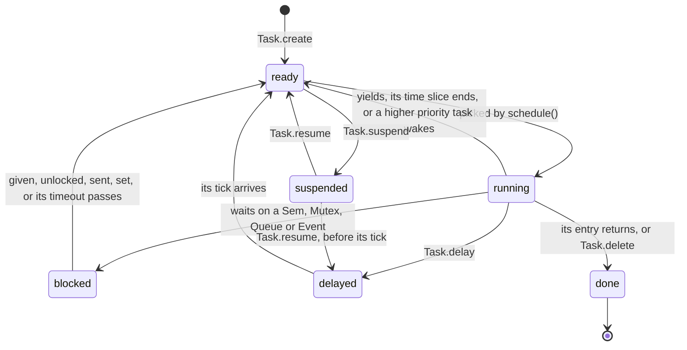
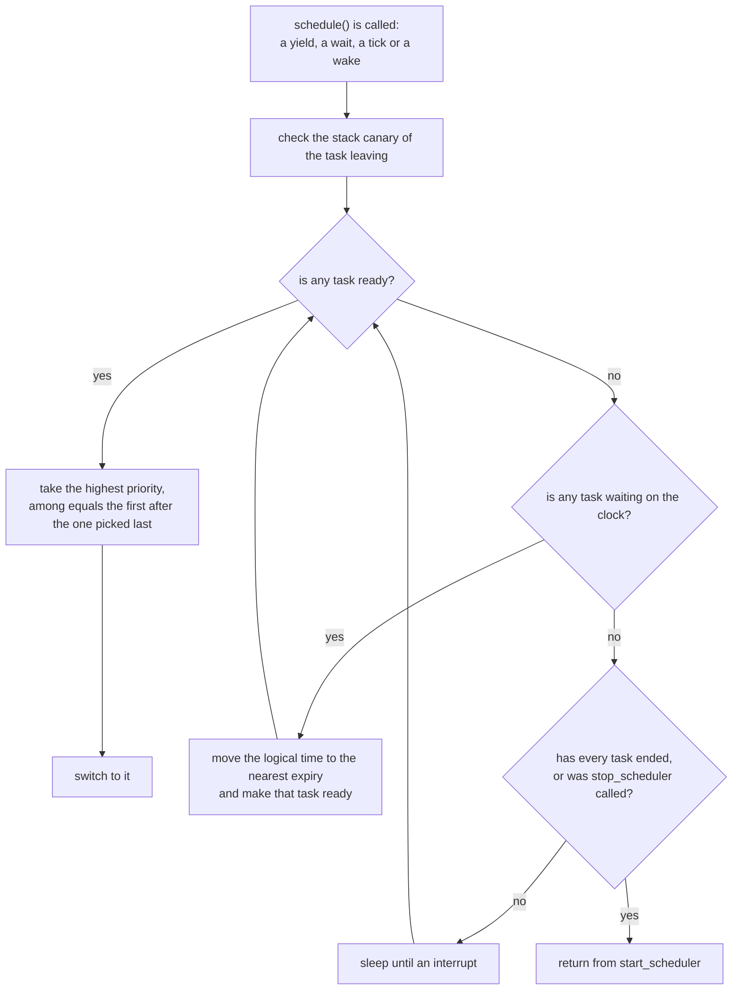
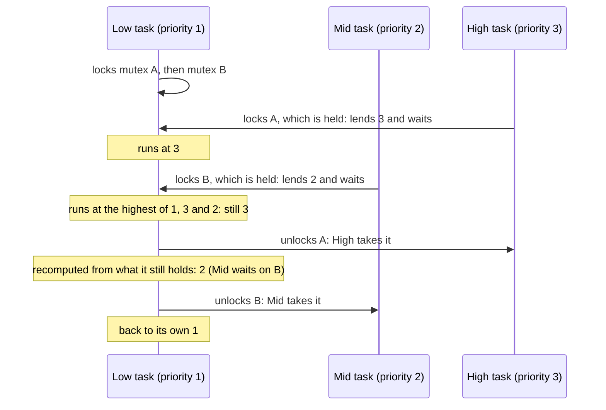
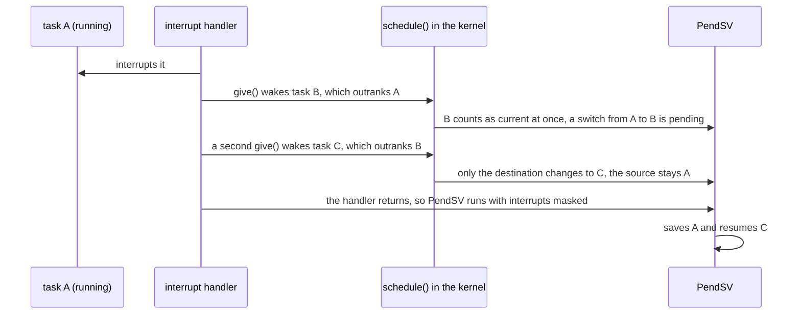
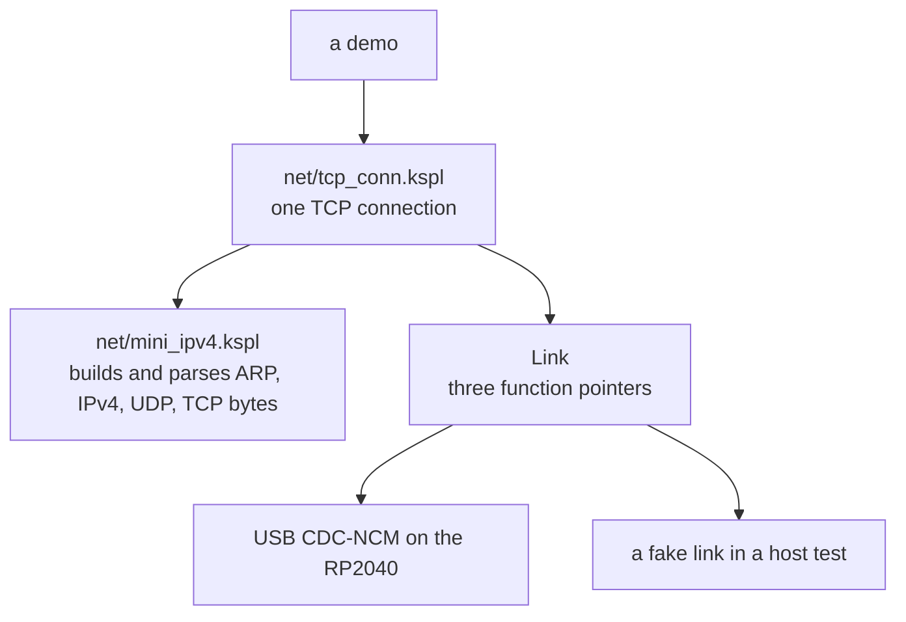

# Kanso OS — the design and how it is checked

Ksos is a small real-time operating system (RTOS) written in KSPL. An RTOS runs several *tasks*: functions that each look like they have the CPU to themselves. It switches between them by priority, so urgent work never waits behind less urgent work.

**A portable kernel core is kept apart from a thin port layer per architecture and OS.** Only the port layer, which absorbs each CPU's and OS's differences, is swapped. So the scheduler is checked as an ordinary Linux process, and the same checks extend to Cortex-M bare metal and a real chip. Where to start reading the code, and the demos by make target, are in [ksos](../README.md) ("Reading order").

## 🏗 The architecture



**The kernel core (`ksos/kernel/`) depends on neither hardware nor libc** (the C standard library). The caller allocates the stacks, the `Task` and a queue's buffer statically, so the core runs unchanged on a microcontroller with no `malloc`.

**The port layer is swapped at link time.** The kernel declares this C ABI with `extern "C"`, and each port implements it. A *context* is a saved set of CPU registers and a stack: enough to resume a task where it stopped.

| function | its role |
|------|------|
| `ksos_port_ctx_create(stack, size)` | makes the context that enters `ksos_trampoline` (which runs the current task's entry) on its first start |
| `ksos_port_ctx_create_main()` | captures the scheduler's (initial) context |
| `ksos_port_ctx_free(ctx)` | takes back a deleted task's context for reuse. If the task is the running one, its switch away saves nothing into it |
| `ksos_port_switch(from, to)` | saves `from` and switches to `to`; a null `from` (the running task was just deleted) saves nothing |
| `ksos_port_tick_start(reload)` | starts the periodic timer: `SIGALRM`+`setitimer` on POSIX, `SysTick` on Cortex-M |
| `ksos_port_irq_save() / _restore(s)` | a critical section: `SIGALRM` blocked through `sigprocmask` on POSIX, `PRIMASK` on Cortex-M |
| `ksos_port_in_isr()` | non-zero inside an interrupt handler: `IPSR` on Cortex-M; always 0 on POSIX, whose signal handler runs on top of the interrupted task |
| `ksos_port_wait_irq()` | called inside a critical section; opens it and sleeps until an interrupt in one step: `wfi` then a brief `cpsie i`, or `sigsuspend` |

**Preemption is opt-in.** `enable_preemption(reload)` starts the port's periodic timer. On every timer interrupt (a *tick*), `ksos_tick()` advances the logical time and reschedules, so a task that never yields still gives way.

## ⚙️ What sets the scheduler apart

**Ksos offers what FreeRTOS offers, redesigned as methods** (`Task.suspend()`, `Sem.take()`). Where FreeRTOS lets a mistake pass without a word, ksos stops at once or makes it impossible to write. The subsections below give the grounds.

| kind | FreeRTOS | ksos |
|---|---|---|
| making and deleting a task | `xTaskCreate` / `vTaskDelete` | `Task.create` / `Task.delete` (dynamic: `Task.create_dyn` / `t.delete_dyn()`) |
| pausing and resuming | `vTaskSuspend` / `vTaskResume` | `Task.suspend` / `Task.resume` |
| delaying | `vTaskDelay` / `vTaskDelayUntil` | `Task.delay` / `Task.delay_until` |
| a counting semaphore | `xSemaphoreCreateCounting` + `Take`/`Give` | `Sem.init`/`take`/`give` |
| an exclusive lock (priority inheritance) | `xSemaphoreCreateMutex` + `Take`/`Give` | `Mutex.init`/`lock`/`unlock` |
| a message queue | `xQueueCreate` + `Send`/`Receive` | `Queue<\|T\|>.init`/`send`/`recv` |
| event flags | `xEventGroupCreate` + `SetBits`/`WaitBits` | `Event.init`/`set`/`wait` |
| task notifications | the `xTaskNotify` family | not offered: the existing primitives express it |
| dynamic heap allocation | `pvPortMalloc` / `vPortFree` | `heap_alloc` / `heap_free` |
| watching the stack | `configCHECK_FOR_STACK_OVERFLOW`, once configured | a canary written on creation and matched on every `schedule()`; nothing to configure |
| statistics and a task listing | `uxTaskGetSystemState` and the rest | `t.cpu_percent()` plus `Task.get_prio`/`get_name`/`get_state` |

Each task is in one of these states (`Task_state` in `ksos/kernel/task.kspl`):



`Task.suspend` works from any state but `done`.

**A suspended task keeps what it was waiting for.** A task paused in `Task.delay` or `Task.delay_until` goes back to its delay on `Task.resume`. It wakes at the tick it asked for, or at once if that tick passed (`make ksos-kernel-check`). Ending the delay at the resume would make `delay` return early with nothing to show it, cutting a settling time or a debounce short. A task paused while blocked becomes ready at the resume and checks its condition again, since a `give` made while it was paused passed it by. Its timeout is an absolute deadline, so the recheck keeps it.

### Which task runs

The ready task with the highest number runs. Tasks with the same number take turns. This is how `schedule()` picks the next task (`pick_next` in `ksos/kernel/task.kspl`):



**`start_scheduler` returns when no task remains, or when the application calls `stop_scheduler()`.** A blocked or suspended task remains. While every remaining task is blocked with no deadline, the scheduler sleeps until an interrupt (`ksos_port_wait_irq`) and looks again (`make ksos-sleep`, `make ksos-nrf51-wfi`).

* **Why it does not return when every task is merely blocked**: a task can wait on a semaphore that an interrupt handler gives. Once the scheduler has returned, that `give` cannot restart it. Looping instead would hold the CPU at full use for as long as the wait lasts.
* **Why it still returns once every task has ended**: a program on a host goes on after its tasks. That is where a demo checks what they did.
* **`stop_scheduler()` returns past tasks that remain**, for a program whose tasks never end. From a task it switches to `start_scheduler`'s caller at once, and the task stays ready. From an interrupt handler it takes effect as the handler returns. A later `start_scheduler` carries every task on. Called while no scheduler runs, it panics (`make ksos-stop-outside`).
* Caution: **A task left waiting on something that never comes keeps the scheduler asleep for ever.** On a host, a demo's time cap reports it as hung ("How far CI looks, per port" in [ksos](../README.md)).

* **Priority scheduling**: the runnable task with the highest priority runs, and equal priorities go round-robin. **The larger the number, the higher the priority** (`prio=0` is the idle task's alone; an application's tasks are 1 or more). Some RTOSes use the reverse direction, and `Task.create` checks nothing, so reading it the other way inverts the system silently.
  * **A task made ready that outranks the running one runs at once**, before the code that woke it goes on (`make ksos-wake-preempt`). From a Cortex-M interrupt handler the switch is taken as the handler returns (`make ksos-cm-isr-give`). A woken task of equal priority waits its turn.
  * **It holds whether or not the timer runs.** `enable_preemption` adds time slicing and the tick, and nothing else. Otherwise, with no timer, a woken high-priority task would wait for the waker's next yield.
  * **Nothing is asked of an interrupt handler.** `give` itself decides on the switch. A flag that the handler must pass on to a yield call is a step that can be forgotten without a diagnostic.
* **The task manager (`cpu_percent` in `ksos/kernel/task.kspl`) samples.** On every tick, `ksos_tick()` adds 1 to whichever task is running, as top and ps do.

### Waiting and waking

* **Blocking**: every primitive shares `block_current`/`wake`. By an argument, `wake` wakes the highest-priority waiter or every waiter. Checking the condition and blocking happen indivisibly inside a critical section, and a woken task checks again (*wake-and-recheck*).
  * Caution: **Do not pick by registration order when waking one.** A low-priority waiter that registered earlier would take the resource while the high-priority one keeps waiting: priority inversion again. Among equal priorities, the waiter earlier in the table would take every `give` while the other *starves*. So `wake` takes the longest waiter among the highest priority. `block_current` stamps each wait with a running count, and the lowest stamp wins a tie (`make ksos-kernel-check`).
  * **A wake one waiter has not acted on passes to the next if that waiter stops first.** Waking only makes the waiter ready; it takes the resource when it runs and rechecks. If it is deleted or suspended before then, the resource would stay given while the next waiter waits for ever. So the waiter keeps what it was woken from until its recheck runs (`woken_from` in `ksos/kernel/task.kspl`). `Task.delete` and `Task.suspend` then wake the next waiter in its place. This covers `Sem`, `Queue` in both directions and `Mutex`. `Event.set` hands each waiter its answer as it wakes it, so it has nothing to pass on (`make ksos-wake-pass-on`).
    * Why the wake is passed on, rather than the resource handed to the waiter: a hand-off would need `delete` and `suspend` to undo it. Only each primitive knows how to do that. Passing the wake on is one rule in the kernel core, served by every primitive's recheck. A hand-off would also leave the resource with a suspended task.
  * **A woken task that finds the resource gone waits again at the back.** Wake-and-recheck lets a task that never waited take what was given before the woken one runs. The woken one's new wait gets a new stamp.
* **The critical section** is code during which no interrupt can run (`irq_save`/`irq_restore`). On Cortex-M it is `cpsid/cpsie i`. On POSIX it blocks `SIGALRM` and `SIGUSR1` (the tick and the stand-in interrupt) through `sigprocmask`. Blocking releases it so the switch can happen, and waking takes it again. So the primitives are safe under preemption (`make ksos-cm-mq`, `ksos-cm-event` and `ksos-preempt`).
* **Hold something exclusively with `Mutex`, never with `Sem`.** Inheritance assumes one known holder, so it cannot apply to a counting semaphore, and a binary semaphore used as a lock is open to inversion. `Sem` and `Mutex` are two types so that whether there is an owner is forced through the type.

### The priority-inheriting mutex

**A task locking a held mutex lends the holder its priority, then blocks.** This prevents *priority inversion*: a mid-priority task keeps preempting the low-priority holder, and the high-priority requester waits forever (`make ksos-cm-pi`).

**The holder runs at the highest of its own priority and every priority waiting on any mutex it holds.** That priority is recomputed on every release from the mutexes it still holds. So mutexes held together can be released in any order, and only the last release returns the task to its own priority (`make ksos-mutex-nested`):



| How the lent priority is returned | What goes wrong |
| :-- | :-- |
| a priority saved per mutex, restored on its release | a priority lent through the mutex still held is dropped as the other is released |
| kept until every mutex is released (FreeRTOS) | the holder runs high after nobody waits on what it holds |
| recomputed from the mutexes held (ksos) | nothing above |

**A chain is not followed.** When the holder itself waits on a mutex held by a third task, what it was lent does not pass on. Keeping one stage keeps a lock's cost a walk of the waiters.

**The kernel core keeps who holds which mutex** (`Holding` in `ksos/kernel/task.kspl`, which each `Mutex` embeds). So `Task.delete` sees a holder, and deleting a waiter takes back what it lent, recomputing every holder as on a release (`make ksos-kernel-check`). **Suspending a waiter takes it back too**, until it is resumed and waits again. A paused task's lent priority would only let the holder run ahead of tasks that can run (`make ksos-wake-pass-on`).

**A holder that drops below a ready task gives way at once.** A priority is returned on `unlock`, or when a waiter is deleted or suspended. Then the running task is compared with every ready task, not only with one just woken (`make ksos-wake-pass-on`).

**Misuse is not silenced.** Three mistakes panic on the spot (`make ksos-mutex-relock`, `make ksos-mutex-foreign-unlock` and `make ksos-delete-holder`):

| The mistake | What it would do if allowed |
| :-- | :-- |
| the holder locking again | it hangs, waiting for itself to let go |
| `unlock` by a task that is not the holder (of a free mutex too) | ignored, it leaves the caller believing it released |
| a task ending while it holds a mutex (deleted, or its entry returning) | every later `lock` waits forever; after `delete_dyn` the mutex names freed memory |

All three break with no diagnostic. A returned error code gets forgotten, so ksos stops instead. Re-entry by a count (a recursive mutex) is not taken: whoever miscounts the `unlock`s delays the release silently.

### Event flags

**Each bit of a `U32` is an event, waited on as an AND (all) or OR (any).** Clearing the bits as the wait ends (*clear-on-exit*) makes taking and consuming indivisible (`make ksos-event` and `ksos-cm-event`).

**One `set` releases every waiter it satisfies, clear-on-exit or not.** `set` judges every blocked waiter on the flags as set, and hands each one it satisfies those flags. Only then does it clear the clear-on-exit bits of all of them together. If each waiter cleared as it ran, the first would clear the bit the others wait on (`make ksos-event` releases three listeners with one set). The waiter keeps what it asked for in `Event_wait` in `ksos/kernel/sync.kspl`, on its own stack, reached through `wait_note` in `ksos/kernel/task.kspl`.

* **A suspended waiter is passed by**: it cannot act on the flags, so it does not consume them. Once resumed it looks at the flags itself.
* **A waiter deleted between the set and its run loses what it was handed.** The others were handed theirs by the same `set`, so nobody waits in its place. **A wait on no bits stops the program.** Under OR it would wait forever, and under AND it would hold at once (`make ksos-event-no-bits`).

### Time: ticks, delays and timeouts

* **Tickless idle**: where no task is runnable, the kernel moves the logical time (`g_tick`) to the nearest `delay` expiry instead of waiting in real time. So `Task.delay` works with no timer, and a test ends in the same order every time without waiting. With no `enable_preemption`, this is the only path that advances `g_tick`.
  * **So `Task.delay(n)` counts logical ticks, not real time.** It never wakes before the expiry. But where no other task runs, it returns in zero real time, even with a real timer running. So `cortex_m_control_ai_probe`'s `max_jitter` is in logical ticks, not real-time jitter.
  * Caution: **Where the real board needs a real-time period, use a hardware timer rather than `Task.delay`.** On the RP2040 that is `delay_us`/`delay_ms` in `ksos/drivers/rp2040/timer.kspl`. Power-saving tickless idle is in the "ksos" section of [`docs/PLAN.md`](../../docs/PLAN.md).
* **A timeout on a wait**: a blocking call is written three ways.

  | Form | Example | What it does |
  | :-- | :-- | :-- |
  | the bare form | `take` / `recv` / `send` / `lock` / `wait` | waits until another task wakes it |
  | `try_` | `try_take` | answers at once, without waiting |
  | `_for(ticks)` | `take_for(10)` | gives up with `false`/`none` at a timeout in logical ticks |

  The timeout runs on `g_tick`, so tickless idle counts it as a point to move the time to. A blocked task carries one timeout. The woken task's recheck takes the condition if it can, and gives up if the timeout has passed (`make ksos-timeout` and `make ksos-cm-timeout`).
  * **When `lock_for` gives up, return the priority it lent.** The holder is recomputed as on a release, from the priorities still waiting on the mutexes it holds.
  * **A timeout too large for the clock waits rather than wrapping.** `deadline_after` in `ksos/kernel/task.kspl` saturates at the last tick. A plain sum would wrap to a deadline already passed (`make ksos-timeout`).
  * **The bare form is the `_for` form with no deadline.** Each primitive has one wait loop per direction (`take_until` and the like in `ksos/kernel/sync.kspl`), so a fix reaches both forms.
  * **A tick is logical time.** `enable_preemption`'s reload is in the port's unit, so only the application can turn it into Hz. It names the rate with `declare_tick_hz(hz)` and converts with `ms_to_ticks(ms)`, which panics if no rate was named. It rounds up: rounding down would turn a short timeout into 0 ticks and give up without waiting.
  * Caution: **Do not fold how long it waits into one argument.** A single tick count that reads 0 as "do not wait" and a sentinel as "forever" lets a setting change the sentinel into a finite wait. ksos separates the cases by how the call is written. It refuses `_for(0)` with a panic (0 is `try_`'s job), and has no sentinel for forever.

### Interrupt handlers

**An interrupt handler (ISR, interrupt service routine) never waits: ksos stops one that tries to.** A wait inside one would block the interrupted task silently. `refuse_in_isr` in `ksos/kernel/task.kspl` panics **first in every waiting call** (each `*_until` loop, `Task.delay`, `Task.yield`). Otherwise a `take` that finds a count would pass, and the misuse would show only the day the count is 0 (`make ksos-cm-isr-block`). `Mutex.unlock` goes through `require_current`, since an unlock there would release the interrupted task's mutex (`make ksos-cm-isr-unlock`).

**Only what does not wait can be called from an ISR** (`give` / `set` / `try_*`, `Queue<|T|>.try_send`/`.try_recv` among them). Those need no dedicated version, because `irq_save` nests (`make ksos-isr`).

Only Cortex-M has a handler mode (`IPSR`), so only it detects the misuse. The POSIX stand-in interrupt, `SIGUSR1`, does only async-signal-safe work: `try_send` and a counter.

### A task's life, its stack and the idle task

* **Pausing, resuming and deleting a task** (`make ksos-lifecycle`): the Task and the stack are static, so a delete reclaims neither. It returns the scheduler's slot and the port's context, so create and delete repeat without running out. A task whose entry returned is `done` but keeps both until deleted, so a task manager still lists it.
* **The stack-overflow canary**: `Task.create` writes a known byte run at the stack's lowest-address end, and every `schedule()` matches it. The demo damages it directly (`make ksos-stack-overflow`), since a real overflow depends on the optimization and can die as a SEGV first.
* **The idle task (`enable_idle_task` in `ksos/kernel/task.kspl`)** calls its hook between pauses. **With nothing ready and nothing waiting on the clock, it sleeps until an interrupt** (`make ksos-sleep`); otherwise it pauses on `Task.delay(1)`, so tickless idle still moves the time. `install_idle_reap` in `ksos/kernel/dynamic.kspl` makes reclaiming deleted tasks its hook. It never ends, so `start_scheduler` returns only on `stop_scheduler`.

### The heap

* **ISR-safe heap allocation (`ksos/kernel/heap.kspl`)**: `std/mem.kspl`'s freestanding heap is a free list that joins neighbors, with a CAS lock for several cores. On one core it is not ISR-safe: an ISR that interrupts a task holding the lock spins on it forever. So `heap_alloc`/`heap_free` disable interrupts around the allocation and the free alone. **On ksos always use these for the heap from a task or an ISR, not `alloc`/`dealloc`.** `make ksos-cm-heap-probe` checks independence, reuse and joining, and `Arc<T>` on a chip with no OS heap.
* **Dynamic creation using the heap (`ksos/kernel/dynamic.kspl`)**: an extension impl on each static type. This is the source for the list of names.

  | | the names |
  | :-- | :-- |
  | **creating** — an associated function, the static side's verb with `_dyn` added | `Task.create_dyn` / `Sem.init_dyn` / `Mutex.init_dyn` / `Event.init_dyn` / `Queue<\|T\|>.init_dyn` |
  | **destroying** — a method on the instance | `t.delete_dyn()` / `s.destroy_dyn()` / `m.destroy_dyn()` / `e.destroy_dyn()` / `q.destroy_dyn()` |

  The Task, the stack and a queue's buffer come from `heap.kspl`, and a delete returns them too. `make ksos-cm-heap-probe` makes and deletes 120 tasks against the port's 33 contexts. **A task deleting itself cannot be freed at once**, since it still runs on that stack. `Task.current().delete_dyn()` leaves the reclaim to the next call into this file, or to the idle task. Deleting another task reclaims at once.

  **The table of dynamic tasks is read and written only inside a critical section**, as `Task.create` chooses its slot in one. A tick between choosing an entry and writing it would let another task do one of three things:

  * take the same slot;
  * free the same Task twice;
  * free a self-deleting task that has marked itself but not yet left its stack.

  So a self-deleting task is reaped only once `Task.delete` has made it `.done`. An entry is claimed inside the critical section before its memory is freed outside it. Deleting another task claims its entry and runs `Task.delete` in one critical section (`make ksos-dyn-race`).

  **Passing `null` as the receiver to mean "myself" is not taken**: the caller spells out `Task.current()`.

## 🔌 The ports

Five ports sit under the kernel, and `ksos/kernel/` changes for none of them. `posix`, `cortex_m` and `cortex_m0` implement the nine port functions; `rp2040` and `nrf51` add a chip's boot and memory map to `cortex_m0`.

| Port | Runs on | How it is checked |
| :-- | :-- | :-- |
| `port/posix/` | a Linux process | run directly |
| `port/cortex_m/` | an ARMv7-M microcontroller | run under QEMU, as a Cortex-M3 board |
| `port/cortex_m0/` | Armv6-M (Cortex-M0/M0+): the CPU layer for the RP2040 and the nRF51 | run under QEMU on the nRF51 |
| `port/rp2040/` | the RP2040 chip itself | built here, run on the real board |
| `port/nrf51/` | the nRF51 (the BBC micro:bit's chip), only as QEMU models it | run under QEMU, as a Cortex-M0 board |

**The one real chip is the RP2040** (a Raspberry Pi Pico / Pico W), on Freenove's mecanum car, brought up with no SWD probe ([`HOWTO-bring-up.md`](HOWTO-bring-up.md)). What is confirmed on it is in "What has been checked on real hardware" in [ksos](../README.md), and nowhere here.

### The POSIX host port (`port/posix/`)

It runs the kernel core in Linux user space. `ksos_port_posix.c` does a real context switch with `ucontext` (`makecontext`/`swapcontext`).

**It stays in C.** `makecontext` is variadic, and how it passes control is hidden behind the header's macros. KSPL's `extern "C"` crosses only scalars and raw pointers, so it cannot declare that function ([`../../docs/SPEC-programming-language.md`](../../docs/SPEC-programming-language.md) lists the types it cannot cross).

#### Preemption

The timer is `SIGALRM` (`setitimer`, on a period of `reload` microseconds). **The switch happens inside the signal handler**: `ksos_tick()` → `schedule()` → `ksos_port_switch()` calls `swapcontext` directly.

**The next tick cannot interrupt a task mid-switch.** `ksos_port_switch` blocks the interrupt signals before `swapcontext`, and gives a task its own mask back only once control has returned to it. So a task switched out inside the handler keeps `SIGALRM` blocked until it resumes and the handler returns. A new task unblocks them in `ksos_task_start`, as a Cortex-M task begins with interrupts enabled.

**`swapcontext` alone would not give it.** It installs the next mask before it loads the next registers. So a pending tick would run on the old task's stack while the new task counts as current. Its switch would save that half-made state as the new task's context (`make ksos-tick-mid-switch`).

**The port guards the switch; the kernel guards the moment before it.** Every path that chooses the next task and switches into it, `start_scheduler` included, does both inside one critical section. Otherwise a tick between the two would save the code still running as the chosen task's context, on either port.

**The critical section blocks and restores `SIGALRM` with `sigprocmask`**, together with `SIGUSR1`. It nests as PRIMASK's save/restore does: a restore unblocks only what its own save blocked (`make ksos-isr`).

### The Cortex-M port (`port/cortex_m/`)

It runs the kernel core bare-metal on an ARMv7-M (`thumbv7m`) microcontroller. It differs from the POSIX port only in the context switch and the boot.

**Its `.c` and `.S` stay in C and assembly.** The PendSV handler needs a variable bound to a register name (`register ... __asm__("r0")`), which KSPL's inline assembler cannot express.

#### The design of the context switch

A Cortex-M CPU has two stack pointers: PSP (used by normal code) and MSP (used by exception handlers). *PendSV* is an exception that software can make pending; it runs once no higher-priority handler is running.

**A thread runs on PSP, an exception handler on MSP, and every switch goes through PendSV.** So the saved frame is the same for a cooperative switch and for timer-driven preemption, and the two mix safely. `ksos_main` (the scheduler included) moves onto PSP at reset. So `start_scheduler`'s own loop is a thread context that PendSV switches to like any task's.

**The kernel picks the next task before PendSV runs, so a second pick can come in between.** `schedule()` counts the task it picked as current at once, while the switch waits for PendSV. An interrupt handler's `give` schedules again inside that window (`make ksos-cm-isr-give`):



Three things keep it sound:

* **PendSV alone records which thread is running** (`g_pendsv_running` in `port/cortex_m/ksos_port_cm.c`), and `ksos_port_switch` sets only the destination. Saving the running thread into the context of the task picked first would lose both.
  * Caution: **Do not let a caller decide from "is PendSV pending" whether it names the source.** An interrupt above PendSV's priority can arrive after PendSV is active but before it masks interrupts. A `give` there would make PendSV save one thread into another's context. Neither QEMU nor a desk run hits that window on demand.
* **PendSV runs with interrupts masked** from its first instruction, so no handler's `schedule()` can rewrite the destination it is reading.
* **`ksos_tick` takes the critical section**, since an interrupt above SysTick's priority can `give` during it.

Picking inside PendSV itself would also avoid the window. ksos keeps one `schedule()` for every port instead, and the POSIX port switches inside it directly.

Caution: **The window reaches into a critical section an application holds itself.** A `give` inside one that wakes a higher-priority task has already made that task current, and the switch waits for `irq_restore`. Until then, anything that acts on the running task (`Task.current`, a delay, a yield, a lock, a take) acts on the woken one. `irq_restore` in `ksos/kernel/task.kspl` says so where it is called.

#### Preemption

The timer is SysTick. PendSV is set to the lowest priority, so it *tail-chains* behind SysTick: it runs straight after it, without returning to the task in between.

**QEMU (`qemu-system-arm`, `mps2-an385`) runs it as the real chip would.** The demos print through ARM semihosting (a debug channel that asks the emulator to print), and end QEMU through it. **The exit carries the verdict.** On a 32-bit core semihosting's exit takes a reason, and QEMU exits with 0 only for "the application ended". A run exits with 1 in three cases (`exit` and `on_panic` in `ksos/demo/common/semihost_console.kspl`):

* its checks failed;
* it never reached its checks;
* it panicked.

**The emulator gets no terminal input or monitor**, since parallel runs sharing a terminal can suspend each other. Every run has a time limit, then a forced kill if shutdown stalls.

### The Cortex-M0/M0+ port (`port/cortex_m0/`)

It runs the kernel core on Armv6-M (`thumbv6m`, Cortex-M0/M0+, inside the RP2040), with the Cortex-M port's role and saved frame. **Armv6-M cannot reuse `cortex_m/`'s assembly.** Thumb-1 lacks two encodings it uses, so two files are rewritten here:

| File | What Armv6-M lacks | What is done instead |
| :-- | :-- | :-- |
| `startup.S` (the `.data`/`.bss` copy) | the post-indexed `ldr r3, [r2], #4` / `str r3, [r0], #4` | the pointer advances with an explicit `adds` |
| `switch.S` | `stmia`/`ldmia` reaching past r0-r7 | r8-r11 go by way of r4-r7 with `mov` |

The saved frame stays exactly `cortex_m/switch.S`'s.

Caution: **A Cortex-M33 (Armv8-M Mainline) does not run on `cortex_m/` by switching `-mcpu` either.** With its FPU in use, an exception stacks the extended frame (s0–s15 and FPSCR), which EXC_RETURN's bit 4 records. `switch.S` neither saves s16–s31 nor keeps EXC_RETURN per task, so a task is restored with another task's frame shape. A port for it needs these:

* in `switch.S`, saving EXC_RETURN with each task, and s16–s31 when that bit is clear, and returning with the incoming task's;
* in `ksos_port_ctx_create`, an initial EXC_RETURN for a basic frame;
* to use what Armv8-M adds, PSPLIM set per task (the hardware stack limit);
* with TrustZone, the EXC_RETURN bits for the task's security state.

Built with the FPU left off, the frames stay Armv7-M's, but nothing in the build enforces that.

[`port/cortex_m/ksos_port_cm.c`](../port/cortex_m/ksos_port_cm.c) and [`port/cortex_m/semihost.c`](../port/cortex_m/semihost.c) hold no instruction the M0+ lacks, so they are recompiled with `-mcpu=cortex-m0plus`. `link.ld` sits with each chip's port ([`port/rp2040/link.ld`](../port/rp2040/link.ld), [`port/nrf51/link.ld`](../port/nrf51/link.ld)). This layer is built once and linked by both chips.

#### Armv6-M has no atomics, so the port supplies them

**Armv6-M has no exclusive-access instructions** (`LDREX`/`STREX`). So the atomic helpers in `ksplc/gen/runtime/core.c` (`kspl_atomic_add` and the rest) are not defined for it. The C preprocessor tests whether `__GCC_ATOMIC_POINTER_LOCK_FREE` or clang's `__CLANG_ATOMIC_POINTER_LOCK_FREE` is 2. (Clang targeting MSVC defines only the latter.)

Caution: **Do not put a stand-in built on an interrupt mask into the runtime.** It is right on a single core, but breaks quietly on a chip with several cores, such as the RP2040. A link error is better than running non-atomically without a word. Only the port layer knows the chip, so only it can supply a substitute.

| the port | atomics | what can be used |
|---|---|---|
| RP2040 ([`port/rp2040/ksos_atomic_sio.c`](../port/rp2040/ksos_atomic_sio.c)) | ✅ the SIO's hardware spinlock plus PRIMASK | `alloc` / `Arena` / `Arc` / `Atomic_sz` / `std/http` |
| any other Armv6-M | ❌ none | referring to those stops at `undefined symbol: kspl_atomic_cas`; not using them has no effect (`--gc-sections` drops the references) |

Caution: **When starting a port for a new Armv6-M chip, look into that chip's locking between cores.** PRIMASK stops only its own core, so an interrupt mask alone must not replace the RP2040's spinlock. The top of `ksos_atomic_sio.c` says why it uses both.

### The nRF51 under QEMU (`port/nrf51/`)

**QEMU has no RP2040, and the RP2040's demos run one task that waits in busy loops.** Without another board, no preempted switch would ever run on Armv6-M. `switch.S`'s handling of r8-r11 would then be correct only by reading. The nRF51 port gives that layer QEMU's `-M microbit`, its only Cortex-M0 machine. That is the BBC micro:bit's nRF51822: 256KB of flash and 16KB of RAM.

**The port adds only what the board itself fixes**, and copies nothing of `cortex_m0/` or `cortex_m/`:

| File | What it holds |
| :-- | :-- |
| [`link.ld`](../port/nrf51/link.ld) | the memory map (flash at 0x0, RAM at 0x20000000), the stacks' places, and an ASSERT that the data leave the main stack its room |
| [`vectors.S`](../port/nrf51/vectors.S) | the nRF51's interrupt lines, IRQ1 to TIMER0's IRQ8, straight after `cortex_m0/startup.S`'s table. The M0 has no VTOR, so the table must be whole at 0x0 |

**One build serves the M0 and the M0+.** Both execute Armv6-M, so the layer built for the RP2040 runs on QEMU's `cortex-m0` unchanged. QEMU's M0 faults on an Armv7-M instruction, so a run also shows that none slipped into the layer. IRQ0, the line the shared demos raise from software, is the nRF51's POWER_CLOCK, which QEMU never raises itself.

**16KB of RAM sets the stacks.** The MSP keeps the top 1KB, and each task gets 1KB: a few times the deepest path (a panic from SysTick, printing the verdict). To measure again, dump the RAM at the run's end with semihosting's `SYS_WRITE`. Each stack's lowest non-zero byte above its canary shows its depth. A demo whose data leave the main stack under 1KB stops at the link.

**What it runs**: `make test-ksos-qemu` runs every demo listed for the Cortex-M0 in [ksos](../README.md), as `ksos-cm0-*` and `ksos-nrf51-*`.

Caution: **Keep the register check in `cortex_m_preempt.kspl`: it is the only demo that sees r8-r11 lost.** With the four restoring `mov`s taken out of `switch.S`, only `ksos-cm0-preempt` fails. C code built for Thumb-1 seldom keeps a value in r8-r11 across a switch.

**The WFI demo shows the wake, not the sleep.** An interrupt that arrives while every task waits must still be taken and wake the task, or the run's cap fails it. Whether the CPU slept cannot be told here: the M0 has no cycle counter, and QEMU's clock follows the instructions run. `make ksos-sleep` measures it on the POSIX port.

**What only the real RP2040 can show**:

* the atomics: `port/rp2040/ksos_atomic_sio.c` takes the SIO's hardware spinlock, which no other chip has;
* the boot: boot2, the flash's XIP mode and the vector table at flash+0x100 through VTOR;
* the second core, which ksos does not start (the "ksos" section of [`docs/PLAN.md`](../../docs/PLAN.md));
* the RP2040's peripherals and its real timing (the drivers under `drivers/rp2040/`).

### The RP2040 port (`port/rp2040/`)

The port layer for the **RP2040** (a Raspberry Pi Pico or Pico W). Its CPU layer is `ksos/port/cortex_m0/`. This port adds the boot, the memory map, the atomics above and the tool that makes a UF2.

#### About UF2

UF2 is the file format copied onto the Pico's USB drive (brought up by BOOTSEL) to install firmware, so no SWD probe is needed. `elf2uf2.kspl` turns an ELF into a UF2 (pico-sdk's `elf2uf2`, narrowed to the features needed).

**It lays the blocks out by `p_paddr` (the load address), never `p_vaddr`.** `.data`'s run-time address is in RAM and its load address in Flash (the `AT > FLASH` in `link.ld`).

Caution: If UF2's format is wrong (the 512-byte blocks, the magic, the family ID `0xe48bff56`), the boot ROM **silently ignores it**. So `elf2uf2.kspl` reads its output back before reporting success. It checks the block length, the magic, the family ID, `blockNo`/`numBlocks` and that the addresses are contiguous.

**Reading back cannot catch a wrong destination.** An ELF whose `p_paddr + p_filesz` passes 32 bits would wrap targetAddr, perhaps onto boot2 at 0, and the chip would stop starting. So it is refused at the start as `load_address_out_of_range`.

**A program-header stride (`e_phentsize`) other than ELF32's 32 bytes is refused too**, since the reader fixes field positions. The regression runs in `make debug-ksos`.

#### How the RP2040 boots


**The RP2040's boot ROM cannot read the QSPI Flash directly.** So it runs the stage-2 bootloader `boot2_generic_03h.S`, which sets the SSI (the QSPI controller) into XIP mode (execute in place). It then jumps through VTOR to `g_vector_table`.

`boot2_generic_03h.S` rewrites the SSI setup and the exit of `raspberrypi/pico-sdk`'s `boot_stage2/boot2_generic_03h.S` and `boot_stage2/asminclude/boot2_helpers/exit_from_boot2.S` (Raspberry Pi (Trading) Ltd., BSD-3-Clause). It uses bare register offsets from `hardware_regs/include/hardware/regs/{addressmap,ssi}.h`, with none of pico-sdk's headers.

**It takes the "anything that answers the 03h command works" setting** (the standard 1-bit SPI read). So it depends on no particular Flash chip: starting where the part number is unknown comes before speed.

`pad_checksum.kspl` shapes it into 256 bytes (code, padding and a 4-byte checksum), as pico-sdk's `boot_stage2/pad_checksum` does with `-s 0xffffffff`. The boot ROM's CRC32 is bit-reversed against a standard CRC32, so the input bytes and the result are both reversed around a standard one.

#### Building

```sh
make ksos-rp2040          # builds and links for the RP2040 and checks the layout and the checksum with objdump (it does not run)
```

`clang --target=thumbv6m-none-eabi -mcpu=cortex-m0plus` compiles the C and the assembly. The position-independent stage-2 bootloader is extracted as a raw binary and shaped by `pad_checksum.kspl`. `link.ld` links it as the `.boot2` section of `out/ksos_rp2040/ksos_rp2040.elf`. QEMU has no RP2040, so CI reaches only the build, the link and `objdump`.

#### Code that runs in RAM, and the record's region

**While Flash is written or erased, XIP stops and no instruction in Flash can be read.** So the code calling the boot ROM's write function must sit in RAM ("Writing Flash" below). `link.ld` puts code marked `#section(".ram_text")` inside `.data`, so the start-up copies it to RAM with the initial values.

**Delete the `.ram_text` line and the link still passes**, with the code in Flash. It shows only on the real board, as a freeze when the write begins. So `make test-ksos-link` checks that the window function's address is in RAM.

**The last 64KB of Flash (from `0x1f0000`) is left for the record inside the device.** An ASSERT in `link.ld` confirms the image does not reach it. [`drivers/rp2040/flash.kspl`](../drivers/rp2040/flash.kspl) holds the same position, and `make test-conventions` checks that they agree. Writing a UF2 touches only the range the image takes, so the record survives new firmware.

## 🔧 The peripheral drivers

A driver reads and writes a piece of hardware's *registers*: fixed memory addresses the hardware watches (MMIO). The drivers do this directly, with `__kspl_read_volatile`/`__kspl_write_volatile`. From the kernel they take only the critical section, and a `Sem` where an interrupt hands data to a task. Each heading below says where its driver is checked.

**Every RP2040 register value comes from pico-sdk's register headers, and every procedure from its implementations or from pico-examples** (Raspberry Pi (Trading) Ltd., BSD-3-Clause). QEMU has no RP2040 to confirm them. This section holds only why each driver is shaped as it is.

### Which folder a driver goes in

**What is bound to a chip goes in the folder named for that chip, and what is not goes directly under `drivers/`.** Mixed, the listing would not say which drivers can be ported.

| the place | what is in it |
| :-- | :-- |
| `rp2040/` `nrf51/` `cortex_m/` | what hits that chip's or IP's registers directly |
| directly under `drivers/` | what does not depend on a chip: an outside part (`ht16k33`), a class specification (`cdc_ncm`), and what every driver relies on (`mmio`) |

Caution: **Do not repeat the folder's name in a file name** (`rp2040/gpio.kspl`, not `rp2040/rp2040_gpio.kspl`). An import's alias is the last name, so the caller would read `rp2040_gpio.set_dir(...)`.

**`wait` in `ksos/drivers/mmio.kspl` is the one home of the busy wait every driver shares** (`mmio.wait(addr, mask, want_nonzero)!`). It gives up with `timed_out` after `POLL_TIMEOUT_ITERS` iterations, so hardware that does not answer cannot stall a driver forever. Do not copy the loop or the constant into a driver.

**A driver's call that can fail returns `Void!Driver_error`** (`Driver_error` in the same file), not a `Bool`. A `Bool` said only "it did not work", and a caller could drop it unseen. Its kind (`timed_out`, `no_answer`, `not_found`, `out_of_range`, `full`) says why. A board passes a failure on; a demo decides what to leave out. Two kinds stay `Bool`: a question (`i2c.present`, `usb_cdc.is_configured`), and a try answered at once (`usb_cdc.write`, `flash.program_at`).

### The RTC (`rtc.kspl`) — real chip only

The RP2040's RTC holds the calendar date and time, ticking on clk_rtc, which `clocks.init()` supplies at 48MHz / 1024. `rtc.init` lifts the block's reset. The `[rtc]` stage of `make ksos-rp2040-board` reports whether it keeps ticking (`ticking=yes`).

### GPIO (`gpio.kspl`) — real chip only

Making a GPIO line an output touches three blocks:

| Block | What it sets |
| :-- | :-- |
| PADS_BANK0 | the pin's electrical settings |
| IO_BANK0 | FUNCSEL, the function the pin is joined to |
| SIO | the output value and the direction |

Caution: Miss even one and **it does nothing, with no error**, so `init_out()` does all three together.

The inputs, the pulls and `spin()` are described at each function in `ksos/drivers/rp2040/gpio.kspl`.

### PWM (`pwm.kspl`) — real chip only

**The RP2040's PWM has 8 slices of 2 channels (A/B). The period (DIV/TOP) is per slice, the duty (CC) per channel.** So two lines needing different periods cannot share a slice. The slice is the GPIO number / 2, mod 8; the channel is the GPIO number mod 2, 0 being A. Confirm it before choosing the pins. On the Freenove car, each motor's two pins are the A/B of one slice, which fits an H bridge unchanged.

**`set_percent` takes the duty as a proportion, and TOP as an argument.** So TOP can grow without changing callers once DIV's 8-bit integer part overflows at 125MHz. The driving control is in [`boards/freenove_4wd_pico/motor.kspl`](../boards/freenove_4wd_pico/motor.kspl).

Caution: **Write it with the wheels off the ground** (stage 3 in [`HOWTO-bring-up.md`](HOWTO-bring-up.md)).

### The clocks and the µs timer (`clocks.kspl` / `timer.kspl`) — real chip only

Out of reset the RP2040 runs on the built-in ROSC (about 6.5MHz, varying with the unit and the temperature). **USB needs exactly 48MHz on clk_usb** (±0.25%), and on the ROSC it does not even enumerate. So `clocks.init()` starts the crystal (XOSC, 12MHz) and sets each clock through the two PLLs.

**Calling it changes the scale of time about 19-fold.** `gpio.spin`'s iteration counts, SysTick's reload and PWM's divisors all need revisiting. Time is then taken from `rp2040/timer`'s real microseconds (`now_us`/`delay_us`/`delay_ms`).

**That timer needs `clocks.init()` too.** TIMER counts a 1µs pulse from the watchdog's tick generator, which `clocks.init()` sets up. Without it, `delay_us` never returns.

Caution: **The same 1µs tick drives the watchdog's counter** ("The watchdog (`watchdog.kspl`)" below). Changing clk_ref or the tick's CYCLES changes every watchdog timeout with it. So keep `TICKS_PER_MS` in `drivers/rp2040/watchdog.kspl`, this section and the drawing below saying the same thing.

The clock tree it sets up (the procedures follow pico-sdk's `hardware_xosc/xosc.c`, `hardware_pll/pll.c` and `pico_runtime_init/runtime_init_clocks.c`):

```
  XOSC 12MHz ─┬─ PLL_SYS  VCO 1500MHz / 6 / 2 → clk_sys  125MHz → clk_peri
              ├─ PLL_USB  VCO 1200MHz / 5 / 5 → clk_usb   48MHz
              │                                → clk_adc   48MHz
              │                                → clk_rtc   46875Hz (= 48MHz / 1024)
              └────────────────────────── → clk_ref   12MHz → watchdog tick 1MHz (TIMER and the watchdog's counter)
```

### USB CDC (`usb_cdc.kspl`) — real chip only

A composite device that offers **two functions** on one USB cable:

| Function | What the PC sees | What it is for |
| :-- | :-- | :-- |
| **CDC-ACM** | a virtual serial port | text on the PC's Serial Monitor, with no SWD probe. Before it is up, the only output is the buzzer |
| **CDC-NCM** | a USB LAN adapter | raw 802.3 frames, so it fills the `Link` in `ksos/net/link.kspl` unchanged. With connection sharing on the PC, it reaches the internet |

**The two live together so the network side can be narrowed down.** With NCM alone, the only clue left when something fails is the buzzer.

**It runs by polling, not by interrupt**: a task calls `poll_once()` on a schedule, which keeps the scheduler out of interrupt priorities. Keep calling it while waiting too, since the host drops a device that does not answer.

**`write(data)` only queues**, and `poll_once()` sends 64-byte packets. A line that does not fit the 512-byte queue is not queued at all (`false`), since part of a line would tear the log. `has_room(n)` asks first.

**EP0's control transfer does not end in one round trip.** Enumeration needs three things from it (the procedures follow pico-examples' `usb/device/dev_lowlevel`):

* the 67-byte configuration descriptor sent as two packets, 64+3 (exactly 64 is not a short packet, so the host waits for more);
* a way to receive the zero-length OUT after the data stage;
* a STALL, not an empty answer, for a request it cannot answer.

Caution: **Always run ksos's `make test` after touching a descriptor** (`make debug-ksos` from the repository's root). One byte out of place makes enumeration fail without a word. Each descriptor is a `U8[_]` array, whose length is its element count; a length written out pads silently. `ksos/tests/usb_descriptors.kspl` checks their length bytes.

### The CDC-NCM framework (`cdc_ncm.kspl`) — **independent of the hardware**

NCM packs raw 802.3 frames into a container called an NTB. `cdc_ncm.kspl` only assembles and parses NTBs, touching no register. **It is kept apart so it can be tested with no hardware**: failing USB says only "it is not recognized". `make debug` runs `ksos/tests/ncm_test.kspl`; run it before going to the real board.

### The ADC (`adc.kspl`) — real chip only

Channels 0 to 3 are GPIO 26 to 29, and channel 4 is the built-in temperature sensor (`pin_channel()` converts). A reading needs preparation in **three places**. Miss any one and it returns 0 or a stuck value, with no error.

1. `clocks.init()`: the ADC runs from `clk_adc` (48MHz). Unset, READY never goes up.
2. `gpio.init_analog(pin)`: turns the pin's digital input buffer and pull off, which would pull at the voltage. It leaves FUNCSEL alone.
3. `adc.init()`: lifts the ADC block's reset, and sets EN.

**It returns 12 bits (0 to 4095).** Arduino's `analogRead` returns 10 bits by default, so a formula or threshold copied from a sketch is out by a factor of 4. A single read wobbles by a few LSB, so compare an average (`read_pin_avg(pin, n)`) against a threshold.

### Ultrasound (`hcsr04.kspl`) — real chip only

The HC-SR04 is **an outside device**: two GPIO (TRIG out, ECHO in) and the µs timer. ECHO's High width is the sound's round-trip time. Its numbers come from Freenove's sample ("The ultrasonic sensor (HC-SR04)" in [`SPEC-board.md`](SPEC-board.md)).

**"No reflection came back" and "the sensor does not answer" are returned apart** (`timed_out` / `ok`). The first means far away or absorbed; the second is the moment to suspect the wiring.

**The pin numbers are the board definition's, not the driver's**, so the driver takes `trig`/`echo` as arguments.

### IR receive (`ir_nec.kspl`) — real chip only

It receives an NEC infrared remote on one GPIO, an outside device like the ultrasound. The timings are at the code in `ksos/drivers/rp2040/ir_nec.kspl`.

**Only the command's inverse is checked.** Extended NEC uses the address's inverse byte as the top half of a 16-bit address, so checking it would refuse some remotes.

**The tolerances are loose on purpose**: polling cuts off the start of the leader, and remotes' crystals vary.

**Mind the interval between calls.** One frame is only about 70ms, so a coarser watch drops it whole. The caller enters `try_receive()` only where `is_idle()` is false, and it blocks for at most 70ms.

### The I2C master (`i2c.kspl`) — real chip only

The RP2040's I2C is a Synopsys DesignWare block (DW_apb_i2c). Its divisors and initialization follow pico-sdk's `hardware_i2c/i2c.c` and the example `bus_scan.c`.

**Each byte goes into DATA_CMD with its control bits.** STOP and RESTART are those bits: forget the STOP on the last byte and it holds the bus. Pass the address as 7 bits (0x70 and the like); the hardware attaches the direction bit.

Four more details are each written at the code in `ksos/drivers/rp2040/i2c.kspl`:

* the configuration takes effect only while ENABLE is down;
* the built-in pull-ups;
* `IC_SLAVE_DISABLE`;
* a bus scan that waits on the abort as well as the receive.

Caution: **Match not only the registers' values but "what to call in the initialization" against the implementation.** The pull-ups and `IC_SLAVE_DISABLE` can be right in value and still fail, and only the real board shows it.

### The LED matrix (`ht16k33.kspl`) — real chip only

The VK16K33 / HT16K33 holds display RAM and scans it by itself, so a picture once written needs no CPU.

**The demo scans the bus for its address**, since a solder jumper moves it over 0x70 to 0x77. `draw()` sends the whole 16-byte display RAM, since a partial update leaves the old picture behind.

### Writing Flash (`flash.kspl`) — real chip only

It offers the last 64KB of Flash as a place to erase and write, where the append-only record ([ksdb](../../ksdb/README.md)) goes. **It alone hits no MMIO.** Writing and erasing are the boot ROM's functions, looked up from the ROM's fixed table. What those functions ask for:

| The operation | The unit | The position |
| :-- | :-- | :-- |
| Erase | a sector, 4096B | a multiple of 4096 |
| Write | a page, 256B | a multiple of 256 |
| Read | free | read the XIP space directly |

A range spanning pages is written page by page, with 0xFF in the bytes not touched. 0xFF changes no cell, so the page can take more later.

**XIP is stopped while writing and erasing.** So the procedure calling the ROM functions is put in RAM (`#section(".ram_text")` plus `#noinline`; [`port/rp2040/link.ld`](../port/rp2040/link.ld) copies it with `.data`). For the same reason:

* **Stop interrupts before entering**, since an ISR in Flash has no way back. PRIMASK stops only this core: once core1 is used, stop it too for the window.
* Inside the window, make **only ROM calls through a function pointer**. Calling one function in Flash crashes the chip. `init` looks the addresses up beforehand.
* The source data passed to `flash_range_program` must be **in RAM**; a string literal in Flash is unreadable during the window.

**A page is staged in RAM inside the same critical section that programs it** (`run_in_window`). The staging buffer is shared, and a task switched in could otherwise stage its own page over it. So no lock is needed, and a write can come from any task.

**The ROM's `flash_enter_cmd_xip` is enough to put XIP back.** It sets up the same 03h 1-bit SPI read that `boot2_generic_03h.S` builds. If boot2 moves to a fast QSPI setting, call boot2 again from RAM here too, or Flash reads stay slow after a write.

### The watchdog (`watchdog.kspl`) — real chip only

**Without a watchdog, a program that stops answering leaves the motors at their last duty.** A panic already stops them through the panic hook, but a hang does not panic. An endless loop, a lock-up, or a fault inside a Flash window all leave the car driving with nothing deciding. (In a Flash window, the fault handler, being in Flash, cannot even be fetched.) The watchdog resets the chip when the program stops feeding it. The reset puts every peripheral back in reset, so the PWM pins fall back to their reset state and the motors stop.

**What the driver does**, with the register addresses from the RP2040 datasheet's chapters "Watchdog" and "Power-On State Machine":

| Call | What it does |
| :-- | :-- |
| `arm(ms)` | Sets the PSM's WDSEL to reset every block except the two oscillators, and leaves a mark in SCRATCH4. Then it loads the counter and turns it on, paused while a debugger halts a core |
| `feed()` | Loads the counter again. It does nothing before `arm` |
| `disarm()` | Turns the counter off |
| `last_reset()` | Why the chip started: `power_on`, `watchdog` (it fired after `arm`), or `other` (a reboot by the boot ROM after a UF2 copy, or by a debugger) |

* **WDSEL is 0 out of reset, which resets nothing.** It must include the RESETS block, so every peripheral (PWM among them) is held in reset after the watchdog fires.
* **The counter goes down twice per 1µs tick** (erratum RP2040-E1), so LOAD holds twice the ticks. Without that every timeout is halved. LOAD has 24 bits, so the longest timeout is 8388 ms.
* **REASON alone cannot tell a hang from a UF2 copy**: the boot ROM reboots through the watchdog too. The mark in SCRATCH4 tells them apart, since the boot ROM clears that register when it reboots the chip itself.
* **It pauses while debugging.** A breakpoint then does not reset the chip under the person reading it. The PWM keeps its last duty meanwhile, so debug with the wheels off the ground.

**On the car, the timeout is 1000 ms** (`WATCHDOG_MS` in `ksos/demo/rp2040/rp2040_car_pilot_probe.kspl`). It has to be longer than the longest stretch between two feeds, and short enough that the car stops within a short roll:

| Stretch between two feeds | How long |
| :-- | :-- |
| One lap of the control loop | 100ms, stretched by IR frames, the distance reading and a report line to about 300ms |
| One Flash sector erase | At most 400ms (the 2MB flash's data sheet; typically 45ms) |
| One Flash page write | At most 3ms |

**Who feeds it, and from where:** the control loop, once per lap. Each step the record takes feeds it too: a read, a page write, a sector erase (`ksos/demo/rp2040/common/records.kspl`).

* **Never from an interrupt or a timer.** They keep running while the loop is stuck, so a watchdog fed from there never fires when it matters.
* **The record's steps feed because erasing while keeping the policy and printing the whole record take seconds.** Each step is short and bounded, so it proves the task is still moving. A timeout covering the whole operation would be several seconds, too long to stop the car.

**It is armed only where the wheels can first turn**, just before the control loop. Start-up can take tens of seconds, more than the longest timeout: it waits for the console and the link, and downloads. The wheels stay stopped meanwhile. Covering start-up would mean feeding inside its waits, which is the feeding that hides a stuck wait.

**At start-up the car first disarms it.** A watchdog left running by the run before, or kept through a debugger's reset, would otherwise fire during start-up. Nothing here jumps to the boot ROM's USB boot. Code that adds such a jump disarms the watchdog first, since the boot ROM does not feed it.

**After a watchdog restart the car stays stopped**, its first LED white (`HALTED: restarted by watchdog`), until a held press on the remote brings it back. Whatever hung may hang again, and a car that restarts and drives off in fits is worse than one that waits. The console says why it started, and prints the message of a panic left by the run before (the panic record in `.noinit_panic`).

### The WS2812 full-color LED (`ws2812.kspl`) — real chip only

The WS2812 is one 800kHz line where **High's length is the bit's value**:

| | Length |
| :-- | :-- |
| one bit | 1.25µs |
| a 0 | High for 0.4µs |
| a 1 | High for 0.8µs |
| the end (latches the colors) | Low for 50µs or more |

There are 24 bits per element, in G→R→B order.

**The PWM counts the time.** It makes the waveform, and the driver rewrites the duty (CC) once per period (GPIO 16 is PWM slice 0, channel A). Counting CPU cycles would depend on the C compiler's output, so a change of optimization would break the colors.

**The write has a grace period, once per period.** CC is not double-buffered, so the rewrite must land after that bit's pulse ends and before the counter wraps: 54 counts of 156 at 125MHz. So:

* Interrupts are **stopped** while sending, since one getting in delays a bit.
* The sending loop is **put in RAM** (`#section(".ram_text")` plus `#noinline`), since a Flash read stalls on XIP's cache. `make test-ksos-ramtext` checks it.
* **The values written into CC are all made in `init`.** Arithmetic inside the loop lets the C compiler move it behind the wait, using up most of the grace.
  * **After adding arithmetic to the loop, read the generated instructions again.**

**PIO is not used.** PIO, the RP2040's programmable I/O engine, would remove the grace period. But it adds a block only the RP2040/RP2350 has, and a second means to one purpose (Principle 6). This holds as long as the grace period is kept.

Caution: **Mind the current.** One element uses close to 60mA at most, so eight all white is 0.5A, and the low-voltage watch fires on their own light. The caller keeps the brightness down (`WS2812_LEVEL` in `ksos/boards/freenove_4wd_pico/board.kspl`).

**Only one line can be driven.** Once a second is needed, move the driver's state into a struct.

**The verdict is the color seen by eye**, in the `[led]` stage of `make ksos-rp2040-board`.

## 🌐 The network stack

It is the smallest ARP/IPv4/UDP/TCP stack that lets the car talk to a PC: no fragmentation, no IP options, no routing table. It runs on an Ethernet link (on the real RP2040, USB CDC-NCM). `make ksos-rp2040-net` runs ARP/TCP/HTTP on the car.



### How the bytes are assembled

* **The fields are written into and read out of the bytes directly in network byte order** (big endian). `put_u16_be` and the rest in `std/bytes` spell out the position, the width and the endianness per call.
* **The UDP checksum is 0** (IPv4 allows leaving it out). The IP and TCP checksums are RFC 1071's one's-complement sum. TCP includes the pseudo header, so `checksum16_step`/`checksum16_finish` let the sum span several regions. The receiver does not check the checksum; an outside test harness recomputes the sender's independently.
* **What ARP resolved (the gateway's MAC) is held by the caller**, not by `mini_ipv4.kspl`, which holds no hidden global state. The TCP sequence and ACK numbers are the caller's too.

**The TCP is the smallest implementation**: a single connection with a fixed 20-byte header and no options. It has no retransmit timer, no congestion control, no handling of reordering and no concurrent connections. It is extended only as far as real use needs.

**What it receives it acknowledges, and the peer's close reaches the caller** (`ksos/net/tcp_conn.kspl`, tested in `ksos/tests/net_test.kspl`):

* **An ACK goes once a segment has been handed over whole**, and again for a segment at a seq already passed. The peer's resend recovers a lost ACK, so the ACK is not retried.
* **The peer's FIN reads as 0**, the end of the stream in `mbedtls_ssl_recv_t`'s contract. **Its RST reads as `mbedtls_err_net_conn_reset`.** Either holds on every later call.
* **An RST counts only at the expected seq.** At any other, a third party could guess one into the window and cut the connection.

### The receiver does not trust what the sender claims

**What is received is bytes the peer chose.** `parse_tcp_segment` returns no content until it has confirmed these six. Let any one through, and it reads outside the buffer or passes on what must not be read.

| what is confirmed | what happens if it is let through |
|---|---|
| the payload's length comes from IP's Total Length, not from the frame's length | Ethernet's zero padding flows in as data, advancing `peer_seq`, and **that connection can never be read again** |
| the version is 4 and the IHL is 20 bytes or more | a header of another shape is read as IPv4 |
| the TCP header's position comes from the IHL, not a fixed 20 bytes | against a header with options, the middle of the options is read as the port number |
| the data offset is 20 bytes or more | the TCP header's own bytes are passed up as the payload |
| it is not a fragment (MF / the fragment offset) | nothing reassembles it, so what is not a header is read as one |
| as much has arrived as Total Length claims | a payload pointing outside the buffer is returned |

(IHL is the IP header's own length field; the data offset is the TCP header's.)

**We pad with zeros too when sending** (`pad_to_min`). That the padding lies outside Total Length is the one thing to rely on.

#### Replies are checked just as strictly

`build_arp_reply` and `build_icmp_echo_reply` **put the peer's bytes back on the wire under our own IP**, so they confirm as much as `parse_tcp_segment` does.

| what is confirmed | what happens if it is let through |
|---|---|
| ICMP: the version is 4 | other stacks drop another version even with EtherType 0x0800; we alone would answer |
| ICMP: it is not a fragment | a later fragment's payload byte is read as the kind. Where it is 8, **the peer's content goes out as an "echo reply" under our own IP** |
| ARP: hwtype/ptype/hwlen/protolen are Ethernet+IPv4's 6/4 | the fields sit at their offsets only at 6/4; answering another claim sends unrelated bytes out as "that peer's address" |

Caution: **When passing a received frame as `(buf, len)`, keep `len <= buf.len`.** `mini_ipv4` does not check it: the checks look at `len` while the reads index `buf`. A link layer's `recv_frame` returns how many bytes it copied, which meets this. `cdc_ncm.datagram_at` checks it itself.

**The assembling functions write nothing and return 0** for a frame that does not fit the buffer (`fits`). `copy_from` and `sub_mut` silently cut off what does not fit, so the caller would send a length that was never written. The 0 is also the answering functions' "not addressed to us", and the caller takes it as "nothing to send" (`net_client.send_now` rejects 0).

The regressions are tested on a host by `ksos/tests/net_test.kspl`.

### Whether a send succeeded — `Link.send_frame` returns a `Bool`

`Link.send_frame` returns **`true` where it could send and `false` where it cannot right now**: the caller waits and retries with the same content.

Caution: **Do not throw the outcome away.** A polling link (`rp2040/usb_cdc`) holds one send buffer, and drops a frame sent before the host read the previous one. With TCP, `our_seq` would then claim bytes the peer can never ACK, and with no retransmit the connection breaks without a word.

**`tcp_stream_send` does not advance `our_seq` and returns 0** where it could not send, which in `mbedtls_ssl_send_t`'s contract means "call again with the same content". The signature is exactly mbedTLS's, so no adapter function is needed. The regression is `test_tcp_conn_send_failure_does_not_advance_seq` in `ksos/tests/net_test.kspl`.

Waiting for `usb.ncm_tx_busy()` to go down before sending is **for efficiency**, not correctness (`drain_tx()` plus `send_now()` in `ksos/demo/rp2040/common/net_client.kspl`).

### Where a link layer is swapped in (`link.kspl`)

**`ksos/net`'s upper layers do not know what hardware they go through.** They need three things (send one frame, has one arrived, receive one), gathered into a struct `Link` of three function pointers. The caller passes in the implementation it chose.

```kspl
link: = netlink.Link::{
    .send_frame = eth.send_frame, .rx_available = eth.rx_available, .recv_frame = eth.recv_frame,
}
conn: = tcpconn.make(link, ...)
```

**Only a link that moves raw 802.3 frames fills `Link`.** A chip that runs TCP/IP itself would stand in place of `ksos/net`, not beneath it.

**`net/mini_ipv4.kspl` holds not one import.** Only the three calls through `Link` in `net/tcp_conn.kspl` touch the hardware, so all of `ksos/net` is independent of the NIC.

**`Link` takes the shape of ksdb's `Store`**: a struct of function pointers with no context pointer ("The place is swapped through a struct of function pointers" in [`ksdb/docs/DESIGN-storage.md`](../../ksdb/docs/DESIGN-storage.md)). Add a context pointer only when two NICs of the same kind come up (Principle 5).

## 🚗 The board: Freenove's 4WD car with a Pico W

**This section covers what ksos puts on the one real board**: a toy car with four mecanum wheels and a Raspberry Pi Pico W. The hardware's own facts are in [`SPEC-board.md`](SPEC-board.md), and bringing it up stage by stage is in [`HOWTO-bring-up.md`](HOWTO-bring-up.md).

### What is in `boards/freenove_4wd_pico/`

**Only the things attached to this board, and how they are handled.** It is the layer below the demos, using `ksos/drivers/` and used by `ksos/demo/`.

Caution: Do not point at a demo from here. Once the board knows a particular demo, it cannot be reused for another.

| File | What it holds |
| :-- | :-- |
| `board.kspl` | The pin assignment. Which GPIO has what attached |
| `motor.kspl` | The four wheels' driving control (composing a mecanum's motion), and the speed cap |
| `track.kspl` | The three reflective sensors for line tracking |
| `range.kspl` | The sense of the distance ahead (an HC-SR04) |
| `face.kspl` | The face (an 8×16 LED matrix) |
| `head.kspl` | The servo swinging the ultrasonic's head, held to its range of motion |
| `status.kspl` | The states' names and how they are shown (the report's line, and WS2812) |

**What differs from unit to unit is a table of constants that is always read**, in `board.kspl`. A commented-out `#define` does not show whether it is off or on (Principle 5). So `wheel_polarity` holds each wheel's direction, and `line_sensor_swapped` corrects swapped outer line sensors. [`SPEC-board.md`](SPEC-board.md) gives the facts under two headings:

* "The direction of rotation differs from unit to unit";
* "Line tracking".

**Only `track.kspl` reads the line sensors**, so a left-right fix lands in one place. **Putting the parts together** belongs to the demos (`ksos/demo/rp2040/common/`).

### What the self-driving probe does, and where its judgement lives

At start-up the car fetches one whole policy from kssrv (`GET /pilot_policy.safetensors`), keeps it inside the device and disconnects. From then on, each round, it reads the sensors, decides the next manoeuvre in the car, turns the wheels and keeps the observation.

**The policy file is `ksos/demo/cortex_m/pilot_policy.safetensors`, the one copy that the car and `cortex_m_pilot_probe` both use.** `ksai/examples/car_pilot` writes it offline. After the rules, the net or the encoding change, write it again with `ksplc run ksai/examples/car_pilot/main.kspl ksos/demo/cortex_m/pilot_policy.safetensors`.

The policy and the observations live in **the record inside the device** (the last 64KB of Flash). Where the link or kssrv is down, or the policy it sends is refused, the car decides with the policy it took last time. It stays put only when neither can be used, and the console says which policy it uses.

**The car does not ask the PC on each observation**: it could then decide nothing once the link drops.

**The safety timeouts are in the car, outside the policy.** They must hold whatever the policy answers, with no policy, and with no link. Which ones each firmware carries is in "The safety timeouts of each firmware" in [`HOWTO-bring-up.md`](HOWTO-bring-up.md).

**How it reads and steers:**

* **The distance is read once per control lap (100ms), and the line every 10ms.** An HC-SR04 measurement blocks up to 36ms and needs 36ms before the next, while the line is three GPIO reads. When the line moves mid-lap, only the steering is redone, except during the close-range reverse or while stopped.
* **The speed cap scales the triple as a whole** (the three numbers of a manoeuvre). Capped per component, a manoeuvre mixing forward and turning would turn harder than instructed.
* **The policy gets the median of the last three distance readings** (`range.steady_mm`). Only the close-range timeout uses the raw reading (`emergency_mm`): a false alarm is safe, a miss is not.
* **The wheels need no tighter timing than 10ms**: the motors' 500Hz PWM gives five periods per instruction.

**Only the first run needs the PC**, to take the policy from kssrv (its stages 7 and 9, in [`HOWTO-bring-up.md`](HOWTO-bring-up.md)). A long press on the remote prints the kept record, with no PC.

### The USB-Ethernet probe's steps and what the PC needs

It runs three stages, in this order. What each prints is stages 6a to 6c in [`HOWTO-bring-up.md`](HOWTO-bring-up.md), with what the PC must provide.

| Stage | What it does |
| :-- | :-- |
| (a) Enumeration and raising the link | waits to be enumerated as CDC-ACM + CDC-NCM. The host chooses alt 1 for NCM's data interface, then the car's notification raises the link |
| (c) The upper layers | asks 192.168.137.1 for its MAC over ARP, raises TCP, and sends an HTTP GET |
| (b) Answering | keeps answering the ARP requests and ICMP echoes addressed to the car |

**`ksos/net/tcp_conn`'s `tcp_stream_send`/`recv` have their one real run in (c).**

**(c) comes before (b) because (c) ends once and (b) does not.** (c)'s result is repeated on (b)'s line every second, so a Serial Monitor opened late still shows it. With no server up, (c) reports TIMEOUT and (b) is unaffected.

There is no DHCP, so **the addresses are fixed** (`net_client.init_addrs`).

## 🤖 The AI on bare metal

**The policy is carried into the car and decided there** (the section above says why). `ksos-cm-pilot-probe` and the car read one safetensors file embedded in Flash with `embed`: the weights, the manoeuvre table and the preprocessing constants. They check the format's version and every tensor's rank and sizes:

* Caution: **Confirm the version before reading it.** The order of the features, the activation and the manoeuvre table's meaning cannot be told from a tensor's shape. The probe also tests that a truncated file is refused.
* **A file that loads must not stop the program at its first decision.** The car saves a policy it took, so a file that stops the program would do so on every start. So `load` refuses a weight or table that is not 2-D and a bias that is not 1-D. It also refuses a header nested deeper than a policy's own three levels, before the JSON parser sees it. Each level costs the parser stack, and on bare metal nothing tells it where the car's 2560-byte task stack ends. `make debug-ksos` tests these refusals on the host.
* **The car makes one decision with a fresh policy before saving it**, and its panic hook stops the wheels. A freestanding panic loops for ever, and without the hook the PWM keeps its last duty. An index out of range or a division by zero stops in the runtime without calling the hook, which is why `load`'s checks come first.
* **A tie goes to the smaller number (= stopping).** An observation with no distance and no line makes every logit 0, and that really happens, so the probe's first case tests it.

### What the car does not learn on board

**The car trains no net while it drives.** Each kind of learning on the car was weighed, and none pays its way:

* **Training the policy on its own record learns nothing.** The record's manoeuvres are that net's choices, so the loss falls and the driving does not change.
* **The record is no training set for the policy either.** Lines a safety timeout drove (`safety=1`) are not the policy's choices. Kept only where the triple changed, it over-weights the instants the car hesitated.
* **A net that predicts the next line reading gains nothing on a real floor.** The position and heading that decide it are not among the car's inputs.

Training on a microcontroller is checked apart from the car: `make ksos-cm-ai-train-probe` trains a LoRA adapter on bare metal and saves and restores it.

### What lets ksai run with no malloc

| What | What it does |
| :-- | :-- |
| **The `cfg(freestanding)` branches of `panic`/`alloc`/`dealloc`/`mem.copy`**, turned on by `--freestanding` | No libc: `panic` reports only through `panic_hook`, `alloc`/`dealloc` panic if called, and `mem.copy` is a byte loop |
| **The `cfg(freestanding)` versions of `std/math`** (sqrt/exp/log/sin/cos/tan/pow) | Software implementations with no libm. `make test-freestanding-math` checks them against a real libm to a relative error under 1e-9 |
| **`--gc-sections` (with `-ffunction-sections -fdata-sections`)** | removes at link time the libc references that the import graph brings in but never calls |
| **`arm-none-eabi`'s `libgcc`** | joins the final link (the `nofp` build matching the core). F32/F64 arithmetic compiles to software floating point (`__aeabi_fadd` and the rest) |
| **`memcmp`/`__aeabi_memclr*`/`__aeabi_memcpy*` in `std/mem`**, as pure algorithms | libgcc has no body for the `libc.memcmp` that `std/json` calls, or for the AAPCS calls clang generates |
| **`std/ds`'s bounds check is not split by `cfg`** | It builds the message with `Panic_msg`, so the same `index out of bounds in List.get (idx: 5, len: 1)` prints as hosted. `io.err()` would make the cycle `ds → io → str → ds` |

## 🧭 The guidance for adding an API or an implementation

**ksos does not let its primitives, build-time flags and implementations multiply.** No mechanical check can force this, so put these questions to yourself whenever an extension is considered.

| Do not | Because | Instead |
| :-- | :-- | :-- |
| **add a synchronizing primitive lightly** | FreeRTOS's Task Notification overlaps its semaphore, queue and event group, and nothing decides which to use | first see whether `Sem`/`Queue<\|T\|>`/`Mutex`/`Event` combined express it. Even where they cannot, merge the overlapping primitives first |
| **add a build-time configuration flag** | FreeRTOS's `FreeRTOSConfig.h` grew to a hundred macros, and a missed setting leaves a fault with no diagnostic | ksos is limited to the single axis `#cfg(freestanding)`. Where another branch is added even so, leave its reason in a comment |
| **hold several allocator implementations** | a choice of heaps that does not fit the use fragments the heap | ksos uses only `std/mem.kspl`'s free list. A new allocation policy extends it |

**Do not mix the roles of `Queue<|T|>` and `Ring<|cap|>` in `std/ring.kspl`.** They suit different situations, so they are not merged.

| | `Queue<\|T\|>` (ksos) | `Ring<\|cap\|>` (std) |
| :-- | :-- | :-- |
| waiting | blocks on empty/full (it needs the scheduler) | never; it returns how much went in and how much came out |
| the unit | one element | **a run of bytes together** |
| taking out | a copy of the value | **a slice pointing inside** (`peek()`; no copy) |
| locking | its own | **the caller's responsibility** |
| where it can go | between ksos's tasks | between an ISR and a task, before the scheduler starts, on a host |

**Do not add a `peek` or a bulk API to `Queue`.** Its role would overlap `Ring`'s (the opposite prohibition is in `std/docs/DESIGN-core.md`).

**ksos marks nothing `pub`: no package builds on it.** An unmarked name is visible across the whole package, and `pub` is a promise to another package that none has asked for.

* **The package that first builds on ksos adds `pub` to what it calls**, in the same change. Once given, it is not removed because nothing outside refers to it ("Whether `pub` is needed is not settled by walking the references" in `std/docs/DESIGN-core.md`).
* **`ksos/demo/` has no `pub` either, and must keep none**, since no package imports it. `make test-conventions` watches it; why a diagnostic cannot is in "A test of a unit's inside goes inside that unit" in [`../../docs/DESIGN-repository.md`](../../docs/DESIGN-repository.md).

## 🚫 What is out of scope, and why

**It assumes a single core (core0).** The atomics already hold between cores, so starting core1 needs no fix to the runtime. What it does need is in the "ksos" section of [`docs/PLAN.md`](../../docs/PLAN.md).

**Hardware checks cover only the RP2040.** There is no port or driver for a real Cortex-M33 chip (a Renesas RA6M4, or a Raspberry Pi Pico 2 W / RP2350). One is in the "ksos" section of [`docs/PLAN.md`](../../docs/PLAN.md).

### TLS

**TLS is out of scope: a decision, not a queue position.** The PC's TLS goes through FFI to OpenSSL to avoid our own implementation. With no wireless, the only link is a USB cable to one PC, so there is nobody to guard against.

**The place to connect one is ready**: `tcp_stream_send`/`tcp_stream_recv` in `net/tcp_conn.kspl` are `#export`ed with the signatures of mbedTLS's `mbedtls_ssl_send_t`/`mbedtls_ssl_recv_t`.

### WiFi (CYW43439) — not implemented in this design

**This arrangement implements no wireless link: a decision, not a place in a queue.** (The CYW43439 is the Pico W's WiFi chip.) There are three reasons:

1. **The license conflicts with what this repository states** (below), and effort cannot buy that back.
2. **Almost no reason for wireless is left.** The car holds its policy and runs on the battery alone (stage 9 in [`HOWTO-bring-up.md`](HOWTO-bring-up.md)). Reading the record afterwards (stage 8) gives what watching from a distance would.
3. **It shows no more technique.** The USB device stack that exists is the harder thing to make; wireless is one more implementation of `Link` in `ksos/net/link.kspl`, whose place is ready.

**The license.** Over FFI, `cyw43-driver` would carry the firmware transfer (some hundreds of KB), the WiFi protocol and the CLM (the per-country table of channels and power). Only that lower driver would be taken: `pico_cyw43_arch` brings async_context, a second execution environment beside the scheduler. ksos would still need a PIO driver for the chip's half-duplex SPI, which it lacks. With `CYW43_LWIP=0`, raw 802.3 frames come up through `cyw43_cb_process_ethernet` and fit `mini_ipv4` unchanged. But `cyw43-driver` is dual-licensed. Its `LICENSE` says "for personal benefit only, not commercial", and its `LICENSE.RP` says "only in combination with Raspberry Pi-made silicon". The firmware blob comes under the same terms. **Neither can be shipped inside an MIT tree.**

| The dependency | The license | The obligation on the user |
|---|---|---|
| OpenSSL / mbedTLS | Apache-2.0 | Attribution only |
| SQLite | Public domain | Effectively none |
| **cyw43-driver** | **Non-commercial only, or RP2040 only** | **A restriction on the use and the hardware** |

Delegating over FFI keeps the repository MIT, but **what a user builds is a combined work under those restrictions**. It would break the root README.md's statement that the repository is "free to modify, redistribute and use commercially alike".
