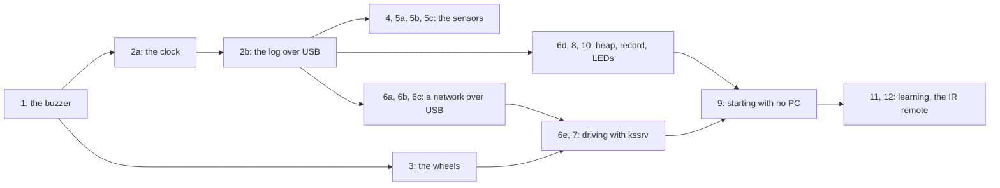
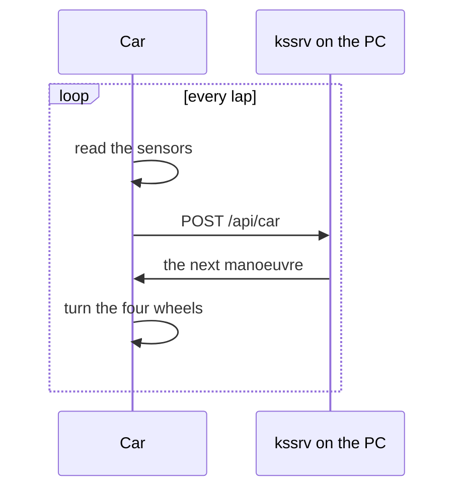
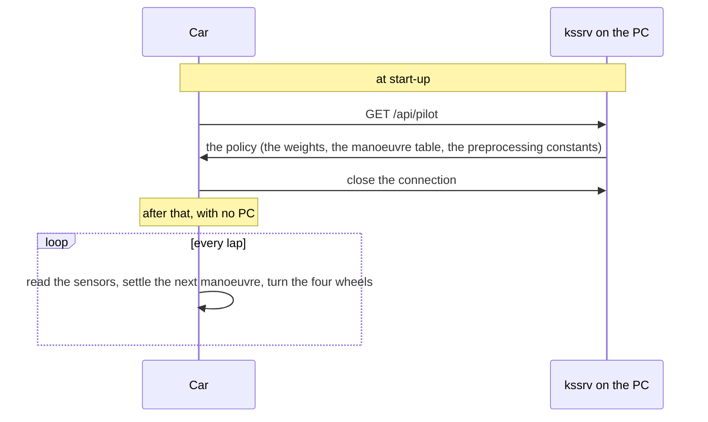
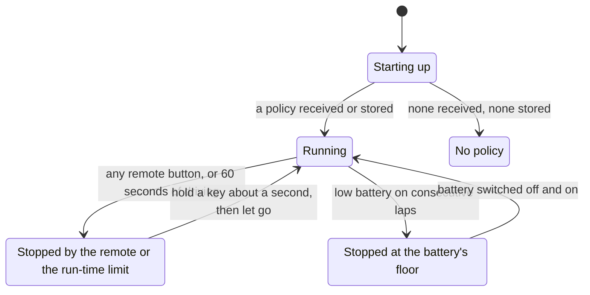
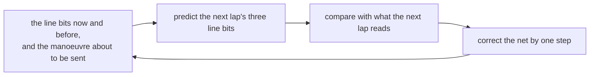

# Bringing the board up, one stage at a time

**You need the car on the desk, a USB cable, and a PC that can copy a file to a USB drive**: no SWD probe (a debugging adapter wired to the chip's debug pins) and no soldering. The car is a Freenove 4WD kit carrying a Raspberry Pi Pico W. What is wired to what is in [`SPEC-board.md`](SPEC-board.md); this document holds the stages in order and how to carry out each.

This guide brings the car up one *stage* at a time. A stage is one small check: you build a small test program, copy it onto the car, and watch for a beep, a light or a line of text that says one part works. Each stage adds one new part on top of parts already checked, so when a stage fails, the new part is the first suspect.

**Do not write here how far each stage has been confirmed**: that is "What has been checked on real hardware" in [ksos](../README.md), and two copies drift.

## What you need first

| What | What it is for | First needed at stage |
| :-- | :-- | :-- |
| The car, its battery charged | Everything; the buzzer and the motors are fed from the battery | 1 |
| A USB cable that carries data, not only power | Copying the program onto the car, and reading its log | 1 |
| A PC that can copy a file to a USB drive | Writing each test program | 1 |
| This repository's build tools (`clang` and the `arm-none-eabi` toolchain; the development container has both) | Building each test program with `make` | 1 |
| A phone frequency-counter app or a tuner (optional) | Measuring the buzzer's pitch | 2a |
| A serial terminal: the Arduino IDE's Serial Monitor, or `screen` | Reading the lines the car prints | 2b |
| A box or stand to put the car's body on, wheels in the air | Any stage that turns the wheels | 3 |
| White paper and black tape | Giving the line sensors something to see | 4 |
| The bundled IR remote | The infrared receiver and driving by remote | 5b |
| The LED matrix module (it takes the ultrasonic module's connector) | The I2C check and the car's face | 5c |
| A PC that can share its connection with the car's USB adapter (the steps here are Windows's) | The network stages | 6a |
| Python (`python -m http.server`) | A web server for the car to call | 6c |
| kssrv built on the PC (`make kssrv`) | The server that decides for the car, or hands it a policy | 6e |

## Words used in this guide

The guide assumes no embedded-systems knowledge. The words for the board's parts and pins (GPIO, PWM, ADC, I2C, H bridge, mecanum wheel, BOOTSEL, UF2, USB CDC) are in "Words used in this document" in [`SPEC-board.md`](SPEC-board.md#words-used-in-this-document). These are the rest of the words it leans on, in roughly the order they appear.

| Word | What it means here |
| :-- | :-- |
| microcontroller (MCU) | A small computer on one chip: a CPU, memory and pins for input and output. The Pico W's microcontroller is the **RP2040** (a Cortex-M0+ CPU) |
| firmware | The program stored in the microcontroller, which runs whenever it powers on. Each stage writes one firmware |
| probe | A small test firmware that checks one feature and reports the result by beeps, light or text |
| flash | The chip that keeps the program and data with the power off (2MB on a Pico W). *Flashing* means writing firmware into it |
| boot ROM | Code built into the chip at the factory. It runs first after every reset, and it is what takes a UF2 |
| stage-2 bootloader (boot2) | A 256-byte program at the start of flash. The boot ROM runs it to make flash readable as memory before jumping to ksos |
| vector table | The table at the start of a program that tells the CPU its first stack address (SP), where to start (`Reset_Handler`), and where each interrupt handler is |
| clock tree | The chip's clock signals. **ROSC** is a rough built-in oscillator the chip starts on; **XOSC** is the accurate crystal oscillator; the **PLL** multiplies XOSC up to the CPU's speed |
| enumeration | The exchange right after a USB device is plugged in: the PC asks what it is, gives it an address and picks a configuration. No data flows until it finishes |
| descriptor | A block of bytes a USB device sends during enumeration to describe itself |
| endpoint (EP0, EP3 …) | A numbered channel inside a USB device. EP0 is the control channel that enumeration uses |
| VID/PID | The vendor and product numbers by which a PC recognises a USB device and remembers its driver |
| Serial Monitor | The Arduino IDE's window that shows the text arriving on a serial port. Any serial terminal does the same |
| NEC | The most common infrared remote protocol. Each press sends an address (which remote) and a command (which button) |
| CDC-NCM | A kind of USB device that looks like a network adapter to the PC ("USB Ethernet") |
| NTB | The USB packet that carries one or more network frames in CDC-NCM. ksos keeps one buffer for it |
| frame, MAC, ARP, ICMP, TCP, HTTP | The network layers. A *frame* (IEEE 802.3) is one packet on the wire, addressed by *MAC* (hardware) address. *ARP* finds the MAC address that owns an IP address. *ICMP* carries `ping`. *TCP* is an ordered connection on top of IP, and *HTTP* is the web's request and response on top of TCP |
| heap | Memory handed out while the program runs (`alloc`), rather than fixed when it is built |
| atomic operation | A read-and-change of memory that nothing can interrupt halfway. The RP2040's CPU has no instruction for it, so ksos builds one from the chip's hardware lock (the SIO *spinlock*) |
| kssrv | Kanso's web server, run on the PC in stages 6e, 7 and 9 |
| policy | The small neural network and its tables that turn the car's sensor readings into the next manoeuvre |
| manoeuvre | One of the car's moves: `forward`, `back`, `strafe_left` / `strafe_right` (sideways), turning, `stop`, `emergency_back` |
| the record | An append-only log (entries are only added at the end) kept in the flash's last 64KB by [ksdb](../../ksdb/README.md) |
| lap | One turn of a firmware's main loop. The board firmware's lap takes about 20 seconds; a car firmware's control lap takes 100ms |
| WS2812 | An RGB LED with its own controller inside; several are chained and set by one timed signal |

## How the stages fit together

**The stage numbers are names, not the order of starting**; renumbering would break every reference to them. The diagram shows which stages must work before another can: an arrow means "get this working first".



| # | What it brings up | How you know it worked |
|---|---|---|
| [1](#stage-1--the-buzzer-sounds) | GPIO output: the buzzer | By ear |
| [2a](#stage-2a--matching-the-clock) | The clock tree (XOSC/PLL) | By ear, and a frequency counter |
| [2b](#stage-2b--usb-cdc) | USB CDC: the log on the Serial Monitor | On the screen |
| [3](#stage-3--turning-the-four-wheels) | PWM: the four wheels in every direction | By eye |
| [4](#stage-4--the-adc-and-line-tracking) | The ADC (battery, light) and GPIO input (line tracking) | The Serial Monitor |
| [5a](#stage-5a--the-hc-sr04-ultrasonic) | The HC-SR04 ultrasonic distance sensor | The Serial Monitor |
| [5b](#stage-5b--ir-receiving) | IR receiving (NEC) | The Serial Monitor |
| [5c](#stage-5c--i2c--the-led-matrix) | I2C (the VK16K33 LED matrix) | By eye |
| [6a](#stage-6a--usb-ethernet--cdc-ncm) | USB Ethernet (CDC-NCM) as a network adapter | Device Manager |
| [6b](#stage-6b--passing-8023-frames--ping) | 802.3 frames through `Link` in `ksos/net/link.kspls` | ping from the PC |
| [6c](#stage-6c--running-the-upper-layers-tcp--http-on-real-hardware) | TCP / HTTP | A server on the PC |
| [6d](#stage-6d--the-heap-and-the-atomics-on-armv6-m) | The heap and the atomics (`alloc` / `Arc` / `std/http`) | The `[heap]` lines |
| [6e](#stage-6e--running-a-closed-loop-with-the-pcs-kssrv) | A **closed loop** with the PC's kssrv | The wheels move / kssrv's `/api/status` |
| [7](#stage-7--receiving-a-policy-then-disconnecting-and-deciding-for-itself) | Deciding in the car on a policy received once | The wheels keep moving with `kssrv.exe` down |
| [8](#stage-8--leaving-a-record-inside-the-device) | An append-only record in the flash's last 64KB | `boot #N` grows each power cycle |
| [9](#stage-9--leaving-the-policy-and-the-observations-inside-the-car-and-starting-up-with-no-pc) | Starting with no PC, on the policy kept in the car | With no kssrv, the wheels turn at power-on |
| [10](#stage-10--showing-the-state-as-light-with-ws2812-a-display-needing-no-cable) | The WS2812 LEDs as a window needing no cable | The `[led]` colours, by eye |
| [11](#stage-11--adding-a-model-that-predicts-the-result-of-the-cars-own-motion) | The car predicting its own motion | `st,` grows and carries across restarts (on the floor; at `line=7` it does not move) |
| [12](#stage-12--driving-it-from-the-ir-remote-alone) | Driving by the IR remote alone | The keys change how it drives |

**"Tuning line following", after stage 12, is not a stage**: it holds what stages 7, 9, 11 and 12 share when the car follows a line.

**Wireless (CYW43439 / ESP-Hosted) is not among the stages** ("WiFi (CYW43439) — not implemented in this design" in [`DESIGN.md`](DESIGN.md)).

**`make ksos-rp2040-board` is one firmware for stages 2b, 4, 5c, 6d, 8 and 10.** It prints lines tagged `[tag]` for each stage in turn, one lap in about 20 seconds (how to read them: the heading of [`demo/rp2040/rp2040_board_probe.kspls`](../demo/rp2040/rp2040_board_probe.kspls)). `make ksos-rp2040-net` is one firmware for 6a, 6b and 6c.

Caution: **Do not add the stages that turn the wheels (3, 6e, 7, 9, 12) to the board firmware**: they need the wheels lifted before writing, and it runs connected on the desk.

**Stage 2 is split** because USB cannot enumerate until the clock is right ("The clocks and the µs timer" in [`DESIGN.md`](DESIGN.md)), and 2a checks the clock by the buzzer's pitch. **Stage 5 is split** by the tools each part needs. IR (5b) comes before I2C (5c) because I2C needs the ultrasonic module swapped for the LED matrix, while the IR receiver stays on GPIO 3.

## Stage 1 — the buzzer sounds

**Goal: a program you built runs on the real chip.** Before USB works a beep is the only output, and the flashing steps here are the ones every later stage repeats.

1. Build it:

   ```sh
   make ksos-rp2040-buzzer      # -> out/ksos_rp2040/ksos_rp2040_buzzer.uf2
   ```

2. Connect USB **while holding the Pico W's BOOTSEL button** (if it is connected, unplug it first). A drive named `RPI-RP2` appears.
3. Copy `ksos_rp2040_buzzer.uf2` to that drive. The drive disappears and the Pico W restarts into the program.
4. Expected: **a short 2kHz beep, repeating with a little gap.**

**Every later stage writes its UF2 this way.** Where a stage reads lines of text, unplug USB and plug it in again *without* holding BOOTSEL (with it held, the program does not run), then open the Serial Monitor at 115200.

Caution: **Switch the car's battery on.** The Pico W runs off USB, but the buzzer and the motors are fed from the battery: with it off, the write succeeds and nothing sounds.

Caution: **If the drive stays after the copy, the boot ROM ignored the file without a word** (it skips a UF2 block of the wrong size or alignment). Run ksos's `make test`, which checks the UF2 maker.

### Silencing the buzzer

The program stays in the flash and beeps at every power-on. **To silence it**, connect USB holding BOOTSEL: the program does not run, and another UF2 can replace it. The Arduino IDE writes the car's original sketch back as usual.

## Stage 2a — matching the clock

**Goal: the clocks run from the crystal.** Stage 1's firmware times its beeps with the real µs timer, so its pitch and rhythm come out right only if the clock tree is set up.

1. Write stage 1's firmware:

   ```sh
   make ksos-rp2040-buzzer      # -> out/ksos_rp2040/ksos_rp2040_buzzer.uf2
   ```

2. Measure the pitch with a phone's frequency-counter app or a tuner. Expected: **2000Hz, within about 1%.**
3. Count the beeps for 10 seconds by a clock. Expected: **20** (0.25 seconds on, 0.25 off).

**Silence where stage 1 sounded, or a pitch far off, means the clock set-up failed**: what `clocks.init()` must do is "The clocks and the µs timer" in [`DESIGN.md`](DESIGN.md).

## Stage 2b — USB CDC

**Goal: the car prints text on the PC through a USB serial port**, so later stages read a log instead of counting beeps.

1. Write the board firmware:

   ```sh
   make ksos-rp2040-board       # -> out/ksos_rp2040/ksos_rp2040_board.uf2
   ```

2. Unplug USB and plug it in again without BOOTSEL. Expected: **one** beep (initialized), then **two** more once the PC has enumerated it.
3. A new serial port appears (Device Manager, `ls /dev/tty.*` or `lsusb`): **`ksos CDC`**, VID/PID 0x1209/0x0001.
4. Open it in the Serial Monitor, or with `screen /dev/ttyACM0 115200`. Any baud rate works.
5. Expected, every lap (about 20 seconds, with other stages' lines between): `[board] round=1`, then `[1]`, `[2]`, `[3]` **in that order**, four times at 0.5-second intervals, and **`[2]`'s line ends with `<END`**.

`[2]` is 91 bytes, more than one USB packet, so `<END` shows a line split across packets arrives whole. `[2]` cut short, or only `[1]` arriving, means the send queue is broken.

**When enumeration fails, the car beeps N, how far it got, again and again**: every 3 seconds during the 8 seconds it waits, then at the head of each lap. What each step needs from the device is "USB CDC" in [`DESIGN.md`](DESIGN.md).

| N | How far it got |
|---|---|
| 1 | Initialized; no bus reset from a host. **Suspect a power-only USB cable first** |
| 2 | The bus reset; no SETUP request arrived |
| 3 | SETUP arrived; the descriptor's reply failed |
| 4 | An address was assigned; the 67-byte configuration descriptor did not go out in full |
| 5 | The configuration descriptor went out; no `SET_CONFIGURATION` came |
| 6 | Configured; `is_configured` reads wrong |
| 9, then silence | `usb.init()` itself failed |

## Stage 3 — turning the four wheels

**Goal: each motor is wired and signed right**: each wheel alone, then the car in every direction.

Caution: **Lift the wheels off before writing it**, the body on a box so that no wheel touches anything: a wheel wired with reversed polarity drives the wrong way, and the car falls off the desk.

1. Put the car's body on a box, and switch the battery on.
2. Write the motor firmware:

   ```sh
   make ksos-rp2040-motor       # -> out/ksos_rp2040/ksos_rp2040_motor.uf2
   ```

3. Expected, at 30% speed and 1 second a step:
   1. **One** beep, then **each wheel alone, all forward**, in the order front left, rear left, rear right, front right.
   2. **Two** beeps, then forward, back, sideways both ways, diagonally, turning both ways.
   3. **Two** beeps, and the wheels stay stopped.

**The first part is the real check.** A wrong order means `motor_pin_a/b` disagrees with the wiring ("On the right side the pin names and forward/back are reversed" in [`SPEC-board.md`](SPEC-board.md)). A wheel turning backward means `board.wheel_polarity` does not fit this unit ("The direction of rotation differs from unit to unit" in [`SPEC-board.md`](SPEC-board.md)).

In the second part, moving sideways turns the front left and rear right one way and the other pair the other way, and moving diagonally turns only one diagonal pair. The body should move right for positive `lateral` and clockwise for positive `rotation` in `drive()`.

## Stage 4 — the ADC and line tracking

**Goal: the battery voltage, the two light sensors (ADC) and the three line sensors (GPIO input) follow real changes.** It needs stage 2b working.

1. Write the board firmware, and open the Serial Monitor:

   ```sh
   make ksos-rp2040-board       # -> out/ksos_rp2040/ksos_rp2040_board.uf2
   ```

2. Each lap, the `[sensor]` line is followed by eight lines, one every 0.5 seconds:

   ```
   [sensor] ADC 12bit (0-4095); press a remote button while these lines run
   bat=7.912V(2454)  light L= 812 R= 907  line=B.W.B (101)  dist= 245mm  ir=--
   ```

3. Change what each sensor sees, and watch its field move (`dist=` and `ir=` are stages 5a and 5b):

| Field | Expected | Confirm by moving something |
| :-- | :-- | :-- |
| `bat=` | About 8.4V (full) to 6.8V; the raw 12-bit value in brackets | Switch the battery off: near 0V |
| `light L= R=` | 0 to 4095 | **Hold a hand over it: it falls** |
| `line=` | Three of `B` (black) / `W` (white), left to right; in brackets as `left<<2 \| centre<<1 \| right` | White paper and black tape swap them |

Caution: **Confirm that each value moves.** A fixed value looks the same as a pin with nothing connected.

Caution: **Cover the leftmost line sensor and check that the left character changes.** Some units have the outer sensors mounted swapped; if the right one changes, flip `board.line_sensor_swapped` ("Line tracking" in [`SPEC-board.md`](SPEC-board.md)). All three characters stuck the same usually means the sensor board's sensitivity trimmer (a small adjustable resistor) needs turning.

**No lines and N beeps at the head of each lap** means USB did not enumerate: back to stage 2b. **`bat=` at about a quarter of the real voltage** means the 12-bit resolution was mixed up with Arduino's 10 ("The ADC" in [`DESIGN.md`](DESIGN.md)).

## Stage 5a — the HC-SR04 ultrasonic

**Goal: the ultrasonic distance follows a hand.** It uses stage 4's firmware and line; look at `dist=`.

```sh
make ksos-rp2040-board       # -> out/ksos_rp2040/ksos_rp2040_board.uf2
```

Expected: **tens to hundreds of mm, shrinking as a hand comes close** and growing as it goes away. `>3000mm` means no echo came back, as when pointed at a ceiling or open space.

Caution: **`----` is not "far away"**: ECHO never went up. Suspect the wiring: the module plugged into the GPIO 4/5 connector, TRIG on 4 and ECHO on 5.

## Stage 5b — IR receiving

**Goal: the infrared receiver decodes the bundled remote.** It uses stage 4's firmware and line; look at `ir=`. The receiver is always on GPIO 3, so no wiring changes.

```sh
make ksos-rp2040-board       # -> out/ksos_rp2040/ksos_rp2040_board.uf2
```

**Press buttons while the sensor lines flow** (4 seconds of each lap); the other stages do not watch IR. Expected, after `--`:

```
... dist= 245mm  ir=A0:C69 x3
```

`C` is the button and **differs per button**; `A` is the remote's address and stays the same; `xN` counts receptions and **grows while a button is held**.

Caution: **Confirm a different `C` for each of several buttons.** One button alone cannot be told from noise that happened to be picked up.

Caution: **`xN` growing with nothing pressed is fluorescent light or sunlight**: shade the receiver. The lines pausing while a button is held is expected (receiving a frame takes up to 70ms).

## Stage 5c — I2C / the LED matrix

**Goal: the I2C bus works, shown by drawing on the LED matrix.**

Caution: **Only this stage changes the wiring: swap the ultrasonic module for the LED matrix** on the GPIO 4/5 connector ("The ultrasonic and the LED matrix cannot be used at once" in [`SPEC-board.md`](SPEC-board.md)). The firmware rescans the bus each lap, so it can be swapped while running.

1. Unplug the ultrasonic module from the GPIO 4/5 connector and plug in the LED matrix.
2. Write the board firmware, if it is not already on the car:

   ```sh
   make ksos-rp2040-board       # -> out/ksos_rp2040/ksos_rp2040_board.uf2
   ```

3. Expected `[i2c]` lines:

   ```
   [i2c] scan: 0x71
   [i2c] using 0x71
   [i2c] matrix init: ok
   [i2c] frame    0 to=0x71 scan=0x71 init=ok fails=0 why=none
   [i2c] frame    1 to=0x71 scan=0x71 init=ok fails=0 why=none
   ```

4. Expected on the matrix: **a band keeps flowing.**

The address is the first one the scan finds, else 0x70; this unit answers on 0x71. `why=` names the last failure: `addr-nack` (nobody at that address), `data-nack` (present but refusing the data), `timeout` (the device still holds the bus).

Caution: **`fails=0` means only that the matrix acknowledged the writes, not that it displayed**, so judge by eye.

Caution: **`why=timeout` that stays: unplug the matrix and plug it back in**, which makes it let go of the bus; the driver does not free the bus itself. If it persists, switch the car off and on. `scan=none` with `why=addr-nack` means nothing answers: check that the matrix is plugged in.

Caution: **Put the ultrasonic module back afterwards**, or stages 4, 5a and 5b read `dist=----`.

---

## Stage 6a — USB Ethernet / CDC-NCM

**Goal: the car shows up on the PC as a network adapter (CDC-NCM)** beside stage 2b's serial port, both on one cable. It needs stage 2b working. One firmware serves stages 6a, 6b and 6c (what it runs, in order: "What the USB-Ethernet probe does, and what it needs on the PC" in [`DESIGN.md`](DESIGN.md)).

1. Build the network firmware, and write `out/ksos_rp2040/ksos_rp2040_net.uf2` as in stage 1:

   ```sh
   make ksos-rp2040-net
   ```

2. Unplug USB and plug it in again, and open the Serial Monitor.
3. Expected:
   * **Two** beeps, then silence. N beeps repeating instead is how far enumeration got, as in stage 2b's table.
   * Device Manager: a COM port under Ports, and **one more entry under Network adapters**.
   * The Serial Monitor: `ncm t= stage= alt= link=down` every second, then `[ncm] link=up` once, with `alt=1`.

Caution: **If the COM port appears but the network adapter does not, remove the old `ksos CDC` and replug.** Windows remembers the driver per VID/PID, and this firmware's PID is 0x0002, not stage 2b's 0x0001. Enable "Show hidden devices" in Device Manager to see the old entry.

Caution: **Windows 10 has no standard CDC-NCM driver**: the adapter shows a "!", and "USB NCM" has to be chosen by hand. Windows 11 ships `UsbNcm.sys`.

### The setting on the PC side (sharing the internet connection)

Windows's internet connection sharing lets the car reach beyond the PC, through the PC's Wi-Fi.

1. In Windows, open Settings → Network → the Wi-Fi adapter's properties → the Sharing tab.
2. Enable "Allow other network users to ... connection".
3. Pick this USB adapter.

By Windows's default this puts the PC at 192.168.137.1.

## Stage 6b — passing 802.3 frames / ping

**Goal: network frames flow both ways over the cable**, shown by pinging the car from the PC.

1. **Set up the PC first**: share the Wi-Fi connection to stage 6a's USB adapter ("The setting on the PC side (sharing the internet connection)" above).
2. Write the network firmware (the same as stage 6a):

   ```sh
   make ksos-rp2040-net
   ```

3. At the command prompt:

   ```
   ping 192.168.137.50
   ```

4. Expected: **replies**, once stage 6c's run has finished (about 20 seconds of ARP retries if no server answers). The Serial Monitor shows a line like `net t=75 rx=173 arp=1 ping=14 drop=0`, with `rx=` and `ping=` growing and **`drop=` staying 0**. `arp -a` on the PC lists 192.168.137.50 as 02-00-00-00-00-01.

`rx` far above `arp + ping` is normal (the car ignores the PC's broadcast and multicast), and so is `arp=1` staying put (Windows caches a resolved MAC).

Caution: **The car's address is fixed at 192.168.137.50, with no DHCP.** `rx=` growing while `arp=` does not means the shared subnet is another one: change `init_addrs` in `ksos/demo/rp2040/common/net_client.kspls`, or set 192.168.137.1/24 on the USB adapter by hand in place of sharing.

## Stage 6c — running the upper layers (TCP / HTTP) on real hardware

**Goal: `ksos/net`'s TCP and HTTP run on the real chip**: the car resolves the PC's MAC over ARP, opens a TCP connection to a web server on the PC, sends an HTTP GET and reads the answer. **Done means both sides**: the handshake in the Serial Monitor, and the request on the PC.

1. **Set up the PC first**: stage 6b's sharing (the PC at 192.168.137.1), and an HTTP server:

   ```
   python -m http.server 8080
   ```

2. Write the network firmware, replug, and open the Serial Monitor:

   ```sh
   make ksos-rp2040-net
   ```

3. Expected beeps: **one** (USB initialized), **two** (the link up, as in stage 6a), then **three** (everything went through). One after the link means it stopped at ARP; two means ARP went through and HTTP did not.
4. Expected lines, then the result line every second:

   ```
   [ncm] link=up
   [net] link up, resolving peer
   [arp] peer mac 02:00:00:00:00:02
   [tcp] handshake ok (http)
   [http] sent=58
   [http] recv=1024
   [http] status200=1 head=152
   [http] total=2318 segs>1=1
   net t=1 rx=72 arp=0 ping=0 drop=0 txf=0 upper arp=ok http=ok arpf=6 et=0800 from=192.168.137.1
   ```

5. Expected on `python -m http.server`'s console: `192.168.137.50 - - [...] "GET / HTTP/1.1" 200 -`.

| The symptom | What to do |
| :-- | :-- |
| `arp=NG`, `from=` still 0.0.0.0 | Nothing reaches the PC: redo stage 6b's sharing |
| `arp=NG`, `from=` another address | The PC is there: set `peer_ip` in `net_client.init_addrs` to it, and `our_ip` in its subnet |
| `arp=ok` but `[tcp] TIMEOUT: no SYN-ACK` | Start the server on port 8080, and let it through Windows Defender Firewall on the USB adapter's side |
| `status200=0` with a non-zero `head=` | The server answered another status (a 404 or the like): check its console |

## Stage 6d — the heap and the atomics on Armv6-M

**Goal: the heap and the atomic operations work on this chip**, whose CPU has no atomic instructions (how they are supplied: "Armv6-M has no atomic instructions — the port supplies them" in [`DESIGN.md`](DESIGN.md)).

1. Write the board firmware and open the Serial Monitor:

   ```sh
   make ksos-rp2040-board
   ```

2. Expected: the `[heap]` stage prints one `[ok]` line per check and ends with **`RESULT pass=11 fail=0`**:

   ```
   [heap] SIO spinlock, round=1
   [ok]   alloc: three blocks are independent
   [ok]   alloc: freed block is reused
   [ok]   alloc: adjacent free blocks coalesce
   [ok]   atomic: store/load
   [ok]   atomic: fetch_add returns the old value
   [ok]   atomic: cas succeeds on a match
   [ok]   atomic: cas fails on a mismatch
   [ok]   Arc: new/clone/get and scope-exit release
   [ok]   std/http: status line
   [ok]   std/http: header lookup
   [ok]   std/http: body
   RESULT pass=11 fail=0
   ```

**Lines stopping partway mean it froze at that check** (taking and releasing the spinlock do not mesh). The report repeats every lap, so a Serial Monitor opened late still shows it.

---

## Stage 6e — running a closed loop with the PC's kssrv

**A decision made outside the car comes back to the wheels.** The car sends its sensor readings to kssrv on the PC, a small MLP (a small neural network) there settles the next manoeuvre, and the car turns its wheels; then it repeats. The request's and response's shape are in the server's own documents.



Caution: **Lift the wheels off**: in a closed loop, a hand is too slow to catch a start in an unintended direction.

**Plug in the ultrasonic module, not the LED matrix.** Lifted, the reflective sensors see nothing and read `line=7`, which the decision takes as "a junction or an end". At a distance the answer is then always `stop`, and moving a hand gives only `stop` and `emergency_back`. To see the other manoeuvres, slip white paper under the reflective sensors (`line=0`). `forward` with no paper is suspect: the sensor or the decision is ignoring the observation.

**The car applies three safety timeouts itself, whatever the reply**: the battery, point-blank range and no reply (the `car-loop` column of "The safety timeouts of each firmware" in stage 7). The battery one does not clear by itself: switch the battery off and on.

**kssrv must run on the PC, facing outward** (only it answers `/api/car`, and not under `--local`). It trains the steering policy at start-up, so its listener takes a moment. The sharing is as in stage 6c (the PC 192.168.137.1, the car 192.168.137.50). The connection stays open (kssrv keeps it alive), since a new TCP connection per lap does not fit the 100ms control period.

### How to proceed

1. Lift the wheels, plug in the ultrasonic module, and slip white paper under the reflective sensors.
2. On the PC, build and start kssrv, then the car's firmware:

   ```
   make kssrv                     # on the PC side
   ./out/kssrv.exe 8080 .         # on the PC side (a few seconds until the listener comes up)
   make ksos-rp2040-car-loop     # the car side's UF2
   ```

3. Write `ksos_rp2040_car_loop.uf2`, replug, and open the Serial Monitor. The buzzer sounds only until enumeration: **one beep, then silence** is going well (the other counts are in the table after these steps).
4. Once connected, it prints:

   ```
   [car] link up, resolving peer
   [car] connected to kssrv, entering the control loop
   ```

   Then one line every 10 laps (about a second):

   ```
   car t=10 dist= 245mm line=2 bat=7.912V cmd=strafe_right (0,50,0) ok=10 to=0 bad=0 drop=0
   ```

5. Check the PC side at the same time (**one side alone is not enough**):

   ```console
   $ curl -s localhost:8080/api/status | python3 -m json.tool | grep -E 'commands|requests'
   ```

What the beeps in step 3 mean:

| The beeps | What it means |
|---|---|
| **One, then silence** | USB initialized: going well; the rest shows on the console |
| Four, then silence | The ADC did not wake (suspect `clk_adc`); with no console yet, sound is all there is |
| Five, then silence | PWM did not wake (every later instruction is ignored) |
| Nine, then silence | `usb.init()` failed: back to stage 2b |
| N, repeating | Not enumerated; N is how far it got, as in stage 2b (replugging starts over) |

What the report line's fields count:

| Field | What it counts |
|---|---|
| `ok` | Valid replies passed to the wheels. **Its growth is the closed loop's evidence** |
| `to` | Replies that never came. Growing: the PC side or the sharing |
| `bad` | Replies that could not be read. Growing: a `seq` mismatch or the JSON's form |
| `drop` | Sends lost. **Must be 0** (there is one NTB) |
| `HALTED:` | It stopped on the safe side; the reason follows (until the power is switched off and on) |

**Done means two things:**

1. **The loop is closed**: `ok` grows with `drop=0`, and the PC's `commands` keeps pace (slightly ahead, since `ok` skips emergency-retreat laps).
2. **The decision reaches the wheels**: with the paper in (`line=0`), move a hand and watch `cmd` go `forward` (over 400mm), `strafe_*` (400 to 150mm), `back` (150 to 100mm) and `emergency_back` (under 100mm, decided by the car alone). The wheels must really change.

**The sideways direction follows the right sensor, not the distance**: an odd `line` gives only `strafe_left`. For `strafe_right` make `line` even (`0` with the paper, or black under the left or centre sensor alone).

## Stage 7 — receiving a policy, then disconnecting and deciding for itself

**Here the car receives a whole policy once at start-up, disconnects, and decides alone** ("What the self-driving probe does" in [`DESIGN.md`](DESIGN.md)). Where stage 6e asks the PC on every lap, this car asks once and then needs no PC.



Caution: **Lift the wheels off, and plug the ultrasonic module in** (as in stage 6e).

**The car applies its safety timeouts outside the policy**: the battery, point-blank range and a missing policy (the `car-pilot` column of "The safety timeouts of each firmware" below).

**kssrv is needed only while the policy is received.** After that the PC can go down, which is the point of this stage. The sharing is as in stage 6c. The policy (about 2.0KB) arrives in several segments and is read until complete (`std/http` looks at Content-Length). Keep the received body alive while in use: the weights point into it (zero copy).

### How to proceed

1. On the PC, build and start kssrv, then build the car's firmware:

   ```
   make kssrv                     # on the PC side (only while it is being received)
   ./out/kssrv.exe 8080 .         # on the PC side (a few seconds until the listener comes up)
   make ksos-rp2040-car-pilot    # the car side's UF2
   ```

2. Write `ksos_rp2040_car_pilot.uf2`, replug, and open the Serial Monitor. The beeps read as in stage 6e.
3. The wheels do not move until the first line below appears (if it does not, check kssrv and the sharing):

   ```
   [car] policy on board, link closed — deciding here from now on   <- it was received
   [car] no policy — staying put                                    <- it was not
   ```

4. Then it prints one line every 10 laps (about a second):

   ```
   car t=10 dist= 245mm line=2 bat=7.912V drive=(0,50,0) n=10 us=12525 emerg=0 drop=0
   ```

| Field | What it counts |
|---|---|
| `n` | Decisions made in the car. **Its growth is the evidence of driving itself** |
| `us` | One decision's time in µs (around 10ms, a tenth of the 100ms period). **Do not rely on the absolute value**: it moves with the XIP cache's contents (the cache through which the CPU runs code straight from flash), and jumps about 1.5 times on the lap after a record is written (stage 9) |
| `emerg` | Laps where it overrode the policy at close range and backed off. **`n` + `emerg` = `t`** (an emergency lap is not in `n`); a mismatch means a lost count |
| `drop` | Sends lost. It sends nothing after receiving, so it must not grow |
| `HALTED:` | As in stage 6e |

#### Bringing it back when the battery stopped it

**Switch the battery off and on** to clear `HALTED: battery low` (only that halt; the switch brings back no missing policy or link).

```
car t=2100 ... HALTED: battery low (1.163V, now 1.155V)   <- still off. Switch it on and now rises
car t=2110 ... HALTED: battery low (1.163V, now 7.903V)   <- it arrived. re-armed comes out after this
[car] battery back — re-armed, deciding again
```

The parentheses hold the voltage when it stopped, and `now`, the present reading. **Only `now` shows whether switching on reached the car.** It must go off first. Off reads about 1V, which no real battery reaches, so only that deliberate act counts as "back". A weakening battery cannot restart the car merely by recovering.

Caution: **Do not unplug USB, and keep the wheels lifted.** Unplugging does not reset the MCU (the Pico runs off USB), but loses the console and the received policy. The switch is the only way back, and the car starts off the instant it is on.

#### How to confirm that it is deciding for itself

1. **Start the car with kssrv up.** In the other order the car gets no policy and never moves.
2. **Then shut down the `kssrv.exe` process.** Do not pull the USB cable, which also carries the console where `n` and `us` are read.
3. `fetch_policy` sends `Connection: close`, so kssrv shows `conn #N closed` and the loop sends nothing after. Bringing kssrv down confirms that from outside.
4. **`n` growing, and the wheels turning, are the evidence.**

The only path to the wheels (`apply`) is `one_round` inside `if ready && !halted`. Stage 6e, treated the same way, counts `to` and stops. The car also runs on the battery alone with the cable off, but then only the wheels' motion can be seen.

### The safety timeouts of each firmware

**Each car firmware stops, or holds the wheels back, by itself in these cases**, whatever the reply or the policy says, and with no link.

| The car sees | It | `car-loop` (6e) | `car-pilot` (7, 9) | `car-ir` (12) | How it comes back |
| :-- | :-- | :--: | :--: | :--: | :-- |
| The battery under `battery_low_mv` on `low_rounds` **consecutive** laps (`ksos/demo/rp2040/common/battery.kspls`) (a motor's inrush dips it for an instant) | Stops; `car-loop` also sends no more requests | ✅ | ✅ | — | Switch the battery off and on ("Bringing it back when the battery stopped it" above) |
| The distance under `emergency_mm` (100mm) | Backs off | ✅ | ✅ | — | By itself, once the distance grows |
| No valid reply within `reply_deadline_ms` (300ms) | Stops | ✅ | — | — | By itself, at the next valid reply |
| No policy received, and none in the record | Never moves | — | ✅ | — | Receive one from kssrv (stage 9) |
| A remote button while it runs | Stops | — | ✅ any button | ✅ ▶ or 9 only | `car-pilot`: hold a key about a second, then let go ("How to stop it when it drives itself" in stage 9) |
| 60 seconds of driving (`max_driving_rounds`) | Stops. The only one that works while nobody watches | — | ✅ | — | As for the remote |
| A held key let go | Stops | — | — | ✅ | Press the key again ("It runs only while a key is held" in stage 12) |
| Every instruction to the wheels | Scales it down to the speed cap, `cap.cap` (it does not stop) | — | ✅ | ✅ | — |

## Stage 8 — leaving a record inside the device

**The sensors' time series and the received policy kept inside the device**, in an append-only record ([ksdb](../../ksdb/README.md)) in the QSPI flash's last 64KB. Append-only means a new entry is only added after the last one; nothing already written is changed. This stage checks that the record survives a power cut.

1. Write the board firmware and open the Serial Monitor:

   ```sh
   make ksos-rp2040-board    # -> out/ksos_rp2040/ksos_rp2040_board.uf2
   ```

2. Find the `[ksdb]` stage. It writes on the first lap only; later laps repeat the result:

   ```
   [ksdb] claiming the flash region
   [ksdb] no marker -> erased the region (first use, or another writer was here)
   [ksdb] span ok (300B record crossing a page boundary)
   [ksdb] boot #1 (records=3, used=332/65536)
   [ksdb] power-cycle the board: boot # must keep going up
   ```

3. Switch the power off and on, and read the line again.

**The verdict is `boot #N` growing across power cycles** (within one start-up, RAM would pass too), with `records`/`used` matching the arithmetic (an 8-byte head plus content rounded up to a multiple of 4).

| Line | What it confirms |
| :-- | :-- |
| `span ok` | A 300-byte record crossing a page boundary makes the round trip without one byte garbled |
| `boot #N (records=M, used=…)` | The record survives power loss (N grows at every boot), and it only appends, never erasing the previous record |
| `FAIL cannot claim the flash region` | Its absence shows that the boot ROM's functions were found |

**The region is erased only the first time**, when the marker record (`ksdb1`) is missing (`no marker -> erased the region`). If that line keeps appearing, the writes do not take effect. That first time the log stops for about a second (16 sectors erased with interrupts and USB polling stopped).

**Rewriting the firmware keeps the record** ("The code that runs in RAM, and the region left for the record" in [`DESIGN.md`](DESIGN.md)); a whole-chip erase (`picotool erase`, or erasing everything from BOOTSEL) removes it. Writing stops interrupts (hundreds of µs to a few ms; a sector erase longer), so keep records infrequent against the control period.

## Stage 9 — leaving the policy and the observations inside the car, and starting up with no PC

**Stage 7's car needs kssrv at every start. Here the received policy is kept in the record (stage 8's region), so the car decides with it even with no link.** The observations are kept too.

1. **The first time**, store the policy: start kssrv as in stage 7, then write the firmware:

   ```sh
   make ksos-rp2040-car-pilot     # -> out/ksos_rp2040/ksos_rp2040_car_pilot.uf2
   ```

   Expected:

   ```
   [car] records erased (first use, or another firmware was here)
   [car] link up, resolving peer
   [pilot] status=200 body=2096
   [car] policy stored on board
   [car] policy on board, link closed — deciding here from now on
   car t=10 dist=0250mm line=0 bat=7.412V drive=(35,0,0) n=10 us=9098 emerg=0 drop=0 rec=3
   ```

2. **From the second time on**, start it without kssrv (USB may stay connected). Expected:

   ```
   [car] last run ended at dist=0180mm bat=7.301V line=0 drive=(35,0,0)
   [car] no fresh policy — using the one stored on board
   [car] policy on board, link closed — deciding here from now on
   ```

**The verdict is the wheels turning without kssrv**: the path to the wheels opens only with a policy, so turning proves it was read from the record.

| What can be seen | How |
| :-- | :-- |
| The policy was stored | `policy stored on board`, the first time |
| It starts with no PC | `no fresh policy — using the one stored on board`, and the wheels turn |
| An unchanged policy is not rewritten | With kssrv up on a later start, `policy unchanged — kept the stored one` |
| The observations survived the power | `last run ended at ...` (the previous run's last) at start-up |
| The observations grow | `rec=` on the report line |
| Recording stopped | A reason, as in `rec=N(stopped: full)` (a full region is not erased: the policy would go with it) |

**Observations are kept only for laps where the manoeuvre changed, plus a heartbeat every 5 seconds** (16 bytes each; every 100ms lap would fill 64KB in minutes). An observation takes 2 pages to write, the policy 8; only observations are written inside the loop.

**Swapping firmware erases the record once.** Stage 8's probe shares the region, told apart by the marker record. So `records erased` appears once after another firmware ran, and the policy must be stored again with kssrv.

Started with no kssrv up:

```
[car] last run ended at dist=471mm bat=7.268V line=7 drive=(0,0,0)
[car] no tcp handshake (is kssrv listening?)
[car] no fresh policy — using the one stored on board
[car] policy on board, link closed — deciding here from now on
car t=360 dist= 301mm line=7 bat=8.326V drive=(0,-50,0) n=360 us=14162 emerg=0 drop=0 rec=54
```

**`last run ended` matches the previous run's last report line only when the last record was a heartbeat** (every 50 laps); usually it does not.

**The lap after a record is written decides about 1.5 times slower.** The boot ROM drops the XIP cache after writing, so instructions come from the flash again. When tightening the period, budget for this jump, not the average.

On the battery alone it waits 5 seconds for the link and 8 for the console before starting off. Otherwise the first lines (`records erased`, `last run ended`) would be lost: a `usb.write` before USB is configured discards a line without counting it in `drop=`.

### How to stop it when it drives itself

**The self-driving firmware (`rp2040_car_pilot_probe`) adds three safety timeouts for driving itself**: the remote, the run-time limit and the speed cap (the table is "The safety timeouts of each firmware" in stage 7). The remote works only when aimed at the car, so the run-time limit is the one that works unwatched.

The diagram shows how the self-driving firmware moves between running and stopped.



**Any button stops it** (repeat frames carry no `cmd`): erring toward stopping is safe. Coming back acts on letting go, since re-armed while still held it would stop again on the next lap (`remote re-armed` with no start-off). To check it, write the firmware and work through the table:

```sh
make ksos-rp2040-car-pilot
```

| Do or look at | Expected |
| :-- | :-- |
| Press the remote | The wheels stop within about 0.2 seconds; `HALTED: stopped by remote` |
| Press about a second, let go | `remote re-armed — deciding again`; from the next line `HALTED` is gone and `n` grows again |
| Press briefly, let go | Nothing (a brief press bringing it back would be dangerous) |
| Leave it | At 60 seconds, `HALTED: run time limit` and it stops |
| `ir=` on the report line | Grows with every press (receiving works) |
| `run=` | Grows only while it runs; coming back resets it to 0 |
| `drive=` | Never over `cap.cap` in absolute value |

Caution: **`HALTED` gone is not enough; check that `n` (the decisions) grows.** Back from the run-time limit:

```
car t=600 ... n=599 ... run=600 rec=95 HALTED: run time limit
[car] remote re-armed — deciding again
car t=700 ... n=599 ... run=1 rec=95
car t=710 ... n=609 ... run=11 rec=95        <- n is growing
```

**The speed cap rewrites the policy's output**, so the report line and the record show the instruction really sent. It is set in one place, `cap` in `ksos/boards/freenove_4wd_pico/cap.kspls`, and applies to the close-range reverse too.

### Seeing the state as light while it drives itself

On the battery alone the LEDs are the only window. Only the first two elements are used (the fewer lit, the less current: "The WS2812 LEDs" in [`SPEC-board.md`](SPEC-board.md)). **The first shows the state's colour, blinking every 0.5 seconds.** The second lights red just after a safety timeout sent an instruction. It stays lit three laps so the eye can catch it (the record's `safety` column shows the same).

| The first element | The state | The report line |
| :-- | :-- | :-- |
| Cyan | Starting up (waiting for the link and the console) | — |
| Green | Running | (no `HALTED`) |
| Red | Stopped at the battery's floor | `HALTED: battery low` |
| Blue | Stopped by the remote | `HALTED: stopped by remote` |
| Yellow | Stopped at the run-time limit | `HALTED: run time limit` |
| Purple | No policy, or unreadable | `HALTED: no policy` and the like |

**The blinking is the evidence that the loop is turning.** Steadily lit or dark means it stopped, whatever the colour (that is just the last one sent). The colour and the report's text come from one place, `State` in `ksos/boards/freenove_4wd_pico/status.kspls`; add a new state to that enum.

**Starting up takes a dozen seconds or so** (5 for the link, 8 for the console), with cyan blinking. If nothing lights, `status.init` failed (six beeps).

### Reading out the record stored in the car

With neither a link nor a PC, **holding a remote key prints the whole record to the Serial Monitor**. Only the hold's length counts, not the button (repeat frames carry no `cmd`). Each action happens on letting go, so a long hold does not print on the way. The press that stopped it does not count, so let go and press again.

| The action (any button) | What happens |
| :-- | :-- |
| Press while running | It stops (`HALTED: stopped by remote`) |
| Let go, hold about a second, let go | It comes back and starts off |
| Let go, hold about three seconds, let go | **It prints the record** and stays stopped |
| Let go, hold about seven seconds, let go | **It erases the record** (`ir_wipe_rounds`) |

**The seconds are a guide**: what counts is the laps held (8 to come back, 25 to print; `ir_rearm_rounds` / `ir_dump_rounds`). Printing does not release the stop, so the car does not start off right after being picked up.

| On erasing | What happens |
| :-- | :-- |
| The region's marker | Written back (left erased, the next start would erase again) |
| The policy | Written back: without it, a start with nothing upstream cannot move |
| The observations (`kind=2`) | Dropped |
| The learned weights (`kind=3`) | Dropped; the weights in RAM stay and are written again at the next save |

**Rewriting the firmware does not erase the record**; only a changed marker (`record_marker`) does. Records of different generations then mix, and `[dump]` alone cannot show the boundary: erase before measuring again.

The output, one line per entry (without the `[dump] ` prefix it is CSV):

```
[dump] begin used=15472
[dump] n,dist_mm,bat_mv,line,lon,lat,rot,safety
[dump] skip kind=0 len=4
[dump] skip kind=1 len=2096
[dump] 1,507,8409,7,0,0,0,0
   :
[dump] 855,294,8284,7,0,-30,0,0
[dump] end samples=855 other=2
```

| Column | Meaning (a line is one moment: the observation and the instruction it caused) |
| :-- | :-- |
| `n` | The record's running number, not the lap's (only laps where the instruction changed are kept, plus the heartbeat) |
| `dist_mm` | The distance the decision used, in mm. `0` means not measured; `3000`, no reflection |
| `bat_mv` | The battery voltage the decision used, in mV |
| `line` | The three reflective sensors as `left<<2 \| centre<<1 \| right` (1 = black), 0 to 7 |
| `lon` `lat` `rot` | Forward-back, sideways and turning sent to the wheels, after the cap |
| `safety` | `1` if a safety timeout gave the instruction, `0` if the policy did |

Caution: **Read the correction's strength from `line`**, not `lon`/`rot`: those change with the cap and the manoeuvre table, while `line` maps to it by the rules themselves.

| `line` | Black sensors | Step |
|--:| :-- | :-- |
| 2 | The centre | On the line: forward, no correction |
| 6 / 3 | Left and centre / centre and right | The weak correction (a small deviation) |
| 4 / 1 | The left / the right | The strong correction (a large deviation) |
| 0 | None | Lost: the position unknown, it creeps forward |
| 7 | All three | A junction or an end, or lifted: it stops |

**No `6` or `3` means the weak correction never came** ("The line's width must fall within a range" under "Tuning line following" below). The count of `0` measures how badly it follows: nothing is corrected while lost.

| What can be seen | How |
| :-- | :-- |
| Everything came out | The `end` line carries no `CUT` |
| It ended partway | `end ... CUT (console full)`: it cuts off at the first dropped line. It waits up to 50ms for room before each line, and with no reader would wait silently for minutes |
| Other entries share the region | `skip kind=0` (the 4-byte marker) and `kind=1` (the policy), with their lengths |
| How many generations it spans | Several `skip kind=1 len=...` lines: runs from that many policy receptions are mixed |

**`used=` adds up only with the gaps at sector ends**: `append` never lets a record straddle a sector ([ksdb](../../ksdb/README.md)).

**The report line's `n=` and `trk=` count one run** and do not match the record's count (`rec=` is what that run left). A short run can leave `trk=` at 0, which alone does not show mid-lap steering failing.

**The record is not sampled at a fixed interval**: it keeps only laps where the triple changed, plus a heartbeat every `sample_every` laps. How long something lasted is not in it; see the report line's `emerg=`. Why the record as it stands is no training set for the policy is in "🤖 The AI on bare metal" in [`DESIGN.md`](DESIGN.md).

**Old lines carry two traps.** A line with no origin bit reads `safety=0` (mark a boundary by changing the marker and erasing once, losing the policy too). A line written under another `cap.cap` has different `lon/lat/rot` magnitudes.

**A line with `bat_mv` around 0.07V is a moment with the battery disconnected** (the divider's top open, not noise). It is a loose contact while running. Several in a row at start-up mean USB alone with the battery switch off (switching on gives `battery back — re-armed`). Hence one low reading does not stop the car.

While printing it ignores the remote (harmless: the wheels are stopped). **Saving the output is the Serial Monitor's job**, as the car holds no file.

Note: Only `ksos/demo/rp2040/common/sample.kspls` knows the columns' order, and the header line names them in that order.

## Stage 10 — showing the state as light with WS2812 (a display needing no cable)

**On the battery alone there is no Serial Monitor, and the buzzer sounds only at start-up**, so the eight fitted WS2812 LEDs (GPIO 16) become a window needing no cable. This stage checks that they show the colours asked for.

1. Write the board firmware. **No battery is needed** (the LEDs run off the Pico's 5V).

   ```sh
   make ksos-rp2040-board      # -> out/ksos_rp2040/ksos_rp2040_board.uf2
   ```

2. Watch the LEDs during the `[led]` stage. It runs once a lap, and the LEDs stay dark until the next lap:

| What to look at | Expected |
| :-- | :-- |
| All eight elements | Red, green, blue, a second each |
| Then | One white element sent from end to end, the rest dark |
| Then | All off |
| The Serial Monitor | `[led] all red` and the rest, in step with the colours |

**Judge by eye**: right colours prove the timing and its window for the write (the WS2812 section of [`DESIGN.md`](DESIGN.md)).

| The symptom | The likely cause | What to do |
| :-- | :-- | :-- |
| Nothing lights | The pin's function (FUNCSEL) is not PWM, or `clocks.init()` failed (the divisor is then 19 times off) | Check the pin's function, then stage 2a |
| Wrong colours (green for red, and so on) | Not sent in G, R, B order | Check `fill_wire` in `ksos/drivers/rp2040/ws2812.kspls`: a colour is given as 0xRRGGBB, and each LED's three bytes must go out green, red, blue |
| Colours shifted per element | The 24-bit boundaries do not line up | Check that each element gets exactly 24 bits |
| Flicker, or wrong colours at times | The window for the write is missed (interrupts not stopped, or the loop not in RAM) | Check both |

Caution: **Do not raise the brightness** (one place: `board.ws2812_level`). Eight elements at full white use about 0.5A, and the low-voltage watch (`battery_low_mv`) fires on their own light. To save more, light fewer elements (what a dark one still uses is under "The WS2812 LEDs" in [`SPEC-board.md`](SPEC-board.md)).

If the colours do start going wrong, doubling `bit_counts` doubles the window for the write (whether WS2812 accepts the longer Low must be confirmed on the real board).

## Stage 11 — adding a model that predicts the result of the car's own motion

**This stage brings the mechanism up; it does not show the prediction coming right.** Whether it beats "the same as last time" on the floor is "What has been checked on real hardware" in [ksos](../README.md).

The policy (stage 7) decides what to do; this stage adds a small net that predicts **what happens then** (`ksos/demo/common/car_model.kspls`). Each lap it learns a little from its own mistake:



* **One step per control lap** (`loop_interval_ms` = 100ms). Do not learn on every 10ms steering tick: a step does not fit, the lap stretches to 230ms, and line following dulls.
* **It predicts the line, not the ultrasonic distance.**

Why it learns this way (the line and not the distance, no teacher, the policy not trained on its own record, what is refused) is in "🤖 The AI on bare metal" in [`DESIGN.md`](DESIGN.md).

The report line gains these fields:

```
car t=300 dist= 612mm line=3 bat=7.980V drive=(20,7,12) n=300 us=9210 emerg=0 drop=0 rec=42 pred=2 perr=4.8% base=6.1% v6 lus=3100/2999st,0sv
```

| Field | What it means |
| :-- | :-- |
| `pred=` | The predicted next-lap bits (0 to 7), to compare with the next line's `line=`. `-` is no prediction (stopped, or not one step learned) |
| `perr=` | A moving average of the share of bits predicted wrong, in % (not the loss). `--` is not one step learned |
| `base=` | The share wrong for "the same as the previous tick", in %. **`perr=` below it is the only evidence of learning** (both over the same steps and window, so `[dump]` need not be recounted). A draw is not a win: it means only "no change" was learned |
| `v` | The weights' layout version (`state_version` in `demo/common/car_model.kspls`). If it differs from the local source, the other numbers still look plausible: check it first when the counting changes |
| `lus=` | One learning step's time in µs, apart from `us=` (the policy alone). A lap that sent a stop skips the forward pass (the net's calculation from input to output) and reads small: read it where `drive=` is non-zero. Do not rely on the absolute value; to shorten it, shrink `hidden` in `demo/common/car_model.kspls` |
| `st,` | Steps learned. **It accumulates across power cycles** (read back from the record), so a run's steps are the difference. One per lap (fewer than `n=` when steering was redone mid-lap), only on laps the wheels moved |
| `sv` | Saves of the weights to the record. If it stays 0, the next start-up does not resume from here |
| `resumed the forward model — N steps learned, missed E per mille of bits vs B for no-change` | The previous weights were read. Whether E is below B says whether it was learning last time (E alone says nothing) |

**`lus=3100/2999st,0sv` is three fields in a row**, not a division: the step time in µs, the steps learned, the saves.

### Nothing can be learned unless the wheels move

**A stopped lap asks no question**: with 0 steps `perr=` shows `--`. A lap not driven (stopped, or HALTED) and a lap whose steering was redone mid-lap teach nothing either. Why is in "🤖 The AI on bare metal" in [`DESIGN.md`](DESIGN.md).

**At `line=7` the car does not move** (the policy stops at "a junction or an end"). On a stand all three sensors read black, so `st,` never grows and a hand does not help. Put it down on the floor.

### Keeping what was learned across a power cycle

The weights and **the progress (the steps and the error)** go into the record (ksdb) as one `kind=3` entry, 452 bytes with its head (`skip kind=3 len=444` in `[dump]`).

It saves every 60 seconds and the instant it stops, but **not on a battery halt**, which loses the progress since the last periodic save.

**Weights of another scale are refused.** If the version, the hidden layer's size or the speed cap differs, `load` refuses them and learning restarts. So no `resumed ...` line appears on the first start after changing `cap.cap`.

### Running it without the cable and reading the result afterwards

A learning run can go on the battery alone, with the LEDs as the window ("Seeing the state as light while it drives itself" in stage 9). **The next cabled start-up's `resumed ...` line gives the result.**

1. Start with USB and confirm the policy is in the record (`no fresh policy — using the one stored on board` is enough). If not, receive it from kssrv once first.
2. Unplug USB, put it down on the floor and let it run. Blinking LEDs show the loop is turning (at `line=7` it does not move).
3. It stops at the 60-second run-time limit and saves what it learned at that instant. To go on, hold a key about a second and let go.
4. Pick it up and connect USB: the start-up line `resumed the forward model — N steps learned, missed E per mille of bits vs B for no-change` is the previous run's result.
5. Repeat 2 to 4: **N growing and E shrinking means it is learning on the floor** (each run is one point).

To print the record, hold a key about three seconds while it is stopped ("Reading out the record stored in the car" in stage 9). `perr=`'s history is not there (the progress is inside the `kind=3` entry).

### How the learning is checked

**`make ksos-cm-car-model-probe` checks the learning on bare metal**, under QEMU (an emulator of the CPU, run on the PC). It uses a function standing in for the floor, which the net cannot see into. The wrong bits must drop below the "same as last time" mark, so the net can only predict from what it learned. It also checks that a stopped lap teaches nothing, the save and read-back, and the refusal of weights of another scale. Even there it does not reach 0% (the course's curve is hidden from the net), so the probe asks only whether it beats "the same as last time", not by how much.

**`base=` moves with the course, the battery and the period**, so compare `perr=` with `base=` within one run, never `perr=` across runs. Do not read the probe's result as the car's prospect: that floor is one function, and on a real floor the line barely moves between ticks.

On the floor, read these three **from the top** (a lower one means something only once those above hold):

| What to look at | The shape of it holding |
| :-- | :-- |
| Is there material to learn from | `st,` grows at a pace close to `n=` |
| Is the learning carried over | The steps grow in the `resumed ...` line after switching back on |
| Is it learning | `perr=` below `base=` |

### Tell the version written by `v`, not by `st,`

**`st,` accumulates across power cycles** and restarts from 0 when `load` refuses another version's weights, so one value can mean "resumed" or "restarted". Read `v` first: if it differs from `state_version` in the local `demo/common/car_model.kspls`, the version written is old. Then one run's steps are the difference in `st,` from the start-up `resumed ...` line.

## Stage 12 — driving it from the IR remote alone

`make ksos-rp2040-car-ir`, the counterpart of Freenove's tutorial "6.3 Multi-Functional Infrared Car", **needs neither a PC nor a link**. Each key of the bundled remote does one thing:

| The key | The table's value | cmd | What it does |
| :-- | :-- | :-- | :-- |
| ✚ / ➖ | `BF40FF00` / `E619FF00` | `40` / `19` | Forward / backward only while held |
| ⏪ / ⏩ | `F807FF00` / `F609FF00` | `07` / `09` | Turns left / right only while held |
| ▶ / 9 | `EA15FF00` / `B54AFF00` | `15` / `4A` | Stops it (back to manual). Two keys on purpose: someone wanting to stop may look for either |
| 0 / 1 / 4 | `E916FF00` / `F30CFF00` / `F708FF00` | `16` / `0C` / `08` | Turns the head 10 degrees left / right / to the front (90 degrees) |
| TEST | `BB44FF00` | `44` | Sounds the buzzer |
| 7 / 8 | `BD42FF00` / `AD52FF00` | `42` / `52` | Advances / clears the WS2812 display |
| 2 / 5 | `E718FF00` / `E31CFF00` | `18` / `1C` | Advances / clears the face's expression |
| C / 3 | `F20DFF00` / `A15EFF00` | `0D` / `5E` | Light following / line tracking |
| 6 | `A55AFF00` | `5A` | **No obstacle dodging** (below): a refusing beep |

1. Store a policy in the record first: run `make ksos-rp2040-car-pilot` once with kssrv up (stage 9).
2. Plug in the LED matrix, not the ultrasonic module.
3. Write the firmware and open the Serial Monitor:

   ```sh
   make ksos-rp2040-car-ir
   ```

4. Hold a key and watch the car; read the report line when a key has no effect.

### `cmd` is the third byte of the table's 32-bit value, not the leftmost

NEC sends the address, its inverse, the command and its inverse, each low bit first. So printed as a 32-bit number, **the last byte sent is leftmost**.

```
BF   40   FF   00
^^ the command inverted
     ^^ the command      <- take this
          ^^ the address inverted
               ^^ the address (0x00 on this remote)
```

**The leftmost two digits are the inverted command** (`0x40 ^ 0xFF = 0xBF`) and match no key. The address is `0x00`, not `FF`. The report line's `last=00:40` puts the address left and the command right, matching the table directly.

### How to read the report line when the remote has no effect

```
car t=10 mode=manual drive=(0,0,0) servo=90 line=7 ws=0 face=71 trk=0 keys=0 ir=0/0/0 last=00:00 drop=0
```

| Field | What it means |
| :-- | :-- |
| `face=` | The LED matrix's I2C address. `00` means nobody answered (not plugged in, or the wrong pins) |
| `trk=` | Steering redone mid-lap. Not growing during line tracking means the per-tick review is not working |
| `keys=` | Times an assigned key took effect |
| `ir=<ok>/<rep>/<bad>` | Frames received / repeats from a held key / times the input moved without making a frame |
| `last=<addr>:<cmd>` | The last address and command, in hex (matched to the table as in the section above) |

**`keys=0` alone locates nothing; read `ir=`:**

| The symptom | The likely cause | What to do |
| :-- | :-- | :-- |
| It stays `ir=0/0/0` | Nothing reaches the receiver | Check the remote's battery, direction and distance |
| Only `bad` grows | Polling too slowly, or noise from fluorescent light or sunlight | Keep `ir_poll_us` under 1.5ms (below) |
| `ok` grows but `keys=0` | Frames arrive, but their command is in no row of the table (`last=`'s `cmd` shows it): another remote, or a key with nothing assigned. Such a frame is ignored with no refusing beep | Use the bundled remote, and a key from the table |

**The polling interval is the usual culprit.** The driver accepts the leader's mark (the long pulse that opens a frame, nominally 9000µs) from 7500µs. So not calling `try_receive` within 1.5ms of the leader's falling edge cuts off the start, and the frame is refused.

### It runs only while a key is held

**A held NEC key sends no command.** About every 108ms a repeat says only "still held", so the key is remembered and its life extended on each; let go and it stops. Make the life longer than the repeat interval (shorter judders in every gap), but not much longer: it keeps running that long after release.

### Line tracking redoes the steering every tick

This firmware has **no line rules of its own**. It reads the stored policy (`pilot_policy`) and asks `decide` every 10ms, only when the three bits changed (as stage 7 does); once per 100ms lap would bulge out on a curve. Do not ask twice for one observation: the answer is the same, and each 9ms forward calculation drops more IR frames. `trk=` shows whether it works.

Caution: **Run `make ksos-rp2040-car-pilot` once with kssrv up first.** With no policy in the record, `3` returns a refusing beep.

### Plug in the LED matrix, not the ultrasonic

They share GPIO 4/5 ("The ultrasonic and the LED matrix cannot be used at once" in [`SPEC-board.md`](SPEC-board.md)), and this stage assumes the matrix, so **obstacle dodging (`6`) prints one line of reason and refuses**. Do not ignore the key silently: with nothing happening, "broken" and "no such key" look the same.

The face is `ksos/boards/freenove_4wd_pico/face.kspls`; its expressions advance dark, eyes rolling, a blink, a smile, a cry, each on its own interval.

**The display is mounted turned 90 degrees**: pictures are held upright and turned 90 degrees anticlockwise just before sending (`face.turned_row`). Do not bake the tilt into the table (the board's business). An upside-down, mirrored picture means the turn is reversed (180 degrees off).

### Only ▶ and 9 stop it

Stage 7's firmware (`rp2040_car_pilot_probe`) **stops on any button** because it has no other way to stop. Here that would make the face and the light impossible to change.

### The speed is slower than the tutorial's

The tutorial drives at 50 to 80%. `cap.cap` is the only cap, held to **a speed one can catch on foot**. To raise it, change that one place in `cap.kspls`.

## Tuning line following

**What stages 7, 9, 11 and 12 share when the car follows a line**: the checks and settings to reach for when it drives badly.

### The car's own behaviour when following a line

Which manoeuvre each line reading gives is in the server's own documents; this holds only what the car itself does.

**If it turns away from the side it came off, separate the two possible causes before fixing.** They cancel out: with both reversed, the driving looks right while `line=` and the direction of avoiding an obstacle stay reversed.

| Check | If it fails |
|---|---|
| On `ksos-rp2040-board`'s sensor line, cover only the physically leftmost sensor: the left character of `line=B.W.B` must change | `board.line_sensor_swapped` does not match the unit |
| That holds, yet it turns the wrong way | `motor.drive`'s turning term: with only `rot` positive, the left two wheels must go forward and the right two back (clockwise from above) |

**The distance is read every control lap (`loop_interval_ms` = 100ms), and the line every `line_interval_ms` (10ms).** Why is in "What the self-driving probe does, and where its judgement lives" in [`DESIGN.md`](DESIGN.md). When the line moves mid-lap, only the steering is redone, counted in the report line's `trk=` apart from `n=`. If `trk=` does not grow, the line is not moving or the sensors are not answering.

### If it does not start moving, raise the kick, not the speed cap

A car standing still needs a harder push to start than to keep rolling (static friction exceeds rolling friction), so a duty that keeps it running may not start it.

Caution: **Do not raise `cap.cap` for this**: it only adds overshoot while running. A hard push at the start works instead.

| Where it acts | The value | What it does |
| :-- | :-- | :-- |
| The kick at starting | `kick_gain` / `kick_ms` | Doubles the instruction only on the lap starting from a standstill; raise it if it does not start |
| The floor per wheel | `wheel_min_percent` | Lifts a non-zero instruction below it, so no single wheel stays still on a mixed manoeuvre |
| The running speed | `cap.cap` | Higher adds overshoot (and shortens the time crossing the line) |

**The kick keeps the direction** (it only multiplies), but control does not return for `kick_ms`, so keep it short: it fires after every stop (a junction at `line=7` and the like).

**A stall while running is not fixed by the kick** (it fires only when the instruction goes from 0 to non-zero) and cannot be detected (next section). So keep the duty away from the stall threshold.

Caution: **Set `cap.cap` just above `wheel_min_percent`** (20 against 18 on this car). At the floor itself a wheel stalls while running. Higher, the car overshoots the line, and each sensor spends less time over the line as it crosses. The line must be read at least twice during one crossing, or the crossing goes unseen, so `line_interval_ms` must be at most half the crossing time. After raising `cap.cap`, check that again ("The line-reading interval is set by the time taken to cross the line while turning" below): at this unit's settings a crossing takes about 75ms, so 10ms reads it about seven times, but a cap that cut the crossing to 20ms would make 10ms the longest interval allowed.

### There is no telling whether the wheels are turning

**There is no encoder** (a sensor that counts a wheel's turns): the motors connect straight to the H bridges ("The motors" in [`SPEC-board.md`](SPEC-board.md)). So the car cannot know a wheel is not turning, and no indirect clue decides it:

| The clue | Why it fails |
| :-- | :-- |
| The battery voltage | The deep dips grow in a stall, but the median barely changes (judging by the tail misjudges) |
| The change in distance | Useless with many no-reflection laps (`dist=3000`) |
| The change in the line | On a straight, `line=2` persisting is normal |

**Under load the battery dips far into its margin above `battery_low_mv`.** One dip does not stop it (`low_rounds` consecutive laps are needed), but a higher `cap.cap` deepens the dips, so watch `bat=` and `HALTED`.

### The distance check comes before line following

**The policy looks at the distance first**: inside the dodging band the line's rules never run, and it moves sideways even on the line. Watching cannot tell this from a missed turn; the record's `lon,lat,rot` can (a run of `lat` at the cap is the distance).

Caution: **Picking the car up fills the record with dodges** (a hand or a body reads tens to hundreds of mm). So do not judge the driving from a run where it was put back on the line again and again.

**`lat` lines continuing while it runs suggest the ultrasonic is tilted down** at the floor. (The policy gets the median of the last three readings, so one stray value does not make it dodge.)

### Whether it can keep up with a sharp curve is decided by a multiplication

**A curve of radius R can be followed only up to `v ≤ ω_max × R`**, `ω_max` being the turning rate at `cap.cap`. On this unit it is about 230 degrees/second (measured with `rp2040_motor_probe`, `test_speed` = `cap.cap`, reading the angle turned over `step_ms`). No tuning passes that ceiling; moving sideways is exempt (`track_*`'s sideways part does not wait for the heading).

**If a gentler curve still loses the line, the cause is elsewhere:**

| In the record | What it is | What helps |
| :-- | :-- | :-- |
| `line` swinging between 4 and 1 | Overshoot | Ease `cap.cap`, or tighten `line_interval_ms` |
| `line` staying on one side | Undercorrection: the `track_*` manoeuvres turn too little for how far they move forward | Lower the forward part (`lon`) of the `track_*` manoeuvres, which raises the turn per distance travelled. They come with the policy from the server, so change them there and let the car receive the policy again. Raising `cap.cap` does not help: it scales all three parts together |
| It bulges out once before correcting | The centre-black instruction has no turn | Only a shorter forward part and a tighter `line_interval_ms`, not a stronger correction |

### The line-reading interval is set by the time taken to cross the line while turning

**The turning speed matters, not the forward speed.** The sensors sit about 100mm from the turn's centre ("Line tracking" in [`SPEC-board.md`](SPEC-board.md)), so turning on the spot sweeps them sideways, and a slow interval can miss the crossing. At this unit's settings a 20mm line takes about 75ms to cross while turning, read about seven times at `line_interval_ms`=10ms. A higher `cap.cap` or a stronger turn shortens the crossing, so tighten the interval with it; a shorter interval reads more often but follows no tighter radius.

### The line's width must fall within a range

**Whether the small step ever appears depends on the line's width against the sensor spacing:**

| The line's width | What happens | `[dump]`'s `line` column |
| :-- | :-- | :-- |
| Short of the neighbouring sensor | The weak correction never appears; every correction is the strongest, and it overshoots | `6`/`3` all but absent, `0` (lost) about half |
| Just right | Mostly the weak correction, the strong now and then | Many `6`/`3`, `0` a few per cent |
| Covering all three | `line=7`, read as "a junction or an end": it stops | Runs of `7` |

With the sensors 20 to 25mm apart ("Line tracking" in [`SPEC-board.md`](SPEC-board.md)), the window, spacing < width < 2 × spacing, is **about 25 to 45mm**. 30mm is the simplest (no `7`, more weak corrections than strong). `line=7` also means "on a wide line" and "lifted off", and halting covers those too.

**To check a line**, watch `ksos-rp2040-board`'s sensor line while shifting the car across it a little at a time. It is too narrow if no two neighbouring characters are ever `B` together, and too wide if all three turn `B` at the centre; the right width gives two neighbours together, never three.

**Changing the line is quicker than the code**: following a narrow line needs the side it was lost on remembered, which adds features and raises the format's version.
