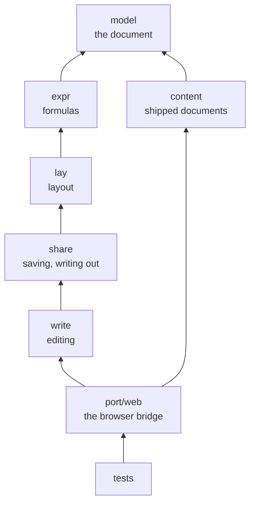

# kspage

**Kanso Doc is one editing system for documents, spreadsheets and presentations**: the three uses in one document, not three programs. It starts from what Word, Excel and PowerPoint do, and keeps, adds or drops each feature on review, to stay simple. You type prose, put a table with formulas inside it, and lay out slides, all in the same file, in a web browser. Try it with two commands:

```sh
make kspage                              # build everything, and a sample document
make kspage-open FILE=out/sample.kspage  # a browser comes up with that document open
```

**It is written in KSPL alone.** It borrows neither the browser's layout (DOM/CSS, the browser's own way of placing text on a page) nor the OS. So kspage does every step itself: it holds the document, breaks text into lines, solves the formulas (the reckoning) and draws the page. Five core folders do that work. Under them sits a bridge to the browser: the KSPL side built as wasm32 (WebAssembly, a compact program format a browser runs), and the JavaScript (JS) that draws and wires the page.

**It does not exchange files with those three**: kspage can neither open nor write a `.docx`, an `.xlsx` or a `.pptx`. What else is missing is in the manual's last chapter (the page's `?`, "Open the manual"). Do not copy it here, since the manual is its source.

**This guide is the map.** It is for whoever reads or changes kspage's code, and it assumes no experience of building an editing system. It shows where things are in the code, the order to read them in, and what a change must touch. The decisions and their grounds are in [`kspage/docs/DESIGN-architecture.md`](docs/DESIGN-architecture.md); its "Words used in this document" explains the terms this guide uses without stopping (canvas, IME, run, band and the rest).

## Run it

**These commands build kspage and open a document in it.** `make help` lists every target under Run and Gates.

| Command | What it does |
| :-- | :-- |
| `make kspage` | Builds the page, the server and the opener (the program that opens a `.kspage` file on a double-click), and `out/sample.kspage` |
| `make kspage-open FILE=out/sample.kspage` | Opens that document in a browser |
| `make kspage-serve` | Serves the page on one document, with saving to the file, opening another file and the folder list all working |
| `make kspage-web` | Makes the page as one HTML file |

**Type `make kspage` first.** It builds the page, the server and the opener, and prints the steps that tie the file type to the opener. You carry out those steps yourself. The last section of [`docs/HOWTO-set-up-a-project.md`](../docs/HOWTO-set-up-a-project.md) says how they differ per environment, and what to check when a double-click opens nothing.

For `make kspage-serve`, choose the document with `KSPAGE_DOC=out/sample.kspage` (relative to the root; by default `kspage/content/manual.kspage`, the built-in manual) and the port with `KSPAGE_SERVE_PORT=8081`. It serves the whole root, because the server refuses anything outside what it serves. **Open the URL it prints, including the token (`#t=…`).** Without it, the page cannot read local files. A URL assembled by hand that misses the page's address or the document opens a page that shows no message.

**`make kspage-web` makes one file that embeds the wasm and the JS.** Serve it through `kssrv --local` and open the URL it prints. The server is required for document access. `make clean` deletes `out/`, so copy the file elsewhere to keep it.

**This folder's own [`Makefile`](Makefile) builds and tests a standalone copy of the folder**: `make test`, `make test-fuzz` (`make test-kspage-fuzz` from the root), `make web`, `make test-wasm`, `make test-served KSSRV=<kssrv>`. The head of that file says what else each target needs. The commands above are the repository's: they call these targets with its own compiler, and build kssrv (the local web server) and the opener around the page.

**What it does**:

* typing and styling from a blank sheet;
* solving a table's formulas;
* showing slides one at a time;
* paging and printing;
* saving and reading back;
* writing out Markdown and CSV.

Two windows may open one file. The second to save is refused if the file changed after it read it ("Editing together" in [`kspage/docs/DESIGN-application.md`](docs/DESIGN-application.md) says why the two are not joined).

## The idea

**A document, a spreadsheet and a presentation hold the same data, blocks of styled text, and differ only in how it is arranged**: flow for prose, a grid for a table, absolute coordinates for a slide. A block's style names its arrangement, so a table sits inside prose and a slide inside the flow. Everything under the arrangement (the document model, text layout with the IME, and the reckoning) is written once. Under that, a thin port layer (`port/web/`) measures text and draws on a canvas through wasm. The grounds are "Why the three can be made one", "How the arrangements nest" and "The core and the port" in [`kspage/docs/DESIGN-architecture.md`](docs/DESIGN-architecture.md). **A figure is a slide**: a slide already sits in the flow, so figures need no container of their own.

**The document (`Doc`) and what is shown (`Page`) are two separate trees.** `Editor` alone rewrites `Doc`, which is what is saved and what an undo puts back. Layout reads `Doc` and `Sheet` and builds `Page` afresh at every keystroke; nothing flows back. So to change what the screen shows, change `Doc` or `Sheet`, and what layout counts (the contents, chapter and note numbers, list marks) never goes into `Doc` ("The editor and the undo record" and "What layout recomputes every time" in [`kspage/docs/DESIGN-document.md`](docs/DESIGN-document.md)).

### The terms and the types behind them

| An editing system's word | Roughly | In kspage |
| :-- | :-- | :-- |
| A document | all the contents | `Doc` ([`kspage/model/doc.kspl`](model/doc.kspl)) |
| A paragraph, a heading, a bullet item, a table, a slide | **all one thing**, told apart only by the style's name | `Block` |
| A row of characters | the text a block holds directly | `Inline` ([`kspage/model/run.kspl`](model/run.kspl)) |
| A style | the look and the arrangement, shared by name | `Style` / `Sheet` ([`kspage/model/style.kspl`](model/style.kspl)) |
| An arrangement | flow / a grid / absolute coordinates | `Arrange` |
| What was laid out | the row of boxes on the screen. **It is not a document** | `Page` / `Box` ([`kspage/lay/page.kspl`](lay/page.kspl)) |
| The cursor | where it is | `Caret` ([`kspage/lay/caret.kspl`](lay/caret.kspl)) |
| The place of editing | **the only** entry point that rewrites the document | `Editor` ([`kspage/write/edit.kspl`](write/edit.kspl)) |
| The shape it is saved in | JSON | [`kspage/share/store.kspl`](share/store.kspl) |

### What happens on one keystroke

**A keystroke passes through five steps, from the browser into the core and back out to the screen.**

| Step | Where | What it does | Folder |
| :-- | :-- | :-- | :-- |
| (1) | `keys.js` | Picks the keystroke up | `port/web/` |
| (2) | `bridge.kspl` | Calls the wasm's entry point (`#export`) | `port/web/` |
| (3) | `Editor.insert` | Rewrites the document, and adds a break to the undo record | `write/` |
| (4) | `kspage_web_layout` | From here down it carries on in one call: | `port/web/` |
| | `calc.recalc` | solves the formula cells in dependency order | `expr/` |
| | `flow.layout` | turns `Doc` + `Sheet` + the measurements into `Page` | `lay/` |
| (5) | `draw.js` | Puts `Page`'s boxes out to the canvas | `port/web/` |

**Only (3) rewrites the document**: (4) only reads it, and (5) sees only `Page`. So when the screen is wrong, the fault is in the rewrite (3), the layout (4) or the drawing (5).

Note: **(4) redoes everything every time.** Its cost, and why it stays, are in "Accepted limit 1: typing one character lays the whole document out again" in [`kspage/docs/DESIGN-architecture.md`](docs/DESIGN-architecture.md).

## What is here

**kspage is split into folders by what each one knows**: a folder may import only the folders below it. The table lists them from the bottom layer up; the diagram shows the same order, each arrow pointing at what a folder builds on.



| Folder | What it holds | What it knows |
| :-- | :-- | :-- |
| `kspage/model/` | The document and the styles. | itself alone |
| `kspage/expr/` | A cell's formula, its value and their text. | `model` |
| `kspage/lay/` | Layout: turns a document into a row of placed boxes. It only reads. | `model` `expr` |
| `kspage/share/` | The shapes that go outside: saving and writing out. | `model` `expr` `lay` |
| `kspage/write/` | Rewriting: `Editor`, and the moves that use it. | the four above |
| `kspage/content/` | The documents shipped with the product (the manual, and the sample shown at startup). **No wiring.** | `model` alone |
| `kspage/port/web/` | The bridge to the browser, built as wasm32, measuring and drawing on a canvas. | the six above |
| `kspage/tests/` | The tests that inspect the inside of the unit. | the seven above |

**`kspage/content/` sits just below `kspage/port/web/` rather than at the bottom**, because only `kspage/port/web` imports it. Its own files import `model` alone. **Do not import it from the other five**, or the core would know the manual's wording.

**`kspage/tests/` sits inside the package**, so the tests reach its inside without making it `pub` (visible to every package; why is "A test inspecting the inside of a unit goes inside that unit" in [`docs/DESIGN-repository.md`](../docs/DESIGN-repository.md)). `kspage/tests/main.kspl` gives them a `main` of their own, so this folder's `make test` runs them alone.

Only what the repository's `tests/` calls is `pub`:

| Name | What it is for |
| :-- | :-- |
| `run_kspage` in `kspage/tests/all.kspl` | Runs all the tests |
| `kspage/tests/trip.kspl` | The round-trip gates (a file read in and written back out) |
| `kspage/tests/seeds.kspl` | Builds the fuzz seeds (the starting inputs that fuzzing varies) |

[I0402] in `ksplc.cfg` holds the rest at zero. Do not import `kspage/tests/` from the product's code, or the tests end up in what is built.

**No folder imports one above it.** What holds that order, and why `kspage/lay/` is one loop, are in [`kspage/docs/DESIGN-architecture.md`](docs/DESIGN-architecture.md#why-the-folders-are-split-by-what-they-know).

**Each file's head comment (`//<`) says what it holds**, so the files of the five core folders and `content/` are not listed here. A list kept by hand beside them would drift. Each document shipped with the product (`content/`) assembles a `Doc` and a `Sheet` and returns them, and knows neither an entry point (a function the screen calls into) nor a screen.

**The files of the bridge to the browser (`port/web/`) are listed**, because `make test-conventions` checks that this guide names every one of them. Several exist only because of the 1000-line cap on a file.

| File | Contents |
| :-- | :-- |
| [`kspage/port/web/bridge.kspl`](port/web/bridge.kspl) | The KSPL side: the entry points that go outside (`#export`), themes among them (the count, a name, wearing one). |
| [`kspage/port/web/state.kspl`](port/web/state.kspl) | One page's state (the document, the cursor, the arena), the only state, and the small helpers the entry-point files share. No entry point is here. |
| [`kspage/port/web/face.kspl`](port/web/face.kspl) | The entry points that **apply** a style (to the selection, a list, a paragraph) and the insertions that follow from it (a shape, an image, a link, a name, a note, a comment). |
| [`kspage/port/web/face_edit.kspl`](port/web/face_edit.kspl) | The entry points that change **the i-th style's contents** (the look, how a number is shown, a paragraph's settings, the frame and the fill, the underline, the line-head mark, a heading's depth, the look changed by the value). |
| [`kspage/port/web/objects.kspl`](port/web/objects.kspl) | The entry points for the contents of the container you are in: line them up, select one, change the stacking order. |
| [`kspage/port/web/table.kspl`](port/web/table.kspl) | The entry points that move a table's cells (rows and columns, merging, copying along, sorting, CSV in and out). |
| [`kspage/port/web/grab.kspl`](port/web/grab.kspl) | The entry points that press and drag (a cell's seam, a slide's frame): the only holder of the state that lives during a press. |
| [`kspage/port/web/paper.kspl`](port/web/paper.kspl) | The entry points for pages (the paper size, the margins, the body's width, a column's width and left edge, the sheet count) and for the header and footer. |
| [`kspage/port/web/inout.kspl`](port/web/inout.kspl) | The entry points for taking the document in and out (the save that reads back, Markdown out, plain text in and out, a blank sheet). |
| [`kspage/port/web/outline.kspl`](port/web/outline.kspl) | The list of headings and the entry point that jumps there, both built from one row, `Page.headings`. |
| [`kspage/port/web/kspage.js`](port/web/kspage.js) | The JS side's entry point: starts the wasm, makes `ks` (the one object the parts share), and assembles the parts. |
| [`kspage/port/web/draw.js`](port/web/draw.js) | Draws the laid-out boxes with `fillText`, the bands, the shapes and the handles, and moves the cursor's sheet (an element of its own over the canvas). |
| [`kspage/port/web/draw_crop.js`](port/web/draw_crop.js) | Draws onto another canvas (a printed sheet, a preview, a thumbnail, a slide shown alone), the same way as `draw.js`. |
| [`kspage/port/web/narrow.js`](port/web/narrow.js) | The table heading kept in view, on a sheet of its own, while its table passes under the tools (pressing it puts the cursor in the heading); and the arrow in every heading cell, with the panel it opens (the ordering, the conditions, a box to search the values, the ticks). |
| [`kspage/port/web/keys.js`](port/web/keys.js) | Pressing and typing: passes the place pressed, the key typed and the text being composed to the wasm. |
| [`kspage/port/web/api.js`](port/web/api.js) | The entry points that go outside (the document itself, the pages, showing, taking in and out, inserting, finding). It also makes the document into text and a document from text. The two files below add theirs to the same `app`. |
| [`kspage/port/web/api_look.js`](port/web/api_look.js) | Those that change the look (decoration, styles, the line-head mark, the frame and the fill, shapes, a container's contents). |
| [`kspage/port/web/api_show.js`](port/web/api_show.js) | Those that cut the document into set frames for viewing (pages drawn, slides shown one at a time). |
| [`kspage/port/web/page.css`](port/web/page.css) | The look, with the colours and the dimensions held by role (`:root`), following the screen's light or dark. |
| [`kspage/port/web/page.js`](port/web/page.js) | The page's frame: the notices, the menus, the common wiring, the redraw notice, the startup. **The parts are assembled here.** |
| [`kspage/port/web/keep.js`](port/web/keep.js) | The draft held back, so what was written survives closing the page or opening another over it. **It is not a save.** |
| [`kspage/port/web/file.js`](port/web/file.js) | The document's name, saving and opening. **This is what swaps the current document**, setting what was unsaved aside as a draft. |
| [`kspage/port/web/handle.js`](port/web/handle.js) | The stores remembered across a reload: where each tab's document lives, and the drafts held aside. |
| [`kspage/port/web/save.js`](port/web/save.js) | Saving and loading (write out, write back, open from a URL or a local place, reopen a tab's document), on the same `kf` as `file.js`. |
| [`kspage/port/web/inout.js`](port/web/inout.js) | Taking in and out with other formats (Markdown, CSV), none of which swaps the current document; and the debug log, without the document's contents. |
| [`kspage/port/web/paper.js`](port/web/paper.js) | The paper settings, printing, and showing one page at a time. |
| [`kspage/port/web/local.js`](port/web/local.js) | Asks the local server (`kssrv --local`) for a file. Startup requires the local server and its token. |
| [`kspage/port/web/command.js`](port/web/command.js) | The wiring of the commands that rewrite the document (a table's rows and columns, insertions, find and replace, notes, comments). `write/edit.kspl`'s counterpart is `api.js`, not this. |
| [`kspage/port/web/form.js`](port/web/form.js) | The style menu (apply one, change its contents, how a number is shown, a paragraph's settings, the line-head mark, the frame and the fill). |
| [`kspage/port/web/fly.js`](port/web/fly.js) | The submenus that fly out to the right of the row pointed at, showing what is applied. |
| [`kspage/port/web/ribbon.js`](port/web/ribbon.js) | The ribbon and the tools (the table of commands shown, folding the overflow, folding it). |
| [`kspage/port/web/here.js`](port/web/here.js) | The menu of the place, on a right-click over the body. |
| [`kspage/port/web/drop.js`](port/web/drop.js) | Opening a file dropped onto the screen, through `file.js`'s `takeChosen` for a document and `command.js`'s `takeImage` for an image. |
| [`kspage/port/web/side.js`](port/web/side.js) | The list on the right (the slides and the contents), the status bar at the bottom edge, and the viewer's overrides. |
| [`kspage/port/web/rt.c`](port/web/rt.c) | `memset` / `memcpy` / `memmove`, supplied here because wasm has no libc (the C standard library). |
| [`kspage/port/web/imports.txt`](port/web/imports.txt) | The entry points that may be borrowed from outside. **The link is bound by this list.** |
| [`kspage/port/web/page.html`](port/web/page.html) | The page's template (the frame and the menus' text), naming the texts to bind. It works only once its marks are filled in. |
| [`kspage/port/web/menus.html`](port/web/menus.html) | The band's Style, Table and Insert menus: a fragment of the template, named by `page.html`. |
| [`kspage/port/web/bundle.kspl`](port/web/bundle.kspl) | Binds the texts the template names and the wasm into one HTML. |

## Reading order

**Read along the line of understanding, `model` -> `lay` -> `write`**, not in import order (`model` -> `expr` -> `lay` -> `share` -> `write` -> `port/web`). First what a document is, then how it becomes a screen, then how it is changed; formulas, saving and the browser come after.

### (1) The document and the styles — `model/`

The base under everything, and **the only folder that knows no other**.

* [`kspage/model/doc.kspl`](model/doc.kspl) — `Doc` / `Block` / `Rect`. Read `Block`'s fields and `Block.add_text` first: **a block has no field for its kind**, only `style`, a name.
* [`kspage/model/style.kspl`](model/style.kspl) — `Sheet` (from a name to a `Style`) and `Style`. Read `Arrange` (the three arrangements) and `Sheet.add` first. **What says "this is a table" is the style, not the document**: that is the idea the whole system rests on.
* [`kspage/model/run.kspl`](model/run.kspl) — `Inline`: the row of characters and the decoration laid on it.
* The rest (`font` / `fixed_font` / `paint` / `marker` / `collect` / `fence` / `limit` / `number` / `over` / `paper` / `panel_paint` / `style_when` / `day` / `filter`) can wait until you need them.

### (2) Laying out — `lay/`

Reads `Doc` and makes `Page`. **Nothing here rewrites one byte.**

* [`kspage/lay/flow.kspl`](lay/flow.kspl) — the entry point `layout(doc, sheet, src, width, arena)`, where everything starts, and flow layout itself (prose wrapping into lines).
* [`kspage/lay/line.kspl`](lay/line.kspl) — how one line is built (where it breaks, where it is drawn): the body of the text layout, and the most costly code there is.
* [`kspage/lay/grid.kspl`](lay/grid.kspl) / [`kspage/lay/absolute.kspl`](lay/absolute.kspl) — the other two strategies, shorter than you would think because they leave the contents to flow.
* [`kspage/lay/caret.kspl`](lay/caret.kspl) — `hit_test(page, x, y)`, which **turns the place pressed back into a place in the document**: the hinge between the screen and the document.

### (3) Editing — `write/`

Changes the document. Every change goes through one type, `Editor`.

* [`kspage/write/edit.kspl`](write/edit.kspl) — `Editor`. **Only its `do_*` operations rewrite the document.** Each one also records how to undo itself, in the same place, so no rewrite can escape the undo. The undo record's shape is [`kspage/write/record.kspl`](write/record.kspl).
* [`kspage/write/typing.kspl`](write/typing.kspl) — `Editor.insert` / `backspace` / the IME / moving the cursor: the entry point to step (3) of "What happens on one keystroke".
* The rest (`block` / `shape` / `cells` / `insert` / `field` / `theme` / `csv`) are moves built from `edit`'s tools, split into files by purpose and nothing more. Read one when you need it.

### (4) Formulas — `expr/`

Solves the formulas: text that begins with `=`.

* [`kspage/expr/calc.kspl`](expr/calc.kspl) — `recalc(doc, sheet)` solves the cells beginning with `=` in dependency order.
  * Caution: **Call it before laying out**, so that the text shown becomes the computed value.
* `value` / `shown` / `addr` / `shift` — the value, how it is shown, an address's text, and rewriting a formula as rows and columns grow and shrink. **None of them knows the document or a cell**, so each can be tested alone.

### (5) Saving, import and export — `share/`

Saving, writing out and taking in.

* [`kspage/share/store.kspl`](share/store.kspl) — `save` / `load`. **This JSON is the only thing that reads back.**
* [`kspage/share/markdown.kspl`](share/markdown.kspl) — a shape for a person to read. **It does not read back.**
* [`kspage/share/text.kspl`](share/text.kspl) — the plain-text shape (a `.md` opens as this too). Come back to it when you need it.

### (6) Connecting to the browser — `port/web/`

**The core calls neither the OS nor the canvas.** JS measures text for it, answering through `Font_source` (the core's interface for text measurements), and draws on a canvas. Start with the row of `#export` in [`kspage/port/web/bridge.kspl`](port/web/bridge.kspl), which is every entry point from the screen into the core; then [`kspage/port/web/kspage.js`](port/web/kspage.js) and [`kspage/port/web/page.js`](port/web/page.js), which start the wasm and assemble the parts. One keystroke goes [`kspage/port/web/keys.js`](port/web/keys.js) → [`kspage/port/web/draw.js`](port/web/draw.js). What every other file holds is in "What is here" above. What the boundary promises is in "The boundary between the core and the browser" in [`kspage/docs/DESIGN-architecture.md`](docs/DESIGN-architecture.md).

## Common changes

**Few changes stay in one place.** The table lists the common ones, the file you start in, the files easily forgotten, and the gate that catches a miss:

| What you want to do | Where you touch | Easily forgotten | The gate |
| :-- | :-- | :-- | :-- |
| Add a field to a style | `kspage/model/style.kspl` | `kspage/share/store.kspl` (saving), `kspage/port/web/face.kspl` (the screen's entry point) | `make debug` / `make test-kspage-wasm` |
| Add a move (an editing operation) | a file under `kspage/write/` | `kspage/write/record.kspl` (the instruction that undoes it) | a test that undoes it in one step |
| Expose an entry point to the screen | `#export` in `kspage/port/web/bridge.kspl` | the JS side in `kspage/port/web/api.js` and the wiring (`port/web/*.js`), `kspage/port/web/face_edit.kspl` where it bears on the look, and the sources `kspage/port/web/page.html` names | `make test-kspage-served` |
| Change the shape it is saved in | `kspage/share/store.kspl` | **raise `version`**: otherwise an old file is silently read as something else | `make debug` |
| Change a text shown on the screen | `port/web/*.js` / `kspage/port/web/page.html` / `content/manual.kspage` (edited in kspage itself) | the screen and the code share one vocabulary: a word kept off the screen is kept out of the code and the comments too ("The vocabulary is one" in [`kspage/docs/DESIGN-application.md`](docs/DESIGN-application.md)) | `make test-conventions` |

Note: **Whatever the change, finish with `make ci-linux`**, every Linux gate ("What each platform runs" in [`docs/SPEC-gates.md`](../docs/SPEC-gates.md)).

## Pitfalls

* **Do not mix the arenas.** An arena is a block of memory whose pieces are all freed at once. The document lives in a long-lived arena, and `Page` in a short-lived one thrown away per keystroke ("Whether an entry point takes an arena depends on what it returns" in [`kspage/docs/DESIGN-architecture.md`](docs/DESIGN-architecture.md)). Something of the document's placed in the short-lived arena is gone after the next keystroke.
* **When you touch the text being composed, run `make test-kspage-served`.** Text is being composed while an IME is still choosing characters, before they are committed. The tests confirm that characters of more than one byte can be typed, and what happens with a server present shows only in the second.
* **The page's JS runs as one script**, so a name declared in two files stops all of it. Only two objects pass between the files ("The page's scripts share one scope" in [`kspage/docs/DESIGN-architecture.md`](docs/DESIGN-architecture.md)).

## The checks, and what none of them sees

**Three checks cover kspage, from the core alone up to the page a real server serves.** Each command runs from this folder; the name in the second column runs the same check from the repository's root.

| From this folder | From the root | What it checks |
| :-- | :-- | :-- |
| `make test` | `make debug-kspage` (also part of `make debug`, on both C and LLVM) | Layout and editing, as golden tests (`tests/*.kspl`: each compares the result with a stored, known-good answer), with the table of fixed measurements plugged in |
| `make test-wasm` | `make test-kspage-wasm` | The core built for wasm32 (`tests/wasm/`, run by `node`) |
| `make test-served KSSRV=<kssrv>` | `make test-kspage-served` | The same sections, on the page a real `kssrv --local` served. kssrv is another package, so it is passed in; from the root, both are built and passed in |

What each of these gates checks, and what it does when no browser is found, are in the notes to "What each platform runs" in [`docs/SPEC-gates.md`](../docs/SPEC-gates.md). How the checks keep their documents apart is in "How the page is checked" in [`kspage/docs/DESIGN-architecture.md`](docs/DESIGN-architecture.md).

**What none of them sees**, and how to check it by hand:

| Not seen | Check it by hand |
| :-- | :-- |
| What comes out on the canvas | Open the page yourself, by the steps in "Run it" |
| The window that chooses a file, which cannot open headless | Open a file through it |
| A real composition, since a headless browser has no input method | Open the page by hand and type |
| Whether a save overwrote | Open a file by hand, save twice, and see that nothing grew |

## Files near the limit and how they split

**Each file below has its split planned before it reaches the cap of 1000 lines a file may hold.** The table says which part leaves it, and for which new file, when it next has to grow. `priv` marks a name visible only inside its own file; some rows name one that stops being `priv` when its group moves.

| File | What to split out | Destination |
| :-- | :-- | :-- |
| [`kspage/port/web/page.html`](port/web/page.html) | more of the menu bar's markup: the `Style`, `Table` and `Insert` menus are out, and `Review` is the largest left. **Take a whole menu, next to those already out**: the band's order is the template's, so a menu taken from the middle comes back with the rest of the bar between its halves | [`kspage/port/web/menus.html`](port/web/menus.html), where the template names it |
| [`kspage/write/block.kspl`](write/block.kspl) | a slide's frames: which is current, choosing one from the list of contents, the overlap order, taking one off (`frame_at` / `framer_at` / `pick_nth` / `raise_frame` / `drop_picked` / `drop_frame`, with the privs `Frame_at` / `no_frame_at` / `holder_of` / `holds_frame` / `dropped`) | a new `frame.kspl` under `kspage/write/` |
| [`kspage/tests/flow_test.kspl`](tests/flow_test.kspl) | the marker-driven tests (`test_a_bullet_hangs_in_the_indent` / `test_numbering_counts_consecutive_siblings` / `test_nested_numbering_starts_over` / `test_a_serial_number_runs_through_the_document` / `test_a_serial_number_counts_nested_figures` / `test_the_contents_lists_the_headings` / `test_the_contents_follows_the_headings` / `test_a_note_puts_a_raised_mark_after_its_run` / `test_note_numbers_follow_the_document_order`). What stays is the flow's geometry | a new `flow_mark_test.kspl` under `kspage/tests/` |
| [`kspage/tests/grid_test.kspl`](tests/grid_test.kspl) | the tests of moving between cells and of narrowing the rows (`test_the_caret_steps_from_cell_to_cell` / `test_enter_moves_down_a_row` / `test_a_filter_leaves_rows_out_of_the_layout`). What stays is how a column's and a row's measurements are decided | a new `step_test.kspl` under `kspage/tests/`, registered in `all.kspl` like the rest |
| [`kspage/tests/slide_test.kspl`](tests/slide_test.kspl) | the tests of grabbing and dragging a frame (`test_a_frame_is_grabbed_at_its_corners_and_body` / `test_one_frame_is_picked_at_a_time` / `test_a_ratio_drag_keeps_the_shape` / `test_dragging_a_frame_moves_and_resizes_it` / `test_one_frame_drag_undoes_in_one_step` / `test_a_frameless_child_cannot_be_grabbed`). What stays is how a slide lays out and what goes onto it and off it. **It needs `sized_slide_sheet`**, which then stops being `priv` | a new `frame_drag_test.kspl` under `kspage/tests/`, registered in `all.kspl` like the rest |
| [`kspage/tests/browser/ribbon.js`](tests/browser/ribbon.js) | the checks of the panel on the right: the lists of headings, slides and placed things, the tabs and their counts, and the boundary that can be dragged. What stays is the ribbon itself | a new `side.js` under `kspage/tests/browser/`, named in `KSPAGE_PROBE` in [`Makefile`](Makefile) and run by `probe.js` like the rest |
| [`kspage/port/web/draw.js`](port/web/draw.js) | the cursor (its bar and its blink) and the IME (`moveCaret` / `hideCaret` / `headRoom` / `jumpToCaret` / `followCaret` / `moveIme`, with the `ime` and `bar` elements). What stays is the painting | a new `caret.js` under `kspage/port/web/`, named from the template as `__KSPAGE_FILE:caret.js__` |
| [`kspage/share/markdown.kspl`](share/markdown.kspl) | writing out a grid: a cell, the rule row under the heading, a column's alignment and a table's marks (`cell_into` / `table_notices` / `align_of` / `rule_into` / `write_table`). What stays is writing the flow. **It needs `Sink` passed in**, and `runs_into` / `start_block` / `lead_in` / `notice` stop being `priv` | a new `markdown_table.kspl` under `kspage/share/` |

Note: **Splitting an `Editor` method costs every caller an import.** An extension method (a method added to `Editor` from a file other than the one declaring it) is seen only where its file is imported. So moving the frame group out of [`kspage/write/block.kspl`](write/block.kspl) adds an `import` to every file that calls it. Count the callers before choosing which group leaves.

**The build accepts a split with nothing added.** `make web` deliberately does not list the bound texts (the scripts, styles and fragments copied into the one page), since the template names them ([`kspage/Makefile`](Makefile)). A fragment needs only its mark and a row in the `port/web/` table under "What is here".

**Do not move the navigation's labels out of `page.html`.** The manual's cross-check reads them from that file by path (`tests/support/conventions_doc.kspl`). With `side-tabs` moved, it finds no labels, and a check with nothing to match against passes.

**When several sections share state rewritten inside one closure, moving blocks does not split the file**: a cut anywhere sends dozens of names across the boundary. (A closure here is one enclosing JS function whose local variables the sections all read and write.) First gather that state into one named object (`kf` in [`kspage/port/web/file.js`](port/web/file.js), the same shape as `ks`).

**Name a file with a word no variable already uses.** An import's alias can collide with a variable's name. [`kspage/model/paint.kspl`](model/paint.kspl) is not called `ink`, because `ink.drawn(...)` would be resolved as that variable's method.

## Further reading

| Document | What it is for | Who reads it |
| :-- | :-- | :-- |
| [`kspage/docs/DESIGN-architecture.md`](docs/DESIGN-architecture.md) | Why it has this shape as a whole: what it aims at and leaves out, the core and the port, the boundary with the browser, how the page is checked, and the accepted limits. | Whoever changes kspage |
| [`kspage/docs/DESIGN-document.md`](docs/DESIGN-document.md) | Why the document is as it is: its model and styles, layout, the cursor and undo, tables and formulas, slides and pages. | Whoever changes the document or its layout |
| [`kspage/docs/DESIGN-application.md`](docs/DESIGN-application.md) | Why kspage behaves as it does around the document: saving, opening and writing back, windows, other formats, the local server, trust in a received document, and the screen's wording, menus and manual. | Whoever changes how documents are opened, saved or shown |
| [std](../std/README.md) | The standard library (`ksplc doc std` lists every file it publishes). kspage stands on the arena (`mem`), strings (`str`), numbers (`math`) and writing out (`json`). | Whoever changes kspage |
| [`docs/SPEC-language.md`](../docs/SPEC-language.md) | The language. A function type's alias, used to swap a function out, is "3.5 Typedefs (`typedef`)". How a function is passed is "8. Functions and error handling". | Whoever changes kspage |
| [`docs/HOWTO-set-up-a-project.md`](../docs/HOWTO-set-up-a-project.md) | Its last section: making a `.kspage` open on a double-click, per environment, and what to check when a press opens nothing. | Whoever wants to open documents that way. Needs a browser and the built opener |
