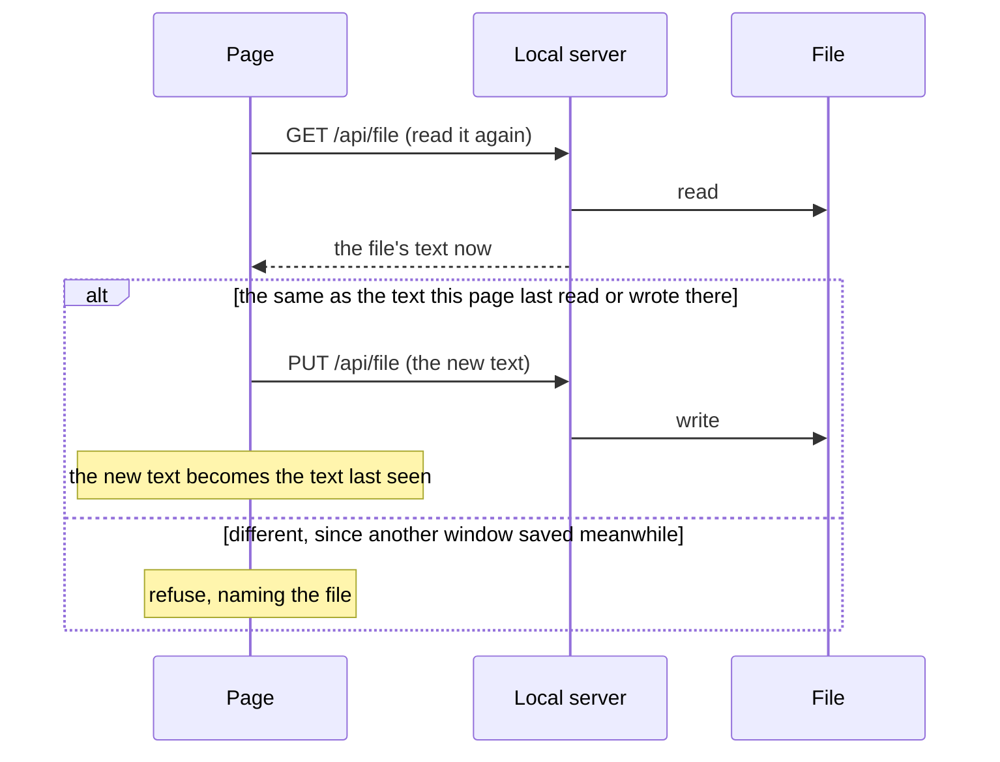
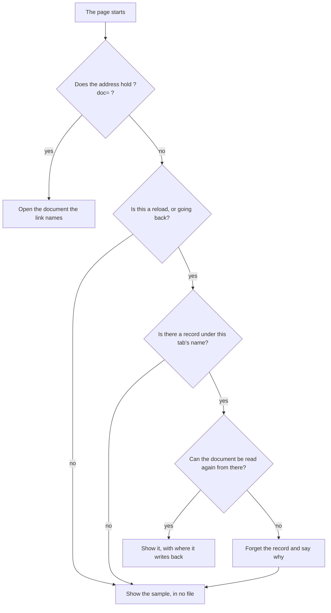
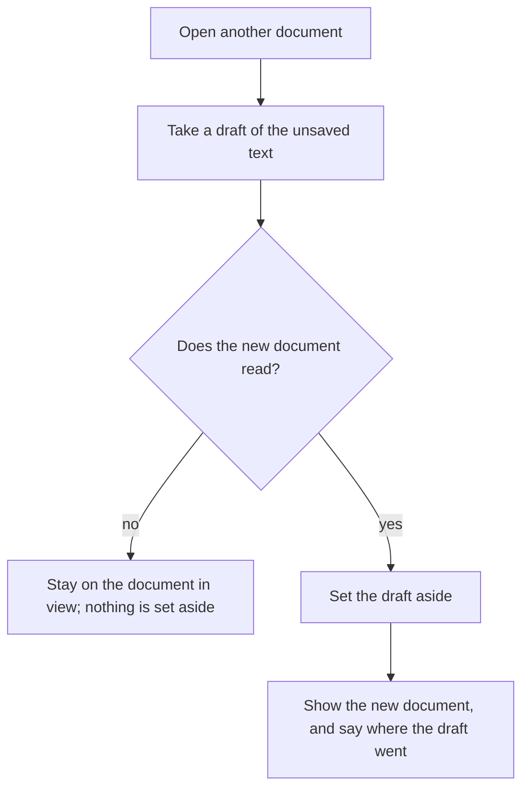
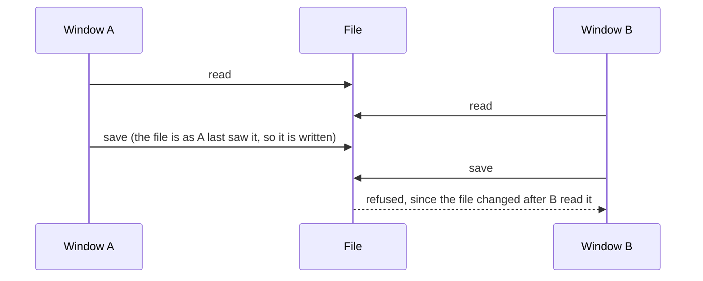
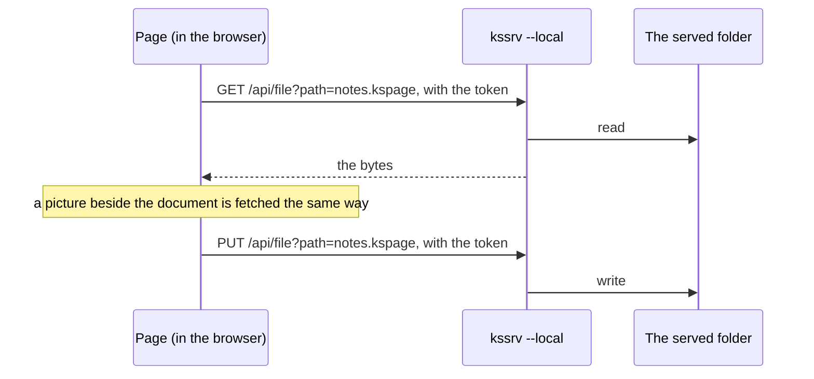
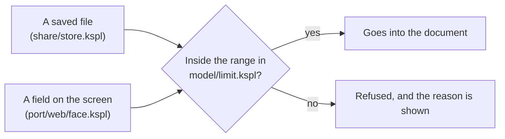

# The grounds of kspage as an application

**This document says why kspage behaves as it does around the document**: how a document is saved, opened and written back, how windows and other formats are handled, what a received document is trusted with, and what the screen says and offers. The words it uses without stopping are in "Words used in this document" in [`DESIGN-architecture.md`](DESIGN-architecture.md).

## Saving and loading the document

**A document is saved as one JSON text that holds both the content and the styles** ([`share/store.kspl`](../share/store.kspl)). Saved apart, one could travel without the other, and the look would drift. Only this text reads back into kspage; Markdown and CSV are one-way exports.

**An unset field is not written.** A style's font fields can be unset, which means "inherited from the parent", so writing the default in would break the inheritance there. The reader leaves an absent field alone too. Only `Sheet.add` fills in defaults; with two places doing it, one could change alone.

**A text of a different version is not read even in part.** A saved text opens with `{"kspage": N, "sheet": …`, where N is the number of its format version (`version` in [`share/store.kspl`](../share/store.kspl)). Writing back a document that kept only what could be read would lose the original.

### A name the core looks up belongs to the format version

**The saved text holds a few names the core looks for by name**: the header and footer marks `{page}` / `{pages}` (`page_mark` in [`lay/chrome.kspl`](../lay/chrome.kspl)), and the header and footer styles (`header` / `footer` in [`model/doc.kspl`](../model/doc.kspl)).

Caution: **Changing a name the core looks up raises the version in [`share/store.kspl`](../share/store.kspl).** Without the raise, an old file's mark is not read as a mark and is printed as written. One raise covers the whole vocabulary, not one per name.

**Any other style may be renamed without raising it.** A style is saved with its definition, so an old file opens with its own, and nothing looked up goes missing.

### An earlier name is not read

**The version field is named after the product, `kspage`, and no earlier name is read.** So renaming the product makes every document saved before it unreadable, although the rename changes not one byte of the format.

**That price is accepted rather than paid with a reader per name.** A reader for an old name never retires: it must be carried, tested and explained as long as the format lives. What is written and what is read are one name. The version check is not relaxed either: a document under that name with a different number is still refused ("A text of a different version is not read even in part" above). The guard is [`tests/store_test.kspl`](../tests/store_test.kspl)'s `test_only_the_one_name_opens`.

### Reading back swaps the document whole

Opening a saved text replaces the whole document, and everything that pointed into the old one is rebuilt or thrown away.

| What | What to do on reading back | Why |
| :-- | :-- | :-- |
| The cursor and the undo record | **Rebuild the cursor and the undo record too** | Both point at `Inline`s (pieces of text in the document), which dangle once the document is swapped |
| The layout | Discard it | Its boxes point at `Inline`s that are gone |
| The parsed text | **Parse the text into the same arena as the document** | A style's name is referenced, not copied. Parsed into another arena (a region of memory freed all at once), it dangles once that arena is freed |

### Saving and loading are separate from exporting

**Export to Markdown cannot be read back.** Even a style's name is lost. It is for keeping the document beside the code. Only the JSON reads back, and neither is used in place of the other.

| Format | Written by | Reads back into the same document? | What it is for |
| :-- | :-- | :-- | :-- |
| JSON (`.kspage`) | [`share/store.kspl`](../share/store.kspl) | yes | keeping the document |
| Markdown | [`share/markdown.kspl`](../share/markdown.kspl) | no: even the style's name is lost | keeping it beside the code |
| CSV | [`write/csv.kspl`](../write/csv.kspl) | only one table's shown text | handing a table's values to another tool |

### Reading and writing CSV share one quoting rule

**Reading and writing CSV share one set of quoting rules** ([`write/csv.kspl`](../write/csv.kspl)). With two, kspage could write a file it cannot read back.

**Export writes the text shown, not the formula.** CSV carries values, and the receiver cannot solve a formula. Imported text goes into the cell as it is, so a text beginning with `=` becomes a formula, as if typed. Rows are padded to the longest row; otherwise the cell count would vary from row to row and the columns would be undefined.

**A text a spreadsheet would run as a formula is written with a leading `'`** (`field_into`): one starting with `=`, `+`, `-`, `@`, a tab or a carriage return. A spreadsheet opening the file reads such a field as a formula, so a cell typed as words (`-to do`, or a received document's `+HYPERLINK(…)`) would run on the reader's machine; `'` is the mark spreadsheets read as "this is text". A field is changed, not merely quoted, because spreadsheets run a quoted formula too.

* **A cell whose value is a number is never marked** (`Inline.figure`): `-5` stays `-5`, and so does a formula's answer. Marked, every negative number would arrive as text.
* **Reading takes the `'` back off, exactly where writing puts one on** (`unguarded`): a field whose text, after its leading `'`s, starts with one of those characters loses one `'`. So a text typed with its own leading `'` (`'=x`) goes out as `''=x` and comes back as typed, and kspage reads what it wrote (the rule above).

## A document's past lives in its files

**kspage keeps no change history and no saved versions of its own: to keep an earlier state, save a copy, or keep the file in git.** A document's past is the files it was saved as. A copy saved under another name is a version anyone can open. A document kept in git has git's history and its diff of the saved text ("The saved text is laid out to read well in a diff" below). A history of kspage's own would be a second thing to carry beside the document and keep in step with it. It would be readable only in kspage, and held where the page keeps it (one browser on one machine), so it would not travel with the document.

**Nothing sets two versions against each other.** Showing what changed between two texts needs a number on every block that never changes, a matching in several steps, a list narrowed by view, and pixels drawn twice. That is a large part of the page for a step taken now and then, and git's diff of the saved text already does it. So a person brings two versions together by opening both, each in its own window.

**What this gives up**: a record of who changed what and when, earlier states kept by a press, and a list of what changed inside kspage. The person keeps copies, or keeps the file where its history is kept.

## Opening, saving and writing back

**kspage requires `kssrv --local` and reads and writes documents by server path.** One destination rule works across browsers and makes every saved document reopenable by path. Standalone pages and browser file handles are not supported; startup names the required server when it cannot connect.

### A document is written back where it was opened

**Open and Enter read the path field.** A `?doc=` link and the desktop opener use that same server API. Save writes to the opened path. A dropped document is imported without a destination, as are a restored draft and the built-in manual; its first save uses the name inside the served folder. Imported images remain embedded in the document.

Every replacement goes through `settleIn` in [`port/web/file.js`](../port/web/file.js), so it preserves the outgoing draft and clears the earlier destination together.

### A save has one destination, and asks nothing it already knows

**While the local server runs, a document opened by path is saved inside the served folder, without choosing its destination in the browser's file window.** If it could choose, it could be saved outside the served folder, making a document that cannot be reopened by path. The same press would also do two different things.

**Nor does it ask instead.** The folder is the one the person chose when starting `kssrv`, and the name is in the menu bar's field; asking for what is already known only adds a press. So with the path field empty, it writes directly under the folder by that name and puts the path written into the field. Later saves then go to the same place, and the workings are visible.

Caution: **Do not silently overwrite an existing file.** The default name is the same for everyone, so it can collide with another document. On a collision the save refuses, pointing at the field.

**A save's path goes to the document it was made for.** The document in view can change while a save waits for the write to finish. A dropped file that fails to open puts the previous document and its path back, and one that opens stays in view. So the path written, and the text the next save compares against, are recorded after the write, and only while that document is still in view (`stillHere` in [`port/web/save.js`](../port/web/save.js)):

| Recorded… | What goes wrong |
| :-- | :-- |
| before the write | in the first case, putting the previous document back restores the pre-save path |
| on whatever is in view | in the second case, another document gets a file it never came from, which its next save overwrites |

The cost: a document that has left view does not take the path. Its next save asks again, and refuses to overwrite this save's file, pointing at the field.

### Before writing back, outside changes are detected by comparing the text

Just before saving, kspage reads the file again. If it is not the text this window last saw there, someone else changed it, and the save refuses instead of overwriting.

The same path can be open in two windows.

Caution: **Overwrite it silently and what was written in the other window is lost.**

So the file is read again before writing, and **if it differs from the text last seen there, the save refuses**, naming that place. A save goes like this:



**Each opened document owns its format, destination and comparison text in one record** (`doc` in [`port/web/file.js`](../port/web/file.js)). A save holds that record while it waits, even if the same path opens another document meanwhile. The comparison uses the original file text; drafts and "Unsaved" use the core's serialization, so formatting on load does not look like an edit.

**Do not compare the time and size**, as other products do (VS Code's "The content of the file is newer"). That refuses even when nothing changed, because clock granularity and each filesystem's quirks affect it. Comparing the text itself never refuses by mistake, and the cap on what can be opened bounds the text held.

**No lock file is laid down** (LibreOffice's `.~lock.`). One left behind by a crashed page makes a file nobody can open, while reading again and comparing leaves nothing behind.

**What guards a path is a text read from it.** A reloaded page reads its document again ("The save destination is remembered"), so its first save compares too. A path typed into the field and saved to at once has read nothing. That save is the person's own "write it here", which the refusal of a colliding name points them to ("A save has one destination, and asks nothing it already knows").

**When the check cannot be made, refuse.** Writing without being able to read is overwriting unchecked.

### The save destination is remembered

**After a reload, the tab comes back on the document it had open, read fresh from where it lives, and Save still writes there.** Otherwise every reload asks for the destination, and a wrong choice grows a copy beside the original. Each tab remembers its own document's path. At start-up the document is read from there and laid in, as Open and Enter in the path field do (`reopen` in [`port/web/save.js`](../port/web/save.js)).

What the page does at start-up:



**Do not restore a destination without its document.** Restored onto the sample the page comes up on, the first `Ctrl+S` would write the sample over a file it never came from. Nothing stops it, since the guard compares only against a text read there. Reading the document again is what makes restoring the destination safe: the text last seen is the one just read, so the guard holds from the first save.

**It is remembered per tab.** The tab's own storage (`sessionStorage`) survives a reload, is seen by no other tab, and holds the tab's name. The record under that name holds the path in the same IndexedDB store as drafts ([`port/web/handle.js`](../port/web/handle.js)). Remembered browser-wide, a reload would bring in the document another tab had open last.

**Only a reload or going back keeps the name** (told by the navigation type). A page reached fresh (a window another opened, a URL typed again) takes a new name and comes up on the sample, in no file.

**A closed tab leaves its record behind**, since nothing tells closing from reloading. So the records are capped, and the oldest go first.

**A destination that cannot be read again is forgotten, and the page says why**: the file is gone or its read was refused. The page stays on the sample, in no file. Without that read, a memory remains that is found broken only when pressed, the complaint raised most against desktop "recent files".

**A link wins over the memory** (`?doc=`). The address names its document, so the page comes up on that and ignores the record.

**It must also work where nothing can be remembered.** A browser can refuse persistent storage. Do not stop silently. A store that fails to open answers "nothing remembered" ([`port/web/handle.js`](../port/web/handle.js)); otherwise start-up waits forever for a document that never comes.

**The page opens one connection to that store and shares it** between where the document lives and the drafts (`ui.handles` in [`port/web/page.js`](../port/web/page.js)): IndexedDB orders transactions only within one connection. **It lets the connection go when another window opens a newer version** (`versionchange`), or that window's upgrade would wait for good; the next use opens it again.

### Drafts are held aside, and a draft is never called a save

**While you type, kspage keeps a copy of the unsaved text inside the browser, a *draft*, so a crash loses little.** The file is written only on a press, so without drafts a crashed tab loses the whole day's typing; every other editor keeps one. A draft is never written to the file, and the screen never calls it "saved".

What happens to a draft, and when:

| When | What happens |
| :-- | :-- |
| Typing pauses (2 seconds), typing has gone on 10 seconds without one, or the page is hidden or left | its text is written to IndexedDB ([`port/web/keep.js`](../port/web/keep.js)) |
| Another document is opened over it | what it has unsaved is set aside as a draft first ("A document is replaced by another only when nothing would be lost" below) |
| The page starts | drafts past 30 days and past 32 of them are pruned; the status bar says in one line where the earlier drafts are |
| The person brings one back (from "File", then "the record of what is half-written") | it opens in no file; the first save asks for the destination |

**Do not write it only on closing (`beforeunload`).** No event fires when the tab crashes, so it fails exactly when it is needed. Hiding the page (`visibilitychange`) and leaving it (`pagehide`) only add to the pause: a phone discards a page put aside with no further event. **The pause has a ceiling**, since every redraw restarts it and typing that never pauses would otherwise write nothing.

**It does not write to the file.** The browser grants write permission only on a press ("The save destination is remembered"), so saving by itself is impossible in principle.

**It says only "held aside", never "saved".** The two words are easy to confuse. Word's AutoRecover is read as "it was saved", yet closing without saving throws the recovery copy away too, and whoever misread it loses the work. Kept apart, the words cannot be misread, and "recovery" does not appear on the screen either.

**A draft is restored only when pressed.** Opened by itself at start-up, a draft one meant to discard would come back to life. Do not announce the open window's own draft. That window is alive and still holding it aside, so the notice would list a live draft as one lost earlier.

**A restored draft is not tied to a destination.** The draft can be older than the file, so tying it would let one press of Save turn the file back into an older version. Word and LibreOffice tie it, relying on the user to notice. The status bar says where the original was, and the first save asks for the destination. **It stays a draft until it is saved**: it lives in no file, so a document opened over it sets it aside again rather than dropping it.

**One question decides whether to write or discard: "is there anything to lose?"** [`port/web/file.js`](../port/web/file.js)'s `draftNow` returns null when there is nothing to lose, and there is one entry point, `keepSync`.

* Do not split the question and the contents into two entry points. The caller would call both and turn the whole document into text twice per pause, paid on every keystroke.
* Do not reuse `unsaved` either. It answers "does the status bar say Unsaved?", and it deliberately calls a document in no file unchanged. Here it would leave unkept a document typed on a blank sheet, the kind most easily lost.

**The key differs per start-up**, and per window, since two windows under one origin (one site, to the browser) use the same document numbers. Keyed by the number alone, document 0 after a reload would overwrite the earlier 0's draft before it can be restored. The start-up's key is not remembered, so an earlier start-up's draft is always left an orphan, and that orphan is what gets restored.

Caution: **Do not let drafts pile up without end.** An origin's storage has a quota, and past it writes fail silently, so the guard works in name only.

The pruning happens in one place, at start-up. Elsewhere, drafts would pile up whenever that place is not reached.

**The document in view is held aside, and so is one another document replaces** ("A document is replaced by another only when nothing would be lost" below).

### A document is replaced by another only when nothing would be lost

**Opening another document never throws away unsaved work: what the document has unsaved is set aside as a draft first, with no dialog asking**, and the page says where it went: "Bring the draft back" lists it at once (`keepAside` in [`port/web/keep.js`](../port/web/keep.js)). Every way of replacing the document goes through it: "Open", a path, a link, a drop, the manual, "New" and a draft brought back (`settleIn` in [`port/web/file.js`](../port/web/file.js)).

Caution: **Do not silently discard unsaved work.** Writing lost to one keypress cannot be undone.

So **no refusal is needed**: a document is replaced only once there is nothing left to lose.



**Do not ask with a dialog (`confirm`).** In a test browser nobody answers, so the test stops there. On an embedded page, a dialog that blocks the whole page does the same.

**Say where it went.** The notice of the opening ends by saying the unsaved text is kept as a draft and where to bring it back; otherwise nobody can tell where the work went.

**Take the draft before reading, and set it aside only once the new document is in.** Reading replaces the text, so a draft taken after it is the new document's. Set aside before it, a refused read would list a draft of the document still in view.

**A window holds one document** (the document in view is the core's globals, [`port/web/state.kspl`](../port/web/state.kspl)). Keeping several in one window would hold every other document, its undo record and its destination aside, swap them at each switch, and add a list to find them by. Another window already holds another document ("A window opened on a document holds that document" below), so a second means is not kept (Principle 6).

**"Open" on the document already in view reads it again.** Whoever pressed wants a fresh read, since it may have changed outside; showing it again would make the press do nothing.

### The extension is kspage's own, and does not name the format inside

**Documents are saved as `.kspage`** (the contents stay JSON).

**Do not name the extension after the format inside.** As `.json`, these documents could not be tied to kspage alone. The OS chooses a program by extension, so tying `.json` to kspage would make every settings and data file open in kspage on a double-click.

The other products do the same: Word names its zip `.docx`, not `.zip`.

**Only `.kspage` opens as a kspage document**; any other name opens as plain text (`port/web/file.js`'s `kindOf`). One function decides the extension written (`bodyExt`).

### The saved text is laid out to read well in a diff

**Do not pack the whole document onto one line.** Packed JSON reads back just as well, but then changing one word changes the whole document in a diff. git's diff and merge and `grep` can say nothing, and there is no way to compare what was written side by side.

**It is written one value per line** ([`share/store.kspl`](../share/store.kspl)'s `spacing`). The reader skips whitespace, so a text saved earlier still reads if the indentation changes; packed text reads too.

**The other products differ here.** kspage saves text that it reads back, so packing is its own choice, and a readable diff is worth more than what packing saves (some tens of KB).

### Pointing at a document by URL and opening it

**A link such as `page.html?doc=notes.kspage` opens the page on that document, and adding `&read=1` opens it read-only.** This is how a README or an issue links to a document: a path typed into the field by hand cannot be passed on as one link.

Caution: **Accept only a relative path on the same origin.** A scheme (`https:` / `data:`), a path starting with `//` and one climbing with `..` are refused. Accepted, one shared link could make this page read any location and show its contents.

**It reads through the local server API with the token.** A static server or a standalone page cannot provide document access.

**Do not strip the query from the URL.** Unlike the token ([`port/web/local.js`](../port/web/local.js)'s `#t=`) it is no secret, and a reload returning to the same document is what the link is worth.

**Set read-only before loading.** Loading a document rebuilds the editing state, so if it is set afterwards, the document is writable while it loads.

### Read-only belongs to how a document was opened, not to the document

Caution: **Do not write it into the document.** Written in, it becomes a lie: a copy calls itself "read-only" and anyone can edit it anyway (the same reason a theme's name is not written into the document). So it appears in neither the saved text nor an export.

It lives with the reader's overrides (`Sheet.over`), and **survives reloading the document** ([`port/web/state.kspl`](../port/web/state.kspl)'s `new_edit`).

**The core refuses the edits.** Hiding the tools is not enough: operations that slip past hidden tools (shortcut keys, pasting, undo) always remain. Hiding only keeps buttons that would do nothing off the screen.

**The refusal is at the entry point of a rewrite, not in the code that rewrites.** If the `do_*` functions (the 20 that rewrite) quietly did nothing, a caller that repeats until something happens would never finish. [`write/block.kspl`](../write/block.kspl)'s `join_here` loops until the runs are gone, so with `do_run` doing nothing it hangs there. Refused at the entry point ([`write/edit.kspl`](../write/edit.kspl)'s `shut`), the loop never starts.

**There are over 50 entry points, so one will surely be missed.** So the check is not a count but that the saved text does not change by one byte (`kspage/tests/edit_test.kspl` and `kspage/tests/browser/store.js`). Whichever way an edit gets in, a changed document shows up there.

### Switching between reading and editing

**The mode switches both ways, and stays a setting of how the document was opened.** Do not make it feel like a lock: it is a screen against edits by a mistaken press. A document opened with `&read=1` can be switched to editing too. A one-way switch would guard nothing, since removing that mark from the URL does the same.

**The control that shows the current mode is the one that switches it**: the pair at the status bar's left edge, with the mark on whichever is on. Do not show the mode in two places, or changing one puts them out of step. Do not hide it when read-only; hidden, the way back is gone from the screen.

**No shortcut key is assigned.** Nothing may silently switch the mode on a mistaken press (as LibreOffice's `Ctrl+Shift+M` can), and with the control always in sight, no key is needed.

**The switch applies in both directions.** Applied one way only, the tools would stay hidden after leaving read-only, leaving a screen where one can write but the writing tools are missing.

### A picture from a file is embedded, and one typed by its place is linked

A picture you insert from a file, or drop, is copied into the document. A picture whose address you type stays a link to that address.

The document holds only **the picture's source**, which is text: either the picture itself encoded as a `data:` address, or an outside reference as it stands.

**The control pressed decides it, and nothing else.**

| The control | What the document holds |
| :-- | :-- |
| "Insert from a file", or a dropped picture | the picture, embedded |
| The place field, with a relative path or an address typed in | a reference to what was typed |

Do not let whether the local server runs decide it. The same press would put the picture in two shapes, a document made with the server would lose its pictures when handed over alone, and the only way to get one self-contained file would be to stop the server first. Nor ask on every insert: pressing one control or the other already says which.

**kspage writes no picture file.** A picture to sit beside the document is put there by the person, with the OS's own tools, and its place is typed in. Writing one would need a rule for a colliding name and for a folder that does not exist, for work the file manager already does.

**Report the size embedded.** Unreported, a few photographs reach the cap on what can be opened, and nobody can see what is heavy (a `data:` text is 4/3 the original bytes).

**A reference stays relative**, in the saved text and in the Markdown written out. Move the document elsewhere without the picture and it disappears, so a document that must be self-contained uses embedding. This is a trade-off: neither can be made the default with the other taken away.

## More than one window, and opening from the desktop

One window shows one document. To see two documents, or two places in one, open two windows. Windows never share edits.

### Editing together

**Kspage has no live co-editing: two people do not edit one document at once, and two windows on one machine are not joined to edit it together either.** Work is merged afterwards by hand.

**Why windows are not joined.** Simultaneous edits need an agreed order, and with no server only each window's own count can give one. That fails with a third window and across a network. So two windows in one browser are a different problem, not a small case of two people in two places. A join held as paths into the document's tree also breaks in ordinary use. Adding or deleting a row or a column, or applying a new style, cuts the paths, and those are the very operations a table needs.

**Two people's work is brought together afterwards, by hand**, with the two texts opened side by side, each in its own window. Two windows may open one file, but the second to save is refused if the file changed after that window read it ("Before writing back, outside changes are detected by comparing the text" above):



**A real answer needs a server that orders edits for everyone.** `kssrv` exists but deliberately knows no document ("Who asks whom" in [`../../docs/SPEC-local-server.md`](../../docs/SPEC-local-server.md)), so such a server has to be designed from scratch, not reached by joining windows.

Note: What the person meets instead is in the manual's "What it cannot do" chapter ([`content/manual.kspage`](../content/manual.kspage)).

### Another place in the same document is seen in another window

**One window shows one place of its document.** The core holds one cursor ([`write/edit.kspl`](../write/edit.kspl)'s `Editor`), so a second pane in the same window that takes typing would have nowhere to keep its own cursor. One that only reads would be a second means beside the one already there: another window on the same file, whose size and place on the screen are real. Two windows may open one file; the second to save is refused if the file changed after it read it ("Before writing back, outside changes are detected by comparing the text" above).

### A window opened on a document holds that document

**A window the page opens with `?doc=` reads the document that names, and no window passes its document to another**, since two windows are not joined ("Editing together" above). A window opened from a link inside a document is `noopener` as well (the new window gets no reference back to the window that opened it). Lining documents up inside one window is a separate matter (accepted limit 2 below).

Caution: **Do not check it by the text alone.** A passed-over document overwrites the named one only when it arrives later, so the text can look right in one order and lose the document in the other. The browser check also counts what was passed ("Opening a different document in a different window" in [`../tests/browser/local.js`](../tests/browser/local.js)).

### What kspage publishes for the opener

**Nothing in kspage is published for the opener**, the program outside this package that opens a `.kspage` document on a double-click. Do not have it reach the names of the sample and of saving directly. `pub` is a contract leaving the unit, so opening `content/` and `share/` adds two contracts (`ksplc.cfg`'s [I0402] watches their count; see "What is here" in [`kspage/README.md`](../README.md)). The entry that assembles the seed is already open for the gates, so the opener uses that.

### Whether a dropped file is opened or inserted

Drop a picture and it is inserted into the document; drop anything else and it is opened as a document. The browser never takes over the drop.

**The heaviest complaints about a drop are "I meant to open it and it was inserted" and "I meant to insert it, it opened, and the earlier document was gone".**

**Once something is dropped, the browser's default is always stopped, across the whole window.** Unstopped, the browser moves to that file, and the document being edited goes with the page.

Caution: **Do not stop it on the body's canvas alone**, or a drop on a panel or the ribbon would escape to the browser. The mark shown while dragging covers the whole window too.

| What is dropped | What happens |
| :-- | :-- |
| A picture | **A picture is inserted into the document.** The cursor first moves to where it landed, but only when it landed on the body; a panel's or the ribbon's coordinates would put the cursor somewhere else |
| Any other file, including a picture that declares no type | opened as a document. The core checks the contents and refuses what it cannot read, so it is never silently mistaken |
| Text being dragged (not a file) | **A text drag is left alone**, so text can still be dropped into a field to paste it. Only a drag carrying `Files` is taken over |

The two are told apart in one place (`isPicture` in `port/web/drop.js`).

**A drop borrows the existing entry points**: `takeChosen` in `port/web/file.js` for a document, `takeImage` in `port/web/command.js` for a picture. Do not write a reading path into the drop (Principle 4: one canonical source), or dropping alone would behave differently.

**A dropped document has no destination.** Its first save writes to a server path; importing a file never gives the browser permission to overwrite its original.

### How a blank document is started

"New" opens a blank sheet at once, with no template screen in front, and with no link to the file opened before.

**The commonest complaint is a list of templates standing between the user and the blank sheet.**

**"New" opens a blank sheet, with no screen of choices in between**, since that screen is the complaint itself. A template never stands in front of the blank sheet.

**What the open document has unsaved is set aside as a draft first**, as on every opening ("A document is replaced by another only when nothing would be lost" above).

Caution: **Do not let "New" drop the open document's unsaved text.** It would silently throw away whatever is half-written.

**No shortcut key is named.** Do not offer `Ctrl+N`: the browser takes that key before the page sees it, so the hint would not work when pressed. A desktop product can use `Ctrl+N` because no browser stands in between (the same difference as "Whether the browser or the page holds the zoom").

What "New" builds, and what it leaves out:

| Part | What "New" does | Why |
| :-- | :-- | :-- |
| The styles' table | **Include the styles' table** | Without it, tables and slides both land as ordinary paragraphs, so someone who started from "New" cannot insert a table |
| One paragraph holding an empty run | **Lay the empty run down too** | A block alone produces no box, so a press cannot fix a position, and the blank sheet appears but cannot be typed into. This is the shape the editor leaves when it empties a paragraph, saved as `"text": ""` |
| Where to write back (the name, the path, the handle) | **not carried over** | Otherwise saving a blank sheet would overwrite the file opened before. The text kept for comparison is empty too, so the overwrite guard would not act either |
| The read-only look | **undone** | The core opens a blank sheet for editing; a look that forbids typing would sit on a document that allows it |
| A body width, a theme | **Neither a body width nor a theme is written into a blank sheet** | (below) |

Caution: **Do not make "New" the place defaults are laid down.** "Where the body's width is capped" above says why, and where "readable for me" goes instead.

## Markdown, plain text and source

Kspage opens plain text and program source as they are, and writes them back byte for byte. A `.md` is one of these texts. These texts are kept beside code, so they must stay readable by every other tool. Markdown is also a format kspage writes, as a one-way export.

### A `.md` opens as plain text

A `.md` file opens with each line as one paragraph, as any text does, and saves back byte for byte ("Plain text holds one line per block" below). Kspage does not read Markdown into headings, lists and tables.

**Reading Markdown in would cost a second format to keep whole.** A reader turns the text into styled blocks, and writing back must then give the same text again. That needs a reader, a table of looks handed to it, rules for every notation the writer must reproduce, and a check that sends real files through and back; the check promises only a fixed point, not the bytes the person typed. Every editor and code host already shows Markdown rendered, so what kspage would add is small next to that cost.

**Opened as text, a `.md` loses nothing.** A notation, a trailing space or a line break stays as typed, so the tools around the file (diff, `grep`, the checks that read text) see exactly what was there.

**The export stays.** A document made in kspage can still be written out as Markdown to keep beside the code. It is a copy for reading, not a second home for the document: the `.kspage` stays the one to edit, since a copy without styles cannot say which of the two is newer.

### The mapping into Markdown

Exporting to Markdown writes everything Markdown has a form for in that form. Content Markdown cannot express is written as a hidden comment, so it is never dropped silently. The look is dropped.

[`share/markdown.kspl`](../share/markdown.kspl) writes it, **for keeping a document beside the code**. It does not read back: kspage opens a `.md` as plain text ("A `.md` opens as plain text" below), and no style is carried into the text ("Saving and loading are separate from exporting" above).

**Contents with a Markdown form are written in that form; contents without one are written as a mark.**

| In the document | In the Markdown |
| :-- | :-- |
| A heading | `#`, as many as its depth |
| A list item | `-` or `1.` |
| A paragraph | text outside any fence (a fenced code block) |
| A grid (a table) | a GFM table (GitHub's table syntax) |
| A link | `[text](destination)` |
| Emphasis on a run | `**` and `*` |
| **Merged cells, a block inside a cell, where a slide's frames sit, and a chart** | a mark, `<!-- kspage: ... -->`: an HTML comment that Markdown passes through unseen. A slide's frames' words still go on as paragraphs. **No fence of kspage's own carries them**: only kspage would read it, and every other tool would show it as code |
| The look (colour, sizes, alignment, a picture's size, a column's width, a row's height) | nothing |

**A mark is written only where contents are lost.** The look is dropped wholesale; a mark for each part of it would bury the text, so this section says it once.

**A number with a Markdown form is written in that form; one without is written as text.** A list's bullet symbol written beside the `-` would show two marks, while a dropped chapter number or "Figure 1. " would vanish from the screen.

Note: Both numbers come from the same place the layout uses (`kspage/model/number.kspl`'s `heading_number` / `serial_number` / `note_number`).

**Escape only what would read as something else**, since escaping everything makes the text unreadable. A `_` inside a word is not emphasis and is left alone, while a `#` at a line's start could read as a heading and is escaped.

**Indent only inside a list.** In Markdown, leading spaces change a block's meaning, so indenting at every nesting level would turn a paragraph into a code block.

**A table's first row is its heading**, since GFM has no table without one. As with CSV, export writes the text shown, not the formula.

### Rules the Markdown writer keeps

**Inline code is the innermost mark.** Emphasis and a link go outside it (`` **`x`** ``, `` [`x`](u) ``): inside a fence a mark is plain text. A text holding a `` ` `` gets a longer fence. Its style is code by role, the same role as a code block's (it does not wrap); the writer never looks at the name.

**A fence is one backtick longer than the longest run of backticks inside it** (`fence_len`). A line inside with a run as long as the fence closes it, and what follows is read as Markdown, raw HTML included: a received document whose code lines hold ```` ``` ```` and ```` ```` ```` put an `` into the page that shows the export. A fixed longer fence only moves the run that closes it.

**A style name a language cannot have declares no language**: anything but letters, digits and `-` `+` `.` `#`. A backtick there stops the line being a fence at all (CommonMark), with the same result as above.

**A picture's address is checked as a link's is** (`linkable`), since the reader of the Markdown opens it too.

**The language a fence declares is the fence style's name.** Dropped, ` ```kspl ` becomes ` ``` `, and every tool that collects the source's fences misses them (in this repository, [`../../tests/suite/docsnippet_test.kspl`](../../tests/suite/docsnippet_test.kspl)). The plain code style declares none.

**Consecutive runs are wrapped together per emphasis.** Code inside bold splits into three runs (`this document (` / `DESIGN-architecture.md` / `)`), so wrapping each run in `**` would write `**...****` ... `****...**`.

**The parting is in two stages: by link target first, then by emphasis inside that.** Parting by both at once splits a link wherever the emphasis changes inside its text. A `[...](...)` is written per piece, so one link multiplies into as many links as it has runs. The rendered text does not show it, yet a screen reader announces each piece as a link. **Only runs inside a link are grouped**: grouping runs with no link too would detach a note's mark from its run.

**A break is "a block that holds no content and collects none"** (`divides` in `model/fence.kspl`). A *break* is the horizontal rule Markdown writes as `---`. Add neither a field nor a name for it. It is recognised by role, so renaming a style does not break it (Principle 1). Its look is the style's: a line under a style that draws one, only space under one that does not. Only a break that draws a line is written.

**A break is never taken into a fence.** Taken in, two fences with a break between would become one block: one band on the screen, and one ``` pair in the text.

**Do not mistake a collecting block for a break.** The table of contents, the footnote list, a chart and a figure assemble their content at every layout. So in the document they hold neither text nor children, and mistaken for breaks, the list disappears whole. Nor mistake a blank line inside a fence, which holds one empty run.

**A column's alignment is held by the style of that column's cells.** Do not add a field to the table. `Style.align` already means "the alignment of a row's content", so a table field would hold one thing two ways (Principle 6: one means to one purpose). The padding tells a cell from the other blocks that draw nothing of their own:

| Block | Inner padding | Draws a line |
| :-- | :-- | :-- |
| A cell | yes, to keep the grid line off its content | (the grid's) |
| A break | no | yes |
| A bare paragraph | no | no |

**It is one per column.** Markdown can write alignment only per column, so the writer takes the header row's cells. A different alignment in a lower row cannot be written. Taking "any row that holds one" would let adding one row change the whole column's alignment. Left is the default, written `---`.

**The annotations (`Inline.remark`) and the asides (`Block.aside`) are not written**, and get no mark. They are not the document's contents, so nothing is dropped from the flow.

**A text is escaped only where CommonMark (and GFM, whose tables the writer uses) would read it as markup** (`escape_into`), so the export renders as the document reads and `snake_case` stays readable:

| What | Escaped |
| :-- | :-- |
| `\` `` ` `` `*` `[` `]` `<` `~` | everywhere (`~` is GFM's strikethrough, and three open a fence) |
| `#` `>` `-` `+` `=`, and the `.` or `)` after leading digits | where the text starts a block's contents: a line's start, and **after a list's `- `**, since an item holds blocks (`- # x` is a heading inside the item) |
| spaces and tabs leading such a text | written as `&#32;` and `&#9;`: four open a code block, and fewer are dropped |
| `&` | only where it starts a character reference (`&amp;`, `&#169;`): `Fish &amp; chips` would show `Fish & chips` |
| `_` | unless it stands between two ASCII letters or digits: a bracket beside it lets it open emphasis (`(_x_)`), and so may a character outside ASCII |
| a heading's trailing run of `#` | a `\` before it, or it is read as the closing sequence and dropped (`Item #`) |

**What the writing gathers goes in an arena of its own, thrown away at the end** (`write`): the headings, the notes, a table's cells. Put in the document's arena, every export would grow the open document for good, as `layout` would (its own caution). Only a reference's shown number stays in the document's arena, where `Inline.shown` keeps it.

### Plain text holds one line per block

A `.txt` file, a `.md` file or a program's source opens with each line as one paragraph, and saves back byte for byte identical.

This is how kspage opens a `.txt`, a `.md` or a program's source ([`share/text.kspl`](../share/text.kspl)).

**It round-trips byte for byte.** A "fixed point" (the written text, read again, changes no further) is not enough here. That one does not count a choice of notation as content, whereas this text is a compiler's or a tool's input, where one byte different is another file. [`../../tests/suite/textrip_test.kspl`](../../tests/suite/textrip_test.kspl) watches it by sending every file git knows through whole.

| What | What kspage does | Why |
| :-- | :-- | :-- |
| The notation, trailing whitespace, the line breaks | kept as they are: not tidied, not dropped, not made uniform | one byte different is another file |
| A trailing line break | **A line is exactly a piece cut at line breaks, so a trailing line break is followed by one more, empty, line** | That tells a file ending in a line break from one that does not, so it is not remembered separately. A flag would say what the content already says, and one of the two could change alone |
| A CR (as in a Windows CRLF file) | **A CR is kept as a character of its line**, so a CRLF file shows one character at each line's end | (this repository holds no CRLF file) |
| A NUL byte | **A file holding a NUL is refused** | it is not text (below) |

Caution: **Do not remember "this file is CRLF".** In a file with mixed breaks, one kind would be silently rewritten.

**One line is held as one block.** Do not make a second kind of document: relayout, the cursor, undo, saving and searching all work unchanged with what exists (Principle 1 and Principle 6). A fence (a ``` block) already has this shape, so only a reader and a writer are added.

**The gutter for line numbers is sized from the number of digits in the line count** (`gutter_for` in `share/text.kspl`). Do not make it a fixed width; one wide enough for the largest document leaves too much space on the left of a file with fewer digits. The digits follow from the line count, so they are known as soon as the file is read. Reckon a digit's width generously: a monospace digit is 0.55 to 0.62em, so 0.65em is used. A number wider than the gutter is drawn from the gutter's left edge and runs into the body (`place_mark` in `lay/line.kspl`). Measuring cannot find it: the gutter is where the body begins, so it is needed before the layout.

Note: The check is [`tests/text_test.kspl`](../tests/text_test.kspl)'s "there is a gutter the numbers are laid in", which checks that the gutter widens as the digits grow and that the number and the space beside it always fit.

**The price is the arena** (the memory region the document lives in). This repository's text takes several times its own size again in memory, the more so the shorter the lines. The cap is that of the existing document memory gate (`room_for` in `port/web/state.kspl`), and past it the page refuses before opening.

**VS Code went the other way.** It replaced one string per line with a piece table (a structure that stores edits as pieces of the original), because opening was slow and memory ran high. That reason holds here too, so kspage does not claim that any large text can be opened. What the price buys is that the document's tools work unchanged.

**Do not open a picture or an executable as text**: the screen fills with nonsense, and the file is broken the moment it is saved. So a file holding a NUL is refused. The one test is git's own, "is there a NUL"; relying on the encoding would let a misjudged text through silently. Report it apart from both "too large" and "cannot be read", since the remedy is "open it with another tool", not changing the text.

**How a file is opened is decided in one place, by its name** (`kindOf` in `port/web/file.js`). There are four ways to open one (a path, a text reference, a handle, a drop). A test per entry point would let the shape opened and the shape written back drift apart per entry point (Principle 4). An unknown extension opens as plain text. A list of known ones would grow with every extension, and a text missing from it would be read as JSON without a word.

### A source opens as plain text, and nothing more

**Kspage is not a code editor: a program's source opens as any plain text does**, with no colour, no window onto a symbol, no figure of the imports, and nothing built from a table into code. All four serve a place for writing code, which is not the aim ("What it is aimed at" in [`DESIGN-architecture.md`](DESIGN-architecture.md)). Colouring by lexeme (by keyword, string, number and so on) needs a copy of each language's keywords that drifts silently from the compiler's. A window and a figure need the editor to read and cut source at every layout, rebuilding what the compiler holds. The editor beside the document already shows all of it.

**A link to a file is an ordinary link** (a relative path), which opens what the browser opens. The document points at the source by name, as every document here does ("Linking documents to source" in [`../../docs/SPEC-documents.md`](../../docs/SPEC-documents.md)), and `make test-docref` checks a Markdown document's pointers.

## The local server reaches files, and nothing else

A web page cannot open a file by its path. The local server, `kssrv --local`, is a small program on your machine that does only that for the page: it reads and writes files in one folder, and reports whether a file changed. **It starts no program.**

`kssrv --local` answers the page's requests for files and for whether a file changed, and the page uses them to open and save by path ([`../../docs/SPEC-local-server.md`](../../docs/SPEC-local-server.md)).

**Served locally, everything the page shows is read with the token.** The *token* is a secret the server prints once at start-up and the page sends with every request, so that no other program or page can read the folder. That server hands out no file but the page without it.



A `?doc=` link reads its document through `GET /api/file`. A picture beside the document is read the same way and drawn from a `blob:` address, since an `` cannot send the token's header (`localPicture` in [`port/web/local.js`](../port/web/local.js); drawing and measuring both go through it). No plain-fetch fallback bypasses the server API.

### The browser draws, and a server only reaches files

**The browser carries what costs most per OS**: the IME, the clipboard, printing and the system's fonts ("Why the browser is the main target" in [`DESIGN-architecture.md`](DESIGN-architecture.md)). kspage's layout and drawing are its own already, so a native window would rebuild those parts three times and gain nothing on the page. **What a page cannot do is reach a file by its path**, and that alone is what the server is for.

**The page checks for the local server before enabling editing.** Missing or refused access stops startup with instructions to open the URL printed by `kssrv --local`. One served-browser gate checks input, document access and drafts together: `make test-kspage-served`.

### kspage starts no program

**kspage neither starts a program nor talks to a language server** (a background program that gives a code editor completions and errors), and holds no plugin that a program on the machine would answer. All three serve a place for writing code, which is not the aim ("What it is aimed at" in [`DESIGN-architecture.md`](DESIGN-architecture.md)). Each would also make the server one that starts programs, the costliest kind to keep safe. **To repeat a fixed routine, write KSPL code that edits the document** (the core is a library), as for macros ("What it does not hold" in [`DESIGN-architecture.md`](DESIGN-architecture.md)).

### Where the protocol with the server is written down

**`kspage → kssrv` is not in the packages' reference direction.** Only the direction of import is allowed ([`../../docs/SPEC-documents.md`](../../docs/SPEC-documents.md)), and there is no import (HTTP joins them), so the only question is where the agreement lives.

**It lives in [`../../docs/SPEC-local-server.md`](../../docs/SPEC-local-server.md)**, for the reasons "A page asks the local machine through one protocol" in [`../../docs/DESIGN-repository.md`](../../docs/DESIGN-repository.md) gives.

## What a document received is trusted with

A document may come from someone else, so kspage does not trust what is inside it. Two rules say what is refused rather than repaired: numbers outside their range, and text used where it could do harm.

### The numbers inside a document are refused rather than rounded where they are outside the range

**Some numbers in a document decide how much work layout does, so size is not the only thing a cap must guard: each has a fixed range, and a document holding a number outside it is refused, not quietly corrected.** A merge loops once per column it spans, a column set lays out once per column, and a heading's depth sets how many places its chapter number stacks up. A cap on the file's size does not stop this. A 190-byte document with two billion in `span_cols` never returns from layout, and with three blocks it passes every size gate.

**The ranges live in one place, [`model/limit.kspl`](../model/limit.kspl), and a value outside its range is refused where it is read.**

| The field | The range | Where it comes from |
| :-- | :-- | :-- |
| A merge's rows and columns (`Block.span_rows` / `span_cols`) | 1 to 1000 | the same as a browser's cap on a table cell's span |
| A column set's columns (`Style.columns`) | 0 to 64 | Word allows 45 (paper width ÷ a ½-inch minimum column) |
| A heading's depth (`Style.outline`) | 0 to 9 | where Word and ODF stop |
| The decimal places (`Number_spec.places`) | 0 to 9 | 10 to that power still fits an I64 |
| How deep blocks sit inside one another | 1 to 32 levels | past any list or table people nest; layout descends one call per level |
| The paper's width and height (`Paper.width` / `height`) | 0 (no pages), or 96 to 100000 px | a page under an inch splits a document into a page per pixel, and the page bands are drawn per page |
| Every other length, gap and position (margins, spacing, indent, padding, sizes, a frame, a picture's size) | -100000 to 100000 px | past any paper (26 m at 96 to the inch), short of a count that hangs or a cast to an integer that overflows |
| A font size (`size_px`) | above 0, to 1638 px | Word's own cap (1638 points), taken as pixels |
| A line height ratio (`Style.line_spacing`) | 0 (not set) to 100 | |

Caution: **Do not round into range.** Rounded, the file says 5000 and the screen shows 1000. That is a field that does not act as written (Principle 5: nothing writable but ineffective).

Refusing, as Word's field does, tells the writer what happened.

**Both entry points, the file ([`share/store.kspl`](../share/store.kspl)) and the screen ([`port/web/face.kspl`](../port/web/face.kspl)), check the same numbers.** One wider entry point would make the range meaningless, so the model holds the ranges and the entry points only read them (Principle 6: one means to one purpose).

**A length the editor makes itself is brought inside the range, not refused**: a column fitted to its text, a border or a frame dragged or nudged, a frame placed by number, a picture at the size it came in. Nobody typed a number the screen could refuse, so a refusal would not say what to change; kept outside, the document saves but never opens again. The two writers every such size and frame passes ([`write/edit.kspl`](../write/edit.kspl)'s `do_set_size`, [`write/field.kspl`](../write/field.kspl)'s `do_set_frame`) bring it in with `limit.length_in`, and a shape drawn anew takes the same `field.rect_in`. A picture larger than the range is placed at the largest size it holds, its proportions kept (`Editor.insert_image`). This is not the rounding the caution above forbids: nothing a file says is changed, and what the screen shows is what is saved.

**A merge or a nesting the editor would make outside the range is refused where it is asked for, not brought inside.** Merging a selection of more than 1000 rows or columns, adding a column that would widen a merge past 1000, and putting a block where it would stand deeper than 32 levels (each slide put in a slide's frame goes one level down) would each save a file that never opens again. Brought inside, the edit would change the document's shape instead: a merge covering fewer cells than were selected, a column added beside the merge rather than through it, a slide put somewhere other than where it was asked for. So merging, adding a column and inserting a slide refuse and say why in the status bar (`Merge_end.too_wide` and `Line_end.too_wide` in [`write/cells.kspl`](../write/cells.kspl), `Surface_end.too_deep` in [`write/insert.kspl`](../write/insert.kspl)). Every insertion asks `Editor.fits_below` in [`write/block.kspl`](../write/block.kspl) before it changes anything; the others reach the depth only inside some thirty slides nested in one another, and refuse with their usual message.



**Read with `as_int64`.** `std/json`'s `as_int` returns an I32 (a 32-bit integer), so a larger number wraps round and turns negative (`4000000000` becomes `-294967296`). A check of the lower bound alone then silently lets it through as "not merged (1)". So both entry points check the range as an I64.

Note: **A gate watches this.** It feeds deliberately broken documents ([`../tests/fuzz_main.kspl`](../tests/fuzz_main.kspl), `make test-fuzz`) through reading, and also through layout and writing out, so this kind of multiplication shows up as a timeout.

### Text from a received document is checked where it is used

**Kspage runs no macros, but that closes only one hole: text inside a document can still do harm**, as a link can run code and a picture address can tell another server you opened the file. Every entry point that uses the document's text as it stands is the same hole. Even with no code to run, what was received decides a link's scheme, a picture's source and the text written out. So every place that uses such text lets through only a short list of known-safe forms.

**Each entry point decides whom it trusts and which schemes it lets through, as listed below.** (A *scheme* is the part of an address before the `:`, such as `https` or `javascript`.)

Caution: **Do not list the dangerous ones and turn those away.** The next one to appear gets through silently.

| The entry point | What is let through | What refusing guards against |
| :-- | :-- | :-- |
| Opening and writing out a link ([`model/run.kspl`](../model/run.kspl)'s `safe_href`) | a relative path, `#`, `http`, `https`, `mailto` | a shared document with a `javascript:` link runs that code in the page of whoever presses it |
| A picture from an outside server ([`port/web/draw.js`](../port/web/draw.js)'s `outside`) | embedded (`data:`), or from where the page came from, judged by the address the browser will fetch (`//host/p.png` is outside) | on opening, the other server learns that the document was opened, and from where (a tracking pixel) |
| Pointing at a path and opening it ([`port/web/save.js`](../port/web/save.js)'s `isSafePath`) | a path with no scheme and no `..` | opening what lies outside the folder served (`%2e%2e%2f` and `..\` are decoded before the check) |

**A `:` ahead of the first `/`, `?` or `#` makes what stands before it a scheme, whatever characters that holds.** A browser deletes a tab, LF and CR anywhere in an address, so a link written `java`, tab, `script:` opens as `javascript:`. Deleting those three before the check would leave the check resting on a list of what browsers delete. Read this way, the schemes allowed decide alone:

| Written in the link | Read as | Result |
| :-- | :-- | :-- |
| `java`, tab, `script:alert(1)` | the scheme `java`+tab+`script` | refused: not on the list |
| `https://example.org/` | the scheme `https` | let through |
| `a:b` | the scheme `a` | refused |
| `./a:b` | a relative path (a `/` comes before the `:`) | let through |

A relative path loses nothing: one holding a `:` ahead of its first `/` would read as a scheme in a browser anyway, so `./a:b` is the way to write it.

Caution: **Tell the user what was stopped.** Stopped silently, an empty frame looks like a failed read, and the screen seems not to respond.

For outside pictures, the status bar shows how many were stopped, and the setting that allows them is in "the look".

**That permission is not remembered.** Remembered, it would let the next document opened silently fetch from outside too.

## The wording on the screen

**Text on the screen uses the words other office products already use, as long as the word also says what the feature does.** A name is what people search by, so a feature called something else looks as if it is missing.

**Do not stop at "make it the same".** Established or not, a name that does not say what is inside is not taken. Mailings is one example: the feature brings in an outside list to make one document per person, and the name does not say so.

**Two tests, in this order.** ① Does the wording reach the person reading? ② Does it say what is inside? A wording that passes both is taken; where none does, the one that says what is inside is taken.

### The established term stays the term

**Where every other tool uses the same term, kspage uses it too, and coins no "plainer" word of its own**; no product does. Call a server "the answering side" or a cursor "an insertion bar", and the reader cannot tell it is the same thing.

**Nor is a word right merely for being the industry's.** The US Federal Plain Language Guidelines ask for the common word over jargon the reader does not share.

**The first test is whether the word reaches the person reading**, not "borrowed, so bad" or "plain, so good". An established word reaches them as it is; an unestablished one does not, whether borrowed, coined or plain.

The complaints come from both directions at once, and this test answers both.

### The register follows where the text appears

**Each kind of text on the screen has one grammatical form (the *register*), and registers are not mixed on one screen**: a menu is a noun, a button is a command, a report is a full sentence. The register follows where the text appears, and the office suites kspage is compared with (Microsoft 365, Google Docs, LibreOffice) agree on this.

| Where it appears | The register | Example |
| :-- | :-- | :-- |
| A tab's or a menu's name | **a noun, sentence case** | File / Insert / Table / Review |
| A button's name | **the imperative** | Save / Undo / Delete the row |
| A field's name | **a noun phrase, sentence case** | Paper size / Line spacing / The body's width |
| A report of what happened | **a full sentence** | Saved it / Wrote it out as CSV |
| A refusal | **a full sentence giving the next step** | There is nowhere to add a comment. Click on some text |
| The manual's body | **sentence case, second person, present tense** | Choose the kind and type the text |
| The manual's heading | **sentence case, in the grammar "How the built-in manual is written" gives** | Paper and printing / Adding a footnote |

**Sentence case, tab names included** (only the first word takes a capital).

Caution: **Do not put Title Case on a tab.** Microsoft and Google put Title Case at the top level and sentence case everywhere below. That is history, not a decision: their menus predate their own companies' guidance. With no such menus to carry, kspage takes the guidance whole.

**Do not end a name with a full stop.** A tab, a button and a field are names, while a report of what happened is a sentence; a full stop on a name would blur the two.

### The vocabulary is one

**One thing has one word, and that word is the same on the screen, in the code, in comments and in the manual.** With two vocabularies, the day someone forgets to update the mapping between them, the screen and the code seem to mean different things. So the wordings turned away appear nowhere in this package: not in the source, a comment, a document or a gate. Identifiers are no exception: whoever comes next reads them.

**The words turned away are named in the table of fixed words below, and no gate refuses them**: a reviewer catches one that comes back with the next screen added.

**Where one word covers two things, split it.** "The place" is `arena` for where memory is taken from and `memory` for the amount usable. "The spelling" is `text` for the content and `path` for the location. Choosing one meaning without splitting leaves the other unreadable.

**Names used only inside the manual belong to the vocabulary too.** `screen-bar` and `screen-area`, which draw a picture of the screen, sit in one list with the `slide-frame` the reader presses.

**The words the reader meets are those the other products use**, on the screen, in the manual and in the style names alike (the reader sees style names in the paragraph list):

| What it names | The word | Where it comes from |
| :-- | :-- | :-- |
| a slide, and a deck of them | Slide | PowerPoint, Impress and Google Slides call it this |
| a table's cell | Cell | Excel, Calc and Sheets call it this |
| a menu | Menu | the standard UI term |
| the band at the top / the band at the bottom | Menu bar / Status bar | the same |
| the list on the right | Navigation | Word's "Navigation pane" |
| the mouse's wheel | Wheel | the same |
| a key | Key (the list is "Keyboard shortcuts") | the same |
| a note | Note | the same |
| the mark at a line's head | Bullets and numbering | Word splits the two ("Bullets" / "Numbering"), and one control here covers both |
| text | character / string / code | chosen by the situation |

**The navigation is "Navigation".** Its three tabs are Headings, Slides and Placed, and "Headings" would hide the other two.

The fixed words, each in place of a plain word of our own:

| The word | What it names | What was turned away, and why |
| :-- | :-- | :-- |
| **entry point** | a place in the code that callers reach | `door` / `mouth`: no other editor, nor Rust, Swift or Java, replaces `entry point`. **Something pressed on the screen** takes the screen's own words — a menu item, the ribbon's tools |
| **character** / **text** / **font** | one unit of text / the text itself / the set that fixes its look | `letter`, for all three: every product says **Font colour** (the ribbon has it and **Highlight colour**), not "The letter's colour". `letter` is not turned away everywhere: a word with several senses needs a replacement per sense, and four ordinary uses stay — CSS's `letter spacing`, Excel's **column letter**, the **Letter** paper size, and a letter one writes |
| **change** / **fix** / **edit** | altering a document, a style or a field / repairing a defect / altering a generated file by hand | `mend`, for all three, which puts a "Mend" button beside a report reading "Changed the style". Word's ribbon says "Modify", which Microsoft's own writing guide says not to use |
| **path** / **way** / **operation** | a place in a document, or a file's place / a means of doing something / a countable act | `road`, for all three. Where "the road that X" would stand for an operation, the noun goes ("what X", or a gerund in a heading). `route` is no answer — a synonym is the same calque spelled differently |
| **theme** | the document's set of colours and typefaces, and the page's own look | `skin`. The word is the document's (the office suites kspage is compared with mostly give Theme to the document; [`write/theme.kspl`](../write/theme.kspl) holds it). The page has no theme of its own: its look follows the screen's light or dark ("The page's look is a few roles, following the screen" below). The fill and the border solved for one block are `Panel_paint` ([`model/panel_paint.kspl`](../model/panel_paint.kspl)), named with the drawing layer's word |
| **delete** | removing a row, a column or an object | `erase`: beside the menu's "Delete the row" it gives one operation two words on one screen; Microsoft, Google, LibreOffice and VS Code all say delete |

**Count the things before counting the name.** `Caret` and `Cursor` in [`lay/caret.kspl`](../lay/caret.kspl) look like one word twice but are two things. `Caret` is the place in the document: which run, which byte, what is being composed, where a selection starts. `Cursor` is the upright bar drawn for it. Neither is a word of our own making. A count says where to look, never what is found there.

### How a wording is changed

**Do not change a wording with a plain bulk replace.** A word turned away usually has a second meaning somewhere in the repository, and replacing every occurrence breaks text unrelated to the screen. Read each line for what it says before changing it. Where a word has no second meaning, say so and measure it; it can then move over in all its forms in one pass.

**Keep the list in the language the package is written in.** A list that hunts one language while the package is written in another cannot fire, and the very wordings it turns away come back through the pass meant to apply it ("The vocabulary is one" above).

## The tools, the menus and the panels

These sections say where each tool sits on the screen and how it answers a press. **Each decision names the complaint it answers.**

The screen has five parts. The names below are the ones these sections use:

```text
+------------------------------------------------------------------+
| Menu bar (the band): File Style Table Insert Share Review        |
|                      the document's name      find  ?  ⚙  fold   |
| Ribbon: [Edit] [Paragraph] [Font] [File] ...                 …   |
+--------------------------------------------------+---------------+
|                                                  | Side panel    |
| Body: the document, drawn on one canvas          | (Navigation): |
|                                                  | Headings /    |
|                                                  | Slides /      |
|                                                  | Placed        |
+--------------------------------------------------+---------------+
| Status bar: path and where you are | result of a press | counts  |
+------------------------------------------------------------------+
```

### A ribbon, or a toolbar that does not move

**The ribbon has no tabs.** With tabs, finding a command means first knowing which tab holds it. Commands sit in named groups, and a contextual group (one shown only while you work on its thing, such as a table) appears on the same row, so no tab has to be searched. What cannot act is not shown, so nothing pressable does nothing. No icon stands without its name. Deep settings stay in the menus ("Groups in a menu are submenus, and a panel is only for what is used over and over" below).

### How much of the window's height is handed to the tools

**Two levels, the menu bar (the band) and the ribbon, and no more.** The manual sits inside the "?", the find field at the band's right, and the formula field appears only when it can be used. Every level takes room from the body, so the checks hold the two rows under a cap (`chromeCap` in [`../tests/browser/ribbon.js`](../tests/browser/ribbon.js)).

**The tools stay put while the body scrolls.** The band and the ribbon stay at the window's top (`#chrome`) and the body passes under them. So following the cursor stops at the tools' bottom edge (`headRoom`); otherwise the line being typed would hide behind the tools.

**A tool's name sits to the right of its icon.** Stacked under it, they would take twice the height. Names always show, since a name shown only on pointing cannot be read on a touch screen. A group's name takes no level: a dividing line shows the group, and its name shows on pointing.

**The band's right side is not left empty.** Find, replace, the manual ("?"), this screen's settings (⚙) and folding go there. Do not put the manual at the left end. Place follows use, and the left end belongs to "File", used most, not to what is used least.

### What the ribbon shows

**A dropdown can sit on the ribbon too.**

Caution: **Do not copy its contents.** The choices and what runs on one live once, in [`port/web/form.js`](../port/web/form.js) (Principle 4: one canonical source). Each place decides only where it sits and its name ("the text colour" on the ribbon, "the colour" inside the font's set). The value is the document's, so either acts on it and both show the mark.

**Colours show as swatches, not names alone.** The value's shape decides whether a swatch appears (a `#rrggbb` is a colour), so the menu and the ribbon show it alike.

**What is placed once per document is not on the ribbon.** The table of contents, the list of notes and the columns are not worth a level's room for good; they are in the menus.

**Line alignment is one dropdown, not four buttons.** The other products apply alignment to the paragraph itself, so four buttons suit them. kspage applies it to the paragraph's style, so a dropdown that shows in one row what is applied is plainer.

**A dropdown that moves into `…` opens its twin in the menu.** Do not copy the dropdown as it stands: the copy has no rows behind it and opens nothing when pressed (Principle 5: nothing writable but ineffective).

**The table's order is the order of use.** Groups that do not fit move into `…` from the back, so the order is also the order they survive in on a narrow screen. Do not order them by meaning, or what survives would stop being what is used most. Place following use is the same decision as "The band's right side is not left empty" above.

* At 1920px the always-shown groups take **1595px**, so at 1280px only Edit, Paragraph, Font and File fit. What survives is the only room the design has, and the order decides it.
* **Back and Forward come last.** No other product puts them on the first level, and the four words are easily confused with Undo and Redo. So they sit where a narrow screen drops first.
* **Save comes early.** Word and Excel keep saving in the always-shown Quick Access Toolbar, and Google Docs saves by itself. kspage does not save by itself, so Save must never sit inside `…`.

**Contextual groups come ahead of the always-shown groups, though not first.** At the back, a group shown only while you work on its thing would move into `…` exactly when needed. Ahead, only the less-used groups behind it shift. First, it would move the most-pressed group from under the finger.

### What is done with the tools that do not fit

**Overflow drops into `…`, and no level is added.** Do not wrap the row: the narrower the window, the less body would show. Whole groups drop, from the back, where the least used sit; dropping single tools would split a group between the row and `…`.

**The ribbon is its table, the same on every screen.** No tool is chosen, hidden, moved or stripped of its name by the viewer. A layout learned from the viewer would be a second layout to keep in step with the table: a tool added vanishes from it, a broken one takes the tools with it, and a reset has to be offered. The manual, the checks and another person's screen would each show a different row. A narrow window is answered by the `…` and by folding the ribbon.

**The `…` sits at the right end of the ribbon's row.** Do not put it on another row: with the cut in one place and what was cut in another, nobody can see what went. It sits beside the ribbon, not inside it, since the ribbon clips horizontally and would clip it. Measure without the `…` first; shown first, it would drop one more group at the width where everything fits.

### The ribbon's first level opens on a press

**A group on the ribbon opens when you press it, not when the pointer passes over it; a group inside an open menu opens on pointing and on focus alike.** Do not open the first level on pointing, or passing over the row would open panel after panel. (Inside a menu the groups run down the page, so the path to a choice crosses no others.) Nor on `:focus-within`, or tabbing through would open it. A press can come from a key, so the keyboard keeps working.

**Three ways close it, all through one place**: another press, a press outside, and Esc (`shutTools` in [`port/web/page.js`](../port/web/page.js)). A panel that opens on pointing closes when the pointer leaves, so opening on a press needs ways to close. Do not write the closing in several places. Split, a press outside would close the band's menu and leave the ribbon's panel open.

**Esc follows the other products.** A menu opened by a key closes by a key, and WAI-ARIA's menu button (the web's accessibility pattern for it) requires Esc. It takes nothing from the browser, since none of Esc's default jobs (stopping a load, leaving full screen, closing a `<dialog>`) arises on this page.

**Leave Esc alone while composing**, where it cancels the composition ("Keys, focus and menus" in [`DESIGN-architecture.md`](DESIGN-architecture.md)). Esc has three jobs (close the menu, drop the held tool, collapse the selection), so only the first that applies acts. The focus goes back to the text input, not to the button that opened the menu, so typing works right after it closes.

**The ribbon scrolls horizontally only.** Do not clip it vertically: a panel opening downward is cut off, and it is open, yet nothing shows. Its `display` is `flex` and it has a size, yet the canvas receives the pointer.

Note: **A check that looks only at the size passes**, so the check asks what receives the pointer at the panel's middle ([`../tests/browser/ribbon.js`](../tests/browser/ribbon.js)).

### A button on the ribbon either acts, or opens the thing that needs filling in

**A ribbon button whose operation needs nothing typed acts on the press.** One that needs something typed opens the panel holding that field, with the cursor in it, and the panel stays open. Applied while empty, a link would stay with no destination (Principle 5). One function opens the field, and the right-click menu uses it too.

**A folded panel takes no focus.** A closed menu and a folded panel are laid out as nothing, and focusing a box not laid out does nothing. So the code taking a person to a field opens every level first and focuses last (`reach` in [`port/web/page.js`](../port/web/page.js)). The other way round, the press looks dead, as Link and Comment both would. Panels open when the pointer rests on them, so there is no state to read. A panel opened on purpose carries a mark, cleared by the one function that folds panels.

**A press that opens a panel is not a choice made.** The ribbon folds its panels on any press that is not on a control, so a button that opens one stops its own press there ([`port/web/ribbon.js`](../port/web/ribbon.js)). Unstopped, the panel would open and fold within one click.

### Groups in a menu are submenus, and a panel is only for what is used over and over

A group inside a menu is either a submenu that flies out, or a folded panel that stays open. Which one depends only on whether people touch the group again and again.

**Two shapes are not the problem; leaving unwritten which to use is**, since the same kind of group then gets built differently in each menu.

**The one thing that decides is whether the group is touched on and on.**

| The shape | Where it is used | Why |
| :-- | :-- | :-- |
| A submenu (`data-fly`) | one choice (or entry), and done | the press returns the focus to the body, so closing as the pointer leaves is fine |
| A folded panel (`details.sub`) | a group touched on and on | as a submenu, **it would close at every touch** (the focus returns to the body) |

Two kinds are touched on and on. One is **what holds text to read**: the note on what is remembered. The other has fields filled in one after another: the page and the margins, the fields that change a style.

Caution: **Do not lay commands out flat on the first level.** Even when the menu stays short, flat commands give no clue to which acts on what. The cap is four, and what counts is every button in neither a submenu nor a panel. Counting only the children of `.items` misses a button inside a `.row`.

**Do not bring the often-used commands back to the first level.** One-press reach is the ribbon's job, and it presses the same button. The checks are four, in `kspage/tests/browser/menu.js`: the first level's count, the shapes a panel may take, no `<select>` in a menu, and no group inside a group.

**A level may be added only where two or more items are folded.** Folding one adds a step with nothing to hide.

Apple's and Microsoft's guidance both say "one level at most". **Two levels are allowed all the same, to keep the first level to "what it acts on"**, as Google Docs' `Format ▸ Text ▸ Bold` does. No third level is made.

**No `<select>` inside a menu; wherever one thing is chosen, it is a submenu, at any level.** Not even inside a panel: the choices there would stay fields while every other became a submenu, and which one acts on the press would get harder to read.

**Where it sits says whether it acts on the press.**

| Where the submenu sits | What a press on a row does |
| :-- | :-- |
| Outside a panel | acts at once |
| Inside a panel | only holds a value; pressing "Apply" acts (`panelFly` in `port/web/form.js`) |

A submenu works inside a panel because the panel is a `details`. A bare submenu closes as the focus returns to the body, but a panel stays open, so the next field can be filled in.

**The choices' list belongs to the JS that builds the submenu**; `page.html` holds only where it sits (`<div id="...">`). `menu_pairs` in `tests/support/conventions_bound.kspl` checks it against the core's list. The list lives in one form, so one reader is enough.

**No bare text field on a menu's first level**; no other product has one. A group needing a field goes into a submenu or a panel, as "link", "footnote" and "comment" do. The one exception is "where it is saved and read from". It shows where saving writes, and folding it would break the rule that this can be read before the press ("The save destination is remembered" below). It shows only while the local server is there, so the flat rows do not keep growing.

### A submenu is not put into a box that scrolls

**A menu level that holds further submenus must never scroll, or the deeper levels are clipped out of sight**: a box with `overflow` clips its absolutely positioned descendants, so `overflow` must not go on such a level. The next level would hide inside the box, a horizontal scroll bar would appear, and the deeper levels could not be reached.

What may scroll is **a leaf level** (one that lists only choices). A swatch list or style names can run long, so it scrolls vertically. `port/web/fly.js` marks the levels that hold submenus (`fly-nest`).

**In the markup the next level is there, so counting the DOM does not notice.** Only the look breaks. So `kspage/tests/browser/menu.js` really opens the third level and checks both its size and the scrolling. A size alone proves nothing, since a rectangle comes back even for a hidden element.

**Some level always runs out of room to open rightward.** Each level opens 180px further right, so the third reaches the window's edge. A level is opened, measured, and flipped to the left (`place` in `port/web/fly.js`). The menus at the band's right open leftward from the first level (`at-right` in `port/web/page.css`). One mark serves the first level and the submenus alike; a list of ids would get changed in one place only, the day a menu is added.

### The style menu is grouped by what it acts on

The Style menu has three headings, by what a style changes: the selected characters, this paragraph, or the whole document.

**Users raised three questions here**: "what do I select before changing it?", "is it the Styles field or the Paragraph field?" and "what does this item point at?". A label alone answers none of them.

**The menu is split by what a style acts on, not by its kind.** Each heading's bracket names what to do first:

| Heading | What to do first |
| :-- | :-- |
| On the selected characters | select them |
| On this paragraph | click inside it |
| On the whole document | nothing |

Do not head them with the kinds' names (character style, paragraph style). As users reported, those do not answer "what do I do?".

**A list shows only the styles that really apply there.** The paragraph's list shows flowing styles only, judged in one place (`fits_block` in `model/style.kspl`). If the page judged again, a listed style could be refused. Do not accept "let it be chosen, then refuse": nothing pressable may fail to act (Principle 5). The entry point still refuses with a reason, but no path leads a person there.

**The list reflects the current state.** Rebuild it when the document is swapped, or the previous document's names stay listed, and choosing one is refused with "there is no style of that name". Build it from the names alone; built from the contents, it would be rebuilt at every colour change, closing an open list at once.

**Rows instead of fields, with the choices opening to the right** ([`port/web/fly.js`](../port/web/fly.js)). Do not go back to a label and a `<select>`. A closed field hides what is applied, so it cannot be read until opened, as users reported. A row puts a ✓ on what is applied and shows its name at the right.

**Only "a choice that acts on the spur of the press" becomes a submenu.** Do not move a field that acts only when applied into such a submenu. "A style's detailed settings" is a panel that swaps some 40 fields on one "Apply", so acting on a row's press would make a half-typed value the style. Across the page, a choice that acts on the spur of the press is a submenu: the paper size, the print direction, the document's theme, the choice made when inserting. A choice whose list is built from the state (the style to change, the source passed in) only holds a value for the button pressed next.

**The first level has three rows only: "the characters", "the paragraph's character style" and "the whole document's theme".** Do not put the choices on the first level. The decorations are six, so the menu would pass its 400px cap and cover the canvas. A submenu floats at absolute coordinates, so opening levels never changes the first level's height.

**Inheriting from the parent is one of the choices.** Its row names itself "nothing named", since a blank row does not look pressable. Nothing shows right of a closed row, though, where "nothing named" would read as something applied: named in the list, blank as the current value.

**Both "do" and "do not" are offered.** Do not make it one switch: one word could not be made non-bold inside a bold paragraph. "Nothing named" cannot say that, since the parent is bold. So there are three rows (nothing named / do / do not), the shape of Google Docs' "Size" and "Alignment".

**One thing removes decoration: "nothing named" in the character style's list.** Do not add a separate "remove decoration". What is applied to a run is one name, and a decoration is applied as a name too (`decoration-cff0000-u1`). So in the core both come down to `apply_style("")`: one thing done two ways (Principle 6). Its label would also lie: pressing "remove decoration" would remove a named style as well, since the core does not tell them apart.

### The insert menu is grouped by what is inserted

**The name comes from the other products**: Word, Excel and Google Docs all have "Insert".

Note: The verb "insert" also stays the core's word ([`write/insert.kspl`](../write/insert.kspl)). **A menu's name and an operation's name are two things.**

**The first level holds only the names of the things inserted; the values and the "insert" sit inside each thing's submenu.** Fields on the first level would number over 10, taller than a window leaves below the band, so the menu would cover the canvas. The first level has seven submenus (a table, a slide, a picture, a graph, a figure, a link, a note). It also has two commands with no settings (insert the table of contents; delete the table, slide or picture you are in).

**One thing's matters are done in one submenu.** Do not scatter a thing's rows over two. The note's submenu holds adding one, removing it and inserting the list together. The figure's submenu holds the shapes, the name and the reference from the body for the same reason: all point at a figure by name, and the reference does nothing until the figure has one.

**The choice made when inserting is a submenu too**: the sketch, the shape's kind, the graph's kind, the line's kind. Do not go back to a `<select>`; a closed field hides what is chosen, as in the styles' menu above.

Note: The page holds the labels and texts in one place (`port/web/command.js`), and `make test-conventions` checks them against the core's texts. **The check reads the JS file**, so a list kept anywhere else goes unchecked.

**A group whose text is read stays a folded panel.** Do not make it a submenu, which closes when the pointer leaves and cuts the reading short. The line is "a place to choose, or a place to read".

**A submenu's contents are written in the HTML, and the page builds only the row that points to it** (`kspageFlyGroups` in [`port/web/fly.js`](../port/web/fly.js)). Do not copy that row's text into the HTML, or one copy goes stale the day the markup changes (Principle 4). The fields and their explanations (`placeholder`, `title`) stay in the HTML; moved, the menu's words would be split over two texts.

### The right-click menu, and what is carried on it

**Only the body's menu is replaced.** Over the menu bar, the status bar, the list at the right and the typing field, the browser's own menu appears. The body is a canvas, where the browser's menu offers only "save the image", so replacing it there loses the least.

**No cut, copy or paste**, since nothing pressable may fail to act (Principle 5). The keys work as usual, since the hidden typing field receives them.

**Every row names a button that is in a menu.** No command lives here and nowhere else (Apple HIG). A row reads its wording from the button it names, so it never keeps old words after the menu changes (Principle 4). A row whose button is absent does not appear.

**A right-click inside the selection does not move the cursor.** Moving it would drop the selection of whoever selected and then opened the menu, and a comment would attach to nothing. A right-click outside the selection does move it. The rows depend on where you are, so without the move, rows acting somewhere other than the spot pressed would be listed.

**The right button grabs nothing.** Grabbing a handle or a border would make opening the menu resize the frame.

### The debug log is kept apart from the document

**"Download the debug log" saves a text file for reporting a fault, and never writes it into the document.** A document goes to whoever receives it; a log belongs to one machine at one time. What decides is whether a save comes in between. Written into the document, reporting a fault would mean saving first, yet what broke did so before the save.

**The log downloads as a text file.** The document's text does not go in, or reporting a fault would mean handing over what was written; a gate checks this. In go the styles' list and the names listed in the fields, the styles applied now, the numbering and page settings, the messages and refusals shown, and the keys that carried a command (not the characters typed). A mismatch shows here: the faults reported from use are slips between "the document's styles" and "the styles listed in the field".

**It is called "Download the debug log".** Do not say "write out", which copies the document into another format (Markdown, CSV), and this is not the document. What a browser passes to the user is a download (the same distinction Word and Excel make between "export" and "download").

### The '?' menu does not copy the manual

**Do not keep the usage text in two places.** Text in the menu goes stale the day the manual changes, and nothing tells which is the source. The manual is a kspage document opened in this window, so it never sends the reader to another page either. So the menu holds two items and no more: what opens the manual, and what downloads the debug log.

### Where the result of a press is shown

**The result of a press goes in the status bar**, and not at the top as well, since two places drift apart when only one is changed. The left shows where you are, the middle the result, and the right the counts. Where you are sits at the left because it explains half the refusals (a shape goes only inside a slide; a row is added only inside a cell).

**A refusal gets a colour.**

Caution: **Do not show it in the same colour as a success.** A message in the bottom bar does not stand out, so nobody would notice the press did nothing.

| The result | Its colour | Why |
| :-- | :-- | :-- |
| A success | **A success is not coloured** | Lit at every press, the bar would stop the refusals catching the eye |
| A refusal | **A refusal is amber** | It must stand out, but it broke nothing |
| Something lost | red is kept for it | Red catches the eye on its own; a refusal shown in it would be as loud as a lost document |

**A mark (✓ / ⚠) goes beside the message.** Do not rely on colour alone, or someone who cannot tell the colours apart could not tell success from refusal. The mark is decoration, so `page.css` holds it, and the text holds only the wording.

**The wording is "what could not be done + the next step".** Do not show a note written for the implementer as it stands. "drag on a presentation's slide" is the implementer's phrasing, and whoever pressed cannot tell from it what happened. It is written as `A shape goes inside a slide. Press a slide and then drag`.

### Where the open file's path is shown

**The path is shown as it is at the left end of the status bar.** Do not add a level for it: the status bar is there already, so this costs none.

**The front is cut, and the name always stays.** Cut from the end, what disappears would be what you most want to see. The front and the name sit in separate boxes and only the front shrinks, so the CSS alone does it (`#file-at .dir` and `#file-at .name`).

**Pointing at it shows the whole path.** Showing only the cut form would leave no way to tell files with the same name apart.

**It says so when there is no file too.**

Caution: **Do not leave it silently empty.** Empty, it lets nobody notice that what is written is going nowhere.

For a file chosen in the browser, the browser passes no path, so only the name is shown, and pointing at it says why.

### Where the document's name is placed

**It sits on the band and is renamed in place.** It is not on the ribbon's row, where folding the ribbon would hide it. It is not the document's contents: the core keeps no name in a document, so this is "the file name when this page saves". Opening a file replaces it with that file's name.

**Renaming it forgets where the document writes back**, so the next save asks for the destination. That is "save as", and it has no button of its own, since one thing is not done two ways (Principle 6).

### The headings and the placed objects share one panel

One side panel ("Navigation") has three tabs, Headings, Slides and Placed. Each tab shows a count, and the panel never switches tab by itself.

What the panels beside the body show is built from the document at every layout, and nothing in them is remembered.

The panel shows two things: the document's frame (the headings) and what is placed on it (shapes, frames, lines).

**One navigation panel, divided by tabs**: "Headings", "Slides" and "Placed", one shown at a time.

Caution: **Do not move the placed objects out to another panel** (as Word and Google Slides do), nor mix them into one tree (as LibreOffice does).

**All three tabs always show, each with a count.**

* **Do not remove an empty tab.** Without it, whether anything is placed could not be known without pressing (the separate panel's "what is folded away is forgotten"). With the count shown, "three placed" reads without a press.
* **Do not switch tabs because of a press.** If selecting a shape swapped out the headings, whoever was following the chapters would lose their place (the count already shows that placed objects exist).
* **Remember the chosen tab**, even where nothing can be stored (every read is fenced). One place decides which tab's contents show (the tabs in `port/web/side.js`). If another place also folded a tab when empty, a pressed tab could show nothing (Principle 6).

How the slides themselves are shown follows the same line. **A thumbnail is too small for its contents to be read**, so on its own it leaves the reader asking which slide it is.

**"Slide 1" and so on is laid over each thumbnail.** Do not make it readable only by pointing, since a `title` alone cannot be read on a touch screen. The page is painted in its role colour, not in the screen's own colour. On a dark screen the screen's colour makes black panels on a black ground, a row of thumbnails showing nothing.

The slide's title is not shown beside it. The core has no entry point that returns a slide's text, so showing it would take a new one.

### How the side panel's width is set

What the panel lists is **the document's text** (headings, shapes' names), so the width needed differs per document.

**The width is changed by dragging, remembered, moved by key too, and reset by a double press; the four go as one set:**

* Caution: **Do not rely on dragging alone.** Aiming at a thin border and holding it is a barrier for an unsteady hand, so the arrow keys move the same width 16px at a time.
* **Offer a reset**; otherwise whoever made it too narrow would restore it by eye.
* **Do not make the grab area the border line alone.** A 6px strip straddles the border, since a border that cannot be hit sends the finger meant for it onto the body. The strip is painted in the same colour when pointed at and when reached by key; that colour is the only sign that it moves.
* **Do not change the width when the tab changes** (as LibreOffice's sidebar does).

**The limits live in one place, the CSS** (`--side-room` in `port/web/page.css`). Do not repeat them in the JS. The upper limit depends on the window's width (`50vw`), which JS cannot hold as a number, and two copies drift apart (Principle 4). The JS holds only the remembered width and the default (216px); the CSS fits a remembered width that is out of range. The remembered number is left as it is: a width widened on a wide screen is fitted when opened on a narrow one.

**Measure the outer width** (`border-box`). Otherwise the room the body gives up, where the border sits and the remembered number drift apart, and narrowing by key keeps widening the outside. The width matters only while the panel is shown. Folded, the border folds too; otherwise a grab strip would stand beside no panel, still in the keys' round (nothing pressable does nothing).

### A remembered position goes stale

**Do not have a list row remember its target's height.** The list on the right is rebuilt only from the text and the depth, so that it is not rebuilt at every keystroke. So it is not rebuilt at a relayout either, where a remembered height goes stale. Asking the layout at the moment of the press is enough (`kspage_web_contents_hit` in `port/web/keys.js`).

**Back and Forward move inside the open document only.** What they remember is the window's scroll, and swapping the document clears both (`forgetPlaces` in [`port/web/api.js`](../port/web/api.js), called where `port/web/file.js` settles a document in). A place in the document gone names nothing in the one now open. Going back across documents would make a navigation tool open a file, with all that opening brings: a draft set aside, a refusal, a permission asked.

**Only kspage scrolls the window.** The typing field sits over the cursor, so focusing it makes the browser scroll there on its own judgement. Giving focus back right after a jump can then pull the window from the target back to the cursor. So focus is given with `focus({ preventScroll: true })`, and only `followCaret` and `jumpToCaret` scroll. They allow for the height hidden behind the tools (`headRoom`); the browser's scrolling does not.

**Neither shows a symptom everywhere**; it depends on the environment. "It does not reproduce" is no reason to leave it. A place that breaks a rule is wrong even where no one knows an environment that shows it.

### Whether the browser or the page holds the zoom

**Kspage has no zoom of its own: the browser's zoom (Ctrl and + or −) is the one way to make the document bigger.** A desktop program holds a zoom of its own because no browser stands around it, and the OS's magnifier enlarges the whole screen. In a browser the zoom is already there, so a second one would be two means for one purpose (Principle 6). A page-side zoom does to the document exactly what the browser's does: both divide the laid-out width and rewrap, with the canvas staying at the window's width. They differ only in whether the tools grow too.

**What is lost**: the browser's zoom enlarges the ribbon and the menus too, so "enlarge only the document" is impossible. On a narrow screen the groups that do not fit drop into `…` ("What is done with the tools that do not fit" above).

**One document unit is one CSS pixel.** Do not put another multiple in between. Then every file that handles a press would need the division that turns a press into document coordinates, and missing one would make the press and the cursor drift apart only when zoomed. Only the pixel density (`devicePixelRatio`) multiplies, in one place, where the canvas is drawn.

**Showing one sheet at a time magnifies differently** ("Showing one slide at a time crops and magnifies it" in [`DESIGN-document.md`](DESIGN-document.md)). It fits one sheet to the window, not a multiple the reader chooses.

### Where the body's width is capped

A document can cap the width of its text, so lines stay readable on a wide screen. The cap is a setting of the document, and only of the document.

* **A line is held readable at 45 to 75 characters.** Left to the window, a line on a wide screen passes 200.
* **Set in one place alone, it causes a complaint either way.** Set by the document alone, it is "set it every time"; set by the application alone, "this one document cannot be changed".

**The body's width is the document's setting** (`Sheet.paper.reading` in [`model/style.kspl`](../model/style.kspl)), kept with the paper width and the margins. 0 means no limit. That is the default, the holder's full width, so an old text reads unchanged. It does not act once the paper width is set: the printed width is the page's to decide, and with both acting, line length would have two owners. The room left over is split equally left and right (`Sheet.column_left`).

* **Do not align it to the left**, or on a wide window the body would cling to one side. The centring is computed in one place; added by each caller, the laid-out and the printed positions would drift apart.
* **The limit applies after the margins are taken off**, so the number in the field matches the body's visible width. Applied before, the body would be narrower by the margins.
* **A row sets the recommended width** (`Make it a readable width`, 640px: 45 to 75 characters at 13px). Someone who does not know the number needs a way in, and a number field alone gives no clue.
* **The application adds no default of its own**: with two settings for one purpose, nobody can tell where an opened document's width came from. Nor does it write the document's width. Written, nobody, the receiver included, could tell from the document whether the width is the writer's choice or the application's default.
* **There is no width of the viewer's own.** "I want it readable for myself" is the browser's zoom, which narrows the laid-out width ("Whether the browser or the page holds the zoom" above). A second width beside the document's would leave nobody able to tell where an opened document's width came from.

**What it costs**: with the body's width limited, a wide table must fit inside it too, not cut but cramped (the cells wrap). The ways out are no limit (0), setting the paper width, or putting the table on a slide. One block alone cannot be placed outside the width (`Style.width` acts on a slide alone).

**Changing the paper settings goes onto the undo record** (`Paper_op`; "The record holds every kind of instruction in one row" in [`DESIGN-document.md`](DESIGN-document.md)). Do not write `sheet.paper` directly; go through `Editor.set_paper`. Missing this is worse than "undo does nothing". An unrecorded change makes no step, so undo reverts the change before it:

| What was done | What undo does if the paper change is not recorded |
| :-- | :-- |
| Type three characters, change the paper, press undo | `undo()` returns true and undoes the typing, while the paper stays changed |
| Change only the paper, press undo | the record is empty, so it returns false and nothing happens |

The check is [`../tests/browser/paper.js`](../tests/browser/paper.js).

**Test it after typing**; otherwise the case that loses the characters is missed. The whole value goes onto the record, so going back to 0 is checked too. If a 0 were not written, undo would keep the previous width, and the same document would wrap differently before and after. The check is in [`../tests/wasm/paper.mjs`](../tests/wasm/paper.mjs).

### Where the viewer's overrides are placed

A viewer can change how a document looks on their own screen (for example, the colours) without changing the document. These *overrides* sit in a layer apart from the document.

* **A per-viewer override that no document holds brings two complaints**: a "change how it looks" that changes the contents too (darkened pictures, dropped tables), and a choice made again every time.

**The overrides are a layer**: what changes the layout is `Sheet.over` ([`model/over.kspl`](../model/over.kspl)), and the colours and outside pictures are the page's (`over` / `setOver` in [`port/web/api.js`](../port/web/api.js)). The document does not change: they reach neither the saved text nor an export. They do not act when printing, since a page per viewer would make printouts disagree. The list's thumbnails are pages too, so they show the document's colours.

**They survive reading the document again and go with the viewer** (`carried` in [`model/over.kspl`](../model/over.kspl)). The exception is the filters, which point at the old document's tables. Kept per document, the overrides would be chosen again every time.

**The colour is the page's.** Only the page knows the role names (the core holds no colour names).

**Colours are not "inverted"; the document's colours are simply not used.** Pictures are not touched, since a colour inside a picture is no setting of the document. A table's grid is drawn in the screen's border colour; undrawn, the cells could not be told apart.

**This screen alone remembers them.**

**There is no width or text size of the viewer's own.** The browser's zoom enlarges what is read and narrows the line ("Whether the browser or the page holds the zoom" above); a second means beside it would be two for one purpose (Principle 6). A size of the viewer's own would also have to be kept off the page's header and footer and the printed page, one caller at a time, and one forgotten would make a printout differ per reader.

### What a theme holds

**A theme is a set of colours and typefaces applied to the document's styles in one step, and it holds nothing else.** It holds no sizes, spacing or alignment: changing those would change the page count per theme, and the printed page and the screen would drift apart. So a theme holds no body width either (the width is a paper setting).

**The colours and the typefaces come as one set** (one list).

Caution: **Do not split them into two lists.** Separate lists let their combinations make a look nobody has seen.

**A theme touches only the styles**, not the root's typeface and not the paper settings. The paper settings are measurements alone (the size, the margins, the body's width), and a theme holds none. The root's typeface is on no undo record (no edit changes it), so one undo would put the styles back and leave it changed.

**One undo restores the whole theme** (`wear` in [`write/theme.kspl`](../write/theme.kspl) opens a step at its two ends alone). Applied style by style, undoing one theme would take tens of presses.

**A theme reaches every style, chosen by its part and not by its name** ("Styles are told apart by role, not by name" in [`DESIGN-document.md`](DESIGN-document.md)). A link's style is found by the runs carrying a link, a heading's by its depth, code's by not wrapping, and the rest is the body.

**The worn theme's name is not written into the document.** Do not leave a tie between the document and the theme; Word's automatic update reverts the styles through such a tie. A document with one colour changed afterwards would still claim to be "that theme", and the name would lie. Once a theme is worn, the styles' table is the source. So themes are offered as commands to press, not a field to choose from, since a field would claim to show the current state.

### The page's look is a few roles, following the screen

**The page's own colours (not the document's) have one look, and it follows the system's light or dark mode**: the roles take the system's colours (`Canvas`, `CanvasText`, `Highlight` in the `:root` of [`port/web/page.css`](../port/web/page.css)). No other palette is offered. Each one is a set of colours every new part has to be given and measured in, while the system's colours already answer light and dark, and a high-contrast mode, with nothing done by the page.

**The colours and the measurements are held as a few roles.** There are two for text (`ink` / `ink-dim`), three for the ground (`field` / `panel` / `raised`), and the border, the accent, the refusal, the page, the rounding, the typeface and the shadow. No field exists per part of the screen, since from then on a part added is a part some colour forgets. One accent colour only: with two, nobody could read which marks the current state.

**No colour is written straight into a rule.** Every one written leaks out of the roles, and that one place stays in its colour when the screen turns light or dark. `make test-conventions` checks it, so a colour value outside `:root` fails. The canvas reads the same roles; it borrows `--accent`, so the selection and the handles follow the screen too.

**The text and its ground reach a contrast of 4.5:1** (3:1 for large text; WCAG 2.2's 1.4.3, the web's accessibility guideline). Do not style pressable things place by place, or a place forgotten stays the browser's own and does not follow the roles.

**A gate checks the contrast** (`make test-conventions`) wherever both roles of a pair hold a written colour (the refusal's ink on its ground), and fails where it measures nothing. Do not rely on looking at the screen. It cannot check the values the environment decides (`CanvasText` and the like), which the browser keeps readable, nor how rules interact (a `:hover` holding an id taking only `[open]`'s ground); that needs a real pointer.

**The document's colours are not the page's.** The colours a style holds show as the document names them, even on a dark screen.

Caution: **Do not mix the two.** Mixed, the same document would show other colours on another machine, and the printed page and the screen would drift apart.

### The tools pack one way

**The tools have one packing** (`--tool-pad-y` / `--tool-gap` in the `:root` of [`port/web/page.css`](../port/web/page.css)), and it does not reach the body. A tight and a roomy one would be two more layouts of the band to keep under the height cap. A narrow window drops groups into `…` instead, and the browser's zoom enlarges the targets for a finger.

### How the settings panel is laid out

**The panel (⚙) holds the look's two overrides and what is remembered**, under headings. The ribbon has no place in it ("What is done with the tools that do not fit" above).

* **What is remembered is written down.** Unseen, nobody can tell how to fix it. It remembers the colours fitted to the screen, whether the ribbon is folded, the shape last used and the document's name (`localStorage`), and says that the document's own settings (the body's width, the pages, the margins, the styles) are under "File" and saved with it.
* **The panel does not scroll.** A submenu inside a scrolling box would hide in it ("A submenu is not put into a box that scrolls" above).

## How the built-in manual is written

**The manual is an ordinary saved document**, [`content/manual.kspage`](../content/manual.kspage), written in kspage itself. It is embedded into the page and opened from its `?`.

To edit it, run `make kspage-serve KSPAGE_DOC=kspage/content/manual.kspage`, change it, and save. A reader can type into the copy opened from `?` too; reloading the page brings the original back.

| The rule | Why |
| :-- | :-- |
| **Do not build it in code.** | Written as calls that add blocks, each sentence sits inside a string literal, and the manual cannot be read until it is built. The page it explains would never be the tool used to write it. As a document, it is written with the machinery it explains, so a fault met while writing it is a fault a user would meet |
| **Keep it in the form kspage writes.** | A check saves it again and expects the same bytes ([`../tests/store_test.kspl`](../tests/store_test.kspl)). So a hand edit in another shape is refused before it turns every later save into a diff of the whole file |
| **Do not write a chapter number, the table of contents or a note number as text** | Layout counts them all (the style's `outline` and `Collect` produce them). A manual writing them out would not use the machinery it explains |
| **Write in the reader's words, which are the screen's words too** | The manual and the screen give each thing one word ("The vocabulary is one" below), so a label the manual quotes is the label the reader finds. A gate checks the navigation's tab names and the rejected words (`make test-conventions`). Every other quoted label is kept right by reading it against the screen |
| **Keep each level of heading to one grammatical shape** | A chapter heading is a noun phrase. A section heading is an `-ing` verb phrase for a task, and a noun phrase for an explanation. Otherwise a glance down the contents cannot tell tasks from explanations |
| **Say where each action is**, down to "under `Paragraph style` in the `Style` menu", in the label's own words | Otherwise the feature is explained and still cannot be reached |
| **Quote a label in the manual's text with “ ”, not with "** | The text is prose a reader sees, so typographic quotes are right for it |
