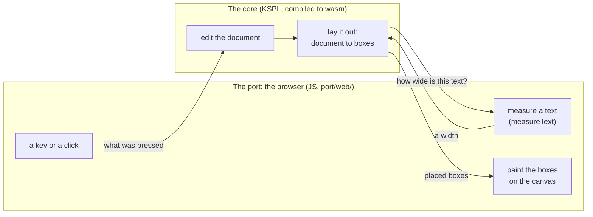
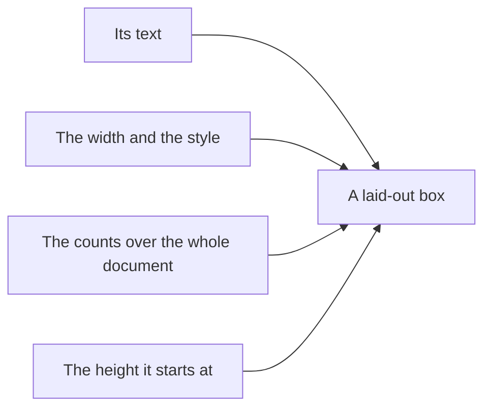

# The grounds of kspage's design

This document says why kspage has the shape it has as a whole: each decision, its reasons, and what it gives up. The other design documents cover these parts:

* the document itself (its model, layout and editing): [`DESIGN-document.md`](DESIGN-document.md);
* its tables: [`DESIGN-tables.md`](DESIGN-tables.md);
* its slides and pages: [`DESIGN-slides.md`](DESIGN-slides.md);
* what kspage does around it (saving and opening, windows, other formats, trust, and what the screen says): [`DESIGN-application.md`](DESIGN-application.md).

What is there, and how to use it, is in [kspage](../README.md).

**How a section reads**: it opens with the decision in plain words. Then come the details, the reasons, and the traps. Terms used without stopping are in "Words used in this document" below.

## Words used in this document

kspage's own types (`Doc`, `Block`, `Inline`, `Style`, `Page`, `Box`, `Caret`, `Editor`) are introduced in [kspage's "The terms and the types behind them"](../README.md#the-terms-and-the-types-behind-them). The table below explains the other words of kspage this document uses without stopping. The words every package shares (arena, Principle N and the rest) are in "Words used throughout" in [`docs/DESIGN-principles.md`](../../docs/DESIGN-principles.md#words-used-throughout). Some words have one fixed meaning in every document, such as *gate*. They are in "Terms of art" in [`docs/SPEC-documents.md`](../../docs/SPEC-documents.md#terms-of-art).

| Word | What it means here |
| :-- | :-- |
| **the core** | The part of kspage that holds the document, lays it out, edits it, solves its formulas and saves it. It is written in KSPL and knows nothing about a screen |
| **the port** | The thin part that connects the core to one screen. The one port is the browser's (`port/web/`) |
| **wasm** | WebAssembly: a compact program format a browser runs. The core is compiled to one wasm module, and the page's JavaScript (JS) calls into it |
| **canvas** | An HTML element that is a plain surface to paint on. kspage paints the whole body onto it itself |
| **DOM** | The browser's tree of page elements (buttons, menus, text). The tools are DOM; the body is not |
| **IME** | Input method editor: the OS tool that turns key presses into Japanese or Chinese characters. While the person is still choosing characters, the text is *being composed*; choosing ends it (the text is *committed*) |
| **block** | A paragraph, a heading, a list item, a table, a row, a cell or a slide. All are one type (`Block`); only the style differs. This is kspage's own word, not the block of source text that "Terms of art" names |
| **run** | A stretch of text inside a block with one style (`Inline`). Making one word of a paragraph bold splits its run into three |
| **style** | A named set of looks (typeface, size, colour, spacing) and an arrangement. Blocks and runs point at a style by its name |
| **arrangement** | How a block's children are placed. It is *flow* (prose that wraps into lines) or a *grid* (a table's rows and columns). Or it is *absolute coordinates* (a slide, where each child has its own x and y) |
| **frame** | A child placed on a slide at a position and size of its own |
| **layout** | Turning the document into placed boxes: which text goes on which line, at what x and y. It runs again at every keystroke |
| **box** | One piece of laid-out text, or a list marker, with its position and size. Drawing paints boxes |
| **band** | A rectangle layout leaves for a fill (background), a rule (border line) or a shape |
| **pen** | Layout's running state while it fills lines: where the next box goes, the current right edge, and the paragraph's settings |
| **entry point** | A function another part calls into, such as a function JS calls in the wasm |
| **hit-testing** | Working out which character a click landed on |
| **the reckoning** | Solving every formula in the document to a value |
| **the undo record** | The list of steps that undo and redo walk through |

## What it is aimed at

**kspage is one editing system for documents, spreadsheets and presentations.** It serves all three uses in one document, with nothing to set up first.

**Word, Excel and PowerPoint are where a feature starts, not a list to match.** A feature begins from how those three do it, since that is what people already know. The screen's words follow them too ("The wording on the screen" in [`DESIGN-application.md`](DESIGN-application.md)). Whether kspage has the feature at all is decided one feature at a time, on review. It is added where the three uses need it. It is dropped where its cost outweighs what it gives, so that the whole stays simple. Being a complete replacement for the three is not the aim.

**So a feature the three have and kspage lacks is not by that alone a fault.** It is either a gap still to fill or a feature left out on purpose, and the two are kept apart. Two lists keep them in view:

| The list | Where it is |
| :-- | :-- |
| What kspage cannot do | the manual's last chapter ([`content/manual.kspage`](../content/manual.kspage)) |
| What is decided never to change | ["Accepted limits"](#accepted-limits-what-is-decided-not-to-change) below |

A feature dropped on review moves to the second list with its reason. An aim written without its gaps makes a reader trust what is not there.

## Why the three can be made one

A document, a spreadsheet and a slide deck hold the same kind of data. **They differ only in how their data is arranged, not in its shape**, so kspage writes everything but the arranging once.

In all three, the data is styled text inside boxes. Only the placing differs:

| The view | How its content is placed (the arrangement) |
| :-- | :-- |
| A document | flow: text runs into lines, and lines into pages |
| A spreadsheet | a grid: rows and columns |
| A slide deck | absolute coordinates: each box at its own x and y on the slide |

Built as three programs, everything but the placing would be written three times. **The most costly shared part is text layout and the IME.** Every view needs line breaking, the selection, the cursor and the text being composed. Joining the three adds no work; it removes the tripling.

## Why the folders are split by 'what they know'

Each folder holds one area of knowledge, and the folders stack in levels. A folder can use the levels below it, never one above.

A compiler can be cut by the order of processing: read, check, then generate. **kspage's folders are not split that way.** Layout, editing and export all call one another, so a cut by order would scatter one piece of logic across three places. What can be cut is what each part knows. The levels, from the bottom:

| Level | Folder | What it knows |
| :--: | :-- | :-- |
| 1 | `model` | the document and the styles |
| 2 | `expr` | a cell's formula and its value |
| 3 | `lay` | layout |
| 4 | `share` | the external formats (the saved text, plain text, Markdown) |
| 5 | `write` | editing |
| 6 | `port/` | the screen |

None imports anything above it.

**The folders make the levels a constraint, not just names.** Two files in different folders that import each other are a compile error ([`docs/SPEC-programming-language.md`](../../docs/SPEC-programming-language.md)'s "9.4 Circular imports and visibility"). One flat folder would not give that. The compiler does not catch every upward import, though: one that closes no cycle (`expr` -> `share`) builds with zero diagnostics. So `make test-conventions` checks the order.

**Do not split a cycle inside one level.** In `lay/`, `flow` calls the three arrangements and the line building, and each of them calls back into `flow` (layout always enters through flow). Moved into another folder, that cycle would cross folders and would not build. So a cycle decides where a folder's boundary goes.

The day (date) type lives in `model/`, because a style's number format (`Number_spec`) holds a day's text. Placed in `expr/`, it would make `model` depend on a level above it.

**Do not give a file the name of its folder** (no `calc/calc.kspl`). The folder says what it knows; the file says its subject within that.

## What it does not hold

Some features of other office suites are left out on purpose. **For each item below, the decision is "none"**, and adding one needs grounds that overturn the reason given.

How kspage feels to use is based on the existing office suites, but they are not copied wholesale.

| What is left out | What that means | Why |
| :-- | :-- | :-- |
| **Typed text is never changed automatically** | no curly quotes, no capital at the start of a sentence, no automatic bullets | Once the changed text becomes the real text, the way back to what was typed is gone |
| **A cell's type is not guessed from its text** | nothing turns "1/2" into a date or drops a leading 0; the style says the type (`Number_spec.dated`) | A guess is invisible where it is right and visible only where it is wrong. Whoever changes the document then starts from "why is this one cell different?" |
| **No procedure runs inside the document** | no macro | Opening a document would mean running it, and merely reading a document someone sent would touch the machine. To repeat a fixed routine, write KSPL code that edits the document (the core is a library) |
| **Another document is not embedded** | as with a picture, only where it came from is held | Embedding would need an arena and a reader for each kind of document |
| **A circular formula is not iterated to a solution** | a cycle is reported and stopped | The answer would change with the number of rounds, so the same document would look different at every opening |
| **There is one way to point at a cell** (`A1`) | no other notation gives the row and column as numbers | If one cell could be written two ways, whatever reads formulas would have to handle both |
| **It does not compete on the number of functions** | only what cannot be written with what exists is added | A function for a formula that can already be written makes two ways of saying one thing |
| **No key repeats the last command** | a command is run again from its own button, menu row or key | A repeat key keeps a second record of commands beside the undo record, for a press the command's own way already gives (Principle 6) |
| **There is no time axis** | no slide transitions, no moving elements | Below |

**Why there is no time axis.** A slide is a block that holds a place, not a separate type (["How a grid and absolute coordinates are laid out" in [`DESIGN-document.md`](DESIGN-document.md)](DESIGN-document.md#how-a-grid-and-absolute-coordinates-are-laid-out)). A time axis would put into the document what cannot be carried into the printed page, the exported Markdown or a diff. Paper cannot say "this paragraph appears 0.4 seconds later". Nor can an effect live on the screen alone. An effect that cannot be written into the document is lost on saving, so what was written would silently disappear. kspage's worth is being writable as one document, not winning as a presentation program.

Note: **An order can be held**, since on the page it flattens to everything shown. See ["Showing frames in turn is an order, not a timeline" in [`DESIGN-slides.md`](DESIGN-slides.md)](DESIGN-slides.md#showing-frames-in-turn-is-an-order-not-a-timeline).

## The body is not available to a screen reader

A screen reader cannot read kspage's body text aloud, and this will not change. **kspage has no way to hand the body to a screen reader or a braille display.** This is not "not yet": it is the largest price of drawing the body onto a canvas, and it is accepted.

A *screen reader* reads a page aloud, or out to a braille display, for a person who cannot see the screen. **To a screen reader, the body is one picture**: assistive technology reads only the DOM, never inside a canvas. The only way to hand the body over would be a second copy of the text in the DOM, never shown on screen.

**The reason is not the cost but the harm.** A second copy must be kept in reading order, carry the cursor and the selection, and follow every edit.

Caution: **The day that copy drifts, the screen reader does not go silent; it goes on reading an old body.** Nobody can read inside the canvas, so there is no way to check from outside that the copy has drifted. Silence as a picture is better than the wrong text read aloud.

**Whatever can be handed over without a copy of the body is handed over.** The test is "does it also help someone reading with their eyes"; something built for the screen reader alone has no place here.

| Where it is handed over | What happens without it |
| :-- | :-- |
| The page's declared language ([`port/web/page.html`](../port/web/page.html)'s `lang`) | Japanese and Chinese **write the same character in different shapes**, so some environments draw Japanese prose in a Chinese typeface. It is also how a screen reader picks a voice |
| The tab title follows the document's name ([`port/web/side.js`](../port/web/side.js)'s `showPlace`) | Different documents can be open in different windows, yet **every tab shows the same name**. The tab title is the only handle for finding a window folded away |
| The body's canvas says what it is and **that its content cannot be read** | An unnamed canvas is announced as "an empty picture", so **the reason it cannot be read appears nowhere** |
| The tools (the ribbon, the menus, the panels, the status bar) | (They are DOM already, and carry their role and name) |

So the manual's "what it cannot do" chapter states **that the body cannot be read and that this will not change** ([`content/manual.kspage`](../content/manual.kspage)).

**There is no field for a picture's alternative text either** (the description a screen reader says in place of a picture). It would reach nobody, so it would be decoration only the writer sees (Principle 5).

## The core and the port

The core lays out and edits; the port measures text and draws, for one target: the browser. These sections say why the line between the two runs where it does.

On one keystroke, the browser hands the key to the core. The core edits the document and lays it out, asking the browser only how wide a piece of text is. The browser then paints the boxes it gets back:

### Why a browser's layout is not borrowed

The browser does not lay out kspage's body with HTML and CSS. kspage paints the body onto a canvas itself, so that the chain from an edit to the screen stays short.

When an office suite in a browser feels slower than a desktop one, the causes, heaviest first, are:

| Order | What is happening |
| :--: | :-- |
| 1 | **The chain from layout to drawing is long.** Every character typed rewrites the DOM, and the browser's own layout, style resolution and compositing run. The larger the document, the longer each round trip. |
| 2 | **Garbage-collection pauses are uneven.** JS frees unused memory by itself, and the collector decides at run time how long it stops. Steady work such as typing stutters inside a pause. |
| 3 | **There is much to load and interpret at start-up** before the first screen appears. |
| 4 | The network. |

**The network is not the main cause.** Editing happens entirely on the machine. Only saving and editing together make a round trip, and a faster network changes neither 1 nor 2.

**The DOM and CSS are designed for web pages**, not for pagination (splitting into pages), footnotes or strict line breaking. Built on them, kspage's own pagination would pile on top of the browser's layout, and the chain in 1 would get no shorter. Painting onto a canvas itself, kspage controls the whole chain from the edit to the screen.

**The price is large**: line breaking, the selection, the cursor, the IME and hit-testing a click are all written in-house. The choice holds because the three views share them all.

### Why the core is a pure function

Layout takes the document and returns boxes, and touches nothing else. It needs no window, so it can be tested without one.

A *pure function* returns the same output for the same input and changes nothing outside itself. Layout is `(the prose, the styles, the font's measurements) -> a row of placed boxes`. It needs neither a window nor a canvas. From outside, it needs only font measurement, received as a struct of function-typed fields ([`model/font.kspl`](../model/font.kspl)'s `Font_source`): the caller fills each field with a function.

| What this gives | How |
| :-- | :-- |
| **It can be tested before a window exists.** | A table of fixed measurements ([`model/fixed_font.kspl`](../model/fixed_font.kspl)) can be plugged in, so no real font or OS is needed, and the answer is the same every time |
| **Where it draws can be chosen later.** | A thin layer encloses the difference between a canvas and a native window |

**Font measurement has two entry points: a line's width and its height** (`Font_source`'s `measure_width` and `vmetrics_of`, the vertical metrics). Pass them an already resolved `Font` (the final typeface, size and weight), so they depend on nothing of how a style holds things. Tied to the styles, they could not be defined until the document model was fixed, and without them layout could not be tested. Neither rasterizing (turning letters into pixels) nor shaping (choosing each letter's form and position) is held. The canvas uses the browser's own shaping. So the two entry points do not grow when a drawing target is added.

JS passes the width and takes the boxes back. It holds neither line breaking, nor inheritance (a style taking unset values from its parent), nor how the cursor advances. The wasm side does the tables' calculation too, and **it runs before the layout**. It changes the cells' text, so run afterwards, the boxes would point at the old text.

**Everything is bound into one file.** The server and desktop opener distribute one page asset, including its wasm and scripts.

### Why the browser is the main target

**Connecting to each OS's input method (IME) is most of the work of porting.** **A browser gives it for free, so the browser comes first.** Each OS designs its native IME differently (Windows: IMM32 / TSF; Linux: IBus / Fcitx; macOS: `NSTextInputClient`). In a browser, three composition events (start / update / end) are enough.

Caution: **Handle the three composition events as a set.** With only the update handled, committed text stays marked as still being composed.

**Development can go on under Windows.** The core calls no OS, so day-to-day work needs only the tests. Once the screen matters, it is checked in a browser.

### How drawing is split between the core and the browser

The browser's side does two things and no more. It measures text with `measureText` and returns the measurements, and it draws the laid-out boxes with `fillText` (`port/web/`, whose files are listed in [kspage](../README.md)'s "What is here").

Caution: **Do not bring layout decisions into it.** The thicker it grows, the more must be rewritten to move to a native window.

**The wasm has neither libc nor malloc** (C's standard library and its memory allocator; a browser provides neither). It is built with `--freestanding` (with no standard library) and allocates from a free list (a list of unused pieces) over a static buffer. The C that replaces libc sits with the target that has none ([`port/web/rt.c`](../port/web/rt.c)). Put into ksplc's freestanding runtime instead, it would be defined twice in the builds that also link a real libc.

**The link guarantees that the borrowed entry points have not grown.** An unresolved name not on the allowed list fails the link. With any name allowed, code that pulls in libc still links, and "there is no such function" first shows up in a browser.

### Where memory runs short it refuses rather than crashing

**kspage refuses to open a document that would not fit in its memory, before the open document is touched.** A failed allocation stops the whole wasm, and the screen freezes. Reloading the page then loses unsaved work. So the refusal stands where the text first comes in ([`port/web/inout.kspl`](../port/web/inout.kspl)'s `kspage_web_load_buffer`).

**Derive the cap from the arena** (`port/web/state.kspl`'s `doc_limit`). Written as a number in two places, the refusal and its report get out of step the day the arena is widened. Widening alone changes nothing: four times the arena moves the limit four times further, and past it the page still dies. Whoever widens it first looks at how many instances the wasm gate starts and at the load gate's peak, since both grow with the arena.

**The cap counts blocks, because blocks set the cost of layout.** At the same number of characters, a table costs 40 times as much as prose. The other products all cap by bytes or characters.

**A cap in bytes cannot guard it.** The cost per byte of reading, layout and writing back, measured on paragraphs, does not hold for other shapes; a table's is far higher. Raising the multiple does not help. Fitted to the worst shape, the cap shrinks drastically for everything else and still guarantees nothing. A text can be packed tighter. A table within the cap still freezes the page during layout. Per block, the cost flattens out. It explodes per byte only because packing puts many more blocks into the same bytes. Eight times the columns (1x20 -> 1x160) costs only 8% more. So a cap per block decides what fits (`port/web/state.kspl`).

**The cap per block has two values, by arrangement: 512 B for flow and 2 KiB for a grid.** Each is the arena one block needs to be laid out and written back. Do not make them one. A grid costs five times what flow does. So one number either cuts prose's cap to a fifth or lets a table cross the limit. Kept apart, prose keeps the higher cap. Inside a grid, everything below counts as grid, since the column-width solver's cost applies to rows and cells alike. A style name that does not exist counts as flow, as in layout. So at about the same size the answer differs by shape. Prose of 1,162 KB opens, and a table document of 1,225 KB is refused (a gate holds this pair).

**It refuses at three tiers**, because each looks at something different:

| Tier | Where | What it does |
| :--: | :-- | :-- |
| 1. **The byte sieve** | `kspage_web_load_buffer` | It guarantees nothing. It only turns away a size that plainly cannot fit, before the arena for the text is prepared |
| 2. **The gate on the count of blocks** | `kspage_web_load` / `kspage_web_load_plain_text` | After reading and before the swap, it counts the blocks and refuses when layout and writing back will not fit |
| 3. **The last net** | `panic_hook` -> the JS throws | It catches what passes the gate: reading itself comes before the count of blocks is known |

* **The gate means something only before the swap**: afterwards, the open document is already gone.
* **Send plain text through the same gate.** If only one route is guarded, the page dies the same way through the other.
* **Why the last net is needed**: a packed text can use up the arena within the cap while it is being read. Such a text is a row of `{}`, three bytes per block. A cap fitted to reading's worst case would stop that too. But **it would cut every ordinary document to a quarter, to stop a shape the net already handles.** That is not a fair exchange.

**The net calls a JS entry point that throws.** The wasm holds no code that raises an exception, so only the JS side can throw. A freestanding panic is the error stop of a build with no standard library. It records the reason and stops at `for {}` (`../../std/lang.kspl`), so an unhandled panic freezes the screen. The exception passes through the wasm frames to the catch at the caller (`port/web/kspage.js`'s `ks.cramps`), which every call that lays out or loads goes through. **The net reports only that signal** (its own error class). Any other exception is a fault in the page's code. So it is thrown on to the browser's console after the cleanup. It is never shown as "memory used up", which would send its reader to the wrong cause.

**After a refusal, the half-built arena is freed** (`kspage_web_recover`). Otherwise refusing loses half its point. After the unwinding nothing points at the half-built chunks, so the arena shrinks by that much for good. In the end even saving fails. Keep the reading's arena in a global: a local one is lost in the unwinding, leaving nothing to free it through. Do not touch the document. It is swapped only after reading, so a refused read leaves it unharmed.

**Report "too large" apart from "cannot be read".** The fixes are opposite: change the text, or split the document or widen the memory (`port/web/file.js`'s `whyNotRead`). Do not guess the reason from the size. The cap is not a count of bytes, so the core's reason is passed on unchanged (`port/web/api.js`'s `load` returns the reason, not true or false). The debug log shows the memory left, which its reader most needs just before a failure.

### Whether an entry point takes an arena follows its result

A function that adds to an existing tree uses that tree's arena. A function that returns something new takes an arena as an argument, so the caller chooses how long the result lives.

**"The receiver has an arena, so none need be passed" is not true in general.** An arena argument can choose where the result goes, not where the receiver lives. The two are not always the same arena.

| The entry point | Takes an arena? | Examples | Why |
| :-- | :-- | :-- | :-- |
| **Attaches to the receiver's tree** | No: it uses the receiver's | `Block.add_text`, `Block.add_child` (they allocate in the arena `inlines` / `children` hold); `new_editor(d)` | A caller's choice would allow a tree whose child dies before its parent. An `Editor` lives exactly as long as its document |
| **Returns a fresh result** | Yes, and keeps it | `lay.layout`, `Block.tiles_of` / `fresh_line` / `detach_line` | The caller decides how long the result lives |

**Do not pass `doc.arena` to an entry point that returns a fresh result.** A laid-out page is thrown away at every keystroke, so the web bridge makes a short-lived arena and passes that (`port/web/bridge.kspl`'s `page_arena`). In the document's arena, pages would pile up for as long as the person works.

**Do not decide which case applies by reading the code.** Add a check that fails wherever the arena passed differs from the derivable one, confirm no gate fires it, and only then drop the argument.

## The boundary between the core and the browser

**JS calls the core only through the `#export` functions under `port/web/`, and the core calls JS only through the names [`port/web/imports.txt`](../port/web/imports.txt) lists** (`extern "C"`). The entry points start from the row in [`port/web/bridge.kspl`](../port/web/bridge.kspl) and the files beside it, and the comment above each says what it takes and returns. Both lists are checked, so neither side can quietly call something the other lacks.

**Do not list the entry points on the linking side.** The `#export` in the source decides what is exported, and the generated C marks it so the linker's `--gc-sections` (which drops unused code) keeps it. A hand-kept list silently misses each new entry point, and "there is no such function" shows up only when the button is pressed.

**The wasm links with its stack first and 1 MiB of it** (`--stack-first -z stack-size=1048576` in [`../Makefile`](../Makefile)). Placed after the data, the linker's default, a call too deep ran past the stack's end into the page's own memory, the arenas included. Nothing trapped. A document nested a few hundred deep "loaded" and showed the startup sample instead, or damaged what was open. First, running past the end leaves the memory and traps. The C runtime also tells std where the stack ends (from the linker's `__stack_low`). So a walk on deep input stops 64 KiB short of it (`std/stack_limit`) rather than trap.

**`make test-kspage-wasm` checks that nothing else is exported**: only `kspage_web_*`, the `memory` and `__heap_base` the linker adds, and `memcmp`, which a target with no libc needs. `make test-conventions` checks that the two sides agree, matching the source's `#export` against the entry points JS calls by name.

Caution: **Both directions break silently.** JS calling an entry point the source lacks still links, and fails only when pressed. An entry point nobody calls stays, holding the boundary wide (Principle 5).

**Some entry points ask which cell, holder or line edge the cursor is in. Each of them is called after layout**, since none of that is known before. Outside a table or holder it returns 0 and leaves the key to the caller.

**How text and numbers are passed:**

| What crosses | How |
| :-- | :-- |
| Text passed in (a `len` argument) | It is first written into the typing arena (`kspage_web_input_buffer()`), unless the entry point's comment names the loading arena |
| Text passed out (an entry point that "writes out") | It goes into the one out arena (`kspage_web_out_ptr()`), which the next write clears; the entry point returns its length |
| Several numbers (`out`) | Each `out` receives the numbers listed in that entry point's comment under `port/web/` |
| A refusal | **An entry point can refuse for more than one reason. Then it returns the reason as a number its comment lists** (per `Sort_end`, `Merge_end` and the like). The page words it |

### Values that cross the boundary

Numbers pass through one arena the wasm hands out, and text passes as a place and a length. JS must make a fresh view of the wasm's memory at every read, because the memory moves when it grows.

**Ask the wasm side for the arena the numbers pass through** (`kspage_web_nums()`). Memory borrowed below `__heap_base` is C's stack. A deep call writes to the same place, so the numbers written out vanish inside the entry point that wrote them. The arena's width, `kspage_web_nums_cap()`, fits the entry point that writes the most (a box's 15). Keep one reader (`kspage.js`'s `ks.nums(n)`).

Caution: **Do not hold the width on the JS side.** With a view made in each place, the day the arena is narrowed a view silently reads its neighbour. With one reader, checking that the numbers fit is one place too.

**No slice crosses the boundary** ("11.1 Types that cannot cross the C boundary" in [`docs/SPEC-programming-language.md`](../../docs/SPEC-programming-language.md)): the pointer and the length are passed separately. Nor can a struct be returned, so several values are returned through a place passed in for them.

**The wasm's memory becomes a different `ArrayBuffer` when it grows** (an `ArrayBuffer` is JS's handle on a block of raw bytes). Do not keep a `Uint8Array` (a byte view of that block) on the JS side; make one at each read.

**For text written out, take the length before the place**: if memory grows during the write, the place moves. Passed as two arguments of one call, the place is fixed first, since JS evaluates from the left. Reading is the same: make the view only after taking the arena. If the memory grows there, an array made earlier still points at the old `ArrayBuffer`.

### Keys, focus and menus

The page takes the keys the browser would otherwise act on wrongly, and leaves the keys of composing to the IME. Keys arrive through a hidden input field, which must keep the focus.

The body is a canvas, so keys go to a hidden input field over the cursor.

Caution: **Do not take the keys of composing.** A `keydown` while `isComposing` belongs to the IME, and taking it stops the composing.

What the page does take from the browser, and why:

| Key or event | Taken? | Why |
| :-- | :-- | :-- |
| The undo key | **Yes** | Otherwise the hidden input field runs its own undo: the field's text goes back and the body does not |
| Copy, cut, paste | **Yes, on the `copy` / `cut` / `paste` events**, which carry `clipboardData` | The hidden field is empty, so by default a copy takes nothing that can be pasted. A paste goes into the field and never reaches the body |
| Ctrl+F, Ctrl+S, Home, End, Ctrl+A | **Yes** | The body is inside the canvas, so the browser's own versions act on the page instead (below) |
| Tab outside a table | **No** | Taken, it would hold the keyboard inside the body. Focus moves to the next field, and no tab character goes in |

**JS puts in the undo separator** after a pause in typing (`kspage_web_break_undo_group()`). Without it, one undo takes back everything typed.

**Copy, cut and paste are not taken on the key side.** The key starts the browser's own copy, and taking the key stops that event from arriving. A paste's `input` has `data` null (the text is in `clipboardData`) and does not arrive as a keypress. With nothing selected a copy is not taken, so copying text from outside the page is not blocked.

**What the browser's own versions would do**: its search finds nothing (search looks broken). Its "save page" downloads this HTML, not the document. Home and End scroll the whole window, and Ctrl+A selects the whole page while the cursor stays put.

**A button and the formula field both take the focus.** Return it to the input field afterwards, or typing stops working.

**Do not rewrite the formula field while it is being typed in**: refilled on every redraw, it loses what was typed. It is applied on Enter alone. Applied when the focus leaves, a press elsewhere would change the text.

**Open one menu at a time.** Close the others before opening. `toggle` arrives afterwards, so closing there leaves a moment with two open, and the one meant to be pressed hides behind. Close a menu once a command is pressed (left open, it covers the canvas). Do not close it in a field where a number or a name is typed (the typing could never be finished).

### What composed input needs

The IME works only on a real, visible text field placed at the cursor. So the hidden input field must keep the focus, keep its size, and follow the cursor.

| Rule | What goes wrong otherwise |
| :-- | :-- |
| **Do not put the focus on the canvas.** Only the hidden input field takes the keys | The canvas is not an editing element, so with the focus there the IME does not start |
| **Do not hide the input field with `opacity: 0` or `visibility: hidden`.** Make only its colour transparent and keep its size | On an invisible element, composing sometimes does not begin |
| **Keep the input field over the cursor**, moving it at every layout | The IME's candidate window (the list of characters to choose from) appears away from the text |

Note: `make test-kspage-served` checks these three in a real browser, but **not that real composing works**: a headless browser has no input method. To confirm composing, open the page by hand and type.

### Drawing on the canvas

The page's side paints the boxes and bands layout produced, in a fixed order, and adds only what belongs to the editing screen. Each rule below keeps what is painted the same on screen, on paper and in export.

**Only the editing screen draws a region's frame** (the dotted outline of a prose, table or slide region). Printing and presenting go through what draws boxes too, so a frame drawn there would appear on the page.

**When printing, paint the background white and set the text colour to black** (a colour a style sets is kept). The screen's colours follow light and dark mode, so a dark screen's white text would not show on paper.

**Pictures are read and drawn by the page's side.** Read each source once (otherwise every redraw fetches it). Redraw once it has loaded: loading is asynchronous, and drawing without waiting leaves a blank. Until then, draw the frame alone (drawing nothing makes the inserted picture look lost).

**The cursor is a layer of its own over the canvas**, so a blink repaints no document. The cursor shows on neither a printed page nor a thumbnail. The window scrolls to it only when it leaves the view. Scrolling every time would pull back, at every keystroke, a window moved to read.

**Only a press with Ctrl (⌘) held follows a link**, since on the editing screen a press on text places the cursor. Do not move the cursor when following it (the person could not go on typing on return). A link looks like one because of its decorating style, so drawing needs no special case.

**Draw the page's header and footer after cropping**: they sit in the margins, outside the frame that crops the contents. Their coordinates are from the page's top left, so do not shift them again (with the margin added again, they land off the page). Lay them out again for every page, since the numbers change.

**Draw underline and strikethrough after the text, in the text's colour**; drawn first, the text covers them. Their thickness follows the font size (a fixed 1px looks like a hair at large sizes). The composing underline sits at the box's bottom edge. So it reads as a different line from the style's underline, which is below the baseline (the line the letters sit on).

Caution: **Set the colour again for every box.** Left overwritten, the caller's colour carries on to whatever is drawn next.

**Draw a box with no colour set in the caller's colour** (which follows light and dark mode). Paint the background before the text, or it covers the text.

**The painting order**, back to front:

| Order | What | Why in this place |
| :--: | :-- | :-- |
| 1 | All the band fills | Painted one band at a time, a neighbouring cell's fill covers this cell's line, and the table's grid goes missing in places |
| 2 | All the bands' lines | After every fill, so no fill covers a line |
| 3 | The boxes (text) and the selection | Bands painted after them would cover both |

**Unlike a region's frame, a band is document content**: it appears in print and when presenting, so draw it where boxes are drawn. A line straddles its path, half on each side, so move it inward by half its thickness, or it spills into the neighbouring cell.

### The page's scripts share one scope

**All the page's JS files run as one script, concatenated into one `<script>`** ([`port/web/bundle.kspl`](../port/web/bundle.kspl) binds it, in the order [`port/web/page.html`](../port/web/page.html) names). So two files must never declare the same name, and they share only two named objects.

Caution: **Do not declare one name with `let` / `const` / `class` in two files.** The whole block is then never evaluated. Each file passes alone, and nothing happens on the screen. `make test-js-syntax` checks each file and the concatenation, but only their syntax, so a mistyped name gets through.

**The script files share only two objects, `ks` and `ui`**: `kspage.js` makes `ks` where it starts the wasm, and `page.js` makes `ui` for the page's frame. `make test-conventions` checks that every field read from either is one some file puts there, and that every field put there is read. So a mistyped read and an entry point nobody calls are both caught. Do not expose a field that only its own file uses; keep it out of the `return`.

Two other shared objects are not checked this way:

* `kf`: through it, [`port/web/file.js`](../port/web/file.js) and [`port/web/save.js`](../port/web/save.js) pass entry points both ways.
* `ks.api`: it faces callers outside the page, so a field there that no file reads is no defect.

## How the page is checked

The built page is checked in two folders of tests. Each test section works on a document of its own, and a round of tests that is cut short still says how far it got.

kspage's checks on the built page live in `kspage/tests/wasm/` and `kspage/tests/browser/`.

### Each browser-check section has its own document

Caution: **A check on the page must not count on the document shown at startup.** **It must not share a document with another section either.** The startup document is the product's sample ([`content/sample.kspl`](../content/sample.kspl)), and it changes whenever what is to be shown changes. If a test counts on it, fixing one paragraph of it fails that test. The test cannot say whether the rule broke or the sample changed. Moving one heading fails cases in both folders. A shared document breaks the same way: a paragraph added for section A moves section B's measurements.

**How a folder keeps its sections apart depends on whether each can have a document of its own:**

| Folder | What it holds | How it keeps them apart |
| :-- | :-- | :-- |
| `kspage/tests/wasm/` | `make test-wasm`'s per-section code; `kspage/tests/wasm/shell.mjs` hands the entry points over and assembles the documents | **Each section declares its own document** with `opens`. The driver reads it before passing it on, so **a forgotten declaration fails the run**. A rule merely written down is not kept |
| `kspage/tests/browser/` | `make test-served`, run on the assembled page in a real browser; `kspage/tests/browser/probe.js` runs the sections in the order of `KSPAGE_PROBE` in [`Makefile`](../Makefile) | The sections share one page, and **those holding asynchrony overlap**, so the document cannot be swapped. They **search for the place to press and to peek** instead (`findBlock` / `findCell` in `kspage/tests/browser/probe.js`) |

### A cut-off test round says how far it got

**A cut-off browser run reports its last completed check.** The page writes progress through the server and to the browser console. The runner has an external deadline and reads console output if no progress file arrives.

### A check starts when the page says it is ready

**The browser checks begin only once the page itself says its start-up is done.** It says so through one promise, `window.kspageReady` ([`port/web/page.js`](../port/web/page.js)), however long that takes. It resolves once the core runs, the local server has been asked and the document the page comes up on is in. It rejects with the reason where the start failed. The page then shows that reason in the status bar, so a person is not left before a blank page. Every waiter takes this promise, and none looks for `window.kspage` on a timer.

**Asynchronous work is awaited directly.** Wasm compilation and IndexedDB run outside the page's thread; a fixed delay cannot prove either has completed. The runner caps real elapsed time outside the browser.

**The reload check waits for the tab's path to be stored before navigating.** Showing the document does not mean that its IndexedDB write has finished. Reloading earlier can cancel that write and leave no path to reopen.

**Every round starts late on purpose** (`kspage/tests/browser/late.js`). Before the page's start goes on, the wasm is compiled again off the page's thread a number of times. A wait counted on the clock then fails every round, not only on a busy machine.

## Accepted limits (what is decided not to change)

This chapter keeps the known shortcomings **judged not worth their cost**, each with its grounds. Keep them rather than deleting them; without the grounds, the same point keeps coming back as "something nobody has got round to".

**It is not the list of what is still missing.** That is the manual's last chapter ([`content/manual.kspage`](../content/manual.kspage)). It also carries every item here that a user can see. Left out, an item would make a user hunt for it as their own mistake. Do not write the same sentence in both. The manual says what cannot be done, and this chapter says why it is decided not to change.

### Accepted limit 1: one typed character lays the whole document out

Every keystroke, and every cursor move, recomputes the position of everything in the document. This is fast enough for every document kspage can open, and making it incremental would risk showing a stale screen, so it stays.

**How it stands.** The calls that cross the boundary to the browser do not grow with the document. Two sections of [`DESIGN-document.md`](DESIGN-document.md) say why:

* "Text that has not changed is not measured again"
* "A style is looked up by name once"

But what is walked is the whole document (`layout` in `lay/flow.kspl`). Retyping one paragraph takes time in proportion to the document's size.

**The cost of one relayout.** It is measured on 3,000 paragraphs of an unchanged document under native `ksplc run`, an unoptimised build. So absolute values run about 2.5 times wasm's; what counts is the ratios. The cost is a fixed amount per paragraph plus a fixed amount per box, nearly constant whatever the shape. The paragraph share stays in the low hundreds of nanoseconds, and the box share adds about as much again. The gathering done beforehand (headings, notes, running numbers, charts, references) is no hotspot either. Stopping it saves only a small fraction of the fixed cost. So making one place faster does not help: both shares grow with how much is walked.

**A relayout that changed nothing costs the same**, so merely moving the cursor costs as much as typing. Moving the cursor, finding the place pressed, selecting and rereading the theme each lay the whole document out again. They are as frequent as keystrokes, so this limit cannot be weighed by typing alone.

**Four reasons for giving up:**

| Reason | Detail |
| :-- | :-- |
| **No document can make it too slow** | The heaviest document that can be opened takes about a third of the 16.7ms budget of one frame at 60 frames per second. What is hit first is **the size cap**. There the document is refused rather than the page crashing (see "Where memory runs short it refuses rather than crashing" above) |
| **No hotspot can be pulled out on its own** | (the breakdown above) so nothing but narrowing what is walked can speed it up |
| **Narrowing it means changing the model's invariants** | It needs "from where it changed", and guessing that from the text's contents does not work (a length or a fingerprint misses `ab` → `ba`). A version number per block drops nothing. But it cannot be made complete with `Block` as it stands. Its fields are all `pub`, and rewriting also happens outside `write/`. Nor is the part before the change safe. The table of contents, the footnote list, a chart or a reference from the body can stand earlier. Then the part before the change has to be laid out whole again |
| **Its way of failing is the worst of all** | A version number not raised "breaks quietly while staying fast", showing an old state. Putting it in first needs a check that relayout gives the same result as a whole layout ([`tests/columns_test.kspl`](../tests/columns_test.kspl)) |

**What a narrower reach would stand on is there already.** The layout is a row of boxes piled fresh onto the arena, not a tree rewritten in place. So nothing is marked, and forgetting to mark a change cannot break it, whereas other editors lay out again from what they mark as changed. A box comes from only four inputs:

Where the four are the same, the box is the same to the byte. So once a changed paragraph keeps its height, nothing below needs laying out again.

**Narrowing is worth something only once the arena itself is wider.** The size cap, not the speed, is what a document meets first.

**Do not add a risky cache.** Showing an old state is the worst breakage an editor can have. The rewind that exists (`Placed` / `rewind` in `lay/flow.kspl`) serves trial layouts partway through a layout, not reuse across keystrokes.

### Accepted limit 2: another document cannot be shown inside one window

One window cannot show two documents side by side. Open a second window instead.

**How it stands.** What it would take lies in the page, not the core. The core can be started twice from the same bytes (`kspageBoot` in [`port/web/kspage.js`](../port/web/kspage.js)). What stands in the way is the tools reaching the DOM by id. There are hundreds of `getElementById` calls, of ids and of calls to `app`, and the parts wired to `ui`.

**Two reasons for giving up:**

* **A second pane that takes typing is large.** Every lookup by id would have to ask which pane is current, or the ids would be kept in two sets. Every part wired to `ui` would be touched.
* **A second read-only pane is small, but buys almost nothing.** Another document already opens in another window (from a link inside a document, or with `?doc=` when the server serves the page). There the size, the arrangement and a second screen are all real. Another place in the same document opens the same way ("Another place in one document is seen in another window" in [`DESIGN-application.md`](DESIGN-application.md)). With that means already there, a second goes against Principle 6.

### Accepted limit 3: a document cannot be written out as HTML

A document goes out as a printed page (PDF), as Markdown, or a table as CSV; there is no HTML export.

**Why there is none.** An HTML export is a second rendering of the document with rules the screen does not use. Styles become CSS classes and rules, a line's leading is scaled to CSS's measure, and a stylesheet needs escaping. It would carry its own tests and checks. The layout could still differ, since the browser breaks the lines. Printing already gives a page that looks as the screen does, and the Markdown export keeps a document beside the code.

### Accepted limit 4: a `.md` file is not read as Markdown

A `.md` opens as plain text, one line a paragraph, and saves back byte for byte ("A `.md` opens as plain text" in [`DESIGN-application.md`](DESIGN-application.md)). It is not turned into headings, lists and tables.

**Why it is not.** Reading Markdown into styled blocks needs a reader and a table of looks handed to it. It also needs a check that real files survive the trip there and back. It would promise only that the text settled, not that it stayed as typed. Every code host and editor already shows Markdown rendered.

## Further reading

* [kspage](../README.md) — what is here, and the smallest example.
* [`../../docs/DESIGN-principles.md`](../../docs/DESIGN-principles.md) — the Development Principles that apply to all of Kanso, and the grounds of the language design.
* [`../../std/docs/DESIGN-core.md`](../../std/docs/DESIGN-core.md) — the design of the standard library kspage stands on.
