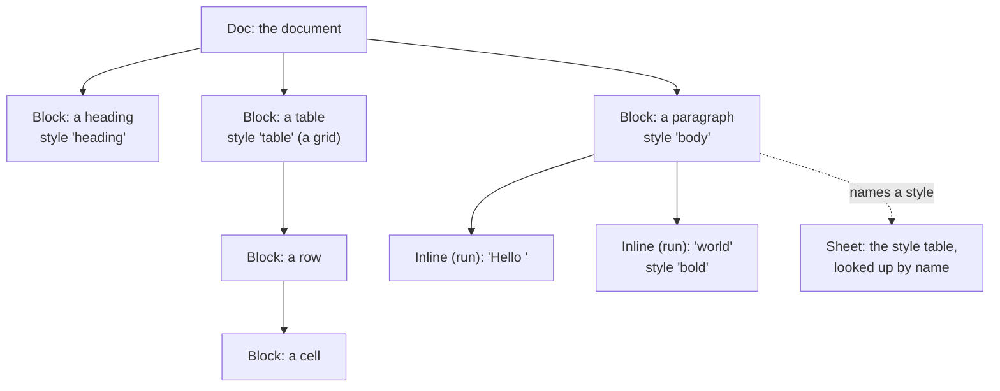
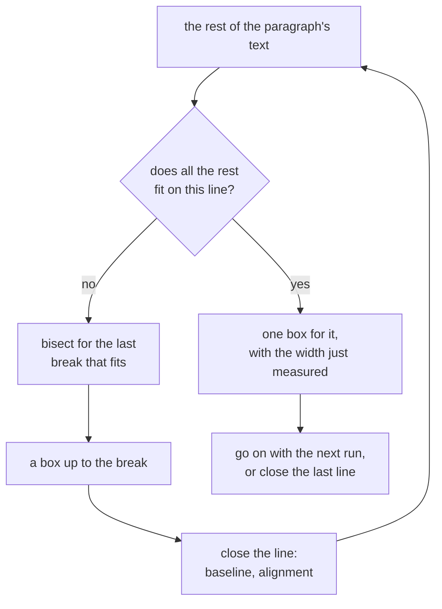
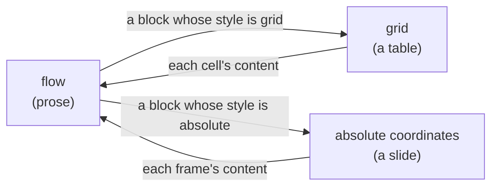
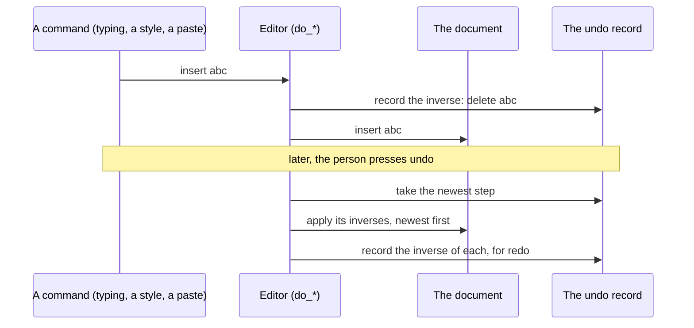
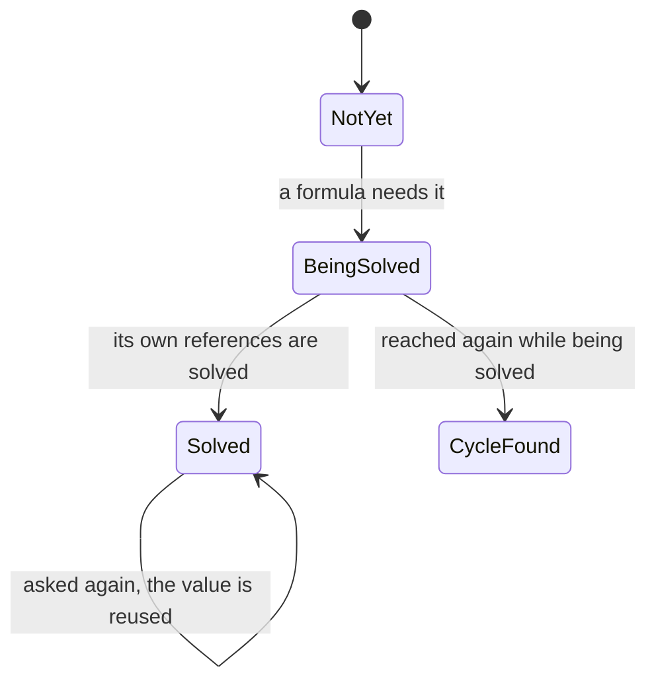
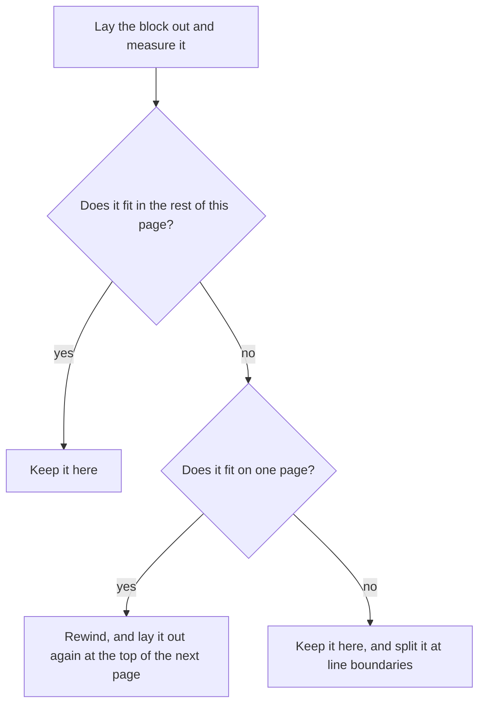

# The grounds of kspage's document

**This document says why kspage's document is shaped as it is**: its model and styles, how it is laid out, how it is edited and undone, its tables and formulas, its slides and its pages. The words it uses without stopping are in "Words used in this document" in [`DESIGN-architecture.md`](DESIGN-architecture.md), and so are the core, the port and the boundary with the browser it leans on.

## The document model

A document is a tree of blocks. Each block holds a row of runs (its own text) and may hold child blocks. A block names its style; the styles live in one table beside the tree.

The tree for a heading, a paragraph with one bold word, and a table looks like this (the style names are examples):

### A block has no field for its kind

A heading, a paragraph and a list item are all blocks; only the style name differs ([`model/doc.kspl`](../model/doc.kspl)).

Caution: **A separate kind field would say the same thing as the style**; each place that draws would pick one of the two, and where they disagreed nothing would decide which is right.

### Unset is expressed with `Option`

Every style field can be "unset", and an unset field takes its parent's value. Unset is an empty `Option` (KSPL's "maybe a value" type), never 0 or an empty string.

Caution: **Do not use 0 or an empty string to mean unset.** No weight is 0, but `false` is a real value for italic, so in some fields the marker would collide with a value.

**The rule covers the fields that inherit and the values a person can type as 0.** A measurement that cannot usefully be 0 keeps 0 as its "not set" mark, and the section on that field says what 0 means:

| Field | What 0 means |
| :-- | :-- |
| a slide's width, the paper's width | the container's width |
| the paper's height | no pagination |
| the body's width | no limit |
| a paragraph's leading (the distance from one line to the next) | the font's own height |
| a rule's width | no rule |

Only the font is inherited. **Space before and after a paragraph, and the indent, are not**; inherited, they would space a child twice over at every level of nesting.

### Only the block holds its position

A frame's position on a slide is stored on the block itself: not in its style, and not in a table beside the document. The same goes for every value that differs from one block to the next.

Of the three arrangements, only absolute coordinates cannot work out where a block goes from the element before it. Every frame's position is its own, so `Block` holds `frame: Rect?` ([`model/doc.kspl`](../model/doc.kspl)).

**Do not put it in the style**: a style is shared by name, and an unshared value would need one style per frame. Nor outside the document: held in a separate table, the positions alone would be lost on saving and reading back.

**Every value that differs from one block to the next is held on the block for the same reason**, though the blocks share a style:

| Field | What it holds |
| :-- | :-- |
| `frame` | a frame's position on its slide |
| `step` | a frame's build step (when it appears as the slide is shown in turn) |
| `size_of` | a table's column widths and row heights |
| `span_rows` / `span_cols` | how far a merged cell spans |
| `name` | the name a formula or a reference points at |

The sections that use each field point here.

**Fields that one arrangement alone reads are the exception to the rule that only the arrangement branches** ("Why the three can be made one" in [`DESIGN-architecture.md`](DESIGN-architecture.md)): `frame` and `step` for absolute coordinates (flow and the grid derive a position from the previous element), and a table's sizes and merges for the grid ([`model/doc.kspl`](../model/doc.kspl)'s `Block`).

### An unknown style name does not stop layout

A style name missing from the table is treated as unset ([`lay/flow.kspl`](../lay/flow.kspl)), so the text takes its parent's look.

Caution: **A misspelt name passes silently.** Check first with `Sheet.find` that a name exists. Failing partway through layout instead would let one typo blank the whole screen.

### Styles are told apart by role, not by name

**To find "the heading style" or "the code style", the core, the page, a theme or a reader looks at what a style does (its role in the table below), never at what it is called**: a document may name its styles anything.

Caution: **Neither the core nor the page may list styles by name and remember them.** A remembered list breaks silently the day a document renames a style: that one style alone keeps the previous theme's colour. What is looked at is the role.

| The role | How it is recognised |
| :-- | :-- |
| A heading | its depth (`outline > 0`) |
| A code block | it does not wrap (`wrap == false`) |
| A table | it is laid out as a grid (`arrange == grid`) |
| A slide | it is laid out at absolute coordinates, and has a size |
| A collecting block (one that gathers entries, such as a table of contents) | its way of collecting (`collect`) |
| A framed block | it has a fill, it draws a line |
| A table's cell | a flowing paragraph with inner space and no marker (`cell_like` in [`model/style.kspl`](../model/style.kspl)) |

Caution: **A theme must cover the styles a person made too.** Chosen by name, those alone would escape it.

**Inserting looks a style up by name, then by role, then makes one by name.** By name alone, it breaks the day the name changes; by role alone, it cannot choose between two of one role. A slide style cannot be made up: the core must not decide a slide's size, so the style has to exist first.

### Asides and annotations are held beside the text, outside the flow

Two kinds of side text stay out of the document's flow. An aside belongs to a slide; an annotation (a remark on some text) belongs to a run.

| | An aside | An annotation |
| :-- | :-- | :-- |
| **Held on** | the slide's block (`Block.aside`) | its run (`Inline.remark` and `Inline.remark_by`) |
| **What it is** | the presenter's note | what somebody said about the text, not part of the document |
| **Who sees it** | the presenter, during the show: no output includes it | it stays out of the flow too |
| **Where it is attached** | only with the cursor inside a slide; the show is the one place a note is read, so on a table, a picture or a paragraph nobody would see it was there | on a range of text |
| **Undo** | it is saved, and one undo removes it | one undo removes both the words and the author |

**An aside a saved text holds on another block is kept as it stands.** The reader takes a block's fields whatever its style, so such an aside is read and written back unchanged, and nothing shows it. Whether a block is a slide is its style's to say, and only layout reads the style; a reader that dropped the field would lose what the text held, and a style changed into a slide's would bring the note back.

**An annotation covers a range**, so splitting the run leaves it on both halves (like a link, unlike a note's mark, which is a point). Runs with different annotations are not joined, or one remark would cover both. The core does not decide who wrote it (it holds no user name); the name comes from outside when it is added.

### A picture: the document holds only its source and size

**The document stores where a picture comes from and how large it is laid out, never the picture's bytes**: in a browser the whole heap is one static block, so the largest document it opens is about 1 MiB (`doc_limit` in `port/web/state.kspl`), which one photograph fills. Reading and drawing it happen outside (the core cannot read a picture). In exchange, the document alone does not carry its pictures.

**The document holds the size too.** The core cannot measure a picture, and an entry point asking outside would make layout depend on how the reading went. With the size in the document, layout is the same whether or not the picture can be read. A picture with only a source is not laid out.

**It is not shrunk to fit**: where it does not fit it overflows (as with a set column width), since shrinking needs the aspect ratio, and knowing it means reading the picture.

**A picture is not split**: its size is known first, so where it does not fit, it moves whole to the next page (like a slide).

## Styles and their fields

A style holds the look and the arrangement, and blocks and runs share it by name. These sections say which field belongs to the style, and how each one acts.

### Applying a style splits a run

Making part of a run bold splits the run at the selection's two ends and gives the middle part another style name. A run never holds a weight or a size of its own.

From the screen, only **the style name** of text can be changed (`Editor.set_style`). Weight and size held on a run directly would step around the styles ("Why the styles are kspage's own, not CSS").

A run has one style, so styling part of a run splits it at the selection's two ends and writes the name on the runs between. **With nothing selected, it applies to the cursor's whole run** (there is nowhere to split). For example, making "world" bold:

| | The runs |
| :-- | :-- |
| Before | `Hello world again` (style `body`) |
| After | `Hello ` (`body`), `world` (`bold`), ` again` (`body`) |

Caution: **Do not split a run that holds a formula.** Its visible text is the computed result, overwritten whole at the next recalculation. Split, the second half would miss the overwrite and keep the old value. A formula run takes the style whole.

**After applying, join neighbouring runs with the same style**, or runs multiply with every apply and remove. Neighbours are joined within their block, so the parents of the styled runs are collected first (a selection crosses blocks).

**After a split or a join, move the cursor with it**; typing into a removed run would put text in the document that appears nowhere on screen.

**A position exactly at a split stays with the earlier run**, which stays in place, so it keeps pointing at the same spot. On the later run, the selection's end would point at a run outside the range, and the applied style could not be read. A join, by contrast, takes the run along, so byte 0 moves as well.

**The selection stays after applying**, so another style can be applied next, or this one removed.

### A paragraph's style is separate from a run's

A paragraph has its own style, which holds the list marker and the arrangement. It is set with `Editor.set_block_style`, apart from the runs' styles.

The line-start marker (a list's `•`) and the arrangement belong to the paragraph's style, so the marker is added and removed here, not on a run. **Deleting the text leaves the marker**: it is not text, so only removing the paragraph's style removes it. An empty name means a plain paragraph.

**A style with another arrangement is not applied**: a table's or a slide's style on a paragraph would not match its content's shape, leaving the text nowhere to go, so the choice is refused and reverts.

**It applies to every paragraph in the selection, and only to paragraphs**: the range a run's style covers, so one selection never lands on two different things. It skips holders (a table, a row, a slide, a picture) and cells: on a cell the grid would go, and on the table the arrangement would turn into flow and the table fall apart. Layout says whether a block is a cell (the document does not say "table"), so the page must be laid out first. However many paragraphs it covers, it is one undo.

### Direct formatting is a style name too

"make just this red" stores no colour on the text. It makes (or reuses) a style whose name spells out the settings, and applies that style.

"Change the colour of just the selection" does not make a run hold a colour.

**Direct formatting reaches only the characters' look.** Alignment, indent, spacing, leading, the mark at a paragraph's head and a page break belong to the style alone. Where a style and direct formatting can set the same thing, changing the style later leaves the directly formatted places as they were. In Word a number applied by hand holds only until the next style is applied; in PowerPoint a slide changed by hand stops following its master (Principle 6).

Caution: **Build a style name from the settings, make sure a style of that name exists, then apply it.** A colour held on a run breaks the same mapping ("Applying a style splits a run"), the keystone of this design.

**The same settings give the same name** (`decoration-cff0000-b00ff00-u1`: text colour ff0000, background 00ff00, underline on). A new name at every apply would grow the styles' table, and the saved text, by one each time. Do not change the order of the fields, or the same settings would give a different name from before.

**Create the style and apply it in the same step**; separate, undoing one operation would take two presses. With nothing set, the name goes back to empty, which removes the direct formatting.

**Bold and italic are applied the same way, but not on the colour's side** (`Ink`): weight and slant change the measurements, which would break "a colour changes neither the width nor the height". They are held as `Accent` and copied into the style's font fields. Either can be "off", so one run can be made plain inside a bold paragraph.

### Changing a style is an edit to the document too

The screen changes **one whole style** at a time (`Editor.set_look`), and the change goes into the undo record like any edit.

**Do not make an entry point per field**: unset is a value in its own right, so field by field, "there was none" and "it was 0" would arrive in the same shape.

Caution: **Keep it and carry it as one whole style.** With copying written per field, a copy missed when a field is added gives no message. It surfaces as "only the colour does not reach the other window", visible in neither the text nor the layout. Copied whole, a new field adds no operation (`style.put_face`).

**The name alone is not changed**: a style is shared by name, so renaming it would strip it from every place it is applied. What is carried is the same text as when the style is added (one style's JSON). With two formats, changing only one would produce text that cannot be read back.

**Changing a style changes every place with its name**: that is sharing by name. To change one run alone, a new name is made and applied. Do not make two styles with the same name: `Sheet.find` returns the first added, so the later one is never used.

A new style sets nothing; it is meant to be applied and then changed.

**Changes to the styles' table go through the undo record too**: the table is saved with the document, so a change that cannot be undone would be a hole (the reason for not changing the document directly).

### A link: the run holds where it points, and the style holds the look

A link's target is stored on the run (`Inline.href`); its look is an ordinary style. Both are set, and removed, in one step.

A link has two parts: where it points, and looking like a link. **Do not hold them in one place**: the target differs run by run, while the look is shared by name. Mixed, the styles' table would grow by one style per target.

So the run holds the target, and the look is applied as a direct-formatting style, **both in one step**. As two, one undo would leave either text that is merely blue or a link with no look. Removing is one step too: the look returns to the parent's with the target.

**Unlike a formula, typing does not drop it**: a formula goes stale when its text changes, but a link's target has nothing to do with its text.

**Neighbouring runs with different targets are not joined**, or two adjacent links would become one target (the same treatment as a style name).

### Colour is inherited with the font but stays out of `Font`

**The text and background colours belong to the style (`Style.ink`) and are inherited like the font, but stay out of `Font`**: `Font` holds only what measuring needs (it is the key for measuring), and a colour changes neither the width nor the height. Mixed in, two fonts differing only in colour would be measured twice. So layout carries a `Look`, the font and the colour bound together, as the inherited value.

**The background is inherited like the text colour.** Otherwise a background set on a paragraph's style would appear nowhere, since boxes exist only where there is text and a paragraph has no box of its own. Only the boxes are painted, like a highlighter (the fill band, below, paints a whole paragraph or cell).

**The highlight goes over the band's fill**: the narrower one on top.

**It can be unset**: unset text is drawn in the screen's default colour, where black would be unreadable on a dark screen. Do not use 0 to mean unset. Black (`#000000`) is a real value, so it is held in `Option`, as italic's `false` is.

**A colour is `0xRRGGBB`, with no transparency**: at 24 bits it crosses the boundary as one number (it fits exactly in an F32, a 32-bit floating-point number). The text form is `#rrggbb`, used alike by the saved file, the exported CSS and the screen's swatch.

**Decide the text colour together with the fill**: the fill (`Style.fill` / `Ink.background`) is a fixed number, but unset text takes the screen's default colour, so deciding only one allows bright text on a bright fill on some screens.

Note: The rule colour has the same problem, and its default black is a dark screen's background. So a line meant to show what was added gets a colour readable on either screen (`write/insert.kspl`'s `drawn_color`).

### Underline and strikethrough sit with the colour

Underline and strikethrough belong to the style (`Ink.underline` / `Ink.strike`) and are inherited with the font. **Do not put them in `Font`**: like a colour, a line changes neither the width nor the height, so it is not part of the measuring key.

**`false` means "draw none"**; if it meant unset, one run inside an underlined paragraph could not have its line removed (as with italic's `false`).

**Write both as one declaration** (`text-decoration-line: underline line-through`); written separately, the later overrides the earlier and only one line appears.

### The fill and the rule are laid as a band, not a box

A paragraph's or a cell's background (the fill) and border (the rule) are painted as one rectangle per block, the band. They come from the style (`Style.fill` / `Style.rule_width` / `Style.rule_color`).

**A box does not stand in for them**: boxes exist only where there is text, so an empty paragraph or cell could not be painted and the rest of a line would stay bare. Layout leaves one band per block (`Panel`).

**The block holds neither rule nor fill; the style does**, and changing it changes every block with that name. Held on a block, they would need a new instruction in both the carried format and the undo record (carrying one whole style already exists, and a new field adds no operation to it).

| The rule | Why |
| :-- | :-- |
| **The band is taken before the content and its shape filled in after** | The height is unknown until the content is laid out. Taken first, it keeps document order, so an inner block's band comes later and lies on top |
| **Its top edge is the top of the laid-out content, not the height when it was taken** | A block crossing a page is laid out and then moved to the next page, making that height stale, and the band would stretch from the old page to the new one |
| **Do not include the space before and after** | Otherwise the gap between paragraphs would be painted too, merging into the neighbour's band |
| **A cell's band is realigned once the row's height is known**, so a band points at its block | Left at content height, the grid would be missing under the shorter cells. Pointing at its block lets each cell's band be found afterwards |
| **Which sides are drawn is not held**: all four are drawn, neighbouring sides overlapping | Removal per side would need a rule for whose setting wins against the neighbouring cell |

The fill can be unset, and a rule is off at width 0 (a rule always has a colour, so it needs no `Option`).

### A shape is the band drawn in another outline

A shape is **the same band with an outline other than a rectangle** (`Style.shape`): an ellipse, a rounded box, a triangle, a diamond, or a line or arrow drawn as the band's diagonal. It is not a separate kind of element: two things would then hold a fill and a rule, doubling up layout and printing.

**The style holds the shape**, as with the frame and the fill, and no value changes it. The style also says which end carries an arrow's head (`_back` is the end it starts from), since the band alone has no direction.

**A shape belongs to the holder where it was clicked**: a slide, a paragraph or a cell alike, as Word and Excel lay one over the body (where it may not go is "How a shape is drawn" below). It holds no text, so it cannot be clicked into; grabbing its frame's corner moves it.

**A band on a frame closes at the frame's height, not the content's**: at absolute coordinates the frame's size is fixed first. Closed at the content's height, a frame with no text (a shape) would be 0 high and vanish.

### Alignment and leading are per paragraph, and take effect when the line is closed

Alignment (left, centre, right, justified) and leading (the line spacing) belong to the paragraph's style, and are not inherited. Alignment is applied once a line is full, by shifting or spreading its boxes.

Alignment belongs to the style (`Style.align`) and **takes effect when the line is closed**, once the remaining space is known: the closed line's boxes shift across together.

Caution: **Do not shift where there is no remaining space.** A wrapped line fills the width, so a negative shift would push characters outside the column.

Neither alignment nor leading is inherited (like the space before and after a paragraph). Inherited, the next paragraph or a child with no style would take the previous paragraph's alignment, and something nobody remembers changing would move.

**It works the same way inside a cell**, whose content flows at the column's width, so right-aligning numbers comes for free.

**Justification spreads a line's remaining space into letter spacing** (`Box.spacing`) without changing the measurement entry points. Letter spacing is space added after each character, which the core can count and add. Passing it to the entry points would grow what every port implements ("font measurement has two entry points" holds).

**Only wrapped lines are stretched** (closing a line is told whether text continues after it). Spread over a paragraph's last line, a few characters would scatter across the whole column.

Caution: **Do not include the last letter space in a box's width.** A box ends where its last character does, and the next box starts one letter space further on. Then, however many boxes a line is split into, its right edge meets the column's, by one rule for every box (width = measured width + (characters − 1) × spacing).

**Hit-testing must add the same spacing** (`caret.width_to`), or the visible character and the click position drift apart along the line. Drawing uses the spacing it is given as is; spread again, it would drift from what layout computed.

The leading is a multiple of the line height (`Style.line_spacing`); 0 means unset and keeps the font's height (like a slide's width). **Apply it to the line height only**; applied to the font size, it would grow the characters when the aim was to space the lines.

**It is relative to one line, not to the font size.** One line is the height the font gives, taller than the font size (about 1.26 times). This is how Word's, Writer's and Docs' "multiple" counts, unlike CSS's `line-height` number (relative to the font size).

Note: So the field's name states the unit (`port/web/menus.html`'s "leading (lines)"). A bare number would be entered with CSS's meaning and open the lines wide.

**Do not add a field with CSS's meaning alongside** (the same thing would be settable two ways).

### The line gap is kspage's own number, since the canvas cannot give it

The canvas cannot tell kspage how much space a typeface wants between lines, so kspage adds its own 0.17em, matched against other editors.

The canvas measures text and nothing more. The leading a typeface recommends is in its OS/2 table (a part of the font file), but a canvas gives only the box above and below the text (`fontBoundingBox*`), so the gap is kspage's own number. **It is set by matching other products**: 0.17em on top of that box matches VS Code's own default almost exactly. Do not raise it: at 0.2em the leading reads as too wide. A style's `line_spacing` multiplies on top of it, so do not make the default wide and tighten it with a style.

### A paragraph that does not wrap keeps the text unchanged

Whether a paragraph wraps belongs to its style too (`Style.wrap`). **Where it is false, what passes the column's width overflows** instead of moving to the next line, as in a code block.

**Wrapping changes the text**: the whitespace after a break is dropped rather than carried to the next line (`lay/line.kspl`'s `skip_spaces`), so code aligned in columns with spaces comes apart where it wraps. Overflowing is better than changing the text: the reader can scroll across, but dropped whitespace cannot be put back.

**This is not inherited either** (like alignment and leading), and it is set on the pen again at the start of every paragraph, or the paragraph after a non-wrapping one would stop wrapping too.

**The monospace comes from the style's font** (`Font_spec.family`). The core has no notion of "code": as `Arrange` sets the arrangement, the style says the look.

### A number format applies only where text is made from a value

Currency, thousands grouping, per cent and decimal places belong to the style (`Style.number`), and apply only to text a formula produced. Text a person typed is never reformatted.

Only [`expr/calc.kspl`](../expr/calc.kspl) reads the number format.

Caution: **Plain typed text is not reformatted**, only a formula cell and a formula in the body, where the core makes text from a value. Formatting plain text would turn the characters being typed into a number partway through.

So "type 1200 and see 1,200" first needs **a cell to hold a value separately from its visible text**.

| The rule | Why |
| :-- | :-- |
| **It is not inherited** (like the arrangement): only the text's own style is used | Otherwise a currency set on the table's style would make the headings and notes currency too |
| **Error text is not formatted** | `#VALUE!` with a currency symbol would read like a value |
| The sign comes before the symbol (`-$1,200`) | After it, a negative value would look like a subtraction |

## Why the styles are kspage's own, not CSS

kspage's styles are its own, not CSS. **With a layout of its own, kspage would have to implement CSS again** to give borrowed styles their meaning.

**A block and a run name their style; neither holds a size or a weight.** A document is a tree of blocks, a row of runs inside each, and styles referenced by name. So changing a style changes every block that names it, and what reads the document (the saved text, the Markdown writer) reads one name, not a pile of values to work a name back out of.

## A style name holds no whitespace

**A name a person types for a new style may not hold whitespace (a space, a tab, a line break)**: a code style's name is the language its Markdown fence declares, and a fence's declaration ends at whitespace ("Rules the Markdown writer keeps" in [`DESIGN-application.md`](DESIGN-application.md)). A style named `my code` would be written out as a fence of language `my`. kspage's own names already join words with a hyphen (`column-body`).

**The entry point where a person names a style refuses such a name** ([`write/shape.kspl`](../write/shape.kspl)'s `add_style`; the reason reaches the screen as its own code in [`port/web/face_edit.kspl`](../port/web/face_edit.kspl)). `make test-conventions` checks the names the product writes.

**Do not push the refusal down into the model or the loader.** [`model/style.kspl`](../model/style.kspl)'s `Sheet.add` takes whatever name a saved text holds, and loading changes no name. Inserting a table, a chart or a code block derives its style name from one already in the table of styles, so a refusal down there would make a document that was read in silently refuse every insertion.

## How text flows

Flow fills a line with text until the next piece no longer fits, then starts the next line. Each rule below keeps that simple loop correct and fast.

A paragraph's text becomes lines and boxes like this:

| The rule | Why |
| :-- | :-- |
| **A line breaks after whitespace, and beside any non-ASCII character.** | Breaking at whitespace alone would let prose written without spaces (Japanese, Chinese) run along one line forever |
| **Even where not one character fits, one character is placed, overflowing.** | Otherwise the line never advances and layout loops forever |
| **The whitespace at a break stays at the end of the earlier line.** | Moved to the start of the next, it would break the left edge |
| **The characters of a line sit on one baseline.** | A line is as tall as its tallest character, so only closing the line decides a character's vertical position |
| **Width is always measured for the whole text from the start of the line.** | Adding widths one character at a time drifts under an implementation that kerns (moves some letter pairs closer, such as "AV") |
| **The break is found by bisection** (halving the range until the break is found). | Below |
| **The measured width is returned with the break.** | Below |

**How the break is found:**

* **Do not measure one character at a time going forward.** Each measurement asks the typeface (`measureText` in a browser), so k measurements for a k-character line would set the cost of every keystroke's relayout. Ask once whether all the rest fits, and bisect only where it does not.
* **Bisection relies on "a longer text is never narrower than a shorter one".** Even under negative kerning the boundary slips by one character at most, and the caller measures an overflowing line again.
* **Snap the midpoint to a character boundary** (a Japanese character is several bytes). Searching only backwards or only forwards does not find the boundary ([`lay/line.kspl`](../lay/line.kspl)'s `midpoint`).

**Why the width comes back with the break:**

* **Do not measure the same text twice.** When "all the rest fits", the caller puts the text just measured into the box. Without the width returned, each box would cost two calls across the boundary. Most paragraphs do not wrap, so this halves the calls.
* **Do not return it after a bisection.** The break depends on the text alone, so the break returned lies before the point measured (`Inline.known_fit`).

### Text that has not changed is not measured again

**Each run remembers the widths it has measured, so a keystroke measures only the run typed into.** Measuring calls across the boundary (in a browser it asks the real typeface), so measuring the whole document at every keystroke would slow typing as the document grows, and unchanged text has an unchanged width ([`model/run.kspl`](../model/run.kspl)'s `wide`). Layout itself (boxes and lines) is never remembered.

The strongest answer, laying out only what is in view (as VS Code does), is closed to kspage because it paginates: the page count and the page breaks need what is out of view. kspage also stays in step with the typing rather than catching up later, a common complaint.

**A run caches measurements, never layout.** It keeps two things:

| What is cached | What it holds |
| :-- | :-- |
| The width of its whole text | that width |
| The answers `fit` gave | keyed by "typeface, space, start", holding "break, width laid, width to the end" (`model/run.kspl`'s `Fit_at`) |

Caution: **Do not cache a box or a line.** Where a line wraps depends on the width the text before it used, which a run alone does not know.

The whole-text width spares a paragraph that does not wrap all measuring, but never hits for a run that wraps. Once the whole does not fit, `lay/line.kspl`'s `fit` bisects for the break, measuring about log(length) times, and the following lines are not whole texts either. With `fit`'s answers cached too, a keystroke measures 7 or 8 widths whatever the document's size: the one run typed into is measured again (its cache is thrown away there). **This keeps to "no box or line is cached"**. Caching the break alone would break it, since the break depends on the width the text before used. With the space in the key, the answer is fixed.

**A run caches for one "typeface and space" pair**, throwing the cache away when asked with another. Where one paragraph is one run (the commonest shape), every question from the start of a line carries the same space, so it keeps hitting. A run that starts partway along a line and wraps misses (its first line has a different space). It is measured again, which costs no more than having no cache.

**The cache lives in the run's own arena**, so `remember_fit` takes no arena argument.

Caution: **Do not let layout's arena be passed in.** The cache would point into memory freed at the next layout, and in wasm that becomes a loop that never stops (a freestanding panic records it and enters `for {}`).

**Staleness is stopped by keeping invalidation in one place.** Only three methods of `Inline` change the text shown (`buf` and `shown` are `priv`), and they throw the cache away. Do not guess by a fingerprint of the content: the length misses `ab` -> `ba`, and even a strong fingerprint can collide.

**The typeface is part of the key**, since the same text in another typeface has another width. The typeface name is compared by address, not read. The styles' table owns that text, so replacing it changes the address, and another address holding the same text is merely a miss (slower, never a wrong width). This relies on a typeface's measurements never changing. kspage loads no typeface (it only names the environment's), so they cannot move while the page is open. **Whatever adds typeface loading must also throw the cache away when loading finishes.**

**Vertical metrics are cached per typeface.** They do not depend on the text (a line's height comes from the typeface), yet uncached they are asked for three times per box. A document uses no more typefaces than styles, so cached on the layout side, the questions drop to the number of typefaces. Put what is added in one place: without a way to "give the height from the metrics", whoever caches the metrics would ask the typeface again for the height ([`model/font.kspl`](../model/font.kspl)'s `line_height`). When the cache overflows, it simply fails to remember: an old entry is swapped out, and the next box measures again.

**An entry point that sets a value again does nothing when the value is the same.** In the plain-text shape "no value" arrives at every setting ([`expr/calc.kspl`](../expr/calc.kspl)'s `show_free`), so invalidating there would measure the whole document again.

Note: The same input always gives the same count, so the gate checks **the count of measurements**, not time: the same shape of document is typed at two sizes and the counts must match, covering a miss as well as a hit ([`../tests/wasm/store.mjs`](../tests/wasm/store.mjs)).

### A style is looked up by name once

**Layout remembers the last style it found, so the ten or so lookups one block makes cost about one.** Laying out one block looks up the same style name about ten times (collecting headings, notes, running numbers, a fence's breaks, the arrangement, the box, the fill). The lookup scans the table from its end, so the further back a document's style sits in the table, the heavier each keystroke; remembering the last style found removes that gap between the table's head and its end.

**The other products do not look styles up here**: Word and Writer store a reference to the style itself in a paragraph's attributes. kspage stores a name. A style is shared by name, and what is saved is a name too (saved by number, an old text would point at another style the day a style is added). So the lookup is made faster without changing what is stored.

**The one style found last is remembered.** One block keeps asking for the same name, so nine times in ten that is enough. What is remembered is the style's place in the table, not the name's text, which could live in an arena freed first. A place is checked against the name the table holds.

**Do not remember "there was none"**: a style of that name added later could then never be found (adding does not clear the memory). The lookup checks the name before returning, so a stale memory is merely a miss.

**No index of names is added.** One memory is enough where it hits, and an index would shorten only the miss: a document pointing at a name not in its table, fixed by changing the faulty document. If documents full of misses appear, the answer is bisecting an array of indices sorted by name. (The order of `styles` itself must not move: saving and matching read that order.)

**`Map` is not used.** The key names come from a document, so colliding keys can be crafted (the decision in `../../std/docs/DESIGN-core.md`; the check is `make test-conventions`).

### The inner padding is not derived from the line height

The space between a fill's edge and its content is one setting, `Style.pad`, for all four sides. It is not a multiple of the line height.

The fill's band needs space between its edge and the content (a code block does).

Caution: **Do not make that space from a multiple of the line height.** A multiple acts between line and line, so it opens the prose's leading too, not just the band's edge (the text looks thinly stretched).

By Principle 6, **`Style.pad` is the space inside all four sides** ([`model/style.kspl`](../model/style.kspl)): the band spans the region's full width, and only the content is inset within it.

**Always restore the region's right edge.** The pen holds only one right edge per region, so otherwise the next sibling is laid out that much narrower ([`lay/flow.kspl`](../lay/flow.kspl)'s `close_block`).

### A code block's lines form one fence, painted as one band

A code block is several one-line paragraphs, but it is painted as one background. One file decides which paragraphs belong together; such a group is a *fence*.

A code block is a row of paragraphs (one line is one paragraph). **Painted one at a time, the background shows through between the lines and the block comes out striped.**

Caution: **Do not decide this in two places, layout and Markdown export.** Changed in one alone, the block is one sheet on screen while each line is fenced separately in the text (or the reverse).

**[`model/fence.kspl`](../model/fence.kspl) alone decides where one fence starts and ends.** Consecutive paragraphs form one fence when they have the same style name, do not wrap, carry no marker, collect nothing and are arranged by flow. The name "code" is not looked for (the same style under another name would then not become a fence).

Layout **takes one fill band at the fence's start and stretches it to where the fence closes** ([`lay/flow.kspl`](../lay/flow.kspl)'s `Joint`). Do not open space before or after partway through (the background would show through there). Do not take a new band partway through either (an unused band would stay in the drawing side's count).

The space above and below is a multiple of the line height (the band closes at the height of the line's box, so with the line exact the text would touch the edge).

### The indent does not narrow the region

A fill or a rule starts at the region's left edge, before the indent; the indent becomes space inside the fill.

The band of the fill and the rule starts before the indent (`hold_panel` in [`lay/flow.kspl`](../lay/flow.kspl)). **Narrowed by the indent, it would leave a strip of background at a code block's left, and in a list the fill would break off before the marker** (the marker sits inside the indent). So the indent becomes the left space inside the fill.

### The column set

Text in several columns, as in a newspaper, is one block whose style says how many columns. Its children are dealt into the columns, and the column heights are levelled.

**Word's columns are a section break**: an invisible mark, whose breaking, meshing and emptying happen out of sight. CSS's `column-count` holds no such mark and levels the heights as the content comes.

**A column set is one block** ([`lay/columns.kspl`](../lay/columns.kspl)). The style holds the number of columns (`Style.columns`), and the block's children are dealt into the columns. No invisible mark such as a section break is made. The block is the range itself, so a table or a slide can sit inside a column set without overflowing a column.

| The rule | Why |
| :-- | :-- |
| **Heights are measured first and levelled**: the children are laid out one at a time at a column's width and measured, then rewound and dealt out | So the right column is not left empty when the content is short |
| A child is not split | Its two halves would land in different columns. So the heights do not always come out equal |
| Fewer children than columns is still a column set | Repacked, the column set would vanish from the screen |
| **A column's width is not held.** It follows from the number of columns and the gap between them (`Style.column_gap`) | A width field would allow settings where width × count + gaps does not add up to the region's width |
| **A column set does not cross a page**; where it does not fit, the whole set moves to the next page | Split across pages, the reader could not tell which column continues which |

## How a grid and absolute coordinates are laid out

The content of a table cell and of a slide's frame is laid out by flow. The grid and the slide only decide where each cell or frame goes and how wide it is.

Both **leave the content of a cell or a frame to flow** ([`lay/flow.kspl`](../lay/flow.kspl)'s `place_blocks`): given the region's top-left corner and width, flow lays the content there and returns the height used.

**Do not write how content is arranged three times.**

| The rule | Why |
| :-- | :-- |
| **A grid column takes its set width, or else fits its widest content.** The row with the most cells decides the number of columns | Columns that do not fit shrink with their ratios kept; cutting only the excess would collapse the narrow ones first |
| A column's width is measured **as the real layout does it**: the cell is laid out once, and its box's right edge read | Added up instead, the indent, inheritance and wrapping would each be solved two ways |
| **A row is as tall as its tallest cell** | So only laying out its cells decides its height |
| **A laid-out cell keeps the shape cut by its column's width and its row's height** | Sized to its content, neighbouring cells would not line up |
| **The space after a paragraph goes in after the children** | Opened before them, it would split the block's inside and pack the gap to the next block tight |
| **A slide at absolute coordinates does not stretch**: it returns the slide's size, not its content's | Absolute coordinates mean that a slide's size is fixed first |
| **A child with no position is laid over the whole slide** | The caution below |

Caution: Dropped instead, a child with no position would make written content silently disappear. An apparent overlap can be fixed; something out of sight cannot.

## How the arrangements nest

**Each block's style says its arrangement** ([`model/style.kspl`](../model/style.kspl)'s `Arrange`), **and layout switches arrangement at that block.** Flow hands over to the grid only at a block whose style is `Arrange.grid`, and a cell's content returns to flow. So a table can sit in prose, a list in a table's cell, a table inside a table, and a table on a slide, all laid out the same way.

Caution: **Do not let the document hold it**: with "this is a table" written into the tree, the tree could no longer be laid out by another arrangement. The arrangement is not inherited either, or even a paragraph in a table's cell would become a table.

**Flow is the entry point**: only flow knows what follows the previous element, so only flow can hand over to another arrangement. All three nest in one another (a table in the flow or in a table's cell, a slide in the flow, a table in a slide's frame), and every combination is laid out the same way:

**A slide's size is set by its style** (`Style.width` / `Style.height`). That is what lets absolute coordinates sit in the flow. Partway along a flow there is no fixed size, so a size taken from the content would break "a slide's size is fixed first", and slides of one style would differ in size.

**Set both width and height**: a frame sits at absolute coordinates in px, so with the width left to the container the document would look different at each window width. A width of 0 means unset and becomes the container's width. Across, there is a container width to fall back on; down the page there is none, so a height of 0 is a slide 0 high.

**A frame's position is relative to the slide's top-left corner.** Only layout decides where the slide lands in the flow, so a `frame` read as screen coordinates would leave the content behind when the slide moved.

### A region's kind is its arrangement

On the editing screen a grey dotted line marks each prose, table or slide region. A region's kind comes straight from its outermost block's arrangement.

The line comes from bands layout leaves behind (`Page.regions`). The outermost block's arrangement decides: flow is prose, a grid a table, absolute coordinates a slide. **A region's kind is `Arrange` itself**; under another name, nobody would notice the style's arrangement and the region's kind drifting apart.

| The rule | Why |
| :-- | :-- |
| **Merge consecutive flow into one region** | Split per paragraph, one continuous piece of prose would look like as many regions as it has paragraphs |
| **Shrink a table's or a slide's region to its laid-out content's width**; down the page it stays a band (the space before and after a paragraph belongs to its region too) | Otherwise a page-wide frame would surround a narrow table |
| **Regions are recorded only when the whole document is laid out** (`flow.layout`) | What lays out a region's inside again (`place_blocks`) also lays out nested content, so recording there would add a region per table cell |
| **The frame is drawn only on the editing screen**; printing and the one-slide-at-a-time view carry none | It is not content but a guide to which kind of tool is in use where the cursor is |

### Flow and the grid call each other

Two pairs of layout files call each other, and both pairs stay in `lay/`. The block side must set the pen's per-paragraph settings again for every paragraph.

[`lay/flow.kspl`](../lay/flow.kspl) and [`lay/line.kspl`](../lay/line.kspl) are split into "stacking blocks" and "building one line" (for the 1000-line cap per file). The line side holds the pen (`Pen`). The block side sets the per-paragraph settings on it again (alignment, leading, the marker at the start of a line). **Forgotten, a paragraph that sets no style of its own is laid out with the previous paragraph's settings.**

[`lay/flow.kspl`](../lay/flow.kspl) and [`lay/grid.kspl`](../lay/grid.kspl) import each other, so the cycle stays inside one folder ([Why the folders are split by 'what they know'](DESIGN-architecture.md#why-the-folders-are-split-by-what-they-know)).

Both entry points (`flow.place_blocks` and `grid.place_rows`) take the shape "How a grid and absolute coordinates are laid out" gives. **Neither looks at `at.h`** (the height of the region handed in): the content decides the height, and the caller what overflows.

## What layout recomputes every time

**Numbers that can be counted from the document are counted again at every layout and never stored**: a note's number, the table of contents, chapter and caption numbers, list markers, a graph's bars, a page number and a conditional style. The grounds are the same for each:

| The ground | What it gives |
| :-- | :-- |
| **Stored, a count would go stale** the moment something before it changed | Nobody could see that it had, since the stored text looks as right as a fresh one |
| **One function counts, and layout and export share it** | So the screen and the exported text cannot disagree |
| **What looks over the whole document is collected before layout starts** (headings, captions, a graph's values) | So an entry standing early still sees what comes after it |
| **A counted entry points at no text in the document** | So typing cannot delete it and the cursor cannot stand in it |

Each section below keeps only what is particular to its count.

### The run holds a note, and layout numbers it

A footnote's text is stored on the run it is attached to (`Inline.note`). **The number is not held**: it is the note's place in the list layout collects.

A note has two parts, the text it is attached to and the note's own text, and the run holds both. The mark and the list of notes both take the number from one place, the order of the collected list, so a mark reading 2 cannot stand beside a list entry reading 3.

**The mark appears after the run's text**: adding a note splits the run at the cursor and attaches the note to the first half. The second half does not inherit it (one note would show two marks), and a run carrying a note is not joined with its neighbours (the mark would move into the middle of the text).

**The mark is superscript**, or it would look like part of the text. The box holds how far it is raised (`Box.rise`), added to the coordinates when the line is closed, so neither drawing nor hit-testing needs to know.

**A note is not laid out at the foot of the page.** That needs each page's body height first reduced by its notes' height, yet only laying out the body decides which notes land on a page. One pass cannot solve it, so layout stays one pass and notes appear where the block that collects them stands.

### The table of contents is built at every layout, not stored

The table of contents is a copy of the headings, built at every layout. **The style says which paragraphs are headings** (`Style.outline`; 0 is "not a heading", 1 the outermost level).

**The contents keep no list of style names** ("Styles are told apart by role, not by name" above): with "collect h1 and h2" written there, renaming a style would empty the contents.

**Headings are collected before layout starts** (`number.collect_headings`, which export shares): the contents can stand anywhere, and collected during layout, only the headings before the contents would be listed.

**No page numbers are listed.** They need the page each heading lands on, known only after the contents are laid out (its height pushes what follows). Listing them would mean laying out and writing back, or laying out twice, breaking the rule that layout is one pass.

### Chapter numbers are computed from depth at every layout

A heading's chapter number ("1.2.3") follows from how many headings at each depth come before it. So adding one chapter changes every later number, and every reference to them in the body, at the next layout.

**The style says the depth (`Style.outline`); the marker says how the number is written (`Marker.outline`).** Do not let the marker hold the depth too, or the contents' indent and the chapter number's levels would come from different values for one heading.

| The case | The number | Why |
| :-- | :-- | :-- |
| A depth-2 heading under a depth-1 heading whose style shows no number | "1.1" | **Depth is counted, not whether a heading shows a number.** Counted by marker it would be "1", losing which chapter it belongs to |
| Depth 3 straight after depth 1 | "1.0.1" | **A skipped depth shows as 0.** Packed to "1.1", the number would hide the skipped level. The choice is no invisible renumbering |

**Numbers are assigned after collecting** (`number.number_headings`, which export shares), since depth can be counted only with the headings in document order.

**A reference from the body shows the number alone.** A figure reference shows "Figure 2" whole because that is the figure's name. A chapter is named differently by context (`section 1.2`, `1.2 above`), so the surrounding words belong to the referring text. When the target is gone, `?` appears (a vanished number shown as it was would go unnoticed).

### Headings outside the chapter sequence

A title page, the table of contents and a colophon **are headings, but not chapters of the body**. Their style sets `in_chapters` to false: they stay in the headings map, and out of the table of contents and the chapter numbering.

**Do not take them out by setting the depth (`outline`) to 0.** 0 means "not a heading", so they would drop out of the headings map too and need a separate way to jump to them.

**Do not split "shown in the contents" and "counted in the numbering" into two settings.** Split, they make "not in the contents but taking a number" writable, and the chapter numbers get a hole (a combination that can be written will be written some day). Whether the chapter number is shown is a separate matter, held by the marker (`Marker`): "an unnumbered chapter shown in the contents" (a change log, say) takes the marker `none`.

**Other products do not do this**: Word and LibreOffice give the contents' own heading another style and drop it from navigation too, and Google Docs cannot leave it out at all. The two are kept apart here, because people do want to jump to the contents. No separate way to jump to the contents is kept (it would be a second way to do one thing; Principle 6).

**The headings map also jumps to the document's two ends, placed at the ends of its row**: the position says the destination, so it is understood without reading the label.

### Caption numbers count across the document, and a figure is referred to by name

Figures and tables are numbered across the whole document, one sequence per caption style. The body refers to a figure by its name, and layout writes in the current number.

A figure's or a table's caption carries a running number, **counted across the whole document in one sequence per style name**. Figures and tables each count from 1 separately, and nothing in between resets them (a reset would renumber the figures after every figure added). A nested figure belongs to the same sequence, or it would disagree with the number referred to from the body. Captions are collected before layout (`collect_serials` in [`model/number.kspl`](../model/number.kspl)): the position in that list is the number, counted in one place (`serial_number`). The text around the number belongs to the style too (the `Figure ` and `. ` of `Figure 1. `).

**The body refers to a figure only by its target's name** (`Block.name`), and `number_refs` writes the visible `Figure 2` in at every layout. Only a block with a running number can be referred to: a number counted among siblings changes with whatever comes between, so a distant reference would point at something else. The referring run holds no text, so it is never split or joined with its neighbour, and Backspace deletes it whole. A name lands on the frame inside a slide, and outside one on the paragraph it stands in.

### List markers are given at layout, not stored

A list's bullet or number belongs to the style (`Style.marker`), and layout draws it. **Do not put it into the document as text**: typing could then delete it, leaving "a list item with only its bullet gone", and something would be needed to renumber.

**A number counts consecutive numbered siblings.** A paragraph without a marker in between restarts it at 1; otherwise two separate lists would number on from each other. A nested level is a separate sequence, so a child's number starts from 1.

**The counting is `style.next_ord`**, which layout (`flow`) and the Markdown writer both call.

**The marker's box points at nothing in the document** (`Box.inline` is null). Hit-testing must skip it, or a click inside the marker would land as a position in the body (in Japanese prose, the middle of a character). Being a box, it is drawn, printed and shown in the one-slide view with nothing extra.

**Do not move the body's left edge line by line.** The marker sits right-aligned inside the indent; shifting only the first line by the marker's width would misalign the wrapped lines.

**Where the indent is narrower than the marker, move the paragraph's left edge right until the marker fits.** Otherwise the marker overlaps the first character, and the number seems to vanish in a heading or a figure title with no indent set. It moves once per paragraph, so wrapped lines share the left edge. A set indent wider than the marker is kept (the left edge does not shift with the number of digits).

**Write it into the exported Markdown as text** where Markdown has no form for it (a figure's number). The text from the same counting is written as is (Markdown is not read back, so it never mixes into the document).

### A graph is built from its range at every layout

**The document holds only which values a graph shows** (`Block.chart`), never a bar's height or a value's text. The bars and labels are drawn again from the cells' current values at every layout.

**The range needs the table's name**: a graph stands in the flow with no table of its own, so `A1` alone names no cell (as with a formula in the body).

**What is read is the computed number** (`Inline.figure`), since the number cannot be recovered from the visible text with its grouping and units. So the document is recalculated before layout (`calc.recalc`).

Caution: **Do not add a drawing primitive.** A bar is a painted band (`Panel`), a line is a band's diagonal, and a value's text is a box (`Box`): all shapes layout already produces. A new primitive would be needed at once by the canvas and page export.

**Values are collected before layout starts** (`chart.collect_figures`), since the range finds its table by name anywhere in the document.

**Each way of gathering brings one style, named `chart-<the way of gathering>`** (`chart-bars`), found by name at the next insertion as a shape's is.

**The style sets the height** (`Style.height`): the core cannot derive one from the content (however many values there are, the height does not follow, as with a picture), so with no height set the graph is not laid out.

**Where the style sets no colour, a default colour is drawn** (`lay/chart.kspl`'s `drawn`). Transparent in a style with neither rule nor fill, a resolved range would show nothing, and whoever inserted it could only conclude the range was wrong (Principle 5). A shape differs: a frame with neither rule nor fill is useful as a shape that holds children, while a graph holds none.

Note: The default colour is the one insertion uses (`model/style.kspl`'s `drawn_color`). Kept apart, an inserted graph and a graph read from a file would differ in colour (Principle 4).

A bar starts from 0, and the axis is drawn at 0; showing only the differences would make a short bar look long.

## How the cursor is held

The cursor is a place in the document ("this run, this byte"), not a point on the screen. So it stays put when the window is resized and the text moves.

The cursor is held as "which `Inline`, and which byte in it" ([`lay/caret.kspl`](../lay/caret.kspl)), **not in screen coordinates**. When the width changes the boxes move, but the position in the document does not, so the cursor survives relayout. (The `Inline` it points at lives in an arena relayout does not throw away.)

In exchange, a click must become a document position, so **each box records which `Inline`, and which byte in it, it came from** ([`lay/flow.kspl`](../lay/flow.kspl)'s `Box`).

| The rule | Why |
| :-- | :-- |
| **A click snaps to the nearest character boundary**; at equal distance it goes left | Text inserted mid-character would break it |
| **A click outside every box goes to the nearest box** | A click on the margin that did nothing would make the screen look dead |
| **Empty text gets a zero-width box** | The cursor can stand only on a box. Without one, an empty cell or paragraph could not be clicked into, and an added row would stay buried in the table at height 0 |
| **Vertical distance weighs more than horizontal** | At equal weight, the end of a neighbouring line can come out nearer, and the cursor would jump to a line other than the one clicked |
| **Deleting removes a character, not a byte** | Deleting one byte of a multi-byte character breaks the text |
| **The `Inline` holds its text**, copied in when added | So the caller need not keep it alive |

Caution: **Do not keep a reference to a run's text.** It grows and shrinks with editing, and moves when it does.

### Left and right follow the document; up and down follow the laid-out lines

← and → step through the text in document order. ↑ and ↓ move to the line above or below on the screen, keeping the column.

Caution: **Do not stop ← and → at the boundary of a run or a paragraph**; stopped there, the cursor could not get past the start of a paragraph. The order is layout's (a block's own inlines first, then its child blocks).

↑ and ↓ move across the laid-out lines, because only layout decides where a line stands. The target column is kept, and the move acts as a click at that column on the neighbouring line. **Call them after relayout.**

**The target column is set where vertical movement began**; taking the current column each time would pull it in at every short line passed. Forget it after a horizontal move (`collapse`), or ↑ or ↓ after ← or → would jump to the old column. Only vertical movement sets it again.

### A position at a wrap is read by how the cursor got there

Where a line wraps, one place in the text is both the end of one line and the start of the next. Which line the cursor is shown on depends on how it got there.

A position at a wrap reads both as "the end of the line before" and as "the start of the next line", since the same `offset` belongs to two boxes. Which one the cursor stands at depends on **how it got there** (`Caret.at_line_start`):

| How the cursor got there | Where it stands |
| :-- | :-- |
| **It came down from the line above, or the start of that line was clicked** | the start of the next line |
| **Anything else** | the end of the line before |

**Without the distinction, ↓ does nothing there**: the new position would be drawn at the end of the line before, so only the column would jump.

The flag comes from the click, so `hit_test` sets it (a position is at a wrap when it is at the start of a box that is not the start of its run). **Set a position through `at`**; writing the field directly would leave the remembered column and this flag as they were.

### The cursor's cell is outlined

The table cell the cursor is in gets an outline ([`lay/caret.kspl`](../lay/caret.kspl)'s `cell_frame`), in **the cell's shape as layout left it**, redrawn at every layout.

**The content's box does not stand in for it**: inset by the indent, it is narrower than the column, and neighbouring outlines would look misaligned.

**When nested, it is the innermost cell**: the outer cell holds the same inline too, and layout records cells outermost first, so searching from the end finds the inner one first.

**The outline and an editable formula are two things.** The outline only shows which cell the cursor is in, while a formula can be written only on the cell's first inline ([`expr/calc.kspl`](../expr/calc.kspl)'s `takes_formula`). So in a cell holding two runs the outline appears while the formula field stays closed.

### The selection is two points

**A selection is "where it started" and "where it is now", and the direction it was extended is not stored**: document order decides which of the two comes first (`Doc.index_of`), so a stored direction would say the same thing twice.

Caution: **Always collapse the selection when the text moves.** If only the current point moves, the editor treats text as selected when nothing is, and whatever is typed next deletes that range.

**The core computes the highlight rectangles.** Painting whole boxes would highlight an entire run when only a few characters are selected. Each rectangle needs the width up to the selection's end measured, and only the core holds the measurement entry point.

**An inline that has become empty stays in the tree**, or any cursor or box pointing at it would dangle; an empty run draws nothing.

### Home and End go to the ends of the laid-out line

Home and End go to the start and end of the line on the screen, not of the paragraph, and never leave a table cell.

`Editor.move_to_edge` moves to the start or end of **the laid-out line, not the paragraph**. With Shift held it extends the selection there. It does not leave the container: the end of a table row would land in the next cell's text, so the edge is the cell's. Call it after layout, which decides a line's ends (as with ↑ and ↓).

Two boxes are on one line if they overlap vertically; compared by top edges, a line mixing character sizes would read as two.

### Select all runs from the first run to the last

`Editor.select_all` selects from the first block's first run to the last block's last run: **the whole document, not the page in view**.

**A block without any text is skipped** (a picture or a shape has nowhere for the cursor to stand). The runs at both ends are found in one place (`Block.first_run` / `last_run`), so what "the first run" means cannot differ between the ends.

### The text being composed goes into the document too

While the IME is composing, its text sits in the document like any other text, so layout and drawing handle it unchanged. It enters the undo record only when it is committed.

Typing Japanese needs the text being composed on screen until it is committed.

Caution: **Do not hold it separately, outside the document**, or wrapping, style inheritance and baseline alignment would all need a second solution for the composition alone.

Instead, the composition goes into the document, and the cursor records how many bytes before it are being composed. Layout and drawing work as usual, unaware of it. **Until committed, the text can vanish at any time.** Replacing it deletes the old composition, then inserts the new (inserting without deleting would pile it up at every keystroke).

It is told apart by a mark on the box ([`lay/flow.kspl`](../lay/flow.kspl)'s `Box.composing`). **Layout does not set the mark**; `mark_composing` does, at every layout, since the rebuilt boxes lose earlier marks. It marks every box the composition covers, since a composition can cross a wrap.

Caution: **Typing and deleting during a composition go to the composition's handling**: typing commits it first; deleting cancels it whole. Cutting into its middle would leave the next replacement unable to know how much to delete.

**The composition does not go into the undo record.** It can vanish at any time, so recorded as typed, a cancelled composition would leave a step whose undo restores nothing. The commit is recorded, as one "typed" step ([`write/typing.kspl`](../write/typing.kspl)'s `commit_preedit`).

**So do not add anything that merely clears the composing mark.** The text would stay in the document with nothing in the record, a hole that cannot be undone. Moving the cursor and typing both go through the commit first.

A composition begun after deleting the selection differs: that deletion is an edit of its own, so it stays in the record and does not return when the composition is cancelled (the undo brings it back).

## The editor and the undo record

Every change to the document goes through one `Editor` ([`write/edit.kspl`](../write/edit.kspl)), which holds the document, the cursor and the undo record. Each change records how to undo itself before it happens.

Caution: **Do not change the document directly.** Nothing is recorded, leaving a hole the undo cannot restore. Only two operations in `Editor` change text (insert and delete), and both record their inverse first.

One edit, and later its undo, go like this:

### Undo is held as inverse operations

**Undo keeps no copies of the document**, since the cursor points at the `Inline` itself and a swapped-in copy would leave it dangling. Each edit records its opposite (deleting for an insertion, inserting again for a deletion), and undo applies those.

Caution: **Copy the text before deleting it**; afterwards it cannot be read.

**Apply the inverses newest first**, or the positions the later operations looked at would have shifted. While undoing, redo records the inverse of each inverse (the original operation) onto a new step.

**Once something new is written, discard the redoable steps**, or a redo after undoing and writing something else would apply edits to text that no longer matches.

### Undo then redo restores the document byte for byte

**Undo, redo, and the document is back to the same bytes.** The undo rests on this: change only the undoing side, and a redo can trample the earlier edit. The invariant is checked (`../tests/wasm/edit.mjs`).

### Where a step ends is decided outside the core

**What one undo takes back is a *step*, and continuous typing is one step, not one per keystroke**: otherwise undoing one sentence would take dozens of presses. A step is cut when the cursor moves and when a composition is committed.

**A pause between keystrokes does not cut a step**: the core has no clock, so a caller that needs a cut at a pause calls `break_group`, as the browser side does after a pause in typing.

A step that changed nothing is not recorded; its undo would restore nothing.

### The record holds every kind of instruction in one row

The undo record is one list for every kind of edit (text, sizes, styles, frames, the paper), so undo always goes back in the order things were done.

The undo record is one row of instructions, each undoing one edit, whatever the edit touched: text, a cell's size, a row or column, a run, a style, a frame, the paper and the rest. The kinds are the variants of `Op` in [`write/record.kspl`](../write/record.kspl).

Caution: **Do not split them into separate records.** The undo order would split, and interleaved edits would stop adding up. Applying one style puts the split, the apply and the join in one step.

**Undo and redo go through the same path** (`apply_inverse`); written twice, a new kind of instruction would reach only one of them.

| The instruction | How it is held | Why |
| :-- | :-- | :-- |
| **A cell's size is one instruction for columns and rows alike** (a field says which) | It remembers "unset" too | Split in two, the same shape of record would exist twice. Restored as 0, a size would appear where the content had been fitted |
| A drag of a cell's border | The setting saved when the drag began undoes the repeated moves; the step boundaries are at the grab and the release | Dragging does not grow the record, and one drag is one undo |
| **A frame's position remembers "unset" too** | as `Option` | A frame with no position covers the whole slide, so restored as a 0-size rectangle it would vanish |
| **The paper settings are saved whole** | all fields at once (the same reason as a style's look) | In the paper, 0 means "no pagination" (height), "the container's width" (width) and "no limit" (body width). Saved field by field, "not set" and "was 0" would look the same |

**Replacing a setting with the same value adds no step**: the screen sends all seven fields whichever one is touched, so steps whose undo restores nothing would otherwise pile up. The text sent is compared whole (field by field, a field added later would be forgotten).

### Splitting a paragraph adds a block

Enter splits the paragraph at the cursor into two blocks, and Backspace at a paragraph's start joins it to the one before. Enter at the end of a heading starts a paragraph in the style the heading names to follow it.

Enter **splits the paragraph at the cursor** (`Editor.split_block`): the runs after it move to a new block, and a run straddling the cursor is split first. Backspace at a paragraph's start is the inverse: its runs move to the end of the previous paragraph and the emptied block is removed (`Editor.join_prev`). Only a paragraph's start joins, or the text before the cursor would move.

**A style names the style that follows it when a paragraph is ended at its end; naming none means the same style again.** Otherwise Enter at the end of a heading makes another heading, and the outline and the table of contents each gain an empty line. Word calls the field "Style for following paragraph", Writer and InDesign "Next Style"; Google Docs hard-wires Normal after a heading.

**It acts only at the paragraph's end** (`follows` in [`write/block.kspl`](../write/block.kspl)): split partway along, the halves are one paragraph cut in two, and both keep the style, as in every product with the field. A paste does not use it: it puts in one text, not a person ending a paragraph, so every line it makes takes the style where it lands.

**Naming none is the default, so nothing already saved changes**, and such a style writes nothing into the file (naming itself would say the same thing a second way). A name found in no table counts as none, so the follower is looked up when splitting, not bound when the style is read.

Caution: **Leave a run in each paragraph.** The cursor can stand only on a box, which appears only where a run is. A split at the end or the start leaves one side empty, so that side gets an empty run, or it could not be clicked into.

**Where splitting and joining do not happen:**

| Where | What happens | Why |
| :-- | :-- | :-- |
| **Inside a table cell** | Enter does not split, and Backspace does not join at a cell's start | A cell is a row's child, so a paragraph beside it would give that row alone one more cell, and the rows' column counts would disagree (cells grow only by adding rows and columns) |
| A paragraph with nested blocks | It is not joined | Its children would move with it, and nothing decides whether before or after the previous paragraph's children |

**Deleting a selection that crosses paragraphs joins them the same way** (`Editor.delete_span`). Deleting only the text would leave empty paragraphs standing, still showing their markers (a list's "•", a number). The following paragraphs are joined on until the one where the selection ended has merged into the cursor's. The deletion and the joining are one step; as two, one undo would produce a state nobody remembers writing.

**Stop where joining is impossible**: across a cell only the content is deleted, and joining stops at a paragraph holding a table or a slide.

**Layout is asked whether joining is allowed** (`caret.cell_of`): the document says neither "table" nor "slide", so only layout tells whether a block is a cell. So the joining lives in `block`, and `edit`'s `delete_selection` deletes text only.

### Copy and paste count paragraphs by line breaks

Copying writes one line break between paragraphs, and pasting makes one paragraph per line. `caret.selection_into` (selection to text) and `Editor.paste` (text into the document) follow one rule: **a paragraph break is one line break**.

**An `Inline` cannot hold a line break** (breaking lines is layout's job), so pasting makes one paragraph per line break. Folded into one paragraph, the pasted lines could be restored only by typing each break again.

Caution: **Do not write a line break where a run is split inside a paragraph.** Applying a style splits a run, so copied text would gain lines just because something was made bold. What counts is where the enclosing block changes, not the runs.

**Inside a table cell, a line break is folded into a space**: a cell's paragraph is not split ("Splitting a paragraph adds a block"), and dropped, part of what was pasted would silently vanish.

**One paste is one undo**: the splitting and inserting share one step, which the caller opens (`Editor.split_here` opens none). With one undo per line, nobody could tell how many presses undo a wrong paste.

Cut has no operation of its own: it copies, then calls **the deletion of the selection**.

### Find returns only a range, and replace selects and types over it

Find only reports where a match is, and never changes the document. Replace selects the match and types over it, as a person would.

[`lay/find.kspl`](../lay/find.kspl) returns only a range in the document, and **must not touch the document**, or merely searching would add to the undo record.

| The rule | Why |
| :-- | :-- |
| **A match crosses runs** | Applying a style splits them, and text including a bold part must still be found |
| A match does not cross paragraphs | There is no character between them, so the end of one and the start of the next would be found as one text |
| It walks in layout order (a block's own inlines first, then its children) | Otherwise "find next" would not move in the order seen |
| **Start matching only at character boundaries** | Byte by byte, a match could begin in the middle of a Japanese character, and the selection would split it |

Replace **selects and then types over** (`Editor.replace_next`); typing deletes the selection, so one replacement is one undo.

**"Replace all" does not wrap around at the end**; it would find the replacement text again and loop forever (replacing "a" with "aa" does exactly that). Skip a match that cannot be replaced and carry on (stopping would leave everything after it unreplaced).

**The visible text of a formula cell is not typed over**, since the next recalculation would write it back. Search still finds it, since being led to where a value is beats not finding it.

**The find field shows the count found as it is typed**, so how many places "Replace all" will touch is in view before the press. 0 is shown too, since a blank could not tell "not counted" from 0. What is counted is places found, so with a formula cell among them fewer are replaced. Matches do not overlap, since replacing goes on from the end of what it found, so the count and the outcome agree. It counts again at every redraw.

### Compound operations are split into files by purpose

Only `write/edit.kspl` changes the document; larger operations are built on it, in files split by what they change.

`Editor`'s methods are split between [`write/edit.kspl`](../write/edit.kspl) (the operations that change the document, `do_*`, and the undo record) and files of compound operations built on them, split by what they change. **A file is capped at 1000 lines** (Principle 3), so keep splitting by purpose as they grow; each file's share is in [kspage](../README.md).

**The document changes only through `write/edit.kspl`'s `do_*`**, the one place that records undo; compound operations only call it.

An extension method (a method declared on a type in another file) is visible only where its file is imported, so code using `Editor` **imports every file holding an operation it calls**.

## Tables

A table is a block laid out as a grid. These sections say how its sizes, merges and rows are held, and how a person moves through it and narrows it.

**A table's first row is its heading by position**, with no setting and nothing to switch on: the exported Markdown (GFM, GitHub's flavour of Markdown) writes it so, and the sort, the heading kept in view and the column filter take it the same way.

### The table holds its cells' sizes, and a set size does not move

Column widths and row heights are stored on each table's own block. A size a person set is kept exactly; only the unset columns share what is left.

Each column's width and each row's height belong to **the table's block, not the style** (`Block.size_of` / `set_size`; "Only the block holds its position" above), or resizing one table would resize every table with that style.

**A row's height works the same way**: content does not push a set height taller, it overflows. The exception is sharing the remainder. Across, the container's width is fixed, so unset columns share what is left; down the page there is no container height, so an unset row is as tall as its content.

The setting is a row of "set / unset" per column. **An unset column still keeps its slot**; dropped, every later column would shift forward one. The cells decide the number of columns, so the settings may be fewer or more (extra ones are not read).

**A set width does not shrink**, or nobody could tell whether the width written took effect or did not fit. Only the unset columns are adjusted. Where the set widths alone exceed the container, the unset columns become 0 and the table overflows. An overflow in sight can be fixed; a silent shrink cannot (the same judgment as not dropping a child with no position).

**Only the grid reads it**; flow and absolute coordinates ignore it, so, as with `frame`, the same tree can still be laid out by another arrangement.

### A border is grabbed at a cell's right and bottom edges

Dragging a border resizes a cell ([`lay/caret.kspl`](../lay/caret.kspl)'s `edge_at` and [`write/edit.kspl`](../write/edit.kspl)'s `drag_edge`). A column's right edge and a row's bottom edge can be grabbed, and **the column or row on the near side** is returned: drag right (or down) and that one grows.

| The rule | Why |
| :-- | :-- |
| **At a corner, the column wins** | Both edges are near, so without a rule the grab would waver |
| **Check for a grab before text selection** | Otherwise a click on a border would move the cursor and a drag would select text |
| **Do not let an edge pass the column's left edge** | A negative width would bring the next column back leftwards over the cells |
| **The width is measured from the column's current left edge**, read again at every layout; the coordinate where the grab began is not remembered | The drag can change the column to the left as well |

### Typing a number writes to the same place as dragging

A column's width or a row's height can also be typed, in px. The typed value goes through the same operation as dragging, and nothing overrides it.

By dragging alone, two columns cannot be made the same width (matched by eye, the difference shows when printed), so a size can also be typed ([`port/web/table.kspl`](../port/web/table.kspl)'s `kspage_web_set_cell_size`). **It writes through the same `do_set_size` as dragging**; with a second path, the typed and dragged widths would stay apart, and an undo would restore only one.

| The rule | Why |
| :-- | :-- |
| **The unit is px, and only px**, as for the paper, the margins and a frame's position (px at 96dpi) | Among these products, the unit the fewest people understand is Excel's "count of characters" |
| **Nothing overrides a typed number.** There is neither "fit to the table's width" nor "automatic fitting" | Word has both, and with them a width can revert even after being typed again |
| **A row's height has no "minimum"**; the number typed is the height | Google Docs has only a minimum, so a row cannot be made shorter |
| **Emptying the field makes the size unset** | The document holds unset as a state of its own (`Option`), so an empty field maps onto it directly |
| **Show the current size faintly in an empty field** | Otherwise the screen gives no starting point |

Caution: **Do not let 0 stand for unset**; 0 is a value that can be typed, and typed, it means 0.

### Rows and columns are added and deleted at the cursor's cell

**A new row (column) goes after the one the cursor is in, and deleting removes the one the cursor is in** ([`write/edit.kspl`](../write/edit.kspl)'s `add_line` and `drop_line`).

Caution: **Call both after layout**, which decides which cell the cursor is in.

| The rule | Why |
| :-- | :-- |
| **The last row or column is not deleted** | A table with none would leave nothing to click to add one |
| **Shift the size settings with it** | Matched by position, each later setting would otherwise land on the row or column one nearer |
| **Keep the removed block**, so putting it back puts the same object back | A rebuilt one would differ from the inline the record's other instructions point at, and the text's undo would dangle |
| **Adding also goes through "put back what was removed"**: build the empty row or column first | Then adding and putting back are one instruction |

A column is "the cell with the same number in every row", so deleting one removes a cell from every row.

### Fitting a column measures it, and fitting a row removes its set height

**A double-click on a cell's seam fits it to its content**, the gesture every spreadsheet uses. A row is fitted by removing its set height; a column by measuring its content.

**The two axes are fitted differently, because layout already fits one of them.** A row with no set height is already laid out to its content, so fitting it removes the setting. A column with no set width takes an equal share of the region, so fitting it sets a measured width ([`lay/ask.kspl`](../lay/ask.kspl)'s `Fit`).

That asymmetry also answers the common complaint about this feature, merged cells. Excel's row fitting is its own measurement and cannot see a merged cell, while here layout does the work and takes merges in like anything else.

**A merged cell is skipped when a column is measured.** It spans two or more columns, so counting it would make one column as wide as the pair. Dragging leaves merged cells out for the same reason.

**The width is summed per run from the boxes as laid out**: a wrapped run's boxes add up to its unwrapped width, which is what fitting needs. So nothing is measured twice, and no second path through the font metrics is opened.

Caution: **Leave room beside the text, and a floor under it.** Fitted exactly, the text sits on the rule; fitted to nothing, an empty column's seam can no longer be found to drag it back.

**Do not make that margin a setting.** Calc does, and two people's fitted widths then differ. It is one number, kept next to the fitting code.

### An automatic column width includes the inner padding on both sides

A column fitted to its content is as wide as the content plus the cell's padding on the left and on the right.

**Do not take the content's measured right edge as the column's width.** That edge includes only the left padding (what the placing code indented by), so as the width it is short by the right padding. The text runs into the padding and, where it does not fit, wraps. The fix belongs where the column's width is decided (`natural_width` in `lay/grid.kspl`), not in the style.

**Write a cell's padding with `pad`, not `indent`.** `indent` indents from the left, so nothing opens on the right; `pad` covers all four sides.

### The cell holds its merge, and covered cells are removed

**The merged cell holds its span (`Block.span_rows` / `span_cols`), not its style ("Only the block holds its position" above), and the cells it covers are removed from the row**: left standing, a covered cell's text would be in the document yet nowhere on screen. Unmerging puts an empty cell back; restoring its text is the undo's job.

**Where each cell stands is counted in one place only** (`Block.tiles_of`): layout, formula addresses and Markdown export all need it, and with copies one table could take three shapes. A covered position has no cell, so the next cell moves right.

**A merged cell sets neither a column's width nor a row's height**, which would need a rule for which column its content's width counts toward. Content that does not fit overflows (as with a set width). A vertical merge's height is filled in after the rows it covers are laid out (their cells decide their heights).

**A formula addresses a merge by its top-left cell only.** A covered address is "no cell" (`#REF!`): merged away, it holds no value, and returning 0 would look like one.

**Only a neighbour whose shape fits is merged in**: across, the neighbour to the right spanning the same number of rows; down, the one directly below spanning the same number of columns. A misfit would make the covered area non-rectangular, and layout could not count the columns it skips.

### Merging is a rectangle chosen by dragging, and one press

**The cells to merge are selected by dragging across them, and merged with one press.** The top-left cell's text is kept, and one undo puts everything back.

**Do not merge one neighbour at a time.** With "merge with the cell to the right" and "merge with the cell below", merging six cells takes five presses in an order the user has to work out, and no other office suite works that way.

**The range is derived from the selection's two ends and stored nowhere**: a stored range would go stale the moment a row was added, and the two ends say all it needs ([`lay/ask.kspl`](../lay/ask.kspl)'s `cell_range`). With nothing selected it is the cursor's cell, so the caller reads one answer.

**The top-left cell's text is kept and the rest dropped, without asking first.** Excel and Sheets warn every time and LibreOffice asks a three-way question, because they cannot undo a merge cleanly. Here one undo puts every cell and its text back, so a question beforehand buys nothing and costs a press every time (Principle 5).

**A merge inside the range that reaches outside it is refused.** Merged anyway, the overhanging cell would lose the columns it covers and every row below would shift by one.

Caution: **Put the cursor in the cell that remains.** The selection reached into cells just removed from the tree, so left as it was, it would point at a run no longer in the document. Whatever is typed next would then go in without appearing on screen.

**Each refusal keeps its own reason and wording** (`Merge_end` in [`write/cells.kspl`](../write/cells.kspl), the same rule as `Sort_end`): nothing selected in a table, a single cell, a merge reaching outside, read-only. Each is fixed differently: one needs a wider selection, another the inner merge split first.

### A table or a slide is inserted only after the cursor's paragraph

**A table or a slide goes after the cursor's paragraph (`Editor.insert_table` / `Editor.insert_surface`), never inside a table cell.** After is the direction rows and columns are added in, so nobody has to remember which way each operation grows. Not inside a cell, for the reason a paragraph is not split there. A table inside a table is for code that builds documents, not the screen: it could go "beside" or "inside" the cell, and a click cannot decide which.

**The style says the arrangement**: the document does not say "table", so insertion looks at the style, making one that says grid where none exists. An existing style's arrangement is never changed (every block with that name would change arrangement). So it is set only when a style is added (`Editor.add_style`), and insertion refuses a name whose arrangement does not match.

**Only a slide's style must already exist**: it sets the slide's size, which the core must not choose (as a slide's size is not taken from its content). A width of 0 means the container's width, which leaves the frames' sizes unknown before layout, so only a style with both width and height set is accepted.

**A refused slide insertion names its reason.** "There is no slide style, or you are inside a table's cell" is one wording for two causes; a person in a cell reads the first half and hunts for a style that was there all along. The reasons take the same shape as the sort's (`Sort_end`, below).

### A fresh table takes the size pressed, and its cells take the cell style

**The Insert menu picks a new table's size on a grid of up to 10 × 8, and the ribbon's button inserts at the size last picked (2 × 2 at first).** This is Word's cap, and a larger table grows with "Insert a row", as there. Every other office suite uses this form. The ribbon's Table button inserts at that size rather than opening the grid: the ribbon is a row of shortcuts that act, and a menu opened there would not stay open. Columns come first ("4 × 3" is four across), as in all three products. The cap is the menu's: the core refuses only a size with no cell (a table in a saved document can be any size).

**The cells take the cell style, found by its role, and created through the record where the document has none.** One predicate identifies a cell style: `cell_like` in [`model/style.kspl`](../model/style.kspl), a flow paragraph with inner space and no marker, so every table inserted into one document shares one style. A missing one is made inside the insertion's step (`Editor.styled`), its look written in one place (`dress_cell` in [`write/insert.kspl`](../write/insert.kspl)). Each cell gets an empty run, without which it could not be clicked into.

| The rule | Why |
| :-- | :-- |
| **The cell style's grid line is 1px and light grey, not black** | Among prose, a black grid would pull the eye from the text |
| **An existing style with the cell style's name is used as it is**, whatever its look | Restyling it would change every cell using it, and a document that made its cells bare on purpose keeps them bare |
| **No heading row is made** | Word, Excel and Google Docs insert a plain grid; only Writer styles the first row as a heading. The exported GFM takes the first row as the heading by position anyway, so leaving the look to the person loses nothing |

**A new table's columns get set widths, equal shares of the width it is laid out at**: the container of the cursor's paragraph, less what the table's own style takes off a block (indent and inner space). The one function flow uses computes it (`contents_width` in `lay/flow.kspl`), so the widths set and the layout cannot disagree. The table spans the text width from the start, and a column keeps its width while typed text wraps inside it. Layout's rule is untouched (an unset column still follows its content, as in a table whose widths were never set), and the widths go through the record, so one undo takes them with the table. Where the cursor is in no laid-out container, no width is set.

### A move past the table's end adds a row, and Enter moves down a row

**Tab from the last cell adds a row and moves into its first cell. Enter in a cell moves to the cell below, Shift+Enter to the one above, and Enter past the last row adds a row too.** One rule, on two keys: moving past the table's end grows a row.

**Tab growing the table is what Word, Docs and Writer all do**, so someone filling in a table never reaches for the menu; one undo removes the row. The key adds a row through the button's recorded insertion, so its undo is the button's. The new row goes at the table's end, not after the cursor's row: a vertically merged cell can reach the end from a row above, and a row inserted after that row would land inside the merge.

**Enter takes the spreadsheet's side.** In a document's table it starts a paragraph in the cell; in a spreadsheet it moves down. A table here stands where a spreadsheet does, and a cell's text wraps on its own, so an in-cell Enter has nothing to open. A person at a table wants the next row. A line break inside a cell is not possible (a cell is one paragraph); the manual's last chapter says so rather than hiding it behind a key.

**It stops above the first row and before the first cell**: a table grows only at its end, never above what was typed.

### Sorting keeps the first row, orders letters without regard to case, and says why it refused

**A sort never moves the first row (the heading), whichever row the cursor is in; the cursor only picks the column.** Letting the cursor decide is a trap for hands trained on Excel: they put the cursor in the heading to sort by its column, and the heading is sorted into the data without warning. The heading is the first row by position ("Tables" above), so the sort asks nothing, as the products with no such complaint do. What is given up is sorting part of a table (the rows from partway down): no product offers it from the cursor alone, only a two-row heading needs it, and the manual says so.

**Text sorts alphabetically ignoring case, and texts differing only in case are one key**, as in Excel's and Calc's default; Sheets puts every capital first. The folding is ASCII only (beyond it, code points are compared as they are), so an accented capital is not folded onto its lower case. The spreadsheets use the locale's collation there (the alphabetical order of the reader's language), at the cost of a collation table in the core, which is not paid here (the comparison names the gap). A date is read by the reader the formulas use (`day.day_of`), so exactly the spellings that count as dates sort as dates, and no second notion of "what is a date" arises.

**Every refused sort says why, and the page words each reason.** One wording for all ("click inside a table's cell") would name the wrong cause when it is a merged cell, sending the reader after a cursor that is not the problem. So, as `Block_style_end` does for applying a style, the core has an enumeration of reasons (`Sort_end`), passed across the bridge as a number and worded on the page.

Caution: **Do not merge the reasons back into one, and do not compare them by number in the core**; a newly added reason would then pass silently (`Sort_end` in [`write/cells.kspl`](../write/cells.kspl), read by `switch`).

### The heading row stays in view while its table passes the window's top

**While a table scrolls past, its first row stays at the top of the window by itself and leaves with the table's last body row, with no command and nothing saved**, as in Numbers.

**The band is a copy, painted from the finished layout onto a small canvas of its own** under the tools (`#pinned-head`, `draw.js`). Nothing on the document's canvas, one long sheet the window scrolls, can stay put. The work is split so that each side knows one thing:

| The side | What it knows | What it does not know |
| :-- | :-- | :-- |
| The layout | each outermost table's rectangle and its first row's (`head_band_at` in `lay/ask.kspl`, across the bridge as `kspage_web_head`) | the window |
| The page | the window | the rows |

Rules and fills come with the copy. The web's sticky heading (CSS's `position: sticky`) loses them, because only the cells move while the collapsed grid stays. A click on the band is a click on the heading: the cursor goes into that cell and the window scrolls up to it, as with a frozen cell in a spreadsheet.

**The band leaves with the table**, sliding up as the last row reaches the top rather than covering what is not this table's. A table inside a cell names no band of its own: the outer heading is kept, since two bands at one edge would overlap.

**What is given up**: a heading of more than one row, and a column kept at the left (the page does not scroll sideways); turning it off per table (that would be a setting in the document); and repeating the heading on the next printed page (Word and Excel do; the manual says so).

### A filter is a way of looking: the rows leave the layout and the document stays whole

**A filter hides a table's rows in this window only: its condition is held with the window, not the document.** The condition (one per column: is, is not, contains, above, below, empty, not empty) lives in `Over.filters` ([`model/over.kspl`](../model/over.kspl), [`model/filter.kspl`](../model/filter.kspl)), beside the step a slide shows now (`reveal`). These are the reader's own settings, which never reach the text, an export or the record. Nothing is saved, no other window is touched, the undo does not see it, and "Show all rows" is the way back. Other suites use this shape, answering the complaint "my filter hid rows for everyone". Written out as Markdown, a filtered document carries every row.

**Layout asks one question; the document is left alone.** `grid.place_rows` asks `filter.row_shown` for each row. A row left out takes no height but keeps its number, so formulas still point at it and merged cells are fixed up by number.

* **A formula counts every row**, as in all four products (`SUBTOTAL` is their opt-in): a total that moved with the filter would show two values on two screens.
* **The heading is always laid out, and so is the row the cursor is in** (`Over.kept_row`, set by the page before every layout). A row being typed into must not vanish under the hands (in Numbers' live filtering it can). When the cursor leaves, the row goes if it fails the condition. Paper has no cursor, so there the row follows the condition.
* Tab, Enter and the arrows skip the rows left out, as Excel's skip hidden rows.

**No hiding rows by hand, and no folding groups.** A hand-hidden row is state inside the data, the source of the second family of complaints: pasting into hidden rows, deleting them unseen, a forgotten row travelling with the file. The manual's last chapter names both.

Caution: **Show the count while a condition is on.** A table with rows missing and nothing saying so reads as a table that lost them, so the status bar says "3 of 10 rows shown" for the cursor's table.

### A column is filtered from its own heading, and typing only narrows the list

Every heading cell carries a small arrow. Pressing it opens a panel under that column with sorting, the column's values each with a tick box, a box to search them, the conditions, and the way back. Tick three names and press once, and the table shows those three.

| The rule | Why |
| :-- | :-- |
| **The arrow is on every heading row, with nothing to switch on first** | Excel shows its arrows only after AutoFilter is switched on. Here the heading is the first row whatever anyone presses ("Tables" above), so a switch would decide nothing |
| **Typing in the search box narrows the list shown and never unticks anything** | In Excel and Sheets typing there replaces the choice instead. Looking and choosing are two acts, so they are two controls |
| **Sorting and narrowing are one panel**; the ribbon keeps one button, which opens the same panel at the cursor's column | Held apart, a column could be narrowed in two places with only one of them looked at (Principle 6) |
| **Pressing the arrow puts the cursor in that heading cell** | Everything the panel does (sorting, narrowing, reading the values) asks about the cursor's column. Naming the column a second way would mean two ways to say which column, and then two ways to narrow one |
| **The values are listed in the order the column sorts in** | One place decides both orders (`column_values` in [`write/cells.kspl`](../write/cells.kspl) uses the sort's own comparison). Numbers stand as numbers, so 80 comes before 120 |
| **Values differing only in case are one value** | The narrowing ignores case, so held apart, both would answer to one tick, and the list would promise what the narrowing does not do |
| **The list is capped, and says so** | A thousand values is more than anyone reads down; past that, the panel says so where the eye already is |
| **With nothing ticked, no rows show** | That is what unticking everything asks for. The way back is the panel's own "Show every row", which removes this column's narrowing and leaves the other columns'. An empty set meaning "all" could not be told from one whose values have all been typed away |
| **A narrowed column keeps a line under its arrow** | Excel's funnel says some column is narrowed, never which |

Note: Blank cells are one value in the list, worded and placed last; an empty value carries them, and how a set is spelled is `value_sep` in [`model/filter.kspl`](../model/filter.kspl).

## Formulas in tables

**A cell whose text begins with `=` holds a formula** ([`expr/calc.kspl`](../expr/calc.kspl)). The document keeps only the text typed; the value is computed at every layout and shown in its place.

The value is shown only at layout (`Inline.show_value`), and goes into neither the saved file nor the undo. Formula and value are never drawn as two texts; drawing them apart would need a second wrapping, cursor and selection for the value alone. For example:

| | A | B |
| :-- | :-- | :-- |
| **1** | `Price` | `Count` |
| **2** | `120` | `3` |
| **3** | `=A2*B2` (shows 360) | `=10 if B2 > 2 else 0` (shows 10) |

**Only the cell being typed in shows its formula, and only on the screen** (`Book.editing`, `Inline.face`); showing the value there would take the typed text away. Its value is still kept, so CSV, Markdown, sorting and paper read the value (`Inline.showing`); paper is laid out with no cursor (`kspage_web_layout_paper`). Replacing a formula whole is a separate operation (`Editor.set_source`).

**The reckoning moves the cursor**: the text shrinks and can leave the cursor past its end, so `Editor.clamp` fits it back onto a character boundary.

### Formulas use KSPL's expression syntax

**A formula is written in KSPL's own expression syntax. Do not make another language for formulas**: one repository would carry two syntaxes to remember, defeating the aim of writing a design document beside the code.

| To write | The text |
| :-- | :-- |
| A choice | `10 if A1 > 0 else 20` (chains to the right) |
| Folding a range | `A1:A3.sum()` / `.min()` / `.max()` / `.count()` |
| Rounding a value | `A1.round(2)` |
| Making a day | `Day.of(2026, 8, 18)` |
| Taking a day apart | `A1.year()` / `.month()` / `.day()` |

**There is no function-first form (`SUM(range)`)**: folding and taking apart are methods chained after the value, so the reading order is the evaluation order (`A1:A3.sum().round(0)`).

**A `.` after digits is a decimal point only where a digit follows it**, so a method can follow a whole number (`2026.year()`, `1.round(0)`). In `5.0.round(2)` the first `.` is the point and the second starts the method.

**A number starts with a digit, as in KSPL**: `=.5` is `#SYNTAX!`, and `0.5` is its one spelling. In KSPL a leading `.` starts a name (`.some`), and a second spelling of one number is not taken (Principle 6).

**`Day` is a type's name**, so no table's name may start with `Day` (`Day.of` would read as its cell; "A table is pointed at by name" below). `if` and `else` are keywords, so `ifx` is another word, not `if`.

### A day is a count of days from 1970-01-01, and nothing returns today

**A day is a number**: the count of days since 1970-01-01. So subtracting two gives the days between, and adding moves a day forward ([`model/day.kspl`](../model/day.kspl)).

Values get no day kind; with one, every step of the reckoning would branch on "number or day".

Caution: **Do not move the origin**: every day in every saved document would shift. The calendar is the Gregorian one extended into the past, ignoring each country's switch-over.

**A text is read and shown as a day only where its style says so** (`Number_spec.dated`; no type is guessed, "What it does not hold" in [`DESIGN-architecture.md`](DESIGN-architecture.md)). On a day the number format does not apply (neither grouping nor per cent is read): with one text formatted two ways, the screen cannot show which acted. A day cannot be written literally inside a formula (`2026-08-18` is a subtraction): write `Day.of(year, month, day)`, and take it apart with `.year()` / `.month()` / `.day()`.

**The calendar reaches 10^13 years either way** ([`model/day.kspl`](../model/day.kspl)'s `year_reach`): its count of days is a whole number an F64 holds exactly, so the day a formula names is the day it reads back. `Day.of` past it is `#VALUE!`; reckoned anyway, the count would be rounded to another day, and far enough out it would overflow an I64.

**Nothing returns "today"**: the same document would give a different answer each day, and layout would stop being a pure function, which the tests stand on.

### A table is pointed at by name

A formula points at another table's cell as `the table's name!the place`, such as `detail!C4`. **The name belongs to the block, not to the style** (`Block.name`; "Only the block holds its position" above): many blocks share a style, and a name picks out one.

**An unknown name gives `#NAME!`**; falling back to the formula's own table would silently give another cell's value. A table with no name cannot be pointed at.

**Gather every table in the document before solving.** Otherwise a formula pointing at a table not yet gathered is an "unknown name", and the answer depends on the order of writing. The gathered tables live through one whole reckoning, which remembers how far each cell is solved. A cycle across tables is found only because both are gathered at once.

A range can point into another table too (`detail!A1:B2.sum()`); **the name covers the whole range**, so its two ends cannot name different tables.

**The block a name goes on is chosen from the innermost outwards** ([`write/block.kspl`](../write/block.kspl)'s `named_at`).

| Where the cursor stands | What the name goes on | What points at it |
| :-- | :-- | :-- |
| Inside a table's cell | **the enclosing table** | a formula (`detail!C4`) |
| Inside a slide's frame, outside a table | the frame | the list of what is placed, which shows it by name |
| Anywhere else | the paragraph | whatever in the body calls it |

**Do not put it on the cell itself**: nothing reads a cell's name, so it would be pointed at from nowhere while the screen says it was set. A cell is pointed at by its place (the `C4` of `detail!C4`).

**Look for the table before the frame.** In a table on a slide, taking the frame first would leave no way to name the table for a formula: the frame can still be named from outside the table, but the table only from inside it.

**A name is set only after layout**, since only then is it known whether the cursor is in a cell ([`lay/ask.kspl`](../lay/ask.kspl)'s `cell_of`). Called before layout, the entry point refuses ([`port/web/face.kspl`](../port/web/face.kspl)).

Caution: **Do not fall back silently to the paragraph.** That is the same mistake as putting the table's name on the cell.

**A name is recognised by the `!` after it**; where none follows, the reader puts back what it read (as with a range's `:`). A name ends at the formula's first separator: a space, an operator (`+ - * / < > =`), a bracket, `,` or `:`. So `A1>T!A1` compares `A1` with `T`'s `A1`.

**A table takes only a name a formula can reach** ([`expr/calc.kspl`](../expr/calc.kspl)'s `name_fault`, checked by `Editor.set_name`). Three kinds are refused where the name is set, and the status bar says which rule was broken:

| The name | Why no formula reaches it |
| :-- | :-- |
| holds a separator, a `!` or a control character (`Q1 sales`, `my-table`) | the name would end there |
| starts with a digit or `#` (`2026`) | it reads as a number or a mark |
| has `Day` as its leading letters (`Day`, `Day2`) | it reads as the date type |

Accepted, such a name would sit on the table while every formula using it read `#REF!`, `#SYNTAX!` or `#NAME!`, with nothing pointing at the name as the cause. **Every other character is allowed**, so a name can be Japanese prose as it is, and words join with `_` (`Q1_sales`). **Only a table's name is held to this**: no formula reads a frame's or a paragraph's, so `Figure 1` stays a fine name for a figure. The loader takes a name as it is, for the reason a style's name is not refused there ("A style name holds no whitespace" below).

### The dependencies are followed while it is solved

No dependency graph is built first. **References are followed down while a formula is solved**, so cells are solved in the order they depend on each other, not the order they are written.

Each cell has three states (not yet, being solved, solved). The diagram also shows where a cycle is found:

* **A solved cell is remembered**, or it would be solved again at every branch that refers to it.
* **Reaching a cell that is being solved is a cycle** (`#CYCLE!`); without this the descent would never come back.
* **A chain is solved in passes, not in one descent** (`settle` in [`expr/calc.kspl`](../expr/calc.kspl)). Each cell a chain passes through is several calls, so a running total of thousands of rows (`=A2+1`, `=A3+1`, …) ran the stack out, and on wasm wrote over the page's memory. Past `max_depth` (256 levels, cells and nesting counted together) the cell reached is set aside: what was computed on the way is dropped, that cell is solved first, and the chain is retried. A cell set aside while it is already waiting depends on itself, so a cycle longer than one pass still reads `#CYCLE!`.
* **One formula nests at most 64 deep** (parentheses, `-`, `if … else`; Excel's cap). Deeper, it reads `#SYNTAX!` rather than recursing once per level.

So cells are solved **in dependency order, not in the order written**, and an earlier row may refer to a later one.

### The methods that fold a range

**A range such as `A1:A3` is not a value until a method folds it into one number (`.sum()`, `.min()`, `.max()`, `.count()`)**: alone it cannot be added or multiplied, and `A1:A3` alone is `#SYNTAX!`.

**A folding method takes no argument**: an argument list would let what a formula already says be said again inside a function, giving two ways for one thing.

**A place is a range only if a `:` follows it**; otherwise the reader puts back what it read, or the `A1` of `A1+2` would be taken for a range's end.

**A cell of typed text that is not a number is skipped**: a range means "the numbers around here" without naming each, and empty cells and heading words get mixed in. An operator differs: `=A1+A2` names two cells, so a non-number there is an error. **A formula in the range that gives no number is carried through, whatever the reason** (`#CYCLE!`, or `#VALUE!` from `=1/0` or from pointing at a text): it shows a mark, and skipped, it would let a total look right beside it. Which of the two a cell is comes from the cell, typed or formula (`typed` in [`expr/calc.kspl`](../expr/calc.kspl)), not from the reason: one reason, "not a number", covers both a heading word and `=1/0`.

**With no number in the range**, the total and the count are 0, but there is no least or greatest value (`#VALUE!`).

**No function is added that the others can already write** ("What it does not hold" in [`DESIGN-architecture.md`](DESIGN-architecture.md)): the mean is `r.sum() / r.count()`, and the absolute value `-A1 if A1 < 0 else A1`.

### A comparison is made once, and the answer is 1 or 0

There are six comparisons (`=` / `<>` / `<` / `<=` / `>` / `>=`), read after addition and subtraction. **The answer is 1 or 0 so that existing operators can combine answers**: multiplying gives "and"; adding and testing for greater than 0 gives "or".

**Equal and not equal are `=` and `<>`, the spreadsheet's spelling, not KSPL's `==` and `!=`**: they are what a person typing a formula already knows, and `==` is not accepted as a second spelling (Principle 6), so `A1 == 0` is `#SYNTAX!`.

**Comparisons do not chain**: `A1<B1<C1` would compare the first answer, 1 or 0, with `C1`, which is not what it reads as, so it is refused as text left unread.

**Only numbers can be compared.** A value is only ever a number or an error, so a text cell is "not a number" (`"yes" = A1` cannot be written).

### The conditional expression evaluates both arms

**Both arms are solved, then one is chosen**, and the error on the arm not chosen is discarded: `0 if A1 = 0 else 1/A1` is 0 even where A1 is 0.

Solving only the chosen arm would make the same formula touch different cells from one reckoning to the next, and change which cycles are found.

### Displayed decimal places and rounding the value are separate

`round` changes the value itself; the number format's decimal places change only the text shown.

`round` rounds the value, so formulas pointing at it see the rounded one. **The number format's places (`Number_spec.places`) round only the text shown**, so formulas pointing at the cell keep the full value.

Caution: **Do not merge the two.** If the number format changed the value, merely changing the places shown would move a total.

**Round at the last place when writing a number out**: truncating shows F64's 1.23 (an F64 is a 64-bit floating-point number, which stores 1.23 a little under) as "1.229999". The larger the number, the fewer decimal places can be written: rounding multiplies by 10 to the power of the places and converts to an integer, and **no more places are written than the F64 holds**. Scaled, the number stays under 2^53, past which an F64 skips integers, so `=123456789012345678` shows `123456789012345680` (the F64's own value), never a made-up `…676.8` ([`expr/shown.kspl`](../expr/shown.kspl)'s `safe_places`). **The sign is written after rounding**: what rounds to 0 shows `0`, never `-0` (`=0.3-0.1-0.2`). **Past about 9×10^18, near the edge of I64 (a 64-bit integer), nothing is converted**, since a conversion past I64's range has no fixed answer ([`expr/shown.kspl`](../expr/shown.kspl)'s `whole_of`). Such a number is written as the F64's own shortest text (`1e+300`, which reads back as the same number), with no grouping or places, and is not rounded: an F64 that large holds no fraction. A count of days that large names no day: `.year()` gives `#VALUE!`, and a date format writes it as a number.

### Conditional styles are resolved at layout

**A conditional style is a rule the style holds** (`Style.when`): "where the value is greater than this number, lay the style of this name over it". Layout applies it, and nothing is written into the document.

What is laid over is a name; a colour or a weight held directly would step around the styles ("Why the styles are kspage's own, not CSS").

**Only the look is laid over** (font, colour, fill, border). Spacing, indent and alignment stay as the plain style has them, since a row whose height moved with the value would lose the reader's place. The fill and the border are laid over field by field (`panel_paint.paint_of`); laid over whole, the condition's style would drop the plain fill or border on exactly the cells that met it.

**Nothing is written into the document** ("What layout recomputes every time" above), and nothing reaches the exported Markdown, which carries no look.

### Changing a formula replaces its source text whole

The cell shows the value, so typing onto it cannot change the formula. Instead **`Inline.text` (the formula if there is one, otherwise the text shown) is offered, and `Editor.set_source` replaces it whole**.

Caution: **The replacement goes through the undo record too**; written directly, it would leave a hole that cannot be undone. A break is recorded before and after it, so one undo takes it back.

### A formula that cannot be evaluated shows an error mark

A formula that cannot give a number shows one of five marks. **They stay distinct because each is fixed differently.**

| The mark | What went wrong |
| :-- | :-- |
| `#SYNTAX!` | it is not readable as a formula |
| `#REF!` | there is no cell where it points |
| `#VALUE!` | what it points at is not a number, or the answer is none (a division by 0, a day past the calendar's reach) |
| `#CYCLE!` | it comes back round to itself |
| `#NAME!` | an unknown function's name |

**Do not overwrite a mark already raised with the mark for text left unread**: the unread text lies past where the first mark arose, and the first reason is closer to the fix. A formula read only part way is not accepted either; discarding the unread rest and answering would let a typing slip pass silently.

**An infinity or a NaN (the floating-point "not a number") is no number either** (`#VALUE!`), whether a division by 0 or a product past an F64's range made it: turned into text it would leave an unreadable value in the cell. One place refuses them ([`expr/value.kspl`](../expr/value.kspl)'s `number`).

**A formula can point only at a cell**, not at text outside a table cell. A table inside a cell is a table in its own right, and can be pointed at if it has a name.

### A formula can be written in the body as well

A text beginning with `=` is a formula outside a table cell too. **The body has no table of its own**, so it points at cells by name; a bare `A1` names no table and is `#REF!`.

Caution: **Solve the body after the tables.** Solved first, a body formula would read values not yet computed.

**Only a cell's first inline is solved as the cell**: a table's or a row's own text, and a cell's second run onwards, count as body and must point by name.

### Once a row or a column is moved the formulas are rewritten

**Adding or deleting a row or a column rewrites the formulas in the whole document, so each reference keeps pointing at the same cell (a place is absolute)**: `A2` keeps pointing at the same cell when a row is added, and what changes is its number. Every formula is rewritten ([`expr/shift.kspl`](../expr/shift.kspl)'s `plan_shift`) because a named table can be pointed at from another table or from the body. A reference with no name belongs to its formula's own table, so an `A2` inside another table does not move. For example, a row added above row 2:

| The formula before | After |
| :-- | :-- |
| `=A2*2` | `=A3*2` |
| `=A1:A4.sum()` | `=A1:A5.sum()` (the range takes in the row added) |

Caution: **A formula pointing at the deleted row itself becomes `#REF!`**; closing up the numbers would silently point it at the neighbouring cell. So `#REF!` is also text a formula may contain, with its table's name too (`detail!#REF!`), or a rewritten formula could not be read.

**A reference that does not move is copied whole, its name included**: read again a character at a time, the `A2` of `detail!A2` would pass for a reference with no name and move with the formula's own table.

**A range shrinks by the part of its end that was deleted**: turning the end into `#REF!` would make the whole range unreadable and lose the total of the cells still there. Only when the near end passes the far end is the whole range `#REF!`.

**Record the rewrite in the same step as the row or column change**; as two steps, one undo would bring back the row and leave the formulas behind. The place of editing applies it, since a rewrite on the reckoning's side would miss the undo record.

### `$` acts only when copying

**When a row or a column is added or deleted, every reference moves with its cell, `$` or not**: a reference left in place would point at another cell. The `$` in `$A$1` is easily read as "a reference that never moves", but it holds still only when copied: the mark says what copying does, not which cell is meant. So one module reads and writes references (`kspage/addr`), and only the two ways of moving them differ (`kspage/shift`).

Caution: **Do not split the reading of the text in two**, or the same formula would be read differently depending on the reader.

**Copying moves references to any table.** A reference with a table name (`detail!A1`) keeps pointing at that table, and only its position shifts. Adding and deleting rows or columns moves only references to the table that changed.

### Where the formula's field opens

**The formula field shows the text typed and replaces it whole.** Making a formula does not need it (typing `=` first does); changing one does, because the text shown is the value.

**It opens on a table's cell and on a run that already holds a formula, not on the bare body**, where replacing whole would let one press delete a paragraph. Do not narrow it to cells alone either: a formula in the body could then be made but never changed. The same set the reckoning rewrites decides whether it opens, so the two never disagree.

## Slides and frames

A slide is a box of fixed size inside the document, and a frame is a smaller box placed on the slide at a position of its own. Text, tables and shapes sit in frames. These sections say how frames are placed, picked, drawn and shown.

In the document model, a slide is a block whose children are laid out at absolute coordinates, and a frame is a child with a position of its own (`Block.frame`; "How a grid and absolute coordinates are laid out" above). Two words recur below. The *core* holds the document, lays it out and edits it (the KSPL folders `model/`, `expr/`, `lay/`, `share/` and `write/`, compiled to WebAssembly). The *page* is what runs in the browser around it (`port/web/`): it measures text, draws, and receives the keys ("The core and the port" in [`DESIGN-architecture.md`](DESIGN-architecture.md)).

### Showing frames in turn is an order, not a timeline

**Each frame on a slide can carry a step number, and the document holds only that step** (`Block.step`). During a slideshow the frames appear in step order, one press at a time; there are no timings and no animations. What each `step` means:

| `step` | When the frame is shown |
| :-- | :-- |
| 0 | always |
| 1 or more | once the show has reached that step |

There is no time axis ("What it does not hold" in [`DESIGN-architecture.md`](DESIGN-architecture.md)), only an order. An order flattens by itself: with no narrowing, every frame shows. So printing and the export need nothing special.

**The block holds the step, not the style** ("Only the block holds its position" above).

**Which step the show has reached is a viewer setting, not part of the document** (`Sheet.over.reveal`), and it is not saved. `none` narrows nothing. `some(n)` lays out only the frames whose `step` is n or less. **Clear it when the show ends.** Otherwise frames with a step stay hidden while editing, and look deleted.

**Layout does the narrowing** ([`lay/absolute.kspl`](../lay/absolute.kspl)'s `shown`). A frame hidden only at drawing time would still be laid out, so its text could still be selected and found by search.

**One action advances the show** (`port/web/api_show.js`'s `stepAhead`). It goes to the next step if one is left on the slide, and otherwise to the next slide. With two actions, the presenter would have to remember which one to press.

**Reordering slides means moving blocks in the document.** The order of the slides is a result of layout, so only the document holds it.

**In the "Slides" tab a thumbnail is dragged to reorder, and it lands where it is dropped.** Moving it while dragging would shift it by however many it passed. A dotted frame shows where it will go, and the move is one undo, since the order is the document's.

Caution: **Move only the outermost block** (a slide inside a frame cannot be moved).

### Showing one slide at a time crops and magnifies it

The slideshow view shows one slide filling the window. The core supplies only the list of laid-out slides; the page does the rest.

The core holds **only the list of laid-out slides** (`Page.surfaces`), in document order. Whether a block is a slide is decided by its style, so the document itself cannot tell; only layout knows, so layout records it. Scaling to the window, centring and the keys are the page's work.

Three rules hold while the show runs:

| Rule | Why |
| :-- | :-- |
| **Clip what lies outside the slide** | Otherwise the paragraphs around it seem to flow into it |
| **Do not change the layout width during the show** | A slide's style size fixes its content, but the text flowing around it would rewrap, and the slide would move |
| **Shut off typing during the show** | An edit could change what the presenter did not mean to touch. Shutting off the one place text enters is enough: keys, a finished IME composition (text typed through an input method, as for Japanese) and a paste all enter there |

### A slide's sketch is not kept

A new slide starts from a sketch, such as "a title and a body". The sketch builds the frames once, when the slide is inserted, and is then forgotten.

A new slide's frames come from **a sketch** (`Sketch`). It lays out at least one frame, since a child with no frame covers the slide but cannot be grabbed. It acts once, at insertion.

Caution: **Keep it in neither the document nor the styles.** If it were kept, the first move of a frame would make "the frames the sketch describes" disagree with "the frames the document holds", and nothing would decide which is right. Only the frames it built go into the document; the sketch is saved neither as a number nor as a name.

**A sketch sets the frames only, and applies no style name.** Applying a style is a separate operation, and a name set here would be a second way to do it (as with the unnamed rows and cells of an inserted table). Every frame takes the parent's style; a larger title means applying a style.

**Write the open margin and the title's height as ratios of the slide's size.** In fixed px, the frames would stick out as soon as the slide's size changed.

### A frame is grabbed at its handles

A frame is moved and resized by dragging, the same way a table's border is dragged ([`lay/ask.kspl`](../lay/ask.kspl)'s `grip_at` and [`write/shape.kspl`](../write/shape.kspl)'s `drag_frame`). Where to grab it, and what each spot does, is in "Handles on frames and shapes, and the numeric fields" below.

**Check for a grab before text selection**, as for a cell's border ("A border is grabbed at a cell's right and bottom edges" above).

**A frame with no set position cannot be grabbed.** It covers the whole slide, so there is nowhere to move it.

Do not remember the coordinate where the grab began. The slide sits in the flow of the text and can move at every layout, so the frame's offset from it is recomputed at every drawing.

### One frame is selected at a time

**A click selects one frame, and selecting another deselects the first.** There is no selecting several with Shift.

**Shift means one thing: it extends the text selection.** If several frames could be selected, a Shift-click would mean two things, depending on what lay under the pointer.

**So there is no grouping, aligning or spacing several shapes evenly.** Other products make grouping easy with a drag box and Shift-click. Built on shapes picked one at a time, grouping would carry its whole cost without those.

### Deleting a frame and deleting its holder are separate

One command deletes a frame, and another deletes the whole slide or table (the *holder*) that the cursor is in. Neither falls back to the other.

| Operation | What it deletes |
| :-- | :-- |
| `Editor.drop_frame` | one frame: the one directly under the slide, even when the cursor is in a table inside that frame |
| `Editor.drop_holder` | the slide, table or picture the cursor is in |

**Do not delete "from the inside out" in one operation.** A press meant to delete the slide would delete one frame and stop. A mistaken deletion is hard to undo, so what gets deleted must be clear beforehand.

**The last frame is not deleted.** A slide with no frame gives the cursor no box to sit in. Then no shape could be added and the holder could not be deleted, so the slide could never be removed.

**The frame deleted is the one directly under the slide.** Inside a slide only frames hold a place, so deleting anything further in would not change the slide's frames. Deleting a table inside a frame is deleting a holder.

### No line joins two frames

**There is no connector: a line that joins two frames and follows them when they move.** PowerPoint's connector is easy to use because it snaps to a shape and follows it. Joining frames by typing their names would carry the whole cost of the feature without that ease. A line is drawn as a shape like any other.

### How a shape is drawn

Pick a shape tool, then drag on the slide where the shape should go. The shape belongs to whatever was under the press.

The steps, and why each is so:

| Step | Why |
| :-- | :-- |
| **Hold the tool, then drag to draw.** The cursor is not consulted: the shape goes into the slide under the press | Going by the cursor, a drag made while looking at another slide would land in the wrong one |
| While dragging, a dashed outline shows the form | A bare rectangle would hide whether an ellipse or a triangle was chosen |
| Once a shape is drawn, the tool is dropped | Otherwise shapes would appear where the person meant to press the body |
| Pressing the tool again keeps it held; `Esc` drops it | (A way to draw several in a row, and a way out) |
| Click-to-insert-in-the-middle stays in the menu | For where there is nowhere to drag |

**The holder of the spot pressed holds the shape**: a slide, a paragraph or a cell. The frame's position counts from that holder's top-left corner; this is a slide's frame rule widened to every holder. There is no second means: nothing "anchors to the page". The shape is not placed in the flow, where it would move the text, and there is no text wrapping around it (which Word recomputes at every move).

A shape does not go into a block that lays out no children. A grid's children are its rows and cells, and a gathering block's children (a table of contents, say) are not laid out, so a shape there would appear nowhere. A shape drawn over a table belongs to the cell. Shapes are placed after the contents, so they show on top of the text, stacked in the document's order.

The forms are few, and **adding one never renumbers the others**. PowerPoint holds 160 kinds, so the one needed has to be searched for (hence its recently used forms at the top). kspage holds the rectangle, the rounded rectangle, the ellipse, the triangle, the diamond, the line and the arrow (along a diagonal). Saving writes the form's name, while the boundary between the core and the page passes a number: the variant's position in `Shape` ([`model/style.kspl`](../model/style.kspl)). So a new form goes at the end only; renumbering would make an old text read as another form.

**Each form drawn brings one style, named `figure-<the form>`**, so the next shape of that form finds it by name ("Styles are told apart by role, not by name" above says why inserting looks a name up first).

### How a form is chosen

**The forms are folded into one ribbon button that opens their list.** Laid out flat, the forms would use up the ribbon level's width. To pay back the extra press the folding costs, the list is headed by the recently used forms.

The folded button shows that a tool is held. Marking only the chosen form, hidden in the closed list, would not. Choosing a form closes the list, which would otherwise cover the slide about to be dragged on.

### Handles on frames and shapes, and the numeric fields

A selected frame or shape has eight handles, like every other product's. Drag a handle to resize; drag the rest of the edge to move.

| Where you grab | What it does | The pointer's shape |
| :-- | :-- | :-- |
| One of the four corners | changes both width and height | a diagonal arrow |
| One of the four edge midpoints | changes one dimension | a horizontal or vertical arrow |
| The rest of the edge | moves the frame | move |
| Inside a frame with contents | nothing to grab: the press goes to the text, so it can be selected | text |
| Inside a shape (it has no contents) | grabs the shape, since nothing else happens there | move |

Caution: **Do not leave out the edge handles.** With only corners, changing the width means matching the height again by eye (every other product has eight).

**A handle that is not drawn is not made**, or spots that do nothing visible when pressed would multiply. On a small frame a corner handle and an edge handle overlap; each keeps a grabbable width, and the corner wins.

**The pointer's shape follows the direction.** An edge gets no diagonal arrow, which would suggest that grabbing there changes both dimensions.

**`Shift` keeps the ratio of the sides, at a corner only.** On an edge handle it would move the side not grabbed too. While drawing, `Shift` gives 1:1: a shape not yet drawn has no ratio to keep, so it makes a square or a true circle. Compute the drag rectangle in one place (`bandRect` in `port/web/draw.js`). Computed twice, once for the preview and once for the placed shape, the shape would jump on release.

**The numeric fields act on the selected shape.** A shape has no text, so it cannot hold the cursor. One way to select it is kept: pressing selects the frame under the press (`Editor.pick`). `Alt`+arrow uses the same entry point (the function the page calls into the core), not a second way.

### The stacking order of a slide's contents

**The list of a slide's contents runs down the right side**, not in the fixed area at the top, where every slide would push the body further down. The top of the list is in front (Figma's way). The stacking order is the document's order; a separate field would state it twice.

An unnamed shape is listed under a name like "Shape 3". **The page makes this name, not the core**; a name made by the core would look as if it were stored in the document.

## Pages and printing

The paper size is one setting for the whole document. Layout itself cuts the content into pages as it goes. These sections say how the pages are made and printed.

### Pagination happens during layout

Layout breaks pages while it places each line. Nothing is shifted onto pages after layout has finished.

The document holds one page's height (`Paper.height`; 0 means no pagination). **The width is not held here.** The paper's width is the container's, as with a slide's size: across, the container has a size; down the page it has none.

Caution: **Do not shift content onto pages after layout.** The cells, slides and frames would have to move with the boxes, and any one forgotten would silently stay out of place. Paginated during layout, whatever comes next starts from the new `y`.

The unit of splitting is set by where a finer split would make the text unreadable:

| What | Split across a page break? | Why |
| :-- | :-- | :-- |
| A line | **Never split inside a line** | The characters' top and bottom halves would land on different pages |
| A table row | **Never split inside a table row** | Only layout knows the row's height, so a row found crossing the break is rewound and laid out again on the next page |
| A slide | **A slide is not split** | Its size is known first, so where it does not fit, it moves whole |
| A block that fits on one page | No: **move it to the next page whole** | A paragraph split with a single line left behind is hard to follow |
| A block taller than one page | Yes, at line boundaries: **do not move it** | It would not fit on the next page either, and moving it only wastes the rest of this one. An overflow in sight is easier to fix than content that disappears |

For a block, layout decides like this:

Only layout knows a block's height, which is why it is laid out, measured, then rewound and laid out again where it must move. Without pagination (on screen), one pass is enough.

**The page count comes from the height where the content ends** (`lay/flow.kspl`'s `paper_count` and `Page.filled`).

**Do not count by the height used**, which includes the space after the last block (`space_after`). A document filling exactly one page would count as two, and a blank last page with no box at all would print. Only the last block's space is left out; space between blocks is content.

**Do not put the counting in the bridge** (`port/web/`, which joins the core to the browser), where `make debug` does not reach it. The check is `tests/join_test.kspl`'s "the count of sheets of a document that fits exactly".

**Printing draws one canvas per page** (one long canvas cannot cross pages). It clips and scales with the same code as the one-slide view.

### The document holds the paper size, and margins apply when printing

The page size and the margins belong to the whole document (`Sheet.paper`). On screen the content is one long band; the margins appear only when printing.

Caution: **Do not put them in a style.** With two page shapes in one document, neither the page breaks nor a column's width could be decided.

**A width of 0 means the container's width.** Until a paper width is set, the text follows the window; once it is set, the column keeps that width at any window width.

**Compute a column's width in one place, in the styles' table** (`Sheet.column_width`). If callers repeated the expression, the widths laid out and printed would drift apart.

**Do not build the margins into the layout coordinates.** Laid-out content is one continuous band, and the margins are how far printing insets it. Built in, every page break would need arithmetic to skip them. So the top and bottom margins do not appear on screen; they show as the spacing at the page breaks.

**The height available for content on one page is also computed in one place** (`Sheet.column_height`). Only there are the margins subtracted from the page height; the break interval, the break line and the page count all follow from it.

**Where the margins alone fill the page, it does not paginate.** Moved, the content would not fit on the next page either, and stopping is plainer than looping forever.

### Headers and footers have no place in the document's coordinates

**The header and footer are whole-document settings (`Doc.header` / `Doc.footer`), not part of `blocks` (the document's list of blocks).** A band appears once per page, so it has no place in one continuous run of coordinates. It is laid out once per page, apart from the body (`flow.layout_chrome`), with coordinates relative to the page's top-left corner. Printing clips and insets the content by the margins, and draws the band as it is.

**With no paper size and no top and bottom margins, the band is not laid out.** It sits inside the margin, and with no fixed bottom edge the footer has nowhere to go. Nor is an empty band laid out, which would make the margin look narrower.

The page number is counted at layout ("What layout recomputes every time" above): `{page}` is the current page and `{pages}` the total. **The document's text keeps the placeholder.** With the number written in, merely changing the paper size would change the document's text.

**A band is not in `blocks`**, so search does not go through it. A band's edit can still be undone, since its text changes through the same `Editor` as typing.

### The printing fits the page into the printable region

**The printed page is shrunk to fit the printer's printable area (`max-width: 100%`), so the left and right margins stay equal; do not count on `@page { margin: 0 }`** (the CSS rule that asks for no printer margin). Margins chosen in the print dialog win. A canvas drawn at the paper's width is then wider than the printable region, and its right side is cut off, so only the left margin shows.

Do not fix it by shifting the page's inner margins left: left and right are equal (57px each on A4), so shifting them makes it wrong.

### A document with no paper size borrows one only for printing

**A document with no paper size (height 0) is one long run on screen, but not "no pages in print either": when it is printed, it borrows the default paper and margins for that one print.** A plain-text document (a program's source), Markdown and a new document all set no paper. Printed unchanged, they become one long canvas, and the browser breaks the pages where it likes.

**The size and the margins are borrowed together** (`paintPages` in `port/web/api_show.js`):

| What is borrowed | What prints |
| :-- | :-- |
| The size alone | Margins of 0. The header and footer bands stand inside the margin, so they have nowhere to go (`chrome_rect` in `lay/chrome.kspl` returns a height of 0). The body runs up to the break, where characters look cut |
| The size and the margins | A 15mm (57px) band opens above and below |

What is borrowed is the default paper of the bundled documents (`a4_portrait` in `model/paper.kspl`: A4 portrait, 15mm margins on all four sides). **Do not copy the numbers into the code that borrows them.** One-inch margins there would drift from the 15mm of the bundled documents (the manual). Two documents printed from one screen would then get different margins, the source of the complaint "the margins are too wide". Do not make it one inch either: Word's, Google Docs' and Pages' defaults are one inch, but kspage's is 15mm. A line that does not wrap runs into the right margin (`wrap` in `share/text.kspl`); to narrow it, set the paper and margin fields.

**Do not borrow for a document that has set its paper**, since margins of 0 were the writer's choice. Once printed, the borrowed paper is returned (the same rule as the viewer's overrides). The check is `kspage/tests/browser/paper.js`'s "A document with no paper settled becomes a page with margins in printing too.", which checks that the bands above and below hold no ink and that a band appears inside the borrowed margin.
