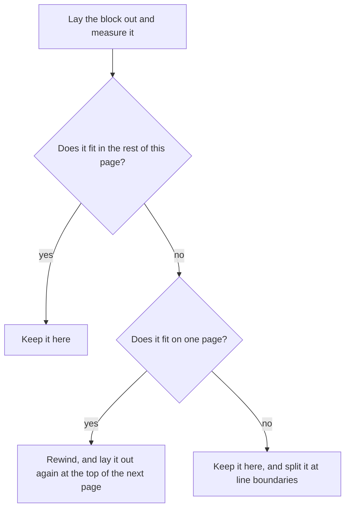

# The grounds of kspage's slides and pages

**This document says why kspage's slides and pages are shaped as they are.** It says how frames are placed, picked, drawn and shown on a slide. It also says how layout cuts the content into pages and prints them. The rest of the document (its model and styles, layout, the cursor and undo) is in [`DESIGN-document.md`](DESIGN-document.md). The words used without stopping are in "Words used in this document" in [`DESIGN-architecture.md`](DESIGN-architecture.md).

## Slides and frames

A slide is a box of fixed size inside the document. A frame is a smaller box placed on the slide at a position of its own. Text, tables and shapes sit in frames. These sections say how frames are placed, picked, drawn and shown.

In the document model, a slide is a block whose children are laid out at absolute coordinates. A frame is a child with a position of its own (`Block.frame`). The layout is in "How a grid and absolute coordinates are laid out" in [`DESIGN-document.md`](DESIGN-document.md). Two words recur below. The *core* holds the document, lays it out and edits it (the KSPL folders `model/`, `expr/`, `lay/`, `share/` and `write/`, compiled to WebAssembly). The *page* is what runs in the browser around it (`port/web/`): it measures text, draws, and receives the keys ("The core and the port" in [`DESIGN-architecture.md`](DESIGN-architecture.md)).

### Showing frames in turn is an order, not a timeline

**Each frame on a slide can carry a step number, and the document holds only that step** (`Block.step`). During a slideshow the frames appear in step order, one press at a time; there are no timings and no animations. What each `step` means:

| `step` | When the frame is shown |
| :-- | :-- |
| 0 | always |
| 1 or more | once the show has reached that step |

There is no time axis ("What it does not hold" in [`DESIGN-architecture.md`](DESIGN-architecture.md)), only an order. An order flattens by itself: with no narrowing, every frame shows. So printing and the export need nothing special.

**The block holds the step, not the style** ("Only the block holds its position" in [`DESIGN-document.md`](DESIGN-document.md)).

**Which step the show has reached is a viewer setting, not part of the document** (`Sheet.over.reveal`), and it is not saved. `none` narrows nothing. `some(n)` lays out only the frames whose `step` is n or less. **Clear it when the show ends.** Otherwise frames with a step stay hidden while editing, and look deleted.

**Layout does the narrowing** ([`lay/absolute.kspl`](../lay/absolute.kspl)'s `shown`). A frame hidden only at drawing time would still be laid out, so its text could still be selected and found by search.

**One action advances the show** (`port/web/api_show.js`'s `stepAhead`). It goes to the next step if one is left on the slide, and otherwise to the next slide. With two actions, the presenter would have to remember which one to press.

**Reordering slides means moving blocks in the document.** The order of the slides is a result of layout, so only the document holds it.

**In the "Slides" tab a thumbnail is dragged to reorder, and it lands where it is dropped.** Moving it while dragging would shift it by however many it passed. A dotted frame shows where it will go, and the move is one undo, since the order is the document's.

Caution: **Move only the outermost block** (a slide inside a frame cannot be moved).

### Showing one slide at a time crops and magnifies it

The slideshow view shows one slide filling the window. The core supplies only the list of laid-out slides; the page does the rest.

The core holds **only the list of laid-out slides** (`Page.surfaces`), in document order. Whether a block is a slide is decided by its style, so the document itself cannot tell; only layout knows, so layout records it. Scaling to the window, centring and the keys are the page's work.

Three rules hold while the show runs:

| Rule | Why |
| :-- | :-- |
| **Clip what lies outside the slide** | Otherwise the paragraphs around it seem to flow into it |
| **Do not change the layout width during the show** | A slide's style size fixes its content, but the text flowing around it would rewrap, and the slide would move |
| **Shut off typing during the show** | An edit could change what the presenter did not mean to touch. Shutting off the one place text enters is enough. Keys, a paste and a finished IME composition all enter there (IME text is typed through an input method, as for Japanese) |

### A slide's sketch is not kept

A new slide starts from a sketch, such as "a title and a body". The sketch builds the frames once, when the slide is inserted, and is then forgotten.

A new slide's frames come from **a sketch** (`Sketch`). It lays out at least one frame, since a child with no frame covers the slide but cannot be grabbed. It acts once, at insertion.

Caution: **Keep it in neither the document nor the styles.** Suppose it were kept. The first move of a frame would then make "the frames the sketch describes" disagree with "the frames the document holds". Nothing would decide which is right. Only the frames it built go into the document; the sketch is saved neither as a number nor as a name.

**A sketch sets the frames only, and applies no style name.** Applying a style is a separate operation. A name set here would be a second way to do it (as with the unnamed rows and cells of an inserted table). Every frame takes the parent's style; a larger title means applying a style.

**Write the open margin and the title's height as ratios of the slide's size.** In fixed px, the frames would stick out as soon as the slide's size changed.

### A frame is grabbed at its handles

A frame is moved and resized by dragging, the same way a table's border is dragged ([`lay/ask.kspl`](../lay/ask.kspl)'s `grip_at` and [`write/shape.kspl`](../write/shape.kspl)'s `drag_frame`). Where to grab it, and what each spot does, is in "Handles on frames and shapes, and the numeric fields" below.

**Check for a grab before text selection**, as for a cell's border ("Borders are grabbed at a cell's right and bottom edges" in [`DESIGN-tables.md`](DESIGN-tables.md)).

**A frame with no set position cannot be grabbed.** It covers the whole slide, so there is nowhere to move it.

Do not remember the coordinate where the grab began. The slide sits in the flow of the text and can move at every layout. So every drawing recomputes the frame's offset from it.

### One frame is selected at a time

**A click selects one frame, and selecting another deselects the first.** There is no selecting several with Shift.

**Shift means one thing: it extends the text selection.** If several frames could be selected, a Shift-click would mean two things, depending on what lay under the pointer.

**So there is no grouping, aligning or spacing several shapes evenly.** Other products make grouping easy with a drag box and Shift-click. Built on shapes picked one at a time, grouping would carry its whole cost without those.

### Deleting a frame and deleting its holder are separate

One command deletes a frame, and another deletes the whole slide or table (the *holder*) that the cursor is in. Neither falls back to the other.

| Operation | What it deletes |
| :-- | :-- |
| `Editor.drop_frame` | one frame: the one directly under the slide, even when the cursor is in a table inside that frame |
| `Editor.drop_holder` | the slide, table or picture the cursor is in |

**Do not delete "from the inside out" in one operation.** A press meant to delete the slide would delete one frame and stop. A mistaken deletion is hard to undo, so what gets deleted must be clear beforehand.

**The last frame is not deleted.** A slide with no frame gives the cursor no box to sit in. Then no shape could be added and the holder could not be deleted, so the slide could never be removed.

**The frame deleted is the one directly under the slide.** Inside a slide only frames hold a place, so deleting anything further in would not change the slide's frames. Deleting a table inside a frame is deleting a holder.

### No line joins two frames

**There is no connector: a line that joins two frames and follows them when they move.** PowerPoint's connector is easy to use because it snaps to a shape and follows it. Joining frames by typing their names would carry the whole cost of the feature without that ease. A line is drawn as a shape like any other.

### How a shape is drawn

Pick a shape tool, then drag on the slide where the shape should go. The shape belongs to whatever was under the press.

The steps, and why each is so:

| Step | Why |
| :-- | :-- |
| **Hold the tool, then drag to draw.** The cursor is not consulted: the shape goes into the slide under the press | Going by the cursor, a drag made while looking at another slide would land in the wrong one |
| While dragging, a dashed outline shows the form | A bare rectangle would hide whether an ellipse or a triangle was chosen |
| Once a shape is drawn, the tool is dropped | Otherwise shapes would appear where the person meant to press the body |
| Pressing the tool again keeps it held; `Esc` drops it | (A way to draw several in a row, and a way out) |
| Click-to-insert-in-the-middle stays in the menu | For where there is nowhere to drag |

**The holder of the spot pressed holds the shape**: a slide, a paragraph or a cell. The frame's position counts from that holder's top-left corner; this is a slide's frame rule widened to every holder. There is no second means: nothing "anchors to the page". The shape is not placed in the flow, where it would move the text. No text wraps around it (Word recomputes such wrapping at every move).

A shape does not go into a block that lays out no children. A grid's children are its rows and cells. A gathering block's children (a table of contents, say) are not laid out, so a shape there would appear nowhere. A shape drawn over a table belongs to the cell. Shapes are placed after the contents, so they show on top of the text, stacked in the document's order.

The forms are few, and **adding one never renumbers the others**. PowerPoint holds 160 kinds, so the one needed has to be searched for (hence its recently used forms at the top). kspage holds the rectangle, the rounded rectangle, the ellipse, the triangle, the diamond, the line and the arrow (along a diagonal). Saving writes the form's name, while the boundary between the core and the page passes a number: the variant's position in `Shape` ([`model/style.kspl`](../model/style.kspl)). So a new form goes at the end only; renumbering would make an old text read as another form.

**Each form drawn brings one style, named `figure-<the form>`**, so the next shape of that form finds it by name. Why inserting looks a name up first is in "Styles are told apart by role, not by name" in [`DESIGN-document.md`](DESIGN-document.md).

### How a form is chosen

**The forms are folded into one ribbon button that opens their list.** Laid out flat, the forms would use up the ribbon level's width. To pay back the extra press the folding costs, the list is headed by the recently used forms.

The folded button shows that a tool is held. Marking only the chosen form, hidden in the closed list, would not. Choosing a form closes the list, which would otherwise cover the slide about to be dragged on.

### Handles on frames and shapes, and the numeric fields

A selected frame or shape has eight handles, like every other product's. Drag a handle to resize; drag the rest of the edge to move.

| Where you grab | What it does | The pointer's shape |
| :-- | :-- | :-- |
| One of the four corners | changes both width and height | a diagonal arrow |
| One of the four edge midpoints | changes one dimension | a horizontal or vertical arrow |
| The rest of the edge | moves the frame | move |
| Inside a frame with contents | nothing to grab: the press goes to the text, so it can be selected | text |
| Inside a shape (it has no contents) | grabs the shape, since nothing else happens there | move |

Caution: **Do not leave out the edge handles.** With only corners, changing the width means matching the height again by eye (every other product has eight).

**A handle that is not drawn is not made**, or spots that do nothing visible when pressed would multiply. On a small frame a corner handle and an edge handle overlap; each keeps a grabbable width, and the corner wins.

**The pointer's shape follows the direction.** An edge gets no diagonal arrow, which would suggest that grabbing there changes both dimensions.

**`Shift` keeps the ratio of the sides, at a corner only.** On an edge handle it would move the side not grabbed too. While drawing, `Shift` gives 1:1: a shape not yet drawn has no ratio to keep, so it makes a square or a true circle. Compute the drag rectangle in one place (`bandRect` in `port/web/draw.js`). Computed twice, once for the preview and once for the placed shape, the shape would jump on release.

**The numeric fields act on the selected shape.** A shape has no text, so it cannot hold the cursor. One way to select it is kept: pressing selects the frame under the press (`Editor.pick`). `Alt`+arrow uses the same entry point (the function the page calls into the core), not a second way.

### The stacking order of a slide's contents

**The list of a slide's contents runs down the right side**, not in the fixed area at the top. There, every slide would push the body further down. The top of the list is in front (Figma's way). The stacking order is the document's order; a separate field would state it twice.

An unnamed shape is listed under a name like "Shape 3". **The page makes this name, not the core**; a name made by the core would look as if it were stored in the document.

## Pages and printing

The paper size is one setting for the whole document. Layout itself cuts the content into pages as it goes. These sections say how the pages are made and printed.

### Pagination happens during layout

Layout breaks pages while it places each line. Nothing is shifted onto pages after layout has finished.

The document holds one page's height (`Paper.height`; 0 means no pagination). **The width is not held here.** The paper's width is the container's, as with a slide's size: across, the container has a size; down the page it has none.

Caution: **Do not shift content onto pages after layout.** The cells, slides and frames would have to move with the boxes, and any one forgotten would silently stay out of place. Paginated during layout, whatever comes next starts from the new `y`.

The unit of splitting is set by where a finer split would make the text unreadable:

| What | Split across a page break? | Why |
| :-- | :-- | :-- |
| A line | **Never split inside a line** | The characters' top and bottom halves would land on different pages |
| A table row | **Never split inside a table row** | Only layout knows the row's height, so a row found crossing the break is rewound and laid out again on the next page |
| A slide | **A slide is not split** | Its size is known first, so where it does not fit, it moves whole |
| A block that fits on one page | No: **move it to the next page whole** | A paragraph split with a single line left behind is hard to follow |
| A block taller than one page | Yes, at line boundaries: **do not move it** | It would not fit on the next page either, and moving it only wastes the rest of this one. An overflow in sight is easier to fix than content that disappears |

For a block, layout decides like this:

Only layout knows a block's height, which is why it is laid out, measured, then rewound and laid out again where it must move. Without pagination (on screen), one pass is enough.

**The page count comes from the height where the content ends** (`lay/flow.kspl`'s `paper_count` and `Page.filled`).

**Do not count by the height used**, which includes the space after the last block (`space_after`). A document filling exactly one page would count as two, and a blank last page with no box at all would print. Only the last block's space is left out; space between blocks is content.

**Do not put the counting in the bridge** (`port/web/`, which joins the core to the browser), where `make debug` does not reach it. The check is `tests/join_test.kspl`'s "the count of sheets of a document that fits exactly".

**Printing draws one canvas per page** (one long canvas cannot cross pages). It clips and scales with the same code as the one-slide view.

### The document holds the paper size; margins apply in print

The page size and the margins belong to the whole document (`Sheet.paper`). On screen the content is one long band; the margins appear only when printing.

Caution: **Do not put them in a style.** With two page shapes in one document, neither the page breaks nor a column's width could be decided.

**A width of 0 means the container's width.** Until a paper width is set, the text follows the window; once it is set, the column keeps that width at any window width.

**Compute a column's width in one place, in the styles' table** (`Sheet.column_width`). If callers repeated the expression, the widths laid out and printed would drift apart.

**Do not build the margins into the layout coordinates.** Laid-out content is one continuous band, and the margins are how far printing insets it. Built in, every page break would need arithmetic to skip them. So the top and bottom margins do not appear on screen; they show as the spacing at the page breaks.

**The height available for content on one page is also computed in one place** (`Sheet.column_height`). Only there are the margins subtracted from the page height; the break interval, the break line and the page count all follow from it.

**Where the margins alone fill the page, it does not paginate.** Moved, the content would not fit on the next page either, and stopping is plainer than looping forever.

### Headers and footers have no place in the document's coordinates

**The header and footer are whole-document settings (`Doc.header` / `Doc.footer`), not part of `blocks` (the document's list of blocks).** A band appears once per page, so it has no place in one continuous run of coordinates. It is laid out once per page, apart from the body (`flow.layout_chrome`), with coordinates relative to the page's top-left corner. Printing clips and insets the content by the margins, and draws the band as it is.

**With no paper size and no top and bottom margins, the band is not laid out.** It sits inside the margin, and with no fixed bottom edge the footer has nowhere to go. Nor is an empty band laid out, which would make the margin look narrower.

The page number is counted at layout ("What layout recomputes every time" in [`DESIGN-document.md`](DESIGN-document.md)): `{page}` is the current page and `{pages}` the total. **The document's text keeps the placeholder.** With the number written in, merely changing the paper size would change the document's text.

**A band is not in `blocks`**, so search does not go through it. A band's edit can still be undone, since its text changes through the same `Editor` as typing.

### The printing fits the page into the printable region

**The printed page is shrunk to fit the printer's printable area (`max-width: 100%`), so the left and right margins stay equal.** **Do not count on `@page { margin: 0 }`** (the CSS rule that asks for no printer margin). Margins chosen in the print dialog win. A canvas drawn at the paper's width is then wider than the printable region. Its right side is cut off, so only the left margin shows.

Do not fix it by shifting the page's inner margins left. Left and right are equal (57px each on A4), so shifting them makes it wrong.

### A document with no paper borrows one only for printing

**A document with no paper size (height 0) is one long run on screen.** **That does not mean "no pages in print either": when it is printed, it borrows the default paper and margins for that one print.** A plain-text document (a program's source), Markdown and a new document all set no paper. Printed unchanged, they become one long canvas, and the browser breaks the pages where it likes.

**The size and the margins are borrowed together** (`paintPages` in `port/web/api_show.js`):

| What is borrowed | What prints |
| :-- | :-- |
| The size alone | Margins of 0. The header and footer bands stand inside the margin, so they have nowhere to go (`chrome_rect` in `lay/chrome.kspl` returns a height of 0). The body runs up to the break, where characters look cut |
| The size and the margins | A 15mm (57px) band opens above and below |

What is borrowed is the default paper of the bundled documents (`a4_portrait` in `model/paper.kspl`: A4 portrait, 15mm margins on all four sides). **Do not copy the numbers into the code that borrows them.** One-inch margins there would drift from the 15mm of the bundled documents (the manual). Two documents printed from one screen would then get different margins, the source of the complaint "the margins are too wide". Do not make it one inch either: Word's, Google Docs' and Pages' defaults are one inch, but kspage's is 15mm. A line that does not wrap runs into the right margin (`wrap` in `share/text.kspl`); to narrow it, set the paper and margin fields.

**Do not borrow for a document that has set its paper**, since margins of 0 were the writer's choice. Once printed, the borrowed paper is returned (the same rule as the viewer's overrides). The check is a test in `kspage/tests/browser/paper.js`:

* "A document with no paper settled becomes a page with margins in printing too."

It checks that the bands above and below hold no ink. It also checks that a band appears inside the borrowed margin.
