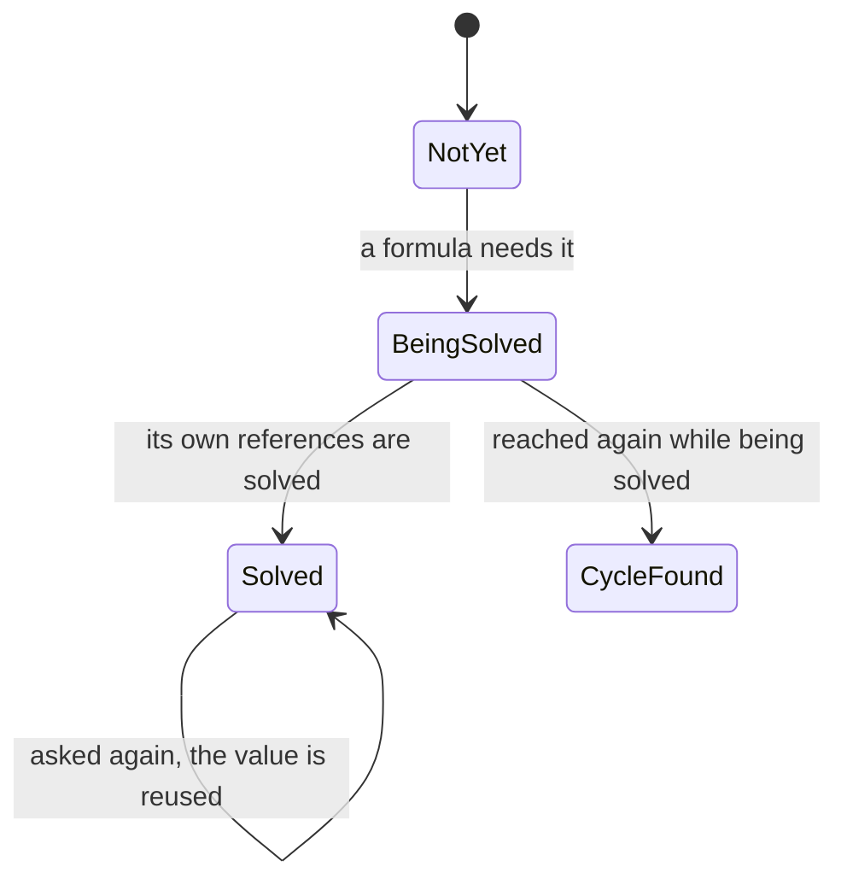

# The grounds of kspage's tables

**This document says why kspage's tables are shaped as they are.** It says how a table's sizes, merges and rows are held, and how a person moves through it and narrows it. It also says how a cell's formula is computed. The rest of the document (its model and styles, layout, the cursor and undo) is in [`DESIGN-document.md`](DESIGN-document.md). The words used without stopping are in "Words used in this document" in [`DESIGN-architecture.md`](DESIGN-architecture.md).

## Tables

A table is a block laid out as a grid. These sections say how its sizes, merges and rows are held, and how a person moves through it and narrows it.

**A table's first row is its heading by position**, with no setting and nothing to switch on. The exported Markdown (GFM, GitHub's flavour of Markdown) writes it so. The sort, the heading kept in view and the column filter take it the same way.

### The table holds cell sizes; set sizes do not move

Column widths and row heights are stored on each table's own block. A size a person set is kept exactly; only the unset columns share what is left.

Each column's width and each row's height belong to **the table's block, not the style** (`Block.size_of` / `set_size`). Otherwise resizing one table would resize every table with that style. The rule is "Only the block holds its position" in [`DESIGN-document.md`](DESIGN-document.md).

**A row's height works the same way**: content does not push a set height taller, it overflows. The exception is sharing the remainder. Across, the container's width is fixed, so unset columns share what is left. Down the page there is no container height, so an unset row is as tall as its content.

The setting is a row of "set / unset" per column. **An unset column still keeps its slot**; dropped, every later column would shift forward one. The cells decide the number of columns, so the settings can be fewer or more (extra ones are not read).

**A set width does not shrink**, or nobody could tell whether the width written took effect or did not fit. Only the unset columns are adjusted. Where the set widths alone exceed the container, the unset columns become 0 and the table overflows. An overflow in sight can be fixed; a silent shrink cannot (the same judgment as not dropping a child with no position).

**Only the grid reads it**; flow and absolute coordinates ignore it, so, as with `frame`, the same tree can still be laid out by another arrangement.

### Borders are grabbed at a cell's right and bottom edges

Dragging a border resizes a cell ([`lay/caret.kspl`](../lay/caret.kspl)'s `edge_at` and [`write/edit.kspl`](../write/edit.kspl)'s `drag_edge`). A column's right edge and a row's bottom edge can be grabbed. **The column or row on the near side** is returned: drag right (or down) and that one grows.

| The rule | Why |
| :-- | :-- |
| **At a corner, the column wins** | Both edges are near, so without a rule the grab would waver |
| **Check for a grab before text selection** | Otherwise a click on a border would move the cursor and a drag would select text |
| **Do not let an edge pass the column's left edge** | A negative width would bring the next column back leftwards over the cells |
| **The width is measured from the column's current left edge**, read again at every layout; the coordinate where the grab began is not remembered | The drag can change the column to the left as well |

### Typing a number writes to the same place as dragging

A column's width or a row's height can also be typed, in px. The typed value goes through the same operation as dragging, and nothing overrides it.

By dragging alone, two columns cannot be made the same width (matched by eye, the difference shows when printed). So a size can also be typed ([`port/web/table.kspl`](../port/web/table.kspl)'s `kspage_web_set_cell_size`). **It writes through the same `do_set_size` as dragging.** With a second path, the typed and dragged widths would stay apart, and an undo would restore only one.

| The rule | Why |
| :-- | :-- |
| **The unit is px, and only px**, as for the paper, the margins and a frame's position (px at 96dpi) | Among these products, the unit the fewest people understand is Excel's "count of characters" |
| **Nothing overrides a typed number.** There is neither "fit to the table's width" nor "automatic fitting" | Word has both, and with them a width can revert even after being typed again |
| **A row's height has no "minimum"**; the number typed is the height | Google Docs has only a minimum, so a row cannot be made shorter |
| **Emptying the field makes the size unset** | The document holds unset as a state of its own (`Option`), so an empty field maps onto it directly |
| **Show the current size faintly in an empty field** | Otherwise the screen gives no starting point |

Caution: **Do not let 0 stand for unset**; 0 is a value that can be typed, and typed, it means 0.

### Rows and columns are added and deleted at the cursor

**A new row (column) goes after the one the cursor is in, and deleting removes the one the cursor is in** ([`write/edit.kspl`](../write/edit.kspl)'s `add_line` and `drop_line`).

Caution: **Call both after layout**, which decides which cell the cursor is in.

| The rule | Why |
| :-- | :-- |
| **The last row or column is not deleted** | A table with none would leave nothing to click to add one |
| **Shift the size settings with it** | Matched by position, each later setting would otherwise land on the row or column one nearer |
| **Keep the removed block**, so putting it back puts the same object back | A rebuilt one would differ from the inline the record's other instructions point at, and the text's undo would dangle |
| **Adding also goes through "put back what was removed"**: build the empty row or column first | Then adding and putting back are one instruction |

A column is "the cell with the same number in every row", so deleting one removes a cell from every row.

**An inserted column takes the current column's width setting.** If that column has no setting,
the new one is automatic too. The other widths stay as they are, so a table can grow beyond the
text column. Leaving the new width unset in a table that already fills the page would give it
no space and make insertion appear to do nothing. The editing screen draws the whole table and
scrolls it horizontally; the tools stay in place, and following the cursor brings it into view.

### Fitting measures a column, and unsets a row's height

**A double-click on a cell's seam fits it to its content**, the gesture every spreadsheet uses. A row is fitted by removing its set height; a column by measuring its content.

**The two axes are fitted differently, because layout already fits one of them.** A row with no set height is already laid out to its content, so fitting it removes the setting. A column with no set width takes an equal share of the region, so fitting it sets a measured width ([`lay/ask.kspl`](../lay/ask.kspl)'s `Fit`).

That asymmetry also answers the common complaint about this feature, merged cells. Excel's row fitting is its own measurement and cannot see a merged cell. Here layout does the work and takes merges in like anything else.

**A merged cell is skipped when a column is measured.** It spans two or more columns, so counting it would make one column as wide as the pair. Dragging leaves merged cells out for the same reason.

**The width is summed per run from the boxes as laid out.** A wrapped run's boxes add up to its unwrapped width, which is what fitting needs. So nothing is measured twice, and no second path through the font metrics is opened.

Caution: **Leave room beside the text, and a floor under it.** Fitted exactly, the text sits on the rule; fitted to nothing, an empty column's seam can no longer be found to drag it back.

**Do not make that margin a setting.** Calc does, and two people's fitted widths then differ. It is one number, kept next to the fitting code.

### A column's automatic width includes inner padding on both sides

A column fitted to its content is as wide as the content plus the cell's padding on the left and on the right.

**Do not take the content's measured right edge as the column's width.** That edge includes only the left padding (what the placing code indented by), so as the width it is short by the right padding. The text runs into the padding and, where it does not fit, wraps. The fix belongs where the column's width is decided (`natural_width` in `lay/grid.kspl`), not in the style.

**Write a cell's padding with `pad`, not `indent`.** `indent` indents from the left, so nothing opens on the right; `pad` covers all four sides.

### The cell holds its merge, and covered cells are removed

**The merged cell holds its span (`Block.span_rows` / `span_cols`), not its style** ("Only the block holds its position" in [`DESIGN-document.md`](DESIGN-document.md)). **The cells it covers are removed from the row.** Left standing, a covered cell's text would be in the document yet nowhere on screen. Unmerging puts an empty cell back; restoring its text is the undo's job.

**Where each cell stands is counted in one place only** (`Block.tiles_of`). Layout, formula addresses and Markdown export all need it. With copies, one table could take three shapes. A covered position has no cell, so the next cell moves right.

**A merged cell sets neither a column's width nor a row's height**, which would need a rule for which column its content's width counts toward. Content that does not fit overflows (as with a set width). A vertical merge's height is filled in after the rows it covers are laid out (their cells decide their heights).

**A formula addresses a merge by its top-left cell only.** A covered address is "no cell" (`#REF!`): merged away, it holds no value, and returning 0 would look like one.

**Only a neighbour whose shape fits is merged in.** Across, it is the neighbour to the right spanning the same number of rows. Down, it is the one directly below spanning the same number of columns. A misfit would make the covered area non-rectangular, and layout could not count the columns it skips.

### Merging is a rectangle chosen by dragging, and one press

**The cells to merge are selected by dragging across them, and merged with one press.** The top-left cell's text is kept, and one undo puts everything back.

**Do not merge one neighbour at a time.** Take "merge with the cell to the right" and "merge with the cell below". With them, merging six cells takes five presses in an order the user has to work out. No other office suite works that way.

**The range is derived from the selection's two ends and stored nowhere.** A stored range would go stale the moment a row was added. The two ends say all it needs ([`lay/ask.kspl`](../lay/ask.kspl)'s `cell_range`). With nothing selected it is the cursor's cell, so the caller reads one answer.

**The top-left cell's text is kept and the rest dropped, without asking first.** Excel and Sheets warn every time and LibreOffice asks a three-way question, because they cannot undo a merge cleanly. Here one undo puts every cell and its text back, so a question beforehand buys nothing and costs a press every time (Principle 5).

**A merge inside the range that reaches outside it is refused.** Merged anyway, the overhanging cell would lose the columns it covers and every row below would shift by one.

Caution: **Put the cursor in the cell that remains.** The selection reached into cells just removed from the tree. Left as it was, it would point at a run no longer in the document. Whatever is typed next would then go in without appearing on screen.

**Each refusal keeps its own reason and wording** (`Merge_end` in [`write/cells.kspl`](../write/cells.kspl), the same rule as `Sort_end`). The reasons are nothing selected in a table, a single cell, a merge reaching outside, and read-only. Each is fixed differently: one needs a wider selection, another the inner merge split first.

### Tables and slides are inserted only after the cursor's paragraph

**A table or a slide goes after the cursor's paragraph (`Editor.insert_table` / `Editor.insert_surface`), never inside a table cell.** After is the direction rows and columns are added in, so nobody has to remember which way each operation grows. Not inside a cell, for the reason a paragraph is not split there. A table inside a table is for code that builds documents, not the screen. It could go "beside" or "inside" the cell, and a click cannot decide which.

**The style says the arrangement**: the document does not say "table", so insertion looks at the style, making one that says grid where none exists. An existing style's arrangement is never changed (every block with that name would change arrangement). So it is set only when a style is added (`Editor.add_style`), and insertion refuses a name whose arrangement does not match.

**Only a slide's style must already exist.** It sets the slide's size, which the core must not choose (as a slide's size is not taken from its content). A width of 0 means the container's width, which leaves the frames' sizes unknown before layout. So only a style with both width and height set is accepted.

**A refused slide insertion names its reason.** "There is no slide style, or you are inside a table's cell" is one wording for two causes. A person in a cell reads the first half and hunts for a style that was there all along. The reasons take the same shape as the sort's (`Sort_end`, below).

### A new table takes the pressed size and cell style

**The Insert menu picks a new table's size on a grid of up to 10 × 8.** **The ribbon's button inserts at the size last picked (2 × 2 at first).** This is Word's cap, and a larger table grows with "Insert a row", as there. Every other office suite uses this form. The ribbon's Table button inserts at that size rather than opening the grid. The ribbon is a row of shortcuts that act, and a menu opened there would not stay open. Columns come first ("4 × 3" is four across), as in all three products. The cap is the menu's: the core refuses only a size with no cell (a table in a saved document can be any size).

**The cells take the cell style, found by its role, and created through the record where the document has none.** One predicate identifies a cell style: `cell_like` in [`model/style.kspl`](../model/style.kspl), a flow paragraph with inner space and no marker. So every table inserted into one document shares one style. A missing one is made inside the insertion's step (`Editor.styled`), its look written in one place (`dress_cell` in [`write/insert.kspl`](../write/insert.kspl)). Each cell gets an empty run, without which it could not be clicked into.

| The rule | Why |
| :-- | :-- |
| **The cell style's grid line is 1px and light grey, not black** | Among prose, a black grid would pull the eye from the text |
| **An existing style with the cell style's name is used as it is**, whatever its look | Restyling it would change every cell using it, and a document that made its cells bare on purpose keeps them bare |
| **No heading row is made** | Word, Excel and Google Docs insert a plain grid; only Writer styles the first row as a heading. The exported GFM takes the first row as the heading by position anyway, so leaving the look to the person loses nothing |

**A new table's columns get set widths, equal shares of the width it is laid out at.** That width is the container of the cursor's paragraph, less what the table's own style takes off a block (indent and inner space). The one function flow uses computes it (`contents_width` in `lay/flow.kspl`), so the widths set and the layout cannot disagree. The table spans the text width from the start, and a column keeps its width while typed text wraps inside it. Layout's rule is untouched: an unset column still follows its content, as in a table whose widths were never set. The widths go through the record, so one undo takes them with the table. Where the cursor is in no laid-out container, no width is set.

### Moving past the end adds a row; Enter moves down

**Tab from the last cell adds a row and moves into its first cell. Enter in a cell moves to the cell below, Shift+Enter to the one above, and Enter past the last row adds a row too.** One rule, on two keys: moving past the table's end grows a row.

**Tab growing the table is what Word, Docs and Writer all do**, so someone filling in a table never reaches for the menu. One undo removes the row. The key adds a row through the button's recorded insertion, so its undo is the button's. The new row goes at the table's end, not after the cursor's row. A vertically merged cell can reach the end from a row above. A row inserted after that row would land inside the merge.

**Enter takes the spreadsheet's side.** In a document's table it starts a paragraph in the cell; in a spreadsheet it moves down. A table here stands where a spreadsheet does, and a cell's text wraps on its own, so an in-cell Enter has nothing to open. A person at a table wants the next row. A line break inside a cell is not possible (a cell is one paragraph). The manual's last chapter says so rather than hiding it behind a key.

**It stops above the first row and before the first cell**: a table grows only at its end, never above what was typed.

### Sorting keeps the first row, ignores case, and explains refusals

**A sort never moves the first row (the heading), whichever row the cursor is in; the cursor only picks the column.** Letting the cursor decide is a trap for hands trained on Excel. They put the cursor in the heading to sort by its column. The heading is then sorted into the data without warning. The heading is the first row by position ("Tables" above), so the sort asks nothing, as the products with no such complaint do. What is given up is sorting part of a table (the rows from partway down). No product offers it from the cursor alone, and only a two-row heading needs it. The manual says so.

**Text sorts alphabetically ignoring case, and texts differing only in case are one key**, as in Excel's and Calc's default; Sheets puts every capital first. The folding is ASCII only (beyond it, code points are compared as they are), so an accented capital is not folded onto its lower case. The spreadsheets use the locale's collation there (the alphabetical order of the reader's language). That costs a collation table in the core, which is not paid here (the comparison names the gap). A date is read by the reader the formulas use (`day.day_of`). So exactly the spellings that count as dates sort as dates, and no second notion of "what is a date" arises.

**Every refused sort says why, and the page words each reason.** One wording for all ("click inside a table's cell") would name the wrong cause when it is a merged cell. It would send the reader after a cursor that is not the problem. So the core has an enumeration of reasons (`Sort_end`), as `Block_style_end` does for applying a style. Each reason is passed across the bridge as a number and worded on the page.

Caution: **Do not merge the reasons back into one, and do not compare them by number in the core.** A newly added reason would then pass silently (`Sort_end` in [`write/cells.kspl`](../write/cells.kspl), read by `switch`).

### The heading row stays visible while its table scrolls past

**While a table scrolls past, its first row stays at the top of the window by itself.** **It leaves with the table's last body row, with no command and nothing saved**, as in Numbers.

**The band is a copy, painted from the finished layout onto a small canvas of its own** under the tools (`#pinned-head`, `draw.js`). Nothing on the document's canvas, one long sheet the window scrolls, can stay put. The work is split so that each side knows one thing:

| The side | What it knows | What it does not know |
| :-- | :-- | :-- |
| The layout | each outermost table's rectangle and its first row's (`head_band_at` in `lay/ask.kspl`, across the bridge as `kspage_web_head`) | the window |
| The page | the window | the rows |

Rules and fills come with the copy. The web's sticky heading (CSS's `position: sticky`) loses them, because only the cells move while the collapsed grid stays. A click on the band is a click on the heading. The cursor goes into that cell and the window scrolls up to it, as with a frozen cell in a spreadsheet.

**The band leaves with the table**, sliding up as the last row reaches the top rather than covering what is not this table's. A table inside a cell names no band of its own: the outer heading is kept, since two bands at one edge would overlap.

**What is given up**:

* a heading of more than one row, and a column kept at the left (the page does not scroll sideways);
* turning it off per table (that would be a setting in the document);
* repeating the heading on the next printed page (Word and Excel do; the manual says so).

### A filter is a way of looking; nothing is deleted

**A filter hides a table's rows in this window only: its condition is held with the window, not the document.** The condition (one per column: is, is not, contains, above, below, empty, not empty) lives in `Over.filters` ([`model/over.kspl`](../model/over.kspl), [`model/filter.kspl`](../model/filter.kspl)), beside the step a slide shows now (`reveal`). These are the reader's own settings, which never reach the text, an export or the record. Nothing is saved, no other window is touched, the undo does not see it, and "Show all rows" is the way back. Other suites use this shape, answering the complaint "my filter hid rows for everyone". Written out as Markdown, a filtered document carries every row.

**Layout asks one question; the document is left alone.** `grid.place_rows` asks `filter.row_shown` for each row. A row left out takes no height but keeps its number, so formulas still point at it and merged cells are fixed up by number.

* **A formula counts every row**, as in all four products (`SUBTOTAL` is their opt-in). A total that moved with the filter would show two values on two screens.
* **The heading is always laid out, and so is the row the cursor is in** (`Over.kept_row`, set by the page before every layout). A row being typed into must not vanish under the hands (in Numbers' live filtering it can). When the cursor leaves, the row goes if it fails the condition. Paper has no cursor, so there the row follows the condition.
* Tab, Enter and the arrows skip the rows left out, as Excel's skip hidden rows.

**No hiding rows by hand, and no folding groups.** A hand-hidden row is state inside the data, the source of the second family of complaints. People paste into hidden rows, delete them unseen, and send a forgotten row with the file. The manual's last chapter names both.

Caution: **Show the count while a condition is on.** A table with rows missing and nothing saying so reads as a table that lost them. So the status bar says "3 of 10 rows shown" for the cursor's table.

### Columns filter from their heading; typing only narrows the list

Every heading cell carries a small arrow. Pressing it opens a panel under that column. The panel holds sorting, the column's values each with a tick box, a box to search them, the conditions, and the way back. Tick three names and press once, and the table shows those three.

The arrow uses the heading's text color. Thus a light heading stays readable when the screen's surrounding tools are dark.

| The rule | Why |
| :-- | :-- |
| **The arrow is on every heading row, with nothing to switch on first** | Excel shows its arrows only after AutoFilter is switched on. Here the heading is the first row whatever anyone presses ("Tables" above), so a switch would decide nothing |
| **Typing in the search box narrows the list shown and never unticks anything** | In Excel and Sheets typing there replaces the choice instead. Looking and choosing are two acts, so they are two controls |
| **Sorting and narrowing are one panel**; the ribbon keeps one button, which opens the same panel at the cursor's column | Held apart, a column could be narrowed in two places with only one of them looked at (Principle 6) |
| **Pressing the arrow puts the cursor in that heading cell** | Everything the panel does (sorting, narrowing, reading the values) asks about the cursor's column. Naming the column a second way would mean two ways to say which column, and then two ways to narrow one |
| **The values are listed in the order the column sorts in** | One place decides both orders (`column_values` in [`write/cells.kspl`](../write/cells.kspl) uses the sort's own comparison). Numbers stand as numbers, so 80 comes before 120 |
| **Values differing only in case are one value** | The narrowing ignores case, so held apart, both would answer to one tick, and the list would promise what the narrowing does not do |
| **The list is capped, and says so** | A thousand values is more than anyone reads down; past that, the panel says so where the eye already is |
| **With nothing ticked, no rows show** | That is what unticking everything asks for. The way back is the panel's own "Show every row", which removes this column's narrowing and leaves the other columns'. An empty set meaning "all" could not be told from one whose values have all been typed away |
| **A narrowed column keeps a line under its arrow** | Excel's funnel says some column is narrowed, never which |

Note: Blank cells are one value in the list, worded and placed last. An empty value carries them. How a set is spelled is `VALUE_SEP` in [`model/filter.kspl`](../model/filter.kspl).

## Formulas in tables

**A cell whose text begins with `=` holds a formula** ([`expr/calc.kspl`](../expr/calc.kspl)). The document keeps only the text typed; the value is computed at every layout and shown in its place.

The value is shown only at layout (`Inline.show_value`), and goes into neither the saved file nor the undo. Formula and value are never drawn as two texts; drawing them apart would need a second wrapping, cursor and selection for the value alone. For example:

| | A | B |
| :-- | :-- | :-- |
| **1** | `Price` | `Count` |
| **2** | `120` | `3` |
| **3** | `=A2*B2` (shows 360) | `=10 if B2 > 2 else 0` (shows 10) |

**Only the cell being typed in shows its formula, and only on the screen** (`Book.editing`, `Inline.face`); showing the value there would take the typed text away. Its value is still kept, so CSV, Markdown, sorting and paper read the value (`Inline.showing`); paper is laid out with no cursor (`kspage_web_layout_paper`). Replacing a formula whole is a separate operation (`Editor.set_source`).

**The reckoning moves the cursor**: the text shrinks and can leave the cursor past its end, so `Editor.clamp` fits it back onto a character boundary.

### Formulas use KSPL's expression syntax

**A formula is written in KSPL's own expression syntax. Do not make another language for formulas.** One repository would carry two syntaxes to remember. That defeats the aim of writing a design document beside the code.

| To write | The text |
| :-- | :-- |
| A choice | `10 if A1 > 0 else 20` (chains to the right) |
| Folding a range | `A1:A3.sum()` / `.min()` / `.max()` / `.count()` |
| Rounding a value | `A1.round(2)` |
| Making a day | `Day.of(2026, 8, 18)` |
| Taking a day apart | `A1.year()` / `.month()` / `.day()` |

**There is no function-first form (`SUM(range)`)**: folding and taking apart are methods chained after the value, so the reading order is the evaluation order (`A1:A3.sum().round(0)`).

**A `.` after digits is a decimal point only where a digit follows it**, so a method can follow a whole number (`2026.year()`, `1.round(0)`). In `5.0.round(2)` the first `.` is the point and the second starts the method.

**A number starts with a digit, as in KSPL**: `=.5` is `#SYNTAX!`, and `0.5` is its one spelling. In KSPL a leading `.` starts a name (`.some`), and a second spelling of one number is not taken (Principle 6).

**`Day` is a type's name**, so no table's name can start with `Day` (`Day.of` would read as its cell; "A table is pointed at by name" below). `if` and `else` are keywords, so `ifx` is another word, not `if`.

### A day counts days from 1970-01-01; nothing returns today

**A day is a number**: the count of days since 1970-01-01. So subtracting two gives the days between, and adding moves a day forward ([`model/day.kspl`](../model/day.kspl)).

Values get no day kind; with one, every step of the reckoning would branch on "number or day".

Caution: **Do not move the origin**: every day in every saved document would shift. The calendar is the Gregorian one extended into the past, ignoring each country's switch-over.

**A text is read and shown as a day only where its style says so** (`Number_spec.dated`; no type is guessed, "What it does not hold" in [`DESIGN-architecture.md`](DESIGN-architecture.md)). On a day the number format does not apply (neither grouping nor per cent is read). With one text formatted two ways, the screen cannot show which acted. A day cannot be written literally inside a formula (`2026-08-18` is a subtraction): write `Day.of(year, month, day)`, and take it apart with `.year()` / `.month()` / `.day()`.

**The calendar reaches 10^13 years either way** ([`model/day.kspl`](../model/day.kspl)'s `YEAR_REACH`). Its count of days is a whole number an F64 holds exactly. So the day a formula names is the day it reads back. `Day.of` past it is `#VALUE!`; reckoned anyway, the count would be rounded to another day, and far enough out it would overflow an I64.

**Nothing returns "today".** The same document would give a different answer each day. Layout would then stop being a pure function, which the tests stand on.

### A table is pointed at by name

A formula points at another table's cell as `the table's name!the place`, such as `detail!C4`. **The name belongs to the block, not to the style** (`Block.name`; "Only the block holds its position" in [`DESIGN-document.md`](DESIGN-document.md)). Many blocks share a style, and a name picks out one.

**An unknown name gives `#NAME!`**; falling back to the formula's own table would silently give another cell's value. A table with no name cannot be pointed at.

**Gather every table in the document before solving.** Otherwise a formula pointing at a table not yet gathered is an "unknown name", and the answer depends on the order of writing. The gathered tables live through one whole reckoning, which remembers how far each cell is solved. A cycle across tables is found only because both are gathered at once.

A range can point into another table too (`detail!A1:B2.sum()`); **the name covers the whole range**, so its two ends cannot name different tables.

**The block a name goes on is chosen from the innermost outwards** ([`write/block.kspl`](../write/block.kspl)'s `named_at`).

| Where the cursor stands | What the name goes on | What points at it |
| :-- | :-- | :-- |
| Inside a table's cell | **the enclosing table** | a formula (`detail!C4`) |
| Inside a slide's frame, outside a table | the frame | the list of what is placed, which shows it by name |
| Anywhere else | the paragraph | whatever in the body calls it |

**Do not put it on the cell itself.** Nothing reads a cell's name, so it would be pointed at from nowhere while the screen says it was set. A cell is pointed at by its place (the `C4` of `detail!C4`).

**Look for the table before the frame.** In a table on a slide, taking the frame first would leave no way to name the table for a formula. The frame can still be named from outside the table. The table can be named only from inside it.

**A name is set only after layout**, since only then is it known whether the cursor is in a cell ([`lay/ask.kspl`](../lay/ask.kspl)'s `cell_of`). Called before layout, the entry point refuses ([`port/web/face.kspl`](../port/web/face.kspl)).

Caution: **Do not fall back silently to the paragraph.** That is the same mistake as putting the table's name on the cell.

**A name is recognised by the `!` after it**; where none follows, the reader puts back what it read (as with a range's `:`). A name ends at the formula's first separator: a space, an operator (`+ - * / < > =`), a bracket, `,` or `:`. So `A1>T!A1` compares `A1` with `T`'s `A1`.

**A table takes only a name a formula can reach** ([`expr/calc.kspl`](../expr/calc.kspl)'s `name_fault`, checked by `Editor.set_name`). Three kinds are refused where the name is set, and the status bar says which rule was broken:

| The name | Why no formula reaches it |
| :-- | :-- |
| holds a separator, a `!` or a control character (`Q1 sales`, `my-table`) | the name would end there |
| starts with a digit or `#` (`2026`) | it reads as a number or a mark |
| has `Day` as its leading letters (`Day`, `Day2`) | it reads as the date type |

Accepted, such a name would sit on the table while every formula using it read `#REF!`, `#SYNTAX!` or `#NAME!`, with nothing pointing at the name as the cause. **Every other character is allowed**, so a name can be Japanese prose as it is, and words join with `_` (`Q1_sales`). **Only a table's name is held to this**: no formula reads a frame's or a paragraph's, so `Figure 1` stays a fine name for a figure. The loader takes a name as it is, for the reason a style's name is not refused there ("A style name holds no whitespace" in [`DESIGN-document.md`](DESIGN-document.md)).

### The dependencies are followed while it is solved

No dependency graph is built first. **References are followed down while a formula is solved.** So cells are solved in the order they depend on each other, not the order they are written.

Each cell has three states (not yet, being solved, solved). The diagram also shows where a cycle is found:

* **A solved cell is remembered**, or it would be solved again at every branch that refers to it.
* **Reaching a cell that is being solved is a cycle** (`#CYCLE!`); without this the descent would never come back.
* **A chain is solved in passes, not in one descent** (`settle` in [`expr/calc.kspl`](../expr/calc.kspl)). Each cell a chain passes through is several calls. So a running total of thousands of rows (`=A2+1`, `=A3+1`, …) ran the stack out, and on wasm wrote over the page's memory. Past `MAX_DEPTH` (256 levels, cells and nesting counted together) the cell reached is set aside. What was computed on the way is dropped, that cell is solved first, and the chain is retried. A cell set aside while it is already waiting depends on itself, so a cycle longer than one pass still reads `#CYCLE!`.
* **One formula nests at most 64 deep** (parentheses, `-`, `if … else`; Excel's cap). Deeper, it reads `#SYNTAX!` rather than recursing once per level.

So cells are solved **in dependency order, not in the order written**, and an earlier row can refer to a later one.

### The methods that fold a range

**A range such as `A1:A3` is not a value until a method folds it into one number (`.sum()`, `.min()`, `.max()`, `.count()`).** Alone it cannot be added or multiplied, and `A1:A3` alone is `#SYNTAX!`.

**A folding method takes no argument.** An argument list would let what a formula already says be said again inside a function. That gives two ways for one thing.

**A place is a range only if a `:` follows it.** Otherwise the reader puts back what it read, or the `A1` of `A1+2` would be taken for a range's end.

**A cell of typed text that is not a number is skipped.** A range means "the numbers around here" without naming each, and empty cells and heading words get mixed in. An operator differs: `=A1+A2` names two cells, so a non-number there is an error. **A formula in the range that gives no number is carried through, whatever the reason** (`#CYCLE!`, or `#VALUE!` from `=1/0` or from pointing at a text). It shows a mark. Skipped, it would let a total look right beside it. Which of the two a cell is comes from the cell, typed or formula (`typed` in [`expr/calc.kspl`](../expr/calc.kspl)), not from the reason. One reason, "not a number", covers both a heading word and `=1/0`.

**With no number in the range**, the total and the count are 0, but there is no least or greatest value (`#VALUE!`).

**No function is added that the others can already write** ("What it does not hold" in [`DESIGN-architecture.md`](DESIGN-architecture.md)): the mean is `r.sum() / r.count()`, and the absolute value `-A1 if A1 < 0 else A1`.

### A comparison is made once, and the answer is 1 or 0

There are six comparisons (`=` / `<>` / `<` / `<=` / `>` / `>=`), read after addition and subtraction. **The answer is 1 or 0 so that existing operators can combine answers**: multiplying gives "and"; adding and testing for greater than 0 gives "or".

**Equal and not equal are `=` and `<>`, the spreadsheet's spelling, not KSPL's `==` and `!=`.** They are what a person typing a formula already knows. `==` is not accepted as a second spelling (Principle 6), so `A1 == 0` is `#SYNTAX!`.

**Comparisons do not chain.** `A1<B1<C1` would compare the first answer, 1 or 0, with `C1`, which is not what it reads as. So it is refused as text left unread.

**Only numbers can be compared.** A value is only ever a number or an error, so a text cell is "not a number" (`"yes" = A1` cannot be written).

### The conditional expression evaluates both arms

**Both arms are solved, then one is chosen**, and the error on the arm not chosen is discarded: `0 if A1 = 0 else 1/A1` is 0 even where A1 is 0.

Solving only the chosen arm would make the same formula touch different cells from one reckoning to the next, and change which cycles are found.

### Displayed decimal places and rounding the value are separate

`round` changes the value itself; the number format's decimal places change only the text shown.

`round` rounds the value, so formulas pointing at it see the rounded one. **The number format's places (`Number_spec.places`) round only the text shown**, so formulas pointing at the cell keep the full value.

Caution: **Do not merge the two.** If the number format changed the value, merely changing the places shown would move a total.

**Round at the last place when writing a number out.** An F64 is a 64-bit floating-point number, which stores 1.23 a little under. Truncating shows that 1.23 as "1.229999". The larger the number, the fewer decimal places can be written. Rounding multiplies by 10 to the power of the places and converts to an integer. **No more places are written than the F64 holds.** Scaled, the number stays under 2^53, past which an F64 skips integers, so `=123456789012345678` shows `123456789012345680` (the F64's own value), never a made-up `…676.8` ([`expr/shown.kspl`](../expr/shown.kspl)'s `safe_places`). **The sign is written after rounding**: what rounds to 0 shows `0`, never `-0` (`=0.3-0.1-0.2`). **Past about 9×10^18, near the edge of I64 (a 64-bit integer), nothing is converted.** A conversion past I64's range has no fixed answer ([`expr/shown.kspl`](../expr/shown.kspl)'s `whole_of`). Such a number is written as the F64's own shortest text (`1e+300`, which reads back as the same number). It has no grouping or places, and is not rounded: an F64 that large holds no fraction. A count of days that large names no day: `.year()` gives `#VALUE!`, and a date format writes it as a number.

### Conditional styles are resolved at layout

**A conditional style is a rule the style holds** (`Style.when`): "where the value is greater than this number, lay the style of this name over it". Layout applies it, and nothing is written into the document.

What is laid over is a name. A colour or a weight held directly would step around the styles ("Why the styles are kspage's own, not CSS" in [`DESIGN-document.md`](DESIGN-document.md)).

**Only the look is laid over** (font, colour, fill, border). Spacing, indent and alignment stay as the plain style has them, since a row whose height moved with the value would lose the reader's place. The fill and the border are laid over field by field (`panel_paint.paint_of`). Laid over whole, the condition's style would drop the plain fill or border on exactly the cells that met it.

**Nothing is written into the document** ("What layout recomputes every time" in [`DESIGN-document.md`](DESIGN-document.md)), and nothing reaches the exported Markdown, which carries no look.

### Changing a formula replaces its source text whole

The cell shows the value, so typing onto it cannot change the formula. Instead **`Inline.text` (the formula if there is one, otherwise the text shown) is offered, and `Editor.set_source` replaces it whole**.

Caution: **The replacement goes through the undo record too**; written directly, it would leave a hole that cannot be undone. A break is recorded before and after it, so one undo takes it back.

### A formula that cannot be evaluated shows an error mark

A formula that cannot give a number shows one of five marks. **They stay distinct because each is fixed differently.**

| The mark | What went wrong |
| :-- | :-- |
| `#SYNTAX!` | it is not readable as a formula |
| `#REF!` | there is no cell where it points |
| `#VALUE!` | what it points at is not a number, or the answer is none (a division by 0, a day past the calendar's reach) |
| `#CYCLE!` | it comes back round to itself |
| `#NAME!` | an unknown function's name |

**Do not overwrite a mark already raised with the mark for text left unread.** The unread text lies past where the first mark arose, and the first reason is closer to the fix. A formula read only part way is not accepted either; discarding the unread rest and answering would let a typing slip pass silently.

**An infinity or a NaN (the floating-point "not a number") is no number either** (`#VALUE!`). This holds whether a division by 0 or a product past an F64's range made it. Turned into text, it would leave an unreadable value in the cell. One place refuses them ([`expr/value.kspl`](../expr/value.kspl)'s `number`).

**A formula can point only at a cell**, not at text outside a table cell. A table inside a cell is a table in its own right, and can be pointed at if it has a name.

### A formula can be written in the body as well

A text beginning with `=` is a formula outside a table cell too. **The body has no table of its own**, so it points at cells by name; a bare `A1` names no table and is `#REF!`.

Caution: **Solve the body after the tables.** Solved first, a body formula would read values not yet computed.

**Only a cell's first inline is solved as the cell.** A table's or a row's own text, and a cell's second run onwards, count as body. They must point by name.

### Moving a row or a column rewrites the formulas

**Adding or deleting a row or a column rewrites the formulas in the whole document.** **So each reference keeps pointing at the same cell (a place is absolute).** `A2` keeps pointing at the same cell when a row is added, and what changes is its number. Every formula is rewritten ([`expr/shift.kspl`](../expr/shift.kspl)'s `plan_shift`) because a named table can be pointed at from another table or from the body. A reference with no name belongs to its formula's own table, so an `A2` inside another table does not move. For example, a row added above row 2:

| The formula before | After |
| :-- | :-- |
| `=A2*2` | `=A3*2` |
| `=A1:A4.sum()` | `=A1:A5.sum()` (the range takes in the row added) |

Caution: **A formula pointing at the deleted row itself becomes `#REF!`**; closing up the numbers would silently point it at the neighbouring cell. So `#REF!` is also text a formula can contain, with its table's name too (`detail!#REF!`), or a rewritten formula could not be read.

**A reference that does not move is copied whole, its name included.** Read again a character at a time, the `A2` of `detail!A2` would pass for a reference with no name. It would then move with the formula's own table.

**A range shrinks by the part of its end that was deleted.** Turning the end into `#REF!` would make the whole range unreadable and lose the total of the cells still there. Only when the near end passes the far end is the whole range `#REF!`.

**Record the rewrite in the same step as the row or column change.** As two steps, one undo would bring back the row and leave the formulas behind. The place of editing applies it, since a rewrite on the reckoning's side would miss the undo record.

### `$` acts only when copying

**When a row or a column is added or deleted, every reference moves with its cell, `$` or not.** A reference left in place would point at another cell. The `$` in `$A$1` is easily read as "a reference that never moves". But it holds still only when copied: the mark says what copying does, not which cell is meant. So one module reads and writes references (`kspage/addr`), and only the two ways of moving them differ (`kspage/shift`).

Caution: **Do not split the reading of the text in two**, or the same formula would be read differently depending on the reader.

**Copying moves references to any table.** A reference with a table name (`detail!A1`) keeps pointing at that table, and only its position shifts. Adding and deleting rows or columns moves only references to the table that changed.

### Where the formula's field opens

**The formula field shows the text typed and replaces it whole.** Making a formula does not need it (typing `=` first does); changing one does, because the text shown is the value.

**It opens on a table's cell and on a run that already holds a formula, not on the bare body.** There, replacing whole would let one press delete a paragraph. Do not narrow it to cells alone either: a formula in the body could then be made but never changed. The same set the reckoning rewrites decides whether it opens, so the two never disagree.
