# The grounds of kspage's design

This document says why kspage has the shape it has: each decision, its reasons, and what it gives up. What is there, and how to use it, is in [kspage](../README.md).

**How a section reads**: it opens with the decision in plain words. Then come the details, the reasons, and the traps. Terms used without stopping are in "Words used in this document" below.

## Words used in this document

kspage's own types (`Doc`, `Block`, `Inline`, `Style`, `Page`, `Box`, `Caret`, `Editor`) are introduced in [kspage's "The terms and the types behind them"](../README.md#the-terms-and-the-types-behind-them). The table below explains the other words of kspage this document uses without stopping. The words every package shares (arena, Principle N and the rest) are in "Words used throughout" in [`docs/DESIGN.md`](../../docs/DESIGN.md#words-used-throughout); *gate* and the other words with one fixed meaning in every document are in "Terms of art" in [`docs/SPEC-documents.md`](../../docs/SPEC-documents.md#terms-of-art).

| Word | What it means here |
| :-- | :-- |
| **the core** | The part of kspage that holds the document, lays it out, edits it, solves its formulas and saves it. It is written in KSPL and knows nothing about a screen |
| **the port** | The thin part that connects the core to one screen. The one port is the browser's (`port/web/`) |
| **wasm** | WebAssembly: a compact program format a browser runs. The core is compiled to one wasm module, and the page's JavaScript (JS) calls into it |
| **canvas** | An HTML element that is a plain surface to paint on. kspage paints the whole body onto it itself |
| **DOM** | The browser's tree of page elements (buttons, menus, text). The tools are DOM; the body is not |
| **IME** | Input method editor: the OS tool that turns key presses into Japanese or Chinese characters. While the person is still choosing characters, the text is *being composed*; choosing ends it (the text is *committed*) |
| **block** | A paragraph, a heading, a list item, a table, a row, a cell or a slide. All are one type (`Block`); only the style differs. This is kspage's own word, not the block of source text that "Terms of art" names |
| **run** | A stretch of text inside a block with one style (`Inline`). Making one word of a paragraph bold splits its run into three |
| **style** | A named set of looks (typeface, size, colour, spacing) and an arrangement. Blocks and runs point at a style by its name |
| **arrangement** | How a block's children are placed: *flow* (prose that wraps into lines), a *grid* (a table's rows and columns) or *absolute coordinates* (a slide, where each child has its own x and y) |
| **frame** | A child placed on a slide at a position and size of its own |
| **layout** | Turning the document into placed boxes: which text goes on which line, at what x and y. It runs again at every keystroke |
| **box** | One piece of laid-out text, or a list marker, with its position and size. Drawing paints boxes |
| **band** | A rectangle layout leaves for a fill (background), a rule (border line) or a shape |
| **pen** | Layout's running state while it fills lines: where the next box goes, the current right edge, and the paragraph's settings |
| **entry point** | A function another part calls into, such as a function JS calls in the wasm |
| **hit-testing** | Working out which character a click landed on |
| **the reckoning** | Solving every formula in the document to a value |
| **the undo record** | The list of steps that undo and redo walk through |

## What it is aimed at

**kspage is one editing system for documents, spreadsheets and presentations.** It serves all three uses in one document, with nothing to set up first.

**Word, Excel and PowerPoint are where a feature starts, not a list to match.** A feature begins from how those three do it, since that is what people already know (the screen's words follow them too: "The wording on the screen" below). Whether kspage has the feature at all is decided one feature at a time, on review: it is added where the three uses need it and dropped where its cost outweighs what it gives, so that the whole stays simple. Being a complete replacement for the three is not the aim.

**So a feature the three have and kspage lacks is not by that alone a fault.** It is either a gap still to fill or a feature left out on purpose, and the two are kept apart. Two lists keep them in view:

| The list | Where it is |
| :-- | :-- |
| What kspage cannot do | the manual's last chapter ([`content/manual.kspage`](../content/manual.kspage)) |
| What is decided never to change | ["Accepted limits"](#accepted-limits-what-is-decided-not-to-change) below |

A feature dropped on review moves to the second list with its reason. An aim written without its gaps makes a reader trust what is not there.

## Why the three can be made one

A document, a spreadsheet and a slide deck hold the same kind of data. **They differ only in how their data is arranged, not in its shape**, so kspage writes everything but the arranging once.

In all three, the data is styled text inside boxes. Only the placing differs:

| The view | How its content is placed (the arrangement) |
| :-- | :-- |
| A document | flow: text runs into lines, and lines into pages |
| A spreadsheet | a grid: rows and columns |
| A slide deck | absolute coordinates: each box at its own x and y on the slide |

Built as three programs, everything but the placing would be written three times. **The most costly shared part is text layout and the IME**: line breaking, the selection, the cursor and showing the text being composed are needed in every view. Joining the three adds no work; it removes the tripling.

## Why the folders are split by 'what they know'

Each folder holds one area of knowledge, and the folders stack in levels. A folder may use the levels below it, never one above.

A compiler can be cut by the order of processing: read, check, then generate. **kspage's folders are not split that way.** Layout, editing and export all call one another, so a cut by order would scatter one piece of logic across three places. What can be cut is what each part knows. The levels, from the bottom:

| Level | Folder | What it knows |
| :--: | :-- | :-- |
| 1 | `model` | the document and the styles |
| 2 | `expr` | a cell's formula and its value |
| 3 | `lay` | layout |
| 4 | `share` | the external formats (the saved text, plain text, Markdown) |
| 5 | `write` | editing |
| 6 | `port/` | the screen |

None imports anything above it.

**The folders make the levels a constraint, not just names.** Two files in different folders that import each other are a compile error ([`docs/SPEC-language.md`](../../docs/SPEC-language.md)'s "9.4 Circular imports and visibility"). One flat folder would not give that. The compiler does not catch every upward import, though: one that closes no cycle (`expr` -> `share`) builds with zero diagnostics. So `make test-conventions` checks the order.

**Do not split a cycle inside one level.** In `lay/`, `flow` calls the three arrangements and the line building, and each of them calls back into `flow` (layout always enters through flow). Moved into another folder, that cycle would cross folders and would not build. So a cycle decides where a folder's boundary goes.

The day (date) type lives in `model/`, because a style's number format (`Number_spec`) holds a day's text. Placed in `expr/`, it would make `model` depend on a level above it.

**Do not give a file the name of its folder** (no `calc/calc.kspls`). The folder says what it knows; the file says its subject within that.

## What it does not hold

Some features of other office suites are left out on purpose. **For each item below, the decision is "none"**, and adding one needs grounds that overturn the reason given.

How kspage feels to use is based on the existing office suites, but they are not copied wholesale.

| What is left out | What that means | Why |
| :-- | :-- | :-- |
| **Typed text is never changed automatically** | no curly quotes, no capital at the start of a sentence, no automatic bullets | Once the changed text becomes the real text, the way back to what was typed is gone |
| **A cell's type is not guessed from its text** | nothing turns "1/2" into a date or drops a leading 0; the style says the type (`Number_spec.dated`) | A guess is invisible where it is right and visible only where it is wrong. Whoever changes the document then starts from "why is this one cell different?" |
| **No procedure runs inside the document** | no macro | Opening a document would mean running it, and merely reading a document someone sent would touch the machine. To repeat a fixed routine, write KSPL code that edits the document (the core is a library) |
| **Another document is not embedded** | as with a picture, only where it came from is held | Embedding would need an arena and a reader for each kind of document |
| **A circular formula is not iterated to a solution** | a cycle is reported and stopped | The answer would change with the number of rounds, so the same document would look different at every opening |
| **There is one way to point at a cell** (`A1`) | no other notation gives the row and column as numbers | If one cell could be written two ways, whatever reads formulas would have to handle both |
| **It does not compete on the number of functions** | only what cannot be written with what exists is added | A function for a formula that can already be written makes two ways of saying one thing |
| **There is no time axis** | no slide transitions, no moving elements | Below |

**Why there is no time axis.** A slide is a block that holds a place, not a separate type (["How a grid and absolute coordinates are laid out"](#how-a-grid-and-absolute-coordinates-are-laid-out)). A time axis would put into the document what cannot be carried into the printed page, the exported Markdown or a diff: paper cannot say "this paragraph appears 0.4 seconds later". Nor can an effect live on the screen alone. An effect that cannot be written into the document is lost on saving, so what was written would silently disappear. kspage's worth is being writable as one document, not winning as a presentation program.

Note: **An order can be held**, since on the page it flattens to everything shown (["Showing frames in turn is an order, not a timeline"](#showing-frames-in-turn-is-an-order-not-a-timeline) below).

## The body is not available to a screen reader

A screen reader cannot read kspage's body text aloud, and this will not change. **kspage has no way to hand the body to a screen reader or a braille display.** This is not "not yet": it is the largest price of drawing the body onto a canvas, and it is accepted.

A *screen reader* reads a page aloud, or out to a braille display, for a person who cannot see the screen. **To a screen reader, the body is one picture**: assistive technology reads only the DOM, never inside a canvas. The only way to hand the body over would be a second copy of the text in the DOM, never shown on screen.

**The reason is not the cost but the harm.** A second copy must be kept in reading order, carry the cursor and the selection, and follow every edit.

Caution: **The day that copy drifts, the screen reader does not go silent; it goes on reading an old body.** Nobody can read inside the canvas, so there is no way to check from outside that the copy has drifted. Silence as a picture is better than the wrong text read aloud.

**Whatever can be handed over without a copy of the body is handed over.** The test is "does it also help someone reading with their eyes"; something built for the screen reader alone has no place here.

| Where it is handed over | What happens without it |
| :-- | :-- |
| The page's declared language ([`port/web/page.html`](../port/web/page.html)'s `lang`) | Japanese and Chinese **write the same character in different shapes**, so some environments draw Japanese prose in a Chinese typeface. It is also how a screen reader picks a voice |
| The tab title follows the document's name ([`port/web/side.js`](../port/web/side.js)'s `showPlace`) | Different documents can be open in different windows, yet **every tab shows the same name** (the tab title is the only handle for finding a window folded away) |
| The body's canvas says what it is and **that its content cannot be read** | An unnamed canvas is announced as "an empty picture", so **the reason it cannot be read appears nowhere** |
| The tools (the ribbon, the menus, the panels, the status bar) | (They are DOM already, and carry their role and name) |

So the manual's "what it cannot do" chapter states **that the body cannot be read and that this will not change** ([`content/manual.kspage`](../content/manual.kspage)).

**There is no field for a picture's alternative text either** (the description a screen reader says in place of a picture): it would reach nobody, so it would be decoration only the writer sees (Principle 5).

## How the built-in manual is written

**The manual is an ordinary saved document**, [`content/manual.kspage`](../content/manual.kspage), written in kspage itself. It is embedded into the page and opened from its `?`.

To edit it, run `make kspage-serve KSPAGE_DOC=kspage/content/manual.kspage`, change it, and save. A reader can type into the copy opened from `?` too; reloading the page brings the original back.

| The rule | Why |
| :-- | :-- |
| **Do not build it in code.** | Written as calls that add blocks, each sentence sits inside a string literal, and the manual cannot be read until it is built. The page it explains would never be the tool used to write it. As a document, it is written with the machinery it explains, so a fault met while writing it is a fault a user would meet |
| **Keep it in the form kspage writes.** | A check saves it again and expects the same bytes ([`../tests/manual_test.kspls`](../tests/manual_test.kspls)). So a hand edit in another shape is refused before it turns every later save into a diff of the whole file |
| **Do not write a chapter number, the table of contents or a note number as text** | Layout counts them all (the style's `outline` and `Collect` produce them). A manual writing them out would not use the machinery it explains |
| **Write in the reader's words, which are the screen's words too** | The manual and the screen give each thing one word ("The vocabulary is one" below), so a label the manual quotes is the label the reader finds. A gate checks the navigation's tab names and the rejected words (`make test-conventions`). Every other quoted label is kept right by reading it against the screen |
| **Keep each level of heading to one grammatical shape** | A chapter heading is a noun phrase. A section heading is an `-ing` verb phrase for a task, and a noun phrase for an explanation. Otherwise a glance down the contents cannot tell tasks from explanations |
| **Say where each action is**, down to "under `Paragraph style` in the `Style` menu", in the label's own words | Otherwise the feature is explained and still cannot be reached |
| **Quote a label in the manual's text with “ ”, not with "** | The text is prose a reader sees, so typographic quotes are right for it |

## Why the styles are kspage's own, not CSS

kspage's styles are its own, not CSS. **With a layout of its own, kspage would have to implement CSS again** to give borrowed styles their meaning.

**A block and a run name their style; neither holds a size or a weight.** A document is a tree of blocks, a row of runs inside each, and styles referenced by name. So changing a style changes every block that names it, and what reads the document (the saved text, the Markdown writer) reads one name, not a pile of values to work a name back out of.

## The core and the port

The core lays out and edits; the port measures text and draws, for one target: the browser. These sections say why the line between the two runs where it does.

On one keystroke, the browser hands the key to the core. The core edits the document and lays it out, asking the browser only how wide a piece of text is. The browser then paints the boxes it gets back:

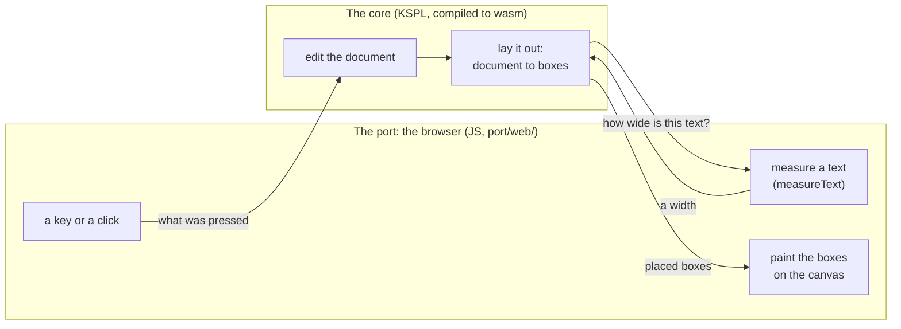

### Why a browser's layout is not borrowed

The browser does not lay out kspage's body with HTML and CSS. kspage paints the body onto a canvas itself, so that the chain from an edit to the screen stays short.

When an office suite in a browser feels slower than a desktop one, the causes, heaviest first, are:

| Order | What is happening |
| :--: | :-- |
| 1 | **The chain from layout to drawing is long.** Every character typed rewrites the DOM, and the browser's own layout, style resolution and compositing run. The larger the document, the longer each round trip. |
| 2 | **Garbage-collection pauses are uneven.** JS frees unused memory by itself, and the collector decides at run time how long it stops. Steady work such as typing stutters inside a pause. |
| 3 | **There is much to load and interpret at start-up** before the first screen appears. |
| 4 | The network. |

**The network is not the main cause.** Editing happens entirely on the machine. Only saving and editing together make a round trip, and a faster network changes neither 1 nor 2.

**The DOM and CSS are designed for web pages**, not for pagination (splitting into pages), footnotes or strict line breaking. Built on them, kspage's own pagination would pile on top of the browser's layout, and the chain in 1 would get no shorter. Painting onto a canvas itself, kspage controls the whole chain from the edit to the screen.

**The price is large**: line breaking, the selection, the cursor, the IME and hit-testing a click are all written in-house. The choice holds because the three views share them all.

### Why the core is a pure function

Layout takes the document and returns boxes, and touches nothing else. It needs no window, so it can be tested without one.

A *pure function* returns the same output for the same input and changes nothing outside itself. Layout is `(the prose, the styles, the font's measurements) -> a row of placed boxes`. It needs neither a window nor a canvas. From outside, it needs only font measurement, received as a struct of function-typed fields ([`model/font.kspls`](../model/font.kspls)'s `Font_source`): the caller fills each field with a function.

| What this gives | How |
| :-- | :-- |
| **It can be tested before a window exists.** | A table of fixed measurements ([`model/fixed_font.kspls`](../model/fixed_font.kspls)) can be plugged in, so no real font or OS is needed, and the answer is the same every time |
| **Where it draws can be chosen later.** | A thin layer encloses the difference between a canvas and a native window |

**Font measurement has two entry points: a line's width and its height** (`Font_source`'s `measure_width` and `vmetrics_of`, the vertical metrics). Pass them an already resolved `Font` (the final typeface, size and weight), so they depend on nothing of how a style holds things. Tied to the styles, they could not be defined until the document model was fixed, and without them layout could not be tested. Neither rasterizing (turning letters into pixels) nor shaping (choosing each letter's form and position) is held: the canvas uses the browser's own shaping, so the two entry points do not grow when a drawing target is added.

JS passes the width and takes the boxes back. It holds neither line breaking, nor inheritance (a style taking unset values from its parent), nor how the cursor advances. The wasm side does the tables' calculation too, and **it runs before the layout**: it changes the cells' text, so run afterwards, the boxes would point at the old text.

**Everything is bound into one file.** A page opened from `file://` cannot load ES modules (JS files importing each other) or use `fetch`: the browser's same-origin rule refuses both. Separate files would need a web server just to serve static files.

### Why the browser is the main target

Connecting to each OS's input method is most of the work of porting, and a browser gives it for free. So the browser comes first.

**Each OS designs its native IME differently** (Windows: IMM32 / TSF; Linux: IBus / Fcitx; macOS: `NSTextInputClient`), and that is where most of the porting work lies. In a browser, three composition events (start / update / end) are enough.

Caution: **Handle the three composition events as a set.** With only the update handled, committed text stays marked as still being composed.

**Development can go on under Windows.** The core calls no OS, so day-to-day work needs only the tests. Once the screen matters, it is checked in a browser.

### How drawing is split between the core and the browser

The browser's side does two things and no more. It measures text with `measureText` and returns the measurements, and it draws the laid-out boxes with `fillText` (`port/web/`, whose files are listed in [kspage](../README.md)'s "What is here").

Caution: **Do not bring layout decisions into it.** The thicker it grows, the more must be rewritten to move to a native window.

**The wasm has neither libc nor malloc** (C's standard library and its memory allocator; a browser provides neither). It is built with `--freestanding` (with no standard library) and allocates from a free list (a list of unused pieces) over a static buffer. The C that replaces libc sits with the target that has none ([`port/web/rt.c`](../port/web/rt.c)). Put into ksplc's freestanding runtime instead, it would be defined twice in the builds that also link a real libc.

**The link guarantees that the borrowed entry points have not grown.** An unresolved name not on the allowed list fails the link. With any name allowed, code that pulls in libc still links, and "there is no such function" first shows up in a browser.

### Where memory runs short it refuses rather than crashing

kspage refuses to open a document that would not fit in its memory, and it refuses before the open document is touched. Running out of memory partway would freeze the page and lose unsaved work.

**A failed allocation stops the whole wasm**: the screen freezes, and reloading the page loses unsaved work. So kspage refuses where the text first comes in ([`port/web/inout.kspls`](../port/web/inout.kspls)'s `kspage_web_load_buffer`), before the open document is touched.

**Derive the cap from the arena** (`port/web/state.kspls`'s `doc_limit`). Written as a number in two places, the refusal and its report get out of step the day the arena is widened. Widening alone changes nothing: four times the arena moves the limit four times further, and past it the page still dies. Whoever widens it first looks at how many instances the wasm gate starts and at the load gate's peak, since both grow with the arena.

**The cap counts blocks, because blocks set the cost of layout.** At the same number of characters, a table costs 40 times as much as prose. The other products all cap by bytes or characters.

**A cap in bytes cannot guard it.** The cost per byte of reading, layout and writing back, measured on paragraphs, does not hold for other shapes; a table's is far higher. Raising the multiple does not help. Fitted to the worst shape, the cap shrinks drastically for everything else and still guarantees nothing: a text can be packed tighter, and a table within the cap still freezes the page during layout. Per block, the cost flattens out. It explodes per byte only because packing puts many more blocks into the same bytes, and eight times the columns (1x20 -> 1x160) costs only 8% more. So a cap per block decides what fits (`port/web/state.kspls`).

**The cap per block has two values, by arrangement: 512 B for flow and 2 KiB for a grid** (the arena one block needs to be laid out and written back). Do not make them one. A grid costs five times what flow does, so one number either cuts prose's cap to a fifth or lets a table cross the limit; kept apart, prose keeps the higher cap. Inside a grid, everything below counts as grid, since the column-width solver's cost applies to rows and cells alike. A style name that does not exist counts as flow, as in layout. So at about the same size the answer differs by shape: prose of 1,162 KB opens, and a table document of 1,225 KB is refused (a gate holds this pair).

**It refuses at three tiers**, because each looks at something different:

| Tier | Where | What it does |
| :--: | :-- | :-- |
| 1. **The byte sieve** | `kspage_web_load_buffer` | It guarantees nothing. It only turns away a size that plainly cannot fit, before the arena for the text is prepared |
| 2. **The gate on the count of blocks** | `kspage_web_load` / `kspage_web_load_plain_text` | After reading and before the swap, it counts the blocks and refuses when layout and writing back will not fit |
| 3. **The last net** | `panic_hook` -> the JS throws | It catches what passes the gate: reading itself comes before the count of blocks is known |

* **The gate means something only before the swap**: afterwards, the open document is already gone.
* **Send plain text through the same gate.** If only one route is guarded, the page dies the same way through the other.
* **Why the last net is needed**: a packed text (a row of `{}`, three bytes per block) can use up the arena within the cap while it is being read. A cap fitted to reading's worst case would stop that too, but **cutting every ordinary document to a quarter, to stop a shape the net already handles, is not a fair exchange.**

**The net calls a JS entry point that throws.** The wasm holds no code that raises an exception, so only the JS side can throw. A freestanding panic (the error stop of a build with no standard library) records the reason and stops at `for {}` (`../../std/lang.kspls`), so an unhandled panic freezes the screen. The exception passes through the wasm frames to the catch at the caller (`port/web/api.js`'s `cramps`).

**After a refusal, the half-built arena is freed** (`kspage_web_recover`). Otherwise refusing loses half its point: after the unwinding nothing points at the half-built chunks, so the arena shrinks by that much for good, until even saving fails. Keep the reading's arena in a global: a local one is lost in the unwinding, leaving nothing to free it through. Do not touch the document. It is swapped only after reading, so a refused read leaves it unharmed.

**Report "too large" apart from "cannot be read".** The fixes are opposite: change the text, or split the document or widen the memory (`port/web/file.js`'s `whyNotRead`). Do not guess the reason from the size. The cap is not a count of bytes, so the core's reason is passed on unchanged (`port/web/api_io.js`'s `load` returns the reason, not true or false). The debug log shows the memory left, which its reader most needs just before a failure.

### Whether an entry point takes an arena depends on what it returns

A function that adds to an existing tree uses that tree's arena. A function that returns something new takes an arena as an argument, so the caller chooses how long the result lives.

**"The receiver has an arena, so none need be passed" is not true in general.** An arena argument may choose where the result goes, not where the receiver lives, and the two are not always the same arena.

| The entry point | Takes an arena? | Examples | Why |
| :-- | :-- | :-- | :-- |
| **Attaches to the receiver's tree** | No: it uses the receiver's | `Block.add_text`, `Block.add_child` (they allocate in the arena `inlines` / `children` hold); `new_editor(d)` | A caller's choice would allow a tree whose child dies before its parent. An `Editor` lives exactly as long as its document |
| **Returns a fresh result** | Yes, and keeps it | `lay.layout`, `Block.tiles_of` / `fresh_line` / `detach_line` | The caller decides how long the result lives |

**Do not pass `doc.arena` to an entry point that returns a fresh result.** A laid-out page is thrown away at every keystroke, so the web bridge makes a short-lived arena and passes that (`port/web/bridge.kspls`'s `page_arena`). In the document's arena, pages would pile up for as long as the person works.

**Do not decide which case applies by reading the code.** Add a check that fails wherever the arena passed differs from the derivable one, confirm no gate fires it, and only then drop the argument.

## The boundary between the core and the browser

JS calls the core only through functions marked `#export`, and the core calls JS only through a fixed list of names. Both lists are checked, so neither side can quietly call something the other lacks.

**The entry points JS calls in wasm are the `#export` functions under `port/web/`**, from the row in [`port/web/bridge.kspls`](../port/web/bridge.kspls) and the files beside it. The comment above each says what it takes and returns. The names wasm borrows from JS (`extern "C"`) are those [`port/web/imports.txt`](../port/web/imports.txt) lists.

**Do not list the entry points on the linking side.** The `#export` in the source decides what is exported, and the generated C marks it so the linker's `--gc-sections` (which drops unused code) keeps it. A hand-kept list silently misses each new entry point, and "there is no such function" shows up only when the button is pressed.

**`make test-kspage-wasm` checks that nothing else is exported**: only `kspage_web_*`, the `memory` and `__heap_base` the linker adds, and `memcmp`, which a target with no libc needs. `make test-conventions` checks that the two sides agree, matching the source's `#export` against the entry points JS calls by name.

Caution: **Both directions break silently.** JS calling an entry point the source lacks still links, and fails only when pressed. An entry point nobody calls stays, holding the boundary wide (Principle 5).

**Every entry point that asks which cell, holder or line edge the cursor is in is called after layout**, since none of that is known before. Outside a table or holder it returns 0 and leaves the key to the caller.

**How text and numbers are passed:**

| What crosses | How |
| :-- | :-- |
| Text passed in (a `len` argument) | It is first written into the typing arena (`kspage_web_input_buffer()`), unless the entry point's comment names the loading arena |
| Text passed out (an entry point that "writes out") | It goes into the one out arena (`kspage_web_out_ptr()`), which the next write clears; the entry point returns its length |
| Several numbers (`out`) | Each `out` receives the numbers listed in that entry point's comment under `port/web/` |
| A refusal | **Where an entry point can refuse for more than one reason, it returns the reason as a number its comment lists** (per `Sort_end`, `Merge_end` and the like), and the page words it |

### Values that cross the boundary

Numbers pass through one arena the wasm hands out, and text passes as a place and a length. JS must make a fresh view of the wasm's memory at every read, because the memory moves when it grows.

**Ask the wasm side for the arena the numbers pass through** (`kspage_web_nums()`). Memory borrowed below `__heap_base` is C's stack: a deep call writes to the same place, so the numbers written out vanish inside the entry point that wrote them. The arena's width, `kspage_web_nums_cap()`, fits the entry point that writes the most (a box's 15). Keep one reader (`kspage.js`'s `ks.nums(n)`).

Caution: **Do not hold the width on the JS side.** With a view made in each place, the day the arena is narrowed a view silently reads its neighbour. With one reader, checking that the numbers fit is one place too.

**No slice crosses the boundary** ("11.1 Types that cannot cross the C boundary" in [`docs/SPEC-language.md`](../../docs/SPEC-language.md)): the pointer and the length are passed separately. Nor can a struct be returned, so several values are returned through a place passed in for them.

**The wasm's memory becomes a different `ArrayBuffer` when it grows** (an `ArrayBuffer` is JS's handle on a block of raw bytes). Do not keep a `Uint8Array` (a byte view of that block) on the JS side; make one at each read.

**For text written out, take the length before the place**: if memory grows during the write, the place moves. Passed as two arguments of one call, the place is fixed first, since JS evaluates from the left. Reading is the same: make the view only after taking the arena. If the memory grows there, an array made earlier still points at the old `ArrayBuffer`.

### Keys, focus and menus

The page takes the keys the browser would otherwise act on wrongly, and leaves the keys of composing to the IME. Keys arrive through a hidden input field, which must keep the focus.

The body is a canvas, so keys go to a hidden input field over the cursor.

Caution: **Do not take the keys of composing.** A `keydown` while `isComposing` belongs to the IME, and taking it stops the composing.

What the page does take from the browser, and why:

| Key or event | Taken? | Why |
| :-- | :-- | :-- |
| The undo key | **Yes** | Otherwise the hidden input field runs its own undo: the field's text goes back and the body does not |
| Copy, cut, paste | **Yes, on the `copy` / `cut` / `paste` events**, which carry `clipboardData` | The hidden field is empty, so by default a copy takes nothing that can be pasted, and a paste goes into the field and never reaches the body |
| Ctrl+F, Ctrl+S, Home, End, Ctrl+A | **Yes** | The body is inside the canvas, so the browser's own versions act on the page instead (below) |

**JS puts in the undo separator** after a pause in typing (`kspage_web_break_undo_group()`). Without it, one undo takes back everything typed.

**Copy, cut and paste are not taken on the key side**: the key starts the browser's own copy, and taking the key stops that event from arriving. A paste's `input` has `data` null (the text is in `clipboardData`) and does not arrive as a keypress. With nothing selected a copy is not taken, so copying text from outside the page is not blocked.

**What the browser's own versions would do**: its search finds nothing (search looks broken). Its "save page" downloads this HTML, not the document. Home and End scroll the whole window, and Ctrl+A selects the whole page while the cursor stays put.

**A button and the formula field both take the focus.** Return it to the input field afterwards, or typing stops working.

**Do not rewrite the formula field while it is being typed in**: refilled on every redraw, it loses what was typed. It is applied on Enter alone. Applied when the focus leaves, a press elsewhere would change the text.

**Open one menu at a time.** Close the others before opening. `toggle` arrives afterwards, so closing there leaves a moment with two open, and the one meant to be pressed hides behind. Close a menu once a command is pressed (left open, it covers the canvas), but not in a field where a number or a name is typed (the typing could never be finished).

### What composed input needs

The IME works only on a real, visible text field placed at the cursor. So the hidden input field must keep the focus, keep its size, and follow the cursor.

| Rule | What goes wrong otherwise |
| :-- | :-- |
| **Do not put the focus on the canvas.** Only the hidden input field takes the keys | The canvas is not an editing element, so with the focus there the IME does not start |
| **Do not hide the input field with `opacity: 0` or `visibility: hidden`.** Make only its colour transparent and keep its size | On an invisible element, composing sometimes does not begin |
| **Keep the input field over the cursor**, moving it at every layout | The IME's candidate window (the list of characters to choose from) appears away from the text |

Note: `make test-kspage-browser` checks these three in a real browser, but **not that real composing works**: a headless browser has no input method. To confirm composing, open the page by hand and type.

### Drawing on the canvas

The page's side paints the boxes and bands layout produced, in a fixed order, and adds only what belongs to the editing screen. Each rule below keeps what is painted the same on screen, on paper and in export.

**Only the editing screen draws a region's frame** (the dotted outline of a prose, table or slide region). Printing and presenting go through what draws boxes too, so a frame drawn there would appear on the page.

**When printing, paint the background white and set the text colour to black** (a colour a style sets is kept). The screen's colours follow light and dark mode, so a dark screen's white text would not show on paper.

**Pictures are read and drawn by the page's side.** Read each source once (otherwise every redraw fetches it). Redraw once it has loaded: loading is asynchronous, and drawing without waiting leaves a blank. Until then, draw the frame alone (drawing nothing makes the inserted picture look lost).

**Only a press with Ctrl (⌘) held follows a link**, since on the editing screen a press on text places the cursor. Do not move the cursor when following it (the person could not go on typing on return). A link looks like one because of its decorating style, so drawing needs no special case.

**Draw the page's header and footer after cropping**: they sit in the margins, outside the frame that crops the contents. Their coordinates are from the page's top left, so do not shift them again (with the margin added again, they land off the page). Lay them out again for every page, since the numbers change.

**Draw underline and strikethrough after the text, in the text's colour**; drawn first, the text covers them. Their thickness follows the font size (a fixed 1px looks like a hair at large sizes). The composing underline sits at the box's bottom edge, so it reads as a different line from the style's underline (below the baseline, the line the letters sit on).

Caution: **Set the colour again for every box.** Left overwritten, the caller's colour carries on to whatever is drawn next.

**Draw a box with no colour set in the caller's colour** (which follows light and dark mode). Paint the background before the text, or it covers the text.

**The painting order**, back to front:

| Order | What | Why in this place |
| :--: | :-- | :-- |
| 1 | All the band fills | Painted one band at a time, a neighbouring cell's fill covers this cell's line, and the table's grid goes missing in places |
| 2 | All the bands' lines | After every fill, so no fill covers a line |
| 3 | The boxes (text) and the selection | Bands painted after them would cover both |

**Unlike a region's frame, a band is document content**: it appears in print and when presenting, so draw it where boxes are drawn. A line straddles its path, half on each side, so move it inward by half its thickness, or it spills into the neighbouring cell.

### The page's scripts share one scope

All the page's JS files run as one script. So two files must never declare the same name, and they share only two named objects.

**The JS runs concatenated into one `<script>`** ([`port/web/bundle.kspls`](../port/web/bundle.kspls) binds it, in the order [`port/web/page.html`](../port/web/page.html) names).

Caution: **Do not declare one name with `let` / `const` / `class` in two files**: the whole block is then never evaluated, so each file passes alone and nothing happens on the screen. `make test-js-syntax` checks each file and the concatenation, but only their syntax, so a mistyped name gets through.

**The script files share only two objects, `ks` and `ui`**: `kspage.js` makes `ks` where it starts the wasm, and `page.js` makes `ui` for the page's frame. `make test-conventions` checks that every field read from either is one some file puts there, and that every field put there is read. So a mistyped read and an entry point nobody calls are both caught. Do not expose a field that only its own file uses; keep it out of the `return`.

Two other shared objects are not checked this way: `kf`, through which [`port/web/file.js`](../port/web/file.js) and [`port/web/save.js`](../port/web/save.js) pass entry points both ways; and `ks.api`, which faces callers outside the page, so a field there that no file reads is no defect.

## The document model

A document is a tree of blocks. Each block holds a row of runs (its own text) and may hold child blocks. A block names its style; the styles live in one table beside the tree.

The tree for a heading, a paragraph with one bold word, and a table looks like this (the style names are examples):

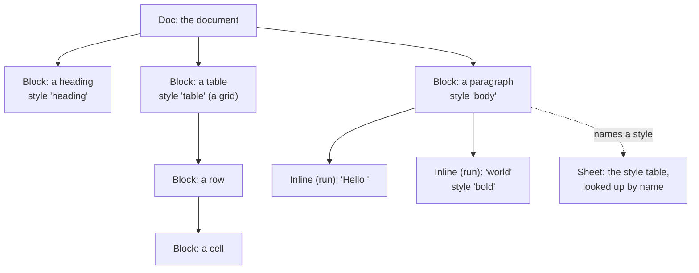

### A block has no field for its kind

A heading, a paragraph and a list item are all blocks; only the style name differs ([`model/doc.kspls`](../model/doc.kspls)).

Caution: **A separate kind field would say the same thing as the style**; each place that draws would pick one of the two, and where they disagreed nothing would decide which is right.

### Unset is expressed with `Option`

Every style field can be "unset", and an unset field takes its parent's value. Unset is an empty `Option` (KSPL's "maybe a value" type), never 0 or an empty string.

Caution: **Do not use 0 or an empty string to mean unset.** No weight is 0, but `false` is a real value for italic, so in some fields the marker would collide with a value.

**The rule covers the fields that inherit and the values a person can type as 0.** A measurement that cannot usefully be 0 keeps 0 as its "not set" mark, and the section on that field says what 0 means:

| Field | What 0 means |
| :-- | :-- |
| a slide's width, the paper's width | the container's width |
| the paper's height | no pagination |
| the body's width | no limit |
| a paragraph's leading (the distance from one line to the next) | the font's own height |
| a rule's width | no rule |

Only the font is inherited. **Space before and after a paragraph, and the indent, are not**; inherited, they would space a child twice over at every level of nesting.

### Only the block holds its position

A frame's position on a slide is stored on the block itself: not in its style, and not in a table beside the document. The same goes for every value that differs from one block to the next.

Of the three arrangements, only absolute coordinates cannot work out where a block goes from the element before it. Every frame's position is its own, so `Block` holds `frame: Rect?` ([`model/doc.kspls`](../model/doc.kspls)).

**Do not put it in the style**: a style is shared by name, and an unshared value would need one style per frame. Nor outside the document: held in a separate table, the positions alone would be lost on saving and reading back.

**Every value that differs from one block to the next is held on the block for the same reason**, though the blocks share a style:

| Field | What it holds |
| :-- | :-- |
| `frame` | a frame's position on its slide |
| `step` | a frame's build step (when it appears as the slide is shown in turn) |
| `size_of` | a table's column widths and row heights |
| `span_rows` / `span_cols` | how far a merged cell spans |
| `name` | the name a formula or a reference points at |

The sections that use each field point here.

**Fields that one arrangement alone reads are the exception to the rule that only the arrangement branches** ("Why the three can be made one"): `frame` and `step` for absolute coordinates (flow and the grid derive a position from the previous element), and a table's sizes and merges for the grid ([`model/doc.kspls`](../model/doc.kspls)'s `Block`).

### An unknown style name does not stop layout

A style name missing from the table is treated as unset ([`lay/flow.kspls`](../lay/flow.kspls)), so the text takes its parent's look.

Caution: **A misspelt name passes silently.** Check first with `Sheet.find` that a name exists. Failing partway through layout instead would let one typo blank the whole screen.

### Styles are told apart by role, not by name

To find "the heading style" or "the code style", kspage looks at what a style does, never at what it is called. A document may name its styles anything.

**Where the core, the page, a theme or a reader needs "the heading style" or "the code style", it looks for a role in the table below**, never for a name.

Caution: **Neither the core nor the page may list styles by name and remember them.** A remembered list breaks silently the day a document renames a style: that one style alone keeps the previous theme's colour. What is looked at is the role.

| The role | How it is recognised |
| :-- | :-- |
| A heading | its depth (`outline > 0`) |
| A code block | it does not wrap (`wrap == false`) |
| A table | it is laid out as a grid (`arrange == grid`) |
| A slide | it is laid out at absolute coordinates, and has a size |
| A collecting block (one that gathers entries, such as a table of contents) | its way of collecting (`collect`) |
| A framed block | it has a fill, it draws a line |
| A table's cell | a flowing paragraph with inner space and no marker (`cell_like` in [`model/style.kspls`](../model/style.kspls)) |

Caution: **A theme must cover the styles a person made too.** Chosen by name, those alone would escape it.

**Inserting looks a style up by name, then by role, then makes one by name.** By name alone, it breaks the day the name changes; by role alone, it cannot choose between two of one role. A slide style cannot be made up: the core must not decide a slide's size, so the style has to exist first.

### Asides and annotations are held beside the text, outside the flow

Two kinds of side text stay out of the document's flow. An aside belongs to a holder (a table, a slide, a picture); an annotation (a remark on some text) belongs to a run.

| | An aside | An annotation |
| :-- | :-- | :-- |
| **Held on** | the holder's block (`Block.aside`) | its run (`Inline.remark` and `Inline.remark_by`) |
| **What it is** | on a slide, the presenter's note | what somebody said about the text, not part of the document |
| **Who sees it** | only its writer: no output includes it | it stays out of the flow too |
| **Where it is attached** | only with the cursor inside a holder (a table, a slide, a picture); beside an ordinary paragraph the screen could not show where it is | on a range of text |
| **Undo** | it is saved, and one undo removes it | one undo removes both the words and the author |

**An annotation covers a range**, so splitting the run leaves it on both halves (like a link, unlike a note's mark, which is a point). Runs with different annotations are not joined, or one remark would cover both. The core does not decide who wrote it (it holds no user name); the name comes from outside when it is added.

### A picture: the document holds only its source and size

The document stores where a picture comes from and how large it is laid out, never the picture's bytes.

**Do not put the picture itself into the document**: in a browser the arena is a static 1 MiB block, which one photograph fills. The document holds only where the picture comes from and how it is laid out. Reading and drawing it happen outside (the core cannot read a picture). In exchange, the document alone does not carry its pictures.

**The document holds the size too.** The core cannot measure a picture, and an entry point asking outside would make layout depend on how the reading went. With the size in the document, layout is the same whether or not the picture can be read. A picture with only a source is not laid out.

**It is not shrunk to fit**: where it does not fit it overflows (as with a set column width), since shrinking needs the aspect ratio, and knowing it means reading the picture.

**A picture is not split**: its size is known first, so where it does not fit, it moves whole to the next page (like a slide).

## How text flows

Flow fills a line with text until the next piece no longer fits, then starts the next line. Each rule below keeps that simple loop correct and fast.

A paragraph's text becomes lines and boxes like this:

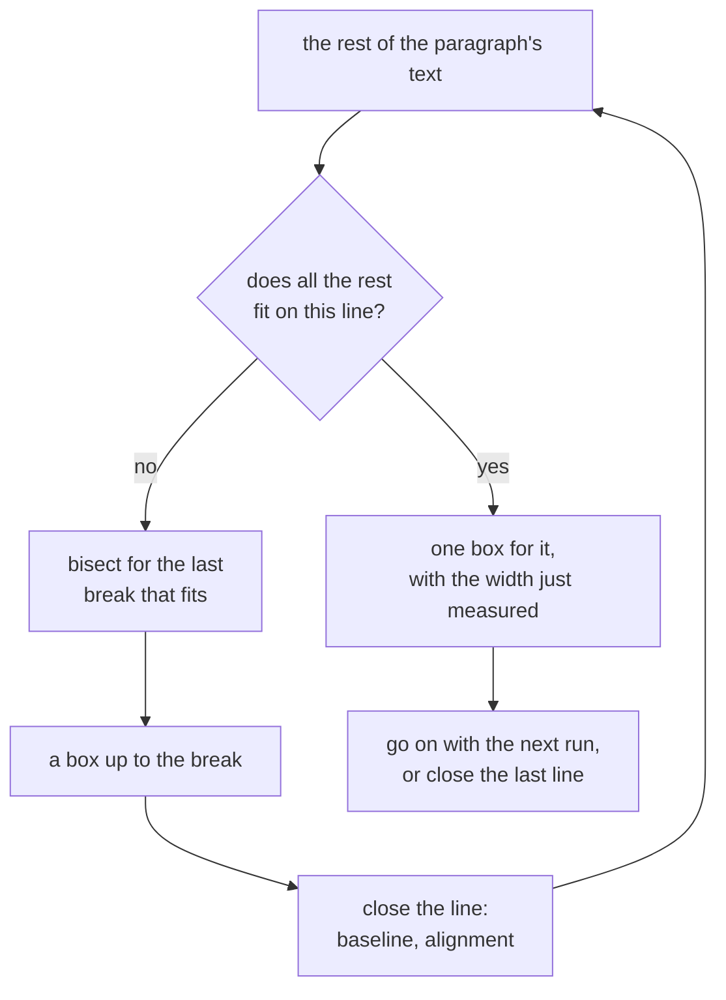

| The rule | Why |
| :-- | :-- |
| **A line breaks after whitespace, and beside any non-ASCII character.** | Breaking at whitespace alone would let prose written without spaces (Japanese, Chinese) run along one line forever |
| **Even where not one character fits, one character is placed, overflowing.** | Otherwise the line never advances and layout loops forever |
| **The whitespace at a break stays at the end of the earlier line.** | Moved to the start of the next, it would break the left edge |
| **The characters of a line sit on one baseline.** | A line is as tall as its tallest character, so only closing the line decides a character's vertical position |
| **Width is always measured for the whole text from the start of the line.** | Adding widths one character at a time drifts under an implementation that kerns (moves some letter pairs closer, such as "AV") |
| **The break is found by bisection** (halving the range until the break is found). | Below |
| **The measured width is returned with the break.** | Below |

**How the break is found:**

* **Do not measure one character at a time going forward.** Each measurement asks the typeface (`measureText` in a browser), so k measurements for a k-character line would set the cost of every keystroke's relayout. Ask once whether all the rest fits, and bisect only where it does not.
* **Bisection relies on "a longer text is never narrower than a shorter one".** Even under negative kerning the boundary slips by one character at most, and the caller measures an overflowing line again.
* **Snap the midpoint to a character boundary** (a Japanese character is several bytes). Searching only backwards or only forwards does not find the boundary ([`lay/line.kspls`](../lay/line.kspls)'s `midpoint`).

**Why the width comes back with the break:**

* **Do not measure the same text twice.** When "all the rest fits", the caller puts the text just measured into the box. Without the width returned, each box would cost two calls across the boundary. Most paragraphs do not wrap, so this halves the calls.
* **Do not return it after a bisection.** The break depends on the text alone, so the break returned lies before the point measured (`Inline.known_fit`).

### Text that has not changed is not measured again

Each run remembers the widths it has measured, so a keystroke measures only the run typed into. Layout itself (boxes and lines) is never remembered.

**Measuring calls across the boundary** (in a browser it asks the real typeface), so measuring the whole document at every keystroke would slow typing as the document grows. Unchanged text has an unchanged width, so a run caches what it measured ([`model/run.kspls`](../model/run.kspls)'s `wide`).

The strongest answer, laying out only what is in view (as VS Code does), is closed to kspage because it paginates: the page count and the page breaks need what is out of view. kspage also stays in step with the typing rather than catching up later, a common complaint.

**A run caches measurements, never layout.** It keeps two things:

| What is cached | What it holds |
| :-- | :-- |
| The width of its whole text | that width |
| The answers `fit` gave | keyed by "typeface, space, start", holding "break, width laid, width to the end" (`model/run.kspls`'s `Fit_at`) |

Caution: **Do not cache a box or a line.** Where a line wraps depends on the width the text before it used, which a run alone does not know.

The whole-text width spares a paragraph that does not wrap all measuring, but never hits for a run that wraps. Once the whole does not fit, `lay/line.kspls`'s `fit` bisects for the break, measuring about log(length) times, and the following lines are not whole texts either. With `fit`'s answers cached too, a keystroke measures 7 or 8 widths whatever the document's size: the one run typed into is measured again (its cache is thrown away there). **This keeps to "no box or line is cached"**. Caching the break alone would break it, since the break depends on the width the text before used. With the space in the key, the answer is fixed.

**A run caches for one "typeface and space" pair**, throwing the cache away when asked with another. Where one paragraph is one run (the commonest shape), every question from the start of a line carries the same space, so it keeps hitting. A run that starts partway along a line and wraps misses (its first line has a different space). It is measured again, which costs no more than having no cache.

**The cache lives in the run's own arena**, so `remember_fit` takes no arena argument.

Caution: **Do not let layout's arena be passed in.** The cache would point into memory freed at the next layout, and in wasm that becomes a loop that never stops (a freestanding panic records it and enters `for {}`).

**Staleness is stopped by keeping invalidation in one place.** Only three methods of `Inline` change the text shown (`buf` and `shown` are `priv`), and they throw the cache away. Do not guess by a fingerprint of the content: the length misses `ab` -> `ba`, and even a strong fingerprint can collide.

**The typeface is part of the key**, since the same text in another typeface has another width. The typeface name is compared by address, not read. The styles' table owns that text, so replacing it changes the address, and another address holding the same text is merely a miss (slower, never a wrong width). This relies on a typeface's measurements never changing. kspage loads no typeface (it only names the environment's), so they cannot move while the page is open. **Whatever adds typeface loading must also throw the cache away when loading finishes.**

**Vertical metrics are cached per typeface.** They do not depend on the text (a line's height comes from the typeface), yet uncached they are asked for three times per box. A document uses no more typefaces than styles, so cached on the layout side, the questions drop to the number of typefaces. Put what is added in one place: without a way to "give the height from the metrics", whoever caches the metrics would ask the typeface again for the height ([`model/font.kspls`](../model/font.kspls)'s `line_height`). When the cache overflows, it simply fails to remember: an old entry is swapped out, and the next box measures again.

**An entry point that sets a value again does nothing when the value is the same.** In the plain-text shape "no value" arrives at every setting ([`expr/calc.kspls`](../expr/calc.kspls)'s `show_free`), so invalidating there would measure the whole document again.

Note: The same input always gives the same count, so the gate checks **the count of measurements**, not time: the same shape of document is typed at two sizes and the counts must match, covering a miss as well as a hit ([`../tests/wasm/store.mjs`](../tests/wasm/store.mjs)).

### A style is looked up by name once

Layout remembers the last style it found, so the ten or so lookups one block makes cost about one.

**Laying out one block looks up the same style name about ten times** (collecting headings, notes, running numbers, a fence's breaks, the arrangement, the box, the fill). The lookup scans the table from its end, so the further back a document's style sits in the table, the heavier each keystroke. Remembering the last style found removes the gap between the table's head and its end.

**The other products do not look styles up here**: Word and Writer store a reference to the style itself in a paragraph's attributes. kspage stores a name. A style is shared by name, and what is saved is a name too (saved by number, an old text would point at another style the day a style is added). So the lookup is made faster without changing what is stored.

**The one style found last is remembered.** One block keeps asking for the same name, so nine times in ten that is enough. What is remembered is the style's place in the table, not the name's text, which could live in an arena freed first. A place is checked against the name the table holds.

**Do not remember "there was none"**: a style of that name added later could then never be found (adding does not clear the memory). The lookup checks the name before returning, so a stale memory is merely a miss.

**No index of names is added.** One memory is enough where it hits, and an index would shorten only the miss: a document pointing at a name not in its table, fixed by changing the faulty document. If documents full of misses appear, the answer is bisecting an array of indices sorted by name. (The order of `styles` itself must not move: saving and matching read that order.)

**`Map` is not used.** The key names come from a document, so colliding keys can be crafted (the decision in `../../std/docs/DESIGN.md`; the check is `make test-conventions`).

### The inner padding is not derived from the line height

The space between a fill's edge and its content is one setting, `Style.pad`, for all four sides. It is not a multiple of the line height.

The fill's band needs space between its edge and the content (a code block does).

Caution: **Do not make that space from a multiple of the line height.** A multiple acts between line and line, so it opens the prose's leading too, not just the band's edge (the text looks thinly stretched).

By Principle 6, **`Style.pad` is the space inside all four sides** ([`model/style.kspls`](../model/style.kspls)): the band spans the region's full width, and only the content is inset within it.

**Always restore the region's right edge.** The pen holds only one right edge per region, so otherwise the next sibling is laid out that much narrower ([`lay/flow.kspls`](../lay/flow.kspls)'s `close_block`).

### A code block's lines form one fence, painted as one band

A code block is several one-line paragraphs, but it is painted as one background. One file decides which paragraphs belong together; such a group is a *fence*.

A code block is a row of paragraphs (one line is one paragraph). **Painted one at a time, the background shows through between the lines and the block comes out striped.**

Caution: **Do not decide this in two places, layout and Markdown export.** Changed in one alone, the block is one sheet on screen while each line is fenced separately in the text (or the reverse).

**[`model/fence.kspls`](../model/fence.kspls) alone decides where one fence starts and ends.** Consecutive paragraphs form one fence when they have the same style name, do not wrap, carry no marker, collect nothing and are arranged by flow. The name "code" is not looked for (the same style under another name would then not become a fence).

Layout **takes one fill band at the fence's start and stretches it to where the fence closes** ([`lay/flow.kspls`](../lay/flow.kspls)'s `Joint`). Do not open space before or after partway through (the background would show through there). Do not take a new band partway through either (an unused band would stay in the drawing side's count).

The space above and below is a multiple of the line height (the band closes at the height of the line's box, so with the line exact the text would touch the edge).

### The indent does not narrow the region

A fill or a rule starts at the region's left edge, before the indent; the indent becomes space inside the fill.

The band of the fill and the rule starts before the indent (`hold_panel` in [`lay/flow.kspls`](../lay/flow.kspls)). **Narrowed by the indent, it would leave a strip of background at a code block's left, and in a list the fill would break off before the marker** (the marker sits inside the indent). So the indent becomes the left space inside the fill.

### The column set

Text in several columns, as in a newspaper, is one block whose style says how many columns. Its children are dealt into the columns, and the column heights are levelled.

**Word's columns are a section break**: an invisible mark, whose breaking, meshing and emptying happen out of sight. CSS's `column-count` holds no such mark and levels the heights as the content comes.

**A column set is one block** ([`lay/columns.kspls`](../lay/columns.kspls)). The style holds the number of columns (`Style.columns`), and the block's children are dealt into the columns. No invisible mark such as a section break is made. The block is the range itself, so a table or a slide can sit inside a column set without overflowing a column.

| The rule | Why |
| :-- | :-- |
| **Heights are measured first and levelled**: the children are laid out one at a time at a column's width and measured, then rewound and dealt out | So the right column is not left empty when the content is short |
| A child is not split | Its two halves would land in different columns. So the heights do not always come out equal |
| Fewer children than columns is still a column set | Repacked, the column set would vanish from the screen |
| **A column's width is not held.** It follows from the number of columns and the gap between them (`Style.column_gap`) | A width field would allow settings where width × count + gaps does not add up to the region's width |
| **A column set does not cross a page**; where it does not fit, the whole set moves to the next page | Split across pages, the reader could not tell which column continues which |

## How a grid and absolute coordinates are laid out

The content of a table cell and of a slide's frame is laid out by flow. The grid and the slide only decide where each cell or frame goes and how wide it is.

Both **leave the content of a cell or a frame to flow** ([`lay/flow.kspls`](../lay/flow.kspls)'s `place_blocks`): given the region's top-left corner and width, flow lays the content there and returns the height used.

**Do not write how content is arranged three times.**

| The rule | Why |
| :-- | :-- |
| **A grid column takes its set width, or else fits its widest content.** The row with the most cells decides the number of columns | Columns that do not fit shrink with their ratios kept; cutting only the excess would collapse the narrow ones first |
| A column's width is measured **as the real layout does it**: the cell is laid out once, and its box's right edge read | Added up instead, the indent, inheritance and wrapping would each be solved two ways |
| **A row is as tall as its tallest cell** | So only laying out its cells decides its height |
| **A laid-out cell keeps the shape cut by its column's width and its row's height** | Sized to its content, neighbouring cells would not line up |
| **The space after a paragraph goes in after the children** | Opened before them, it would split the block's inside and pack the gap to the next block tight |
| **A slide at absolute coordinates does not stretch**: it returns the slide's size, not its content's | Absolute coordinates mean that a slide's size is fixed first |
| **A child with no position is laid over the whole slide** | The caution below |

Caution: Dropped instead, a child with no position would make written content silently disappear. An apparent overlap can be fixed; something out of sight cannot.

## How the arrangements nest

Each block's style says its arrangement, and layout switches arrangement at that block. So a table can sit in prose, a list in a table's cell, and a table on a slide, all laid out the same way.

**Each block's arrangement is set by its style** ([`model/style.kspls`](../model/style.kspls)'s `Arrange`). Flow hands over to the grid only at a block whose style is `Arrange.grid`, and a cell's content returns to flow. So a table inside a table, or a list inside a table, is laid out the same way.

Caution: **Do not let the document hold it**: with "this is a table" written into the tree, the tree could no longer be laid out by another arrangement. The arrangement is not inherited either, or even a paragraph in a table's cell would become a table.

**Flow is the entry point**: only flow knows what follows the previous element, so only flow can hand over to another arrangement. All three nest in one another (a table in the flow or in a table's cell, a slide in the flow, a table in a slide's frame), and every combination is laid out the same way:

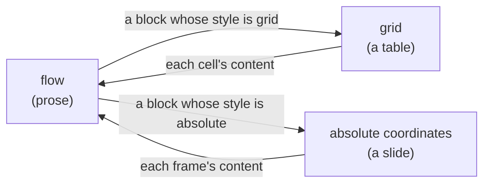

**A slide's size is set by its style** (`Style.width` / `Style.height`). That is what lets absolute coordinates sit in the flow. Partway along a flow there is no fixed size, so a size taken from the content would break "a slide's size is fixed first", and slides of one style would differ in size.

**Set both width and height**: a frame sits at absolute coordinates in px, so with the width left to the container the document would look different at each window width. A width of 0 means unset and becomes the container's width. Across, there is a container width to fall back on; down the page there is none, so a height of 0 is a slide 0 high.

**A frame's position is relative to the slide's top-left corner.** Only layout decides where the slide lands in the flow, so a `frame` read as screen coordinates would leave the content behind when the slide moved.

### A region's kind is its arrangement

On the editing screen a grey dotted line marks each prose, table or slide region. A region's kind comes straight from its outermost block's arrangement.

The line comes from bands layout leaves behind (`Page.regions`). The outermost block's arrangement decides: flow is prose, a grid a table, absolute coordinates a slide. **A region's kind is `Arrange` itself**; under another name, nobody would notice the style's arrangement and the region's kind drifting apart.

| The rule | Why |
| :-- | :-- |
| **Merge consecutive flow into one region** | Split per paragraph, one continuous piece of prose would look like as many regions as it has paragraphs |
| **Shrink a table's or a slide's region to its laid-out content's width**; down the page it stays a band (the space before and after a paragraph belongs to its region too) | Otherwise a page-wide frame would surround a narrow table |
| **Regions are recorded only when the whole document is laid out** (`flow.layout`) | What lays out a region's inside again (`place_blocks`) also lays out nested content, so recording there would add a region per table cell |
| **The frame is drawn only on the editing screen**; printing and the one-slide-at-a-time view carry none | It is not content but a guide to which kind of tool is in use where the cursor is |

### Flow and the grid call each other

Two pairs of layout files call each other, and both pairs stay in `lay/`. The block side must set the pen's per-paragraph settings again for every paragraph.

[`lay/flow.kspls`](../lay/flow.kspls) and [`lay/line.kspls`](../lay/line.kspls) are split into "stacking blocks" and "building one line" (for the 1000-line cap per file). The line side holds the pen (`Pen`). The block side sets the per-paragraph settings on it again (alignment, leading, the marker at the start of a line). **Forgotten, a paragraph that sets no style of its own is laid out with the previous paragraph's settings.**

[`lay/flow.kspls`](../lay/flow.kspls) and [`lay/grid.kspls`](../lay/grid.kspls) import each other, so the cycle stays inside one folder ([Why the folders are split by 'what they know'](#why-the-folders-are-split-by-what-they-know)).

Both entry points (`flow.place_blocks` and `grid.place_rows`) take the shape "How a grid and absolute coordinates are laid out" gives. **Neither looks at `at.h`** (the height of the region handed in): the content decides the height, and the caller what overflows.

## How the cursor is held

The cursor is a place in the document ("this run, this byte"), not a point on the screen. So it stays put when the window is resized and the text moves.

The cursor is held as "which `Inline`, and which byte in it" ([`lay/caret.kspls`](../lay/caret.kspls)), **not in screen coordinates**. When the width changes the boxes move, but the position in the document does not, so the cursor survives relayout. (The `Inline` it points at lives in an arena relayout does not throw away.)

In exchange, a click must become a document position, so **each box records which `Inline`, and which byte in it, it came from** ([`lay/flow.kspls`](../lay/flow.kspls)'s `Box`).

| The rule | Why |
| :-- | :-- |
| **A click snaps to the nearest character boundary**; at equal distance it goes left | Text inserted mid-character would break it |
| **A click outside every box goes to the nearest box** | A click on the margin that did nothing would make the screen look dead |
| **Empty text gets a zero-width box** | The cursor can stand only on a box. Without one, an empty cell or paragraph could not be clicked into, and an added row would stay buried in the table at height 0 |
| **Vertical distance weighs more than horizontal** | At equal weight, the end of a neighbouring line can come out nearer, and the cursor would jump to a line other than the one clicked |
| **Deleting removes a character, not a byte** | Deleting one byte of a multi-byte character breaks the text |
| **The `Inline` holds its text**, copied in when added | So the caller need not keep it alive |

Caution: **Do not keep a reference to a run's text.** It grows and shrinks with editing, and moves when it does.

### Left and right follow the document; up and down follow the laid-out lines

← and → step through the text in document order. ↑ and ↓ move to the line above or below on the screen, keeping the column.

Caution: **Do not stop ← and → at the boundary of a run or a paragraph**; stopped there, the cursor could not get past the start of a paragraph. The order is layout's (a block's own inlines first, then its child blocks).

↑ and ↓ move across the laid-out lines, because only layout decides where a line stands. The target column is kept, and the move acts as a click at that column on the neighbouring line. **Call them after relayout.**

**The target column is set where vertical movement began**; taking the current column each time would pull it in at every short line passed. Forget it after a horizontal move (`collapse`), or ↑ or ↓ after ← or → would jump to the old column. Only vertical movement sets it again.

### A position at a wrap is read by how the cursor got there

Where a line wraps, one place in the text is both the end of one line and the start of the next. Which line the cursor is shown on depends on how it got there.

A position at a wrap reads both as "the end of the line before" and as "the start of the next line", since the same `offset` belongs to two boxes. Which one the cursor stands at depends on **how it got there** (`Caret.at_line_start`):

| How the cursor got there | Where it stands |
| :-- | :-- |
| **It came down from the line above, or the start of that line was clicked** | the start of the next line |
| **Anything else** | the end of the line before |

**Without the distinction, ↓ does nothing there**: the new position would be drawn at the end of the line before, so only the column would jump.

The flag comes from the click, so `hit_test` sets it (a position is at a wrap when it is at the start of a box that is not the start of its run). **Set a position through `at`**; writing the field directly would leave the remembered column and this flag as they were.

### The cursor's cell is outlined

The table cell the cursor is in gets an outline ([`lay/caret.kspls`](../lay/caret.kspls)'s `cell_frame`), in **the cell's shape as layout left it**, redrawn at every layout.

**The content's box does not stand in for it**: inset by the indent, it is narrower than the column, and neighbouring outlines would look misaligned.

**When nested, it is the innermost cell**: the outer cell holds the same inline too, and layout records cells outermost first, so searching from the end finds the inner one first.

**The outline and an editable formula are two things.** The outline only shows which cell the cursor is in, while a formula can be written only on the cell's first inline ([`expr/calc.kspls`](../expr/calc.kspls)'s `takes_formula`). So in a cell holding two runs the outline appears while the formula field stays closed.

### The selection is two points

A selection is "where it started" and "where it is now". Which of the two comes first is worked out from document order, not stored.

**The direction it was extended is not stored**: document order decides which point comes first (`Doc.index_of`), so a stored direction would say the same thing twice.

Caution: **Always collapse the selection when the text moves.** If only the current point moves, the editor treats text as selected when nothing is, and whatever is typed next deletes that range.

**The core computes the highlight rectangles.** Painting whole boxes would highlight an entire run when only a few characters are selected. Each rectangle needs the width up to the selection's end measured, and only the core holds the measurement entry point.

**An inline that has become empty stays in the tree**, or any cursor or box pointing at it would dangle; an empty run draws nothing.

### Home and End go to the ends of the laid-out line

Home and End go to the start and end of the line on the screen, not of the paragraph, and never leave a table cell.

`Editor.move_to_edge` moves to the start or end of **the laid-out line, not the paragraph**. With Shift held it extends the selection there. It does not leave the container: the end of a table row would land in the next cell's text, so the edge is the cell's. Call it after layout, which decides a line's ends (as with ↑ and ↓).

Two boxes are on one line if they overlap vertically; compared by top edges, a line mixing character sizes would read as two.

### Select all runs from the first run to the last

`Editor.select_all` selects from the first block's first run to the last block's last run: **the whole document, not the page in view**.

**A block without any text is skipped** (a picture or a shape has nowhere for the cursor to stand). The runs at both ends are found in one place (`Block.first_run` / `last_run`), so what "the first run" means cannot differ between the ends.

### The text being composed goes into the document too

While the IME is composing, its text sits in the document like any other text, so layout and drawing handle it unchanged. It enters the undo record only when it is committed.

Typing Japanese needs the text being composed on screen until it is committed.

Caution: **Do not hold it separately, outside the document**, or wrapping, style inheritance and baseline alignment would all need a second solution for the composition alone.

Instead, the composition goes into the document, and the cursor records how many bytes before it are being composed. Layout and drawing work as usual, unaware of it. **Until committed, the text can vanish at any time.** Replacing it deletes the old composition, then inserts the new (inserting without deleting would pile it up at every keystroke).

It is told apart by a mark on the box ([`lay/flow.kspls`](../lay/flow.kspls)'s `Box.composing`). **Layout does not set the mark**; `mark_composing` does, at every layout, since the rebuilt boxes lose earlier marks. It marks every box the composition covers, since a composition can cross a wrap.

Caution: **Typing and deleting during a composition go to the composition's handling**: typing commits it first; deleting cancels it whole. Cutting into its middle would leave the next replacement unable to know how much to delete.

**The composition does not go into the undo record.** It can vanish at any time, so recorded as typed, a cancelled composition would leave a step whose undo restores nothing. The commit is recorded, as one "typed" step ([`write/typing.kspls`](../write/typing.kspls)'s `commit_preedit`).

**So do not add anything that merely clears the composing mark.** The text would stay in the document with nothing in the record, a hole that cannot be undone. Moving the cursor and typing both go through the commit first.

A composition begun after deleting the selection differs: that deletion is an edit of its own, so it stays in the record and does not return when the composition is cancelled (the undo brings it back).

## The editor and the undo record

Every change to the document goes through one `Editor` ([`write/edit.kspls`](../write/edit.kspls)), which holds the document, the cursor and the undo record. Each change records how to undo itself before it happens.

Caution: **Do not change the document directly.** Nothing is recorded, leaving a hole the undo cannot restore. Only two operations in `Editor` change text (insert and delete), and both record their inverse first.

One edit, and later its undo, go like this:

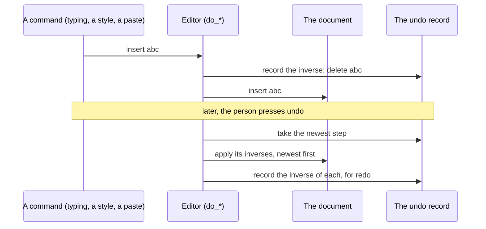

### Undo is held as inverse operations

Undo keeps no copies of the document. Each edit records its opposite (deleting for an insertion, inserting again for a deletion), and undo applies those.

**No copy of the document is taken**, since the cursor points at the `Inline` itself and a swapped-in copy would leave it dangling.

Caution: **Copy the text before deleting it**; afterwards it cannot be read.

**Apply the inverses newest first**, or the positions the later operations looked at would have shifted. While undoing, redo records the inverse of each inverse (the original operation) onto a new step.

**Once something new is written, discard the redoable steps**, or a redo after undoing and writing something else would apply edits to text that no longer matches.

### Undo then redo restores the document byte for byte

**Undo, redo, and the document is back to the same bytes.** The undo rests on this: change only the undoing side, and a redo can trample the earlier edit. The invariant is checked (`../tests/wasm/edit.mjs`).

### Where a step ends is decided outside the core

What one undo takes back is a *step*. Continuous typing is one step, and the browser side cuts a step after a pause in typing.

**Do not make each keystroke a step**, or undoing one sentence would take dozens of presses. Continuous typing is one step, cut when the cursor moves and when a composition is committed.

**A pause between keystrokes does not cut a step**: the core has no clock, so a caller that needs a cut at a pause calls `break_group`, as the browser side does after a pause in typing.

A step that changed nothing is not recorded; its undo would restore nothing.

### The record holds every kind of instruction in one row

The undo record is one list for every kind of edit (text, sizes, styles, frames, the paper), so undo always goes back in the order things were done.

The undo record is one row of instructions, each undoing one edit, whatever the edit touched: text, a cell's size, a row or column, a run, a style, a frame, the paper and the rest. The kinds are the variants of `Op` in [`write/record.kspls`](../write/record.kspls).

Caution: **Do not split them into separate records.** The undo order would split, and interleaved edits would stop adding up. Applying one style puts the split, the apply and the join in one step.

**Undo and redo go through the same path** (`apply_inverse`); written twice, a new kind of instruction would reach only one of them.

| The instruction | How it is held | Why |
| :-- | :-- | :-- |
| **A cell's size is one instruction for columns and rows alike** (a field says which) | It remembers "unset" too | Split in two, the same shape of record would exist twice. Restored as 0, a size would appear where the content had been fitted |
| A drag of a cell's border | The setting saved when the drag began undoes the repeated moves; the step boundaries are at the grab and the release | Dragging does not grow the record, and one drag is one undo |
| **A frame's position remembers "unset" too** | as `Option` | A frame with no position covers the whole slide, so restored as a 0-size rectangle it would vanish |
| **The paper settings are saved whole** | all fields at once (the same reason as a style's look) | In the paper, 0 means "no pagination" (height), "the container's width" (width) and "no limit" (body width). Saved field by field, "not set" and "was 0" would look the same |

**Replacing a setting with the same value adds no step**: the screen sends all seven fields whichever one is touched, so steps whose undo restores nothing would otherwise pile up. The text sent is compared whole (field by field, a field added later would be forgotten).

### Doing the last command again is its own key

**`F4` repeats the last command where the cursor now is, and redo keeps `Ctrl+Y`.** Each job has one key, so what a press will do is known beforehand.

Excel and Word put both on `Ctrl+Y` (redo if there is something to redo, else repeat), so which one a press will do cannot be told beforehand. `F4` is Excel's own second key for repeat, and a browser page does not take it, so each job keeps one key.

**The command is remembered, not inferred from the record** (`Again` in [`write/record.kspls`](../write/record.kspls)); inferring would be guesswork. Each repeatable command registers itself when it succeeds, so the list is readable in one place. What is kept is what the command needs (an axis, a style name), not where it acted, since repeating acts where the cursor is.

**Answer the key either way**: done, the status bar clears; refused, it names the command it was holding.

### Splitting a paragraph adds a block

Enter splits the paragraph at the cursor into two blocks, and Backspace at a paragraph's start joins it to the one before. Enter at the end of a heading starts a paragraph in the style the heading names to follow it.

Enter **splits the paragraph at the cursor** (`Editor.split_block`): the runs after it move to a new block, and a run straddling the cursor is split first. Backspace at a paragraph's start is the inverse: its runs move to the end of the previous paragraph and the emptied block is removed (`Editor.join_prev`). Only a paragraph's start joins, or the text before the cursor would move.

**A style names the style that follows it when a paragraph is ended at its end; naming none means the same style again.** Otherwise Enter at the end of a heading makes another heading, and the outline and the table of contents each gain an empty line. Word calls the field "Style for following paragraph", Writer and InDesign "Next Style"; Google Docs hard-wires Normal after a heading.

**It acts only at the paragraph's end** (`follows` in [`write/block.kspls`](../write/block.kspls)): split partway along, the halves are one paragraph cut in two, and both keep the style, as in every product with the field. A paste does not use it: it puts in one text, not a person ending a paragraph, so every line it makes takes the style where it lands.

**Naming none is the default, so nothing already saved changes**, and such a style writes nothing into the file (naming itself would say the same thing a second way). A name found in no table counts as none, so the follower is looked up when splitting, not bound when the style is read.

Caution: **Leave a run in each paragraph.** The cursor can stand only on a box, which appears only where a run is. A split at the end or the start leaves one side empty, so that side gets an empty run, or it could not be clicked into.

**Where splitting and joining do not happen:**

| Where | What happens | Why |
| :-- | :-- | :-- |
| **Inside a table cell** | Enter does not split, and Backspace does not join at a cell's start | A cell is a row's child, so a paragraph beside it would give that row alone one more cell, and the rows' column counts would disagree (cells grow only by adding rows and columns) |
| A paragraph with nested blocks | It is not joined | Its children would move with it, and nothing decides whether before or after the previous paragraph's children |

**Deleting a selection that crosses paragraphs joins them the same way** (`Editor.delete_span`). Deleting only the text would leave empty paragraphs standing, still showing their markers (a list's "•", a number). The following paragraphs are joined on until the one where the selection ended has merged into the cursor's. The deletion and the joining are one step; as two, one undo would produce a state nobody remembers writing.

**Stop where joining is impossible**: across a cell only the content is deleted, and joining stops at a paragraph holding a table or a slide.

**Layout is asked whether joining is allowed** (`caret.cell_of`): the document says neither "table" nor "slide", so only layout tells whether a block is a cell. So the joining lives in `block`, and `edit`'s `delete_selection` deletes text only.

### Copy and paste count paragraphs by line breaks

Copying writes one line break between paragraphs, and pasting makes one paragraph per line. `caret.selection_into` (selection to text) and `Editor.paste` (text into the document) follow one rule: **a paragraph break is one line break**.

**An `Inline` cannot hold a line break** (breaking lines is layout's job), so pasting makes one paragraph per line break. Folded into one paragraph, the pasted lines could be restored only by typing each break again.

Caution: **Do not write a line break where a run is split inside a paragraph.** Applying a style splits a run, so copied text would gain lines just because something was made bold. What counts is where the enclosing block changes, not the runs.

**Inside a table cell, a line break is folded into a space**: a cell's paragraph is not split ("Splitting a paragraph adds a block"), and dropped, part of what was pasted would silently vanish.

**One paste is one undo**: the splitting and inserting share one step, which the caller opens (`Editor.split_here` opens none). With one undo per line, nobody could tell how many presses undo a wrong paste.

Cut has no operation of its own: it copies, then calls **the deletion of the selection**.

### Find returns only a range, and replace selects and types over it

Find only reports where a match is, and never changes the document. Replace selects the match and types over it, as a person would.

[`lay/find.kspls`](../lay/find.kspls) returns only a range in the document, and **must not touch the document**, or merely searching would add to the undo record.

| The rule | Why |
| :-- | :-- |
| **A match crosses runs** | Applying a style splits them, and text including a bold part must still be found |
| A match does not cross paragraphs | There is no character between them, so the end of one and the start of the next would be found as one text |
| It walks in layout order (a block's own inlines first, then its children) | Otherwise "find next" would not move in the order seen |
| **Start matching only at character boundaries** | Byte by byte, a match could begin in the middle of a Japanese character, and the selection would split it |

Replace **selects and then types over** (`Editor.replace_next`); typing deletes the selection, so one replacement is one undo.

**"Replace all" does not wrap around at the end**; it would find the replacement text again and loop forever (replacing "a" with "aa" does exactly that). Skip a match that cannot be replaced and carry on (stopping would leave everything after it unreplaced).

**The visible text of a formula cell is not typed over**, since the next recalculation would write it back. Search still finds it, since being led to where a value is beats not finding it.

### Compound operations are split into files by purpose

Only `write/edit.kspls` changes the document; larger operations are built on it, in files split by what they change.

`Editor`'s methods are split between [`write/edit.kspls`](../write/edit.kspls) (the operations that change the document, `do_*`, and the undo record) and files of compound operations built on them, split by what they change. **A file is capped at 1000 lines** (Principle 3), so keep splitting by purpose as they grow; each file's share is in [kspage](../README.md).

**The document changes only through `write/edit.kspls`'s `do_*`**, the one place that records undo; compound operations only call it.

An extension method (a method declared on a type in another file) is visible only where its file is imported, so code using `Editor` **imports every file holding an operation it calls**.

## Styles and their fields

A style holds the look and the arrangement, and blocks and runs share it by name. These sections say which field belongs to the style, and how each one acts.

### Applying a style splits a run

Making part of a run bold splits the run at the selection's two ends and gives the middle part another style name. A run never holds a weight or a size of its own.

From the screen, only **the style name** of text can be changed (`Editor.set_style`). Weight and size held on a run directly would step around the styles ("Why the styles are kspage's own, not CSS").

A run has one style, so styling part of a run splits it at the selection's two ends and writes the name on the runs between. **With nothing selected, it applies to the cursor's whole run** (there is nowhere to split). For example, making "world" bold:

| | The runs |
| :-- | :-- |
| Before | `Hello world again` (style `body`) |
| After | `Hello ` (`body`), `world` (`bold`), ` again` (`body`) |

Caution: **Do not split a run that holds a formula.** Its visible text is the computed result, overwritten whole at the next recalculation. Split, the second half would miss the overwrite and keep the old value. A formula run takes the style whole.

**After applying, join neighbouring runs with the same style**, or runs multiply with every apply and remove. Neighbours are joined within their block, so the parents of the styled runs are collected first (a selection crosses blocks).

**After a split or a join, move the cursor with it**; typing into a removed run would put text in the document that appears nowhere on screen.

**A position exactly at a split stays with the earlier run**, which stays in place, so it keeps pointing at the same spot. On the later run, the selection's end would point at a run outside the range, and the applied style could not be read. A join, by contrast, takes the run along, so byte 0 moves as well.

**The selection stays after applying**, so another style can be applied next, or this one removed.

### A paragraph's style is separate from a run's

A paragraph has its own style, which holds the list marker and the arrangement. It is set with `Editor.set_block_style`, apart from the runs' styles.

The line-start marker (a list's `•`) and the arrangement belong to the paragraph's style, so the marker is added and removed here, not on a run. **Deleting the text leaves the marker**: it is not text, so only removing the paragraph's style removes it. An empty name means a plain paragraph.

**A style with another arrangement is not applied**: a table's or a slide's style on a paragraph would not match its content's shape, leaving the text nowhere to go, so the choice is refused and reverts.

**It applies to every paragraph in the selection, and only to paragraphs**: the range a run's style covers, so one selection never lands on two different things. It skips holders (a table, a row, a slide, a picture) and cells: on a cell the grid would go, and on the table the arrangement would turn into flow and the table fall apart. Layout says whether a block is a cell (the document does not say "table"), so the page must be laid out first. However many paragraphs it covers, it is one undo.

### Direct formatting is a style name too

"make just this red" stores no colour on the text. It makes (or reuses) a style whose name spells out the settings, and applies that style.

"Change the colour of just the selection" does not make a run hold a colour.

**Direct formatting reaches only the characters' look.** Alignment, indent, spacing, leading, the mark at a paragraph's head and a page break belong to the style alone. Where a style and direct formatting can set the same thing, changing the style later leaves the directly formatted places as they were. In Word a number applied by hand holds only until the next style is applied; in PowerPoint a slide changed by hand stops following its master (Principle 6).

Caution: **Build a style name from the settings, make sure a style of that name exists, then apply it.** A colour held on a run breaks the same mapping ("Applying a style splits a run"), the keystone of this design.

**The same settings give the same name** (`decoration-cff0000-b00ff00-u1`: text colour ff0000, background 00ff00, underline on). A new name at every apply would grow the styles' table, and the saved text, by one each time. Do not change the order of the fields, or the same settings would give a different name from before.

**Create the style and apply it in the same step**; separate, undoing one operation would take two presses. With nothing set, the name goes back to empty, which removes the direct formatting.

**Bold and italic are applied the same way, but not on the colour's side** (`Ink`): weight and slant change the measurements, which would break "a colour changes neither the width nor the height". They are held as `Accent` and copied into the style's font fields. Either can be "off", so one run can be made plain inside a bold paragraph.

### Changing a style is an edit to the document too

The screen changes **one whole style** at a time (`Editor.set_look`), and the change goes into the undo record like any edit.

**Do not make an entry point per field**: unset is a value in its own right, so field by field, "there was none" and "it was 0" would arrive in the same shape.

Caution: **Keep it and carry it as one whole style.** With copying written per field, a copy missed when a field is added gives no message. It surfaces as "only the colour does not reach the other window", visible in neither the text nor the layout. Copied whole, a new field adds no operation (`style.put_face`).

**The name alone is not changed**: a style is shared by name, so renaming it would strip it from every place it is applied. What is carried is the same text as when the style is added (one style's JSON). With two formats, changing only one would produce text that cannot be read back.

**Changing a style changes every place with its name**: that is sharing by name. To change one run alone, a new name is made and applied. Do not make two styles with the same name: `Sheet.find` returns the first added, so the later one is never used.

A new style sets nothing; it is meant to be applied and then changed.

**Changes to the styles' table go through the undo record too**: the table is saved with the document, so a change that cannot be undone would be a hole (the reason for not changing the document directly).

### A link: the run holds where it points, and the style holds the look

A link's target is stored on the run (`Inline.href`); its look is an ordinary style. Both are set, and removed, in one step.

A link has two parts: where it points, and looking like a link. **Do not hold them in one place**: the target differs run by run, while the look is shared by name. Mixed, the styles' table would grow by one style per target.

So the run holds the target, and the look is applied as a direct-formatting style, **both in one step**. As two, one undo would leave either text that is merely blue or a link with no look. Removing is one step too: the look returns to the parent's with the target.

**Unlike a formula, typing does not drop it**: a formula goes stale when its text changes, but a link's target has nothing to do with its text.

**Neighbouring runs with different targets are not joined**, or two adjacent links would become one target (the same treatment as a style name).

### Colour is inherited with the font but stays out of `Font`

The text and background colours belong to the style (`Style.ink`) and are inherited like the font. They stay out of `Font`, which holds only what measuring needs.

**Do not put them in `Font`**: `Font` is the key for measuring, and a colour changes neither the width nor the height. Mixed in, two fonts differing only in colour would be measured twice. So layout carries a `Look`, the font and the colour bound together, as the inherited value.

**The background is inherited like the text colour.** Otherwise a background set on a paragraph's style would appear nowhere, since boxes exist only where there is text and a paragraph has no box of its own. Only the boxes are painted, like a highlighter (the fill band, below, paints a whole paragraph or cell).

**The highlight goes over the band's fill**: the narrower one on top.

**It can be unset**: unset text is drawn in the screen's default colour, where black would be unreadable on a dark screen. Do not use 0 to mean unset. Black (`#000000`) is a real value, so it is held in `Option`, as italic's `false` is.

**A colour is `0xRRGGBB`, with no transparency**: at 24 bits it crosses the boundary as one number (it fits exactly in an F32, a 32-bit floating-point number). The text form is `#rrggbb`, used alike by the saved file, the exported CSS and the screen's swatch.

**Decide the text colour together with the fill**: the fill (`Style.fill` / `Ink.background`) is a fixed number, but unset text takes the screen's default colour, so deciding only one allows bright text on a bright fill on some screens.

Note: The rule colour has the same problem, and its default black is a dark screen's background. So a line meant to show what was added gets a colour readable on either screen (`write/insert.kspls`'s `drawn_color`).

### Underline and strikethrough sit with the colour

Underline and strikethrough belong to the style (`Ink.underline` / `Ink.strike`) and are inherited with the font. **Do not put them in `Font`**: like a colour, a line changes neither the width nor the height, so it is not part of the measuring key.

**`false` means "draw none"**; if it meant unset, one run inside an underlined paragraph could not have its line removed (as with italic's `false`).

**Write both as one declaration** (`text-decoration-line: underline line-through`); written separately, the later overrides the earlier and only one line appears.

### The fill and the rule are laid as a band, not a box

A paragraph's or a cell's background (the fill) and border (the rule) are painted as one rectangle per block, the band. They come from the style (`Style.fill` / `Style.rule_width` / `Style.rule_color`).

**A box does not stand in for them**: boxes exist only where there is text, so an empty paragraph or cell could not be painted and the rest of a line would stay bare. Layout leaves one band per block (`Panel`).

**The block holds neither rule nor fill; the style does**, and changing it changes every block with that name. Held on a block, they would need a new instruction in both the carried format and the undo record (carrying one whole style already exists, and a new field adds no operation to it).

| The rule | Why |
| :-- | :-- |
| **The band is taken before the content and its shape filled in after** | The height is unknown until the content is laid out. Taken first, it keeps document order, so an inner block's band comes later and lies on top |
| **Its top edge is the top of the laid-out content, not the height when it was taken** | A block crossing a page is laid out and then moved to the next page, making that height stale, and the band would stretch from the old page to the new one |
| **Do not include the space before and after** | Otherwise the gap between paragraphs would be painted too, merging into the neighbour's band |
| **A cell's band is realigned once the row's height is known**, so a band points at its block | Left at content height, the grid would be missing under the shorter cells. Pointing at its block lets each cell's band be found afterwards |
| **Which sides are drawn is not held**: all four are drawn, neighbouring sides overlapping | Removal per side would need a rule for whose setting wins against the neighbouring cell |

The fill can be unset, and a rule is off at width 0 (a rule always has a colour, so it needs no `Option`).

### A shape is the band drawn in another outline

A shape is **the same band with an outline other than a rectangle** (`Style.shape`): an ellipse, a rounded box, a triangle, a diamond, or a line or arrow drawn as the band's diagonal. It is not a separate kind of element: two things would then hold a fill and a rule, doubling up layout and printing.

**The style holds the shape**, as with the frame and the fill, and no value changes it. The style also says which end carries an arrow's head (`_back` is the end it starts from), since the band alone has no direction.

**A shape belongs to the holder where it was clicked**: a slide, a paragraph or a cell alike, as Word and Excel lay one over the body (where it may not go is "How a shape is drawn" below). It holds no text, so it cannot be clicked into; grabbing its frame's corner moves it.

**A band on a frame closes at the frame's height, not the content's**: at absolute coordinates the frame's size is fixed first. Closed at the content's height, a frame with no text (a shape) would be 0 high and vanish.

### Alignment and leading are per paragraph, and take effect when the line is closed

Alignment (left, centre, right, justified) and leading (the line spacing) belong to the paragraph's style, and are not inherited. Alignment is applied once a line is full, by shifting or spreading its boxes.

Alignment belongs to the style (`Style.align`) and **takes effect when the line is closed**, once the remaining space is known: the closed line's boxes shift across together.

Caution: **Do not shift where there is no remaining space.** A wrapped line fills the width, so a negative shift would push characters outside the column.

Neither alignment nor leading is inherited (like the space before and after a paragraph). Inherited, the next paragraph or a child with no style would take the previous paragraph's alignment, and something nobody remembers changing would move.

**It works the same way inside a cell**, whose content flows at the column's width, so right-aligning numbers comes for free.

**Justification spreads a line's remaining space into letter spacing** (`Box.spacing`) without changing the measurement entry points. Letter spacing is space added after each character, which the core can count and add. Passing it to the entry points would grow what every port implements ("font measurement has two entry points" holds).

**Only wrapped lines are stretched** (closing a line is told whether text continues after it). Spread over a paragraph's last line, a few characters would scatter across the whole column.

Caution: **Do not include the last letter space in a box's width.** A box ends where its last character does, and the next box starts one letter space further on. Then, however many boxes a line is split into, its right edge meets the column's, by one rule for every box (width = measured width + (characters − 1) × spacing).

**Hit-testing must add the same spacing** (`caret.width_to`), or the visible character and the click position drift apart along the line. Drawing uses the spacing it is given as is; spread again, it would drift from what layout computed.

The leading is a multiple of the line height (`Style.line_spacing`); 0 means unset and keeps the font's height (like a slide's width). **Apply it to the line height only**; applied to the font size, it would grow the characters when the aim was to space the lines.

**It is relative to one line, not to the font size.** One line is the height the font gives, taller than the font size (about 1.26 times). This is how Word's, Writer's and Docs' "multiple" counts, unlike CSS's `line-height` number (relative to the font size).

Note: So the field's name states the unit (`port/web/menus.html`'s "leading (lines)"). A bare number would be entered with CSS's meaning and open the lines wide.

**Do not add a field with CSS's meaning alongside** (the same thing would be settable two ways).

### The line gap is kspage's own number, since the canvas cannot give it

The canvas cannot tell kspage how much space a typeface wants between lines, so kspage adds its own 0.17em, matched against other editors.

The canvas measures text and nothing more. The leading a typeface recommends is in its OS/2 table (a part of the font file), but a canvas gives only the box above and below the text (`fontBoundingBox*`), so the gap is kspage's own number. **It is set by matching other products**: 0.17em on top of that box matches VS Code's own default almost exactly. Do not raise it: at 0.2em the leading reads as too wide. A style's `line_spacing` multiplies on top of it, so do not make the default wide and tighten it with a style.

### A paragraph that does not wrap keeps the text unchanged

Whether a paragraph wraps belongs to its style too (`Style.wrap`). **Where it is false, what passes the column's width overflows** instead of moving to the next line, as in a code block.

**Wrapping changes the text**: the whitespace after a break is dropped rather than carried to the next line (`lay/line.kspls`'s `skip_spaces`), so code aligned in columns with spaces comes apart where it wraps. Overflowing is better than changing the text: the reader can scroll across, but dropped whitespace cannot be put back.

**This is not inherited either** (like alignment and leading), and it is set on the pen again at the start of every paragraph, or the paragraph after a non-wrapping one would stop wrapping too.

**The monospace comes from the style's font** (`Font_spec.family`). The core has no notion of "code": as `Arrange` sets the arrangement, the style says the look.

### A number format applies only where text is made from a value

Currency, thousands grouping, per cent and decimal places belong to the style (`Style.number`), and apply only to text a formula produced. Text a person typed is never reformatted.

Only [`expr/calc.kspls`](../expr/calc.kspls) reads the number format.

Caution: **Plain typed text is not reformatted**, only a formula cell and a formula in the body, where the core makes text from a value. Formatting plain text would turn the characters being typed into a number partway through.

So "type 1200 and see 1,200" first needs **a cell to hold a value separately from its visible text**.

| The rule | Why |
| :-- | :-- |
| **It is not inherited** (like the arrangement): only the text's own style is used | Otherwise a currency set on the table's style would make the headings and notes currency too |
| **Error text is not formatted** | `#VALUE!` with a currency symbol would read like a value |
| The sign comes before the symbol (`-$1,200`) | After it, a negative value would look like a subtraction |

## What layout recomputes every time

Numbers that can be counted from the document are counted again at every layout and never stored: a note's number, the table of contents, chapter and caption numbers, list markers, a graph's bars, a page number and a conditional style.

**What layout can count is counted at every layout and never stored.** The grounds are the same for each:

| The ground | What it gives |
| :-- | :-- |
| **Stored, a count would go stale** the moment something before it changed | Nobody could see that it had, since the stored text looks as right as a fresh one |
| **One function counts, and layout and export share it** | So the screen and the exported text cannot disagree |
| **What looks over the whole document is collected before layout starts** (headings, captions, a graph's values) | So an entry standing early still sees what comes after it |
| **A counted entry points at no text in the document** | So typing cannot delete it and the cursor cannot stand in it |

Each section below keeps only what is particular to its count.

### The run holds a note, and layout numbers it

A footnote's text is stored on the run it is attached to (`Inline.note`). **The number is not held**: it is the note's place in the list layout collects.

A note has two parts, the text it is attached to and the note's own text, and the run holds both. The mark and the list of notes both take the number from one place, the order of the collected list, so a mark reading 2 cannot stand beside a list entry reading 3.

**The mark appears after the run's text**: adding a note splits the run at the cursor and attaches the note to the first half. The second half does not inherit it (one note would show two marks), and a run carrying a note is not joined with its neighbours (the mark would move into the middle of the text).

**The mark is superscript**, or it would look like part of the text. The box holds how far it is raised (`Box.rise`), added to the coordinates when the line is closed, so neither drawing nor hit-testing needs to know.

**A note is not laid out at the foot of the page.** That needs each page's body height first reduced by its notes' height, yet only laying out the body decides which notes land on a page. One pass cannot solve it, so layout stays one pass and notes appear where the block that collects them stands.

### The table of contents is built at every layout, not stored

The table of contents is a copy of the headings, built at every layout. **The style says which paragraphs are headings** (`Style.outline`; 0 is "not a heading", 1 the outermost level).

**The contents keep no list of style names** ("Styles are told apart by role, not by name" above): with "collect h1 and h2" written there, renaming a style would empty the contents.

**Headings are collected before layout starts** (`number.collect_headings`, which export shares): the contents can stand anywhere, and collected during layout, only the headings before the contents would be listed.

**No page numbers are listed.** They need the page each heading lands on, known only after the contents are laid out (its height pushes what follows). Listing them would mean laying out and writing back, or laying out twice, breaking the rule that layout is one pass.

### Chapter numbers are computed from depth at every layout

A heading's chapter number ("1.2.3") follows from how many headings at each depth come before it. So adding one chapter changes every later number, and every reference to them in the body, at the next layout.

**The style says the depth (`Style.outline`); the marker says how the number is written (`Marker.outline`).** Do not let the marker hold the depth too, or the contents' indent and the chapter number's levels would come from different values for one heading.

| The case | The number | Why |
| :-- | :-- | :-- |
| A depth-2 heading under a depth-1 heading whose style shows no number | "1.1" | **Depth is counted, not whether a heading shows a number.** Counted by marker it would be "1", losing which chapter it belongs to |
| Depth 3 straight after depth 1 | "1.0.1" | **A skipped depth shows as 0.** Packed to "1.1", the number would hide the skipped level. The choice is no invisible renumbering |

**Numbers are assigned after collecting** (`number.number_headings`, which export shares), since depth can be counted only with the headings in document order.

**A reference from the body shows the number alone.** A figure reference shows "Figure 2" whole because that is the figure's name. A chapter is named differently by context (`section 1.2`, `1.2 above`), so the surrounding words belong to the referring text. When the target is gone, `?` appears (a vanished number shown as it was would go unnoticed).

### Headings outside the chapter sequence

A title page, the table of contents and a colophon **are headings, but not chapters of the body**. Their style sets `in_chapters` to false: they stay in the headings map, and out of the table of contents and the chapter numbering.

**Do not take them out by setting the depth (`outline`) to 0.** 0 means "not a heading", so they would drop out of the headings map too and need a separate way to jump to them.

**Do not split "shown in the contents" and "counted in the numbering" into two settings.** Split, they make "not in the contents but taking a number" writable, and the chapter numbers get a hole (a combination that can be written will be written some day). Whether the chapter number is shown is a separate matter, held by the marker (`Marker`): "an unnumbered chapter shown in the contents" (a change log, say) takes the marker `none`.

**Other products do not do this**: Word and LibreOffice give the contents' own heading another style and drop it from navigation too, and Google Docs cannot leave it out at all. The two are kept apart here, because people do want to jump to the contents. No separate way to jump to the contents is kept (it would be a second way to do one thing; Principle 6).

**The headings map also jumps to the document's two ends, placed at the ends of its row**: the position says the destination, so it is understood without reading the label.

### Caption numbers count across the document, and a figure is referred to by name

Figures and tables are numbered across the whole document, one sequence per caption style. The body refers to a figure by its name, and layout writes in the current number.

A figure's or a table's caption carries a running number, **counted across the whole document in one sequence per style name**. Figures and tables each count from 1 separately, and nothing in between resets them (a reset would renumber the figures after every figure added). A nested figure belongs to the same sequence, or it would disagree with the number referred to from the body. Captions are collected before layout (`collect_serials` in [`model/number.kspls`](../model/number.kspls)): the position in that list is the number, counted in one place (`serial_number`). The text around the number belongs to the style too (the `Figure ` and `. ` of `Figure 1. `).

**The body refers to a figure only by its target's name** (`Block.name`), and `number_refs` writes the visible `Figure 2` in at every layout. Only a block with a running number can be referred to: a number counted among siblings changes with whatever comes between, so a distant reference would point at something else. The referring run holds no text, so it is never split or joined with its neighbour, and Backspace deletes it whole. A name lands on the frame inside a slide, and outside one on the paragraph it stands in.

### List markers are given at layout, not stored

A list's bullet or number belongs to the style (`Style.marker`), and layout draws it. **Do not put it into the document as text**: typing could then delete it, leaving "a list item with only its bullet gone", and something would be needed to renumber.

**A number counts consecutive numbered siblings.** A paragraph without a marker in between restarts it at 1; otherwise two separate lists would number on from each other. A nested level is a separate sequence, so a child's number starts from 1.

**The counting is `style.next_ord`**, which layout (`flow`) and the Markdown writer both call.

**The marker's box points at nothing in the document** (`Box.inline` is null). Hit-testing must skip it, or a click inside the marker would land as a position in the body (in Japanese prose, the middle of a character). Being a box, it is drawn, printed and shown in the one-slide view with nothing extra.

**Do not move the body's left edge line by line.** The marker sits right-aligned inside the indent; shifting only the first line by the marker's width would misalign the wrapped lines.

**Where the indent is narrower than the marker, move the paragraph's left edge right until the marker fits.** Otherwise the marker overlaps the first character, and the number seems to vanish in a heading or a figure title with no indent set. It moves once per paragraph, so wrapped lines share the left edge. A set indent wider than the marker is kept (the left edge does not shift with the number of digits).

**Write it into the exported Markdown as text** where Markdown has no form for it (a figure's number). The text from the same counting is written as is (Markdown is not read back, so it never mixes into the document).

### A graph is built from its range at every layout

**The document holds only which values a graph shows** (`Block.chart`), never a bar's height or a value's text. The bars and labels are drawn again from the cells' current values at every layout.

**The range needs the table's name**: a graph stands in the flow with no table of its own, so `A1` alone names no cell (as with a formula in the body).

**What is read is the computed number** (`Inline.figure`), since the number cannot be recovered from the visible text with its grouping and units. So the document is recalculated before layout (`calc.recalc`).

Caution: **Do not add a drawing primitive.** A bar is a painted band (`Panel`), a line is a band's diagonal, and a value's text is a box (`Box`): all shapes layout already produces. A new primitive would be needed at once by the canvas and page export.

**Values are collected before layout starts** (`chart.collect_figures`), since the range finds its table by name anywhere in the document.

**The style sets the height** (`Style.height`): the core cannot derive one from the content (however many values there are, the height does not follow, as with a picture), so with no height set the graph is not laid out.

**Where the style sets no colour, a default colour is drawn** (`lay/chart.kspls`'s `drawn`). Transparent in a style with neither rule nor fill, a resolved range would show nothing, and whoever inserted it could only conclude the range was wrong (Principle 5). A shape differs: a frame with neither rule nor fill is useful as a shape that holds children, while a graph holds none.

Note: The default colour is the one insertion uses (`model/style.kspls`'s `drawn_color`). Kept apart, an inserted graph and a graph read from a file would differ in colour (Principle 4).

A bar starts from 0, and the axis is drawn at 0; showing only the differences would make a short bar look long.

## Tables

A table is a block laid out as a grid. These sections say how its sizes, merges and rows are held, and how a person moves through it and narrows it.

**A table's first row is its heading by position**, with no setting and nothing to switch on: the exported Markdown (GFM, GitHub's flavour of Markdown) writes it so, and the sort, the heading kept in view and the column filter take it the same way.

### The table holds its cells' sizes, and a set size does not move

Column widths and row heights are stored on each table's own block. A size a person set is kept exactly; only the unset columns share what is left.

Each column's width and each row's height belong to **the table's block, not the style** (`Block.size_of` / `set_size`; "Only the block holds its position" above), or resizing one table would resize every table with that style.

**A row's height works the same way**: content does not push a set height taller, it overflows. The exception is sharing the remainder. Across, the container's width is fixed, so unset columns share what is left; down the page there is no container height, so an unset row is as tall as its content.

The setting is a row of "set / unset" per column. **An unset column still keeps its slot**; dropped, every later column would shift forward one. The cells decide the number of columns, so the settings may be fewer or more (extra ones are not read).

**A set width does not shrink**, or nobody could tell whether the width written took effect or did not fit. Only the unset columns are adjusted. Where the set widths alone exceed the container, the unset columns become 0 and the table overflows. An overflow in sight can be fixed; a silent shrink cannot (the same judgment as not dropping a child with no position).

**Only the grid reads it**; flow and absolute coordinates ignore it, so, as with `frame`, the same tree can still be laid out by another arrangement.

### A border is grabbed at a cell's right and bottom edges

Dragging a border resizes a cell ([`lay/caret.kspls`](../lay/caret.kspls)'s `edge_at` and [`write/edit.kspls`](../write/edit.kspls)'s `drag_edge`). A column's right edge and a row's bottom edge can be grabbed, and **the column or row on the near side** is returned: drag right (or down) and that one grows.

| The rule | Why |
| :-- | :-- |
| **At a corner, the column wins** | Both edges are near, so without a rule the grab would waver |
| **Check for a grab before text selection** | Otherwise a click on a border would move the cursor and a drag would select text |
| **Do not let an edge pass the column's left edge** | A negative width would bring the next column back leftwards over the cells |
| **The width is measured from the column's current left edge**, read again at every layout; the coordinate where the grab began is not remembered | The drag can change the column to the left as well |

### Typing a number writes to the same place as dragging

A column's width or a row's height can also be typed, in px. The typed value goes through the same operation as dragging, and nothing overrides it.

By dragging alone, two columns cannot be made the same width (matched by eye, the difference shows when printed), so a size can also be typed ([`port/web/table.kspls`](../port/web/table.kspls)'s `kspage_web_set_cell_size`). **It writes through the same `do_set_size` as dragging**; with a second path, the typed and dragged widths would stay apart, and an undo would restore only one.

| The rule | Why |
| :-- | :-- |
| **The unit is px, and only px**, as for the paper, the margins and a frame's position (px at 96dpi) | Among these products, the unit the fewest people understand is Excel's "count of characters" |
| **Nothing overrides a typed number.** There is neither "fit to the table's width" nor "automatic fitting" | Word has both, and with them a width can revert even after being typed again |
| **A row's height has no "minimum"**; the number typed is the height | Google Docs has only a minimum, so a row cannot be made shorter |
| **Emptying the field makes the size unset** | The document holds unset as a state of its own (`Option`), so an empty field maps onto it directly |
| **Show the current size faintly in an empty field** | Otherwise the screen gives no starting point |

Caution: **Do not let 0 stand for unset**; 0 is a value that can be typed, and typed, it means 0.

### Rows and columns are added and deleted at the cursor's cell

**A new row (column) goes after the one the cursor is in, and deleting removes the one the cursor is in** ([`write/edit.kspls`](../write/edit.kspls)'s `add_line` and `drop_line`).

Caution: **Call both after layout**, which decides which cell the cursor is in.

| The rule | Why |
| :-- | :-- |
| **The last row or column is not deleted** | A table with none would leave nothing to click to add one |
| **Shift the size settings with it** | Matched by position, each later setting would otherwise land on the row or column one nearer |
| **Keep the removed block**, so putting it back puts the same object back | A rebuilt one would differ from the inline the record's other instructions point at, and the text's undo would dangle |
| **Adding also goes through "put back what was removed"**: build the empty row or column first | Then adding and putting back are one instruction |

A column is "the cell with the same number in every row", so deleting one removes a cell from every row.

### Fitting a column measures it, and fitting a row removes its set height

**A double-click on a cell's seam fits it to its content**, the gesture every spreadsheet uses. A row is fitted by removing its set height; a column by measuring its content.

**The two axes are fitted differently, because layout already fits one of them.** A row with no set height is already laid out to its content, so fitting it removes the setting. A column with no set width takes an equal share of the region, so fitting it sets a measured width ([`lay/ask.kspls`](../lay/ask.kspls)'s `Fit`).

That asymmetry also answers the common complaint about this feature, merged cells. Excel's row fitting is its own measurement and cannot see a merged cell, while here layout does the work and takes merges in like anything else.

**A merged cell is skipped when a column is measured.** It spans two or more columns, so counting it would make one column as wide as the pair. Dragging leaves merged cells out for the same reason.

**The width is summed per run from the boxes as laid out**: a wrapped run's boxes add up to its unwrapped width, which is what fitting needs. So nothing is measured twice, and no second path through the font metrics is opened.

Caution: **Leave room beside the text, and a floor under it.** Fitted exactly, the text sits on the rule; fitted to nothing, an empty column's seam can no longer be found to drag it back.

**Do not make that margin a setting.** Calc does, and two people's fitted widths then differ. It is one number, kept next to the fitting code.

### An automatic column width includes the inner padding on both sides

A column fitted to its content is as wide as the content plus the cell's padding on the left and on the right.

**Do not take the content's measured right edge as the column's width.** That edge includes only the left padding (what the placing code indented by), so as the width it is short by the right padding. The text runs into the padding and, where it does not fit, wraps. The fix belongs where the column's width is decided (`natural_width` in `lay/grid.kspls`), not in the style.

**Write a cell's padding with `pad`, not `indent`.** `indent` indents from the left, so nothing opens on the right; `pad` covers all four sides.

### The cell holds its merge, and covered cells are removed

The merged cell holds its span (`Block.span_rows` / `span_cols`), not its style ("Only the block holds its position" above). The cells it covers are removed from the table.

**Do not leave a covered cell in the row**: merging removes it, since, left standing, its text would be in the document yet nowhere on screen. Unmerging puts an empty cell back; restoring its text is the undo's job.

**Where each cell stands is counted in one place only** (`Block.tiles_of`): layout, formula addresses and Markdown export all need it, and with copies one table could take three shapes. A covered position has no cell, so the next cell moves right.

**A merged cell sets neither a column's width nor a row's height**, which would need a rule for which column its content's width counts toward. Content that does not fit overflows (as with a set width). A vertical merge's height is filled in after the rows it covers are laid out (their cells decide their heights).

**A formula addresses a merge by its top-left cell only.** A covered address is "no cell" (`#REF!`): merged away, it holds no value, and returning 0 would look like one.

**Only a neighbour whose shape fits is merged in**: across, the neighbour to the right spanning the same number of rows; down, the one directly below spanning the same number of columns. A misfit would make the covered area non-rectangular, and layout could not count the columns it skips.

### Merging is a rectangle chosen by dragging, and one press

**The cells to merge are selected by dragging across them, and merged with one press.** The top-left cell's text is kept, and one undo puts everything back.

**Do not merge one neighbour at a time.** With "merge with the cell to the right" and "merge with the cell below", merging six cells takes five presses in an order the user has to work out, and no other office suite works that way.

**The range is derived from the selection's two ends and stored nowhere**: a stored range would go stale the moment a row was added, and the two ends say all it needs ([`lay/ask.kspls`](../lay/ask.kspls)'s `cell_range`). With nothing selected it is the cursor's cell, so the caller reads one answer.

**The top-left cell's text is kept and the rest dropped, without asking first.** Excel and Sheets warn every time and LibreOffice asks a three-way question, because they cannot undo a merge cleanly. Here one undo puts every cell and its text back, so a question beforehand buys nothing and costs a press every time (Principle 5).

**A merge inside the range that reaches outside it is refused.** Merged anyway, the overhanging cell would lose the columns it covers and every row below would shift by one.

Caution: **Put the cursor in the cell that remains.** The selection reached into cells just removed from the tree, so left as it was, it would point at a run no longer in the document. Whatever is typed next would then go in without appearing on screen.

**Each refusal keeps its own reason and wording** (`Merge_end` in [`write/cells.kspls`](../write/cells.kspls), the same rule as `Sort_end`): nothing selected in a table, a single cell, a merge reaching outside, read-only. Each is fixed differently: one needs a wider selection, another the inner merge split first.

### A table or a slide is inserted only after the cursor's paragraph

A table or a slide goes **after** the cursor's paragraph (`Editor.insert_table` / `Editor.insert_surface`), never inside a table cell. That is the direction rows and columns are added in, so nobody has to remember which way each operation grows.

**It is not inserted inside a table cell**, for the reason a paragraph is not split there. A table inside a table is for code that builds documents, not the screen: it could go "beside" or "inside" the cell, and a click cannot decide which.

**The style says the arrangement**: the document does not say "table", so insertion looks at the style, making one that says grid where none exists. An existing style's arrangement is never changed (every block with that name would change arrangement). So it is set only when a style is added (`Editor.add_style`), and insertion refuses a name whose arrangement does not match.

**Only a slide's style must already exist**: it sets the slide's size, which the core must not choose (as a slide's size is not taken from its content). A width of 0 means the container's width, which leaves the frames' sizes unknown before layout, so only a style with both width and height set is accepted.

**A refused slide insertion names its reason.** "There is no slide style, or you are inside a table's cell" is one wording for two causes; a person in a cell reads the first half and hunts for a style that was there all along. The reasons take the same shape as the sort's (`Sort_end`, below).

### A fresh table takes the size pressed, and its cells take the cell style

The Insert menu picks a new table's size on a grid of up to 10 × 8; the ribbon's button inserts at the size last picked. The new cells take the document's cell style, which is made if it is missing.

**The Insert menu chooses the size on a 10 × 8 grid, and the button inserts at the size last chosen (2 × 2 at first).** This is Word's cap, and a larger table grows with "Insert a row", as there. Every other office suite uses this form. The ribbon's Table button inserts at that size rather than opening the grid: the ribbon is a row of shortcuts that act, and a menu opened there would not stay open. Columns come first ("4 × 3" is four across), as in all three products. The cap is the menu's: the core refuses only a size with no cell (a table in a saved document can be any size).

**The cells take the cell style, found by its role, and created through the record where the document has none.** One predicate identifies a cell style: `cell_like` in [`model/style.kspls`](../model/style.kspls), a flow paragraph with inner space and no marker, so every table inserted into one document shares one style. A missing one is made inside the insertion's step (`Editor.styled`), its look written in one place (`dress_cell` in [`write/insert.kspls`](../write/insert.kspls)). Each cell gets an empty run, without which it could not be clicked into.

| The rule | Why |
| :-- | :-- |
| **The cell style's grid line is 1px and light grey, not black** | Among prose, a black grid would pull the eye from the text |
| **An existing style with the cell style's name is used as it is**, whatever its look | Restyling it would change every cell using it, and a document that made its cells bare on purpose keeps them bare |
| **No heading row is made** | Word, Excel and Google Docs insert a plain grid; only Writer styles the first row as a heading. The exported GFM takes the first row as the heading by position anyway, so leaving the look to the person loses nothing |

**A new table's columns get set widths, equal shares of the width it is laid out at**: the container of the cursor's paragraph, less what the table's own style takes off a block (indent and inner space). The one function flow uses computes it (`contents_width` in `lay/flow.kspls`), so the widths set and the layout cannot disagree. The table spans the text width from the start, and a column keeps its width while typed text wraps inside it. Layout's rule is untouched (an unset column still follows its content, as in a table whose widths were never set), and the widths go through the record, so one undo takes them with the table. Where the cursor is in no laid-out container, no width is set.

### A move past the table's end adds a row, and Enter moves down a row

**Tab from the last cell adds a row and moves into its first cell. Enter in a cell moves to the cell below, Shift+Enter to the one above, and Enter past the last row adds a row too.** One rule, on two keys: moving past the table's end grows a row.

**Tab growing the table is what Word, Docs and Writer all do**, so someone filling in a table never reaches for the menu; one undo removes the row. The key adds a row through the button's recorded insertion, so its undo is the button's. The new row goes at the table's end, not after the cursor's row: a vertically merged cell can reach the end from a row above, and a row inserted after that row would land inside the merge.

**Enter takes the spreadsheet's side.** In a document's table it starts a paragraph in the cell; in a spreadsheet it moves down. A table here stands where a spreadsheet does, and a cell's text wraps on its own, so an in-cell Enter has nothing to open. A person at a table wants the next row. A line break inside a cell is not possible (a cell is one paragraph); the manual's last chapter says so rather than hiding it behind a key.

**It stops above the first row and before the first cell**: a table grows only at its end, never above what was typed.

### Sorting keeps the first row, orders letters without regard to case, and says why it refused

A sort never moves the first row (the heading). It orders text alphabetically, ignoring case, and when it refuses, it says why.

**The first row is the heading and never moves in a sort, whichever row the cursor is in; the cursor only picks the column.** Letting the cursor decide is a trap for hands trained on Excel: they put the cursor in the heading to sort by its column, and the heading is sorted into the data without warning. The heading is the first row by position ("Tables" above), so the sort asks nothing, as the products with no such complaint do. What is given up is sorting part of a table (the rows from partway down): no product offers it from the cursor alone, only a two-row heading needs it, and the manual says so.

**Text sorts alphabetically ignoring case, and texts differing only in case are one key**, as in Excel's and Calc's default; Sheets puts every capital first. The folding is ASCII only (beyond it, code points are compared as they are), so an accented capital is not folded onto its lower case. The spreadsheets use the locale's collation there (the alphabetical order of the reader's language), at the cost of a collation table in the core, which is not paid here (the comparison names the gap). A date is read by the reader the formulas use (`day.day_of`), so exactly the spellings that count as dates sort as dates, and no second notion of "what is a date" arises.

**Every refused sort says why, and the page words each reason.** One wording for all ("click inside a table's cell") would name the wrong cause when it is a merged cell, sending the reader after a cursor that is not the problem. So, as `Block_style_end` does for applying a style, the core has an enumeration of reasons (`Sort_end`), passed across the bridge as a number and worded on the page.

Caution: **Do not merge the reasons back into one, and do not compare them by number in the core**; a newly added reason would then pass silently (`Sort_end` in [`write/cells.kspls`](../write/cells.kspls), read by `switch`).

### The heading row stays in view while its table passes the window's top

**While a table scrolls past, its first row stays at the top of the window by itself and leaves with the table's last body row, with no command and nothing saved**, as in Numbers.

**The band is a copy, painted from the finished layout onto a small canvas of its own** under the tools (`#pinned-head`, `draw.js`). Nothing on the document's canvas, one long sheet the window scrolls, can stay put. The work is split so that each side knows one thing:

| The side | What it knows | What it does not know |
| :-- | :-- | :-- |
| The layout | each outermost table's rectangle and its first row's (`head_band_at` in `lay/ask.kspls`, across the bridge as `kspage_web_head`) | the window |
| The page | the window | the rows |

Rules and fills come with the copy. The web's sticky heading (CSS's `position: sticky`) loses them, because only the cells move while the collapsed grid stays. A click on the band is a click on the heading: the cursor goes into that cell and the window scrolls up to it, as with a frozen cell in a spreadsheet.

**The band leaves with the table**, sliding up as the last row reaches the top rather than covering what is not this table's. A table inside a cell names no band of its own: the outer heading is kept, since two bands at one edge would overlap.

**What is given up**: a heading of more than one row, and a column kept at the left (the page does not scroll sideways); turning it off per table (that would be a setting in the document); and repeating the heading on the next printed page (Word and Excel do; the manual says so).

### A filter is a way of looking: the rows leave the layout and the document stays whole

A filter hides a table's rows in this window only. The document does not change, nothing is saved, and undo does not see it.

**A table's rows are narrowed by a condition held with the window, not the document.** The condition (one per column: is, is not, contains, above, below, empty, not empty) lives in `Over.filters` ([`model/over.kspls`](../model/over.kspls), [`model/filter.kspls`](../model/filter.kspls)), beside the text size and whether marks are revealed. These are the reader's own settings, which never reach the text, an export or the record. Nothing is saved, no other window is touched, the undo does not see it, and "Show all rows" is the way back. Other suites use this shape, answering the complaint "my filter hid rows for everyone". Written out as Markdown, a filtered document carries every row.

**Layout asks one question; the document is left alone.** `grid.place_rows` asks `filter.row_shown` for each row. A row left out takes no height but keeps its number, so formulas still point at it and merged cells are fixed up by number.

* **A formula counts every row**, as in all four products (`SUBTOTAL` is their opt-in): a total that moved with the filter would show two values on two screens.
* **The heading is always laid out, and so is the row the cursor is in** (`Over.kept_row`, set by the page before every layout). A row being typed into must not vanish under the hands (in Numbers' live filtering it can). When the cursor leaves, the row goes if it fails the condition.
* Tab, Enter and the arrows skip the rows left out, as Excel's skip hidden rows.

**No hiding rows by hand, and no folding groups.** A hand-hidden row is state inside the data, the source of the second family of complaints: pasting into hidden rows, deleting them unseen, a forgotten row travelling with the file. The manual's last chapter names both.

Caution: **Show the count while a condition is on.** A table with rows missing and nothing saying so reads as a table that lost them, so the status bar says "3 of 10 rows shown" for the cursor's table.

### A column is filtered from its own heading, and typing only narrows the list

Every heading cell carries a small arrow. Pressing it opens a panel under that column with sorting, the column's values each with a tick box, a box to search them, the conditions, and the way back. Tick three names and press once, and the table shows those three.

| The rule | Why |
| :-- | :-- |
| **The arrow is on every heading row, with nothing to switch on first** | Excel shows its arrows only after AutoFilter is switched on. Here the heading is the first row whatever anyone presses ("Tables" above), so a switch would decide nothing |
| **Typing in the search box narrows the list shown and never unticks anything** | In Excel and Sheets typing there replaces the choice instead. Looking and choosing are two acts, so they are two controls |
| **Sorting and narrowing are one panel**; the ribbon keeps one button, which opens the same panel at the cursor's column | Held apart, a column could be narrowed in two places with only one of them looked at (Principle 6) |
| **Pressing the arrow puts the cursor in that heading cell** | Everything the panel does (sorting, narrowing, reading the values) asks about the cursor's column. Naming the column a second way would mean two ways to say which column, and then two ways to narrow one |
| **The values are listed in the order the column sorts in** | One place decides both orders (`column_values` in [`write/cells.kspls`](../write/cells.kspls) uses the sort's own comparison). Numbers stand as numbers, so 80 comes before 120 |
| **Values differing only in case are one value** | The narrowing ignores case, so held apart, both would answer to one tick, and the list would promise what the narrowing does not do |
| **The list is capped, and says so** | A thousand values is more than anyone reads down; past that, the panel says so where the eye already is |
| **With nothing ticked, no rows show** | That is what unticking everything asks for. The way back is the panel's own "Show every row", which removes this column's narrowing and leaves the other columns'. An empty set meaning "all" could not be told from one whose values have all been typed away |
| **A narrowed column keeps a line under its arrow** | Excel's funnel says some column is narrowed, never which |

Note: Blank cells are one value in the list, worded and placed last; an empty value carries them, and how a set is spelled is `value_sep` in [`model/filter.kspls`](../model/filter.kspls).

## Formulas in tables

**A cell whose text begins with `=` holds a formula** ([`expr/calc.kspls`](../expr/calc.kspls)). The document keeps only the text typed; the value is computed at every layout and shown in its place.

The value is shown only at layout (`Inline.show_value`), and goes into neither the saved file nor the undo. Formula and value are never drawn as two texts; drawing them apart would need a second wrapping, cursor and selection for the value alone. For example:

| | A | B |
| :-- | :-- | :-- |
| **1** | `Price` | `Count` |
| **2** | `120` | `3` |
| **3** | `=A2*B2` (shows 360) | `=10 if B2 > 2 else 0` (shows 10) |

**Only the cell being typed in shows its formula** (`Book.editing`); showing the value there would take the typed text away. Replacing a formula whole is a separate operation (`Editor.set_source`).

**The reckoning moves the cursor**: the text shrinks and can leave the cursor past its end, so `Editor.clamp` fits it back onto a character boundary.

### Formulas use KSPL's expression syntax

**A formula is written in KSPL's own expression syntax. Do not make another language for formulas**: one repository would carry two syntaxes to remember, defeating the aim of writing a design document beside the code.

| To write | The text |
| :-- | :-- |
| A choice | `10 if A1 > 0 else 20` (chains to the right) |
| Folding a range | `A1:A3.sum()` / `.min()` / `.max()` / `.count()` |
| Rounding a value | `A1.round(2)` |
| Making a day | `Day.of(2026, 8, 18)` |
| Taking a day apart | `A1.year()` / `.month()` / `.day()` |

**There is no function-first form (`SUM(range)`)**: folding and taking apart are methods chained after the value, so the reading order is the evaluation order (`A1:A3.sum().round(0)`).

**`Day` is a type's name**, so no table may be named `Day` (`Day.of` would read as its cell). `if` and `else` are keywords, so `ifx` is another word, not `if`.

### A day is a count of days from 1970-01-01, and nothing returns today

**A day is a number**: the count of days since 1970-01-01. So subtracting two gives the days between, and adding moves a day forward ([`model/day.kspls`](../model/day.kspls)).

Values get no day kind; with one, every step of the reckoning would branch on "number or day".

Caution: **Do not move the origin**: every day in every saved document would shift. The calendar is the Gregorian one extended into the past, ignoring each country's switch-over.

**A text is read and shown as a day only where its style says so** (`Number_spec.dated`; no type is guessed, "What it does not hold" above). On a day the number format does not apply (neither grouping nor per cent is read): with one text formatted two ways, the screen cannot show which acted. A day cannot be written literally inside a formula (`2026-08-18` is a subtraction): write `Day.of(year, month, day)`, and take it apart with `.year()` / `.month()` / `.day()`.

**Nothing returns "today"**: the same document would give a different answer each day, and layout would stop being a pure function, which the tests stand on.

### A table is pointed at by name

A formula points at another table's cell as `the table's name!the place`, such as `detail!C4`. **The name belongs to the block, not to the style** (`Block.name`; "Only the block holds its position" above): many blocks share a style, and a name picks out one.

**An unknown name gives `#NAME!`**; falling back to the formula's own table would silently give another cell's value. A table with no name cannot be pointed at.

**Gather every table in the document before solving.** Otherwise a formula pointing at a table not yet gathered is an "unknown name", and the answer depends on the order of writing. The gathered tables live through one whole reckoning, which remembers how far each cell is solved. A cycle across tables is found only because both are gathered at once.

A range can point into another table too (`detail!A1:B2.sum()`); **the name covers the whole range**, so its two ends cannot name different tables.

**The block a name goes on is chosen from the innermost outwards** ([`write/block.kspls`](../write/block.kspls)'s `named_at`).

| Where the cursor stands | What the name goes on | What points at it |
| :-- | :-- | :-- |
| Inside a table's cell | **the enclosing table** | a formula (`detail!C4`) |
| Inside a slide's frame, outside a table | the frame | the list of what is placed, which shows it by name |
| Anywhere else | the paragraph | whatever in the body calls it |

**Do not put it on the cell itself**: nothing reads a cell's name, so it would be pointed at from nowhere while the screen says it was set. A cell is pointed at by its place (the `C4` of `detail!C4`).

**Look for the table before the frame.** In a table on a slide, taking the frame first would leave no way to name the table for a formula: the frame can still be named from outside the table, but the table only from inside it.

**A name is set only after layout**, since only then is it known whether the cursor is in a cell ([`lay/ask.kspls`](../lay/ask.kspls)'s `cell_of`). Called before layout, the entry point refuses ([`port/web/face.kspls`](../port/web/face.kspls)).

Caution: **Do not fall back silently to the paragraph.** That is the same mistake as putting the table's name on the cell.

**A name is recognised by the `!` after it**; where none follows, the reader puts back what it read (as with a range's `:`). Only the formula's separators are barred from a name, so a name can be Japanese prose as it is.

### The dependencies are followed while it is solved

No dependency graph is built first. **References are followed down while a formula is solved**, so cells are solved in the order they depend on each other, not the order they are written.

Each cell has three states (not yet, being solved, solved). The diagram also shows where a cycle is found:

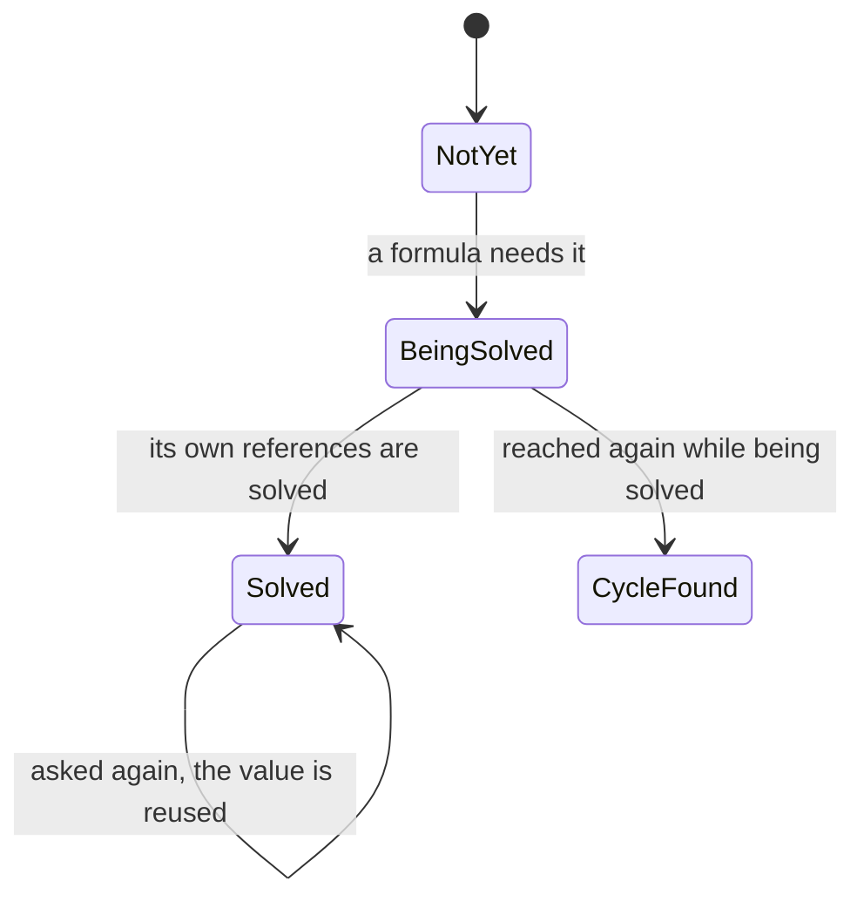

* **A solved cell is remembered**, or it would be solved again at every branch that refers to it.
* **Reaching a cell that is being solved is a cycle** (`#CYCLE!`); without this the descent would never come back.

So cells are solved **in dependency order, not in the order written**, and an earlier row may refer to a later one.

### The methods that fold a range

A range such as `A1:A3` must be folded into one number by a method (`.sum()`, `.min()`, `.max()`, `.count()`). Cells in the range that are not numbers are skipped.

**`A1:A3` is not a value**: it cannot be added or multiplied. Only a range with a folding method chained on is one (`A1:A3.sum()`); `A1:A3` alone is `#SYNTAX!`.

**A folding method takes no argument**: an argument list would let what a formula already says be said again inside a function, giving two ways for one thing.

**A place is a range only if a `:` follows it**; otherwise the reader puts back what it read, or the `A1` of `A1+2` would be taken for a range's end.

**A cell in the range that is not a number is skipped**: a range means "the numbers around here" without naming each, and empty cells and heading words get mixed in. An operator differs: `=A1+A2` names two cells, so a non-number there is an error. An error mark inside the range is carried through; skipped, it would let a total look right while a cell inside it is `#CYCLE!`.

**With no number in the range**, the total and the count are 0, but there is no least or greatest value (`#VALUE!`).

**No function is added that the others can already write** ("What it does not hold" above): the mean is `r.sum() / r.count()`, and the absolute value `-A1 if A1 < 0 else A1`.

### A comparison is made once, and the answer is 1 or 0

There are six comparisons (`=` / `<>` / `<` / `<=` / `>` / `>=`), read after addition and subtraction. **The answer is 1 or 0 so that existing operators can combine answers**: multiplying gives "and"; adding and testing for greater than 0 gives "or".

**Comparisons do not chain**: `A1<B1<C1` would compare the first answer, 1 or 0, with `C1`, which is not what it reads as, so it is refused as text left unread.

**Only numbers can be compared.** A value is only ever a number or an error, so a text cell is "not a number" (`"yes" == A1` cannot be written).

### The conditional expression evaluates both arms

**Both arms are solved, then one is chosen**, and the error on the arm not chosen is discarded: `0 if A1 == 0 else 1/A1` is 0 even where A1 is 0.

Solving only the chosen arm would make the same formula touch different cells from one reckoning to the next, and change which cycles are found.

### Displayed decimal places and rounding the value are separate

`round` changes the value itself; the number format's decimal places change only the text shown.

`round` rounds the value, so formulas pointing at it see the rounded one. **The number format's places (`Number_spec.places`) round only the text shown**, so formulas pointing at the cell keep the full value.

Caution: **Do not merge the two.** If the number format changed the value, merely changing the places shown would move a total.

**Round at the last place when writing a number out**: truncating shows F64's 1.23 (an F64 is a 64-bit floating-point number, which stores 1.23 a little under) as "1.229999". The larger the number, the fewer decimal places can be written: rounding multiplies by 10 to the power of the places and converts to an integer, so past the range of I64 (a 64-bit integer) the result is nonsense.

### Conditional styles are resolved at layout

**A conditional style is a rule the style holds** (`Style.when`): "where the value is greater than this number, lay the style of this name over it". Layout applies it, and nothing is written into the document.

What is laid over is a name; a colour or a weight held directly would step around the styles ("Why the styles are kspage's own, not CSS").

**Only the look is laid over** (font, colour, fill, border). Spacing, indent and alignment stay as the plain style has them, since a row whose height moved with the value would lose the reader's place. The fill and the border are laid over field by field (`panel_paint.paint_of`); laid over whole, the condition's style would drop the plain fill or border on exactly the cells that met it.

**Nothing is written into the document** ("What layout recomputes every time" above), and nothing reaches the exported Markdown, which carries no look.

### Changing a formula replaces its source text whole

The cell shows the value, so typing onto it cannot change the formula. Instead **`Inline.text` (the formula if there is one, otherwise the text shown) is offered, and `Editor.set_source` replaces it whole**.

Caution: **The replacement goes through the undo record too**; written directly, it would leave a hole that cannot be undone. A break is recorded before and after it, so one undo takes it back.

### A formula that cannot be evaluated shows an error mark

A formula that cannot give a number shows one of five marks. **They stay distinct because each is fixed differently.**

| The mark | What went wrong |
| :-- | :-- |
| `#SYNTAX!` | it is not readable as a formula |
| `#REF!` | there is no cell where it points |
| `#VALUE!` | what it points at is not a number |
| `#CYCLE!` | it comes back round to itself |
| `#NAME!` | an unknown function's name |

**Do not overwrite a mark already raised with the mark for text left unread**: the unread text lies past where the first mark arose, and the first reason is closer to the fix. A formula read only part way is not accepted either; discarding the unread rest and answering would let a typing slip pass silently.

**Division by 0 gives no number either**: an infinity or a NaN (the floating-point "not a number") turned into text would leave an unreadable value in the cell.

**A formula can point only at a cell**, not at text outside a table cell. A table inside a cell is a table in its own right, and can be pointed at if it has a name.

### A formula can be written in the body as well

A text beginning with `=` is a formula outside a table cell too. **The body has no table of its own**, so it points at cells by name; a bare `A1` names no table and is `#REF!`.

Caution: **Solve the body after the tables.** Solved first, a body formula would read values not yet computed.

**Only a cell's first inline is solved as the cell**: a table's or a row's own text, and a cell's second run onwards, count as body and must point by name.

### Once a row or a column is moved the formulas are rewritten

Adding or deleting a row or a column rewrites the formulas in the whole document, so each reference keeps pointing at the same cell.

**A place is absolute**: `A2` keeps pointing at the same cell when a row is added, and what changes is its number. So adding or deleting a row or a column rewrites every formula in the document ([`expr/shift.kspls`](../expr/shift.kspls)'s `plan_shift`), because a named table can be pointed at from another table or from the body. A reference with no name belongs to its formula's own table, so an `A2` inside another table does not move. For example, a row added above row 2:

| The formula before | After |
| :-- | :-- |
| `=A2*2` | `=A3*2` |
| `=A1:A4.sum()` | `=A1:A5.sum()` (the range takes in the row added) |

Caution: **A formula pointing at the deleted row itself becomes `#REF!`**; closing up the numbers would silently point it at the neighbouring cell. So `#REF!` is also text a formula may contain, or a rewritten formula could not be read.

**A range shrinks by the part of its end that was deleted**: turning the end into `#REF!` would make the whole range unreadable and lose the total of the cells still there. Only when the near end passes the far end is the whole range `#REF!`.

**Record the rewrite in the same step as the row or column change**; as two steps, one undo would bring back the row and leave the formulas behind. The place of editing applies it, since a rewrite on the reckoning's side would miss the undo record.

### `$` acts only when copying

The `$` in `$A$1` is easily read as "a reference that never moves", but it holds still **only when copied**. When rows or columns are added or deleted, every reference moves with its cell.

**When a row or a column is added or deleted, the reference moves, `$` or not**: the cell itself moves, so a reference left in place would point at another cell. (The mark says what copying does, not which cell is meant.) So one module reads and writes references (`kspage/addr`), and only the two ways of moving them differ (`kspage/shift`).

Caution: **Do not split the reading of the text in two**, or the same formula would be read differently depending on the reader.

**Copying moves references to any table.** A reference with a table name (`detail!A1`) keeps pointing at that table, and only its position shifts. Adding and deleting rows or columns moves only references to the table that changed.

### Where the formula's field opens

**The formula field shows the text typed and replaces it whole.** Making a formula does not need it (typing `=` first does); changing one does, because the text shown is the value.

**It opens on a table's cell and on a run that already holds a formula, not on the bare body**, where replacing whole would let one press delete a paragraph. Do not narrow it to cells alone either: a formula in the body could then be made but never changed. The same set the reckoning rewrites decides whether it opens, so the two never disagree.

## Slides and frames

A slide is a box of fixed size inside the document, and a frame is a smaller box placed on the slide at a position of its own. Text, tables and shapes sit in frames. These sections say how frames are placed, picked, drawn and shown.

In the document model, a slide is a block whose children are laid out at absolute coordinates, and a frame is a child with a position of its own (`Block.frame`; "How a grid and absolute coordinates are laid out" above). Two words recur below. The *core* holds the document, lays it out and edits it (the KSPL folders `model/`, `expr/`, `lay/`, `share/` and `write/`, compiled to WebAssembly). The *page* is what runs in the browser around it (`port/web/`): it measures text, draws, and receives the keys ("The core and the port" above).

### Showing frames in turn is an order, not a timeline

Each frame on a slide can carry a step number. During a slideshow the frames appear in step order, one press at a time. There are no timings and no animations.

**The document holds only the step at which each frame appears** (`Block.step`):

| `step` | When the frame is shown |
| :-- | :-- |
| 0 | always |
| 1 or more | once the show has reached that step |

There is no time axis ("What it does not hold" above), only an order. An order flattens by itself: with no narrowing, every frame shows. So printing and the export need nothing special.

**The block holds the step, not the style** ("Only the block holds its position" above).

**Which step the show has reached is a viewer setting, not part of the document** (`Sheet.over.reveal`), and it is not saved. `none` narrows nothing. `some(n)` lays out only the frames whose `step` is n or less. **Clear it when the show ends.** Otherwise frames with a step stay hidden while editing, and look deleted.

**Layout does the narrowing** ([`lay/absolute.kspls`](../lay/absolute.kspls)'s `shown`). A frame hidden only at drawing time would still be laid out, so its text could still be selected and found by search.

**One action advances the show** (`port/web/api_show.js`'s `stepAhead`). It goes to the next step if one is left on the slide, and otherwise to the next slide. With two actions, the presenter would have to remember which one to press.

**Reordering slides means moving blocks in the document.** The order of the slides is a result of layout, so only the document holds it.

Caution: **Move only the outermost block** (a slide inside a frame cannot be moved).

### Showing one slide at a time crops and magnifies it

The slideshow view shows one slide filling the window. The core supplies only the list of laid-out slides; the page does the rest.

The core holds **only the list of laid-out slides** (`Page.surfaces`), in document order. Whether a block is a slide is decided by its style, so the document itself cannot tell; only layout knows, so layout records it. Scaling to the window, centring and the keys are the page's work.

Three rules hold while the show runs:

| Rule | Why |
| :-- | :-- |
| **Clip what lies outside the slide** | Otherwise the paragraphs around it seem to flow into it |
| **Do not change the layout width during the show** | A slide's style size fixes its content, but the text flowing around it would rewrap, and the slide would move |
| **Shut off typing during the show** | An edit could change what the presenter did not mean to touch. Shutting off the one place text enters is enough: keys, a finished IME composition (text typed through an input method, as for Japanese) and a paste all enter there |

### A slide's sketch is not kept

A new slide starts from a sketch, such as "a title and a body". The sketch builds the frames once, when the slide is inserted, and is then forgotten.

A new slide's frames come from **a sketch** (`Sketch`). It lays out at least one frame, since a child with no frame covers the slide but cannot be grabbed. It acts once, at insertion.

Caution: **Keep it in neither the document nor the styles.** If it were kept, the first move of a frame would make "the frames the sketch describes" disagree with "the frames the document holds", and nothing would decide which is right. Only the frames it built go into the document; the sketch is saved neither as a number nor as a name.

**A sketch sets the frames only, and applies no style name.** Applying a style is a separate operation, and a name set here would be a second way to do it (as with the unnamed rows and cells of an inserted table). Every frame takes the parent's style; a larger title means applying a style.

**Write the open margin and the title's height as ratios of the slide's size.** In fixed px, the frames would stick out as soon as the slide's size changed.

### A frame is grabbed at its handles

A frame is moved and resized by dragging, the same way a table's border is dragged ([`lay/ask.kspls`](../lay/ask.kspls)'s `grip_at` and [`write/shape.kspls`](../write/shape.kspls)'s `drag_frame`). Where to grab it, and what each spot does, is in "Handles on frames and shapes, and the numeric fields" below.

**Check for a grab before text selection**, as for a cell's border ("A border is grabbed at a cell's right and bottom edges" above).

**A frame with no set position cannot be grabbed.** It covers the whole slide, so there is nowhere to move it.

Do not remember the coordinate where the grab began. The slide sits in the flow of the text and can move at every layout, so the frame's offset from it is recomputed at every drawing.

### One frame is selected at a time

**A click selects one frame, and selecting another deselects the first.** There is no selecting several with Shift.

**Shift means one thing: it extends the text selection.** If several frames could be selected, a Shift-click would mean two things, depending on what lay under the pointer.

**So there is no grouping, aligning or spacing several shapes evenly.** Other products make grouping easy with a drag box and Shift-click. Built on shapes picked one at a time, grouping would carry its whole cost without those.

### Deleting a frame and deleting its holder are separate

One command deletes a frame, and another deletes the whole slide or table (the *holder*) that the cursor is in. Neither falls back to the other.

| Operation | What it deletes |
| :-- | :-- |
| `Editor.drop_frame` | one frame: the one directly under the slide, even when the cursor is in a table inside that frame |
| `Editor.drop_holder` | the slide, table or picture the cursor is in |

**Do not delete "from the inside out" in one operation.** A press meant to delete the slide would delete one frame and stop. A mistaken deletion is hard to undo, so what gets deleted must be clear beforehand.

**The last frame is not deleted.** A slide with no frame gives the cursor no box to sit in. Then no shape could be added and the holder could not be deleted, so the slide could never be removed.

**The frame deleted is the one directly under the slide.** Inside a slide only frames hold a place, so deleting anything further in would not change the slide's frames. Deleting a table inside a frame is deleting a holder.

### No line joins two frames

**There is no connector: a line that joins two frames and follows them when they move.** PowerPoint's connector is easy to use because it snaps to a shape and follows it. Joining frames by typing their names would carry the whole cost of the feature without that ease. A line is drawn as a shape like any other.

**A saved document holding such a line is refused whole** (`Store_error.withdrawn` in [`share/store.kspls`](../share/store.kspls), as for a window onto source). If it opened without the line, the next save would drop the line without a word.

### How a shape is drawn

Pick a shape tool, then drag on the slide where the shape should go. The shape belongs to whatever was under the press.

The steps, and why each is so:

| Step | Why |
| :-- | :-- |
| **Hold the tool, then drag to draw.** The cursor is not consulted: the shape goes into the slide under the press | Going by the cursor, a drag made while looking at another slide would land in the wrong one |
| While dragging, a dashed outline shows the form | A bare rectangle would hide whether an ellipse or a triangle was chosen |
| Once a shape is drawn, the tool is dropped | Otherwise shapes would appear where the person meant to press the body |
| Pressing the tool again keeps it held; `Esc` drops it | (A way to draw several in a row, and a way out) |
| Click-to-insert-in-the-middle stays in the menu | For where there is nowhere to drag |

**The holder of the spot pressed holds the shape**: a slide, a paragraph or a cell. The frame's position counts from that holder's top-left corner; this is a slide's frame rule widened to every holder. There is no second means: nothing "anchors to the page". The shape is not placed in the flow, where it would move the text, and there is no text wrapping around it (which Word recomputes at every move).

A shape does not go into a block that lays out no children. A grid's children are its rows and cells, and a gathering block's children (a table of contents, say) are not laid out, so a shape there would appear nowhere. A shape drawn over a table belongs to the cell. Shapes are placed after the contents, so they show on top of the text, stacked in the document's order.

The forms are few, and **adding one never renumbers the others**. PowerPoint holds 160 kinds, so the one needed has to be searched for (hence its recently used forms at the top). kspage holds the rectangle, the rounded rectangle, the ellipse, the triangle, the diamond, the line and the arrow (along a diagonal). Saving writes the form's name, while the boundary between the core and the page passes a number: the variant's position in `Shape` ([`model/style.kspls`](../model/style.kspls)). So a new form goes at the end only; renumbering would make an old text read as another form.

### How a form is chosen

**The forms are folded into one ribbon button that opens their list.** Laid out flat, the forms would use up the ribbon level's width. To pay back the extra press the folding costs, the list is headed by the recently used forms.

The folded button shows that a tool is held. Marking only the chosen form, hidden in the closed list, would not. Choosing a form closes the list, which would otherwise cover the slide about to be dragged on.

### Handles on frames and shapes, and the numeric fields

A selected frame or shape has eight handles, like every other product's. Drag a handle to resize; drag the rest of the edge to move.

| Where you grab | What it does | The pointer's shape |
| :-- | :-- | :-- |
| One of the four corners | changes both width and height | a diagonal arrow |
| One of the four edge midpoints | changes one dimension | a horizontal or vertical arrow |
| The rest of the edge | moves the frame | move |
| Inside a frame with contents | nothing to grab: the press goes to the text, so it can be selected | text |
| Inside a shape (it has no contents) | grabs the shape, since nothing else happens there | move |

Caution: **Do not leave out the edge handles.** With only corners, changing the width means matching the height again by eye (every other product has eight).

**A handle that is not drawn is not made**, or spots that do nothing visible when pressed would multiply. On a small frame a corner handle and an edge handle overlap; each keeps a grabbable width, and the corner wins.

**The pointer's shape follows the direction.** An edge gets no diagonal arrow, which would suggest that grabbing there changes both dimensions.

**`Shift` keeps the ratio of the sides, at a corner only.** On an edge handle it would move the side not grabbed too. While drawing, `Shift` gives 1:1: a shape not yet drawn has no ratio to keep, so it makes a square or a true circle. Compute the drag rectangle in one place (`bandRect` in `port/web/draw.js`). Computed twice, once for the preview and once for the placed shape, the shape would jump on release.

**The numeric fields act on the selected shape.** A shape has no text, so it cannot hold the cursor. One way to select it is kept: pressing selects the frame under the press (`Editor.pick`). `Alt`+arrow uses the same entry point (the function the page calls into the core), not a second way.

### The stacking order of a slide's contents

**The list of a slide's contents runs down the right side**, not in the fixed area at the top, where every slide would push the body further down. The top of the list is in front (Figma's way). The stacking order is the document's order; a separate field would state it twice.

An unnamed shape is listed under a name like "Shape 3". **The page makes this name, not the core**; a name made by the core would look as if it were stored in the document.

## Pages and printing

The paper size is one setting for the whole document. Layout itself cuts the content into pages as it goes. These sections say how the pages are made and printed.

### Pagination happens during layout

Layout breaks pages while it places each line. Nothing is shifted onto pages after layout has finished.

The document holds one page's height (`Paper.height`; 0 means no pagination). **The width is not held here.** The paper's width is the container's, as with a slide's size: across, the container has a size; down the page it has none.

Caution: **Do not shift content onto pages after layout.** The cells, slides and frames would have to move with the boxes, and any one forgotten would silently stay out of place. Paginated during layout, whatever comes next starts from the new `y`.

The unit of splitting is set by where a finer split would make the text unreadable:

| What | Split across a page break? | Why |
| :-- | :-- | :-- |
| A line | **Never split inside a line** | The characters' top and bottom halves would land on different pages |
| A table row | **Never split inside a table row** | Only layout knows the row's height, so a row found crossing the break is rewound and laid out again on the next page |
| A slide | **A slide is not split** | Its size is known first, so where it does not fit, it moves whole |
| A block that fits on one page | No: **move it to the next page whole** | A paragraph split with a single line left behind is hard to follow |
| A block taller than one page | Yes, at line boundaries: **do not move it** | It would not fit on the next page either, and moving it only wastes the rest of this one. An overflow in sight is easier to fix than content that disappears |

For a block, layout decides like this:

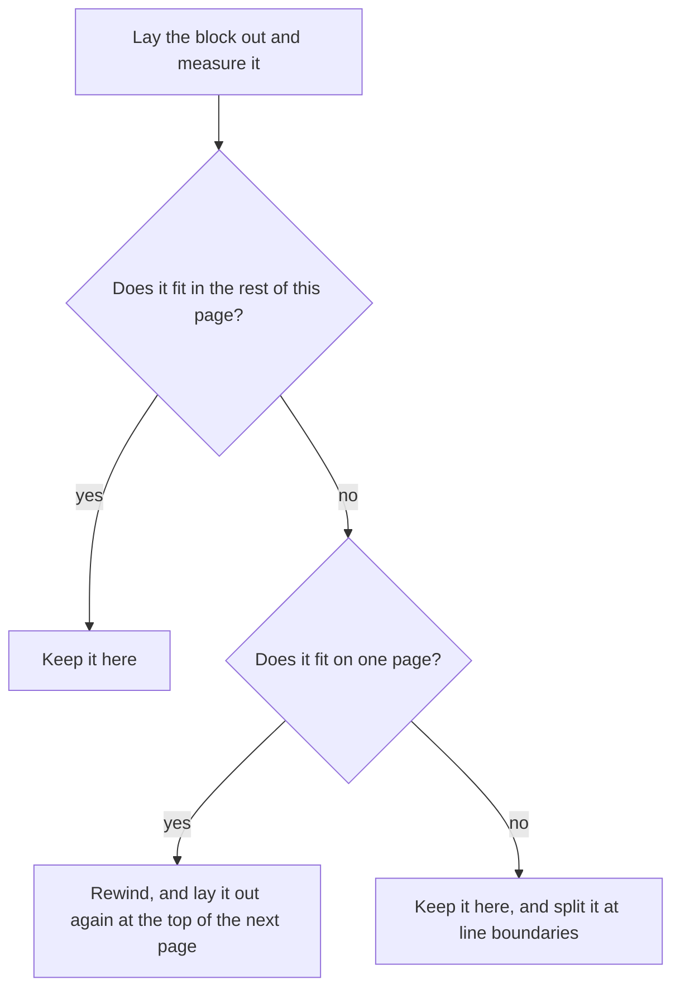

Only layout knows a block's height, which is why it is laid out, measured, then rewound and laid out again where it must move. Without pagination (on screen), one pass is enough.

**The page count comes from the height where the content ends** (`lay/flow.kspls`'s `paper_count` and `Page.filled`).

**Do not count by the height used**, which includes the space after the last block (`space_after`). A document filling exactly one page would count as two, and a blank last page with no box at all would print. Only the last block's space is left out; space between blocks is content.

**Do not put the counting in the bridge** (`port/web/`, which joins the core to the browser), where `make debug` does not reach it. The check is `tests/print_test.kspls`'s "the count of sheets of a document that fits exactly".

**Printing draws one canvas per page** (one long canvas cannot cross pages). It clips and scales with the same code as the one-slide view.

### The document holds the paper size, and margins apply when printing

The page size and the margins belong to the whole document (`Sheet.paper`). On screen the content is one long band; the margins appear only when printing.

Caution: **Do not put them in a style.** With two page shapes in one document, neither the page breaks nor a column's width could be decided.

**A width of 0 means the container's width.** Until a paper width is set, the text follows the window; once it is set, the column keeps that width at any window width.

**Compute a column's width in one place, in the styles' table** (`Sheet.column_width`). If callers repeated the expression, the widths laid out and printed would drift apart.

**Do not build the margins into the layout coordinates.** Laid-out content is one continuous band, and the margins are how far printing insets it. Built in, every page break would need arithmetic to skip them. So the top and bottom margins do not appear on screen; they show as the spacing at the page breaks.

**The height available for content on one page is also computed in one place** (`Sheet.column_height`). Only there are the margins subtracted from the page height; the break interval, the break line and the page count all follow from it.

**Where the margins alone fill the page, it does not paginate.** Moved, the content would not fit on the next page either, and stopping is plainer than looping forever.

### Headers and footers have no place in the document's coordinates

The header and footer are whole-document settings (`Doc.header` / `Doc.footer`), laid out once per page, apart from the body.

**Do not put them in `blocks`** (the document's list of blocks). A band appears once per page, so it has no place in one continuous run of coordinates. It is laid out separately (`flow.layout_chrome`), with coordinates relative to the page's top-left corner. Printing clips and insets the content by the margins, and draws the band as it is.

**With no paper size and no top and bottom margins, the band is not laid out.** It sits inside the margin, and with no fixed bottom edge the footer has nowhere to go. Nor is an empty band laid out, which would make the margin look narrower.

The page number is counted at layout ("What layout recomputes every time" above): `{page}` is the current page and `{pages}` the total. **The document's text keeps the placeholder.** With the number written in, merely changing the paper size would change the document's text.

**A band is not in `blocks`**, so search does not go through it. A band's edit can still be undone, since its text changes through the same `Editor` as typing.

### The printing fits the page into the printable region

The printed page is shrunk to fit the printer's printable area, so the left and right margins stay equal.

**Do not count on `@page { margin: 0 }`** (the CSS rule that asks for no printer margin). Margins chosen in the print dialog win. A canvas drawn at the paper's width is then wider than the printable region, and its right side is cut off, so only the left margin shows. `max-width: 100%` shrinks the page to fit and keeps both margins equal.

Do not fix it by shifting the page's inner margins left: left and right are equal (57px each on A4), so shifting them makes it wrong.

### A document with no paper size borrows one only for printing

A document with no paper size (height 0) is one long run on screen. When it is printed, it borrows the default paper and margins for that one print.

**A height of 0 means "one continuous run on the screen", not "no pages in print either".** A plain-text document (a program's source), Markdown and a new document all set no paper. Printed unchanged, they become one long canvas, and the browser breaks the pages where it likes.

**The size and the margins are borrowed together** (`paintPages` in `port/web/api_show.js`):

| What is borrowed | What prints |
| :-- | :-- |
| The size alone | Margins of 0. The header and footer bands stand inside the margin, so they have nowhere to go (`chrome_rect` in `lay/chrome.kspls` returns a height of 0). The body runs up to the break, where characters look cut |
| The size and the margins | A 15mm (57px) band opens above and below |

What is borrowed is the default paper of the bundled documents (`a4_portrait` in `model/paper.kspls`: A4 portrait, 15mm margins on all four sides). **Do not copy the numbers into the code that borrows them.** One-inch margins there would drift from the 15mm of the bundled documents (the manual). Two documents printed from one screen would then get different margins, the source of the complaint "the margins are too wide". Do not make it one inch either: Word's, Google Docs' and Pages' defaults are one inch, but kspage's is 15mm. A line that does not wrap runs into the right margin (`wrap` in `share/text.kspls`); to narrow it, set the paper and margin fields.

**Do not borrow for a document that has set its paper**, since margins of 0 were the writer's choice. Once printed, the borrowed paper is returned (the same rule as the viewer's overrides). The check is `kspage/tests/browser/paper.js`'s "A document with no paper settled becomes a page with margins in printing too.", which checks that the bands above and below hold no ink and that a band appears inside the borrowed margin.

## Saving and loading the document

A document is saved as one JSON text that holds both the content and the styles ([`share/store.kspls`](../share/store.kspls)). Only this text reads back into kspage; Markdown and CSV are one-way exports.

**The document and its styles are saved together.** Saved apart, one could travel without the other, and the look would drift.

**An unset field is not written.** A style's font fields can be unset, which means "inherited from the parent", so writing the default in would break the inheritance there. The reader leaves an absent field alone too. Only `Sheet.add` fills in defaults; with two places doing it, one could change alone.

**A text of a different version is not read even in part.** A saved text opens with `{"kspage": N, "sheet": …`, where N is the number of its format version (`version` in [`share/store.kspls`](../share/store.kspls)). Writing back a document that kept only what could be read would lose the original.

### A name the core looks up belongs to the format version

A few names in the saved text are ones the core looks for by name. Renaming one of them changes the format, so it needs a new version number.

**The saved text holds names the core looks up**: the header and footer marks `{page}` / `{pages}` (`page_mark` in [`lay/chrome.kspls`](../lay/chrome.kspls)), and the header and footer styles (`header` / `footer` in [`model/doc.kspls`](../model/doc.kspls)).

Caution: **Changing a name the core looks up raises the version in [`share/store.kspls`](../share/store.kspls).** Without the raise, an old file's mark is not read as a mark and is printed as written. One raise covers the whole vocabulary, not one per name.

**Any other style may be renamed without raising it.** A style is saved with its definition, so an old file opens with its own, and nothing looked up goes missing.

### An earlier name is not read

The version field is named after the product, `kspage`. Only that one name is read, so renaming the product would make every older document unreadable. That price is accepted.

**The field that names the version is `kspage`, the product's own name, and no earlier name is read.** So renaming the product makes every document saved before it unreadable, although the rename changes not one byte of the format.

**That price is accepted rather than paid with a reader per name.** A reader for an old name never retires: it must be carried, tested and explained as long as the format lives. What is written and what is read are one name. The version check is not relaxed either: a document under that name with a different number is still refused ("A text of a different version is not read even in part" above). The guard is [`tests/store_test.kspls`](../tests/store_test.kspls)'s `test_only_the_one_name_opens`.

### Reading back swaps the document whole

Opening a saved text replaces the whole document, and everything that pointed into the old one is rebuilt or thrown away.

| What | What to do on reading back | Why |
| :-- | :-- | :-- |
| The cursor and the undo record | **Rebuild the cursor and the undo record too** | Both point at `Inline`s (pieces of text in the document), which dangle once the document is swapped |
| The layout | Discard it | Its boxes point at `Inline`s that are gone |
| The parsed text | **Parse the text into the same arena as the document** | A style's name is referenced, not copied. Parsed into another arena (a region of memory freed all at once), it dangles once that arena is freed |

### Saving and loading are separate from exporting

**Export to Markdown cannot be read back.** Even a style's name is lost. It is for keeping the document beside the code. Only the JSON reads back, and neither is used in place of the other.

| Format | Written by | Reads back into the same document? | What it is for |
| :-- | :-- | :-- | :-- |
| JSON (`.kspage`) | [`share/store.kspls`](../share/store.kspls) | yes | keeping the document |
| Markdown | [`share/markdown.kspls`](../share/markdown.kspls) | no: even the style's name is lost | keeping it beside the code |
| CSV | [`write/csv.kspls`](../write/csv.kspls) | only one table's shown text | handing a table's values to another tool |

### Reading and writing CSV share one quoting rule

**Reading and writing CSV share one set of quoting rules** ([`write/csv.kspls`](../write/csv.kspls)). With two, kspage could write a file it cannot read back.

**Export writes the text shown, not the formula.** CSV carries values, and the receiver cannot solve a formula. Imported text goes into the cell as it is, so a text beginning with `=` becomes a formula, as if typed. Rows are padded to the longest row; otherwise the cell count would vary from row to row and the columns would be undefined.

## A document's past lives in its files

Kspage keeps no history of changes and no saved versions of its own. To keep an earlier state, save a copy, or keep the file in git.

**kspage keeps no change history and no saved versions of its own.** A document's past is the files it was saved as. A copy saved under another name is a version anyone can open. A document kept in git has git's history and its diff of the saved text ("The saved text is laid out to read well in a diff" below). A history of kspage's own would be a second thing to carry beside the document and keep in step with it. It would be readable only in kspage, and held where the page keeps it (one browser on one machine), so it would not travel with the document.

**Nothing sets two versions against each other.** Showing what changed between two texts needs a number on every block that never changes, a matching in several steps, a list narrowed by view, and pixels drawn twice. That is a large part of the page for a step taken now and then, and git's diff of the saved text already does it. So a person brings two versions together by opening both, each in its own window.

**What this gives up**: a record of who changed what and when, earlier states kept by a press, and a list of what changed inside kspage. The person keeps copies, or keeps the file where its history is kept.

An `origin` key, which earlier texts carry to keep one document's versions together, is read past and not written again ([`share/store.kspls`](../share/store.kspls)'s `load`), so those texts open as they were.

## A style name holds no whitespace

A name a person types for a new style may not hold whitespace (a space, a tab, a line break). kspage's own names already join words with a hyphen (`column-body`).

**A code style's name is the language its Markdown fence declares**, and a fence's declaration ends at whitespace ("Rules the Markdown writer keeps" below). A style named `my code` would be written out as a fence of language `my`.

**The entry point where a person names a style refuses such a name** ([`write/shape.kspls`](../write/shape.kspls)'s `add_style`; the reason reaches the screen as its own code in [`port/web/face_edit.kspls`](../port/web/face_edit.kspls)). `make test-conventions` checks the names the product writes.

**Do not push the refusal down into the model or the loader.** [`model/style.kspls`](../model/style.kspls)'s `Sheet.add` takes whatever name a saved text holds, and loading changes no name. Inserting a table, a chart or a code block derives its style name from one already in the table of styles, so a refusal down there would make a document that was read in silently refuse every insertion.

## The wording on the screen

The screen uses the words other office products already use, as long as the word also says what the feature does.

**Text on the screen uses the wording the other products share.** A name is what people search by, so a feature called something else looks as if it is missing.

**Do not stop at "make it the same".** Established or not, a name that does not say what is inside is not taken. Mailings is one example: the feature brings in an outside list to make one document per person, and the name does not say so.

**Two tests, in this order.** ① Does the wording reach the person reading? ② Does it say what is inside? A wording that passes both is taken; where none does, the one that says what is inside is taken.

### The established term stays the term

Where every other tool uses the same term, kspage uses it too, rather than inventing a "plainer" word.

**Do not coin a plain word of our own for a term other tools already share**; no product does. Call a server "the answering side" or a cursor "an insertion bar", and the reader cannot tell it is the same thing.

**Nor is a word right merely for being the industry's.** The US Federal Plain Language Guidelines ask for the common word over jargon the reader does not share.

**The first test is whether the word reaches the person reading**, not "borrowed, so bad" or "plain, so good". An established word reaches them as it is; an unestablished one does not, whether borrowed, coined or plain.

The complaints come from both directions at once, and this test answers both.

### The register follows where the text appears

Each kind of text on the screen has one grammatical form (the *register*): a menu is a noun, a button is a command, a report is a full sentence.

**Do not mix registers on one screen.** The register follows where the text appears, and the office suites kspage is compared with (Microsoft 365, Google Docs, LibreOffice) agree on this.

| Where it appears | The register | Example |
| :-- | :-- | :-- |
| A tab's or a menu's name | **a noun, sentence case** | File / Insert / Table / Review |
| A button's name | **the imperative** | Save / Undo / Delete the row |
| A field's name | **a noun phrase, sentence case** | Paper size / Line spacing / The body's width |
| A report of what happened | **a full sentence** | Saved it / Wrote it out as CSV |
| A refusal | **a full sentence giving the next step** | There is nowhere to add a comment. Click on some text |
| The manual's body | **sentence case, second person, present tense** | Choose the kind and type the text |
| The manual's heading | **sentence case, in the grammar "How the built-in manual is written" gives** | Paper and printing / Adding a footnote |

**Sentence case, tab names included** (only the first word takes a capital).

Caution: **Do not put Title Case on a tab.** Microsoft and Google put Title Case at the top level and sentence case everywhere below. That is history, not a decision: their menus predate their own companies' guidance. With no such menus to carry, kspage takes the guidance whole.

**Do not end a name with a full stop.** A tab, a button and a field are names, while a report of what happened is a sentence; a full stop on a name would blur the two.

### The vocabulary is one

One thing has one word, and that word is the same on the screen, in the code, in comments and in the manual.

**Do not use different words on the screen, in the code and in the comments.** With two vocabularies, the day someone forgets to update the mapping between them, the screen and the code seem to mean different things. So the wordings turned away appear nowhere in this package: not in the source, a comment, a document or a gate. Identifiers are no exception: whoever comes next reads them.

**The words turned away are named in the table of fixed words below, and no gate refuses them**: a reviewer catches one that comes back with the next screen added.

**Where one word covers two things, split it.** "The place" is `arena` for where memory is taken from and `memory` for the amount usable. "The spelling" is `text` for the content and `path` for the location. Choosing one meaning without splitting leaves the other unreadable.

**Names used only inside the manual belong to the vocabulary too.** `screen-bar` and `screen-area`, which draw a picture of the screen, sit in one list with the `slide-frame` the reader presses.

**The words the reader meets are those the other products use**, on the screen, in the manual and in the style names alike (the reader sees style names in the paragraph list):

| What it names | The word | Where it comes from |
| :-- | :-- | :-- |
| a slide, and a deck of them | Slide | PowerPoint, Impress and Google Slides call it this |
| a table's cell | Cell | Excel, Calc and Sheets call it this |
| a menu | Menu | the standard UI term |
| the band at the top / the band at the bottom | Menu bar / Status bar | the same |
| the list on the right | Navigation | Word's "Navigation pane" |
| the mouse's wheel | Wheel | the same |
| a key | Key (the list is "Keyboard shortcuts") | the same |
| a note | Note | the same |
| the mark at a line's head | Bullets and numbering | Word splits the two ("Bullets" / "Numbering"), and one control here covers both |
| text | character / string / code | chosen by the situation |

**The navigation is "Navigation".** Its three tabs are Headings, Slides and Placed, and "Headings" would hide the other two.

The fixed words, each in place of a plain word of our own:

| The word | What it names | What was turned away, and why |
| :-- | :-- | :-- |
| **entry point** | a place in the code that callers reach | `door` / `mouth`: no other editor, nor Rust, Swift or Java, replaces `entry point`. **Something pressed on the screen** takes the screen's own words — a menu item, the ribbon's tools |
| **character** / **text** / **font** | one unit of text / the text itself / the set that fixes its look | `letter`, for all three: every product says **Font colour** (the ribbon has it and **Highlight colour**), not "The letter's colour". `letter` is not turned away everywhere: a word with several senses needs a replacement per sense, and four ordinary uses stay — CSS's `letter spacing`, Excel's **column letter**, the **Letter** paper size, and a letter one writes |
| **change** / **fix** / **edit** | altering a document, a style or a field / repairing a defect / altering a generated file by hand | `mend`, for all three, which puts a "Mend" button beside a report reading "Changed the style". Word's ribbon says "Modify", which Microsoft's own writing guide says not to use |
| **path** / **way** / **operation** | a place in a document, or a file's place / a means of doing something / a countable act | `road`, for all three. Where "the road that X" would stand for an operation, the noun goes ("what X", or a gerund in a heading). `route` is no answer — a synonym is the same calque spelled differently |
| **theme** | the document's set of colours and typefaces, and the page's own look | `skin`. The word is the document's (the office suites kspage is compared with mostly give Theme to the document; [`write/theme.kspls`](../write/theme.kspls) holds it). The page has no theme of its own: its look follows the screen's light or dark ("The page's look is a few roles, following the screen" below). The fill and the border solved for one block are `Panel_paint` ([`model/panel_paint.kspls`](../model/panel_paint.kspls)), named with the drawing layer's word |
| **delete** | removing a row, a column or an object | `erase`: beside the menu's "Delete the row" it gives one operation two words on one screen; Microsoft, Google, LibreOffice and VS Code all say delete |

**Count the things before counting the name.** `Caret` and `Cursor` in [`lay/caret.kspls`](../lay/caret.kspls) look like one word twice but are two things. `Caret` is the place in the document: which run, which byte, what is being composed, where a selection starts. `Cursor` is the upright bar drawn for it. Neither is a word of our own making. A count says where to look, never what is found there.

### How a wording is changed

**Do not change a wording with a plain bulk replace.** A word turned away usually has a second meaning somewhere in the repository, and replacing every occurrence breaks text unrelated to the screen. Read each line for what it says before changing it. Where a word has no second meaning, say so and measure it; it can then move over in all its forms in one pass.

**Keep the list in the language the package is written in.** A list that hunts one language while the package is written in another cannot fire, and the very wordings it turns away come back through the pass meant to apply it ("The vocabulary is one" above).

## The tools, the menus and the panels

These sections say where each tool sits on the screen and how it answers a press. **Each decision names the complaint it answers.**

The screen has five parts. The names below are the ones these sections use:

```text
+------------------------------------------------------------------+
| Menu bar (the band): File Style Table Insert Share Review        |
|                      the document's name      find  ?  ⚙  fold   |
| Ribbon: [Edit] [Paragraph] [Font] [File] ...                 …   |
+--------------------------------------------------+---------------+
|                                                  | Side panel    |
| Body: the document, drawn on one canvas          | (Navigation): |
|                                                  | Headings /    |
|                                                  | Slides /      |
|                                                  | Placed        |
+--------------------------------------------------+---------------+
| Status bar: path and where you are | result of a press | counts  |
+------------------------------------------------------------------+
```

### A ribbon, or a toolbar that does not move

**The ribbon has no tabs.** With tabs, finding a command means first knowing which tab holds it. Commands sit in named groups, and a contextual group (one shown only while you work on its thing, such as a table) appears on the same row, so no tab has to be searched. What cannot act is not shown, so nothing pressable does nothing. No icon stands without its name. Deep settings stay in the menus ("The tools and the look" below).

### How much of the window's height is handed to the tools

**Two levels, the menu bar (the band) and the ribbon, and no more.** The manual sits inside the "?", the find field at the band's right, and the formula field appears only when it can be used. Every level takes room from the body, so the checks in `kspage/tests/browser/` watch the cap.

**A tool's name sits to the right of its icon.** Stacked under it, they would take twice the height. Names always show, since a name shown only on pointing cannot be read on a touch screen. A group's name takes no level: a dividing line shows the group, and its name shows on pointing.

**The band's right side is not left empty.** Find, replace, the manual ("?"), this screen's settings (⚙) and folding go there. Do not put the manual at the left end. Place follows use, and the left end belongs to "File", used most, not to what is used least.

### What the ribbon shows

**A dropdown can sit on the ribbon too.**

Caution: **Do not copy its contents.** The choices and what runs on one live once, in [`port/web/form.js`](../port/web/form.js) (Principle 4: one canonical source). Each place decides only where it sits and its name ("the text colour" on the ribbon, "the colour" inside the font's set). The value is the document's, so either acts on it and both show the mark.

**Colours show as swatches, not names alone.** The value's shape decides whether a swatch appears (a `#rrggbb` is a colour), so the menu and the ribbon show it alike.

**What is placed once per document is not on the ribbon.** The table of contents, the list of notes and the columns are not worth a level's room for good; they are in the menus.

**Line alignment is one dropdown, not four buttons.** The other products apply alignment to the paragraph itself, so four buttons suit them. kspage applies it to the paragraph's style, so a dropdown that shows in one row what is applied is plainer.

**A dropdown that moves into `…` opens its twin in the menu.** Do not copy the dropdown as it stands: the copy has no rows behind it and opens nothing when pressed (Principle 5: nothing writable but ineffective).

**The table's order is the order of use.** Groups that do not fit move into `…` from the back, so the order is also the order they survive in on a narrow screen. Do not order them by meaning, or what survives would stop being what is used most. Place following use is the same decision as "The band's right side is not left empty" above.

* At 1920px the always-shown groups take **1595px**, so at 1280px only Edit, Paragraph, Font and File fit. What survives is the only room the design has, and the order decides it.
* **Back and Forward come last.** No other product puts them on the first level, and the four words are easily confused with Undo and Redo. So they sit where a narrow screen drops first.
* **Save comes early.** Word and Excel keep saving in the always-shown Quick Access Toolbar, and Google Docs saves by itself. kspage does not save by itself, so Save must never sit inside `…`.

**Contextual groups come ahead of the always-shown groups, though not first.** At the back, a group shown only while you work on its thing would move into `…` exactly when needed. Ahead, only the less-used groups behind it shift. First, it would move the most-pressed group from under the finger.

### What is done with the tools that do not fit

**Overflow drops into `…`, and no level is added.** Do not wrap the row: the narrower the window, the less body would show. Whole groups drop, from the back, where the least used sit; dropping single tools would split a group between the row and `…`.

**The ribbon is its table, the same on every screen.** No tool is chosen, hidden, moved or stripped of its name by the viewer. A layout learned from the viewer would be a second layout to keep in step with the table: a tool added vanishes from it, a broken one takes the tools with it, and a reset has to be offered. The manual, the checks and another person's screen would each show a different row. A narrow window is answered by the `…` and by folding the ribbon.

**The `…` sits at the right end of the ribbon's row.** Do not put it on another row: with the cut in one place and what was cut in another, nobody can see what went. It sits beside the ribbon, not inside it, since the ribbon clips horizontally and would clip it. Measure without the `…` first; shown first, it would drop one more group at the width where everything fits.

### The ribbon's first level opens on a press

A group on the ribbon opens when you press it, not when the pointer passes over it. Inside an open menu, a group opens on pointing too.

**It depends on where the group sits.** The ribbon's first-level groups open on a press; groups inside an open menu open on pointing and on focus alike. Do not open the first level on pointing, or passing over the row would open panel after panel. (Inside a menu the groups run down the page, so the path to a choice crosses no others.) Nor on `:focus-within`, or tabbing through would open it. A press can come from a key, so the keyboard keeps working.

**Three ways close it, all through one place**: another press, a press outside, and Esc (`shutTools` in [`port/web/page.js`](../port/web/page.js)). A panel that opens on pointing closes when the pointer leaves, so opening on a press needs ways to close. Do not write the closing in several places. Split, a press outside would close the band's menu and leave the ribbon's panel open.

**Esc follows the other products.** A menu opened by a key closes by a key, and WAI-ARIA's menu button (the web's accessibility pattern for it) requires Esc. It takes nothing from the browser, since none of Esc's default jobs (stopping a load, leaving full screen, closing a `<dialog>`) arises on this page.

**Leave Esc alone while composing**, where it cancels the composition ("Keys, focus and menus" above). Esc has three jobs (close the menu, drop the held tool, collapse the selection), so only the first that applies acts. The focus goes back to the text input, not to the button that opened the menu, so typing works right after it closes.

**The ribbon scrolls horizontally only.** Do not clip it vertically: a panel opening downward is cut off, and it is open, yet nothing shows. Its `display` is `flex` and it has a size, yet the canvas receives the pointer.

Note: **A check that looks only at the size passes**, so the check asks what receives the pointer at the panel's middle ([`../tests/browser/ribbon.js`](../tests/browser/ribbon.js)).

### A button on the ribbon either acts, or opens the thing that needs filling in

**A ribbon button whose operation needs nothing typed acts on the press.** One that needs something typed opens the panel holding that field, with the cursor in it, and the panel stays open. Applied while empty, a link would stay with no destination (Principle 5). One function opens the field, and the right-click menu uses it too.

**A folded panel takes no focus.** A closed menu and a folded panel are laid out as nothing, and focusing a box not laid out does nothing. So the code taking a person to a field opens every level first and focuses last (`reach` in [`port/web/page.js`](../port/web/page.js)). The other way round, the press looks dead, as Link and Comment both would. Panels open when the pointer rests on them, so there is no state to read. A panel opened on purpose carries a mark, cleared by the one function that folds panels.

**A press that opens a panel is not a choice made.** The ribbon folds its panels on any press that is not on a control, so a button that opens one stops its own press there ([`port/web/ribbon.js`](../port/web/ribbon.js)). Unstopped, the panel would open and fold within one click.

### Groups in a menu are submenus, and a panel is only for what is used over and over

A group inside a menu is either a submenu that flies out, or a folded panel that stays open. Which one depends only on whether people touch the group again and again.

**Two shapes are not the problem; leaving unwritten which to use is**, since the same kind of group then gets built differently in each menu.

**The one thing that decides is whether the group is touched on and on.**

| The shape | Where it is used | Why |
| :-- | :-- | :-- |
| A submenu (`data-fly`) | one choice (or entry), and done | the press returns the focus to the body, so closing as the pointer leaves is fine |
| A folded panel (`details.sub`) | a group touched on and on | as a submenu, **it would close at every touch** (the focus returns to the body) |

Two kinds are touched on and on. One is **what holds text to read**: the note on what is remembered. The other has fields filled in one after another: the page and the margins, the fields that change a style.

Caution: **Do not lay commands out flat on the first level.** Even when the menu stays short, flat commands give no clue to which acts on what. The cap is four, and what counts is every button in neither a submenu nor a panel. Counting only the children of `.items` misses a button inside a `.row`.

**Do not bring the often-used commands back to the first level.** One-press reach is the ribbon's job, and it presses the same button. The checks are four, in `kspage/tests/browser/menu.js`: the first level's count, the shapes a panel may take, no `<select>` in a menu, and no group inside a group.

**A level may be added only where two or more items are folded.** Folding one adds a step with nothing to hide.

Apple's and Microsoft's guidance both say "one level at most". **Two levels are allowed all the same, to keep the first level to "what it acts on"**, as Google Docs' `Format ▸ Text ▸ Bold` does. No third level is made.

**No `<select>` inside a menu; wherever one thing is chosen, it is a submenu, at any level.** Not even inside a panel: the choices there would stay fields while every other became a submenu, and which one acts on the press would get harder to read.

**Where it sits says whether it acts on the press.**

| Where the submenu sits | What a press on a row does |
| :-- | :-- |
| Outside a panel | acts at once |
| Inside a panel | only holds a value; pressing "Apply" acts (`panelFly` in `port/web/form.js`) |

A submenu works inside a panel because the panel is a `details`. A bare submenu closes as the focus returns to the body, but a panel stays open, so the next field can be filled in.

**The choices' list belongs to the JS that builds the submenu**; `page.html` holds only where it sits (`<div id="...">`). `menu_pairs` in `tests/support/conventions_bound.kspls` checks it against the core's list. The list lives in one form, so one reader is enough.

**No bare text field on a menu's first level**; no other product has one. A group needing a field goes into a submenu or a panel, as "link", "footnote" and "comment" do. The one exception is "where it is saved and read from". It shows where saving writes, and folding it would break the rule that this can be read before the press ("The save destination is remembered, and permission is asked at the first save" below). It shows only while the local server is there, so the flat rows do not keep growing.

### A submenu is not put into a box that scrolls

A menu level that holds further submenus must never scroll, or the deeper levels are clipped out of sight.

**A box with `overflow` clips its absolutely positioned descendants.** So `overflow` must not go on a level (a submenu) that holds another submenu. The next level would hide inside the box, a horizontal scroll bar would appear, and the deeper levels could not be reached.

What may scroll is **a leaf level** (one that lists only choices). A swatch list or style names can run long, so it scrolls vertically. `port/web/fly.js` marks the levels that hold submenus (`fly-nest`).

**In the markup the next level is there, so counting the DOM does not notice.** Only the look breaks. So `kspage/tests/browser/menu.js` really opens the third level and checks both its size and the scrolling. A size alone proves nothing, since a rectangle comes back even for a hidden element.

**Some level always runs out of room to open rightward.** Each level opens 180px further right, so the third reaches the window's edge. A level is opened, measured, and flipped to the left (`place` in `port/web/fly.js`). The menus at the band's right open leftward from the first level (`at-right` in `port/web/page.css`). One mark serves the first level and the submenus alike; a list of ids would get changed in one place only, the day a menu is added.

### The style menu is grouped by what it acts on

The Style menu has three headings, by what a style changes: the selected characters, this paragraph, or the whole document.

**Users raised three questions here**: "what do I select before changing it?", "is it the Styles field or the Paragraph field?" and "what does this item point at?". A label alone answers none of them.

**The menu is split by what a style acts on, not by its kind.** Each heading's bracket names what to do first:

| Heading | What to do first |
| :-- | :-- |
| On the selected characters | select them |
| On this paragraph | click inside it |
| On the whole document | nothing |

Do not head them with the kinds' names (character style, paragraph style). As users reported, those do not answer "what do I do?".

**A list shows only the styles that really apply there.** The paragraph's list shows flowing styles only, judged in one place (`fits_block` in `model/style.kspls`). If the page judged again, a listed style could be refused. Do not accept "let it be chosen, then refuse": nothing pressable may fail to act (Principle 5). The entry point still refuses with a reason, but no path leads a person there.

**The list reflects the current state.** Rebuild it when the document is swapped, or the previous document's names stay listed, and choosing one is refused with "there is no style of that name". Build it from the names alone; built from the contents, it would be rebuilt at every colour change, closing an open list at once.

**Rows instead of fields, with the choices opening to the right** ([`port/web/fly.js`](../port/web/fly.js)). Do not go back to a label and a `<select>`. A closed field hides what is applied, so it cannot be read until opened, as users reported. A row puts a ✓ on what is applied and shows its name at the right.

**Only "a choice that acts on the spur of the press" becomes a submenu.** Do not move a field that acts only when applied into such a submenu. "A style's detailed settings" is a panel that swaps some 40 fields on one "Apply", so acting on a row's press would make a half-typed value the style. Across the page, a choice that acts on the spur of the press is a submenu: the paper size, the print direction, the document's theme, the choice made when inserting. A choice whose list is built from the state (the style to change, the source passed in) only holds a value for the button pressed next.

**The first level has three rows only: "the characters", "the paragraph's character style" and "the whole document's theme".** Do not put the choices on the first level. The decorations are six, so the menu would pass its 400px cap and cover the canvas. A submenu floats at absolute coordinates, so opening levels never changes the first level's height.

**Inheriting from the parent is one of the choices.** Its row names itself "nothing named", since a blank row does not look pressable. Nothing shows right of a closed row, though, where "nothing named" would read as something applied: named in the list, blank as the current value.

**Both "do" and "do not" are offered.** Do not make it one switch: one word could not be made non-bold inside a bold paragraph. "Nothing named" cannot say that, since the parent is bold. So there are three rows (nothing named / do / do not), the shape of Google Docs' "Size" and "Alignment".

**One thing removes decoration: "nothing named" in the character style's list.** Do not add a separate "remove decoration". What is applied to a run is one name, and a decoration is applied as a name too (`decoration-cff0000-u1`). So in the core both come down to `apply_style("")`: one thing done two ways (Principle 6). Its label would also lie: pressing "remove decoration" would remove a named style as well, since the core does not tell them apart.

### The insert menu is grouped by what is inserted

**The name comes from the other products**: Word, Excel and Google Docs all have "Insert".

Note: The verb "insert" also stays the core's word ([`write/insert.kspls`](../write/insert.kspls)). **A menu's name and an operation's name are two things.**

**The first level holds only the names of the things inserted; the values and the "insert" sit inside each thing's submenu.** Fields on the first level would number over 10, taller than a window leaves below the band, so the menu would cover the canvas. The first level has seven submenus (a table, a slide, a picture, a graph, a figure, a link, a note). It also has two commands with no settings (insert the table of contents; delete the table, slide or picture you are in).

**One thing's matters are done in one submenu.** Do not scatter a thing's rows over two. The note's submenu holds adding one, removing it and inserting the list together. The figure's submenu holds the shapes, the name and the reference from the body for the same reason: all point at a figure by name, and the reference does nothing until the figure has one.

**The choice made when inserting is a submenu too**: the sketch, the shape's kind, the graph's kind, the line's kind. Do not go back to a `<select>`; a closed field hides what is chosen, as in the styles' menu above.

Note: The page holds the labels and texts in one place (`port/web/command.js`), and `make test-conventions` checks them against the core's texts. **The check reads the JS file**, so a list kept anywhere else goes unchecked.

**A group whose text is read stays a folded panel.** Do not make it a submenu, which closes when the pointer leaves and cuts the reading short. The line is "a place to choose, or a place to read".

**A submenu's contents are written in the HTML, and the page builds only the row that points to it** (`kspageFlyGroups` in [`port/web/fly.js`](../port/web/fly.js)). Do not copy that row's text into the HTML, or one copy goes stale the day the markup changes (Principle 4). The fields and their explanations (`placeholder`, `title`) stay in the HTML; moved, the menu's words would be split over two texts.

### The right-click menu, and what is carried on it

**Only the body's menu is replaced.** Over the menu bar, the status bar, the list at the right and the typing field, the browser's own menu appears. The body is a canvas, where the browser's menu offers only "save the image", so replacing it there loses the least.

**No cut, copy or paste**, since nothing pressable may fail to act (Principle 5). The keys work as usual, since the hidden typing field receives them.

**Every row names a button that is in a menu.** No command lives here and nowhere else (Apple HIG). A row reads its wording from the button it names, so it never keeps old words after the menu changes (Principle 4). A row whose button is absent does not appear.

**A right-click inside the selection does not move the cursor.** Moving it would drop the selection of whoever selected and then opened the menu, and a comment would attach to nothing. A right-click outside the selection does move it. The rows depend on where you are, so without the move, rows acting somewhere other than the spot pressed would be listed.

**The right button grabs nothing.** Grabbing a handle or a border would make opening the menu resize the frame.

### The debug log is kept apart from the document

"Download the debug log" saves a text file for reporting a fault. It holds the styles and settings, never the document's text, and it is never written into the document.

**Do not write it into the document.** A document goes to whoever receives it; a log belongs to one machine at one time. What decides is whether a save comes in between. Written into the document, reporting a fault would mean saving first, yet what broke did so before the save.

**The log downloads as a text file.** The document's text does not go in, or reporting a fault would mean handing over what was written; a gate checks this. In go the styles' list and the names listed in the fields, the styles applied now, the numbering and page settings, the messages and refusals shown, and the keys that carried a command (not the characters typed). A mismatch shows here: the faults reported from use are slips between "the document's styles" and "the styles listed in the field".

**It is called "Download the debug log".** Do not say "write out", which copies the document into another format (Markdown, CSV), and this is not the document. What a browser passes to the user is a download (the same distinction Word and Excel make between "export" and "download").

### The '?' menu does not copy the manual

**Do not keep the usage text in two places.** Text in the menu goes stale the day the manual changes, and nothing tells which is the source. The manual is a kspage document opened in this window, so it never sends the reader to another page either. So the menu holds two items and no more: what opens the manual, and what downloads the debug log.

### Where the result of a press is shown

**The result of a press goes in the status bar**, and not at the top as well, since two places drift apart when only one is changed. The left shows where you are, the middle the result, and the right the counts. Where you are sits at the left because it explains half the refusals (a shape goes only inside a slide; a row is added only inside a cell).

**A refusal gets a colour.**

Caution: **Do not show it in the same colour as a success.** A message in the bottom bar does not stand out, so nobody would notice the press did nothing.

| The result | Its colour | Why |
| :-- | :-- | :-- |
| A success | **A success is not coloured** | Lit at every press, the bar would stop the refusals catching the eye |
| A refusal | **A refusal is amber** | It must stand out, but it broke nothing |
| Something lost | red is kept for it | Red catches the eye on its own; a refusal shown in it would be as loud as a lost document |

**A mark (✓ / ⚠) goes beside the message.** Do not rely on colour alone, or someone who cannot tell the colours apart could not tell success from refusal. The mark is decoration, so `page.css` holds it, and the text holds only the wording.

**The wording is "what could not be done + the next step".** Do not show a note written for the implementer as it stands. "drag on a presentation's slide" is the implementer's phrasing, and whoever pressed cannot tell from it what happened. It is written as `A shape goes inside a slide. Press a slide and then drag`.

### Where the open file's path is shown

**The path is shown as it is at the left end of the status bar.** Do not add a level for it: the status bar is there already, so this costs none.

**The front is cut, and the name always stays.** Cut from the end, what disappears would be what you most want to see. The front and the name sit in separate boxes and only the front shrinks, so the CSS alone does it (`#file-at .dir` and `#file-at .name`).

**Pointing at it shows the whole path.** Showing only the cut form would leave no way to tell files with the same name apart.

**It says so when there is no file too.**

Caution: **Do not leave it silently empty.** Empty, it lets nobody notice that what is written is going nowhere.

For a file chosen in the browser, the browser passes no path, so only the name is shown, and pointing at it says why.

### Where the document's name is placed

**It sits on the band and is renamed in place.** It is not on the ribbon's row, where folding the ribbon would hide it. It is not the document's contents: the core keeps no name in a document, so this is "the file name when this page saves". Opening a file replaces it with that file's name.

### The headings and the placed objects share one panel

One side panel ("Navigation") has three tabs, Headings, Slides and Placed. Each tab shows a count, and the panel never switches tab by itself.

What the panels beside the body show is built from the document at every layout, and nothing in them is remembered.

The panel shows two things: the document's frame (the headings) and what is placed on it (shapes, frames, lines).

**One navigation panel, divided by tabs**: "Headings", "Slides" and "Placed", one shown at a time.

Caution: **Do not move the placed objects out to another panel** (as Word and Google Slides do), nor mix them into one tree (as LibreOffice does).

**All three tabs always show, each with a count.**

* **Do not remove an empty tab.** Without it, whether anything is placed could not be known without pressing (the separate panel's "what is folded away is forgotten"). With the count shown, "three placed" reads without a press.
* **Do not switch tabs because of a press.** If selecting a shape swapped out the headings, whoever was following the chapters would lose their place (the count already shows that placed objects exist).
* **Remember the chosen tab**, even where nothing can be stored (every read is fenced). One place decides which tab's contents show (the tabs in `port/web/side.js`). If another place also folded a tab when empty, a pressed tab could show nothing (Principle 6).

How the slides themselves are shown follows the same line. **A thumbnail is too small for its contents to be read**, so on its own it leaves the reader asking which slide it is.

**"Slide 1" and so on is laid over each thumbnail.** Do not make it readable only by pointing, since a `title` alone cannot be read on a touch screen. The page is painted in its role colour, not in the screen's own colour. On a dark screen the screen's colour makes black panels on a black ground, a row of thumbnails showing nothing.

The slide's title is not shown beside it. The core has no entry point that returns a slide's text, so showing it would take a new one.

### How the side panel's width is set

What the panel lists is **the document's text** (headings, shapes' names), so the width needed differs per document.

**The width is changed by dragging, remembered, moved by key too, and reset by a double press; the four go as one set:**

* Caution: **Do not rely on dragging alone.** Aiming at a thin border and holding it is a barrier for an unsteady hand, so the arrow keys move the same width 16px at a time.
* **Offer a reset**; otherwise whoever made it too narrow would restore it by eye.
* **Do not make the grab area the border line alone.** A 6px strip straddles the border, since a border that cannot be hit sends the finger meant for it onto the body. The strip is painted in the same colour when pointed at and when reached by key; that colour is the only sign that it moves.
* **Do not change the width when the tab changes** (as LibreOffice's sidebar does).

**The limits live in one place, the CSS** (`--side-room` in `port/web/page.css`). Do not repeat them in the JS. The upper limit depends on the window's width (`50vw`), which JS cannot hold as a number, and two copies drift apart (Principle 4). The JS holds only the remembered width and the default (216px); the CSS fits a remembered width that is out of range. The remembered number is left as it is: a width widened on a wide screen is fitted when opened on a narrow one.

**Measure the outer width** (`border-box`). Otherwise the room the body gives up, where the border sits and the remembered number drift apart, and narrowing by key keeps widening the outside. The width matters only while the panel is shown. Folded, the border folds too; otherwise a grab strip would stand beside no panel, still in the keys' round (nothing pressable does nothing).

### A remembered position goes stale

**Do not have a list row remember its target's height.** The list on the right is rebuilt only from the text and the depth, so that it is not rebuilt at every keystroke. So it is not rebuilt at a relayout either, where a remembered height goes stale. Asking at the moment of the press is enough (`app.contentsTop()`).

**Only kspage scrolls the window.** The typing field sits over the cursor, so focusing it makes the browser scroll there on its own judgement. Giving focus back right after a jump can then pull the window from the target back to the cursor. So focus is given with `focus({ preventScroll: true })`, and only `followCaret` and `jumpToCaret` scroll. They allow for the height hidden behind the tools (`headRoom`); the browser's scrolling does not.

**Neither shows a symptom everywhere**; it depends on the environment. "It does not reproduce" is no reason to leave it. A place that breaks a rule is wrong even where no one knows an environment that shows it.

### Whether the browser or the page holds the zoom

Kspage has no zoom of its own. The browser's zoom (Ctrl and + or −) is the one way to make the document bigger.

**The zoom is the browser's; the page keeps none.** A desktop program holds a zoom of its own because no browser stands around it, and the OS's magnifier enlarges the whole screen. In a browser the zoom is already there, so a second one would be two means for one purpose (Principle 6). A page-side zoom does to the document exactly what the browser's does: both divide the laid-out width and rewrap, with the canvas staying at the window's width. They differ only in whether the tools grow too.

**What is lost**: the browser's zoom enlarges the ribbon and the menus too, so "enlarge only the document" is impossible. On a narrow screen the groups that do not fit drop into `…` ("What is done with the tools that do not fit" above).

**One document unit is one CSS pixel.** Do not put another multiple in between. Then every file that handles a press would need the division that turns a press into document coordinates, and missing one would make the press and the cursor drift apart only when zoomed. Only the pixel density (`devicePixelRatio`) multiplies, in one place, where the canvas is drawn.

**Showing one sheet at a time magnifies differently** ("Showing one slide at a time crops and magnifies it"). It fits one sheet to the window, not a multiple the reader chooses.

### Where the body's width is capped

A document can cap the width of its text, so lines stay readable on a wide screen. The cap is a setting of the document, and only of the document.

* **A line is held readable at 45 to 75 characters.** Left to the window, a line on a wide screen passes 200.
* **Set in one place alone, it causes a complaint either way.** Set by the document alone, it is "set it every time"; set by the application alone, "this one document cannot be changed".

**The body's width is the document's setting** (`Sheet.paper.reading` in [`model/style.kspls`](../model/style.kspls)), kept with the paper width and the margins. 0 means no limit. That is the default, the holder's full width, so an old text reads unchanged. It does not act once the paper width is set: the printed width is the page's to decide, and with both acting, line length would have two owners. The room left over is split equally left and right (`Sheet.column_left`).

* **Do not align it to the left**, or on a wide window the body would cling to one side. The centring is computed in one place; added by each caller, the laid-out and the printed positions would drift apart.
* **The limit applies after the margins are taken off**, so the number in the field matches the body's visible width. Applied before, the body would be narrower by the margins.
* **A row sets the recommended width** (`Make it a readable width`, 640px: 45 to 75 characters at 13px). Someone who does not know the number needs a way in, and a number field alone gives no clue.
* **The application adds no default of its own**: with two settings for one purpose, nobody can tell where an opened document's width came from. Nor does it write the document's width. Written, nobody, the receiver included, could tell from the document whether the width is the writer's choice or the application's default.
* **There is no width of the viewer's own.** "I want it readable for myself" is the browser's zoom, which narrows the laid-out width ("Whether the browser or the page holds the zoom" above). A second width beside the document's would leave nobody able to tell where an opened document's width came from.

**What it costs**: with the body's width limited, a wide table must fit inside it too, not cut but cramped (the cells wrap). The ways out are no limit (0), setting the paper width, or putting the table on a slide. One block alone cannot be placed outside the width (`Style.width` acts on a slide alone).

**Changing the paper settings goes onto the undo record** (`Paper_op`; "The record holds every kind of instruction in one row" above). Do not write `sheet.paper` directly; go through `Editor.set_paper`. Missing this is worse than "undo does nothing". An unrecorded change makes no step, so undo reverts the change before it:

| What was done | What undo does if the paper change is not recorded |
| :-- | :-- |
| Type three characters, change the paper, press undo | `undo()` returns true and undoes the typing, while the paper stays changed |
| Change only the paper, press undo | the record is empty, so it returns false and nothing happens |

The check is [`../tests/browser/paper.js`](../tests/browser/paper.js).

**Test it after typing**; otherwise the case that loses the characters is missed. The whole value goes onto the record, so going back to 0 is checked too. If a 0 were not written, undo would keep the previous width, and the same document would wrap differently before and after. The check is in [`../tests/wasm/paper.mjs`](../tests/wasm/paper.mjs).

### Where the viewer's overrides are placed

A viewer can change how a document looks on their own screen (for example, the colours) without changing the document. These *overrides* sit in a layer apart from the document.

* **A per-viewer override that no document holds brings two complaints**: a "change how it looks" that changes the contents too (darkened pictures, dropped tables), and a choice made again every time.

**The overrides are a layer** (`Sheet.over` in [`model/style.kspls`](../model/style.kspls)). The document does not change: they reach neither the saved text nor an export. They do not act when printing, since a page per viewer would make printouts disagree. The list's thumbnails are pages too, so they show the document's colours.

**They survive reading the document again and go with the viewer** (`carried` in [`model/over.kspls`](../model/over.kspls)). The exception is the filters, which point at the old document's tables. Kept per document, the overrides would be chosen again every time.

**The colour is the page's.** Only the page knows the role names (the core holds no colour names).

**Colours are not "inverted"; the document's colours are simply not used.** Pictures are not touched, since a colour inside a picture is no setting of the document. A table's grid is drawn in the screen's border colour; undrawn, the cells could not be told apart.

**This screen alone remembers them.**

**There is no width or text size of the viewer's own.** The browser's zoom enlarges what is read and narrows the line ("Whether the browser or the page holds the zoom" above); a second means beside it would be two for one purpose (Principle 6). A size of the viewer's own would also have to be kept off the page's header and footer and the printed page, one caller at a time, and one forgotten would make a printout differ per reader.

### What a theme holds

A theme is a set of colours and typefaces applied to the document's styles in one step. It holds nothing that changes sizes or spacing.

**A theme holds only colours and typefaces.** It holds no sizes, spacing or alignment: changing those would change the page count per theme, and the printed page and the screen would drift apart. So a theme holds no body width either (the width is a paper setting).

**The colours and the typefaces come as one set** (one list).

Caution: **Do not split them into two lists.** Separate lists let their combinations make a look nobody has seen.

**A theme touches only the styles**, not the root's typeface and not the paper settings. The paper settings are measurements alone (the size, the margins, the body's width), and a theme holds none. The root's typeface is on no undo record (no edit changes it), so one undo would put the styles back and leave it changed.

**One undo restores the whole theme** (`wear` in [`write/theme.kspls`](../write/theme.kspls) opens a step at its two ends alone). Applied style by style, undoing one theme would take tens of presses.

**A theme reaches every style, chosen by its part and not by its name** ("Styles are told apart by role, not by name" above). A link's style is found by the runs carrying a link, a heading's by its depth, code's by not wrapping, and the rest is the body.

**The worn theme's name is not written into the document.** Do not leave a tie between the document and the theme; Word's automatic update reverts the styles through such a tie. A document with one colour changed afterwards would still claim to be "that theme", and the name would lie. Once a theme is worn, the styles' table is the source. So themes are offered as commands to press, not a field to choose from, since a field would claim to show the current state.

### The page's look is a few roles, following the screen

The page's own colours (not the document's) follow the system's light or dark mode. Every colour comes from a short list of named roles in one CSS block.

**There is one look, and it follows the screen's light or dark**: the roles take the system's colours (`Canvas`, `CanvasText`, `Highlight` in the `:root` of [`port/web/page.css`](../port/web/page.css)). No other palette is offered. Each one is a set of colours every new part has to be given and measured in, while the system's colours already answer light and dark, and a high-contrast mode, with nothing done by the page.

**The colours and the measurements are held as a few roles.** There are two for text (`ink` / `ink-dim`), three for the ground (`field` / `panel` / `raised`), and the border, the accent, the refusal, the page, the rounding, the typeface and the shadow. No field exists per part of the screen, since from then on a part added is a part some colour forgets. One accent colour only: with two, nobody could read which marks the current state.

**No colour is written straight into a rule.** Every one written leaks out of the roles, and that one place stays in its colour when the screen turns light or dark. `make test-conventions` checks it, so a colour value outside `:root` fails. The canvas reads the same roles; it borrows `--accent`, so the selection and the handles follow the screen too.

**The text and its ground reach a contrast of 4.5:1** (3:1 for large text; WCAG 2.2's 1.4.3, the web's accessibility guideline). Do not style pressable things place by place, or a place forgotten stays the browser's own and does not follow the roles.

**A gate checks the contrast** (`make test-conventions`) wherever both roles of a pair hold a written colour (the refusal's ink on its ground), and fails where it measures nothing. Do not rely on looking at the screen. It cannot check the values the environment decides (`CanvasText` and the like), which the browser keeps readable, nor how rules interact (a `:hover` holding an id taking only `[open]`'s ground); that needs a real pointer.

**The document's colours are not the page's.** The colours a style holds show as the document names them, even on a dark screen.

Caution: **Do not mix the two.** Mixed, the same document would show other colours on another machine, and the printed page and the screen would drift apart.

### The tools pack one way

**The tools have one packing** (`--tool-pad-y` / `--tool-gap` in the `:root` of [`port/web/page.css`](../port/web/page.css)), and it does not reach the body. A tight and a roomy one would be two more layouts of the band to keep under the height cap. A narrow window drops groups into `…` instead, and the browser's zoom enlarges the targets for a finger.

### How the settings panel is laid out

**The panel (⚙) holds the look's two overrides and what is remembered**, under headings. The ribbon has no place in it ("What is done with the tools that do not fit" above).

* **What is remembered is written down.** Unseen, nobody can tell how to fix it.
* **The panel does not scroll.** A submenu inside a scrolling box would hide in it ("A submenu is not put into a box that scrolls" above).

## What a document received is trusted with

A document may come from someone else, so kspage does not trust what is inside it. Two rules say what is refused rather than repaired: numbers outside their range, and text used where it could do harm.

### The numbers inside a document are refused rather than rounded where they are outside the range

Some numbers in a document decide how much work layout does. Each has a fixed range, and a document holding a number outside it is refused, not quietly corrected.

**Size is not the only thing a cap must guard.** In some fields one number sets how much work there is. A merge loops once per column it spans, a column set lays out once per column, and a heading's depth sets how many places its chapter number stacks up. A cap on the file's size does not stop this. A 190-byte document with two billion in `span_cols` never returns from layout, and with three blocks it passes every size gate.

**The ranges live in one place, [`model/limit.kspls`](../model/limit.kspls), and a value outside its range is refused where it is read.**

| The field | The range | Where it comes from |
| :-- | :-- | :-- |
| A merge's rows and columns (`Block.span_rows` / `span_cols`) | 1 to 1000 | the same as a browser's cap on a table cell's span |
| A column set's columns (`Style.columns`) | 0 to 64 | Word allows 45 (paper width ÷ a ½-inch minimum column) |
| A heading's depth (`Style.outline`) | 0 to 9 | where Word and ODF stop |
| The decimal places (`Number_spec.places`) | 0 to 9 | 10 to that power still fits an I64 |

Caution: **Do not round into range.** Rounded, the file says 5000 and the screen shows 1000. That is a field that does not act as written (Principle 5: nothing writable but ineffective).

Refusing, as Word's field does, tells the writer what happened.

**Both entry points, the file ([`share/store.kspls`](../share/store.kspls)) and the screen ([`port/web/face.kspls`](../port/web/face.kspls)), check the same numbers.** One wider entry point would make the range meaningless, so the model holds the ranges and the entry points only read them (Principle 6: one means to one purpose).

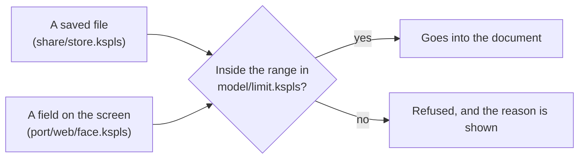

**Read with `as_int64`.** `std/json`'s `as_int` returns an I32 (a 32-bit integer), so a larger number wraps round and turns negative (`4000000000` becomes `-294967296`). A check of the lower bound alone then silently lets it through as "not merged (1)". So both entry points check the range as an I64.

Note: **A gate watches this.** It feeds deliberately broken documents ([`../tests/fuzz_main.kspls`](../tests/fuzz_main.kspls), `make test-fuzz`) through reading, and also through layout and writing out, so this kind of multiplication shows up as a timeout.

### Text from a received document is checked where it is used

Kspage runs no macros, but text inside a document can still do harm: a link can run code, a picture address can tell another server you opened the file. So every place that uses such text lets through only a short list of known-safe forms.

**Holding no macros closes only that one hole.** Every entry point that uses the document's text as it stands is the same hole. Even with no code to run, what was received decides a link's scheme, a picture's source and the text written out.

**Each entry point decides whom it trusts and which schemes it lets through, as listed below.** (A *scheme* is the part of an address before the `:`, such as `https` or `javascript`.)

Caution: **Do not list the dangerous ones and turn those away.** The next one to appear gets through silently.

| The entry point | What is let through | What refusing guards against |
| :-- | :-- | :-- |
| Opening and writing out a link ([`model/run.kspls`](../model/run.kspls)'s `safe_href`) | a relative path, `#`, `http`, `https`, `mailto` | a shared document with a `javascript:` link runs that code in the page of whoever presses it |
| A picture from an outside server ([`port/web/draw.js`](../port/web/draw.js)'s `outside`) | embedded (`data:`), or from where the page came from, judged by the address the browser will fetch (`//host/p.png` is outside) | on opening, the other server learns that the document was opened, and from where (a tracking pixel) |
| Pointing at a path and opening it ([`port/web/save.js`](../port/web/save.js)'s `isSafePath`) | a path with no scheme and no `..` | opening what lies outside the folder served (`%2e%2e%2f` and `..\` are decoded before the check) |

**A `:` ahead of the first `/`, `?` or `#` makes what stands before it a scheme, whatever characters that holds.** A browser deletes a tab, LF and CR anywhere in an address, so a link written `java`, tab, `script:` opens as `javascript:`. Deleting those three before the check would leave the check resting on a list of what browsers delete. Read this way, the schemes allowed decide alone:

| Written in the link | Read as | Result |
| :-- | :-- | :-- |
| `java`, tab, `script:alert(1)` | the scheme `java`+tab+`script` | refused: not on the list |
| `https://example.org/` | the scheme `https` | let through |
| `a:b` | the scheme `a` | refused |
| `./a:b` | a relative path (a `/` comes before the `:`) | let through |

A relative path loses nothing: one holding a `:` ahead of its first `/` would read as a scheme in a browser anyway, so `./a:b` is the way to write it.

Caution: **Tell the user what was stopped.** Stopped silently, an empty frame looks like a failed read, and the screen seems not to respond.

For outside pictures, the status bar shows how many were stopped, and the setting that allows them is in "the look".

**That permission is not remembered.** Remembered, it would let the next document opened silently fetch from outside too.

## Opening, saving and writing back

Save writes the document back to the file it came from, and refuses rather than overwrite changes made elsewhere. A browser lets a page reach a file only when the person presses something, which shapes every rule below.

Two ways of reaching a file recur in these sections:

| Way | What it is | What the page holds |
| :-- | :-- | :-- |
| **The browser's file window** ("Open") | the browser's own dialog for picking a file (`showOpenFilePicker`, desktop Chromium only) | a *handle* (`FileSystemFileHandle`): the browser's permission to read and write that one file again, without knowing its path |
| **The local server** (`kssrv --local`) | a small program the person starts, which serves one folder to the page and reads and writes files in it by path ("The local server reaches files, and nothing else" below) | a *path* inside the served folder |

### A document is written back where it was opened

**A document is written back where it was opened from, and "Open" is the browser's own window whether or not the server is running.** Every way of opening ends in the one place that decides where Save writes (`settleIn` in [`port/web/file.js`](../port/web/file.js)):

| How the document was opened | Where Save writes |
| :-- | :-- |
| Through the browser's window ("Open") | back through its handle, even while the server runs |
| By path: Enter in the path field, a `?doc=` link, a double-click | to its path. It holds no handle |
| Any other way: the file field, a drop that passes no handle, the manual, a draft brought back | it lives in no file. It first saves where a fileless document does (under the served folder by its name, or where the window asks), never into the previous document's file |

**"Open" is not routed through the path field while the server runs.** A person who arrived by a double-click holds a file, not a path, and presses "Open" expecting the window every other product gives them.

**What this gives up**: a file opened through the window may lie outside the served folder, so no `?doc=` link can point at it. It is reopened the way it was opened: through the window, or by a double-click, the OS's own way. A file under the folder is still reached by path. The path field clears when the window opens a document, so only one destination shows.

**Opening by path is Enter in the path field**, as in a browser's address bar. It is the screen's one way, and it states its refusals there: an empty field, or a path outside the folder.

**Say something on a cancel too.** The browser's window returns the same refusal when a person closes it and when it failed to open. With no message, that looks like a button that does nothing.

### A save has one destination, and asks nothing it already knows

With the local server running, a document opened by path is saved inside the served folder, without a file window. A new file is never allowed to overwrite one that exists.

**While the server runs, a document opened by path does not choose its destination in the browser's window.** If it could, it could be saved outside the served folder, making a document that cannot be reopened by path. The same press would also do two different things.

**Nor does it ask instead.** The folder is the one the person chose when starting `kssrv`, and the name is in the menu bar's field; asking for what is already known only adds a press. So with the path field empty, it writes directly under the folder by that name and puts the path written into the field. Later saves then go to the same place, and the workings are visible.

Caution: **Do not silently overwrite an existing file.** The default name is the same for everyone, so it can collide with another document. On a collision the save refuses, pointing at the field.

**A save's path goes to the document it was made for.** The document in view can change while a save waits for the write to finish. A dropped file that fails to open puts the previous document and its path back, and one that opens stays in view. So the path written, and the text the next save compares against, are recorded after the write, and only while that document is still in view (`stillHere` in [`port/web/save.js`](../port/web/save.js)):

| Recorded… | What goes wrong |
| :-- | :-- |
| before the write | in the first case, putting the previous document back restores the pre-save path |
| on whatever is in view | in the second case, another document gets a file it never came from, which its next save overwrites |

The cost: a document that has left view does not take the path. Its next save asks again, and refuses to overwrite this save's file, pointing at the field.

### Before writing back, outside changes are detected by comparing the text

Just before saving, kspage reads the file again. If it is not the text this window last saw there, someone else changed it, and the save refuses instead of overwriting.

The same file can be open in two windows: by path (`?doc=` and the path field), or through the browser's window, where each window holds its own handle.

Caution: **Overwrite it silently and what was written in the other window is lost.**

So the file is read again before writing, and **if it differs from the text last seen there, the save refuses**, naming that place. A save by path goes like this (through a handle, the page reads and writes through the handle instead of the server):

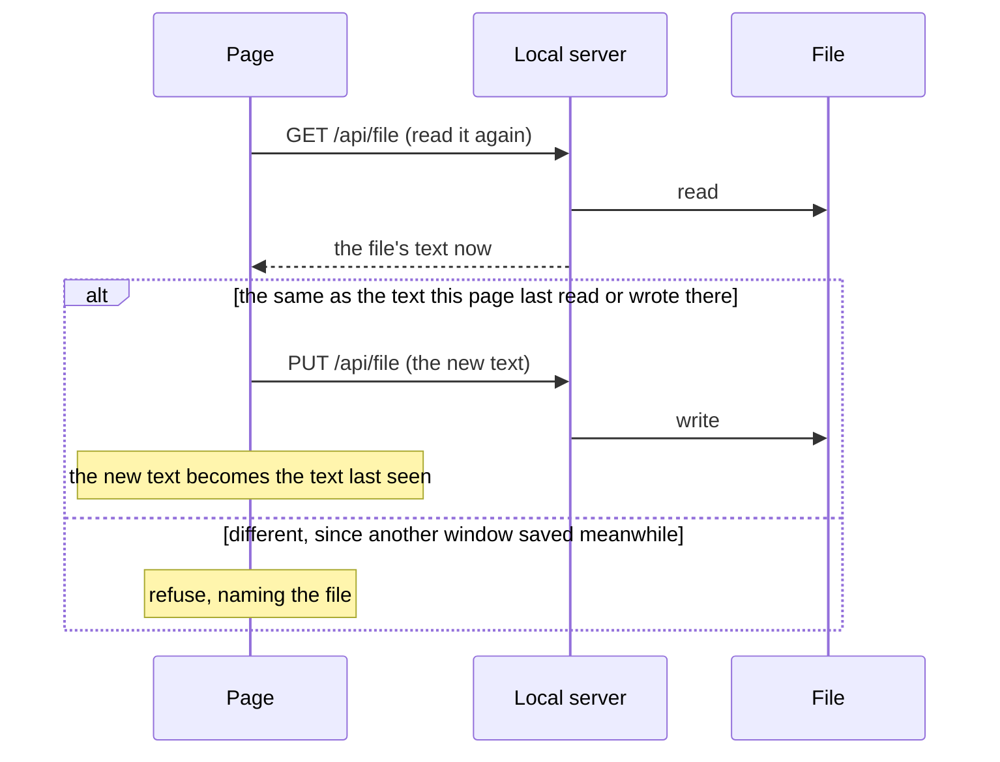

**A handle compares against the text last read or written through it** (`seenAt` in [`port/web/file.js`](../port/web/file.js), compared in [`port/web/save.js`](../port/web/save.js)'s `writeTo`). The one exception is a target just chosen in the save window. Choosing an existing file is the person's own "replace it", and the window asks.

**Do not compare the time and size**, as other products do (VS Code's "The content of the file is newer"). That refuses even when nothing changed, because clock granularity and each filesystem's quirks affect it. Comparing the text itself never refuses by mistake, and the cap on what can be opened bounds the text held.

**No lock file is laid down** (LibreOffice's `.~lock.`). One left behind by a crashed page makes a file nobody can open, while reading again and comparing leaves nothing behind.

**What guards a path is a text read from it.** A reloaded page reads its document again ("The save destination is remembered, and permission is asked at the first save"), so its first save compares too. A path typed into the field and saved to at once has read nothing. That save is the person's own "write it here", which the refusal of a colliding name points them to ("A save has one destination, and asks nothing it already knows").

**When the check cannot be made, refuse.** Writing without being able to read is overwriting unchecked.

### The save destination is remembered, and permission is asked at the first save

After a reload, the tab comes back on the document it had open, read fresh from its file, and Save still writes there. Each tab remembers its own document.

**A reloaded page comes up on the document it had open, read again from where it lives, together with where it writes back.** Otherwise every reload asks for the destination, and a wrong choice grows a copy beside the original. What is remembered is the document's path or its handle (`FileSystemFileHandle`). At start-up the document is read from there and laid in, as Enter in the path field and the window do (`reopen` in [`port/web/save.js`](../port/web/save.js)).

What the page does at start-up:

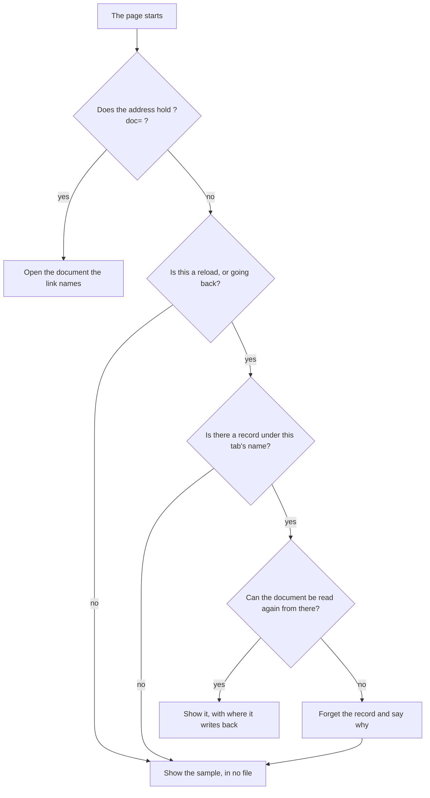

**Do not restore a destination without its document.** Restored onto the sample the page comes up on, the first `Ctrl+S` would write the sample over a file it never came from. Nothing stops it, since the guard compares only against a text read there. Reading the document again is what makes restoring the destination safe: the text last seen is the one just read, so the guard holds from the first save.

**It is remembered per tab.** The tab's own storage (`sessionStorage`) survives a reload, is seen by no other tab, and holds the tab's name. The record under that name holds the path and the handle ([`port/web/handle.js`](../port/web/handle.js)). A handle cannot be turned into text, and IndexedDB (the browser's database for a site) is the one store that keeps it, by structured cloning. Remembered browser-wide, a reload would bring in the document another tab had open last.

**Only a reload or going back keeps the name** (told by the navigation type). A page reached fresh (a window another opened, a URL typed again) takes a new name and comes up on the sample, in no file.

**A closed tab leaves its record behind**, since nothing tells closing from reloading. So the records are capped, and the oldest go first.

**The permission does not come back with the handle.** `requestPermission` can be called only in response to a press. So the start-up read relies on the permission the browser still holds, and write permission is asked at the first save. Once the browser has been closed, the read permission is gone too, and the file cannot be read without a press. The page says so, and the file is reopened from "Open".

**A destination that cannot be read again is forgotten, and the page says why**: the file is gone, the server is not running, or the permission is gone. The page stays on the sample, in no file. Without that read, a memory remains that is found broken only when pressed, the complaint raised most against desktop "recent files".

**A link wins over the memory** (`?doc=`). The address names its document, so the page comes up on that and ignores the record.

**It must also work where nothing can be remembered.** IndexedDB cannot be opened under an opaque origin (`file://`), so there the page comes up on the sample. Do not stop silently. A store that fails to open answers "nothing remembered" ([`port/web/handle.js`](../port/web/handle.js)); otherwise start-up waits forever for a document that never comes.

### Drafts are held aside, and a draft is never called a save

While you type, kspage keeps a copy of the unsaved text inside the browser, so a crash loses little. That copy is called a *draft*. It is never written to the file, and the screen never calls it "saved".

**Without drafts, unsaved work is lost.** The file is written only on a press, so a crashed tab loses the whole day's typing. Every other editor keeps a draft.

What happens to a draft, and when:

| When | What happens |
| :-- | :-- |
| Typing pauses (2 seconds), or the document is left | its text is written to IndexedDB ([`port/web/keep.js`](../port/web/keep.js)) |
| Another document is opened over it | what it has unsaved is set aside as a draft first ("A document is replaced by another only when nothing would be lost" below) |
| The page starts | drafts past 30 days and past 32 of them are pruned; the status bar says in one line where the earlier drafts are |
| The person brings one back (from "File", then "the record of what is half-written") | it opens in no file; the first save asks for the destination |

**Do not write it on closing (`beforeunload`).** No event fires when the tab crashes, so it fails exactly when it is needed.

**It does not write to the file.** The browser grants write permission only on a press ("The save destination is remembered, and permission is asked at the first save"), so saving by itself is impossible in principle.

**It says only "held aside", never "saved".** The two words are easy to confuse. Word's AutoRecover is read as "it was saved", yet closing without saving throws the recovery copy away too, and whoever misread it loses the work. Kept apart, the words cannot be misread, and "recovery" does not appear on the screen either.

**A draft is restored only when pressed.** Opened by itself at start-up, a draft one meant to discard would come back to life. Do not announce the open window's own draft. That window is alive and still holding it aside, so the notice would list a live draft as one lost earlier.

**A restored draft is not tied to a destination.** The draft can be older than the file, so tying it would let one press of Save turn the file back into an older version. Word and LibreOffice tie it, relying on the user to notice. The status bar says where the original was, and the first save asks for the destination. **It stays a draft until it is saved**: it lives in no file, so a document opened over it sets it aside again rather than dropping it.

**One question decides whether to write or discard: "is there anything to lose?"** [`port/web/file.js`](../port/web/file.js)'s `draftNow` returns null when there is nothing to lose, and there is one entry point, `keepSync`.

* Do not split the question and the contents into two entry points. The caller would call both and turn the whole document into text twice per pause, paid on every keystroke.
* Do not reuse `unsaved` either. It answers "does the status bar say Unsaved?", and it deliberately calls a document in no file unchanged. Here it would leave unkept a document typed on a blank sheet, the kind most easily lost.

**The key differs per start-up**, and per window, since two windows under one origin (one site, to the browser) use the same document numbers. Keyed by the number alone, document 0 after a reload would overwrite the earlier 0's draft before it can be restored. The start-up's key is not remembered, so an earlier start-up's draft is always left an orphan, and that orphan is what gets restored.

Caution: **Do not let drafts pile up without end.** An origin's storage has a quota, and past it writes fail silently, so the guard works in name only.

The pruning happens in one place, at start-up. Elsewhere, drafts would pile up whenever that place is not reached.

**The document in view is held aside, and so is one another document replaces** ("A document is replaced by another only when nothing would be lost" below).

### A document is replaced by another only when nothing would be lost

Opening another document never throws away unsaved work. The unsaved text is set aside as a draft first, with no dialog asking, and the page says where it went.

**When another document is opened over it, what a document has unsaved is set aside as a draft first**, and "Bring the draft back" lists it at once (`keepAside` in [`port/web/keep.js`](../port/web/keep.js)). Every way of replacing the document goes through it: "Open", a path, a link, a drop, the manual, "New" and a draft brought back (`settleIn` in [`port/web/file.js`](../port/web/file.js)).

Caution: **Do not silently discard unsaved work.** Writing lost to one keypress cannot be undone.

So **no refusal is needed**: a document is replaced only once there is nothing left to lose.

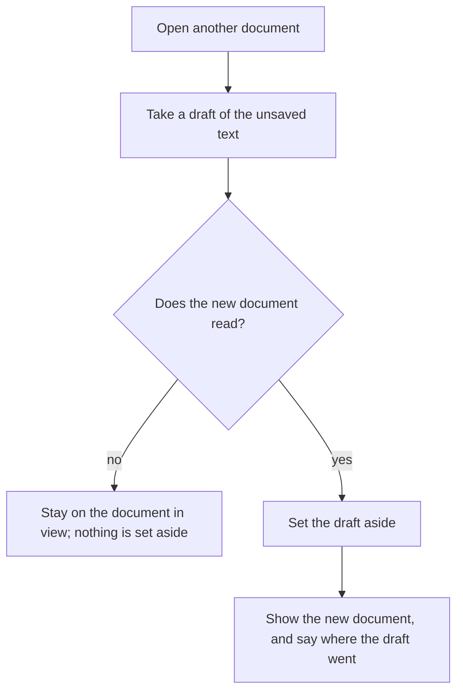

**Do not ask with a dialog (`confirm`).** In a test browser nobody answers, so the test stops there. On an embedded page, a dialog that blocks the whole page does the same.

**Say where it went.** The notice of the opening ends by saying the unsaved text is kept as a draft and where to bring it back; otherwise nobody can tell where the work went.

**Take the draft before reading, and set it aside only once the new document is in.** Reading replaces the text, so a draft taken after it is the new document's. Set aside before it, a refused read would list a draft of the document still in view.

**A window holds one document** (the document in view is the core's globals, [`port/web/state.kspls`](../port/web/state.kspls)). Keeping several in one window would hold every other document, its undo record and its destination aside, swap them at each switch, and add a list to find them by. Another window already holds another document ("A window opened on a document holds that document" below), so a second means is not kept (Principle 6).

**"Open" on the document already in view reads it again.** Whoever pressed wants a fresh read, since it may have changed outside; showing it again would make the press do nothing.

### The extension is kspage's own, and does not name the format inside

**Documents are saved as `.kspage`** (the contents stay JSON).

**Do not name the extension after the format inside.** As `.json`, these documents could not be tied to kspage alone. The OS chooses a program by extension, so tying `.json` to kspage would make every settings and data file open in kspage on a double-click.

The other products do the same: Word names its zip `.docx`, not `.zip`.

**`.json` stays readable.** Older documents are `.json`. Made unreadable, one would open as plain text, its tables, formulas and decorations collapsed into one paragraph, and saving would overwrite it in that shape.

**This does not make two formats for writing.** One function writes (`port/web/file.js`'s `bodyExt`), and `kindOf` only reads files that already exist. This is the same reason a version is kept ([`share/store.kspls`](../share/store.kspls)'s version).

**Write a document back in the form it was opened in.** Do not move a document opened from `.json` to `.kspage`, or two files would stand side by side with nothing to say which is newer (the same reason a Markdown export is a copy, not a second home: "A `.md` opens as plain text"). Whoever wants to move it can use "save as".

### The saved text is laid out to read well in a diff

**Do not pack the whole document onto one line.** Packed JSON reads back just as well, but then changing one word changes the whole document in a diff. git's diff and merge and `grep` can say nothing, and there is no way to compare what was written side by side.

**It is written one value per line** ([`share/store.kspls`](../share/store.kspls)'s `spacing`). The reader skips whitespace, so a text saved earlier still reads if the indentation changes; packed text reads too.

**The other products differ here.** kspage saves text that it reads back, so packing is its own choice, and a readable diff is worth more than what packing saves (some tens of KB).

### Pointing at a document by URL and opening it

A link such as `page.html?doc=notes.kspage` opens the page on that document; adding `&read=1` opens it read-only. This is how a README or an issue links to a document.

**`?doc=<path>` starts with that document open, and `&read=1` makes it read-only.** A path typed into the field by hand cannot be passed on as one link.

Caution: **Accept only a relative path on the same origin.** A scheme (`https:` / `data:`), a path starting with `//` and one climbing with `..` are refused. Accepted, one shared link could make this page read any location and show its contents.

**It reads with an ordinary `fetch`**, not the local server's `/api/file`, so it works from any server that just serves files. It does not work on a page opened from `file://`, since the document is not on that page's origin.

**Do not strip the query from the URL.** Unlike the token ([`port/web/local.js`](../port/web/local.js)'s `#t=`) it is no secret, and a reload returning to the same document is what the link is worth.

**Set read-only before loading.** Loading a document rebuilds the editing state, so if it is set afterwards, the document is writable while it loads.

### Read-only belongs to how a document was opened, not to the document

Caution: **Do not write it into the document.** Written in, it becomes a lie: a copy calls itself "read-only" and anyone can edit it anyway (the same reason a theme's name is not written into the document). So it appears in neither the saved text nor an export.

It lives with the reader's overrides (`Sheet.over`), and **survives reloading the document** ([`port/web/state.kspls`](../port/web/state.kspls)'s `new_edit`).

**The core refuses the edits.** Hiding the tools is not enough: operations that slip past hidden tools (shortcut keys, pasting, undo) always remain. Hiding only keeps buttons that would do nothing off the screen.

**The refusal is at the entry point of a rewrite, not in the code that rewrites.** If the `do_*` functions (the 20 that rewrite) quietly did nothing, a caller that repeats until something happens would never finish. [`write/block.kspls`](../write/block.kspls)'s `join_here` loops until the runs are gone, so with `do_run` doing nothing it hangs there. Refused at the entry point ([`write/edit.kspls`](../write/edit.kspls)'s `shut`), the loop never starts.

**There are over 50 entry points, so one will surely be missed.** So the check is not a count but that the saved text does not change by one byte (`kspage/tests/edit_test.kspls` and `kspage/tests/browser/store.js`). Whichever way an edit gets in, a changed document shows up there.

### Switching between reading and editing

**The mode switches both ways, and stays a setting of how the document was opened.** Do not make it feel like a lock: it is a screen against edits by a mistaken press. A document opened with `&read=1` can be switched to editing too. A one-way switch would guard nothing, since removing that mark from the URL does the same.

**The control that shows the current mode is the one that switches it**: the pair at the status bar's left edge, with the mark on whichever is on. Do not show the mode in two places, or changing one puts them out of step. Do not hide it when read-only; hidden, the way back is gone from the screen.

**No shortcut key is assigned.** Nothing may silently switch the mode on a mistaken press (as LibreOffice's `Ctrl+Shift+M` can), and with the control always in sight, no key is needed.

**The switch applies in both directions.** Applied one way only, the tools would stay hidden after leaving read-only, leaving a screen where one can write but the writing tools are missing.

### A picture from a file is embedded, and one typed by its place is linked

A picture you insert from a file, or drop, is copied into the document. A picture whose address you type stays a link to that address.

The document holds only **the picture's source**, which is text: either the picture itself encoded as a `data:` address, or an outside reference as it stands.

**The control pressed decides it, and nothing else.**

| The control | What the document holds |
| :-- | :-- |
| "Insert from a file", or a dropped picture | the picture, embedded |
| The place field, with a relative path or an address typed in | a reference to what was typed |

Do not let whether the local server runs decide it. The same press would put the picture in two shapes, a document made with the server would lose its pictures when handed over alone, and the only way to get one self-contained file would be to stop the server first. Nor ask on every insert: pressing one control or the other already says which.

**kspage writes no picture file.** A picture to sit beside the document is put there by the person, with the OS's own tools, and its place is typed in. Writing one would need a rule for a colliding name and for a folder that does not exist, for work the file manager already does.

**Report the size embedded.** Unreported, a few photographs reach the cap on what can be opened, and nobody can see what is heavy (a `data:` text is 4/3 the original bytes).

**A reference stays relative**, in the saved text and in the Markdown written out. Move the document elsewhere without the picture and it disappears, so a document that must be self-contained uses embedding. This is a trade-off: neither can be made the default with the other taken away.

## More than one window, and opening from the desktop

One window shows one document. To see two documents, or two places in one, open two windows. Windows never share edits.

### Editing together

Kspage has no live co-editing. Two people, or two windows, cannot edit one document at the same time; work is merged afterwards by hand.

**Two people do not edit one document at once, and two windows on one machine are not joined to edit it together either.**

**Why windows are not joined.** Simultaneous edits need an agreed order, and with no server only each window's own count can give one. That fails with a third window and across a network. So two windows in one browser are a different problem, not a small case of two people in two places. A join held as paths into the document's tree also breaks in ordinary use. Adding or deleting a row or a column, or applying a new style, cuts the paths, and those are the very operations a table needs.

**Two people's work is brought together afterwards, by hand**, with the two texts opened side by side, each in its own window. Two windows may open one file, but the second to save is refused if the file changed after that window read it ("Before writing back, outside changes are detected by comparing the text" above):

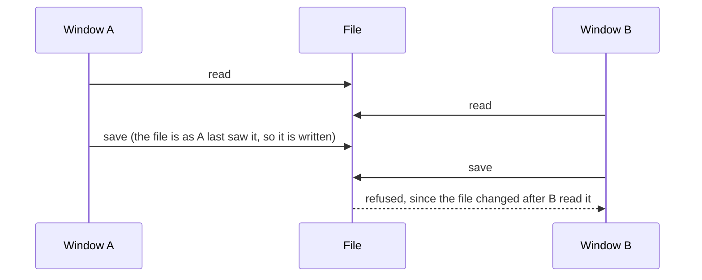

**A real answer needs a server that orders edits for everyone.** `kssrv` exists but deliberately knows no document ("Who asks whom" in [`../../docs/SPEC-local-server.md`](../../docs/SPEC-local-server.md)), so such a server has to be designed from scratch, not reached by joining windows.

Note: What the person meets instead is in the manual's "What it cannot do" chapter ([`content/manual.kspage`](../content/manual.kspage)).

### Another place in the same document is seen in another window

**One window shows one place of its document.** The core holds one cursor ([`write/edit.kspls`](../write/edit.kspls)'s `Editor`), so a second pane in the same window that takes typing would have nowhere to keep its own cursor. One that only reads would be a second means beside the one already there: another window on the same file, whose size and place on the screen are real. Two windows may open one file; the second to save is refused if the file changed after it read it ("Before writing back, outside changes are detected by comparing the text" above).

### A window opened on a document holds that document

**A window the page opens with `?doc=` reads the document that names, and no window passes its document to another**, since two windows are not joined ("Editing together" above). A window opened from a link inside a document is `noopener` as well (the new window gets no reference back to the window that opened it). Lining documents up inside one window is a separate matter (accepted limit 2 below).

Caution: **Do not check it by the text alone.** A passed-over document overwrites the named one only when it arrives later, so the text can look right in one order and lose the document in the other. The browser check also counts what was passed ("Opening a different document in a different window" in [`../tests/browser/local.js`](../tests/browser/local.js)).

### What kspage publishes for the opener

**Nothing in kspage is published for the opener**, the program outside this package that opens a `.kspage` document on a double-click. Do not have it reach the names of the sample and of saving directly. `pub` is a contract leaving the unit, so opening `content/` and `share/` adds two contracts (`ksplc.cfg`'s [I0402] watches their count; see "What is here" in [`kspage/README.md`](../README.md)). The entry that assembles the seed is already open for the gates, so the opener uses that.

### Whether a dropped file is opened or inserted

Drop a picture and it is inserted into the document; drop anything else and it is opened as a document. The browser never takes over the drop.

**The heaviest complaints about a drop are "I meant to open it and it was inserted" and "I meant to insert it, it opened, and the earlier document was gone".**

**Once something is dropped, the browser's default is always stopped, across the whole window.** Unstopped, the browser moves to that file, and the document being edited goes with the page.

Caution: **Do not stop it on the body's canvas alone**, or a drop on a panel or the ribbon would escape to the browser. The mark shown while dragging covers the whole window too.

| What is dropped | What happens |
| :-- | :-- |
| A picture | **A picture is inserted into the document.** The cursor first moves to where it landed, but only when it landed on the body; a panel's or the ribbon's coordinates would put the cursor somewhere else |
| Any other file, including a picture that declares no type | opened as a document. The core checks the contents and refuses what it cannot read, so it is never silently mistaken |
| Text being dragged (not a file) | **A text drag is left alone**, so text can still be dropped into a field to paste it. Only a drag carrying `Files` is taken over |

The two are told apart in one place (`isPicture` in `port/web/drop.js`).

**A drop borrows the existing entry points**: `takeChosen` in `port/web/file.js` for a document, `takeImage` in `port/web/command.js` for a picture. Do not write a reading path into the drop (Principle 4: one canonical source), or dropping alone would behave differently.

**The dropped file is bound for writing back only where a handle could be taken.** In the browsers that give one (Chrome, Edge), a save writes straight back to the dropped file. Do not bind again where no handle was taken; that would only delete the handle remembered. There the file opens but a save drops a copy, the same split as choosing a file (`canBind` in `port/web/file.js`).

### How a blank document is started

"New" opens a blank sheet at once, with no template screen in front, and with no link to the file opened before.

**The commonest complaint is a list of templates standing between the user and the blank sheet.**

**"New" opens a blank sheet, with no screen of choices in between**, since that screen is the complaint itself. A template never stands in front of the blank sheet.

**What the open document has unsaved is set aside as a draft first**, as on every opening ("A document is replaced by another only when nothing would be lost" above).

Caution: **Do not let "New" drop the open document's unsaved text.** It would silently throw away whatever is half-written.

**No shortcut key is named.** Do not offer `Ctrl+N`: the browser takes that key before the page sees it, so the hint would not work when pressed. A desktop product can use `Ctrl+N` because no browser stands in between (the same difference as "Whether the browser or the page holds the zoom").

What "New" builds, and what it leaves out:

| Part | What "New" does | Why |
| :-- | :-- | :-- |
| The styles' table | **Include the styles' table** | Without it, tables and slides both land as ordinary paragraphs, so someone who started from "New" cannot insert a table |
| One paragraph holding an empty run | **Lay the empty run down too** | A block alone produces no box, so a press cannot fix a position, and the blank sheet appears but cannot be typed into. This is the shape the editor leaves when it empties a paragraph, saved as `"text": ""` |
| Where to write back (the name, the path, the handle) | **not carried over** | Otherwise saving a blank sheet would overwrite the file opened before. The text kept for comparison is empty too, so the overwrite guard would not act either |
| The read-only look | **undone** | The core opens a blank sheet for editing; a look that forbids typing would sit on a document that allows it |
| A body width, a theme | **Neither a body width nor a theme is written into a blank sheet** | (below) |

Caution: **Do not make "New" the place defaults are laid down.** "Where the body's width is capped" above says why, and where "readable for me" goes instead.

## Markdown, plain text and source

Kspage opens plain text and program source as they are, and writes them back byte for byte. A `.md` is one of these texts. These texts are kept beside code, so they must stay readable by every other tool. Markdown is also a format kspage writes, as a one-way export.

### A `.md` opens as plain text

A `.md` file opens with each line as one paragraph, as any text does, and saves back byte for byte ("Plain text holds one line per block" below). Kspage does not read Markdown into headings, lists and tables.

**Reading Markdown in would cost a second format to keep whole.** A reader turns the text into styled blocks, and writing back must then give the same text again. That needs a reader, a table of looks handed to it, rules for every notation the writer must reproduce, and a check that sends real files through and back; the check promises only a fixed point, not the bytes the person typed. Every editor and code host already shows Markdown rendered, so what kspage would add is small next to that cost.

**Opened as text, a `.md` loses nothing.** A notation, a trailing space or a line break stays as typed, so the tools around the file (diff, `grep`, the checks that read text) see exactly what was there.

**The export stays.** A document made in kspage can still be written out as Markdown to keep beside the code. It is a copy for reading, not a second home for the document: the `.kspage` stays the one to edit, since a copy without styles cannot say which of the two is newer.

### The mapping into Markdown

Exporting to Markdown writes everything Markdown has a form for in that form. Content Markdown cannot express is written as a hidden comment, so it is never dropped silently. The look is dropped.

[`share/markdown.kspls`](../share/markdown.kspls) writes it, **for keeping a document beside the code**. It does not read back: kspage opens a `.md` as plain text ("A `.md` opens as plain text" below), and no style is carried into the text ("Saving and loading are separate from exporting" above).

**Contents with a Markdown form are written in that form; contents without one are written as a mark.**

| In the document | In the Markdown |
| :-- | :-- |
| A heading | `#`, as many as its depth |
| A list item | `-` or `1.` |
| A paragraph | text outside any fence (a fenced code block) |
| A grid (a table) | a GFM table (GitHub's table syntax) |
| A link | `[text](destination)` |
| Emphasis on a run | `**` and `*` |
| **Merged cells, a block inside a cell, where a slide's frames sit, and a chart** | a mark, `<!-- kspage: ... -->`: an HTML comment that Markdown passes through unseen. A slide's frames' words still go on as paragraphs. **No fence of kspage's own carries them**: only kspage would read it, and every other tool would show it as code |
| The look (colour, sizes, alignment, a picture's size, a column's width, a row's height) | nothing |

**A mark is written only where contents are lost.** The look is dropped wholesale; a mark for each part of it would bury the text, so this section says it once.

**A number with a Markdown form is written in that form; one without is written as text.** A list's bullet symbol written beside the `-` would show two marks, while a dropped chapter number or "Figure 1. " would vanish from the screen.

Note: Both numbers come from the same place the layout uses (`kspage/model/number.kspls`'s `heading_number` / `serial_number` / `note_number`).

**Escape only what would read as something else**, since escaping everything makes the text unreadable. A `_` inside a word is not emphasis and is left alone, while a `#` at a line's start could read as a heading and is escaped.

**Indent only inside a list.** In Markdown, leading spaces change a block's meaning, so indenting at every nesting level would turn a paragraph into a code block.

**A table's first row is its heading**, since GFM has no table without one. As with CSV, export writes the text shown, not the formula.

### Rules the Markdown writer keeps

**Inline code is the innermost mark.** Emphasis and a link go outside it (`` **`x`** ``, `` [`x`](u) ``): inside a fence a mark is plain text. A text holding a `` ` `` gets a longer fence. Its style is code by role, the same role as a code block's (it does not wrap); the writer never looks at the name.

**The language a fence declares is the fence style's name.** Dropped, ` ```kspl ` becomes ` ``` `, and every tool that collects the source's fences misses them (in this repository, [`../../tests/suite/docsnippet_test.kspls`](../../tests/suite/docsnippet_test.kspls)). The plain code style declares none.

**Consecutive runs are wrapped together per emphasis.** Code inside bold splits into three runs (`this document (` / `DESIGN.md` / `)`), so wrapping each run in `**` would write `**...****` ... `****...**`.

**The parting is in two stages: by link target first, then by emphasis inside that.** Parting by both at once splits a link wherever the emphasis changes inside its text. A `[...](...)` is written per piece, so one link multiplies into as many links as it has runs. The rendered text does not show it, yet a screen reader announces each piece as a link. **Only runs inside a link are grouped**: grouping runs with no link too would detach a note's mark from its run.

**A break is "a block that holds no content and collects none"** (`divides` in `model/fence.kspls`). A *break* is the horizontal rule Markdown writes as `---`. Add neither a field nor a name for it. It is recognised by role, so renaming a style does not break it (Principle 1). Its look is the style's: a line under a style that draws one, only space under one that does not. Only a break that draws a line is written.

**A break is never taken into a fence.** Taken in, two fences with a break between would become one block: one band on the screen, and one ``` pair in the text.

**Do not mistake a collecting block for a break.** The table of contents, the footnote list, a chart and a figure assemble their content at every layout. So in the document they hold neither text nor children, and mistaken for breaks, the list disappears whole. Nor mistake a blank line inside a fence, which holds one empty run.

**A column's alignment is held by the style of that column's cells.** Do not add a field to the table. `Style.align` already means "the alignment of a row's content", so a table field would hold one thing two ways (Principle 6: one means to one purpose). The padding tells a cell from the other blocks that draw nothing of their own:

| Block | Inner padding | Draws a line |
| :-- | :-- | :-- |
| A cell | yes, to keep the grid line off its content | (the grid's) |
| A break | no | yes |
| A bare paragraph | no | no |

**It is one per column.** Markdown can write alignment only per column, so the writer takes the header row's cells. A different alignment in a lower row cannot be written. Taking "any row that holds one" would let adding one row change the whole column's alignment. Left is the default, written `---`.

**The annotations (`Inline.remark`) and the asides (`Block.aside`) are not written**, and get no mark. They are not the document's contents, so nothing is dropped from the flow.

### Plain text holds one line per block

A `.txt` file, a `.md` file or a program's source opens with each line as one paragraph, and saves back byte for byte identical.

This is how kspage opens a `.txt`, a `.md` or a program's source ([`share/text.kspls`](../share/text.kspls)).

**It round-trips byte for byte.** A "fixed point" (the written text, read again, changes no further) is not enough here. That one does not count a choice of notation as content, whereas this text is a compiler's or a tool's input, where one byte different is another file. [`../../tests/suite/textrip_test.kspls`](../../tests/suite/textrip_test.kspls) watches it by sending every file git knows through whole.

| What | What kspage does | Why |
| :-- | :-- | :-- |
| The notation, trailing whitespace, the line breaks | kept as they are: not tidied, not dropped, not made uniform | one byte different is another file |
| A trailing line break | **A line is exactly a piece cut at line breaks, so a trailing line break is followed by one more, empty, line** | That tells a file ending in a line break from one that does not, so it is not remembered separately. A flag would say what the content already says, and one of the two could change alone |
| A CR (as in a Windows CRLF file) | **A CR is kept as a character of its line**, so a CRLF file shows one character at each line's end | (this repository holds no CRLF file) |
| A NUL byte | **A file holding a NUL is refused** | it is not text (below) |

Caution: **Do not remember "this file is CRLF".** In a file with mixed breaks, one kind would be silently rewritten.

**One line is held as one block.** Do not make a second kind of document: relayout, the cursor, undo, saving and searching all work unchanged with what exists (Principle 1 and Principle 6). A fence (a ``` block) already has this shape, so only a reader and a writer are added.

**The gutter for line numbers is sized from the number of digits in the line count** (`gutter_for` in `share/text.kspls`). Do not make it a fixed width; one wide enough for the largest document leaves too much space on the left of a file with fewer digits. The digits follow from the line count, so they are known as soon as the file is read. Reckon a digit's width generously: a monospace digit is 0.55 to 0.62em, so 0.65em is used. A number wider than the gutter is drawn from the gutter's left edge and runs into the body (`place_mark` in `lay/line.kspls`). Measuring cannot find it: the gutter is where the body begins, so it is needed before the layout.

Note: The check is [`tests/text_test.kspls`](../tests/text_test.kspls)'s "there is a gutter the numbers are laid in", which checks that the gutter widens as the digits grow and that the number and the space beside it always fit.

**The price is the arena** (the memory region the document lives in). This repository's text takes several times its own size again in memory, the more so the shorter the lines. The cap is that of the existing document memory gate (`room_for` in `port/web/state.kspls`), and past it the page refuses before opening.

**VS Code went the other way.** It replaced one string per line with a piece table (a structure that stores edits as pieces of the original), because opening was slow and memory ran high. That reason holds here too, so kspage does not claim that any large text can be opened. What the price buys is that the document's tools work unchanged.

**Do not open a picture or an executable as text**: the screen fills with nonsense, and the file is broken the moment it is saved. So a file holding a NUL is refused. The one test is git's own, "is there a NUL"; relying on the encoding would let a misjudged text through silently. Report it apart from both "too large" and "cannot be read", since the remedy is "open it with another tool", not changing the text.

**How a file is opened is decided in one place, by its name** (`kindOf` in `port/web/file.js`). There are four ways to open one (a path, a text reference, a handle, a drop). A test per entry point would let the shape opened and the shape written back drift apart per entry point (Principle 4). An unknown extension opens as plain text. A list of known ones would grow with every extension, and a text missing from it would be read as JSON without a word.

### A source opens as plain text, and nothing more

Kspage is not a code editor. Source code opens as plain text: no colouring, no symbol windows, no import graphs.

**A program's source opens as any plain text does**: no colour, no window onto a symbol, no figure of the imports, and nothing built from a table into code. All four serve a place for writing code, which is not the aim ("What it is aimed at" above). Colouring by lexeme (by keyword, string, number and so on) needs a copy of each language's keywords that drifts silently from the compiler's. A window and a figure need the editor to read and cut source at every layout, rebuilding what the compiler holds. The editor beside the document already shows all of it.

**A link to a file is an ordinary link** (a relative path), which opens what the browser opens. The document points at the source by name, as every document here does ("Linking documents to source" in [`../../docs/SPEC-documents.md`](../../docs/SPEC-documents.md)), and `make test-docref` checks a Markdown document's pointers.

**A text holding a window onto source is refused whole** (`Store_error.withdrawn` in [`share/store.kspls`](../share/store.kspls), which refuses a line joining two frames the same way): a block with an `aim`, or a style collecting `source` or `imports`. Opened without the window, the next save would drop what it held without a word. Raising the format version instead would lock out every document, not only the ones holding a window. The page says why it did not open, and that nothing in the file was lost.

## The local server reaches files, and nothing else

A web page cannot open a file by its path. The local server, `kssrv --local`, is a small program on your machine that does only that for the page: it reads and writes files in one folder, and reports whether a file changed. **It starts no program.**

`kssrv --local` answers the page's requests for files and for whether a file changed, and the page uses them to open and save by path ([`../../docs/SPEC-local-server.md`](../../docs/SPEC-local-server.md)).

**Served locally, everything the page shows is read with the token.** The *token* is a secret the server prints once at start-up and the page sends with every request, so that no other program or page can read the folder. That server hands out no file but the page without it.

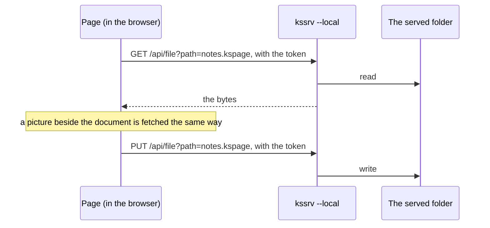

A `?doc=` link reads its document through `GET /api/file`. A picture beside the document is read the same way and drawn from a `blob:` address, since an `` cannot send the token's header (`localPicture` in [`port/web/local.js`](../port/web/local.js); drawing and measuring both go through it). From `file://` or another server, both are a plain fetch.

### The browser draws, and a server only reaches files

**The browser carries what costs most per OS**: the IME, the clipboard, printing and the system's fonts ("Why the browser is the main target" above). kspage's layout and drawing are its own already, so a native window would rebuild those parts three times and gain nothing on the page. **What a page cannot do is reach a file by its path**, and that alone is what the server is for.

**Without a server, the path tools are folded away, and the page asks once whether a server is there** ("When it is not connected" in the same [`../../docs/SPEC-local-server.md`](../../docs/SPEC-local-server.md)). Asking at every press would make a person wait on every press.

**The case with no server is checked too.** That nothing pressable-but-inert appears can be seen only where no server is, so two gates run:

| Gate | What page it checks |
| :-- | :-- |
| `make test-kspage-browser` | the page opened from `file://`, with no server |
| `make test-kspage-served` | the page a real `kssrv --local` serves |

Note: The same sections run under both ([`../tests/browser/probe.js`](../tests/browser/probe.js)).

### kspage starts no program

**kspage neither starts a program nor talks to a language server** (a background program that gives a code editor completions and errors), and holds no plugin that a program on the machine would answer. All three serve a place for writing code, which is not the aim ("What it is aimed at" above). Each would also make the server one that starts programs, the costliest kind to keep safe. **To repeat a fixed routine, write KSPL code that edits the document** (the core is a library), as for macros ("What it does not hold" above).

### Where the protocol with the server is written down

**`kspage → kssrv` is not in the packages' reference direction.** Only the direction of import is allowed ([`../../docs/SPEC-documents.md`](../../docs/SPEC-documents.md)), and there is no import (HTTP joins them), so the only question is where the agreement lives.

**It lives in [`../../docs/SPEC-local-server.md`](../../docs/SPEC-local-server.md)**, for the reasons "13.10 A page asks the local machine through one protocol" in [`../../docs/DESIGN.md`](../../docs/DESIGN.md) gives.

## How the page is checked

The built page is checked in two folders of tests. Each test section works on a document of its own, and a round of tests that is cut short still says how far it got.

kspage's checks on the built page live in `kspage/tests/wasm/` and `kspage/tests/browser/`.

### Each browser-check section has its own document

Caution: **A check on the page must not count on the document shown at startup, nor share a document with another section.** The startup document is the product's sample ([`content/sample.kspls`](../content/sample.kspls)), and it changes whenever what is to be shown changes. Counted on, fixing one paragraph of it fails a test that cannot say whether the rule broke or the sample changed; moving one heading fails cases in both folders. A shared document breaks the same way: a paragraph added for section A moves section B's measurements.

**How a folder keeps its sections apart depends on whether each can have a document of its own:**

| Folder | What it holds | How it keeps them apart |
| :-- | :-- | :-- |
| `kspage/tests/wasm/` | `make test-wasm`'s per-section code; `kspage/tests/wasm/shell.mjs` hands the entry points over, and `kspage/tests/wasm/material.mjs` assembles the documents | **Each section declares its own document** with `opens`, and the driver reads it before passing it on, so **a forgotten declaration fails the run** (a rule merely written down is not kept) |
| `kspage/tests/browser/` | `make test-browser` and `make test-served`, run on the assembled page in a real browser; `kspage/tests/browser/probe.js` runs the sections in the order of `KSPAGE_PROBE` in [`Makefile`](../Makefile) | The sections share one page, and **those holding asynchrony overlap**, so the document cannot be swapped: they **search for the place to press and to peek** instead (`findBlock` / `findCell` in `kspage/tests/browser/probe.js`) |

### A cut-off test round says how far it got

If the test browser hangs and has to be killed, the gate still reports the last step the page reached, because the page also prints every step to the console.

**The page also writes every mark to `console`, and the gate reads them back from the browser's standard error when no DOM arrives.** The `file://` page dumps its DOM only at the end, so a browser killed before then would leave only "it did not reach the marker". With the marks, the last one read is how far the round got.

**The hang itself is Chrome's.** `--virtual-time-budget`'s own description says "virtual time does not advance while network fetches are pending". `--timeout` does not cover that wait, since it races only the page's load. So a fetch that never settles pins the clock and nothing is dumped. Killing from outside is the only way out.

**Other test runners use this shape.** Chromium's own web-test runner reads the browser's standard error alongside the results, keeps its own deadline outside the browser, kills, and reports what came out before the kill. Playwright and Puppeteer (`dumpio`) keep the same way out, because any timeout put inside the browser can itself be what hangs.

**A way out used only in an emergency has to run on the ordinary round too.** The shape of the line Chrome writes is no contract and moves between versions. A reader left behind would cut out nothing and report "the page said nothing", on the one round where the trace was needed. So a round that passes compares the two lists (the marks in the DOM and the marks read from standard error), and the day the shape moves, a green round fails instead.

### A check starts when the page says it has stood up

The browser checks begin only once the page itself says its start-up is done, however long that takes, and a start that fails is marked with its reason.

**The page publishes one promise, `window.kspageReady`** ([`port/web/page.js`](../port/web/page.js)). It resolves once the core runs, the local server has been asked and the document the page comes up on is in. It rejects with the reason where the start failed, and the page then shows that reason in the status bar, so a person is not left before a blank page. Every waiter takes this promise, and none looks for `window.kspage` on a timer.

**A wait on a clock cannot be right here.** The `file://` round runs on Chrome's virtual clock (`--virtual-time-budget`), which jumps to the next timer whenever the page's thread has nothing to run. It does not see work done off that thread: compiling the wasm, IndexedDB, reading a `Blob`. On a busy machine, a cap of a few seconds on that clock runs out in a fraction of a real second while the wasm is still compiling, and the round fails as if the page were broken. With no timer at all it is worse: the clock jumps to the end of the budget and the DOM is dumped before the answer.

**So a wait on such work keeps the page's thread fed** (`fed` in `kspage/tests/browser/probe.js`): one message after another, and the virtual clock stands still until the answer comes. Chrome holds that clock for pending network loads alone, so nothing else would. Real time is capped outside, by the gate's `timeout`, and a round cut there names the wait as its last line.

**Every round starts late on purpose** (`kspage/tests/browser/late.js`). Before the page's start goes on, the wasm is compiled again off the page's thread a number of times. A wait counted on the clock then fails every round, not only on a busy machine.

## The screen and its controls

How to use the screen is the manual's to explain ([`content/manual.kspage`](../content/manual.kspage)). This chapter holds only what the page itself fixes that no chapter above says: where a control sits, what a key does, and the numbers the page holds.

### Where the controls sit, and the keys

* **The commands sit in six menus** (File, Style, Table, Insert, Share, Review), one open at a time. The frequent ones line up as icon shortcuts on the ribbon (`RIBBON` in `port/web/ribbon.js`). A shortcut presses the menu's own button, and so does its entry under `…`, so nothing is implemented twice.
* **Opening by path is the path field under "File".** The note on the holder the cursor is in (a slide, a table, a picture) is under "Share" too. "Review" holds the comment, and the name a comment is written under. A table exports as `kspage.csv`. A slide is inserted from the template beside the button (one frame, a title and a body, a title and two columns). Each shape drawn brings one style named `figure-<the shape>`, and each chart one named `chart-<the way of gathering>`.
* **The right-click menu on the body** carries a comment, a link and the style, and in a table cell the rows and columns.
* **Typing in the find field shows the count found at once.** "Replace all" touches the whole document, so how many will change is in view before the press. 0 is shown too, since a blank could not tell "not counted" from 0. What is counted is places found; a formula's run is found but not replaced, so fewer may be replaced. Overlaps are not counted, and it counts again on every redraw (about a tenth of a layout).
* **In the "Slides" tab a thumbnail is dragged to reorder**, placed by where it is dropped; moving it while dragging would shift it by however many it passed. A dotted frame shows where it will go, and it is one undo, since the order is the document's.

**The keys while editing** (Command in place of Ctrl on a Mac):

| Keys | What they do |
| :-- | :-- |
| Ctrl+S | saves |
| Ctrl+Z | undoes |
| Ctrl+Shift+Z or Ctrl+Y | redoes |
| Ctrl+F | opens the find field (Esc folds it) |
| Ctrl+K | opens the link field |
| Ctrl+B / I / U | toggle bold, italic and underline, with the same rows as the menu's (`ACCENT_KEYS` in `port/web/keys.js` and `keys` in `port/web/form.js` are one list) |
| A press with Ctrl (⌘) held | follows a link |
| `Alt`+arrow | moves the chosen frame; with `Shift` it resizes it, and with `Ctrl` it moves 10px at a time |
| Delete or Backspace | deletes a chosen shape (in a frame holding text, one character) |
| Tab outside a table | not taken: focus moves to the next field, and no tab character goes in |

**During a slideshow**:

| Keys | What they do |
| :-- | :-- |
| → ↓ and Space | the next step or slide |
| ← ↑ | the previous step or slide |
| Esc | returns to editing (typing is shut off during the show) |
| Holding `N` | shows the slide's note at the bottom |

There is one screen, so nothing can be shown to the presenter alone, and an empty note shows no band (a black band alone looks like a mistake). In a document with no slides nothing happens.

### The tools and the look

**The tools stay put while the body scrolls.** The menus, fields and ribbon stay at the window's top (`#chrome`) and the body passes under them. So scrolling to follow the cursor stops at the tools' bottom edge (`app.headRoom`); otherwise the place being typed would hide behind the tools. The checks hold the two rows under a cap (`chromeCap` in [`../tests/browser/ribbon.js`](../tests/browser/ribbon.js)).

**The cursor is a layer over the canvas**, so a blink repaints no document and shows on neither the page nor a thumbnail. The window scrolls to it only when it leaves the view. Scrolling every time would pull back, on every keystroke, a window moved to read. Right after a move, the cursor is always in view.

**⚙ remembers** fitting the colours to the screen, whether the ribbon is folded, the shape last used and the document's name (`localStorage`). It also says the document's own settings (the body's width, the pages, the margins, the styles) are under "File" and saved with it. The page's look follows the screen's light or dark. The document's themes are `Standard`, `Indigo`, `Vermilion` and `Serif`, at the top of the "Style" menu, and those names are the core's ([`write/theme.kspls`](../write/theme.kspls)).

**Only desktop Chromium can write a file back** (`showSaveFilePicker` / `showOpenFilePicker`). In Firefox, Safari and on a phone a copy is downloaded, and the page says so rather than switching silently. Retyping the document's name forgets where it writes back. That is "save as", and it has no button, since one thing is not done two ways.

## Accepted limits (what is decided not to change)

This chapter keeps the known shortcomings **judged not worth their cost**, each with its grounds. Keep them rather than deleting them; without the grounds, the same point keeps coming back as "something nobody has got round to".

**It is not the list of what is still missing.** That is the manual's last chapter ([`content/manual.kspage`](../content/manual.kspage)), which also carries every item here that a user can see; left out, a user would hunt for it as their own mistake. Do not write the same sentence in both. The manual says what cannot be done, and this chapter says why it is decided not to change.

### Accepted limit 1: typing one character lays the whole document out again

Every keystroke, and every cursor move, recomputes the position of everything in the document. This is fast enough for every document kspage can open, and making it incremental would risk showing a stale screen, so it stays.

**How it stands.** The calls that cross the boundary to the browser do not grow with the document ("Text that has not changed is not measured again" and "A style is looked up by name once" above), but what is walked is the whole document (`layout` in `lay/flow.kspls`). Retyping one paragraph takes time in proportion to the document's size.

**The cost of one relayout.** It is measured on 3,000 paragraphs of an unchanged document under native `ksplc run`, an unoptimised build, so absolute values run about 2.5 times wasm's; what counts is the ratios. The cost is a fixed amount per paragraph plus a fixed amount per box, nearly constant whatever the shape. The paragraph share stays in the low hundreds of nanoseconds, and the box share adds about as much again. The gathering done beforehand (headings, notes, running numbers, charts, references) is no hotspot either; stopping it saves only a small fraction of the fixed cost. So making one place faster does not help: both shares grow with how much is walked.

**A relayout that changed nothing costs the same**, so merely moving the cursor costs as much as typing. Moving the cursor, finding the place pressed, selecting and rereading the theme each lay the whole document out again. They are as frequent as keystrokes, so this limit cannot be weighed by typing alone.

**Four reasons for giving up:**

| Reason | Detail |
| :-- | :-- |
| **No document can make it too slow** | The heaviest document that can be opened takes about a third of the 16.7ms budget of one frame at 60 frames per second. What is hit first is **the size cap**, where the document is refused rather than the page crashing ("Where memory runs short it refuses rather than crashing" above) |
| **No hotspot can be pulled out on its own** | (the breakdown above) so nothing but narrowing what is walked can speed it up |
| **Narrowing it means changing the model's invariants** | It needs "from where it changed", and guessing that from the text's contents does not work (a length or a fingerprint misses `ab` → `ba`). A version number per block drops nothing, but it cannot be made complete with `Block` as it stands: its fields are all `pub`, and rewriting also happens outside `write/`. Nor is the part before the change safe. Where the table of contents, the footnote list, a chart or a reference from the body stands earlier, it has to be laid out whole again |
| **Its way of failing is the worst of all** | A version number not raised "breaks quietly while staying fast", showing an old state. Putting it in first needs a check that relayout gives the same result as a whole layout ([`tests/relayout_test.kspls`](../tests/relayout_test.kspls)) |

**What a narrower reach would stand on is there already.** The layout is a row of boxes piled fresh onto the arena, not a tree rewritten in place. So nothing is marked, and forgetting to mark a change cannot break it, whereas other editors lay out again from what they mark as changed. A box comes from only four inputs:

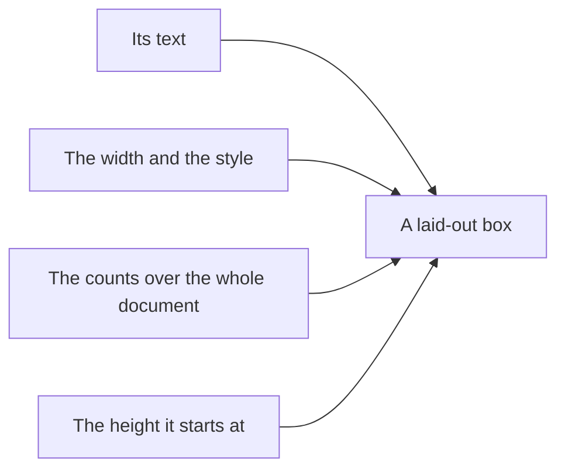

Where the four are the same, the box is the same to the byte, so once a changed paragraph keeps its height, nothing below needs laying out again.

**Narrowing is worth something only once the arena itself is wider.** The size cap, not the speed, is what a document meets first.

**Do not add a risky cache.** Showing an old state is the worst breakage an editor can have. The rewind that exists (`Placed` / `rewind` in `lay/flow.kspls`) serves trial layouts partway through a layout, not reuse across keystrokes.

### Accepted limit 2: another document cannot be shown inside one window

One window cannot show two documents side by side. Open a second window instead.

**How it stands.** What it would take lies in the page, not the core. The core can be started twice from the same bytes (`kspageBoot` in [`port/web/kspage.js`](../port/web/kspage.js)). What stands in the way is the tools reaching the DOM by id: hundreds of `getElementById` calls, of ids and of calls to `app`, and the parts wired to `ui`.

**Two reasons for giving up:**

* **A second pane that takes typing is large.** Every lookup by id would have to ask which pane is current, or the ids would be kept in two sets, and every part wired to `ui` would be touched.
* **A second read-only pane is small, but buys almost nothing.** Another document already opens in another window (from a link inside a document, or with `?doc=` when the server serves the page). There the size, the arrangement and a second screen are all real. Another place in the same document opens the same way ("Another place in the same document is seen in another window" above). With that means already there, a second goes against Principle 6.

### Accepted limit 3: a document cannot be written out as HTML

A document goes out as a printed page (PDF), as Markdown, or a table as CSV; there is no HTML export.

**Why there is none.** An HTML export is a second rendering of the document with rules the screen does not use: styles turned into CSS classes and rules, a line's leading scaled to CSS's measure, escaping for a stylesheet. It would carry its own tests and checks, and the layout could still differ, since the browser breaks the lines. Printing already gives a page that looks as the screen does, and the Markdown export keeps a document beside the code.

### Accepted limit 4: a `.md` file is not read as Markdown

A `.md` opens as plain text, one line a paragraph, and saves back byte for byte ("A `.md` opens as plain text" above). It is not turned into headings, lists and tables.

**Why it is not.** Reading Markdown into styled blocks needs a reader, a table of looks handed to it, and a check that real files survive the trip there and back, and it would promise only that the text settled, not that it stayed as typed. Every code host and editor already shows Markdown rendered.

## Further reading

* [kspage](../README.md) — what is here, and the smallest example.
* [`../../docs/DESIGN.md`](../../docs/DESIGN.md) — the Development Principles that apply to all of Kanso, and the grounds of the language design.
* [`../../std/docs/DESIGN.md`](../../std/docs/DESIGN.md) — the design of the standard library kspage stands on.
