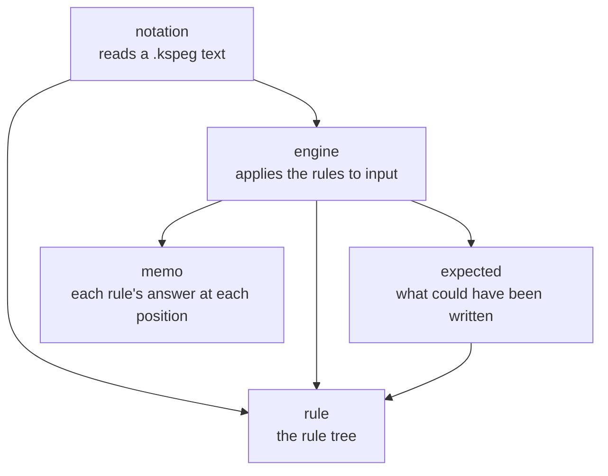

# kspeg

**kspeg reads a grammar and parses text with it, with no code generation.** A grammar is a short `.kspeg` file of named rules that say what valid input looks like, such as "an expression is a number, then any number of `+ number`". kspeg reads that file while your program runs and turns input text into a tree. You write no parser code, and no tool generates any. KSPL's own grammar is written this way.

It is for whoever writes a grammar for a format or a language, and for whoever changes the engine. The words used below:

| Word | What it means here |
| :-- | :-- |
| **grammar** | The `.kspeg` file: a list of rules |
| **rule** | One named definition, such as `term = Number`. A rule may name other rules, and itself |
| **PEG** (parsing expression grammar) | The kind of grammar kspeg reads. Its choice `a \| b` is an **ordered choice**: it tries `a` first and takes `b` only if `a` fails, so any input has at most one reading |
| **parse** | Reading input by following the rules, to get a tree of what matched where |
| **backtracking** | Going back to an earlier position after an alternative fails, to try the next one |
| **memo table** | A table that remembers "rule R at position P gave this answer", so the same attempt is never parsed twice |

"1.1 What a PEG is (for a reader new to it)" in [`kspeg/docs/SPEC-notation.md`](docs/SPEC-notation.md) compares PEG with BNF and with regular expressions.

## Run it

**Read the grammar once, then make one `Target` for each input text.** A `Target` is one input being parsed. It borrows the rules and the memo table from the grammar you read. Calling `parse_grammar` again for each input would rebuild the rule table and a memo table every time.

```kspls
import "kspeg/engine" as kspeg
import "kspeg/notation" as kspeg_notation

$meta: = kspeg_notation.Meta.new(grammar_text, arena)
parser: = meta.parse_grammar()!
defer parser.free_memo()

$t: = kspeg.Target.new(source, arena)
defer t.free_memo()
t.share_grammar_from(parser)
node: = t.parse_rule("program")!
```

| Line | What it does |
| :-- | :-- |
| `Meta.new` / `parse_grammar` | Reads the grammar text into rules, and checks them. A bad grammar fails here |
| `Target.new` | Starts one parse of `source` |
| `share_grammar_from` | Borrows the rules and the memo table read above (`Target.share_grammar_from`) |
| `parse_rule("program")` | Parses the whole source from the start, beginning at the rule named `program`, and returns the tree's root `Node` |

**`Target`s that borrow one grammar parse one at a time**, since they share its memo table (`Target.share_grammar_from`). Two at once would each empty the table under the other.

**`make test` runs the tests from this folder** with only a `ksplc` ([`kspeg/Makefile`](Makefile)). kspeg names itself in [`kspeg/ksplc.cfg`](ksplc.cfg), so a copy of this folder alone runs them the same way.

The engine adds two default rules, `_Space` (the whitespace it skips) and `_Boundary` (what ends a word). A grammar that defines `_Space` and `_Boundary` itself never runs these defaults, so only [`kspeg/tests/engine_test.kspls`](tests/engine_test.kspls) tests them.

Three complete grammars sit in [`kspeg/docs/`](docs/README.md): the notation's own, JSON's and a small scripting language's. Read JSON's first; it is the shortest.

## What is here

**The engine is five files.** The diagram shows which file imports which; each arrow points from the importer to what it imports.



Caution: The dependencies run one way, downward; do not add an `import` in the reverse direction, which makes a cycle.

| File | Role |
| :-- | :-- |
| [`kspeg/notation.kspls`](notation.kspls) | **Reads a `.kspeg` text** into the rule tree and returns a `Target`. |
| [`kspeg/engine.kspls`](engine.kspls) | **Applies the rule tree to input** — backtracking, memoization (filling and reading the memo table), whitespace skipping, the profile (a count of how often each rule runs). |
| [`kspeg/memo.kspls`](memo.kspls) | **What each rule answered at each position** — one table for every input of a grammar. It is emptied by starting a new generation, not by writing zeros over it: each slot carries the generation that wrote it, and a slot from an older one reads as empty. |
| [`kspeg/expected.kspls`](expected.kspls) | The position where the parse failed and **what could have been written** there; it never advances the input. |
| [`kspeg/rule.kspls`](rule.kspls) | **The rule tree's representation**, and the operations on it alone. |

## Pitfalls

* **Do not mix the two readers.** kspeg reads two different things. [`kspeg/notation.kspls`](notation.kspls) reads a `.kspeg` grammar file; it is a recursive descent parser written by hand (one function per piece of the notation). [`kspeg/engine.kspls`](engine.kspls) reads your input by following a grammar. They are separate code.
* **kspeg reaches only what `std` publishes.** The compiler rejects a name under `std/` that is not marked `pub` (`cannot access symbol`). Making one `pub` in `std` is a decision to weigh: an engine that only interprets a grammar cannot be swapped out once it depends on `std/`'s internals.
* **Only `try_parse` in `kspeg/engine.kspls` swallows a backtracking signal** ("A backtracking signal may be swallowed, a real failure may not" in [`kspeg/docs/SPEC-notation.md`](docs/SPEC-notation.md)). A backtracking signal means "this alternative did not match, try the next"; a real failure must reach the caller.

## Files near the limit and how they split

No file in kspeg exceeds 900 lines; the nearest is [`kspeg/engine.kspls`](engine.kspls). **Before adding to it, write here what will be split out and where it goes** (`make test-conventions` checks this). How to choose where to cut is "Choosing where to split a file" in [`docs/DESIGN.md`](../docs/DESIGN.md). How kspeg's files are split is "How the engine is split across files" in [`kspeg/docs/DESIGN.md`](docs/DESIGN.md).

## Further reading

| Document | What it is for | Who reads it |
| :-- | :-- | :-- |
| [`kspeg/docs/SPEC-notation.md`](docs/SPEC-notation.md) | The notation, and the requirements an engine has to meet. | Whoever writes a grammar (Part I alone); whoever writes an engine (the rest) |
| [`kspeg/docs/DESIGN.md`](docs/DESIGN.md) | Why the engine took this shape, and what each choice gives up. | Whoever changes kspeg |
| [`kspeg/docs/README.md`](docs/README.md) | Every document this package carries. | Anyone |
| [`kspeg/SURFACE.txt`](SURFACE.txt) | The record of the published API, remade by `make surface` and held against the tree by `make test-surface` ("The record of a published API" in [`docs/SPEC-gates.md`](../docs/SPEC-gates.md)). | Whoever changes kspeg |
| [std](../std/README.md) | The standard library kspeg builds on; `ksplc doc std` lists every file it publishes. | Whoever changes kspeg |
