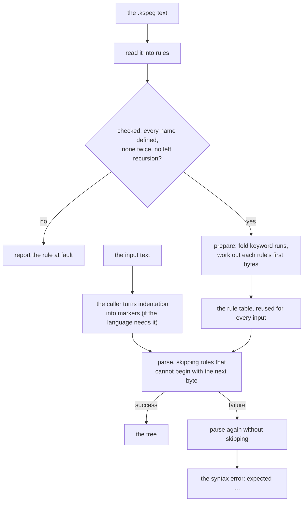
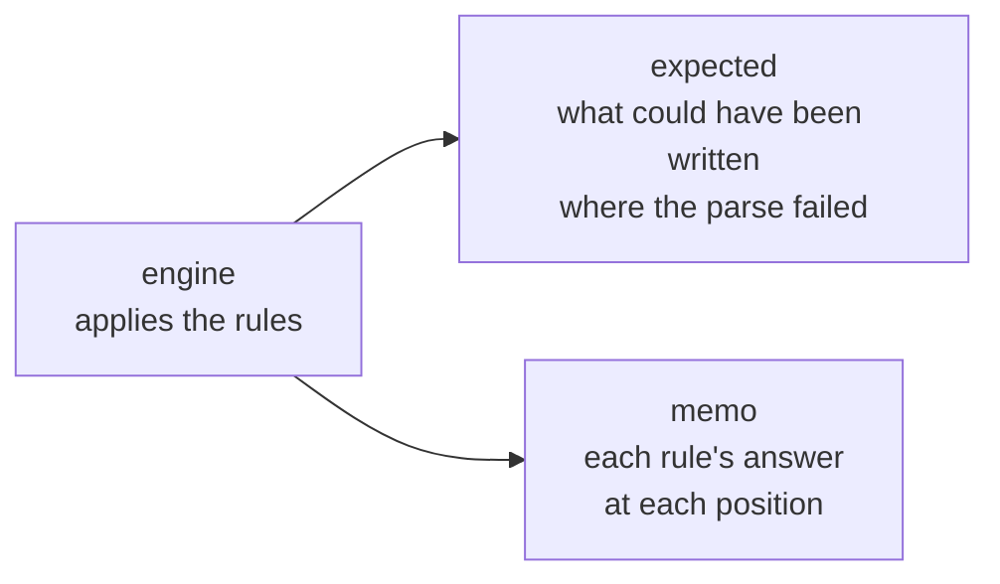

# The design decisions of kspeg

`kspeg` reads a grammar file (`.kspeg`) and parses input by following that grammar directly, with no generated parser code. This document holds **why it took this shape**, and what each choice gives up. The notation and what an engine must do are in [`SPEC-notation.md`](SPEC-notation.md), with its words defined at its head; each file's job is in [kspeg](../README.md).

The diagram shows what happens to a grammar from loading to a parse result.

## The grammar is interpreted, not turned into code

| Tool | What the build does |
| :-- | :-- |
| ANTLR, yacc | A tool of their own turns the grammar into parser source code, which the build then compiles |
| **kspeg** | Nothing. The engine, written in KSPL, reads the `.kspeg` file at run time |

So a program using kspeg needs nothing but the engine and the grammar: no generator to install or run in its build.

## A grammar is checked when it is read

**Every reference in a grammar is checked once, as soon as the grammar is loaded.** What is refused is "11.1 Validation at the moment the grammar is read" in [`SPEC-notation.md`](SPEC-notation.md). A grammar is read once and reused, so this walk costs nothing per parse.

**The check is not put off until parsing**, where an undefined name would show only on a run that reached its branch. Until then the author believes the rule takes effect.

* **A rule defined twice** is refused because which definition wins is invisible to the author.
* **Left recursion** is refused because, under PEG, such a rule enters itself again at the same position until the depth limit stops the parse. With first-byte skipping (below), whether it stopped would also depend on the next byte. The analysis of what a rule can begin with already says what can match nothing, so finding the cycle costs one more walk.

**The report names the rule that refers to the missing name**, since several rules can refer to one name. It holds no line and column inside the `.kspeg`. A grammar can be built into an executable, where a position could point at a file nobody can open.

## Lexical rules are not memoized

A lexical-mode rule (an upper-case initial) works one character at a time. Storing its answer in the memo table often costs more than the re-parse a hit saves, so only syntax-mode rules are memoized.

## A run of keywords is looked up once

A choice written as keywords, such as a language's built-in type names (`'int' | 'long' | ... | 'bool'`), is tried one keyword at a time. At a position holding an identifier every keyword fails in turn, and a grammar can ask that choice at every position a type can stand.

**As the grammar loads, each run of two or more keywords inside a choice becomes one rule.** The rule does two steps:

1. cut out the run of boundary characters at the position (the characters a word is made of, `_Boundary`);
2. look that word up once in a hash table.

This is `fold_keyword_choices` in [`../rule.kspl`](../rule.kspl). The synthesized `_Keyword` is folded the same way.

**Only where the result cannot differ** (the conditions are in "9. The implementation requirements for keywords and word boundaries" in [`SPEC-notation.md`](SPEC-notation.md)). There a keyword matches exactly when it equals the whole run, so at most one keyword of the run can match. Their order among themselves decides nothing, and the alternatives around the run keep their places.

**Folding changes no syntax error either**: the folded rule records the same labels as the choice, in the same order. Cases in [`../tests/engine_test.kspl`](../tests/engine_test.kspl) require the same tree and labels from a grammar that folds and its twin that cannot.

**What it buys depends on the grammar**; counting instructions under callgrind shows it where wall time varies too much to.

## Rules that cannot begin with the next byte are skipped

Most of a parse is attempts that fail at their first byte. Each enters a rule, looks in the memo, and builds a node to throw away.

**As the grammar loads, the engine works out for each rule the bytes a match can begin with, and whether it can match nothing** (`compute_first_bytes` in [`../rule.kspl`](../rule.kspl)). Rules refer to each other, so it repeats the calculation until no rule's set changes. Before entering a rule that cannot match nothing, one bit test on the next byte decides whether it is entered at all. What is allowed is "12.3 Skipping a rule by its first byte" in [`SPEC-notation.md`](SPEC-notation.md).

**The bytes err only on the side of too many.** A wrong "yes" only costs an attempt; a wrong "no" would change the parse. So:

* a lookahead reads nothing, so it adds no byte and can match nothing;
* `.` (any character) and a recovery branch allow every byte;
* in syntax mode the next byte is the one after whitespace, read where the engine skips it anyway;
* a syntax-mode rule entered from a lexical one skips whitespace itself before its first byte, so there it is always entered;
* a lexical rule that begins with such a rule allows every byte.

**A syntax error is read from a second run that skips nothing**, since a skipped rule records no label. A run that fails, or leaves text other than whitespace unread, is run again without skipping. That costs only where a file holds a syntax error. `ran_twice` on input that parses would mean a rule was skipped where it could have matched.

**Only references are checked**, not every alternative. The memo lookup, the node and the restore all sit behind a reference. A literal already fails at its first byte for the price of the check.

**What it gives up:** the depth limit counts the rules entered, so near the limit an input can pass where an engine without skipping stops. The limit is a safety valve at a depth ordinary code never reaches. The profile counts only the rules entered, too.

## Indentation becomes markers before the parse

**Kspeg sees bytes, not columns, so it cannot read indentation itself.** The caller replaces each change of indentation with a one-byte marker ("13. How to handle a language that depends on indentation" in [`SPEC-notation.md`](SPEC-notation.md)). To read indentation itself, the engine would need four things it lacks.

| What is missing | Why it is needed |
| :-- | :-- |
| **A means of counting the column** | The engine holds only the byte position |
| **A means of saying whether it is at a line's head** | Lookahead only looks forward, so "the byte just before is a `\n`" cannot be written locally, nor **made a part** such as a `_LineStart` |
| **State during the parse** | Indentation needs a stack of columns. The engine holds only the position, the furthest failure, the mode's options and the memo |
| **A predicate that looks at a value** | **No operator decides success from a value**, so "the current column > the top of the stack" cannot be written |

**State inside the engine is not taken, because it breaks two things at once.** Fixing only one still breaks silently.

* **The state must be restored on a backtrack.** A stack would have to be restored wherever a choice, a `?`, a `*`, a `+` or a lookahead fails. Otherwise a column pushed by a failed alternative stays behind.
* **The state must go into the memo key**, for correctness. The key is `(rule, position, mode)`, so the same rule at the same position under a different column would get the first answer.

| Parser | How indentation reaches the grammar |
| :-- | :-- |
| PEG implementations that added state (stack operations or semantic predicates) | Inside the parser. They have known cases of breaking with memoization |
| Python, ANTLR's Python grammar, tree-sitter | A lexer or an external scanner emits indent tokens, which the parser consumes as ordinary terminals |
| PureScript, CoffeeScript, F# | They insert a zero-width token and leave the bytes alone, so no position moves |

kspeg takes the second shape: a pass before the parse emits the markers.

**The markers go at line ends so that positions survive.** kspeg reads bytes, so a marker has to be text. At a line's end it leaves every line number as it is.

**What this gives up is syntax where a parse failure closes a block.** Haskell's layout rule closes a block where the next token cannot continue but a `}` could, which a pass beforehand cannot know. KSPL's grammar has no such syntax; adding it reopens this decision.

## The profile counts calls, not time

Reading the clock at each of a parse's million rule references would add work and skew the breakdown. **A count repeats exactly** for the same input and grammar, on any machine under any load. Failures are `calls - memo hits - successes` (`Rule_prof` in [`../engine.kspl`](../engine.kspl)).

## How the engine is split across files

**The engine's files import in one direction only** (`engine` → `expected` and `engine` → `memo`), and each split keeps them so.

**`Target` holds `Fail_track` from [`../expected.kspl`](../expected.kspl) as one field (`fail`).** `is_suppressed` stays in `Target` as the mode of the engine applying the rules. `track_fail`, which decides whether to record a failure, stays in `engine`.

Caution: **Do not hand that decision to the callers.** If `is_suppressed` is passed around, one caller that forgets it records a failure inside a suppressed token as an expectation for the user.

**The memo table is generic over what it holds**: `Memo_table<|V|>` in [`../memo.kspl`](../memo.kspl) never names a node.
