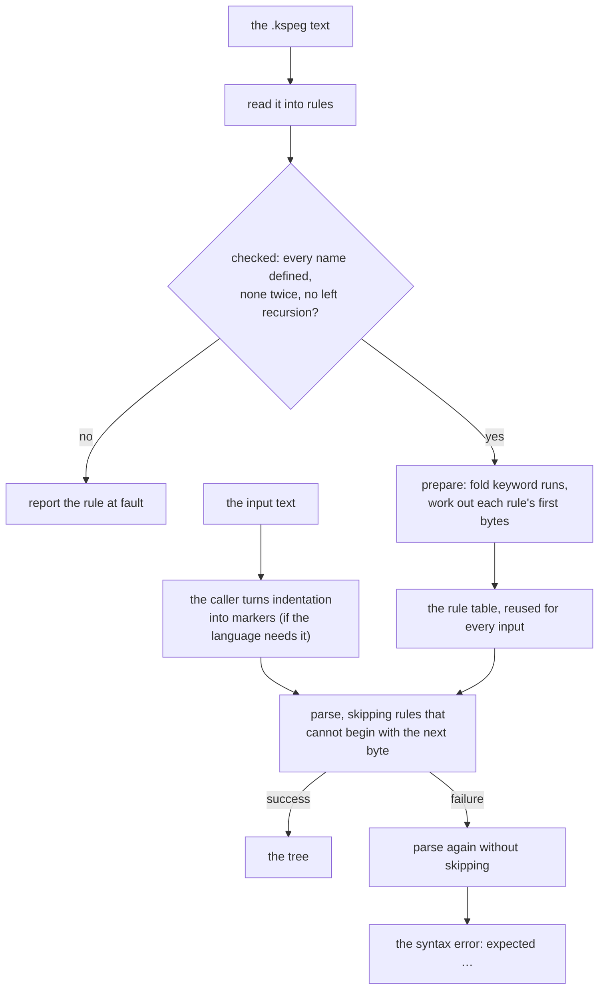
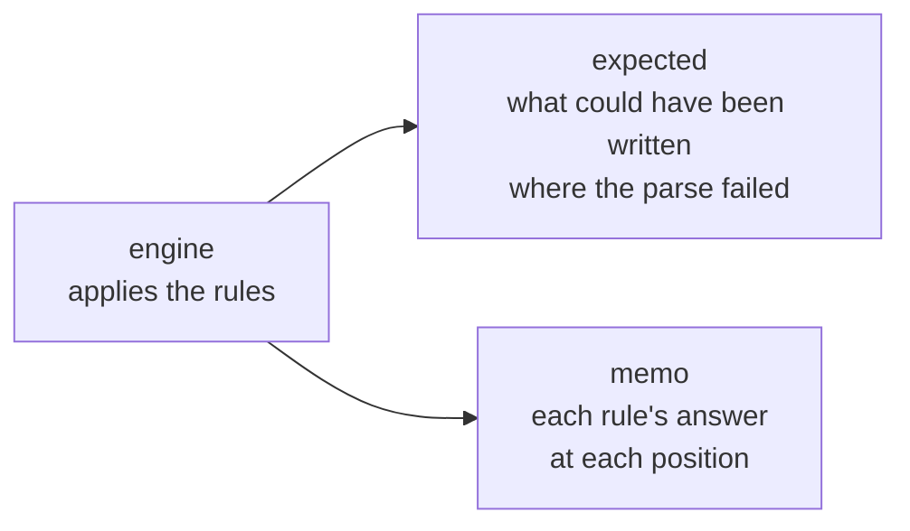

# The design decisions of kspeg

`kspeg` is a parser that reads a grammar file (`.kspeg`) and then parses input by following that grammar directly. It generates no parser code. This document holds **why it took this shape**, and what each choice gives up. The notation and what an engine must do are in [`SPEC-notation.md`](SPEC-notation.md); each file's job is in [kspeg](../README.md).

The words below come up in every section. "1.1 What a PEG is (for a reader new to it)" in [`SPEC-notation.md`](SPEC-notation.md) explains PEG for a reader who knows BNF or regular expressions.

| Word | What it means here |
| :-- | :-- |
| **PEG** (parsing expression grammar) | A grammar whose choice `a \| b` tries `a` first and takes `b` only if `a` fails. The first match wins, so a PEG is never ambiguous |
| **rule** | One named definition in the grammar, such as `expr = term ("+" term)*` |
| **reference** | One rule naming another inside its definition |
| **backtrack** | Going back to an earlier input position after an alternative fails, to try the next one |
| **memo** (packrat memoization) | A table remembering "rule R at position P gave this answer", so the same attempt is never parsed twice |
| **syntax mode / lexical mode** | A rule whose name starts lower-case skips whitespace and builds tree nodes (syntax). One starting upper-case reads exact bytes as one token (lexical) |
| **lookahead** (`&` / `!`) | A check that the next text does (or does not) match, without consuming it |

The diagram shows what happens to a grammar from loading to a parse result. The sections below explain each step.

## The grammar is interpreted, not turned into code

A program that uses kspeg needs only the engine and the grammar file. There is no generator tool to install or run.

| Tool | What the build does |
| :-- | :-- |
| ANTLR, yacc | A tool of their own turns the grammar into parser source code, which the build then compiles |
| **kspeg** | Nothing. The engine, written in KSPL, reads the `.kspeg` file at run time |

So a program using kspeg needs no generator, neither installed nor run in its build, and nothing but the engine and the grammar.

## A grammar is checked when it is read

**Every reference in a grammar is checked once, as soon as the grammar is loaded, so a mistake is reported then.** A grammar is read once and reused, so this one walk costs nothing per parse.

**The check is not put off until parsing.** A name is looked up when its rule is applied, so an undefined name would show only on a run that reached that branch. A reference in an unmatched alternative, an optional or a repetition can stay unrun. The parse then succeeds, and the grammar's author believes the rule takes effect.

The load refuses three kinds of grammar.

| Refused | Why |
| :-- | :-- |
| **A reference to a name no rule defines** | It would fail only on the input that reaches it (above) |
| **A rule defined twice** | One of the two definitions would never be used, and which one wins is not something the grammar's author can see |
| **Left recursion** (a rule that can reach itself again before reading a character, as in `expr = expr "+" term`) | Such a rule never matches (below) |

**Why left recursion is refused.** Under PEG, each entry to such a rule enters it again at the same position, until the depth limit stops the parse. This happens only on inputs that reach the rule. Skipping rules by their first byte (below) would make that worse. A skipped entry does not stop, so whether the parse stopped would depend on the next byte. The analysis that works out what a rule can begin with also says what can match nothing, so finding the cycle costs one more walk.

**The report names the rule that refers to the missing name.** Several rules can refer to one name, and without the referrer there is no one place to look. The report holds no line and column inside the `.kspeg`. A grammar can be built into an executable, where a position could point at a file nobody can open.

## Lexical rules are not memoized

Only syntax-mode rules store their answers in the memo; token rules do not.

A lexical-mode rule (an upper-case initial) works one character at a time. Storing its answer in the memo table often costs more than the re-parse a hit saves, so only syntax-mode rules are memoized.

## A run of keywords is looked up once

When a choice lists many keywords, kspeg turns them into one hash-table lookup instead of trying each keyword in turn. The result is the same, only faster.

A choice written as keywords, such as a language's built-in type names (`'int' | 'long' | ... | 'bool'`), is tried one keyword at a time as written. At a position holding an identifier, every keyword fails in turn. A grammar can ask that choice at every position a type can stand.

**As the grammar loads, each run of two or more keywords inside a choice becomes one rule.** The rule does two steps:

1. cut out the run of boundary characters at the position (the characters a word is made of, `_Boundary`);
2. look that word up once in a hash table.

This is `fold_keyword_choices` in [`../rule.kspl`](../rule.kspl). The synthesized `_Keyword` (the rule matching any keyword of the grammar) is folded the same way.

**Only where the result cannot differ.** A keyword matches only when no boundary character follows. So where `_Boundary` is one character class and every keyword is written with its characters, a keyword matches exactly when it equals the whole run. At most one keyword of the run can match at a position, so their order among themselves decides nothing. The alternatives around the run keep their places. Elsewhere the run stays a choice.

**Folding changes no syntax error either.** A choice records a label for each keyword it fails on, also before the one that matches. It then marks those labels as not what stopped the parse. The folded rule records the same labels in the same order. Those marks are read even on success, where unread text remains. Dropping them makes a case in [`../tests/engine_test.kspl`](../tests/engine_test.kspl) fail. Those cases parse each input under a grammar that folds and under its twin that cannot. They require the same tree and labels from both.

**What it buys depends on the grammar**: how many keywords a choice holds, and how often it is asked. Counting instructions under callgrind (a tool that counts the machine instructions a program runs) shows it where wall time varies too much to. The rest of a parse's cost is attempts that fail at their first byte on rules other than keywords (below).

## Rules that cannot begin with the next byte are skipped

Before trying a rule, the engine checks whether the next byte could start a match at all. If it cannot, the rule is skipped without any work.

Most of a parse is attempts that fail at their first byte. A grammar for a programming language tries several alternatives at each expression before the plain one. Each attempt does four things: it enters the rule, looks in the memo, builds a node, and throws it away. Most of the nodes built never reach the tree.

**As the grammar loads, the engine works out for each rule the bytes a match can begin with, and whether it can match nothing** (`compute_first_bytes` in [`../rule.kspl`](../rule.kspl)). Rules refer to each other, so this is a fixed point: the engine repeats the calculation until no rule's set changes. Before entering a rule that cannot match nothing, one bit test on the next byte decides whether it is entered at all.

For example, if `number` can only begin with `0`–`9`, the engine never enters `number` at a position holding `x`.

**The bytes err only on the side of too many.** A wrong "yes" only costs an attempt; a wrong "no" would change the parse. So:

* a lookahead reads nothing, so it adds no byte and can match nothing;
* `.` (any character) and a recovery branch allow every byte;
* in syntax mode the next byte is the one after whitespace, read where the engine skips it anyway;
* a syntax-mode rule entered from a lexical one skips whitespace itself before its first byte, so there it is always entered;
* a lexical rule that begins with such a rule allows every byte.

**A syntax error is read from a second run that skips nothing.** A skipped rule records no label, so the skipping run's `expected …` would come up short. A run that fails, or leaves text other than whitespace unread, is run again without skipping, and its report is the one returned. That run costs only where a file holds a syntax error. Its message is byte for byte the one that an engine that never skips gives. `ran_twice` says when it happened: on input that parses, it would mean a rule was skipped where it could have matched.

**Only references are checked**, not every alternative. A reference is where an attempt costs most: the memo lookup, the node and the restore all sit behind it. A literal already fails at its first byte for the price of the check itself.

**What it buys depends on the grammar** too: the more of its attempts fail at their first byte, the more are skipped. A grammar that seldom guesses wrong gains little.

**What it gives up:** the depth limit counts the rules entered. So near the limit, an input can pass where an engine without skipping stops. The limit is a safety valve at a depth ordinary code never reaches. The profile counts only the rules entered, too.

## Indentation becomes markers before the parse

**Kspeg sees bytes, not columns, so it cannot read indentation itself.** For a language like Python, the caller first replaces each change of indentation with a one-byte marker at a line's end. The grammar then matches those markers like ordinary text. To read indentation itself, the engine would need four things it lacks.

| What is missing | Why it is needed |
| :-- | :-- |
| **A means of counting the column** | Nothing tells how many spaces a line begins with; the engine holds only the byte position |
| **A means of saying whether it is at a line's head** | Lookahead (`&` / `!`) only looks forward, so "the byte just before is a `\n`" cannot be written locally. A grammar where every line begins after a consumed newline guarantees it by its shape, but that **cannot be made a part** such as a `_LineStart` |
| **State during the parse** | Indentation needs a stack of columns. The engine holds only the position, the furthest failure position, the mode's options and the memo, so there is nowhere to put one |
| **A predicate that looks at a value** | The operators are concatenation, choice, repetition and lookahead. **None decides success from a value**, so "the current column > the top of the stack" cannot be written |

**State inside the engine is not taken, because it breaks two things at once.** Fixing only one of them still breaks silently.

* **The state must be restored on a backtrack.** The engine restores only the position. A stack would have to be restored with it wherever a choice, a `?`, a `*`, a `+` or a lookahead fails. Otherwise a column that a failed alternative pushed stays behind.
* **The state must go into the memo key**, for correctness, not speed. The key is `(rule, position, mode)`. Trying the same rule at the same position under a different column makes packrat return the first answer for the second.

How other parsers handle it:

| Parser | How indentation reaches the grammar |
| :-- | :-- |
| PEG implementations that added state (stack operations or semantic predicates) | Inside the parser. They have known cases of breaking with memoization |
| Python, ANTLR's Python grammar, tree-sitter | A lexer or an external scanner emits indent tokens, which the parser consumes as ordinary terminals |
| PureScript, CoffeeScript, F# | They insert a zero-width token and leave the bytes alone, so no position moves |

The requirement in "13. How to handle a language that depends on indentation" in [`SPEC-notation.md`](SPEC-notation.md) takes the second shape: a pass before the parse emits the markers.

**The markers go at line ends so that positions survive.** kspeg reads bytes, so a marker has to be text, unlike the zero-width tokens above. Placed at a line's end, it leaves every line number as it is, and only the end of a marked line shifts.

**What this gives up is syntax where a parse failure closes a block.** Haskell's layout rule closes a block where the next token cannot continue under the grammar but a `}` could. So GHC handles indentation in both the lexer and the parser. One pass beforehand cannot do that, since that pass would have to know the grammar. PureScript leaves that syntax out, and so does KSPL's grammar; adding such syntax reopens this decision.

## The profile counts calls, not time

The profile (the report of where a parse spends its effort) counts how often each rule runs, instead of timing it.

Reading the clock at each of a parse's million rule references would add work and skew the breakdown. **A count repeats exactly** for the same input and grammar, on any machine under any load. Failures are `calls - memo hits - successes` (`Rule_prof` in [`../engine.kspl`](../engine.kspl)).

## How the engine is split across files

**The engine's files import in one direction only** (`engine` → `expected` and `engine` → `memo`), and each split keeps them so.

**`Target` holds `Fail_track` from [`../expected.kspl`](../expected.kspl) as one field (`fail`).** `Target` is one parse of one input. `is_suppressed` stays in `Target` as the mode of the engine applying the rules. `track_fail`, which decides whether to record a failure, stays in `engine`.

Caution: **Do not hand that decision to the callers.** If `is_suppressed` is passed around, one caller that forgets it records a failure inside a suppressed token as an expectation for the user.

**The memo table is generic over what it holds**: `Memo_table<|V|>` in [`../memo.kspl`](../memo.kspl) never names a node.
