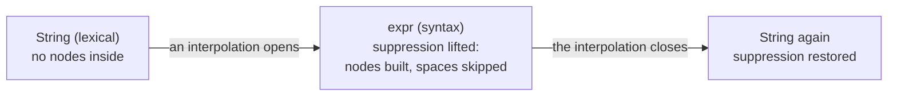

# The KSPEG grammar definition specification

**This document defines how to write a `.kspeg` grammar, and what the engine that reads one must do.** A grammar is a file of named rules that describe what valid input looks like. The engine (`engine.kspl`) follows those rules to read input and build a tree from it. Part I is for whoever writes a `.kspeg` file (a grammar's author). Part II is for whoever implements or revises the engine. KSPL's own grammar is written in KSPEG, so everything here applies to the KSPL compiler's parser. Why a requirement is what it is lives in [`DESIGN-engine.md`](DESIGN-engine.md).

These words come up throughout:

| Word | What it means here |
| :-- | :-- |
| **rule** | One named definition, such as `term = Number`. Rules name other rules, and can name themselves |
| **parse** | Reading input by following the rules |
| **AST** (abstract syntax tree) | The tree a parse returns: a node for each rule or literal that matched, holding the nodes matched inside it. Section 10 explains why kspeg's tree is, strictly, a CST |
| **node** | One entry of that tree: the rule's name, the text it matched, where that text starts, and its child nodes (section 7) |
| **backtrack** | Going back to an earlier position in the input after an alternative fails, to try the next one |
| **byte** | One unit of the UTF-8 input. An ASCII character is one byte; a character such as `あ` is several |

---

## Part I: A reference for writing a grammar

### 1. What KSPEG is

KSPEG is the notation of a `.kspeg` file. It is based on PEG (Parsing Expression Grammar), and has PEG's standard building blocks:

| Notation | Meaning | Example |
| :-- | :-- | :-- |
| `A B` | **Sequence**: `A`, then `B` | `"(" expr ")"` |
| <code>A &#124; B</code> | **Prioritized choice**: try `A`; only if `A` fails, try `B`. Also called ordered choice | <code>"+" &#124; "-"</code> |
| `( ... )` | **Grouping**: treat what is inside as one piece | <code>("+" &#124; "-") term</code> |
| `A?` | **Optional**: `A` once, or nothing | `"-"? Digits` |
| `A*` | **Repetition**: `A` zero or more times, as many as match | `[0-9]*` |
| `A+` | **Repetition**: `A` one or more times, as many as match | `[0-9]+` |
| `&A` | **And lookahead**: succeed if `A` matches here, but consume nothing | `&"("` |
| `!A` | **Not lookahead**: succeed if `A` does not match here, and consume nothing | `!_Keyword Identifier` |

The things these combine (a quoted string, a keyword, a character class, a rule's name) are in section 3. How tightly each operator binds is in section 6.

**One `.kspeg` file holds both lexing and parsing.** Lexing (tokenizing) cuts the text into words such as numbers and names; parsing arranges those words into a tree. Many tools need a separate file for each. In KSPEG:

* The engine infers "can whitespace be skipped here" and "is an AST node built here" from a rule's name alone (section 4).
* A keyword literal `'...'` is enough for it to check the word boundary and build the reserved-word list (section 5).

So neither a separate tokenizer definition nor hard-coding in the engine is needed.

**Three complete grammars sit beside this document**, each read by the tests:

| Grammar | What it shows |
| :-- | :-- |
| [`json.kspeg`](json.kspeg) | JSON: the shortest whole example |
| [`script.kspeg`](script.kspeg) | A small scripting language, with keywords, comments, operator precedence and string interpolation |
| [`kspeg.kspeg`](kspeg.kspeg) | The notation written in itself ([Appendix A](#appendix-a-kspegs-own-grammar-definition-the-normative-grammar)) |

#### 1.1 What a PEG is (for a reader new to it)

A PEG reads like the grammars in a language manual, but its choice always takes the first alternative that matches. This table compares it with three things that a reader often knows already.

| Compared with | What differs in a PEG | Example |
| :-- | :-- | :-- |
| **BNF / CFG** (the grammar notation of most language manuals; a context-free grammar) | **Ambiguity is ruled out.** BNF's `\|` permits every grammatical reading, so a rule can have several, and a precedence rule outside the grammar has to pick one. PEG's `\|` is a prioritized choice: it takes the first alternative from the left that matches and tries none after it, so no ambiguity arises | `if_stmt = 'if' cond stmt \| 'if' cond stmt 'else' stmt` has several readings in BNF (the "dangling else" problem: which `if` owns the `else`) |
| **A regular expression** | **Recursion and nested structure.** PEG rules can reference themselves and each other, so nesting that a regular expression cannot express is written directly | `(1 + (2 * 3))` |
| **A hand-written recursive descent parser** (one function per piece of syntax, each calling the others) | **The same method, written as a grammar.** KSPEG runs the same recursive descent, driven by the declarative `.kspeg` instead of written out. There is no code-generation step: the engine, itself written in KSPL, interprets the `.kspeg` file at run time | — |

**A known constraint: left recursion cannot be written.** A rule is left-recursive when it names itself first, before reading anything. Such a rule would call itself at the same position forever, so the grammar is refused when it is read ([11.1](#111-validation-at-the-moment-the-grammar-is-read)). Write a run of left-associative operators as a repetition (`*`) instead:

```kspeg
// refused: left-recursive
expr = expr "+" term | term

// accepted: the same language, as a repetition
expr = term (("+" | "-") term)*
```

[`script.kspeg`](script.kspeg) writes a whole precedence table that way, one rule per level from `expr` down to `unary`.

### 2. Starting from the smallest example

These three lines are a grammar for adding and subtracting numbers.

```kspeg
expr = term ( ("+" | "-") term )*
term = Number
Number = [0-9]+
```

Parsing the input `12 + 3` with it gives this AST.

```
expr
├─ term
│  └─ Number "12"
├─ Literal "+"
└─ term
   └─ Number "3"
```

Two of KSPEG's core behaviours already show.

1. **Whitespace is skipped automatically**: the grammar never says so, yet the whitespace around `+` is gone.
2. **`Number` alone is treated differently**: `expr` and `term` become branches holding child nodes, while `Number` becomes a leaf holding the string `"12"` itself.

Both follow from the names alone, which is KSPEG's central idea ([4. A rule's name sets its mode](#4-a-rules-name-sets-its-mode)). `expr` and `term` begin with a lower-case letter (syntax mode), and `Number` with an upper-case one (lexical mode).

### 3. Lexical elements

These are the pieces a `.kspeg` file is made of. A `.kspeg` file must be encoded in **UTF-8**. Its tokens are these.

| Element | Syntax | Description |
| --- | --- | --- |
| **Identifier** | `rule_name`, `_Void` | Letters, digits and `_`, beginning with a letter or `_`. **The first character sets the mode**, and with it whether a node is built (section 4). |
| **String** | `"text"` | Matches the text's **UTF-8 byte sequence** exactly. In syntax mode it always builds a `Literal` node (a CST node); which ones a language keeps is the consumer's choice (section 10). |
| **Keyword** | `'text'` | Matches the text, then confirms that what follows does not match the word-boundary rule `_Boundary` ([section 5](#5-the-automatic-rules-_space--_boundary--_keyword)). In syntax mode it always builds a `Keyword` node. |
| **Character class** | `[a-z0-9]` | A set of characters (bytes), ranges (`a-z`) included. There is no negation (`^`) inside `[]`; use the `!` lookahead. |
| **Wildcard** | `.` | Matches any one byte, a newline included, except at end of file (EOF). A multi-byte character is consumed one byte at a time. |
| **Comment** | `// text` | From `//` to the line's end is ignored. |

#### 3.1 Escape sequences

An escape is a backslash and what follows it, standing for a character that is hard to write directly. Inside a string, a keyword and a character class, **only these ten escapes are valid**.

| Kind | Escapes |
| :-- | :-- |
| **Control characters** | `\n` (LF), `\r` (CR), `\t` (Tab) |
| **Symbols** | `\"`, `\'`, `\\`, `\[`, `\]`, `\-` |
| **Code points** | `\uXXXX` (four hex digits; a high and a low surrogate written as a pair are combined into one code point) |

**Any other `\X` is a syntax error**, never read as that character itself. If `\d` were silently read as `d`, the grammar's author would see it only as input that matches where it must not, or the reverse.

**`\uXXXX` is only for the bytes that cannot be typed**: the control bytes and DEL, all inside `\u0000`–`\u007F`. A character that can be typed is written as its UTF-8 bytes directly (`あ` reads better than `あ`).

**Inside a character class nothing above `\u007F` can be written.** A character class is a table applied one byte at a time (section 7). A code point that encodes to several bytes would make it match any one of those bytes, so `[あ]` would not match あ. The engine refuses it when the grammar is read. A literal has no such limit: it applies as a byte sequence, so several bytes are correct there.

**A `\u` without four hex digits is refused**: let through, `"\u00"` would become the 3 bytes `u00`. An unpaired surrogate is refused too: it is not a code point, so copying it to UTF-8 gives an invalid byte sequence.

The rules above, by example:

| Written | Accepted? | Why |
| :-- | :-- | :-- |
| `"\t"`, `[\-+]` | Yes | Among the ten escapes |
| `[a\d]` | No | `\d` is not among the ten |
| `"\u0001"` | Yes | A control byte, which cannot be typed |
| `"あ"` | Yes, but write `"あ"` | A character that can be typed is written directly |
| `[あ]` | No | Above `\u007F` inside a character class |
| `"\u00"` | No | Fewer than four hex digits |
| `"\uD800"` alone | No | An unpaired surrogate |

### 4. A rule's name sets its mode

**The first character of a rule's name decides how the rule reads input.** The engine switches two things by the **name** of the running rule alone.

* **The automatic whitespace skip**: whether whitespace (and any comments the grammar defines) is skipped immediately before each element.
* **Building an AST node**: whether the match becomes a node with children, a flat leaf node, or no node at all.

A name's first character puts the rule in one of three **modes**.

| Mode | The name begins with | Examples | Skips whitespace? | The node it builds |
| :-- | :-- | :-- | :-- | :-- |
| **Syntax** (the default) | a lower-case letter | `program`, `stmt_if`, `expr` | Yes, before each atomic element | A node with children |
| **Lexical** | an upper-case letter | `Number`, `Identifier` | No; matches byte for byte | One leaf holding the whole match, no children |
| **Transparent** | `_` | `_Space`, `_internal` | No; matches byte for byte | None |

#### 4.1 Syntax mode (snake_case), the default mode

A syntax-mode rule describes structure, such as a statement or an expression, and lets whitespace sit between its parts.

* **The trigger**: a rule name beginning with a lower-case letter (`program`, `stmt_if`, or the `expr` and `term` of [section 2](#2-starting-from-the-smallest-example)).
* **The behaviour**: it calls the whitespace skip (`_Space`) immediately before each atomic element below. On success it builds an AST node holding a list of child nodes.

**The atomic elements (the units that trigger a skip)**:

1. A rule reference (`term`)
2. A string literal (`"if"`)
3. A keyword literal (`'if'`)
4. A character class (`[a-z]`)
5. A wildcard (`.`)
6. A group (`(...)` — the skip happens before entering the group)

#### 4.2 Lexical mode (Capital_snake_case)

A lexical-mode rule describes one token, such as a number or a name, and reads its bytes exactly.

* **The trigger**: a rule name beginning with an upper-case letter (the `Number` of [section 2](#2-starting-from-the-smallest-example), or `Identifier`, `String_literal`).
* **The behaviour**: no automatic skip; the match is exact, byte for byte. The whole matched span is returned as one leaf node with no children ([section 8.2](#82-suppressing-subnode-generation-in-lexical-mode-flattening)).
* **A syntax-mode rule called from inside it keeps its node.** A `snake_case` rule called from inside lexical mode builds its AST node as usual, as a child of the lexical rule (an embedded AST).

So a pure token such as `Identifier` is a flat leaf that allocates nothing. String interpolation, which keeps its whitespace yet embeds an expression partway (`"total: ${a + b}"`), can still be written directly ([`Interpolation` in section 5.1](#51-_space-and-_boundary-the-hooks-fired-automatically)).

#### 4.3 Transparent mode (the `_` prefix)

A transparent rule reads input but leaves nothing in the tree, which suits whitespace and comments.

* **The trigger**: any rule name beginning with an underscore `_`, whatever follows it (`_Space`, `_New_line`, `_internal`, or `_` alone). The first character alone decides, so a `_` rule is transparent even when its second character is upper or lower case. Rules such as whitespace and comments are written this way: the tree can ignore them, but their definitions are kept apart.
* **The behaviour**: no automatic skip; the match is exact, byte for byte, but no AST node is ever built. It keeps content such as whitespace and comments out of the syntax tree.

### 5. The automatic rules: `_Space` / `_Boundary` / `_Keyword`

**Three rule names have a special meaning: the engine supplies them when the grammar does not, and a grammar can define its own.** All three are transparent-mode rules. Their names are alike, but the engine **calls** the first two by itself, while it only builds `_Keyword`, which runs only where the grammar references it.

| Rule | When it runs | The default when undefined | How to override |
| --- | --- | --- | --- |
| **`_Space`** | In syntax mode, **immediately before** each atomic element. | `[ \t\r\n]*` (whitespace only; comments are the grammar's to define) | Define `_Space` in the grammar; the engine uses it instead. |
| **`_Boundary`** | **Immediately after** a keyword literal (`'...'`) matches, as a negative lookahead (`!_Boundary`). | `[A-Za-z0-9_]` | The same as above. |
| **`_Keyword`** | Never by the engine; only where the grammar references it, as in `!_Keyword`. | None (it is not a value but the synthesized rule itself; section 5.2) | Define `_Keyword` in the grammar, and the engine collects nothing and uses it (rarely needed). |

#### 5.1 `_Space` and `_Boundary`: the hooks fired automatically

**`_Space` says what to skip between the parts of a syntax rule; `_Boundary` says which characters must not follow a keyword.**

To skip comments too, the grammar overrides `_Space`. [`script.kspeg`](script.kspeg) does so for a line comment and for a block comment that nests: its `_Block_comment` refers to itself, so `/* a /* b */ c */` is one comment.

Note: Which comments exist is the grammar's choice; the notation restricts none. [`kspeg.kspeg`](kspeg.kspeg), the notation's own grammar, has only the line comment, and [`json.kspeg`](json.kspeg) has none, as JSON has none.

`_Space` is also an ordinary rule that **can be called by hand**. A lexical-mode rule that allows whitespace in one place only calls it there. `Interpolation` in [`script.kspeg`](script.kspeg) calls it just inside `${ ... }`, so `${ total }` reads as `${total}` does, while the rest of the string keeps every space.

`_Boundary` stops a keyword literal matching part of a word: without it, `'if'` would match the leading `if` of the identifier `ifCondition` and leave `Condition` behind.

#### 5.2 `_Keyword`: the helper rule synthesized automatically

**`_Keyword` matches any keyword the grammar uses, so a grammar can say "an identifier is not a keyword".**

As the grammar loads, the engine **collects every keyword literal (`'...'`) in the file**. It registers a rule matching any one of them under the name `_Keyword`. For a grammar using `'if'`, `'var'` and `'defer'`, that rule is equivalent to `_Keyword = 'if' | 'var' | 'defer' | ...`.

The typical use excludes reserved words from identifiers, as `Identifier` in [`script.kspeg`](script.kspeg) does by starting with `!_Keyword`. Without it, `if` matches both as an `Identifier` and as the keyword `'if'`, and which wins depends on the order of the alternatives. `!_Keyword` at the head decides it: an identifier is accepted only where none of the collected keywords matches.

### 6. Operators and precedence

**Precedence says which operator binds first when several are written together**: in `"a" "b" | "c"`, the sequence `"a" "b"` binds before the choice, so it reads as `("a" "b") | "c"`. The table runs from highest (binding most tightly) to lowest:

| Precedence | Operator | Syntax | Description |
| --- | --- | --- | --- |
| **1** | **Primary** | `Identifier`, `"..."`, `'...'`, `[...]`, `.`, `(...)`, `~"..."` | The atomic units, and grouping. |
| **2** | **Quantifier** | `?`, `*`, `+` | Greedy repetition, binding to a primary. |
| **3** | **Lookahead** | `&`, `!` | And / Not lookahead. Consumes no input. |
| **4** | **Sequence** | `A B` | Implicit concatenation. |
| **5** | **Choice** | <code>A &#124; B</code> | Prioritized choice, tried from the left. |

"Greedy" means a quantifier takes as many repetitions as match. It never gives one back to let what follows match. So `[0-9]* "5"` never matches `"125"`, because `[0-9]*` has taken the `5` already.

#### 6.1 How lookahead relates to the automatic skip

A lookahead takes the mode of the rule it is in.

| The rule is in | `!"end"` means |
| :-- | :-- |
| Syntax mode | `!( _Space "end" )`: whitespace is skipped before the check |
| Lexical or transparent mode | A check at the current byte exactly, without skipping whitespace |

#### 6.2 `~"..."`: swallowing a run, and the mark of the lenient run

**`~"..."` skips over input that does not parse, up to a stopping byte, and only in a lenient run.** A lenient run is a parse whose caller asked for a tree even from a broken file; an ordinary run never uses `~`.

`~";}"` swallows bytes from the current position up to the first byte written between the quotes, and leaves that byte in place. What is written is a **set of bytes to stop at**: not a spelling to match, and not a character class. No range or negation applies, and negation written out, `( !";" !"}" . )+`, makes a node per byte.

**It matches nothing unless the run is lenient.** A `Target` (one parse of one input) parses leniently only where the caller sets `is_lenient`. In an ordinary run every branch holding a `~` is dead, and the grammar reads exactly as it would without them. The swallowing and the mark are one operator, so no run can have one without the other.

**It swallows at least one byte.** An empty match under a `*` would loop forever at the same position, so where a stopping byte is already next, it does not match.

It is for a reader, such as an editor, that needs a tree from a file that does not parse. In the lenient run, a `~` branch last in a rule swallows what could not be read and carries on. In any other run it does nothing. **Whoever writes such a branch must keep the lenient run away from anything that has to refuse bad input.** There, the branch takes in what would otherwise be refused.

---

## Part II: The specification for implementers

This part takes Part I's "what happens" as given and states only how the engine must be implemented. It has three aims:

* to keep the syntax tree from growing without order;
* to hand a clean AST downstream (to semantic analysis, the compiler step that checks names and types, and the like);
* to guarantee memory safety.

### 7. The AST node the engine builds

**Every node the engine returns has the same four fields** (`engine.kspl`'s `Node` struct), whatever rule built it.

```json
{
  "kind": "Identifier",
  "text": "my_variable",
  "offset": 128,
  "children": [...]
}
```

| Field | What it holds |
| :-- | :-- |
| `kind` | The name of the rule that matched (or `Literal` / `Keyword`; sections 3 and 9) |
| `text` | The matched span of the source |
| `offset` | Where that span begins, in bytes from the start of the source |
| `children` | The nodes matched inside it, in order |

* **Zero-copy parsing**: `text` (the matched string) must be a slice (a pointer and a length) into the buffer holding the whole source. Dynamic allocation during the parse (copying or joining on the heap) is avoided as far as possible.
* **A position is only the byte offset from the start**: line and column numbers are not kept. A caller that needs them (for a diagnostic, say) computes them from `offset` by counting newlines.
* **An arena allocator**: every AST node and its child array must be allocated on a global arena. An arena is a block of memory that hands out pieces and frees all of them at once. AST lifetimes are complex. The arena rules out by construction a leak or a dangling pointer from a missed fine-grained free.

### 8. Mode control and the AST's optimization

**These requirements make the three modes of section 4 build exactly the nodes section 4 promises, and no others.**

#### 8.1 Making transparent mode fully transparent

For every rule name beginning with `_`, the naming convention alone decides that no AST node is built, with no hard-coded string comparison in the engine.

* **The requirement**: while a transparent-mode rule runs, the engine advances the parse position and nothing else. It must never allocate an AST node or add one to the parent's child list. A stray whitespace node shifts the indices for a downstream reader that accesses children by index.

#### 8.2 Suppressing subnode generation in lexical mode (Flattening)

A lexical-mode rule (`Capital_snake_case`) is a token: the smallest unit carrying an atomic meaning for the compiler.

* **The requirement**: the engine must hold a flag saying whether lexical mode is running. While it is, the engine must build no AST node for any subpattern called inside (a group, a character class, and so on).
* **The output**: a single node is built and returned only when the outermost lexical rule succeeds. It holds the whole matched span as a slice and no children.

#### 8.3 Dynamic mode transitions

String interpolation and similar syntax need the mode to change during a parse. In [`script.kspeg`](script.kspeg) the token `String` reaches `Interpolation`, which reads the syntax rule `expr`.

* **The requirement**: where a syntax-mode rule (`snake_case`) is called from inside lexical mode (`Capital_snake_case`), the engine must lift the suppression and enter syntax mode. When the syntax rule is done and control returns to the lexical rule, it restores the suppression, managing the state like a stack.

The diagram shows the suppression across one string such as `"a ${x + 1} b"`, in that grammar.



### 9. The implementation requirements for keywords and word boundaries

The keyword literal's role and the uses of `_Boundary` and `_Keyword` are in [section 5](#5-the-automatic-rules-_space--_boundary--_keyword); only the engine's requirements stand here.

* **Desugaring the word boundary**: immediately after `'text'` matches, the engine must run `!_Boundary` internally. Where a boundary character follows, it rewinds the match as a failure (so `'defer'` does not match the start of `defer_scope`).
* **Automatic collection and synthesis**: as the grammar loads, the engine must register `_Keyword`, a rule matching any one of the file's keyword literals (section 5.2). Where the grammar defines `_Keyword` itself, the engine must not add its own, and uses the grammar's as it stands. This is the same "a user definition wins" policy as the defaults for `_Space` and `_Boundary`.
  * The internal representation is free. The engine can try the keywords one at a time in collection order. It can also cut a word out once and look it up in a set once.
  * Caution: **The set lookup must not be used unless both of these hold**; otherwise the engine tries the keywords one at a time. The scan that cuts a word out reads only a run of boundary characters. So in a grammar with a keyword holding any other character, such as `'->'`, `_Keyword` always fails. Where the grammar wrote `!_Keyword`, that shows only as an identifier swallowing a reserved word.
    * `_Boundary` is a single character class (a reference or a concatenation cannot be judged one byte at a time)
    * no keyword is empty, and each is written only with characters that class holds
  * Under either representation, the expected labels (the `expected …` that section 11.2 gathers) must be gathered in collection order.
* **Forcing an AST node to be built**: a keyword literal used in syntax mode (`snake_case`) must always build an AST node with `kind="Keyword"` and `text="text"` in the parent's `children`. Semantic analysis (Sema) can then rely on index access. In lexical or transparent mode no node is built, following [section 8.2](#82-suppressing-subnode-generation-in-lexical-mode-flattening).

### 10. The engine returns a CST

**The engine returns every node its grammar produces, and the program using it decides which to keep.** Such a full tree is a CST (concrete syntax tree): unlike a pruned AST, it still holds every bracket, keyword and pass-through rule.

The engine follows its grammar and emits a raw CST. In syntax mode every `Literal` and `Keyword` node stays (sections 3 and 9). So does every wrapper node that a chain of rules leaves (in section 2, the `term` node that only wraps `Number`). The engine cannot tell which nodes carry meaning for a particular language, so the consumer decides which ones a language keeps, and under what names.

### 11. Error handling: validating the grammar and tracking the furthest failure

The engine refuses two things: **a bad grammar, and input that does not fit the grammar**. The first must be reported in full when the grammar is read; the second must point at the place in the input to fix.

#### 11.1 Validation at the moment the grammar is read

**A grammar with a broken rule is refused as soon as it is read, before any input is parsed.**

| Refused | Example |
| :-- | :-- |
| A reference to a rule that is not defined | `stmt = Nope ";"` with no rule `Nope` |
| A rule defined twice | `a = "x"` and later `a = "y"` |
| A left-recursive rule: one that can enter itself again before reading a character, directly, through rules that can match nothing, or through a lookahead | `a = a "x"`, `a = b? a "x"`, `a = !a "x"` |

* **The requirement**: as soon as the grammar has been read, every reference to another rule by name must be confirmed defined, not left until parsing. Each of the three in the table is refused, naming the rule at fault (for a missing rule, the missing name).
* **Where the confirmation goes**: after the engine has added the rules it synthesizes (`_Space` / `_Boundary` / `_Keyword`; [section 5](#5-the-automatic-rules-_space--_boundary--_keyword)). Done earlier, references to them look undefined.
* **The granularity of the report**: the refusal must hold the undefined name and the name of the rule referring to it. The line and column inside the `.kspeg` are not required.

"A grammar is checked when it is read" in [`DESIGN-engine.md`](DESIGN-engine.md) says why the check runs then. It also says why the report holds what it holds.

#### 11.2 Tracking the furthest failure

**A syntax error points at the furthest place the parse reached, and lists what could have been written there.** A PEG parser backtracks, so a naive implementation reports a failure at the start of the file. The outermost rule fails there after every alternative has been tried. To stop that, the engine must implement this tracking.

* **The requirement**: the engine records, as global state, `max_fail_pos` (the furthest parse position reached so far) and the rules expected there (`expected_labels`).
* **Zero allocation**: it is strongly recommended that this list allocate no strings. The recommended shape is a fixed-length slice array (say, of about 8 elements at most) plus a counter (`expected_label_count`). It then takes no arena memory.
* The final syntax error must join the gathered labels into one rich message (`Syntax Error: expected 'case', 'default', or '}'`, say).

**The behaviour** on each failure depends on where it happens:

| A rule fails | What the engine does |
| :-- | :-- |
| Deeper than `max_fail_pos` | Updates `max_fail_pos`, empties the list, and registers the current rule |
| At `max_fail_pos` itself (a tie) | Adds the rule, unless its name is already in the list |
| Before `max_fail_pos` | Records nothing |

#### 11.3 A backtracking signal can be swallowed, a real failure cannot

A rule fails in one of two ways, and the engine must keep them apart.

| Signal | What it means | Where it goes |
| :-- | :-- | :-- |
| `mismatch` | The internal token "this rule did not match, try the next alternative" | Swallowed by a choice, an optional or a repetition, through `try_parse` alone |
| `fatal` | A real failure, to be delivered to the caller | Up to the caller; never swallowed |

One recursive entry point (`Rule.parse`) throws either, so the receiver can mistake one for the other.

* **One place swallows.** A choice, an optional and a repetition all swallow a `mismatch`, through one function (`try_parse`) that rethrows a `fatal`. A `catch` per container is refused: with three places able to write one, a fourth added later swallows silently.
* **Do not catch that entry point's failure with `catch false`.** That does not tell the two apart, so a `fatal` turns into "this branch did not match".

### 12. Performance and safety: packrat memoization and the recursion depth guard

**These devices keep a parse fast on any input, and keep deep input from crashing the program.**

#### 12.1 Packrat memoization

A PEG backtracks, so a naive implementation re-parses the same position under the same rule, exponentially in a deeply nested expression. The engine caches each result by **packrat memoization**: a table that remembers each rule's answer at each position, keyed on `(rule_id, pos, syntax/lexical mode)`. It holds the end position and AST node on success, and the bare fact on failure. A revisit returns it at once. Lexical-mode rules (an upper-case initial; section 4) are not memoized ("Lexical rules are not memoized" in [`DESIGN-engine.md`](DESIGN-engine.md)).

#### 12.2 The recursion depth guard

On pathologically deep input, a recursive rule such as `expr = expr_primary (operator expr_primary)*` can use up the native call stack and crash. (Input such as ten thousand `(` in a row is pathologically deep: each `(` enters the rule once more.) The engine must track the recursion depth with a counter (`ctx.depth`) and stop the parse once it exceeds a fixed limit (`max_parse_depth = 3000` by default). It fails as a compile error before a native stack overflow can crash it.

* **A count alone does not protect the stack.** The stack one level costs varies with the backend and the toolchain that built the engine. So the engine also stops the parse, with the same failure, when the stack left on its thread drops below a margin (`std/stack_limit`). The count is the limit that is the same on every build. The stack check stops a build that spends more per level before the count does.
* **The cut-off must not be thrown as a backtracking signal.** A choice, an optional or a repetition would swallow it as "this branch did not match" and carry on searching at the same depth. Throw it as a failure that propagates to the caller (a `fatal`; [11.3](#113-a-backtracking-signal-can-be-swallowed-a-real-failure-cannot) keeps it from being swallowed).
* **The input position of the cut-off must be recorded where it happens.** Backtracking rewinds the position at each level. By the time the failure reaches the entry point, the position is back at the input's start, and a report using it points at line 1.

#### 12.3 Skipping a rule by its first byte

**The engine can skip a rule that cannot begin with the next byte, as long as nobody can tell from the result.** For example, a rule whose every match begins with `{` cannot match where the next byte is `x`.

* **What is allowed**: the engine can skip a rule, without entering it, where it cannot match at the next byte. That holds where the rule cannot match nothing, and no match of it begins with that byte. In syntax mode the next byte is the one after whitespace.
* **The requirement**: skipping must change neither the tree nor a syntax error. A skipped rule records no expected label, so the labels must come from a parse that skips nothing.
* **A syntax-mode rule entered from a lexical one** skips whitespace before its first byte. So the byte at the point of entry is not its first, and the rule must not be skipped there by that byte.

### 13. How to handle a language that depends on indentation

**For a language like Python, where indentation shows structure, the caller marks each change of indentation before the parse.** A language where the column at a line's start decides the structure cannot be written in a PEG alone. **This is not the engine cutting corners: it is beyond a PEG's expressive power.**

**Indentation is resolved before the PEG.** The caller passes over the input once. It writes each change of column as a marker at the end of the line before it, and has that text parsed. Below, `<IN>` and `<OUT>` are one byte each, from the bytes that cannot be typed.

```
if x:                     if x:<IN>
    y = 1        ──▶          y = 1<OUT>
z = 2                     z = 2
```

The grammar writes the marker as a plain literal (written with `\uXXXX`, as in `Indent = "\u0001"`). So the engine needs no column count, no test for a line's head, no state and no predicate on a value.

**Line numbers do not change**: a marker goes at a line's end, so only the end of a marked line shifts. A diagnostic built from `ctx.max_fail_pos` needs no table mapping back to the original text.

Caution: Keep the marker at one byte, so the shift is just the number of markers inserted before that position.

**Narrow `_Space` first.** The default `_Space` is `[ \t\r\n]*` and consumes newlines, but where the column decides the structure, a newline and a line's leading whitespace are both syntax. Define `_Space = [ \t]*` in the grammar and consume newlines explicitly in a rule (the grammar's definition replaces the default; section 5).

"Indentation becomes markers before the parse" in [`DESIGN-engine.md`](DESIGN-engine.md) says why the column is erased outside the engine. It also names the one shape of syntax this does not carry.

## Appendix A: KSPEG's own grammar definition (the normative grammar)

**The grammar is [`kspeg.kspeg`](kspeg.kspeg)**, beside this document. It defines the `.kspeg` format itself, in the format itself, and doubles as the complete reference for the rules stated in Parts I and II. `kspeg/tests/engine_test.kspl` reads it with itself and reads [`json.kspeg`](json.kspeg) and [`script.kspeg`](script.kspeg) with it, so it cannot drift unnoticed from what the engine accepts.

A fixed helper parser skips the whitespace between definitions in a `.kspeg` file; it recognizes only the `//` line comment, and a grammar's author cannot change it. When parsing **the language a `.kspeg` file describes** (JSON with [`json.kspeg`](json.kspeg), say), `_Space` and `_Boundary` take the engine's defaults below where the grammar does not define them ([section 5](#5-the-automatic-rules-_space--_boundary--_keyword)).

```kspeg
_Space    = [ \t\r\n]*
_Boundary = [A-Za-z0-9_]
```

[`kspeg.kspeg`](kspeg.kspeg) overrides `_Space` with a comment-aware version, as [section 5.1](#51-_space-and-_boundary-the-hooks-fired-automatically) shows; [`json.kspeg`](json.kspeg) keeps both defaults.
