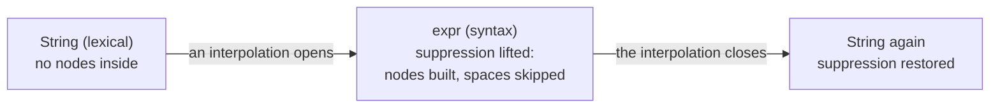

# The KSPEG grammar definition specification

**This document defines how to write a `.kspeg` grammar, and what the engine that reads one must do.** A grammar is a file of named rules that describe what valid input looks like. The engine (`engine.kspl`) follows those rules to read input and build a tree from it. Part I is for whoever writes a `.kspeg` file (a grammar's author). Part II is for whoever implements or revises the engine. KSPL's own grammar is written in KSPEG, so everything here applies to the KSPL compiler's parser.

These words come up throughout:

| Word | What it means here |
| :-- | :-- |
| **rule** | One named definition, such as `term = Number`. Rules name other rules, and can name themselves |
| **parse** | Reading input by following the rules |
| **AST** (abstract syntax tree) | The tree a parse returns: a node for each rule or literal that matched, holding the nodes matched inside it. Section 10 explains why kspeg's tree is, strictly, a CST |
| **node** | One entry of that tree: the rule's name, the text it matched, where that text starts, and its child nodes (section 7) |
| **backtrack** | Going back to an earlier position in the input after an alternative fails, to try the next one |
| **byte** | One unit of the UTF-8 input. An ASCII character is one byte; a character such as `あ` is several |

---

## Part I: A reference for writing a grammar

### 1. What KSPEG is

KSPEG is the notation of a `.kspeg` file. It is based on PEG (Parsing Expression Grammar), and has PEG's standard building blocks:

| Notation | Meaning | Example |
| :-- | :-- | :-- |
| `A B` | **Sequence**: `A`, then `B` | `"(" expr ")"` |
| <code>A &#124; B</code> | **Prioritized choice**: try `A`; only if `A` fails, try `B`. Also called ordered choice | <code>"+" &#124; "-"</code> |
| `( ... )` | **Grouping**: treat what is inside as one piece | <code>("+" &#124; "-") term</code> |
| `A?` | **Optional**: `A` once, or nothing | `"-"? Digits` |
| `A*` | **Repetition**: `A` zero or more times, as many as match | `[0-9]*` |
| `A+` | **Repetition**: `A` one or more times, as many as match | `[0-9]+` |
| `&A` | **And lookahead**: succeed if `A` matches here, but consume nothing | `&"("` |
| `!A` | **Not lookahead**: succeed if `A` does not match here, and consume nothing | `!_Keyword Identifier` |

The pieces these combine are in section 3, and how tightly each operator binds is in section 6.

**One `.kspeg` file holds both lexing and parsing.** A rule's name alone says whether whitespace is skipped and a node is built (section 4). A keyword literal `'...'` alone gives the word boundary and the reserved-word list (section 5).

**Three complete grammars sit beside this document**, each read by the tests:

| Grammar | What it shows |
| :-- | :-- |
| [`json.kspeg`](json.kspeg) | JSON: the shortest whole example |
| [`script.kspeg`](script.kspeg) | A small scripting language, with keywords, comments, operator precedence and string interpolation |
| [`kspeg.kspeg`](kspeg.kspeg) | The notation written in itself ([Appendix A](#appendix-a-kspegs-own-grammar-definition-the-normative-grammar)) |

#### 1.1 What a PEG is (for a reader new to it)

A PEG reads like the grammars in a language manual, but its choice always takes the first alternative that matches.

| Compared with | What differs in a PEG | Example |
| :-- | :-- | :-- |
| **BNF / CFG** (the grammar notation of most language manuals) | **Ambiguity is ruled out.** BNF's `\|` permits every reading; PEG's takes the first alternative that matches | `if_stmt = 'if' cond stmt \| 'if' cond stmt 'else' stmt` has several readings in BNF (the "dangling else" problem) |
| **A regular expression** | **Recursion and nested structure.** PEG rules can reference themselves and each other, so nesting is written directly | `(1 + (2 * 3))` |
| **A hand-written recursive descent parser** (one function per piece of syntax) | **The same method, written as a grammar.** The engine interprets the `.kspeg` file at run time, with no code-generation step | — |

**A known constraint: left recursion cannot be written.** A rule that names itself first, before reading anything, would call itself at the same position forever, so the grammar is refused ([11.1](#111-validation-at-the-moment-the-grammar-is-read)). Write a run of left-associative operators as a repetition (`*`) instead:

```kspeg
// refused: left-recursive
expr = expr "+" term | term

// accepted: the same language, as a repetition
expr = term (("+" | "-") term)*
```

[`script.kspeg`](script.kspeg) writes a whole precedence table that way, one rule per level from `expr` down to `unary`.

### 2. Starting from the smallest example

These three lines are a grammar for adding and subtracting numbers.

```kspeg
expr = term ( ("+" | "-") term )*
term = Number
Number = [0-9]+
```

Parsing the input `12 + 3` with it gives this AST.

```
expr
├─ term
│  └─ Number "12"
├─ Literal "+"
└─ term
   └─ Number "3"
```

Two of KSPEG's core behaviours already show.

1. **Whitespace is skipped automatically**: the grammar never says so, yet the whitespace around `+` is gone.
2. **`Number` alone is treated differently**: `expr` and `term` become branches holding child nodes, while `Number` becomes a leaf holding the string `"12"` itself.

Both follow from the names alone ([4. A rule's name sets its mode](#4-a-rules-name-sets-its-mode)). `expr` and `term` begin with a lower-case letter (syntax mode), and `Number` with an upper-case one (lexical mode).

### 3. Lexical elements

A `.kspeg` file must be encoded in **UTF-8**. Its tokens are these.

| Element | Syntax | Description |
| --- | --- | --- |
| **Identifier** | `rule_name`, `_Void` | Letters, digits and `_`, beginning with a letter or `_`. **The first character sets the mode** (section 4). |
| **String** | `"text"` | Matches the text's **UTF-8 byte sequence** exactly. In syntax mode it always builds a `Literal` node (section 10). |
| **Keyword** | `'text'` | Matches the text, then confirms that what follows does not match `_Boundary` ([section 5](#5-the-automatic-rules-_space--_boundary--_keyword)). In syntax mode it always builds a `Keyword` node. |
| **Character class** | `[a-z0-9]` | A set of bytes, ranges (`a-z`) included. There is no negation (`^`) inside `[]`; use the `!` lookahead. |
| **Wildcard** | `.` | Matches any one byte, a newline included, except at end of file. A multi-byte character is consumed one byte at a time. |
| **Comment** | `// text` | From `//` to the line's end is ignored. |

#### 3.1 Escape sequences

Inside a string, a keyword and a character class, **only these ten escapes are valid**.

| Kind | Escapes |
| :-- | :-- |
| **Control characters** | `\n` (LF), `\r` (CR), `\t` (Tab) |
| **Symbols** | `\"`, `\'`, `\\`, `\[`, `\]`, `\-` |
| **Code points** | `\uXXXX` (four hex digits; a high and a low surrogate written as a pair are combined into one code point) |

**Any other `\X` is a syntax error**, never read as that character itself. If `\d` were silently read as `d`, the author would see it only as input that matches where it must not, or the reverse.

**`\uXXXX` is only for the bytes that cannot be typed**: the control bytes and DEL, all inside `\u0000`–`\u007F`. A character that can be typed is written as its UTF-8 bytes directly (`あ`, not `\u3042`).

**Inside a character class nothing above `\u007F` can be written.** A character class applies one byte at a time (section 7), so `[あ]` would match any one of あ's bytes, not あ. The engine refuses it when the grammar is read. A literal applies as a byte sequence, so it has no such limit.

**A `\u` without four hex digits is refused**: let through, `"\u00"` would become the 3 bytes `u00`. An unpaired surrogate is refused too: it is not a code point, and gives invalid UTF-8.

### 4. A rule's name sets its mode

**The first character of a rule's name decides how the rule reads input.** By the running rule's name alone, the engine switches the whitespace skip before each element, and whether a match builds a node.

| Mode | The name begins with | Examples | Skips whitespace? | The node it builds |
| :-- | :-- | :-- | :-- | :-- |
| **Syntax** (the default) | a lower-case letter | `program`, `stmt_if`, `expr` | Yes, before each atomic element | A node with children |
| **Lexical** | an upper-case letter | `Number`, `Identifier` | No; matches byte for byte | One leaf holding the whole match, no children |
| **Transparent** | `_` | `_Space`, `_internal` | No; matches byte for byte | None |

#### 4.1 Syntax mode (snake_case), the default mode

A syntax-mode rule describes structure, such as a statement or an expression. It calls the whitespace skip (`_Space`) immediately before each atomic element below. **The atomic elements**:

1. A rule reference (`term`)
2. A string literal (`"if"`)
3. A keyword literal (`'if'`)
4. A character class (`[a-z]`)
5. A wildcard (`.`)
6. A group (`(...)` — the skip happens before entering the group)

#### 4.2 Lexical mode (Capital_snake_case)

A lexical-mode rule describes one token, such as a number or a name. The whole matched span is returned as one leaf node with no children ([section 8.2](#82-suppressing-subnode-generation-in-lexical-mode-flattening)).

**A syntax-mode rule called from inside it keeps its node**, as a child of the lexical rule. So a pure token such as `Identifier` is a flat leaf that allocates nothing. String interpolation, which keeps its whitespace yet embeds an expression (`"total: ${a + b}"`), can still be written directly ([`Interpolation` in section 5.1](#51-_space-and-_boundary-the-hooks-fired-automatically)).

#### 4.3 Transparent mode (the `_` prefix)

**Any rule name beginning with `_` is transparent, whatever follows it** (`_Space`, `_New_line`, `_internal`, or `_` alone). It reads input byte for byte but never builds a node, which keeps whitespace and comments out of the tree.

### 5. The automatic rules: `_Space` / `_Boundary` / `_Keyword`

**Three rule names have a special meaning: the engine supplies them when the grammar does not, and a grammar can define its own.** All three are transparent. The engine **calls** the first two by itself; `_Keyword` runs only where the grammar references it.

| Rule | When it runs | The default when undefined | How to override |
| --- | --- | --- | --- |
| **`_Space`** | In syntax mode, **immediately before** each atomic element. | `[ \t\r\n]*` (whitespace only; comments are the grammar's to define) | Define `_Space` in the grammar; the engine uses it instead. |
| **`_Boundary`** | **Immediately after** a keyword literal (`'...'`) matches, as a negative lookahead (`!_Boundary`). | `[A-Za-z0-9_]` | The same as above. |
| **`_Keyword`** | Never by the engine; only where the grammar references it, as in `!_Keyword`. | None (it is the synthesized rule itself; section 5.2) | Define `_Keyword` in the grammar, and the engine collects nothing and uses it (rarely needed). |

#### 5.1 `_Space` and `_Boundary`: the hooks fired automatically

**`_Space` says what to skip between the parts of a syntax rule; `_Boundary` says which characters must not follow a keyword.**

To skip comments too, the grammar overrides `_Space`. [`script.kspeg`](script.kspeg) does so for a line comment and a nesting block comment (`/* a /* b */ c */` is one comment). Which comments exist is the grammar's choice: [`json.kspeg`](json.kspeg) has none, as JSON has none.

`_Space` is also an ordinary rule that **can be called by hand**. `Interpolation` in [`script.kspeg`](script.kspeg), a lexical rule, calls it just inside `${ ... }`. So `${ total }` reads as `${total}` does, while the rest of the string keeps every space.

`_Boundary` stops a keyword literal matching part of a word: without it, `'if'` would match the leading `if` of `ifCondition`.

#### 5.2 `_Keyword`: the helper rule synthesized automatically

**`_Keyword` matches any keyword the grammar uses, so a grammar can say "an identifier is not a keyword".** As the grammar loads, the engine collects every keyword literal (`'...'`) in the file. For a grammar using `'if'`, `'var'` and `'defer'`, the rule is equivalent to `_Keyword = 'if' | 'var' | 'defer' | ...`.

`Identifier` in [`script.kspeg`](script.kspeg) starts with `!_Keyword`. Without it, `if` would match both as an `Identifier` and as `'if'`, and the order of the alternatives would decide.

### 6. Operators and precedence

**Precedence says which operator binds first when several are written together**: `"a" "b" | "c"` reads as `("a" "b") | "c"`. The table runs from highest to lowest:

| Precedence | Operator | Syntax | Description |
| --- | --- | --- | --- |
| **1** | **Primary** | `Identifier`, `"..."`, `'...'`, `[...]`, `.`, `(...)`, `~"..."` | The atomic units, and grouping. |
| **2** | **Quantifier** | `?`, `*`, `+` | Greedy repetition, binding to a primary. |
| **3** | **Lookahead** | `&`, `!` | And / Not lookahead. Consumes no input. |
| **4** | **Sequence** | `A B` | Implicit concatenation. |
| **5** | **Choice** | <code>A &#124; B</code> | Prioritized choice, tried from the left. |

"Greedy" means a quantifier takes as many repetitions as match, and never gives one back. So `[0-9]* "5"` never matches `"125"`, because `[0-9]*` has taken the `5` already.

#### 6.1 How lookahead relates to the automatic skip

A lookahead takes the mode of the rule it is in.

| The rule is in | `!"end"` means |
| :-- | :-- |
| Syntax mode | `!( _Space "end" )`: whitespace is skipped before the check |
| Lexical or transparent mode | A check at the current byte exactly, without skipping whitespace |

#### 6.2 `~"..."`: swallowing a run, and the mark of the lenient run

**`~"..."` skips over input that does not parse, up to a stopping byte, and only in a lenient run.** That is a parse whose caller, such as an editor, asked for a tree even from a broken file.

`~";}"` swallows bytes up to the first byte written between the quotes, and leaves that byte in place. What is written is a **set of bytes to stop at**, with no range or negation. Negation written out, `( !";" !"}" . )+`, would make a node per byte.

**It matches nothing unless the run is lenient.** A `Target` (one parse of one input) parses leniently only where the caller sets `is_lenient`. In an ordinary run every branch holding a `~` is dead, and the grammar reads exactly as it would without them. The swallowing and the mark are one operator, so no run can have one without the other.

**It swallows at least one byte.** An empty match under a `*` would loop forever, so where a stopping byte is already next, it does not match.

**Whoever writes such a branch must keep the lenient run away from anything that has to refuse bad input.** There, the branch takes in what would otherwise be refused.

---

## Part II: The specification for implementers

This part states how the engine must implement Part I.

### 7. The AST node the engine builds

**Every node the engine returns has the same four fields** (`engine.kspl`'s `Node` struct), whatever rule built it.

```json
{
  "kind": "Identifier",
  "text": "my_variable",
  "offset": 128,
  "children": [...]
}
```

| Field | What it holds |
| :-- | :-- |
| `kind` | The name of the rule that matched (or `Literal` / `Keyword`; sections 3 and 9) |
| `text` | The matched span of the source |
| `offset` | Where that span begins, in bytes from the start of the source |
| `children` | The nodes matched inside it, in order |

* **Zero-copy parsing**: `text` must be a slice (a pointer and a length) into the buffer holding the whole source. Heap allocation during the parse is avoided as far as possible.
* **A position is only the byte offset from the start.** A caller that needs a line and column computes them from `offset` by counting newlines.
* **An arena allocator**: every node and its child array must be allocated on a global arena, which frees everything at once. Tree lifetimes are complex, and the arena rules out a leak or a dangling pointer by construction.

### 8. Mode control and the AST's optimization

**The three modes of section 4 must build exactly the nodes section 4 promises, and no others.**

#### 8.1 Making transparent mode fully transparent

* **The requirement**: while a transparent-mode rule runs, the engine advances the parse position and nothing else, never allocating or adding a node. The name alone decides. A stray whitespace node would shift the indices for a reader that accesses children by index.

#### 8.2 Suppressing subnode generation in lexical mode (Flattening)

* **The requirement**: the engine must hold a flag saying whether lexical mode is running. While it is, the engine must build no node for any subpattern called inside.
* **The output**: a single node is built only when the outermost lexical rule succeeds. It holds the whole matched span as a slice and no children.

#### 8.3 Dynamic mode transitions

String interpolation needs the mode to change during a parse. In [`script.kspeg`](script.kspeg) the token `String` reaches `Interpolation`, which reads the syntax rule `expr`.

* **The requirement**: where a syntax-mode rule is called from inside lexical mode, the engine must lift the suppression and enter syntax mode. When control returns to the lexical rule, it restores the suppression, like a stack.



### 9. The implementation requirements for keywords and word boundaries

* **Desugaring the word boundary**: immediately after `'text'` matches, the engine must run `!_Boundary`. Where a boundary character follows, the match fails (so `'defer'` does not match the start of `defer_scope`).
* **Automatic collection and synthesis**: as the grammar loads, the engine must register `_Keyword`, matching any one of the file's keyword literals. Where the grammar defines `_Keyword` itself, the engine must not add its own, as with `_Space` and `_Boundary`.
  * The internal representation is free. The engine can try the keywords one at a time, or cut a word out once and look it up in a set.
  * Caution: **The set lookup must not be used unless both of these hold**; otherwise the engine tries the keywords one at a time. The scan reads only a run of boundary characters, so a keyword such as `'->'` would never match. Where the grammar wrote `!_Keyword`, that shows only as an identifier swallowing a reserved word.
    * `_Boundary` is a single character class (a reference or a concatenation cannot be judged one byte at a time)
    * no keyword is empty, and each is written only with characters that class holds
  * Under either representation, the expected labels (section 11.2) must be gathered in collection order.
* **Forcing a node to be built**: a keyword literal in syntax mode must always build a node with `kind="Keyword"` and `text="text"` in the parent's `children`. Semantic analysis can then rely on index access. In lexical or transparent mode no node is built.

### 10. The engine returns a CST

**The engine returns every node its grammar produces, and the program using it decides which to keep.** Such a full tree is a CST (concrete syntax tree): unlike a pruned AST, it still holds every bracket, keyword and pass-through rule. In syntax mode every `Literal` and `Keyword` node stays, and so does every wrapper node a chain of rules leaves (section 2's `term`). The engine cannot tell which nodes carry meaning for a language, so the consumer decides.

### 11. Error handling: validating the grammar and tracking the furthest failure

The engine refuses **a bad grammar, and input that does not fit the grammar**. The first must be reported in full when the grammar is read; the second must point at the place in the input to fix.

#### 11.1 Validation at the moment the grammar is read

**A grammar with a broken rule is refused as soon as it is read, before any input is parsed.**

| Refused | Example |
| :-- | :-- |
| A reference to a rule that is not defined | `stmt = Nope ";"` with no rule `Nope` |
| A rule defined twice | `a = "x"` and later `a = "y"` |
| A left-recursive rule: one that can enter itself again before reading a character, directly, through rules that can match nothing, or through a lookahead | `a = a "x"`, `a = b? a "x"`, `a = !a "x"` |

* **The requirement**: every reference to a rule by name must be confirmed defined as soon as the grammar has been read. Each of the three is refused, naming the rule at fault (for a missing rule, the missing name).
* **Where the confirmation goes**: after the engine has added the rules it synthesizes (section 5), or references to them look undefined.
* **The granularity of the report**: the undefined name and the name of the rule referring to it. A line and column inside the `.kspeg` are not required.

#### 11.2 Tracking the furthest failure

**A syntax error points at the furthest place the parse reached, and lists what could have been written there.** It does not point at the file's start, where the outermost rule finally fails.

* **The requirement**: the engine records `max_fail_pos` (the furthest parse position reached so far) and the rules expected there (`expected_labels`).
* **Zero allocation**: it is recommended that this list allocate no strings: a fixed-length slice array (about 8 elements) plus a counter (`expected_label_count`).
* The final syntax error must join the gathered labels into one message (`Syntax Error: expected 'case', 'default', or '}'`, say).

**The behaviour** on each failure depends on where it happens:

| A rule fails | What the engine does |
| :-- | :-- |
| Deeper than `max_fail_pos` | Updates `max_fail_pos`, empties the list, and registers the current rule |
| At `max_fail_pos` itself (a tie) | Adds the rule, unless its name is already in the list |
| Before `max_fail_pos` | Records nothing |

#### 11.3 A backtracking signal can be swallowed, a real failure cannot

A rule fails in one of two ways, and the engine must keep them apart.

| Signal | What it means | Where it goes |
| :-- | :-- | :-- |
| `mismatch` | The internal token "this rule did not match, try the next alternative" | Swallowed by a choice, an optional or a repetition, through `try_parse` alone |
| `fatal` | A real failure, to be delivered to the caller | Up to the caller; never swallowed |

One recursive entry point (`Rule.parse`) throws either, so the receiver can mistake one for the other.

* **One place swallows.** A choice, an optional and a repetition all swallow a `mismatch` through one function (`try_parse`) that rethrows a `fatal`. A `catch` per container is refused: a fourth place added later would swallow silently.
* **Do not catch that entry point's failure with `catch false`.** That turns a `fatal` into "this branch did not match".

### 12. Performance and safety: packrat memoization and the recursion depth guard

#### 12.1 Packrat memoization

The engine caches each result in a table keyed on `(rule_id, pos, syntax/lexical mode)`, so no position is re-parsed under the same rule. It holds the end position and node on success, and the bare fact on failure. Lexical-mode rules (section 4) are not memoized.

#### 12.2 The recursion depth guard

On pathologically deep input, such as ten thousand `(` in a row, a recursive rule can use up the native call stack and crash. The engine must count the recursion depth (`ctx.depth`) and stop the parse past a fixed limit (`max_parse_depth = 3000` by default). It fails as a compile error before a native stack overflow.

* **A count alone does not protect the stack.** The stack one level costs varies with the backend and toolchain. So the engine also stops, with the same failure, when the stack left on its thread drops below a margin (`std/stack_limit`).
* **The cut-off must not be thrown as a backtracking signal**, or a choice would swallow it and carry on at the same depth. Throw it as a `fatal` ([11.3](#113-a-backtracking-signal-can-be-swallowed-a-real-failure-cannot)).
* **The input position of the cut-off must be recorded where it happens.** Backtracking rewinds the position at each level, so by the entry point it is back at line 1.

#### 12.3 Skipping a rule by its first byte

**The engine can skip a rule that cannot begin with the next byte, as long as nobody can tell from the result.** For example, a rule whose every match begins with `{` cannot match where the next byte is `x`.

* **What is allowed**: skipping a rule that cannot match nothing, where no match of it begins with the next byte. In syntax mode the next byte is the one after whitespace.
* **The requirement**: skipping must change neither the tree nor a syntax error. A skipped rule records no expected label, so the labels must come from a parse that skips nothing.
* **A syntax-mode rule entered from a lexical one** skips whitespace before its first byte. So it must not be skipped there by the byte at the point of entry.

### 13. How to handle a language that depends on indentation

**For a language like Python, where indentation shows structure, the caller marks each change of indentation before the parse.** Structure decided by the column at a line's start is beyond a PEG's expressive power.

The caller writes each change of column as a marker at the end of the line before it, and has that text parsed. Below, `<IN>` and `<OUT>` are one byte each, from the bytes that cannot be typed.

```
if x:                     if x:<IN>
    y = 1        ──▶          y = 1<OUT>
z = 2                     z = 2
```

The grammar writes the marker as a plain literal (`Indent = "\u0001"`), so the engine needs no column count and no state.

**Line numbers do not change**, since a marker goes at a line's end. So a diagnostic built from `ctx.max_fail_pos` needs no table mapping back to the original text.

Caution: Keep the marker at one byte, so the shift is just the number of markers inserted before that position.

**Narrow `_Space` first.** The default `_Space` consumes newlines, but here a newline and a line's leading whitespace are syntax. Define `_Space = [ \t]*` and consume newlines explicitly in a rule.

**The markers are computed before parsing**, so syntax that closes a block in response to a parse failure cannot be represented.

## Appendix A: KSPEG's own grammar definition (the normative grammar)

**The grammar is [`kspeg.kspeg`](kspeg.kspeg)**, beside this document. It defines the `.kspeg` format in the format itself. `kspeg/tests/engine_test.kspl` reads it with itself, and reads [`json.kspeg`](json.kspeg) and [`script.kspeg`](script.kspeg) with it, so it cannot drift from what the engine accepts.

A fixed helper parser skips the whitespace between definitions in a `.kspeg` file; it recognizes only the `//` line comment. When parsing **the language a `.kspeg` file describes**, `_Space` and `_Boundary` take these defaults where the grammar does not define them ([section 5](#5-the-automatic-rules-_space--_boundary--_keyword)):

```kspeg
_Space    = [ \t\r\n]*
_Boundary = [A-Za-z0-9_]
```

[`kspeg.kspeg`](kspeg.kspeg) overrides `_Space` with a comment-aware version; [`json.kspeg`](json.kspeg) keeps both defaults.
